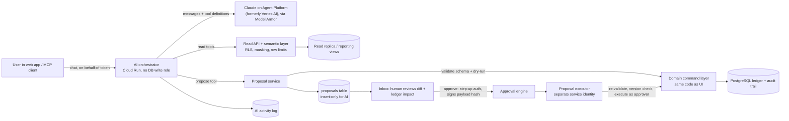
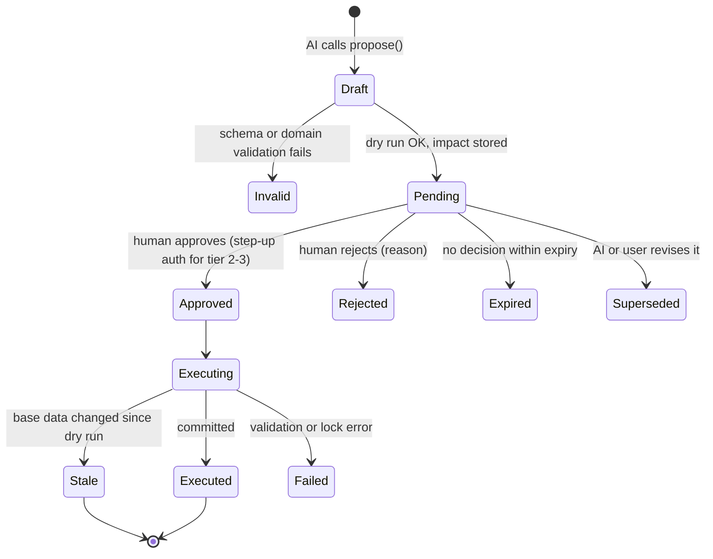
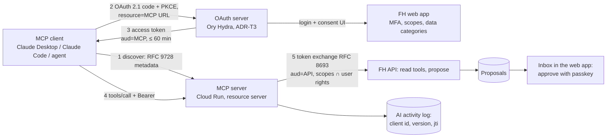
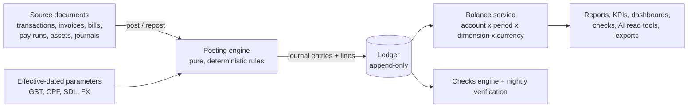
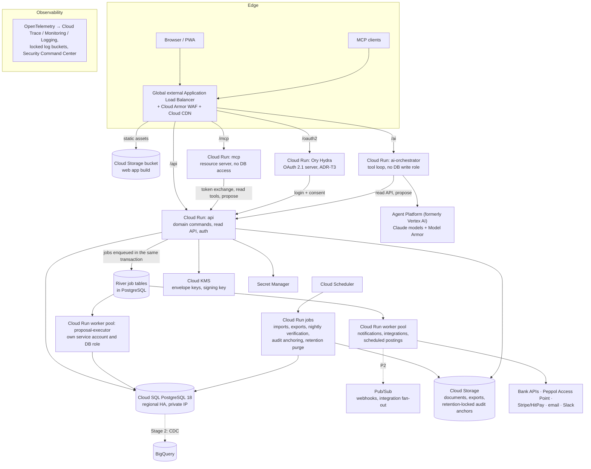

# PRD-001 · Cognizhi Finance Hub Cloud

**A web-hosted accounting, compliance, reporting and planning platform on Google Cloud.
Built for a lean founding team, with the controls a growing company needs.**

| | |
|---|---|
| Document | PRD-001 (initial PRD, greenfield) |
| Product | Cognizhi Finance Hub Cloud ("FH Cloud"; working name) |
| Status | Draft for founder review |
| Revision | 0.6 (12 Oct 2026): AI company secretary and scheduled agents (§9.12), Xero-parity features (Appendix A.3), My claims, configurable sign-in, email, notifications, banners and chat (§8.24). 0.5 (12 Oct 2026): no vectors for the knowledge base, in any phase (AI-58, ADR-T6). 0.4 (12 Oct 2026): AI context and a compiled, versioned knowledge base (§9.11, ADR-T6), after a review of Karpathy's "LLM Wiki" pattern. 0.3 (12 Oct 2026): founders' money (§8.22), equity and investors (§8.23), evidence on every important activity (§8.16), in-app help and first-run walkthrough (§7.9), and recommended defaults for every open question (§20), all at the founders' request. 0.2 applied the [review](reviews/prd-001-review-2026-10-12.md). See the revision history at the end. |
| Date | 12 Oct 2026 |
| Owner | Cognizhi founders |
| Reviewers | Founders; external accountant / tax agent; security reviewer (later: auditor) |
| Predecessor | `zh-sheet-accounting` PRD-001 "Cognizhi Finance Hub" (Zoho Sheet workbook, release 1.x). This PRD replaces the workbook with a cloud platform and keeps its accounting rules, statuses, checks and test philosophy. |
| Hosting | Google Cloud, Singapore region (`asia-southeast1`) |

**How to read this document.** §1–§4 cover the why and the what. §5 summarises the market
research. §6–§9 cover users, roles, experience, features and the AI assistant. §10–§16 cover the
accounting engine, storage and audit trail, technology, security, compliance and testing.
§12.8–§12.10 cover how the team builds, runs and releases the platform: the local mode, the
container images and the versioning. §17–§21 cover migration, phasing, risks and open questions.
The appendices hold the detailed catalogues: feature parity, posting rules, checks, permissions,
the AI task catalogue, the control registry, acceptance scenarios and the agent skills the
repository ships with (`.claude/skills/`, Appendix H).

**Requirement IDs and phases.** Requirements carry an ID (`FR-…`, `NFR-…`, `SEC-…`, `CMP-…`,
`AI-…`, `QA-…`), a priority (**M** must, **S** should, **C** could) and a phase:

| Phase | Name | Outcome |
|---|---|---|
| **P0** | Foundation | Platform skeleton: identity, tenancy, audit trail, ledger core, CI/CD, compliance-as-code baseline |
| **P1** | Replace the workbook (MVP) | Feature parity with the workbook for Cognizhi's own books, plus approvals, audit, AI chat (read) and the first AI proposal types. Parallel run, then go-live. |
| **P2** | Run the company | Bank feeds, InvoiceNow (Peppol), payroll outputs (payslips, CPF and IR8A files), expense-claim app, receipt capture, scheduled reports, customer portal, payment links, more AI task types |
| **P3** | Scale and SaaS | Multi-entity and consolidation, accountant-practice mode, multi-tenant onboarding, public API and marketplace, SOC 2 / ISO 27001 certification, XBRL |

Statements tagged **[verify]** are believed correct but must be confirmed against the official
source before they are relied on in a build. Statutory rates and dates always come from the
official source at build time (§10.6).

---

## 1. Summary

Cognizhi runs its books today in a generated Zoho Sheet workbook (the "workbook"): 42 sheets,
83 accounts, about 367,000 formulas, 37 health checks, 22 optional macros and 264 automated tests
against an independent reference ledger. It works, and its accounting rules are proven. It has
reached the limits of a spreadsheet: one file per year, no real access control or approval
workflow, no tamper-proof audit trail, no bank feeds, no e-invoicing, no automation and a ceiling
of a few thousand transactions a year.

**FH Cloud** is a greenfield web platform that keeps what the workbook got right and removes its
limits:

- **Record** in plain words, as in the workbook (money in, money out, invoice, bill, payday), with
  bank feeds, receipt capture and e-invoices doing most of the typing.
- **Account** with a deterministic double-entry engine whose invariants (balanced entries,
  immutable posted history, closed periods) are enforced by the database itself, not only by
  application code.
- **Report** live: P&L, balance sheet, cash flow, budget vs actual, AR/AP, GST F5, KPIs,
  dashboards, board packs, with drill-down from any number to its source document and its full
  change history, and exports to XLSX, PDF and CSV (XBRL later).
- **Plan**: budgets, driver-based forecasts with scenarios, 13-week cash, runway, feasibility and
  the cap table.
- **Control**: role-based access with segregation of duties, approval workflows, period locks,
  continuous health checks, a tamper-evident audit trail on every saved change, and an automated
  compliance checklist (Singapore statutory obligations, PDPA, ISO/IEC 27001, SOC 2 readiness,
  AI governance).
- **Ask and delegate to AI**: a chat assistant that answers questions from the books with cited
  figures, and that may **propose** changes but can never make them. Every AI proposal is an
  item from an approved task catalogue, is shown with its exact accounting impact, and is executed
  only after a named human approves that specific proposal.

**Key decisions** (detailed in §11 and §12):

| Decision | Choice | Main reason |
|---|---|---|
| System of record | **PostgreSQL 18** on Cloud SQL (Enterprise edition, regional HA, Singapore); Enterprise Plus or AlloyDB only when measured need arises | Exact `NUMERIC` arithmetic, multi-row ACID transactions, database-enforced ledger invariants, relational reporting, row-level security for tenancy and mature audit tooling. Firestore fails the first three (§11.2). |
| Audit trail | Append-only ledger + trigger-captured change log with a per-tenant hash chain, checkpointed hourly and at every period close to a locked (WORM) Cloud Storage bucket, signed with Cloud KMS | Tamper-evident without the operating cost of full event sourcing (§11.5) |
| Analytics | BigQuery fed by change-data-capture, introduced when reporting volume needs it | Keeps the transactional database lean (§11.7) |
| Application | **Go** services on Cloud Run (exact decimals with explicit rounding, SQL checked at build time); **React** single-page app with spreadsheet-grade grids; Typst and excelize for exports; OpenTofu for infrastructure (§12) | Lightweight, fast cold starts, cheap at low scale, scales out; one backend language for a small team |
| AI | Claude on Google Cloud's Agent Platform (formerly Vertex AI) behind our own tool layer; Singapore endpoint by default (ADR-T2); AI holds no write credential; an approval-gated proposal layer is the only write path; (rev 0.4) know-how from a compiled, versioned knowledge base, figures only from tools (ADR-T6) | "AI must never update data directly" enforced by architecture, not by prompt (§9) |
| Team model | **Founder mode** by default: 2–3 people hold several roles each, with named compensating controls; **Standard** and **Enterprise** modes enforce full segregation of duties as the team grows | Controls that fit the team today and tighten without re-platforming (§6) |
| API and integration | **API-first**: the web app uses only the public, versioned OpenAPI 3.1 API, from P1; an **OAuth 2.1 authorisation server (Ory Hydra)** issues tokens to integrations and MCP clients (ADR-T3); webhooks follow the Standard Webhooks specification | Other systems and AI agents get the same surface, contracts and controls as our own UI (§8.18) |
| MCP | A remote MCP server, **off by default**, with read tools plus `propose` only, audience-bound OAuth tokens, a client allowlist and approvals that happen only in the web app. First-party clients in P1, third-party clients in P2 (§9.7). | "MCP-ready" without opening a write path |
| Build and release | **Local mode**: the full stack runs and every merge gate passes on a laptop or in CI with no cloud credentials (ADR-T4). **Lean images**: static binaries on distroless, with size budgets enforced in CI. **Automated versioning**: SemVer from Conventional Commits via release-please (ADR-T5). | A 2–3 person team ships safely and often (§12.8–§12.10) |

---

## 2. Background: from workbook to platform

### 2.1 What the workbook proved (keep)

| Workbook practice | Carry into FH Cloud as |
|---|---|
| One row = one event, in plain words; the engine derives the double entry | Plain-language entry forms and grids, with an optional accountant view showing debits and credits (FR-UX-08) |
| Invalid rows never post; every failure has a plain-English status (✔ ⚠ ✖ ⏰ ✎) | The same status vocabulary on every record, with validation that blocks posting (✖) or asks for acknowledgement (⚠) (§10.5) |
| A single source of truth: every report reads the trial balance | Every report reads the ledger through one balance service; reports cannot disagree (§10.2) |
| 37 automatic health checks with a books-health status | A continuous Checks engine with the same 37 checks plus new ones, running on every change and nightly (Appendix C) |
| Period lock with Close Log checksums | Period close workflow, database-enforced locks, signed period snapshots (§8.8, §11.5) |
| Posting rules implemented independently in four places that must agree | An engine plus an **independent reference ledger** used in differential tests, plus database invariants (§10, §16) |
| Every visible calculated number verified by a test; every status triggered by an edge-case data set | The same two coverage gates for every report API and every validation message (§16) |
| Pinned, hand-calculated payroll figures guard the statutory rates | Pinned statutory tests per rate table and effective date (§16.4) |
| Singapore defaults, all configurable on Settings | Effective-dated statutory parameter tables with source and approval (§10.6) |
| Layman-first UX: drop-downs, notes, statuses that say what to do | A design principle with acceptance criteria (§7) |
| Generated from code, reviewed and tested before release | Everything as code: application, schema migrations, infrastructure, controls (§12, §14) |

### 2.2 What the workbook could not do (fix)

| Workbook limitation (workbook PRD §3.2, §16.2) | FH Cloud requirement |
|---|---|
| One file per financial year; capacity of a few thousand rows | One continuous ledger across years; designed for millions of lines per tenant (NFR-SCALE) |
| File-level sharing only; protection is not security | Authenticated users, MFA, roles, field-level masking, segregation of duties (§6, §13) |
| No approvals | Approval engine with amount thresholds and dual control (FR-CTL) |
| Version history and an optional macro log are the only audit trail | Tamper-evident audit trail on every change, AI actions included (§11.5) |
| Statutory rates are not date-effective; a change recalculates closed months | Effective-dated parameters picked by transaction date (§10.6) |
| CPF additional-wage ceiling and PR graduated rates not automated | Implemented (FR-PAY) |
| Unrealised FX is a memo only | Month-end revaluation postings with automatic reversal (FR-GL) |
| Budget at P&L-line level only; no department or tag P&Ls | Budgets and reports by account and by any dimension (FR-DIM, FR-PLN) |
| Bank import: one account per batch, paste only, no feeds | Multi-account import (CSV, OFX, CAMT.053, MT940), then bank feeds (FR-BNK) |
| No InvoiceNow (Peppol), no IRAS filing, no payslips, no CPF or IR8A files | P2 scope (FR-TAX, FR-PAY, FR-AR) |
| Macros run on demand; nothing is scheduled | Scheduler and event automation (FR-AUT) |
| Single entity | Multi-entity and consolidation (P3) |
| Non-breaking spaces in a reference break matching | Unicode normalisation of every reference and name before matching (FR-BNK-07) |
| Reminder links limited by spreadsheet hyperlink length | Reminders sent by the platform (FR-AR-08) |

### 2.3 Assumptions carried over

Cognizhi is a Singapore private limited company with SGD as base currency. It sells AI software
subscriptions plus consulting and AI project work. It may or may not be GST-registered at go-live.
Its staff may include Singapore Citizens and PRs (CPF) and foreigners (SDL only). The founders
are not accountants; an external accountant or tax agent reviews the books and prepares filings.
See §20 for the full list.

---

## 3. Vision, principles and what the cloud unlocks

### 3.1 Vision

*The finance back office a founder actually enjoys opening: always correct, always current,
explains itself, does the routine work for you, and never acts without a human's say-so.*

### 3.2 Product principles

1. **Correct by construction.** No floating-point money anywhere. The database refuses an
   unbalanced entry, a posting into a closed period and an edit of posted history, whatever the
   application does. Every figure is reproducible from the ledger.
2. **Never silently wrong.** Anything that cannot post says so, in plain words, and tells you how
   to fix it. Checks run continuously and the health status is always visible.
3. **Everything is traceable.** Any number drills down to ledger lines, then to the source
   document, then to every change ever made to it: who, when, what, why, and who approved it.
4. **Humans decide; AI proposes.** AI reads, explains, drafts and suggests. It changes data only
   through proposals that a named human approves one at a time, from a catalogue of permitted task
   types.
5. **Layman-first, accountant-proof.** Plain words and guided flows for founders (**Basic
   mode**), with full double-entry views, journals and audit evidence for accountants and
   auditors (**Expert mode**). One toggle switches between them; the data, rules and permissions
   are the same in both (§7.8).
6. **Controls that fit the team.** Founder mode for 2–3 people today; full segregation of duties
   when the team grows. Switching mode is a setting, not a migration.
7. **Singapore first, country-pluggable.** GST, CPF, SDL, SHG, IRAS and ACRA rules ship as
   effective-dated packs. Other countries are new packs, not new code paths.
8. **Tenant-ready from day one.** Every row belongs to an organisation and is protected by
   row-level security, even while Cognizhi is the only tenant.
9. **Lightweight and frugal.** Scale to zero where possible, pay for capacity only when it is used,
   and keep the operating burden within what two or three people can run.
10. **Everything as code.** Application, schema, infrastructure, statutory parameters, controls
    and their evidence are versioned, reviewed and tested.
11. **API-first, agent-ready.** Every capability is an API before it is a screen. The web app is
    one client of the public API. Contracts (OpenAPI, event schemas, tool schemas) are written for
    human developers and AI agents alike. Agents always go through the proposal layer.
12. **Runs on a laptop.** One command starts the whole platform with the sample company, and one
    command runs every merge gate, with no cloud account and no network access beyond package
    downloads.

### 3.3 What hosting in the cloud unlocks

The spreadsheet could not do any of these. They shape the architecture now even where they ship
later.

| Capability | What it gives Cognizhi | Phase |
|---|---|---|
| Real-time collaboration | Several people work at once, with comments, @mentions, record-level history and no file conflicts | P1 |
| Approvals and segregation of duties | Payments, bills, journals and payroll approved by the right person, with evidence | P1 |
| Tamper-evident audit trail | Investor, auditor and IRAS-ready evidence for every change | P1 |
| AI assistant and MCP server | Ask the books anything; let AI prepare work for approval; use the same tools from Claude Desktop or Claude Code | P1 (in-app; MCP for first-party clients) → P2 (third-party MCP clients) |
| Automation and scheduling | Recurring documents, reminders, depreciation, accruals, FX rates and month-end tasks run by themselves | P1–P2 |
| Bank feeds and payment initiation | Transactions arrive daily; payment batches go to the bank; PayNow QR on invoices | P2 |
| E-invoicing (InvoiceNow / Peppol) | Send and receive structured invoices; required for some GST registrants | P2 |
| Government integrations | GST F5 filing, IRAS Audit File, CPF and IR8A submission files | P2 |
| Document intelligence | Bills and receipts emailed or photographed, read automatically and matched | P2 |
| Self-service portals | Employees: claims and payslips. Customers: invoices, statements, pay online. Investors: board pack. | P2 |
| Continuous close and continuous controls monitoring | Books close in days, not weeks; exceptions surface the day they happen | P2 |
| Analytics at scale | Cohorts, unit economics, anomaly detection, benchmarks on BigQuery | P2–P3 |
| Multi-entity, consolidation, intercompany | New subsidiaries (e.g. overseas) without a new system | P3 |
| Accountant-practice mode and SaaS | Serve other start-ups; a possible product line | P3 |
| Open API, webhooks, integrations marketplace | Stripe, CRM, HR, Google Workspace, Slack and others; any system or AI agent can integrate through documented contracts | P1 (public API, used by our own UI) → P2 (third-party clients, webhooks) → P3 (marketplace) |

---

## 4. Goals, non-goals and success metrics

### 4.1 Goals

| # | Goal |
|---|---|
| G1 | Replace the workbook for Cognizhi's own books with at least feature parity (Appendix A) and no unexplained difference in the trial balance during the parallel run (§4.3). |
| G2 | Calculations with zero tolerance for error: deterministic, exact-decimal, invariant-enforced, verified by differential and coverage testing (§10, §16). |
| G3 | A strong audit trail on every saved change, tamper-evident and retained for at least the statutory period (§11.5, §14). |
| G4 | Roles that follow standard finance practice, operable by 2–3 founders today and by a finance team later (§6). |
| G5 | Navigation and data entry a non-accountant finds easy; a modern look with light and dark themes (§7). |
| G6 | An AI assistant that answers from the books with citations and can only change data through human-approved proposals from an approved task catalogue (§9). |
| G7 | Singapore compliance built in and checked automatically: GST, InvoiceNow, CPF, SDL, SHG, IRAS, ACRA, PDPA (§14). |
| G8 | Security and assurance that can grow into CSA Cyber Trust, ISO/IEC 27001 and SOC 2 (§13, §14). |
| G9 | Low cost and low operating burden at Cognizhi's scale, with a path to multi-tenant SaaS without re-platforming (§12). |

### 4.2 Non-goals (P1)

- Inventory quantities and stock costing (FIFO or weighted average). Items remain a price list.
  Revisit if Cognizhi sells physical goods.
- Multi-entity consolidation (P3; the data model is ready for it from P0).
- Acting as a payment institution or holding customer funds. Payments are initiated through banks
  or licensed providers; the platform never stores card data.
- Statutory audit services or tax advice. The platform prepares figures and files; the
  accountant or tax agent remains responsible for filings.
- (rev 0.3) Company secretarial work. FH Cloud records share issues and directors' balances
  (§8.22), keeps the resolutions and lodgement evidence, and tracks the deadlines; the register of
  members, share certificates and ACRA lodgements stay with the company secretary.
- Native mobile apps. P2 ships a responsive progressive web app (PWA) for approvals, receipts and
  dashboards.
- Fully autonomous AI bookkeeping. Autonomy is limited by design (§9).

### 4.3 Success metrics

| Metric | Target |
|---|---|
| Trial balance difference vs the workbook during the parallel run | S$0.00 on every account and month, except the documented cent allocation of spreads and depreciation (`ALLOC-EVEN`, §10.4): those differ from the workbook's unrounded monthly values by less than S$0.01 per month and match exactly over each schedule |
| Calculation defects reaching production | 0 per quarter (any one is a P1 incident with a root-cause review) |
| Month-end close effort (≤ 300 bank lines a month) | ≤ 30 minutes in P1; ≤ 2 working days to a reviewed close in P2 |
| Bank lines categorised automatically (rules + AI proposals approved without edits) | ≥ 80% by end of P2 |
| Checks status at each close | Zero ✖; every ⚠ explained |
| Audit trail integrity verification | 100% of daily hash-chain anchors verified; 0 gaps |
| Time for a new user to record a first transaction | ≤ 5 minutes, no training |
| Report and page performance | p95 page load ≤ 1.5 s; p95 standard report ≤ 2 s at 1 million ledger lines |
| AI answer accuracy on the golden question set | 100% of numeric answers match the ledger (numbers must come from tools); ≥ 95% rated helpful |
| AI proposals executed without an approval record | 0 (a control test fails the build and pages on-call if this is ever non-zero) |
| Platform availability (business hours SGT) | ≥ 99.9% monthly |
| Infrastructure cost at Cognizhi's own scale | Within the budget set in §12.6 |

---

## 5. Market research: what we absorb

Research date: 12 Oct 2026. About 30 products in 7 categories were studied from vendor
documentation, help centres, pricing pages, government sites and trade press. Sources are in
Appendix I. Vendor features change quickly; treat this as a snapshot.

### 5.1 Landscape

| Category | Products studied | What they do best | Relevance |
|---|---|---|---|
| SMB accounting | Xero, QuickBooks Online, Zoho Books (SG), Odoo 19 | Bank feeds and rules, invoicing, SG GST F5 and InvoiceNow, app ecosystems; all now ship AI agents | Baseline parity; their gaps are our openings |
| Mid-market ERP | NetSuite, Sage Intacct, Microsoft Dynamics 365 Business Central | Dimensions, multi-level approvals, multi-entity, role design, agent identities | Controls and data-model patterns for P2–P3 |
| Close and reconciliation | Numeric, FloQast, BlackLine | Close checklists, flux analysis, reconciliation packages, AI-prepared work for sign-off | Close workflow and reviewer experience |
| AI-native ledgers | Digits, Puzzle, Rillet, Campfire, Light, Basis, Pennylane, Doss, Kick | Real-time books, auto-categorisation, accrual proposals, drill-down, keyboard-first UX | Experience bar and AI patterns |
| Spend and banking | Ramp, Brex, Mercury, Aspire (SG), Pleo, Spendesk | Policy agents, bill capture, approvals by amount, exception-first review | AP, claims, approvals |
| FP&A | Runway/cfo.ai, Pigment, Abacum, (Mosaic, Causal, Fathom, Jirav) | Scenarios, plan vs actual, AI-drafted board decks | Planning module |
| Singapore payroll and services | Talenox, Swingvy, JustLogin, Osome, Sleek, Financio | CPF/SDL/SHG/FWL, CPF submission file, IR8A via AIS, IRAS Audit File | Statutory scope; build vs buy for payroll |

### 5.2 What we absorb

| Module | Pattern (seen in) | FH Cloud requirement |
|---|---|---|
| Home | **One "needs attention" inbox** for AI work, unmatched lines, approvals, close tasks and deadlines; the home page shows work, not only charts (QuickBooks Business Feed) | FR-UX-03, §7.1 Inbox |
| Home | **Exception states** on every item (OK / needs attention / unknown) so founders review only exceptions (Pleo) | FR-UX-09 status chips |
| Banking | Deterministic **bank rules** first, AI for the rest; rules apply forward and can be back-tested (Mercury, Xero) | FR-BNK-05 |
| Banking | **Suggested matches with confidence and bulk confirm** (Xero JAX) | FR-BNK-06, AI `bank.match_payments` |
| Banking | **PayNow**: static UEN QR on invoices now; dynamic per-invoice QR through a provider later (HitPay, Stripe) for automatic reconciliation | FR-AR-13 |
| Banking | Direct bank APIs exist (DBS RAPID, UOB API); SGFinDex covers individuals only and is not an option | FR-BNK-03 |
| Sales | **Posted documents are immutable; corrections via credit note or void-and-replace** (Xero API edits drafts only) | FR-GL-12 |
| Sales | **InvoiceNow (Peppol)** data model from day one: Peppol ID against the UEN, PINT-SG documents, transmission through an IMDA-accredited Access Point's API | FR-CT-01, FR-AR-12, FR-AP-05 |
| Purchases | **Document inbox → draft bill** via OCR; never auto-posted (Business Central Payables Agent "doesn't post purchase invoices") | FR-AP-04, AI `ap.draft_bill` |
| Purchases | **Bill approvals by amount, vendor and account, in sequential levels** (Zoho Books) | FR-APR-01 |
| Purchases | **Fraud flags on changed supplier bank details and new suppliers** (Xero Bill Protection) | FR-CT-03, Check C.2 #11 |
| Payroll | **Statutory rates as effective-dated data**; CPF submission as a file (Talenox does the same; no public CPF API was found) | ENG-30, FR-PAY-09 |
| GL and close | **Two lock levels** (everyone vs everyone except advisers) and an **exceptions report** for postings near the lock date (Xero, QuickBooks) | FR-GL-08/09 |
| GL and close | **Close checklist with preparer and reviewer sign-off** (Numeric) and **flux / variance commentary per line** (Sage Intacct Close Automation) | FR-GL-07, FR-GL-14 |
| GL and close | **Dimensions without a small fixed cap** (a common complaint: Xero allows two active tracking categories) | FR-DIM-01 |
| GL and close | **Journal outlier detection before approval** (Sage Intacct GL Outlier Detection) | FR-KPI-06, AI review lane |
| Tax | **GST F5 drill-down to transactions and IRAS Audit File export** (Financio) | FR-TAX-02/04 |
| Reporting | **Drill-down from every number to its source** (Campfire) | FR-UX-04 |
| Reporting | Scheduled report emails (Zoho); report builder over dimensions (Sage Intacct); AI first draft of the board pack (cfo.ai) | FR-RPT-04/06/07 |
| Planning | Base / upside / downside scenarios and short-term cash forecasts (Xero 30/60/180-day forecast) | FR-PLN-02/05 |
| Integrations | **MCP read access scoped by role, none by default, never with admin roles** (NetSuite) | AI-15/16 |
| AI | **Answers only from data the user may see** (Abacum); **rationale and cited evidence on every proposal** (Ramp, Basis) | AI-01, §9.5 |
| AI | **Agent as its own principal, attributed in the audit log** ("Jane Doe via Intuit Intelligence" in QuickBooks; Business Central's agent user) | AI-10, AI-12, AUD-01 |
| Controls | **Field-level before/after history, exportable** (Xero is criticised for lacking export); **audit log that cannot be turned off** (QuickBooks) | AUD-01…07 |
| UX | **⌘K command palette with bulk actions**, "G then" navigation keys, **spreadsheet-style grids** with Tab, fill-down, paste and `=` arithmetic (Kick) | FR-UX-01/06/07 |
| UX | **Real-time books**, no batch posting (Digits) | ENG-02 |

### 5.3 How the market governs AI writes

| Tier | Pattern | Examples (Oct 2026) |
|---|---|---|
| T0 | Read-only | Sage Intacct Finance Intelligence Agent; Abacum Ask AI |
| T1 | Suggests inline; the user accepts | QuickBooks category suggestions; Campfire; Sage outlier flags |
| T2 | Drafts; a person approves before it posts | Business Central Payables Agent; Puzzle ("nothing posts to the ledger without your approval"); Mercury Command; Aspire MCP ("You confirm anything that changes") |
| T3 | Acts on its own within admin rules | Ramp Policy Agent (auto-approve below an amount); Brex auto-pilot (on by default); Digits (auto-books > 90%); Light; FloQast |
| T4 | Writes with no approval step | Official MCP servers of QuickBooks and Xero (write tools on by default); NetSuite MCP within the user's role; Numeric (posts journals directly); Zoho Ask Zia; Odoo AI server actions |

**Mechanisms worth copying**

1. **The agent has its own identity** and never exceeds the requesting user (Business Central,
   NetSuite, Aspire, Mercury).
2. **Scope by task type** (Odoo's "Use in AI" actions, NetSuite roles per tool, Ramp's
   allow/don't-allow per automation): the nearest analogue of our catalogue.
3. **Approving the AI's work is separate from the business approval** (Business Central): an
   AI-drafted bill that a human accepts still goes through bill approval and payment controls.
4. **Anything that reaches outside parties needs a person** (QuickBooks Custom Automations:
   emails, payments, e-invoices).
5. **Show reasoning and evidence** (Ramp: "rationale and cited policy text"; Basis cites
   evidence for conclusions).
6. **Label AI actions in the audit log** (QuickBooks, Business Central, Light).
7. **Measure approval quality** to guard against rubber-stamping, as Singapore's Model AI
   Governance Framework for Agentic AI (IMDA, Jan 2026, updated May 2026) asks: limits on agents'
   powers, "significant checkpoints at which human approval is required", and audits of how
   effective those approvals are.

### 5.4 Where FH Cloud is different

| Gap in the market | FH Cloud |
|---|---|
| **No vendor publishes a typed catalogue of AI task types where every AI write needs a human approval.** The approval layer usually covers only the agents the vendor chose to put behind a review step; the official MCP servers of the two largest SMB ledgers write directly. | Catalogue + per-proposal approval + no AI write credential (§9) |
| **No real undo of AI actions** anywhere (one vendor offers backup/restore; another claims "reversible" without detail) | One-click, audited reversal of an executed proposal while its period is open (AI-31) |
| **No dark mode on the web** in Xero, QuickBooks Online or Zoho Books (confirmed Oct 2026) | Light, dark and system themes from P1 (§7.4) |
| Spreadsheet-grade data entry is rare outside Kick | Grids with paste, fill-down and `=` arithmetic (FR-UX-07) |
| Founder-sized segregation of duties is not a concept anywhere | Founder mode with named compensating controls (§6.4) |
| Singapore depth (CPF/SDL/SHG, F5, IAF, InvoiceNow, AIS) usually needs two or three products (ledger + payroll + Peppol app) | One platform, with "buy" integrations where licensing requires (Peppol Access Point, bank APIs) |

### 5.5 Build vs buy

| Capability | Decision | Rationale |
|---|---|---|
| Ledger, AR/AP, GST, reporting, planning, controls, AI layer | **Build** | Core of the product; the workbook's proven rules |
| Peppol transmission | **Buy**: an IMDA-accredited Access Point's API | Accreditation is required to transmit |
| Bank connectivity | **Buy / partner**: bank APIs (DBS RAPID, UOB) or an aggregator; statement import as the always-available fallback | Bank onboarding and licences |
| Card and online payments | **Buy**: Stripe or HitPay | PCI scope and licensing |
| OCR / document extraction | **Buy**: Google Document AI or the model's PDF input | Commodity; quality improves without us |
| Payroll | **Build calculations (P1)**; revisit buying (e.g. Talenox) if statutory outputs (payslips, CPF file, AIS) cost more to maintain than to integrate | The workbook already calculates payroll; outputs are the costly part |
| Compliance automation | **Build the control registry**; consider a compliance-automation tool when pursuing ISO 27001 / SOC 2 (§14) | Evidence collection at certification time |

**Pricing context** (what a start-up pays elsewhere, Oct 2026): Xero S$70–95 a month (rising
1 Nov 2026); Zoho Books SG S$30–54 a month; Talenox payroll S$4.36–7.63 per employee a month
(minimum 5); Financio S$20–30 a month. A SaaS version of FH Cloud would compete in the S$50–150
a month band for small companies, with practice pricing for accounting firms.

---

## 6. Users, roles and team modes

### 6.1 Personas

| Persona | Who | Needs | Main areas |
|---|---|---|---|
| P1 Founder / CEO | Decides, fundraises, approves | Cash, burn, runway, approvals in one place, board pack, "what if" | Home, Inbox, Dashboards, Planning |
| P2 Operating founder / bookkeeper | Non-accountant who records and categorises weekly | Know what to do next; fix problems in plain words; little typing | Inbox, Banking, Sales, Purchases |
| P3 External accountant / tax agent | Monthly or quarterly review, year end, filings | Trial balance, GL, journals, GST working papers, audit evidence, exports | Accounting, Reports, Tax |
| P4 Investor / board member | Reads the numbers | Monthly pack, KPIs, cap table | Board portal |
| P5 Employee | Spends company money, gets paid | Submit claims from a phone, see payslips | Employee self-service |
| P6 Auditor | Statutory or due-diligence review | Read-only access to everything relevant, audit trail, evidence exports, time-boxed | Auditor workspace |
| P7 Future finance hire (controller, AP/AR specialist) | Runs finance day to day | Queues, bulk tools, approval routing, close checklist | All finance areas |
| P8 AI assistant (non-human) | Acts for a signed-in user | Read access within that user's permissions; propose only | Chat, Inbox (proposals) |

### 6.2 Standard finance roles

Roles follow common finance practice (maker–checker, segregation of preparation, approval,
payment, reconciliation and administration). A user may hold several roles; the team mode
(§6.4) decides which combinations are allowed.

| Role | Can | Cannot (in Standard mode) |
|---|---|---|
| **Owner** | Everything in Administrator plus subscription, data export of the whole tenant, break-glass, closing the organisation | — (every Owner action is dual-controlled and audited) |
| **Administrator** | Users, roles, team mode, approval policies, integrations, settings | Post or approve financial transactions |
| **Finance controller / CFO** | Approve journals, bills and payments above thresholds; close and reopen periods (with a second approver); approve statutory parameter changes; sign off reconciliations | Release payments they prepared |
| **Accountant** | Prepare and post journals within limits; reconciliations; accruals, prepayments, FX revaluation; fixed assets; tax working papers | Approve own journals above the threshold; close periods |
| **Bookkeeper** | Record transactions; categorise bank lines; draft invoices and bills; attach documents; manage bank rules | Approve; post journals; change vendor bank details |
| **AR specialist** | Quotes, orders, invoices, credit notes, reminders, customer statements, apply receipts | Write off receivables above limit; approve credit notes above limit |
| **AP specialist** | Purchase orders, bills, vendor credits, prepare payment batches | Approve bills; release payments; change vendor bank details without a second approver |
| **Payroll administrator** | Employees, pay runs, CPF/SDL/SHG, payslips, IR8A | Approve own pay run; release salary payments |
| **Payment releaser (treasury)** | Release approved payment batches to the bank; manage bank connections | Create or approve the payments they release |
| **Approver (budget holder)** | Approve POs, bills, claims within their department and limits | Anything outside their department or limit |
| **Employee** | Submit expense claims and receipts; see own payslips and claims | See anyone else's data |
| **Auditor (external)** | Read everything in scope, the audit trail and evidence; export; time-boxed access with an expiry date | Any change; payroll personal data unless explicitly granted |
| **Tax agent / external accountant** | Accountant rights plus GST and tax working papers; time-boxed | User administration |
| **Board / investor viewer** | Board pack, dashboards, cap table (as granted) | Transaction-level data unless granted |
| **Super admin** (rev 0.6) | Installation-wide settings: sign-in providers, email and messaging connections, announcements to everyone, platform health (FR-ADM-06/07) | Read an organisation's books without being a member; act alone once a second Super admin exists |
| **Company secretary** (rev 0.6) | Corporate profile, registers, equity register, AI company secretary runs and drafts, evidence, filing records (FR-CS-08) | Transactions, payroll or bank detail unless granted |
| **Compliance officer / DPO** | Compliance Center, control evidence, audit trail, data-subject requests, retention holds | Post or approve transactions |
| **AI assistant** (non-human principal) | Read within the delegating user's permissions minus AI exclusions (§9.4); create proposals from the approved task catalogue | Execute, approve or reject anything; hold a write credential |
| **Integration** (service principal) | Narrow, scoped API rights for one integration (bank feed, Peppol access point, Stripe) | Anything outside its scope |

**Permission model.** Role-based access control plus attribute conditions (organisation, entity,
department, amount, document type, data sensitivity). Field-level masking for sensitive fields
(salaries, NRIC/FIN, full bank account numbers, personal addresses). Permissions are checked in
the API layer and again by database row-level security. The full matrix is Appendix D.

### 6.3 Segregation-of-duties (SoD) conflicts

| # | Conflict (the same person must not do both) | Why |
|---|---|---|
| SOD-1 | Create or change a vendor's bank details **and** approve or release payments to that vendor | Payment fraud |
| SOD-2 | Prepare a payment batch **and** release it | Payment fraud |
| SOD-3 | Prepare a journal above the threshold **and** approve it | Misstatement |
| SOD-4 | Prepare a pay run **and** approve it or release salary payments | Payroll fraud |
| SOD-5 | Record bank transactions **and** sign off the bank reconciliation | Concealment |
| SOD-6 | Administer users or roles **and** post or approve transactions | Privilege abuse |
| SOD-7 | Close a period **and** reopen it alone | Tampering with reported results |
| SOD-8 | Propose a change to the AI task catalogue or approval policies **and** approve it | Weakening controls |
| SOD-9 | Write off a receivable **and** receive cash from that customer | Teeming and lading |
| SOD-10 | Change statutory parameters (GST, CPF rates) **and** approve the change | Silent mis-statement |

### 6.4 Team modes

| Mode | Team | SoD | Default |
|---|---|---|---|
| **Founder mode** | 1–3 people, all founders | Conflicts allowed **with compensating controls** (below) | ✔ for Cognizhi at go-live |
| **Standard mode** | 4–15 people, some finance staff | Conflicts blocked; an override needs a reason and a second approver and is reported | |
| **Enterprise mode** | 15+ people or several entities | Conflicts blocked; approval matrices per entity and department; SSO and SCIM; quarterly access reviews | |

**Founder mode: compensating controls (all mandatory).**

| # | Control | Mechanism |
|---|---|---|
| FM-1 | **Two-person rule for high-risk actions**, regardless of amount: releasing payments, adding or changing payee bank details, approving a pay run, reopening a period, changing roles, policies or the AI task catalogue, changing statutory parameters, voiding a posted document, editing opening balances; (rev 0.3) repaying, converting or waiving a director's balance and recording a share issue (FR-EQ-05…08) | Approval engine requires a second founder. Step-up authentication (passkey or TOTP) for both. |
| FM-2 | **Self-approval below a threshold** for routine items (default S$2,000 per document; configurable) | Allowed, but flagged "self-approved" and queued for review |
| FM-3 | **Weekly review** of the self-approved and high-risk log by another founder | Inbox task; unreviewed items older than 14 days show ⚠ on Checks |
| FM-4 | **Monthly close attestation** signed by a founder who did not prepare the close | Part of the close checklist; the close cannot complete without it |
| FM-5 | **Independent bank reconciliation evidence**: statement balances come from the bank feed or an uploaded statement, never typed | Reconciliation refuses typed balances in Founder mode |
| FM-6 | **AI anomaly review** of journals, vendor changes and payments (advisory) | AI flags unusual items into the weekly review; it never approves |
| FM-7 | **Accountant review** at least quarterly, with read access to the full audit trail | Time-boxed accountant access; review sign-off recorded |
| FM-8 | **Break-glass for a single available founder** (e.g. the other is unreachable) | Owner break-glass with reason, 24-hour expiry, automatic notification and mandatory post-review |
| FM-9 | (rev 0.3) **A founder never approves the settlement of their own balance**: repaying, converting or waiving a founder's balance needs another founder's approval; when every available approver benefits (for example, all founders convert together), the external accountant's recorded review is also required before posting | The approval engine excludes the beneficiary and adds the accountant step automatically; resolutions attached (FR-EQ-05, FR-EQ-06) |

**Mode switching.** Switching mode is dual-controlled and audited. On a switch to Standard mode,
the platform lists every user whose role combination now conflicts and blocks the switch until
the conflicts are resolved or explicitly overridden.

### 6.5 Approval engine

| ID | Requirement | Pri | Phase |
|---|---|---|---|
| FR-APR-01 | Approval policies per object type (bill, payment batch, journal, pay run, expense claim, PO, credit note, write-off, vendor bank change, period reopen, parameter change, role change, AI proposal; (rev 0.3) director-balance settlement and share issue, FR-EQ-05/08) with conditions (amount, entity, department, account, vendor, risk tier) and ordered steps (role or named user, quorum) | M | P1 |
| FR-APR-02 | The approver sees exactly what is approved: the document, the ledger impact (debits and credits), affected balances and checks, and a diff against the previous version | M | P1 |
| FR-APR-03 | Each approval is a signed record: approver, time, method of authentication, and a SHA-256 hash of the approved payload. For passkey users the WebAuthn challenge includes that hash, so the approval is a cryptographic signature over exactly what was approved. Executing a payload whose hash differs from the approved hash is impossible. | M | P1 |
| FR-APR-04 | Step-up authentication (passkey or TOTP) for high-risk approvals | M | P1 |
| FR-APR-05 | Approvals expire (default 7 days) and become invalid if the underlying record changes | M | P1 |
| FR-APR-06 | Delegation of approval authority with a start and end date (e.g. during leave), audited | S | P2 |
| FR-APR-07 | Approve or reject from the Inbox, from email (secure link plus sign-in) and from the mobile PWA | S | P1 (web) / P2 (email, PWA) |
| FR-APR-08 | Escalation and reminders for pending approvals | S | P2 |
| FR-APR-09 | Approval policy changes are themselves approval-gated (SOD-8) and versioned | M | P1 |

---

## 7. Experience: navigation, UX and visual design

The workbook taught that founders succeed when the tool tells them what to do next. FH Cloud
turns that into an **inbox-driven, keyboard-first, drill-anywhere** experience with a modern
visual identity.

### 7.1 Information architecture

Top-level navigation (left sidebar, collapsible to icons with labels in tooltips; at most 13
(rev 0.3; 12 before Equity)
items, grouped by job, not by accounting jargon; feature-switched items are hidden when the
feature is off, FR-ORG-06):

| Item | Contains | Badge |
|---|---|---|
| **Home** | Role-aware "Today": cash, runway, books health, to-dos, upcoming deadlines, AI suggestions | — |
| **Inbox** | Everything waiting for me: approvals, AI proposals, items that cannot post (✖), items to review (⚠), mentions, compliance tasks; the **AI tasks** page (catalogue and proposal history, §9.6) | Count |
| **Sales** | Quotes and orders, invoices, credit notes, receipts, statements, recurring invoices, items | Overdue count |
| **Purchases** | Purchase orders, bills (rev 0.6: bills board and calendar, FR-AP-13), vendor credits, payment batches, expense claims (all users' claims, for approvers and AP) | Due count |
| **Contacts** | Customers and vendors (one list, filterable by role), balances, activity, bank-detail changes | — |
| **Banking** | Bank and card accounts, feeds and imports, categorise, match, rules, transfers, reconciliations | Uncategorised count |
| **Payroll** | Employees, pay runs, CPF/SDL/SHG, payslips, IR8A | Due status |
| **Projects** (feature-switched) | Projects, timesheets, profitability | Over-budget count |
| **Accounting** | Journals, chart of accounts, dimensions, fixed assets, accruals and schedules, FX, period close, year end, director accounts and share issues (rev 0.3, §8.22) | Close status |
| **Reports** | Financial statements, management reports, tax reports, saved and scheduled reports, board pack | — |
| **Planning** | Budgets, forecasts and scenarios, 13-week cash, feasibility, funding plan (rev 0.3: the cap table moved to Equity) | — |
| **Equity** (feature-switched; rev 0.3) | Who owns the company (cap table, issued and fully diluted), shareholders and investors, share classes, share issues and transfers, SAFEs and notes, option pool, round simulator, investor updates (§8.23) | ACRA tasks due |
| **Compliance** | Statutory calendar, GST returns, filings, Compliance Center (controls and evidence), audit trail explorer, (rev 0.6) the **AI company secretary** (runs, findings, drafts, schedule; §9.12) | Due count |
| Settings (footer) | Organisation, users and roles, team mode, approval policies, AI settings and task catalogue, **connected apps** (API and MCP clients, §9.7), integrations and webhooks, statutory parameters | — |

(rev 0.6) **Personal section**, at the top of the sidebar for every user and not counted in the cap:
**My claims** (FR-AP-14), "Money I put in" for directors (FR-EQ-14) and, from P2, **My payslips**.

The **AI assistant** is not a navigation item. It is a persistent side panel (⌘J / Ctrl+J, and
the "Ask about this" action of FR-UX-17), available on every page and carrying the page's
context.

The list above is **Expert mode**. **Basic mode** (§7.8) shows a shorter list of the essentials;
the user switches with one toggle in the header.

### 7.2 Navigation requirements

| ID | Requirement | Pri | Phase |
|---|---|---|---|
| FR-UX-01 | **Command palette** (⌘K / Ctrl+K): go to any page or record, create anything ("new invoice for Acme"), run a report, change theme, or hand the query to the AI assistant (Tab). Fuzzy search, recent items first. | M | P1 |
| FR-UX-02 | **Global search** across documents, contacts, accounts, amounts ("1,234.56", "> 5k"), references and notes, with type filters and keyboard navigation | M | P1 |
| FR-UX-03 | **Inbox triage**: keyboard shortcuts (J/K move, A approve, R reject, E open, ? help), bulk actions where safe, grouping by type and due date. **A opens the approval confirmation** (with step-up where FR-APR-04 requires it) and never approves directly; tier-2/3 AI proposals and FM-1 actions cannot be bulk-approved (rev 0.2) | M | P1 |
| FR-UX-04 | **Drill-down everywhere**: any figure in any report or tile opens its breakdown, then ledger lines, then the source document, then its history ("Trace" panel). Breadcrumbs keep the report context; Back returns to the same scroll position and filters. | M | P1 |
| FR-UX-05 | **Side-peek panels**: open a record over the current list without losing place; split view for matching (bank line ↔ invoice) | M | P1 |
| FR-UX-06 | **Keyboard-first entry**: shortcuts for every create action (e.g. `C I` new invoice), "G then" navigation keys (e.g. `G B` Banking), Enter-to-next-field, bulk actions on selected rows from the command palette, a shortcut sheet on `?`. **Single-character shortcuts can be turned off and remapped per user** (WCAG 2.1 SC 2.1.4, Level A) and never fire while focus is in a text field (rev 0.2) | M | P1 |
| FR-UX-07 | **Spreadsheet-like grids** for bulk work (journal lines, bank categorisation, budgets, opening balances, imports): paste from Excel or Google Sheets, fill down, multi-cell edit, `=` arithmetic in amount cells, undo/redo, inline validation with status chips, virtualised to 100,000 rows | M | P1 |
| FR-UX-08 | **Plain view / Accountant view** toggle per user: "Money in / Money out / Category" vs "Debit / Credit / Account"; both show the same data. Available in Expert mode; Basic mode always uses Plain view (§7.8). | M | P1 |
| FR-UX-09 | **Status chips** in the workbook vocabulary: ✔ OK · ⚠ included, please review · ✖ cannot post until fixed · ⏰ due or overdue · ✎ draft · 🔒 locked period. Each chip's tooltip says what is wrong and how to fix it, with a "Fix it" action where possible. **In the UI, each chip is an SVG icon from the single icon set (§7.4) plus a text label**; the workbook symbols stay in CSV, plain-text email and exports, where users know them. Colour never carries meaning alone. (Rev 0.2: replaces "icons are BMP symbols"; 🔒 is outside the BMP and emoji render differently per OS.) | M | P1 |
| FR-UX-10 | **Guided set-up**: a checklist (company, financial year, GST, bank accounts, opening balances, contacts, employees, import from the workbook) with progress, and a **sample company** sandbox to explore safely | M | P1 |
| FR-UX-11 | **Teaching empty states and contextual help**: every empty list explains what goes there and offers the first action; glossary terms have hover definitions; "What happened → where to record it" helper (from the workbook's Start Here) | M | P1 |
| FR-UX-12 | **Favourites, recent items and saved views** (filters, columns, sort) per user; shareable view links | S | P1 |
| FR-UX-13 | **Comments and @mentions** on any record, with notifications | S | P1 |
| FR-UX-14 | **Undo-friendly safety**: nothing is hard-deleted; void with reason; destructive or high-risk actions show their consequences and require confirmation (typed confirmation for bulk voids) | M | P1 |
| FR-UX-15 | **Notifications**: in-app, email, daily digest; Slack or similar in P2; user-level preferences (rev 0.6: detailed in FR-NTF-01…06) | S | P1 / P2 |
| FR-UX-16 | **Responsive PWA** for approvals, receipt capture (camera), claims, payslips and dashboards; offline receipt queue | S | P2 |
| FR-UX-17 | **Contextual AI**: an "Ask about this" action on any record, report or figure opens the assistant with that context attached (§9) | S | P1 |
| FR-UX-18 | **Multi-entity switcher** in the header, and "all entities" views where the user has access | C | P3 |
| FR-UX-19 | **Live updates**: server-sent events notify open pages of changes to the records and lists they show; conflicting edits are caught by ETag / `If-Match` (FR-INT-09) and shown as "changed by X — review and re-apply"; no CRDT in P1 | S | P1 |
| FR-UX-20 | **Clipboard and paste fidelity**: copied amounts and exports use an ASCII minus and plain decimals (the typographic "−" is display-only); pasted amounts accept `(1,234.56)`, `S$1,234.56`, `−1,234.56` and the user's locale format, with the parsed value previewed before commit | M | P1 |
| FR-UX-21 | **Accessible live counts**: badge and status changes are announced through one polite, atomic status region as contextual phrases ("3 approvals waiting"), never as bare numbers, and never move focus | M | P1 |
| FR-UX-22 | **No optimistic money**: figures derived from the ledger render only from server responses; optimistic updates are allowed only for non-financial UI state (comments, favourites, layout) | M | P1 |

### 7.3 Record pages

Every record (invoice, bill, transaction, journal, pay run, asset, contact) has the same anatomy:

1. **Header**: number, status chip, contact, key amounts, primary actions (Approve, Post,
   Send, Record payment), "⋯" for the rest.
2. **Body tabs**: Details · Lines · **Ledger impact** (the debits and credits this record posts,
   always visible to accountants and optional for others) · Attachments · Activity (history,
   approvals, comments; from the audit trail) · Related (payments, credit notes, source quote).
3. **Right panel** (collapsible): checks for this record, AI suggestions, context.

### 7.4 Visual design and themes

**Brand direction: "calm confidence with a spark".** Finance tools are usually grey and dense.
FH Cloud stays readable and serious about numbers, and gets its personality from colour, motion
and craft rather than decoration.

| Element | Direction |
|---|---|
| Themes | **Light**, **Dark** and **System** (follows the OS), switchable from the header and the command palette; plus a **high-contrast** theme that follows `prefers-contrast: more` or a user setting and meets 7:1 for text. Windows **forced-colours** mode is supported with system colours, and focus stays visible. Dark mode uses its own selected colour steps, validated against the dark surface, not an automatic inversion. |
| Surfaces | Light: warm paper white with soft elevation. Dark: deep blue-black ("ink") with layered surfaces, not pure black. |
| Brand accent | **Deep teal** for primary actions, links, selection and focus rings. One primary action per view. |
| AI accent | **Violet**, used **only** for AI-originated content (assistant messages, proposals, AI suggestions, AI badges), always with an "AI" label, so AI content is never mistaken for human or posted data. A violet-to-teal gradient appears only on the Home "pulse" card and the AI panel header, never on controls or text backgrounds. (Rev 0.2: the draft used one accent for both buttons and AI content, which destroyed the AI signal.) |
| Typography | **Inter** (UI, `tnum` tabular figures in every table, total and axis) and **JetBrains Mono** (codes, references, IDs), both SIL OFL and **self-hosted** with `font-display: swap`; no third-party font requests. uipro's "Financial Trust" pairing (IBM Plex Sans and Mono) is the recorded alternative if Inter proves too narrow in dense grids. |
| Icons | One SVG set, **Lucide** (shadcn/ui's own components use it, so a second set would break consistency); 16 / 20 / 24 px tokens; 1.5 px stroke; decorative icons beside text are `aria-hidden`, icon-only buttons carry an accessible name. No emoji as structural icons. |
| Numbers | Right-aligned, tabular, thousands separators; negative numbers as "−1,234.56" or "(1,234.56)" per user preference; positive/negative colouring optional and never the only cue; clipboard and exports per FR-UX-20 |
| Motion | Short (150–200 ms; exits faster than entrances), purposeful transitions on `transform` and `opacity` only; number tickers on Home only, never in reports; "reduce motion" renders final states immediately |
| Density | **Comfortable** (default; 40 px rows) and **Compact** (32 px rows) per user, on a 4 px grid; 56 px header; 240 px sidebar (64 px collapsed); spacing 8–32 px in data views. Every pointer target stays ≥ 24 × 24 px (WCAG 2.2 SC 2.5.8). |
| Illustration | Friendly line illustrations for empty states and onboarding; none inside reports |
| Signature moments | Home "pulse" card (cash, runway, health) with a subtle gradient; a satisfying "books closed" moment at month end; confetti-free professionalism elsewhere |

**Design tokens** (defined once, used everywhere): colour (semantic: background, surface-1/2/3,
text-primary/secondary/muted, border, accent, positive, negative, status good/warning/serious/
critical, AI accent), typography scale, spacing (4 px grid), radius, elevation, motion. Light and
dark values for every colour token. A visual-regression test renders key pages in both themes
(QA-RPT-04).

**Design system (rev 0.2).** The design system was reviewed with uipro (the `ui-ux-pro-max`
skill; findings REV-29…39 in the [review](reviews/prd-001-review-2026-10-12.md)). It lives in
`docs/design-system/cognizhi-finance-hub/`:

| File | Content |
|---|---|
| `MASTER.md` | Global rules: style (uipro "Data-Dense Dashboard" on a minimal Swiss base), colour roles, type scale, density, motion, components, accessibility, anti-patterns |
| `pages/*.md` | Page-specific overrides (Home, Inbox and proposal review, bank categorisation, reports); a page file wins over MASTER |
| `tokens.css` | OKLCH semantic tokens for `:root` (light), `.dark` and `[data-contrast="more"]`, exposed to Tailwind 4 with `@theme inline` (the shadcn/ui CLI 4 convention) |
| `scripts/check_contrast.py` | Validator: every foreground/background token pair meets its WCAG target in every theme; runs in CI (with FR-VIZ-07's palette check) and fails the build on a regression |

The web app (`apps/web`) imports `tokens.css`. Components never use raw colour values. A static
prototype of the shell, Home, Inbox and the AI-proposal review is in `docs/design/prototype/`.

### 7.5 Charts, dashboards and stat tiles

Charts follow the data-visualisation method used across the project (dataviz skill):

| ID | Requirement |
|---|---|
| FR-VIZ-01 | Choose the form by the data's job: a **stat tile** for a single headline (cash, runway, burn), lines for change over time, bars for comparison, waterfall for bridges (e.g. cash bridge, budget variance) |
| FR-VIZ-02 | **One y-axis per chart.** Two measures of different scale become two charts or small multiples. |
| FR-VIZ-03 | Categorical colours are assigned in a **fixed order and follow the entity, not its rank** (a filter never repaints the remaining series). More than 8 series fold into "Other" or small multiples. |
| FR-VIZ-04 | Sequential scales use one hue light→dark; diverging scales (e.g. variance) use two poles with a neutral grey midpoint |
| FR-VIZ-05 | **Status colours are reserved** (good, warning, serious, critical) and always paired with an icon and label |
| FR-VIZ-06 | Every chart has hover tooltips, a legend when it has 2+ series (with direct labels for ≤ 4), and a **table view** toggle; every chart exports to PNG and its data to XLSX/CSV |
| FR-VIZ-07 | The categorical palette is **validated by script** (colour-vision-deficiency separation, contrast against the light and dark surfaces) in CI; a palette change that fails validation fails the build |
| FR-VIZ-08 | Text uses text colours (never the series colour); gridlines and axes are recessive |
| FR-VIZ-09 | Dashboards are composed of tiles a user can add, remove, resize and save per role; tiles carry a "last updated" time and drill down (FR-UX-04) |

The starting categorical palette is the validated reference set (blue, orange, aqua, yellow,
magenta, green, violet, red; separate light and dark steps). The brand accent is not a data
series colour.

### 7.6 Accessibility, localisation and performance budgets

| ID | Requirement | Pri |
|---|---|---|
| NFR-A11Y-01 | WCAG 2.2 level AA across the application, tested automatically (axe) and manually each release | M |
| NFR-A11Y-02 | Full keyboard operation; visible focus; screen-reader labels on every control and chart (table view as the accessible alternative) | M |
| NFR-L10N-01 | English (Singapore) at launch; all strings externalised for translation; dates "12 Oct 2026" by default; per-user number and date formats; time zone per organisation (default Asia/Singapore) | M |
| NFR-PERF-UI-01 | p75 Largest Contentful Paint ≤ 1.5 s on a mid-range laptop over 4G; interaction to next paint ≤ 200 ms; route changes ≤ 300 ms with cached data | M |
| NFR-PERF-UI-02 | Grids stay responsive (≥ 50 fps scrolling) with 100,000 rows | S |
| NFR-A11Y-03 | **Focus not obscured** (WCAG 2.2 SC 2.4.11): sticky report headers and first columns, side-peek panels, the AI panel and toasts never hide the focused element; scrolling keeps the focused cell clear of sticky regions | M |
| NFR-A11Y-04 | **Dragging alternatives** (SC 2.5.7): fill-down, column resize, dashboard tile layout and split-view resizing all have single-pointer and keyboard alternatives (e.g. Ctrl+D fill-down) | M |
| NFR-A11Y-05 | **Accessible authentication** (SC 3.3.8): sign-in and step-up allow password managers, paste and passkeys; no cognitive tests; error summaries after a failed submit take focus and link to each field | M |
| NFR-PERF-UI-03 | Route-level code splitting; heavy modules (AG Grid, ECharts, the PDF preview) load on demand and are preloaded on intent (hover, focus); initial JavaScript ≤ 250 KB compressed for the shell and Home | S |

### 7.7 Usability acceptance

| # | Test | Target |
|---|---|---|
| UX-T1 | A founder with no accounting training records a supplier bill and pays it | ≤ 5 minutes, no help needed |
| UX-T2 | Find why "Cash" on the dashboard changed since last week | ≤ 3 clicks to the transactions |
| UX-T3 | Approve three pending items from the Inbox using only the keyboard | Possible and ≤ 30 seconds |
| UX-T4 | First-time set-up from the workbook export | ≤ 60 minutes including import |
| UX-T5 | System Usability Scale with the founders and the accountant | ≥ 80 |
| UX-T6 | (rev 0.2) A founder in **Basic** mode completes UX-T1 without meeting a debit, credit or account code; switching to **Expert** halfway keeps the draft and every entered value | Pass; 0 values lost |
| UX-T7 | (rev 0.2) A user in Basic mode finds an Expert-only feature (e.g. "journal") from ⌘K and reaches it | ≤ 2 actions |

### 7.8 Experience modes: Basic and Expert (rev 0.2, founder request)

Founders, employees and approvers need a calm product with only the essentials. Accountants and
controllers need every lever. One **toggle per user** switches between the two. The user can
start with the essentials and grow into the full product at their own pace.

```
Header  ┌──────────────────────────────────────────────────────────────┐
        │ ☰  Cognizhi Pte Ltd ▾   ⌘K Search…        [ Basic | Expert ]  ◐  AY │
        └──────────────────────────────────────────────────────────────┘
```

**What each mode shows** (presentation only; permissions decide what a user may do in either
mode):

| Area | Basic: the essentials | Expert: adds |
|---|---|---|
| Navigation | Home, Inbox, Sales, Purchases, Contacts, Banking, Reports; Payroll and Projects when the role and feature switch allow; (rev 0.3) Equity as "Who owns the company" (≤ 10 items) | Accounting, Planning, Compliance and all sub-pages (≤ 13 items, §7.1) |
| Data entry | Guided forms: contact, date, amount, category, GST code (suggested), attachment; plain words ("Money in", "Category"); one document at a time | Lines with accounts, dimensions, FX rate overrides, service periods and spreads, discounts, tax overrides, numbering; spreadsheet grids with paste, fill-down and `=` arithmetic (FR-UX-07) |
| Lists | Simple tables with the key columns, saved filters and a "needs attention" view | Full grids: column chooser, bulk edit, multi-sort, export, saved views (FR-UX-12) |
| Banking | Categorise one line at a time from suggestions; accept or change; match to an invoice | Bulk categorise, split, transfers, rules editor with regex and back-test (FR-BNK-05), reconciliation workspace |
| Reports | A curated set: P&L, balance sheet, cash and runway, who owes us / whom we owe, GST summary, each with a plain-English explanation | Comparatives, dimension pivots, trial balance, general ledger, journals, report builder (P2), all exports |
| Ledger detail | The "Ledger impact" tab is collapsed, with a one-line plain summary ("This bill adds S$1,090 to what we owe ABC") | Ledger impact open with debits, credits and account codes (FR-UX-08 Accountant view) |
| Keyboard | ⌘K and `?` only | The full shortcut set (FR-UX-03/06), still remappable and switchable off |
| Density | Comfortable | Compact by default (the user can change it) |
| AI assistant | Plain-language answers and suggestions | Also shows ledger lines, account codes and query details behind each figure |
| Settings | Profile, theme, notifications, connected apps | Everything the role allows |
| Help (rev 0.3) | Tooltips in plain words, the first-run tour, guide pages for Basic features | Tooltips add the accounting detail; every guide page (§7.9) |
| Equity (rev 0.3) | Ownership chart and table, my holding, the latest round, a simple round simulator | Classes and rights, instruments, option pool, transactions, fully diluted views, reconciliation (FR-EQ-27) |

| ID | Requirement | Pri | Phase |
|---|---|---|---|
| FR-UX-23 | **Mode toggle**: each user switches between **Basic** and **Expert** with a segmented control in the header, from the command palette ("Switch to Expert mode") or with a shortcut. The switch is instant (no reload), keeps the current page, filters and any unsaved draft, and is stored server-side as a user preference (the same on every device). The current mode is always visible in the header. | M | P1 |
| FR-UX-24 | **Presentation only**: the mode never grants or removes a permission, never changes validation, posting, approvals or the data saved, and every action calls the same API in both modes. **Safety information is never hidden** in Basic mode: ✖ and ⚠ statuses, approvals waiting, locked periods, compliance deadlines, AI labels and the books-health status. | M | P1 |
| FR-UX-25 | **Nothing silently hidden on records**: when a record uses fields that Basic mode does not show (e.g. dimensions or an FX override entered by the accountant), Basic shows a "Has advanced details (2)" disclosure that reveals them read-only, with "Open in Expert mode" | M | P1 |
| FR-UX-26 | **Discoverable growth**: in Basic mode, search and the command palette still find Expert features and offer "Available in Expert mode: switch?" as one action. Contextual hints ("You can split this line in Expert mode") are dismissible, appear at most once per session, and can be turned off. | M | P1 |
| FR-UX-27 | **Defaults by role**: new users start in **Basic** if their roles are Owner, Founder, Bookkeeper, AR/AP specialist, Approver, Employee or Board viewer, and in **Expert** if any role is Accountant, Controller, Tax agent, Auditor or Payroll administrator. When roles disagree, **Owner wins**: a founder who is Owner (and, say, also Payroll administrator) starts in Basic. The Administrator can change the default per role. | S | P1 |
| FR-UX-28 | The Administrator can **pin** a role to Basic (e.g. Employee, Board viewer). Pinned users do not see the toggle. | C | P2 |
| FR-UX-29 | **One feature registry**: every route, navigation item, field group, column set and action in `apps/web` is tagged `basic` or `expert` in a single registry. A test fails if anything is untagged, and an end-to-end test asserts that the same action sends identical API requests in both modes (QA-UI-04). | M | P1 |

FR-UX-08 (Plain view / Accountant view) stays an independent toggle inside Expert mode. Basic mode
always uses the Plain view.

### 7.9 Help: tooltips, user guide and first-run walkthrough (rev 0.3, founder request)

Every page explains itself where the user is, a user guide covers the whole platform, and a
first-time user gets a short animated walkthrough. This builds on the guided set-up (FR-UX-10)
and the teaching empty states and glossary definitions (FR-UX-11). Help content is part of the
product: it lives in the repository, ships with each release and is tested like code.

| ID | Requirement | Pri | Phase |
|---|---|---|---|
| FR-UX-30 | **Tooltips on every page**: every field label, column header, status chip, stat tile, chart, icon-only control and accounting term has help: a tooltip for a short hint, or an ⓘ info popover (what it is, why it matters, an example, "Learn more" to the guide page). Help **supplements** the visible label and never replaces it. Basic mode words it plainly; Expert mode adds the accounting detail (account, posting, rule ID). WCAG 2.2: shown on hover **and** keyboard focus, dismissible with Esc, hoverable, persistent until dismissed (SC 1.4.13); on touch the ⓘ target is at least 24 × 24 px (SC 2.5.8) and opens on tap | M | P1 |
| FR-UX-31 | **One help registry**: every help text has a key in the feature registry (FR-UX-29), so the Basic/Expert tag, the tooltip, the guide page and the tour step of a feature are defined in one place. Text is plain English, uses the UI's own names, is reviewed by the accountant where it states an accounting or statutory rule, and is ready for translation (keys, no text in code). A test fails when a field, column, chip, tile or route has no help key (QA-UI-05) | M | P1 |
| FR-UX-32 | **User guide** for the entire platform, in the app at `/help` (header **Help** button, ⌘K "Help: …", and "Learn more" links): getting started; one page per module and per common task ("How do I record a bill?"); concepts in plain words (money in and out, debits and credits, statuses, Basic and Expert modes, approvals, AI proposals, founders' money); Singapore guides (GST, CPF, filings); keyboard shortcuts; the glossary (§21); **What's new**, built from the release notes. Searchable, deep-linkable, printable, filtered by the user's role and mode. Written in Markdown in `docs/user-guide/`, built into the web app (no external CMS) and versioned with each release; screenshots are regenerated from the end-to-end tests in light and dark themes, so they never go stale | M | P1 |
| FR-UX-33 | **Context-aware help**: the Help panel opens on the guide page for the current screen (route → page in the registry); the AI assistant answers "how do I…" questions from the user guide with links to the pages it used (the curated knowledge base of AI-25; rev 0.4: through the compiled knowledge base, §9.11) | S | P1 |
| FR-UX-34 | **First-run walkthrough**: on a user's first sign-in, an optional animated tour of the real interface: a spotlight moves to each element with a short caption (≤ 7 steps, about 2 minutes): the Basic/Expert toggle, Home, Inbox, recording money in and out, approving, ⌘K search, the AI panel and Help. Variants per role (founder or owner, accountant, employee, approver, board viewer). Skippable at every step, resumable, replayable from Help ("Take the tour again"); progress is stored per user on the server. The tour **never changes data** and never clicks on the user's behalf. With `prefers-reduced-motion` it shows the same steps without animation. It is fully keyboard-operable (Next, Back, Esc), announces each step to screen readers, moves focus to the step and back to where it started, and never hides the focused element (SC 2.4.11) | M | P1 |
| FR-UX-35 | **Feature tours and "What's new"**: the first time a user opens a feature, or after a release changes it, a one- to three-step tip offers a short tour; release highlights appear once as a dismissible "What's new" card linked to the guide. Each user can turn tips off | S | P2 |
| FR-UX-36 | **Practice safely**: tours and guide pages can open the sample company (FR-UX-10) in a separate, clearly labelled organisation, so users can try a task without touching the real books | S | P1 |

---

## 8. Functional requirements

Each module lists its requirements with priority and phase. Appendix A maps every workbook
feature to the requirement that replaces it. Posting rules are in §10.2 and Appendix B.

### 8.1 Organisation and settings

| ID | Requirement | Pri | Phase |
|---|---|---|---|
| FR-ORG-01 | Organisation profile: legal name, UEN, GST registration number and date, addresses, contact details, logo, bank and PayNow details for documents, document footers | M | P1 |
| FR-ORG-02 | Financial year (any start month; first year may be short or long), books start date, base currency (default SGD), time zone | M | P1 |
| FR-ORG-03 | GST status with effective dates (registered from / deregistered from), return frequency and period alignment, accounting basis (invoice basis; cash basis where IRAS allows [verify]) | M | P1 |
| FR-ORG-04 | Defaults: payment terms, document number sequences per document type (prefix, next number, gap-free option), rounding and FX tolerances, capitalisation threshold | M | P1 |
| FR-ORG-05 | **Effective-dated statutory parameters** (GST rates and codes, CPF rate tables and ceilings, SDL, SHG, CIT tiers and rebates) maintained as versioned packs with source URL, effective date, verifier and dual approval (§10.6) | M | P1 |
| FR-ORG-06 | Organisation-level feature switches (payroll, projects, multi-currency, AI assistant, portals) so the UI shows only what is used | S | P1 |
| FR-ORG-07 | Data region and retention settings visible to the Owner (read-only where fixed by the platform) | S | P1 |
| FR-ORG-08 | (rev 0.3) **Recommended defaults, configurable**: every policy the founders were asked to decide (§20, recommended defaults) and every evidence rule (FR-DOC-06) ships set to the recommended value, with a one-line reason and a link to the guide. Settings show **Recommended** or **Changed from recommended**, offer "Reset to recommended", are effective-dated and audited, and need dual approval where FM-1 applies (thresholds, retention, AI and MCP settings, approval policies) | M | P1 |

### 8.2 Chart of accounts and dimensions

| ID | Requirement | Pri | Phase |
|---|---|---|---|
| FR-COA-01 | Pre-loaded Singapore start-up chart of accounts (the workbook's 83 accounts and ranges, Appendix B of the workbook PRD), editable | M | P1 |
| FR-COA-02 | Account attributes: code, name, type (asset, liability, equity, revenue, expense), report group, cash-flow line, function (COGS, R&D, S&M, G&A), money-account flag, default GST code, currency (for bank accounts), control-account flag, active flag, usage guidance shown at entry | M | P1 |
| FR-COA-03 | **System accounts** (AR, AP, GST control, FX and rounding, deferred revenue, prepayments, salaries payable, CPF and SDL payable, employer CPF, SDL, depreciation, accumulated depreciation, suspense, retained earnings, expense claims payable; (rev 0.3) director accounts 2500 and 2120, share capital 3010/3020, capital contribution 3300) are protected: they cannot be deleted, retyped or posted to manually where the engine owns them | M | P1 |
| FR-COA-04 | Accounts with postings cannot be deleted; they can be deactivated (blocked for new postings) or merged by an approved journal-preserving merge | M | P1 |
| FR-COA-05 | Hierarchy (parent/child) for reporting roll-ups; unlimited depth for reporting, posting only to leaves | S | P1 |
| FR-DIM-01 | **Dimensions** (tracking): Department, Project, and up to 8 custom dimensions (e.g. Product line, Region, Customer segment, Funding source). Values can be required per account. | M | P1 |
| FR-DIM-02 | Every ledger line carries its dimension values; every report can be filtered, grouped and pivoted by dimension (department P&L, project P&L) | M | P1 |
| FR-DIM-03 | Allocation rules (e.g. split shared costs by headcount) posted as approved journals | C | P2 |

### 8.3 Contacts, items and employees

| ID | Requirement | Pri | Phase |
|---|---|---|---|
| FR-CT-01 | Contacts (customer, vendor or both): legal name, UEN or tax ID, Peppol ID, emails (billing, remittance), phone, addresses, currency, payment terms, default category, country, default GST code | M | P1 |
| FR-CT-02 | Live contact balances (owed to us, we owe), FY sales and spend, ageing, activity timeline | M | P1 |
| FR-CT-03 | **Vendor bank details are high-risk data**: changes are dual-controlled (SOD-1, FM-1), notify all founders, and freeze payments to that vendor until approved. Payee name check against the bank where available (P2). | M | P1 |
| FR-CT-04 | Duplicate detection on name, UEN, email and bank account | S | P1 |
| FR-ITM-01 | Items (products and services): code, name, printed description, type, unit, price per currency, revenue account, GST code, active flag; FY quantity and sales | S | P1 |
| FR-ITM-02 | Price lists per customer group or currency | C | P3 |
| FR-EMP-01 | Employees: identity (NRIC/FIN collected only for statutory filings, stored encrypted and partially masked by default, CMP-PD-07), residency status and PR start date, date of birth (CPF age band), department, job title, start and end dates, salary and allowances, SHG fund, bank account for salary, hourly cost override | M | P1 |
| FR-EMP-02 | Departments mapped to salary accounts and dimensions | M | P1 |

### 8.4 Banking

| ID | Requirement | Pri | Phase |
|---|---|---|---|
| FR-BNK-01 | Bank, card, wallet, payment-gateway and cash accounts in any currency | M | P1 |
| FR-BNK-02 | **Statement import** for several accounts at once: CSV/XLSX with a saved column mapping per bank (signed amount or in/out columns), OFX/QFX, CAMT.053, MT940, PDF statements via document AI (P2) | M | P1 (CSV/XLSX/OFX) / P2 |
| FR-BNK-03 | **Bank feeds** through bank APIs or a licensed aggregator for the Singapore banks Cognizhi uses (DBS, OCBC, UOB, and neo-banks such as Aspire, Airwallex, Wise) [verify available APIs and partners] | S | P2 |
| FR-BNK-04 | **Duplicate detection** across imports and feeds, including a transfer already recorded from the other account (workbook behaviour), using date, amount, reference and a fingerprint | M | P1 |
| FR-BNK-05 | **Bank rules**: conditions (description contains/regex, amount range, account, counterparty) → category, contact, GST code, dimensions, reference; ordered, testable against history ("this rule would have matched 23 lines") | M | P1 |
| FR-BNK-06 | **Categorise** screen: queue of unreconciled lines with suggested matches (open invoices and bills by amount, reference and contact), rule hits and AI suggestions; accept, edit, split, or transfer; bulk accept | M | P1 |
| FR-BNK-07 | **Matching** a payment to invoices or bills by reference: exact, then normalised (Unicode NFKC, trimmed, non-breaking spaces removed, case-insensitive), then amount and contact; one payment to many documents and many payments to one document; partial payments; overpayments become credits | M | P1 |
| FR-BNK-08 | Settlement differences within tolerance clear to FX and rounding (7030) in the settlement month, as in the workbook | M | P1 |
| FR-BNK-09 | Transfers between money accounts recorded once, matched on both sides; transfers in transit | M | P1 |
| FR-BNK-10 | **Bank reconciliation** per account and period: statement balance (from feed or uploaded statement), reconciled book balance, unreconciled items, difference, sign-off by a different person than the preparer (FM-5, SOD-5); reconciliation reports locked with the period | M | P1 |
| FR-BNK-11 | Suspense handling: unmatched imported lines can post to suspense (2999) with ⚠ until classified; Checks flags a non-zero suspense balance | M | P1 |
| FR-BNK-12 | **Payment batches**: build from approved bills, claims and pay runs; approve (dual control); export a bank bulk-payment file (GIRO/FAST formats of the banks used [verify]) or initiate via bank API (P2); mark paid when the feed shows the debit | S | P1 (file) / P2 (API) |
| FR-BNK-13 | Daily cash position across accounts and currencies at the latest rates | S | P1 |
| FR-BNK-14 | (rev 0.6) **Auto-reconcile, deterministically**: lines that match exactly one open document (same amount and currency, a unique reference and the expected contact), transfers matched on both feeds, and lines hit by a bank rule that an approver marked *auto-apply* are reconciled by the system principal (FR-AUT-02) without a click. A pattern the organisation has coded the same way several times (default 5; Xero calls this "memory") is **offered as a rule to promote**, never applied by itself. Auto-reconciliation runs within limits (amount cap per line and per rule per day; settings with recommended defaults, FR-ORG-08). Everything auto-reconciled appears in an **Auto-reconciled** list with the rule or match that did it, and can be undone while the period is open; a sample enters the weekly review (FM-3). Ambiguous lines stay in the queue. **AI suggestions are never auto-applied** (AI-P4): they stay proposals | M | P1 (imports) / P2 (feeds) |

### 8.5 Sales and receivables

| ID | Requirement | Pri | Phase |
|---|---|---|---|
| FR-AR-01 | Quotes and sales orders with lines, validity date, status (Draft, Sent, Accepted, Declined, Invoiced, Cancelled, Expired), pipeline value; not posted | S | P1 |
| FR-AR-02 | Convert quote or order → invoice (full or partial), keeping links | S | P1 |
| FR-AR-03 | **Invoices**: number, date, customer, lines (item, description, quantity, unit price, discount %, account, GST code, dimensions) or a single amount, currency and rate, terms and due date, service period (deferred revenue), attachments, notes; draft → approved (optional policy) → posted → sent → part-paid → paid / overdue | M | P1 |
| FR-AR-04 | **Credit notes** linked to invoices (full or partial), and standalone; refunds | M | P1 |
| FR-AR-05 | Tax invoice layout meets IRAS particulars (supplier name, address, GST no., invoice no. and date, customer, description, amount before GST, rate, GST, total; net, GST and gross in SGD for foreign-currency invoices; issued within 30 days; simplified invoices up to S$1,000) | M | P1 |
| FR-AR-06 | Branded PDF templates (several per organisation), sent by email from the platform with tracking (sent, opened), and a secure online view link | M | P1 |
| FR-AR-07 | Recurring invoices (weekly to yearly), auto-draft or auto-send, month-end date handling | S | P1 |
| FR-AR-08 | **Automated reminders** on a schedule per customer group, with templates; statement of account by date range (workbook Statement logic: brought-forward balance, documents, payments, FX and rounding, ageing that adds to the balance) | S | P1 |
| FR-AR-09 | Customer deposits and retainers applied to invoices | S | P1 |
| FR-AR-10 | AR ageing (Current, 1–30, 31–60, 61–90, 90+) by customer and currency; unrealised FX exposure | M | P1 |
| FR-AR-11 | Bad-debt write-off (approval-gated, SOD-9) with GST bad-debt relief tracking (written off, 12 months passed or debtor insolvent, claimed within 5 years of the supply) | S | P2 |
| FR-AR-12 | **InvoiceNow (Peppol)**: send invoices, credit and debit notes in PINT-SG format through an IMDA-accredited Access Point; track transmission status per document; validate the customer's Peppol ID. **Must be live before Cognizhi registers voluntarily for GST** (mandatory for new voluntary registrants since 1 Apr 2026; all registrants phased in 2028–2031, §14.2) | M before GST registration; else S | P2 (or earlier if GST registration is planned) |
| FR-AR-13 | Online payment: PayNow QR (SGQR) on invoices; card and bank payment links through a licensed provider (e.g. Stripe), with automatic matching of payouts and fees | S | P2 |
| FR-AR-14 | Customer portal: view and pay invoices, download statements | C | P2 |
| FR-AR-15 | Subscription revenue schedules (start, end, MRR) feeding deferred revenue and KPIs; contract changes (upgrade, downgrade, cancel) | S | P2 |
| FR-AR-16 | (rev 0.6) **Send quotes and invoices**: quotes and invoices go out by email with a branded PDF and a secure online view link (FR-AR-06); the customer can **accept or decline a quote online** (name, date and comment recorded as evidence, FR-DOC-05), and an accepted quote converts to an invoice in one action (FR-AR-02); expiring quotes and unpaid invoices get scheduled reminders (FR-AR-08); send status (sent, opened, accepted, paid) shows on the record and in the customer's timeline | M | P1 |

### 8.6 Purchases, payables and spend

| ID | Requirement | Pri | Phase |
|---|---|---|---|
| FR-AP-01 | Purchase orders with lines and approval; convert to bill; three-way match (PO, receipt, bill) optional | S | P1 (PO) / P2 (match) |
| FR-AP-02 | **Bills**: mirror of invoices with expense or asset accounts, prepayment periods, GST input tax codes, attachments; draft → approved → posted → scheduled → paid | M | P1 |
| FR-AP-03 | Vendor credits and refunds | M | P1 |
| FR-AP-04 | (rev 0.6: part of FR-DOC-12, now P1) **Bill capture**: forward to a per-organisation email address or upload/photograph; document AI extracts vendor, dates, number, lines, GST and totals into a draft bill; duplicates flagged | S | P2 |
| FR-AP-05 | **Receiving Peppol invoices** (InvoiceNow inbound) into draft bills; the InvoiceNow requirement covers purchase data as well as sales | M with FR-AR-12 | P2 |
| FR-AP-06 | AP ageing, bills to pay by due date, cash requirement forecast | M | P1 |
| FR-AP-07 | **Expense claims**: employee submits receipts (mobile), selects category and project, GST captured; approver approves; posts to 2150 Expense claims payable; reimbursed in a payment batch. (rev 0.3) A director may keep a claim as a loan to the company instead (FR-EQ-02) | M | P1 (web) / P2 (PWA) |
| FR-AP-08 | Corporate card transactions imported (feed or statement) with receipt matching and missing-receipt reminders | S | P2 |
| FR-AP-09 | Recurring bills | S | P1 |
| FR-AP-10 | Vendor statement reconciliation | C | P2 |
| FR-AP-11 | Withholding tax on payments to non-resident service providers (records and S45 form support [verify]) | C | P3 |
| FR-AP-12 | (rev 0.6) **Automated bill entry**: every captured bill (FR-DOC-12) becomes a draft with supplier, number, dates, currency, lines, GST and totals filled in; **supplier defaults** (account, GST code, dimensions, terms) are suggested from that supplier's approved bills and saved as a supplier rule once a person confirms them; duplicates are blocked (supplier, number, amount, date window); the draft goes into the normal approval policy (AI-30) | M | P1 |
| FR-AP-13 | (rev 0.6) **Track and pay bills**: a bills board by status (to review, awaiting approval, approved, scheduled, paid, overdue) and a due-date calendar; schedule a bill for a payment date so it joins that day's payment batch (FR-BNK-12); reminders before due dates; early-payment discounts shown; remittance advice emailed to the supplier when paid; supplier statements reconciled (FR-AP-10) | M | P1 |
| FR-AP-14 | (rev 0.6) **My expense claims**: a dedicated page for **every user** (`/me/claims`, "My claims" in the personal section of the navigation). It shows the user's claims by status (draft, submitted, approved, scheduled, paid, returned) with totals and **what the company owes me**. New claims start from a receipt (paste a screenshot, drag and drop, phone camera in the PWA, or forward it to the user's own capture address, FR-DOC-12): category, project, GST, currency (reimbursed in SGD at the rate cascade, ENG-40), split lines, mileage at the organisation's rate (setting). Policy checks run before submission (FR-AP-15); the user sees the approver's comments, fixes and resubmits, and exports their history. Directors also see "Paid personally → keep as a loan" (FR-EQ-02). A Basic-mode page; approvers handle claims from the Inbox | M | P1 (web) / P2 (PWA camera) |
| FR-AP-15 | (rev 0.6) **Expense policy**: per category limits, receipt and evidence rules (FR-DOC-06), mileage rate, claim deadline (e.g. within 60 days of the expense), approval routing (FR-APR-01) and duplicate-receipt detection across users; shipped with recommended defaults and configurable (FR-ORG-08); breaches show as ⚠ on the claim with the rule named | S | P1 |

### 8.7 Payroll (Singapore)

| ID | Requirement | Pri | Phase |
|---|---|---|---|
| FR-PAY-01 | Pay runs per month: employees from the register, gross pay (salary, allowances, overtime, bonus as additional wages, deductions, unpaid leave), employee CPF, employer CPF, SDL, SHG, net pay, total cost | M | P1 |
| FR-PAY-02 | CPF by residency, PR year and age band from effective-dated tables (age band changes from the first day of the month after the birthday); Ordinary Wage ceiling (S$8,000 a month) and **Additional Wage ceiling** (S$102,000 annual salary ceiling minus ordinary wages subject to CPF in the year, tracked year to date); graduated rates for wages from S$50 to S$750; first- and second-year PR graduated rates; CPF Board rounding (total to nearest dollar with 50 cents rounding up, employee share rounded down, employer = total − employee) [re-verify every January] | M | P1 |
| FR-PAY-03 | SDL on total remuneration with minimum and maximum per employee per month; all employees | M | P1 |
| FR-PAY-04 | SHG fund deductions (CDAC, ECF, MBMF, SINDA) by wage band from tables; opt-out recorded | M | P1 |
| FR-PAY-05 | Foreign worker levy recorded as an expense where applicable | S | P1 |
| FR-PAY-06 | Overrides allowed with a reason and an approval; overrides flagged ⚠ | M | P1 |
| FR-PAY-07 | Pay run approval (SOD-4) and posting: salary expense by department account and dimensions; employer CPF; SDL; liabilities to 2100 Salaries payable and 2110 CPF & SDL payable (workbook rule) | M | P1 |
| FR-PAY-08 | **Itemised payslips** with the 12 MOM items, issued within 3 working days, published to the MFA-protected self-service area or sent as an expiring link (never as NRIC-password PDFs); key employment terms (KETs) generator | M | P2 |
| FR-PAY-09 | **CPF submission file** for EZPay / One-Stop Payroll (no public CPF API); CPF is due at month end and must be paid by the 14th of the next month to avoid interest | S | P2 |
| FR-PAY-10 | **IR8A / Auto-Inclusion Scheme** file (Appendix 8A/8B where relevant) due 1 March, mandatory from 5 employees (directors included); **IR21** workflow for non-citizen employees (PRs included) filed at least 1 month before cessation, with a hold on final pay until cleared | M from 5 employees; else S | P2 |
| FR-PAY-11 | Salary payment batch (FR-BNK-12) | S | P1 |
| FR-PAY-12 | Leave balances (annual, sick, etc.) for unpaid-leave calculations | C | P3 (or integrate an HR system) |
| FR-PAY-13 | Payroll data is restricted: visible only to Payroll administrators and Owners by default; AI access to payroll requires an explicit organisation setting and the user's payroll role (§9.4) | M | P1 |

### 8.8 General ledger, journals and period close

| ID | Requirement | Pri | Phase |
|---|---|---|---|
| FR-GL-01 | Manual journals with any number of lines, dimensions and attachments; balanced in base currency (and per currency for foreign-currency journals); preparer and approver recorded | M | P1 |
| FR-GL-02 | Recurring journals; **auto-reversing** journals (e.g. accruals reversing on the 1st of the next period) | M | P1 |
| FR-GL-03 | **Schedules**: prepayments and deferred revenue (from bills, invoices, transactions with "spread over months"), depreciation, amortisation; recognition up to the current period only (workbook "as of" gate) | M | P1 |
| FR-GL-04 | **FX revaluation** of open foreign-currency AR, AP and bank balances at month end at the period-end rate, posting unrealised gain or loss with automatic reversal | M | P1 |
| FR-GL-05 | FX rates: automatic daily feed (e.g. MAS reference rates [verify source and licence]) plus manual overrides with audit; rate source recorded on every converted amount | M | P1 |
| FR-GL-06 | Opening balances at books start with a balance check; opening open items (invoices, bills) imported with their currencies | M | P1 |
| FR-GL-07 | **Period close workflow**: a close checklist per month (templates; tasks with owner, due date and evidence), checks that must be clean, reconciliations signed off, attestation (FM-4); closing locks the period | M | P1 |
| FR-GL-08 | **Period lock** is enforced in the database: no posting with a date in a locked period, by anyone. Reopening needs dual approval and a reason, and is logged with before/after snapshots. | M | P1 |
| FR-GL-09 | Two lock levels (all users; all users except the accountant/adviser role) and per-module soft locks (e.g. lock AR while AP stays open); an exceptions report of postings dated near or before a lock date | S | P2 |
| FR-GL-10 | **Year-end**: retained earnings computed (no closing entries required); optional year-end closing entry for statutory presentation; carry-forward of open items is automatic (one continuous ledger) | M | P1 |
| FR-GL-11 | General ledger report for any account(s) and date range with running balance, export, drill to source | M | P1 |
| FR-GL-12 | Posted documents are never edited in place. An edit in an open period creates a new version and the engine posts reversal and replacement entries; history keeps both. Void = reversal with reason. | M | P1 |
| FR-GL-13 | Intercompany journals and eliminations | C | P3 |
| FR-GL-14 | **Flux analysis** in the close: month-on-month and budget variances per account above a threshold need a short explanation (AI may draft it) before the close is signed off | S | P1 |

### 8.9 Fixed assets

| ID | Requirement | Pri | Phase |
|---|---|---|---|
| FR-FA-01 | Asset register from bills or transactions (capitalisation threshold prompt): category, cost, date, useful life, residual value, method (straight-line in P1; reducing balance P2), depreciation start | M | P1 |
| FR-FA-02 | Monthly depreciation posted by the scheduler (6610 / 1590 per workbook), from the later of depreciation start and books start | M | P1 |
| FR-FA-03 | Disposal and write-off with gain or loss; partial disposal | M | P1 |
| FR-FA-04 | NBV, accumulated depreciation and movement schedule report (for the financial statements); tax capital allowance schedule (S19, S19A [verify]) | S | P2 |

### 8.10 Projects and time

| ID | Requirement | Pri | Phase |
|---|---|---|---|
| FR-PRJ-01 | Projects (a dimension with attributes: customer, budget, dates, status, billing method) | S | P1 |
| FR-PRJ-02 | Timesheets: date, person, project, task, hours, billable flag and rate; cost at hourly cost (default includes employer CPF up to the ceiling, as in the workbook) | S | P1 |
| FR-PRJ-03 | Project profitability: revenue, direct costs, staff time cost, margin, unbilled time, budget use, health status | S | P1 |
| FR-PRJ-04 | Invoice unbilled time and expenses | S | P2 |

### 8.11 Tax and statutory

| ID | Requirement | Pri | Phase |
|---|---|---|---|
| FR-TAX-01 | Singapore GST codes (the workbook's 12 plus reverse-charge and other codes required by current IRAS guidance) with F5 box mapping, maintained as an effective-dated pack | M | P1 |
| FR-TAX-02 | **GST F5 return** for any period: all boxes including those the workbook left manual, a breakdown by code, drill-down to transactions, and reconciliation to the GST control account; F7 (corrections) and F8 (final) support | M | P1 (F5) / P2 (F7, F8) |
| FR-TAX-03 | **Filing**: lock the return period on filing; record the filing reference; P2: submit through the IRAS GST filing API where available [verify] | M | P1 (record) / P2 (API) |
| FR-TAX-04 | **IRAS audit listings**: sales and purchase listings in Excel/CSV for any period (what IRAS's current GST audit guidance asks for); IRAS Audit File (IAF) only if IRAS republishes a specification (§14.2) | M | P1 |
| FR-TAX-05 | GST registration monitor: retrospective (calendar-year taxable supplies) and prospective (forecast next 12 months) tests against the threshold, as in the workbook | M | P1 |
| FR-TAX-06 | Corporate income tax support: tax-adjusted profit working paper (non-deductible expenses, capital allowances), SUTE/PTE and rebate estimates, ECI and Form C-S/C-S Lite data pack for the tax agent | S | P2 |
| FR-TAX-07 | **Statutory calendar**: GST F5, CPF, IR8A/AIS, ECI, Form C-S/C, ACRA annual return, AGM where applicable, register-of-controllers updates, (rev 0.3) share-issue approvals and returns of allotment (FR-EQ-09); dates derived from the organisation's FY and GST periods; reminders and Inbox tasks; overdue items on Checks (CMP-02) | M | P1 |
| FR-TAX-08 | ACRA filing pack: filing-category classifier (solvent exempt private company, simplified XBRL, full XBRL), BizFinx data pack, then XBRL (Taxonomy 2026) validated with Arelle (§14.2) | C | P3 |
| FR-TAX-09 | Country packs: tax codes, return formats and payroll rules for other countries as new effective-dated packs | C | P3 |

### 8.12 Reporting and export

| ID | Requirement | Pri | Phase |
|---|---|---|---|
| FR-RPT-01 | **Financial statements**: P&L (by stream, gross margin, operating expenses by group and function, EBITDA, net profit, % of revenue), balance sheet (with balance check and movement in equity), cash flow (indirect, tied to bank; direct method in P2), trial balance | M | P1 |
| FR-RPT-02 | Any period (month, quarter, YTD, FY, custom), **comparatives** (prior period, prior year, budget, forecast), columns by month or by dimension | M | P1 |
| FR-RPT-03 | Management reports from the workbook: Budget vs Actual, AR & AP ageing, customer statement, sales by customer and item, spend by supplier, top expenses, projects, GST return, KPIs, cash and runway | M | P1 |
| FR-RPT-04 | **Report builder**: choose rows (accounts, groups, dimensions), columns (periods, comparatives, dimensions), filters and calculated rows; save, share, schedule | S | P2 |
| FR-RPT-05 | **Exports**: XLSX (formatted, with live formulas for totals where helpful and a data tab), PDF (print-quality, branded), CSV (raw, streaming for large data); Google Sheets export (P2) | M | P1 |
| FR-RPT-06 | **Board pack**: a templated monthly pack (cover, highlights, P&L, BS, CF, KPIs, runway, commentary) built from saved reports; commentary drafted by AI and edited by a human; PDF and web link with access control | S | P2 |
| FR-RPT-07 | **Scheduled reports** emailed or posted to Slack on a schedule, with permissions checked at send time | S | P2 |
| FR-RPT-08 | Reports are reproducible: each generated report records the ledger version (high-water mark) and parameters, so re-running it "as at" that version returns identical figures | M | P1 |
| FR-RPT-09 | Large exports run asynchronously and deliver a short-lived signed link; every export is logged in the audit trail (who, what, filters, row count) | M | P1 |
| FR-RPT-10 | Accountant exports: GL, TB, journals, fixed asset schedule, AR/AP detail, GST detail; formats for common audit tools; **auditor evidence pack** (P2) | M | P1 |
| FR-RPT-11 | Financial statements in SFRS for Small Entities / SFRS(I) presentation with notes scaffolding [verify standards applicable] | C | P3 |
| FR-RPT-12 | Consolidated reporting across entities with eliminations and currency translation | C | P3 |

### 8.13 Dashboards and KPIs

| ID | Requirement | Pri | Phase |
|---|---|---|---|
| FR-KPI-01 | The workbook's 16 dashboard tiles and 4 charts as the default Home and Dashboard (cash, burn, runway, revenue, gross margin, net profit YTD, owed to us, owed by us, revenue and cost vs budget, forecast cash-out date, books health, pipeline, unbilled time, recurring due, unrealised FX) | M | P1 |
| FR-KPI-02 | The workbook KPI set with its definitions (workbook PRD §11.5): MRR, ARR, growth, gross margin, spend by function, net burn, runway, ARPA, churn, CAC, LTV, LTV:CAC, CAC payback, burn multiple, current and quick ratio, working capital, debt/equity, DSO, DPO, EBITDA margin, net margin, headcount, revenue per employee | M | P1 |
| FR-KPI-03 | KPI definitions are versioned code with tests; each tile shows its definition on hover | M | P1 |
| FR-KPI-04 | Customer counts for SaaS KPIs come from the subscription schedules (FR-AR-15) or a CRM/billing integration instead of manual input | S | P2 |
| FR-KPI-05 | Custom dashboards per role and user (FR-VIZ-09) | S | P2 |
| FR-KPI-06 | Anomaly alerts (e.g. spend in a category 3σ above its trend) as Inbox items | C | P2 |
| FR-KPI-07 | (rev 0.6) **Industry benchmarks**: KPIs (gross margin, opex ratios by function, DSO, DPO, revenue per employee, burn multiple, growth) shown against industry bands for the organisation's industry code (SSIC) and size, from **benchmark packs**: sourced, licensed and dated data sets kept like statutory packs (§10.6), for example Singapore Department of Statistics industry surveys and published SaaS benchmark reports [verify licences]. Every comparison shows the source, the year and the sample; benchmarks never touch the ledger; the AI may explain a gap (read lane) | S | P2 |
| FR-KPI-08 | (rev 0.6) **Peer benchmarks** across organisations on the platform (SaaS, P3): opt-in, anonymised, published only for cells with at least 10 organisations, under a PDPA assessment and the data inventory | C | P3 |

### 8.14 Planning

| ID | Requirement | Pri | Phase |
|---|---|---|---|
| FR-PLN-01 | **Budgets** by account and dimension, monthly, several versions (original, revised), approval and lock; copy with growth; import from XLSX | M | P1 |
| FR-PLN-02 | **Driver-based forecast** (workbook model): scenarios (Base, Best, Worst and custom), horizon 12–60 months, revenue drivers (customers, new customers and growth, churn, ARPA, price increases, services, other revenue, collection pattern), cost drivers (hosting %, AI/API %, contractors %, payment fees %, salary increases, other opex), headcount plan, capex plan, funding plan, scenario levers | M | P1 |
| FR-PLN-03 | Forecast outputs: monthly P&L and cash, yearly summary, tax estimate (SUTE/PTE), cash-out month, runway, minimum cash, break-even month, average burn, funding gap for the buffer, next-12-month revenue, ending ARR and customers; side-by-side scenario comparison | M | P1 |
| FR-PLN-04 | **Rolling forecast**: actuals replace forecast months automatically as periods close | S | P2 |
| FR-PLN-05 | (rev 0.6: P1, the weekly view of FR-PLN-09) **13-week cash forecast** from open AR and AP (with expected dates from payment behaviour), recurring items, payroll and planned payments | S | P2 |
| FR-PLN-09 | (rev 0.6) **Short-term cash flow** (the Xero-style 30/60/180-day view): a daily projection for **30, 60, 90 or 180 days** (the user picks; default 60) from today's bank balances, open invoices and bills on their expected dates (from each contact's payment behaviour), recurring documents, scheduled pay runs, CPF, GST and tax due dates, and planned payments. It shows the lowest balance and its date, a buffer line and an alert when the projection falls below it; what-ifs (delay this bill, chase that invoice) are sandboxed and never post. The 13-week view of FR-PLN-05 is the same engine in weekly buckets, so FR-PLN-05 moves to P1 with it | M | P1 |
| FR-PLN-06 | **Feasibility** calculator (workbook model): NPV, IRR, payback, discounted payback, profitability index, break-even, margin of safety, sensitivity grid, verdict | S | P1 |
| FR-PLN-07 | **Cap table and funding** (workbook model): holders, share classes, options, SAFEs and notes (cap, discount), next priced round, dilution; fix the workbook limitation (converted SAFE shares and whole-share rounding). (rev 0.3) **Partly superseded**: the register, the cap table and round modelling moved to §8.23 (FR-EQ-15…27) in P1; FR-PLN-07 keeps the funding plan inside forecasts, starting from the current cap table | S | P2 |
| FR-PLN-08 | Forecasts are sandboxed: they never post to the ledger; AI may run scenarios freely (read lane) | M | P1 |

### 8.15 Controls and checks

| ID | Requirement | Pri | Phase |
|---|---|---|---|
| FR-CTL-01 | **Checks engine**: every workbook check (37) plus new platform checks (Appendix C), each with a severity (✖ blocks close, ⚠ needs review), a plain-English explanation, a drill-down to offending items, and an owner. Runs on every relevant change and nightly. | M | P1 |
| FR-CTL-02 | **Books health score** on Home (OK / review / problems) with counts by severity | M | P1 |
| FR-CTL-03 | **Audit trail explorer**: filter by user, AI, record, field, time, action; see before/after values; export; verify integrity (hash chain) on demand | M | P1 |
| FR-CTL-04 | Period lock, approvals, SoD and team mode as in §6 and FR-GL-07/08 | M | P1 |
| FR-CTL-05 | **Continuous ledger verification** (nightly): recompute balances from journal lines and compare with materialised balances; subledgers (AR, AP, payroll liabilities, fixed assets, GST) vs control accounts; hash chain and anchors; result on Checks and in the Compliance Center | M | P1 |
| FR-CTL-06 | User access review report (who has what, last sign-in, SoD conflicts) with quarterly attestation | S | P1 |

### 8.16 Documents and attachments

| ID | Requirement | Pri | Phase |
|---|---|---|---|
| FR-DOC-01 | Attach files (PDF, images, email messages) to any record; preview inline; virus-scanned on upload | M | P1 |
| FR-DOC-02 | Stored encrypted in Cloud Storage with retention locks matching the statutory retention period (§14); deletions only by retention expiry, never by users | M | P1 |
| FR-DOC-03 | (rev 0.6: part of FR-DOC-12) Document inbox (emailed-in documents) with AI extraction into drafts (FR-AP-04) | S | P2 |
| FR-DOC-04 | Generated documents (invoices, payslips, reports) are stored as issued, with a hash, so a re-issued copy can be proven identical | M | P1 |
| FR-DOC-05 | (rev 0.3) **Evidence on every important activity**: an **Evidence** panel on every record and on every important activity (the FR-APR-01 approval objects, filings and payments to IRAS, CPF and ACRA, close tasks, reconciliations, equity transactions, investor-record changes, founders' settlements, AI-proposal decisions, access reviews and manual control evidence). Add files by drag-and-drop, file picker, **pasting a screenshot from the clipboard**, phone camera (PWA, P2) or forwarding an email; several files per item, each with an evidence type (e.g. "ACRA acknowledgement", "board resolution", "bank letter", "screenshot"), a short note and the date it relates to | M | P1 |
| FR-DOC-06 | (rev 0.3) **Evidence rules** per activity type: *required*, *recommended* or *optional*, with the evidence types expected. A missing required item blocks completion (✖, in plain words: what is missing and how to add it); a missing recommended item is ⚠. Recommended rules ship as defaults (table below) and are organisation settings (FR-ORG-08) | M | P1 |
| FR-DOC-07 | (rev 0.3) **Evidence integrity**: each file's SHA-256, uploader, time, source (upload, paste, email, API) and parent record are written to the audit trail in the same transaction (AUD-01). While the parent is a draft, files can be removed; once it is approved, posted or completed, evidence is **append-only**: a file can only be superseded by a newer one with a reason, and both are kept. Stored under the retention lock of FR-DOC-02; a nightly job re-verifies hashes | M | P1 |
| FR-DOC-08 | (rev 0.3) **Safe files**: PDF, PNG, JPEG, HEIC (converted to JPEG), WebP, CSV, XLSX, DOCX, TXT, EML and MSG; up to 25 MB per file (setting); malware-scanned before they are attached (ClamAV, SEC-24); image metadata such as location is stripped; office files with macros are rejected. Files are untrusted data for the AI (AI-18) | M | P1 |
| FR-DOC-09 | (rev 0.3) **Personal data in evidence**: each file carries a data class (general, personal data, bank details, payroll, identity document). Payroll and identity evidence follow payroll permissions (FR-PAY-13); the NRIC pattern scan flags unmasked identifiers; a redaction tool creates a redacted copy and keeps the original restricted (P2) | M | P1 (class) / P2 (redaction) |
| FR-DOC-10 | (rev 0.3) **Find and export evidence**: search by activity, type, date and uploader; a "missing evidence" list; an evidence pack for a period, a filing, an investor or an audit, with a manifest of file hashes (feeds the auditor pack of FR-RPT-10) | S | P1 (search) / P2 (packs) |
| FR-DOC-11 | (rev 0.3) **Evidence through the API**: integrations upload with `POST /v1/{collection}/{id}/evidence` (multipart, `Idempotency-Key`, the same scanning and rules). AI and MCP clients never upload directly: they can only propose attaching an existing document (`doc.attach`, tier 1), which a human approves | M | P1 |
| FR-DOC-12 | (rev 0.6) **Smart document capture**: one pipeline for receipts, bills, sales invoices, statements and contracts. In: upload, drag and drop, paste, an email-in address per organisation and per user, InvoiceNow inbound (FR-AP-05) and the PWA camera (P2). The pipeline classifies each document, extracts fields with a confidence per field (supplier, UEN, GST registration number, number, dates, currency, lines, GST, totals) using the model's PDF and image input (AI-28), checks the IRAS tax-invoice particulars (FR-AR-05), detects duplicates, matches receipts to card and bank lines, and creates **drafts only** (`ap.draft_bill`, `exp.draft_claim`, tier 1). Low-confidence fields are highlighted for the person who reviews the draft. The original is kept as evidence (FR-DOC-05). Extracted text is untrusted data (AI-18). Replaces FR-AP-04 and FR-DOC-03, which become parts of this pipeline | M | P1 (upload, paste, email-in) / P2 (camera, statements) |

**Recommended evidence rules (rev 0.3; defaults, configurable under FR-ORG-08):**

| Activity | Required | Recommended |
|---|---|---|
| Bill, expense claim, founder cost paid personally | Receipt or invoice | Business purpose note |
| Payee bank-detail change | Bank letter, or a screenshot of the vendor's confirmation through a known channel | Call-back note (who, when, number used) |
| Payment batch release | — | Bank confirmation screenshot or file |
| Manual journal | Supporting calculation or document above S$1,000 | Explanation |
| Bank reconciliation sign-off | Bank statement for the period (FM-5) | — |
| Period close | Signed checklist (generated); reconciliations | Flux explanations (FR-GL-14) |
| GST F5, Form C-S/C, ECI, AIS filing | Submission acknowledgement | Working papers |
| CPF payment | Payment acknowledgement | CPF submission file |
| Share issue or conversion (FR-EQ-06, FR-EQ-17) | Shareholders' and board resolutions; written agreement for non-cash consideration; ACRA acknowledgement | Valuation or price basis |
| Share transfer | Signed transfer form; ACRA acknowledgement | Stamp duty certificate |
| SAFE, note, option grant | Signed instrument or grant letter | Board resolution |
| Founder settlement or waiver (FR-EQ-05…07) | Founder's balance confirmation; deed or resolution | — |
| Investor record change | — | Source document (e.g. updated agreement) |
| Period reopen, parameter change, role change | Reason (text) | Supporting document |
| Access review, control evidence (manual) | Review record or screenshot | — |

### 8.17 Automation

| ID | Requirement | Pri | Phase |
|---|---|---|---|
| FR-AUT-01 | Scheduler for recurring documents, depreciation, auto-reversals, FX revaluation, reminders, scheduled reports, statutory reminders, nightly verification | M | P1 |
| FR-AUT-02 | Every automated posting runs under a named system principal with its own audit identity, and respects period locks and approval policies | M | P1 |
| FR-AUT-03 | Workflow rules ("when a bill over S$5,000 is created, notify X") configurable without code | C | P2 |
| FR-AUT-04 | Outbound webhooks for document and ledger events (signed, retried, logged), as specified in FR-INT-12 | S | P2 |

### 8.18 Integrations and API

| ID | Requirement | Pri | Phase |
|---|---|---|---|
| FR-INT-01 | **API-first public REST API** (OpenAPI 3.1) covering every user-facing operation, using the same domain commands, validations and approval policies as the UI. **The web app uses only this API**: there are no private endpoints (QA-API-03). Third-party access opens in P2. (Rev 0.2: was S / P2.) | M | P1 (our UI) / P2 (third parties) |
| FR-INT-02 | **Client credentials by class** (AI-34): `integration` clients use OAuth 2.1 client credentials with `private_key_jwt`, narrow scopes granted by the Owner with dual control, IP allow-lists where possible, and expiry; developers may use **personal access tokens** (hashed at rest, the same scopes as OAuth clients, expiring ≤ 90 days, shown once, and class `agent` by default because a token may be pasted into an AI tool; the Owner may reclass one as `integration` with dual control); rate limits per client and per organisation; every call audited with the client ID. Tokens come from the OAuth server (ADR-T3). The client-class model itself (AI-34) exists from P1, for MCP. | M | P2 |
| FR-INT-03 | **MCP server** exposing the AI read tools and the propose tool to MCP clients under the user's own identity and the same proposal-only rule; secured as §9.7 specifies | S | P1 (first-party clients) / P2 (third-party) |
| FR-INT-04 | Integrations: payment provider (Stripe), Peppol access point, bank feeds, Google Workspace (sign-in, Drive export), Slack (notifications and deep links; rev 0.6: approvals stay in the web app, FR-NTF-04), CRM or billing system (customers, subscriptions) | S | P2 |
| FR-INT-05 | Import from Xero, QuickBooks Online and Zoho Books (CoA, contacts, open items, balances, history) for SaaS onboarding | C | P3 |

#### 8.18.1 API conventions (rev 0.2)

The conventions an integrator, or an AI agent, can rely on. They live in `contracts/` and are
checked by the contract tests (QA-API-01…03).

| ID | Requirement | Pri | Phase |
|---|---|---|---|
| FR-INT-06 | **Versioning**: the major version is in the path (`/v1/…`); within a version, changes are additive only; a breaking change needs a new major version, detected by `oasdiff` in CI (QA-API-02); deprecations carry `Deprecation` (RFC 9745) and `Sunset` (RFC 8594) headers and at least **6 months' notice** to registered clients | M | P1 |
| FR-INT-07 | **Errors** are RFC 9457 problem details (`application/problem+json`) with a stable `code` (the same codes as ENG-23), the field path, a plain-English `detail` and a `fix` hint; validation errors list every invalid field at once | M | P1 |
| FR-INT-08 | **Idempotency**: every `POST` that creates or changes state accepts an `Idempotency-Key` header (stored 24 hours per client; a replay returns the original response; reusing the key with a different body returns 422) [verify the status of the IETF idempotency-key draft at P0] | M | P1 |
| FR-INT-09 | **Concurrency**: versioned resources return an `ETag`; updates require `If-Match` and return 412 on a stale version (the same row versions as `base_versions` in §9.5) | M | P1 |
| FR-INT-10 | **Lists**: cursor pagination (`page_size` ≤ 500, opaque `next_cursor`), filtering on documented fields, sorting, sparse fieldsets; money as decimal strings with currency (ENG-12); dates ISO 8601; IDs as UUIDv7 strings | M | P1 |
| FR-INT-11 | **Long and bulk operations**: requests that may take longer than 10 s return `202 Accepted` and an operation resource to poll or subscribe to; bulk endpoints (≤ 1,000 items) return a result per item and never fail silently | M | P1 |
| FR-INT-12 | **Webhooks and events**: outbound webhooks follow the **Standard Webhooks** specification (HMAC-SHA256 signature, timestamp, `webhook-id` for idempotent receipt, a 5-minute replay window); retries with exponential back-off for 3 days, then a dead-letter view with manual replay; events use the **CloudEvents 1.0** envelope, are catalogued in **AsyncAPI 3** (`contracts/events/`) and are emitted from the transactional outbox, so no event is ever lost or phantom. Endpoints are verified before activation. | S | P2 |
| FR-INT-13 | **Machine-readable contracts**: OpenAPI descriptions and examples are written for both developers and models (purpose, side effects, required permission, the approval policy that may apply); JSON Schema for every resource; published API reference, `llms.txt` and an "agent guide" (how to read, how to propose, what is never allowed) | M | P1 |
| FR-INT-14 | **Preview before commit**: every write command supports a dry run (`Prefer: return=preview`) that returns the validation result and the ledger impact, without committing, through the same simulation the proposal layer uses (§9.3) | S | P1 |
| FR-INT-15 | **Semantic metrics endpoint**: `POST /v1/metrics:query` exposes the semantic layer (AI-03) to any authorised client, so integrations and agents ask for `revenue by customer by month` instead of writing SQL | S | P2 |
| FR-INT-16 | **Rate limits and quotas** are signalled with `RateLimit` / `RateLimit-Policy` headers [verify the IETF draft status at P0] and `Retry-After` on 429; defaults per client: 600 reads and 120 writes a minute, adjustable per organisation | M | P1 |
| FR-INT-17 | **Generated SDKs**: the TypeScript client (used by the web app) is generated from the OpenAPI document; Go and Python clients are generated for integrators | S | P1 (TS) / P2 (Go, Python) |
| FR-INT-18 | **Sandbox**: each organisation can create a sandbox copy of the sample company (FR-UX-10) for integration testing, with its own credentials and no access to real data | S | P2 |
| FR-INT-19 | **Agent-to-agent**: publish an A2A agent card so other organisations' agents can ask FH Cloud read-only questions under OAuth, through the same tool layer and limits as MCP | C | P3 |

### 8.19 Migration, import and export

| ID | Requirement | Pri | Phase |
|---|---|---|---|
| FR-MIG-01 | **Workbook import**: Settings, Accounts (with opening balances), Contacts, Employees, Items, Lists (FX rates, bank rules), and every record table (Transactions, Invoices, Doc Lines, Bills, Journal, Payroll, Assets, Quotes & Orders, Timesheets, Recurring, Budget, Forecast drivers, Funding) from the published `.xlsx`, with a validation report before commit | M | P1 |
| FR-MIG-02 | Import reconciliation: the imported trial balance must equal the workbook's trial balance for every account and month (to the cent, subject only to the documented `ALLOC-EVEN` cent allocation, §4.3), and the workbook's Checks status must be reproduced | M | P1 |
| FR-MIG-03 | Generic CSV/XLSX import for each entity with templates and dry-run | M | P1 |
| FR-MIG-04 | **Full tenant export** (owner, dual-controlled): all data and documents in open formats (CSV/JSON + files), with a manifest and hashes; supports exit, access requests and any future data-portability obligation | M | P1 |

### 8.20 Multi-entity (P3)

| ID | Requirement | Pri | Phase |
|---|---|---|---|
| FR-ENT-01 | Several legal entities per organisation, each with its own base currency, chart of accounts mapping, tax packs and periods | C | P3 |
| FR-ENT-02 | Intercompany transactions, eliminations, consolidation with currency translation | C | P3 |
| FR-ENT-03 | **Accountant-practice mode**: a firm manages many client organisations with per-client access and a practice dashboard | C | P3 |

### 8.21 Administration

| ID | Requirement | Pri | Phase |
|---|---|---|---|
| FR-ADM-01 | Invite users by email, assign roles and scopes (entity, department), expiry dates for external users | M | P1 |
| FR-ADM-02 | Authentication: MFA mandatory for every user (TOTP or passkey); passkeys (WebAuthn) for step-up and approvals; Google sign-in allowed with MFA; SSO (SAML/OIDC) and SCIM in Enterprise mode (rev 0.6: providers are configurable, including Zoho, FR-ADM-08) | M | P1 (TOTP, passkey step-up) / P3 (SSO/SCIM) |
| FR-ADM-03 | Session management: idle timeout, absolute timeout, device list, revoke sessions, sign-in alerts | M | P1 |
| FR-ADM-04 | Team mode, approval policies, AI settings and task catalogue, statutory parameters, integrations — all changes approval-gated and audited | M | P1 |
| FR-ADM-05 | Tenant usage and cost view (AI tokens, storage, exports) | S | P2 |

### 8.22 Founders' money: director accounts, deferred pay and conversion to share capital (rev 0.3, founder request)

Founders of a young company often pay company costs from their own pockets, lend it money, take
no salary or defer it, and later turn what the company owes them into shares. The workbook had
the accounts for this (1250 Staff & director advances, 2500 Loan from director / shareholder,
2700 Convertible notes / SAFE, 3010/3020 Share capital, 6050 Directors' fees) but no workflow,
so these amounts became manual journals without a trail. FH Cloud records each founder's
position from the first receipt to the share allotment, and keeps the evidence the accountant,
the tax agent and future investors will ask for.

**The options and the general view.** This is a digest for the founders' decision (open
questions 15 and 16). It is general information, not tax or legal advice: the accountant and the
tax agent confirm a route before it is used. The facts were checked against official sources on
12 Oct 2026 (Appendix I.7 and the [source notes](research/founders-money-sources-2026-10-12.md));
[verify] marks what no official source confirmed.

Whatever it started as (money lent, a cost paid personally, unpaid pay, a fee), an amount the
company owes a founder is a **liability to a related party**. It can be settled in five ways:

| Route | What happens | Posting (summary) | Founder: tax and CPF | Company: tax | Paperwork | How investors tend to see it ¹ |
|---|---|---|---|---|---|---|
| **Repay** | The company pays the founder back in cash | Dr 2500 / Cr Bank | None: repaying a loan or reimbursing the company's own cost is not income | The underlying costs are deducted as usual | Receipts, in the company's name for the GST claim | Fine while small; repaying founders from a new round's money is rare, and grant money cannot be used for it ¹ |
| **Keep as a loan** | The balance stays owed, interest-free and repayable on demand unless agreed otherwise | None; 2500 stays | None while it stays a loan | None | A short loan note or board minute with the terms | Disclosed in due diligence; often converted or waived as a condition of the round |
| **Convert to shares** (capitalise) | The company allots new shares, and the debt is the payment for them | Dr 2500 (or 2120) / Cr 3010 share capital; no cash | No income when the debt was a loan or a reimbursement. When it was pay, the pay was already taxed when due; shares worth more than the debt may be a further gain [verify] | No deduction for issuing shares; no gain or loss when the founder converts as a shareholder | Shareholders' approval (a written resolution is allowed) lodged with ACRA within 14 days; then the return of allotment with the written conversion agreement. The shares exist only when ACRA updates the register of members, and that date cannot be backdated | Preferred: a clean balance sheet before investors' money comes in |
| **Waive** (capital contribution) | The founder forgives the balance and receives nothing | Dr 2500 / Cr 3300 capital contribution (when waived as a shareholder) | None | A waived non-trade loan is generally capital (IRAS ruled so for one applicant in 2026); waiving an amount the company deducted earlier (pay, fees) may be taxable [verify] | Deed of waiver or written resolution | Simple; the founder gives up the claim and every shareholder gains pro rata |
| **Convert to a SAFE or convertible note** | The balance becomes an instrument that converts at the next priced round | Dr 2500 / Cr 2700 | As for a loan | None | Instrument terms; cap table (FR-PLN-07) | Common at seed; adds to the dilution the round must model |

¹ The investor practice comes from US and UK sources; Singapore-specific practice is not
confirmed. The Startup SG Founder grant (S$20k–S$50k, matched 1:1 by the founders' paid-up
capital) must not be used to pay off loans from the founders. Whether a capitalised founder loan
counts as the founders' capital injection is for Enterprise Singapore to confirm [verify].

Founder **pay** is a separate decision, best made **before** the month, because the tax and CPF
effects follow the choice, not the cash:

| Choice | Effect | When it fits |
|---|---|---|
| **No salary**, agreed in writing before the period | Nothing to post, no CPF, nothing to convert later | The usual choice while the company cannot pay; the cleanest |
| **Salary paid** | A normal pay run (§8.7) | When cash allows |
| **Salary deferred** | The pay run posts as usual (salary expense, CPF, SDL); the net pay moves to 2120 Deferred remuneration payable instead of the bank. CPF falls due at the month end on wages due, paid or not (pay by the 14th of the next month to avoid interest of 1.5% a month), and the founder is taxed on salary in the year it is due, paid or not [verify CPF for unpaid director salary] | Only when the founders accept paying CPF and tax on money not yet received; repay or convert later |
| **Director's fee** | Approved by the shareholders; taxed in the year the director becomes entitled (for fees approved in arrears, the date of the meeting that votes them); no CPF on fees voted at a general meeting; Dr 6050 / Cr 2120 until paid | Directors who are not employees, or a deliberate split between fee and salary |
| **Shares instead of pay** ("sweat equity") | An equity-settled share-based payment measured at the shares' grant-date fair value; employment income to the founder, who pays tax without receiving cash; no CPF on shares in kind; no tax deduction for the company for newly issued shares [verify valuation basis] | Rarely sensible before a priced round; needs a valuation |

**The traps, and what the platform does about each.**

1. **Deferring pay silently.** Accruing pay the company never meant to pay creates CPF and tax
   obligations without the cash, and a liability investors will question. The pay run applies a
   recorded choice per director and refuses a deferral without one (FR-EQ-04).
2. **Mixing personal and company spending.** Every founder-paid cost needs a receipt and a
   business purpose, as for any expense claim. Input GST is claimable only with a tax invoice
   addressed to the company; an invoice in a founder's name is not claimable unless the founder
   acted as the company's agent (FR-EQ-02). Costs from before incorporation follow their own rules
   (FR-EQ-03).
3. **Converting at an arbitrary price.** The price per share decides who owns what. A price away
   from the latest round or a valuation moves value between shareholders, so the price basis is
   recorded and every shareholder's approval is attached. Shares issued without the
   shareholders' approval are void (FR-EQ-06).
4. **Overdrawn director accounts.** A debit balance is a loan to a director. The Companies Act
   bans loans to directors except in an **exempt private company** (no corporate shareholder, at
   most 20 members) and for approved advances for company expenses. A company loses exempt status
   when a corporate investor joins, so a debit balance that was allowed becomes a problem at the
   round (FR-EQ-11).
5. **Converting without the paperwork.** The conversion stays pending, and the balance stays a
   liability, until ACRA has registered the allotment; the ledger posts on that date, never
   earlier. A conversion meant to show in this year's balance sheet must be registered before
   the year end (FR-EQ-06, FR-EQ-09).
6. **Misstating the cash flow.** A conversion moves no cash. The cash flow statement must not show
   it as shares issued for cash and a loan repaid (FR-EQ-10).

| ID | Requirement | Pri | Phase |
|---|---|---|---|
| FR-EQ-01 | **Director accounts**: one sub-ledger per director or shareholder on 2500 Loan from director / shareholder (and on 2120 Deferred remuneration payable), linked to the person's contact and, where employed, the employee record. Every movement records its **origin** (cash lent, cost paid personally, pay, fee) because the tax and accounting result depends on it. A statement per person: opening balance, movements by origin, repayments, conversions, waivers, closing balance; PDF export for balance confirmations | M | P1 |
| FR-EQ-02 | **"Paid personally"** on expense claims (FR-AP-07): when the claimant is a director, each claim settles either to 2150 (reimburse) or to the director's account on 2500 (keep as a loan). Receipt and business purpose are required as for any claim; input GST is claimed only when the tax invoice is addressed to the company, otherwise the GST stays in the cost; another founder approves (FM-2/FM-3 apply below the self-approval threshold) | M | P1 |
| FR-EQ-03 | **Costs before incorporation or before GST registration**: recorded with their original date and flagged for the accountant's decision. Income tax: revenue costs from up to 12 months before the deemed start of business are deductible (Income Tax Act s14R); incorporation costs are capital; founders' revenue costs from before incorporation [verify]. GST: input tax from before incorporation is claimable in the first GST return with IRAS's approval when the payer became a member, officer or employee, was reimbursed (or holds a written undertaking), was not GST-registered and bought only for the business, and the pre-registration rules hold (services within 6 months; goods still held). Posted at the books start or the adoption date | S | P1 |
| FR-EQ-04 | **Founder pay choice** per director per period (no salary, salary paid, salary deferred, director's fee), effective-dated and stored with the signed decision. The pay run applies it: deferred net pay goes to 2120 for that person, and the run shows in plain words the CPF, SDL and income tax that still fall due. A deferral without a recorded choice is ✖. Default for new directors: "No salary" (§20 recommended default 16; FR-ORG-08) | M | P1 (with payroll) |
| FR-EQ-05 | **Settlement routes** for a director's balance on 2500 or 2120: repay (payment batch; FM-1), keep (terms: interest, repayment date, subordination), convert to shares (FR-EQ-06), waive (FR-EQ-07), or convert to a SAFE or convertible note (2700; FR-PLN-07). Each route is an approval object (FR-APR-01) that shows its ledger impact before approval (FR-APR-02), and FM-9 applies. The default route ("keep as a loan") and the default price basis ("latest priced round") are organisation settings (§20 recommended default 15; FR-ORG-08) | M | P1 |
| FR-EQ-06 | **Conversion to share capital** (capitalisation), in two steps. **Approve**: choose the person, the balance and amount, the share class, the price per share with its basis (latest priced round, independent valuation, or a price every shareholder approves); shares = `RND-SHARE`, and the remainder stays on the director's account. Attach the shareholders' approval (Companies Act s161; a private company may use a written resolution, s184A), the board resolution, the written conversion agreement and the founder's signed balance confirmation. Record the founder's **capacity** (lender, employee or shareholder). **Effective**: record the lodgement reference and the effective date, which is the filing date once ACRA's electronic register of members shows the allotment (FR-EQ-09); the entry posts on that date and is never backdated: Dr 2500/2120 converted amount, Cr 3010 or 3020. Until then the balance stays a liability and the conversion shows as pending. The accountant picks the measurement basis: carrying amount (the default, when the founder converts as a shareholder) or the shares' fair value with the difference in profit or loss (IFRIC 19 ¶9 and its Singapore equivalents; SFRS for Small Entities ¶22.15A–C); a basis other than the default needs a note | M | P1 |
| FR-EQ-07 | **Waiver**: Dr 2500/2120; Cr 3300 Capital contribution (equity) when the founder waives as a shareholder, or Cr other income otherwise (the accountant's choice, with a reason). A waived amount the company deducted earlier (pay, fees) is tagged for the tax computation [verify taxability] | M | P1 |
| FR-EQ-08 | **Register of share issues**: every allotment, for cash or not, with holder, class, number, price, consideration type (cash, debt capitalised, services, SAFE or note conversion), resolution references, the ACRA lodgement reference and the **effective date** (the filing date, once ACRA has updated the electronic register of members). Share-capital accounts accept postings only from this register or opening balances (INV-13). It is the issues part of the equity register (§8.23), from which the cap table is computed | M | P1 |
| FR-EQ-09 | **ACRA steps**, tracked with their evidence (FH Cloud does not lodge, §4.2, §9.6): (a) the shareholders' approval of the share issue is lodged within 14 days of the resolution (Companies Act s161(5) and s186): a ⏰ statutory-calendar task (FR-TAX-07); the approval lapses at the next AGM (or the date by which it must be held), so a conversion not registered by then needs a new approval (⚠); (b) the return of allotment, lodged with the written conversion agreement or a statement of particulars for shares not paid in cash (s63, s63B): an approved conversion not registered after a configurable number of days (default 14, matching ACRA's guidance; the Act sets no deadline for private companies) is ⚠ | M | P1 |
| FR-EQ-10 | **Presentation**: conversions, waivers and other non-cash movements are left out of the cash flow statement and listed as non-cash financing transactions; the statement of changes in equity shows shares issued for cash and for non-cash consideration separately; a related-party schedule (balances with directors, their pay and fees, conversions, waivers) feeds the notes (FR-RPT-11) | M | P1 |
| FR-EQ-11 | **Director's account in debit**: a director's net balance (2500 and 2120 together) in debit at a month end raises ⚠ on Checks, and the balance sheet presents it in 1250 Staff & director advances. Exempt-private-company status is an effective-dated organisation attribute (FR-ORG-01); when the company is not exempt, the message cites the Companies Act s162 ban on loans to directors and its exception for advances for company expenses (approved in general meeting, or repaid within 6 months after the next AGM). Losing exempt status (for example when a corporate investor joins) re-runs the check | M | P1 |
| FR-EQ-12 | **Year-end confirmation**: each director confirms their closing balance in the app (passkey); an unconfirmed balance is ⚠ on the year-end close checklist | S | P1 |
| FR-EQ-13 | **Shares for services** (equity-settled share-based payment): grant record with the grant-date fair value (SFRS(I) 2 / IFRS 2; SFRS for Small Entities section 26), vesting and the expense recognised over the service period; employment-income data for IR8A [verify valuation]; no company tax deduction for newly issued shares. Settling pay already accrued is a conversion (FR-EQ-06), not a share-based payment | C | P2 |
| FR-EQ-14 | **Modes** (§7.8): the "Paid personally" option and a "Money I put in" card for each founder (balance, latest items, pending settlements) are **Basic**; the settlement routes and the register of share issues are **Expert**. The ⚠ and ⏰ items of FR-EQ-09 and FR-EQ-11 show in both modes (FR-UX-24) | S | P1 |

### 8.23 Equity: shareholders, investors, cap table and dilution (rev 0.3, founder request)

The founders need to know at any date who owns what, what a new round would do to each holder,
and what every investor holds and is entitled to. FR-PLN-07 planned a cap table **model** for P2;
this section makes the **equity register** a P1 record, kept from equity transactions, and keeps
round modelling as a sandbox like forecasts (FR-PLN-08). For a private company the legal register
of members is ACRA's electronic register of members (EROM); FH Cloud mirrors it, adds the history,
the instruments ACRA does not hold (SAFEs, notes, options) and the evidence, and reconciles to it.

| ID | Requirement | Pri | Phase |
|---|---|---|---|
| FR-EQ-15 | **Holders and investors**: every shareholder, SAFE or note holder and option holder is a contact with the role *investor* or *shareholder* (Contacts filter): individual or entity, identifiers (protected like employee identifiers, CMP-PD-07), address, contact people, holdings by class, instruments, rights and documents. A change to a holder record is versioned, audited and approved; identity documents are evidence (FR-DOC-05) with the personal-data class | M | P1 |
| FR-EQ-16 | **Share classes**: ordinary and preference (series), each with structured rights: votes per share, liquidation preference (multiple, participating or not, seniority), dividend rights, conversion ratio, anti-dilution (none, broad-based weighted average, full ratchet), pro-rata and redemption rights; the constitution and shareholders' agreement attached as evidence | M | P1 |
| FR-EQ-17 | **Equity transactions**, append-only and dated by their effective date: issue for cash (Dr Bank, Cr 3010/3020), issue for non-cash consideration (FR-EQ-06), **transfer** between holders (no entry in the company's books; share duty on the transfer document is the parties' matter, on the higher of price and net asset value [verify rate]), conversion between classes, SAFE or note conversion (FR-EQ-18), option exercise (FR-EQ-19); cancellation, buy-back, capital reduction, split and consolidation are C/P2. Each transaction needs approval (FM-1, FM-9) and evidence (FR-DOC-06) and opens its ACRA tasks (FR-EQ-09; a transfer needs a proper instrument of transfer, then the company lodges a notice of transfer, s126, and the transfer takes effect when ACRA updates the register of members; ACRA's guidance expects this within 14 days). A wrong transaction is corrected by a reversing transaction, never edited | M | P1 |
| FR-EQ-18 | **SAFEs and convertible notes**: holder, amount, date, valuation cap, discount, most-favoured-nation clause, interest and maturity (notes), conversion trigger and the shares they convert into; posted to 2700 (the accountant classifies each instrument as liability or equity from its terms [verify per instrument]). At a priced round the engine computes the conversion price (the lower of the cap price and the discounted round price, as the terms say) and the shares with `RND-SHARE`, and creates the share issues as drafts for approval. Fixes the workbook limitation on converted SAFE shares and whole-share rounding (Appendix A) | M | P1 |
| FR-EQ-19 | **Option pool and grants**: pool size set by resolution; grants with holder, number, exercise price, grant date, vesting (cliff, monthly, acceleration), expiry; exercises, forfeitures and expiries update the pool. Each employee sees their own grants. Share-based payment expense schedules (FR-EQ-13) and the employee share-gains data for IR8A (Appendix 8B [verify]) follow in P2 | S | P1 (register) / P2 (expense, IR8A) |
| FR-EQ-20 | **Cap table at any date**, computed from the transactions and never edited directly: by holder and class; **issued** and **fully diluted** (granted options, the unallocated pool, SAFEs and notes as converted at a stated price); ownership and voting percentages; comparison of two dates; drill-down to each transaction and its evidence; XLSX and PDF export. Percentages are computed exactly and shown to 2 decimals (`RND-DISPLAY`); the oracle computes the same table (QA-ENG-02) | M | P1 |
| FR-EQ-21 | **Round modelling and dilution** (sandboxed, never posts): pre-money valuation or price per share, new money per investor, option-pool top-up before or after the money, SAFE and note conversions, pro-rata take-up. Outputs: price per share, shares per investor, the pro-forma cap table, each holder's ownership before and after and the dilution in percentage points, post-money valuation; side-by-side scenarios. An approved scenario can create **draft** share issues, which then follow FR-EQ-17. The AI may run scenarios (read lane, like FR-PLN-08) | M | P1 |
| FR-EQ-22 | **Investor records and obligations**: per investor, the investments (round, instrument, amount, price, date), rights from the agreements (board seat, observer, information rights, pro-rata, consent matters) and documents (subscription agreement, shareholders' agreement, side letters) as evidence. Information rights become calendar tasks (for example quarterly accounts within 45 days) with the delivered pack as evidence | M | P1 (records) / S P2 (obligation tasks) |
| FR-EQ-23 | **Investor updates**: a monthly or quarterly update built from the board pack (FR-RPT-06): KPIs, cash, runway, highlights, asks; commentary drafted by the AI and edited by a human (`rpt.draft_commentary`); sent to a distribution list as access-controlled links; read status and an archive | S | P2 |
| FR-EQ-24 | **Investor access**: the Board / investor viewer role sees the investor updates, the board pack and **their own holdings** by default; the full cap table only when an Owner grants it. Employees see only their own option grants | S | P2 |
| FR-EQ-25 | **Linked statutory checks**: every holder change re-evaluates exempt-private-company status (a corporate holder or a 21st member ends it, FR-EQ-11), and flags any person whose shares or votes cross the controller threshold (more than 25% [verify]) for a register-of-controllers update: the company's own register within 7 days, then the central register within 2 business days (ACRA guidance; s386AG–AH) (FR-TAX-07) | M | P1 |
| FR-EQ-26 | **Integrity**: paid-up capital in the register equals 3010 + 3020 in the ledger (INV-13); the register reconciles to an uploaded ACRA register-of-members extract (business profile), with differences on Checks; equity data is restricted (`fh.read.equity`, never granted by default, AI-37) | M | P1 |
| FR-EQ-27 | **Basic and Expert** (§7.8): Basic shows "Who owns the company" (ownership chart with a table view, my holding, the latest round) and the round simulator with a few inputs; Expert adds classes and rights, instruments, the option pool, transactions, fully diluted views and reconciliation | S | P1 |

### 8.24 Sign-in, super admin, email, notifications and messaging (rev 0.6, founder request)

Every outside service sits behind a **capability interface with interchangeable adapters**, so a
provider is a configuration choice, not a code change. The founders use Google and Zoho
accounts, Zoho ZeptoMail and Resend for email, and may use Slack or Zoho Cliq. All of these are
adapters; none is hard-wired.

| Capability | Adapters at launch | Local substitute (ADR-T4) | Phase |
|---|---|---|---|
| Sign-in | Google; Zoho; any OpenID Connect provider; email and password; SAML in Enterprise mode | Firebase Authentication emulator (mock providers only; real Zoho and Google sign-in are tested in staging) | P1 |
| Outbound email | Zoho ZeptoMail (renamed Zoho CPaaS in September 2026); Resend; generic SMTP | Mailpit | P1 |
| Inbound email (capture addresses) | Resend receiving (webhook, then fetch the message); mailbox polling over IMAP (e.g. a Zoho Mail mailbox) | Mailpit plus a local webhook | P1 |
| Messaging | Slack; Zoho Cliq; generic incoming webhook | Local message sink at `/dev/messages` | P2 |

| ID | Requirement | Pri | Phase |
|---|---|---|---|
| FR-INT-20 | **Integration framework**: every external service (sign-in, outbound and inbound email, messaging, payments, bank feeds, the Peppol Access Point, document AI) implements a capability interface; adapters are interchangeable. Settings → Integrations (the Super admin for installation-wide connections, the Owner or Administrator for organisation-level ones) lets them pick an adapter, enter credentials (kept in Secret Manager and write-only in the interface), **test the connection**, see its health, enable or disable it and set a failover order. Changes are audited and dual-controlled (FM-1). Every adapter has a local substitute and contract tests; adding a provider adds an adapter, never a change to the core | M | P1 |
| FR-ADM-06 | **First-run setup and the super admin**: a new installation opens a setup wizard, and **the first person to complete it becomes the Super admin** and the Owner of the first organisation. The wizard needs a **one-time setup code** created at deployment (printed by `make setup` locally; held in Secret Manager in the cloud) and, optionally, an email address fixed at deployment, so nobody can claim a public installation first. After setup the wizard closes for good. The wizard asks for a second Super admin (recommended) and explains break-glass (FM-8) | M | P0 |
| FR-ADM-07 | **Super admin scope**: installation-wide settings (sign-in providers, email and messaging connections, announcements to everyone, organisations in P3, platform health). The Super admin is not an organisation role: reading an organisation's books needs membership in it. The last Super admin cannot be removed; Super admin changes are audited, need step-up authentication, and are dual-controlled once a second Super admin exists | M | P1 |
| FR-ADM-08 | **Configurable sign-in providers**: Google and Zoho out of the box, any OpenID Connect provider by configuration (issuer or discovery URL, client ID, secret in Secret Manager, scopes, claim mapping). **Zoho**: the authorisation-code flow with a client secret (Zoho's discovery document offers no `id_token` response type for the implicit flow); scopes `openid email profile`; **one provider per Zoho data centre**, because each has its own issuer (`https://accounts.zoho.com`, `.eu`, `.in`, `.com.au`, `.jp`, `.sg` and others); users identified by the `sub` claim, not email. A live sign-in per data centre is a P0 exit test, since the issuer format in Zoho's tokens is not confirmed [verify]. email and password optional, SAML in Enterprise mode. Per provider: enabled, allowed email domains, and whether new users may join by domain (**off by default; an invitation is required**). Accounts link only on a verified email. **The platform's own MFA (TOTP or passkey) stays mandatory whatever the provider** ("trust the provider's MFA" is off by default); passkeys remain the step-up for approvals (FR-ADM-02). Every sign-in records the provider used | M | P1 |
| FR-INT-21 | **Outbound email**: adapters for **Zoho ZeptoMail**, **Resend** and generic **SMTP** (Mailpit locally). A sender address per purpose (notifications, invoices and quotes, reminders, security); a primary provider and a failover; the platform renders its own templates and providers only deliver. The sending domain's SPF, DKIM and DMARC status is shown and checked daily. Provider webhooks are signature-verified and deduplicated, and update each message's status and a suppression list; **the status model allows for providers that never report "delivered"** (ZeptoMail reports opens, clicks, bounces and complaints only; Resend also reports delivered and delayed). Sends are idempotent through the platform's outbox (Resend's `Idempotency-Key` where available; ZeptoMail has none, so the outbox key goes in `client_reference`). There is a test send and each provider's sandbox is used in staging. Each message is logged (recipient, template, status, provider) without storing bodies beyond what the record needs. **Neither provider documents a Singapore region** (ZeptoMail: US, EU, AU, IN, CN, JP; Resend sends from US, EU, São Paulo or Tokyo and keeps account data and logs in the US), so each provider is in the data inventory with a PDPA transfer assessment before use | M | P1 |
| FR-INT-22 | **Inbound email** for the capture addresses (FR-DOC-12): an inbound adapter receives messages through a provider's webhook, keeps the SPF, DKIM and DMARC results, scans attachments (ClamAV), and stores everything as untrusted documents (AI-18); unknown senders go to a quarantine list for a person to accept. Adapters: Resend receiving (generally available since November 2025; the webhook carries metadata and the message is fetched through the API) or IMAP polling of a mailbox; ZeptoMail is send-only | M | P1 |
| FR-NTF-01 | **Notification centre** for every user: a bell with the unread count; each notification has a type, a severity, the record it is about and the time; read, unread and archive. **Inbox and notifications differ**: the Inbox holds what waits for the user to act (approvals, tasks, proposals, fixes); notifications say what happened, and an actionable one links to its Inbox item | M | P1 |
| FR-NTF-02 | **Preferences** per user and event type: channels (in-app always; email; Slack or Cliq when connected), immediate or a daily or weekly digest, quiet hours. Organisation defaults ship with recommended values (FR-ORG-08). Security notifications (new-device sign-in, MFA or role change) cannot be turned off | M | P1 |
| FR-NTF-03 | **Announcement banners**: the Super admin (for everyone) and the Owner or Administrator (for one organisation) publish a banner with a message and a link, a severity (info, warning, critical), an audience (everyone, roles), a start and an end time, and whether it can be dismissed (critical ones cannot). Banners sit under the header on every page; the platform adds its own for maintenance windows and incidents, and the "What's new" release note (FR-UX-35). Info banners use `role="status"` and only critical ones `role="alert"`; a banner never covers the focused element (SC 2.4.11); dismissals are stored per user on the server; publishing is audited | M | P1 |
| FR-NTF-04 | **Slack and Zoho Cliq (optional)**: an organisation-level connection per workspace: a private Slack app posting with a bot token (`chat.postMessage`, scope `chat:write`; not incoming webhooks, which are fixed to one channel), or a Zoho Cliq bot posting to channels and users through the Cliq REST API (OAuth scope `ZohoCliq.Webhooks.CREATE`; 50 requests a minute per user, so messages are queued and batched); routing rules send event types to channels (for example approvals to #finance, company-secretary runs to #compliance); users who link their chat account also get direct messages. Messages carry deep links into the web app. **Approvals never happen in chat**: a button opens the web app, where step-up applies (FR-APR-03/04). A content level per connection: **minimal by default** ("2 approvals waiting", no amounts or names) or standard (amounts and counterparties), the latter only after the chat provider is in the data inventory with a PDPA transfer assessment (Slack offers Singapore data residency on its Business+ and Enterprise plans; Cliq documents no Singapore data centre). Failed deliveries fall back to email | S | P2 |
| FR-NTF-05 | **One event stream**: notifications, digests, banners for incidents, chat messages and webhooks are all produced from the same events (FR-INT-12), so channels are interchangeable; every delivery attempt is logged and retried; each channel has a test message | M | P1 |
| FR-NTF-06 | **Ask from chat**: linked users ask the assistant read-only questions in Slack or Cliq through the same tools, permissions and exclusions (an `agent`-class client, §9.7); answers follow the connection's content level | C | P3 |

---

## 9. AI assistant and the proposal layer

### 9.1 Principles

| # | Principle | Enforced by |
|---|---|---|
| AI-P1 | **AI reads freely within the user's permissions** and answers with cited figures | Read tools on a curated semantic layer, on-behalf-of authorisation (§9.4) |
| AI-P2 | **AI never changes data directly.** It has no write path to the ledger, documents, settings or users. | Architecture: the AI runtime's service account and database role have no write privilege except inserting proposals; a control test proves it on every build and nightly (CMP-AI-01) |
| AI-P3 | **Every change AI wants is a proposal** of a type from the **approved task catalogue**. Anything not in the catalogue cannot be proposed. | Proposal service validates the task type and its JSON Schema |
| AI-P4 | **A human approves each proposal, every time.** No standing approvals, no "always allow", no auto-approve rules for AI proposals, in any team mode. | Approval engine: AI proposals have a mandatory approval step that policies cannot remove |
| AI-P5 | **What is approved is exactly what is executed.** | The approval signs the proposal's payload hash; the executor refuses any mismatch or stale base data |
| AI-P6 | **AI does not do arithmetic in prose.** Figures come from tools; calculations go through a deterministic calculator tool. | Numeric grounding check on every answer (AI-08) |
| AI-P7 | **Untrusted content stays data.** Bank descriptions, emails, uploaded documents and web content can never instruct the assistant. | Prompt-injection defences (§9.8); the catalogue and approval gate are the backstop |
| AI-P8 | **Everything the AI does is audited** and visible to the user and the Owner | AI activity log (AI-12) |

### 9.2 What the assistant does

| Lane | Examples | Writes? |
|---|---|---|
| **Ask** | "What's our runway at the current burn?", "Why did gross margin drop in August?", "Which customers are more than 60 days overdue?", "Show me all software subscriptions above S$500 a month", "How much GST do we owe for Q3 and how was it computed?" | No |
| **Explain** | "Explain this number" on any report cell: lineage from the figure to ledger lines to documents; plain-English explanation of a posting or a check | No |
| **Simulate** | "What if we hire two engineers in January and raise S$2m in June?" → a sandboxed forecast scenario; "What would the F5 look like if this invoice were zero-rated?" | No (sandbox only; may be saved as a *proposal* to create a scenario) |
| **Prepare** | Categorise these 40 bank lines; match receipts to invoices; draft a bill from this PDF; draft the month-end accruals; draft reminder emails; draft board-pack commentary | **Proposals only** |
| **Review** | Flag unusual journals, duplicate bills, vendor bank changes, out-of-pattern spend, missing receipts, close-checklist gaps | No (creates Inbox notes, not approvals) |

### 9.3 Architecture



- The **AI orchestrator** runs the tool loop (client-side tool use). It authenticates the user's
  session and passes an on-behalf-of token to the read API, which applies the user's permissions
  minus AI exclusions. It holds **no** database write credential and no permission to call
  domain commands.
- The **proposal service** is the only place AI output can land. It accepts a `task_type` and
  parameters, validates them against the catalogue's schema and the domain validators, performs a
  **dry run** (the domain command in a rolled-back transaction or a pure simulation) and stores
  the proposal with its computed impact.
- The **proposal executor** is a separate service identity with write rights. It runs only
  approved proposals, re-validates them against current data, checks the base versions the
  dry run used, and executes the frozen payload **as the approving human**, with the AI recorded
  as originator.

### 9.4 Data access for AI

| ID | Requirement | Pri | Phase |
|---|---|---|---|
| AI-01 | **On-behalf-of authorisation**: the AI sees only what the signed-in user can see, intersected with the AI exclusion policy | M | P1 |
| AI-02 | **AI exclusions** (default, Owner-configurable, dual-controlled): never send NRIC/FIN, full bank account numbers, passwords, secrets, authentication data or full home addresses to the model; payroll and individual salaries only if the organisation enables "AI payroll access" **and** the user has the payroll role | M | P1 |
| AI-03 | Read tools query a **curated semantic layer** (named measures and dimensions, e.g. `revenue`, `net_burn`, `ar_outstanding` by `customer`, `month`) compiled to SQL by platform code. The model never writes SQL against production in P1. A read-only SQL sandbox over the reporting dataset (BigQuery authorised views with the same row-level policy) is a P2 option for the Accountant role. | M | P1 |
| AI-04 | Result limits: row caps, column allow-lists, statement timeouts, and token budgets per tool call; large results are summarised by the tool, not dumped into the conversation | M | P1 |
| AI-05 | **Data residency and provider terms**: model calls go to Google Cloud's Agent Platform under Google Cloud's terms; the endpoint (Singapore, global or multi-region) and the model follow ADR-T2 (§12.5); any cross-border processing is assessed under PDPA's Transfer Limitation Obligation and recorded in the data inventory (§14) | M | P1 |

### 9.5 The proposal

**Lifecycle**



**What a proposal stores**

| Field | Purpose |
|---|---|
| `task_type`, `task_version` | Catalogue entry and the version of its schema and rules |
| `payload` (JSON) and `payload_hash` (SHA-256) | Exactly what will execute |
| `items[]` | For batch proposals (e.g. 40 categorisations), each item is individually selectable; partial approval re-hashes the selected subset |
| `rationale`, `evidence_refs[]` | Why the AI proposes it, with links to the records and documents it relied on |
| `impact` | The dry-run result: ledger lines that would post, balances before/after, checks that change, documents created or changed (diff) |
| `base_versions` | Row versions of every record read or changed (optimistic concurrency) |
| `risk_tier`, `required_approvals` | From the catalogue and approval policies |
| `originator` | AI principal, user who asked, conversation ID, model ID, prompt and tool versions |
| `approvals[]` | Approver, time, authentication method, approved hash |
| `execution` | Executor run ID, resulting record IDs, ledger entry IDs, error if any |
| `expires_at` | Default 72 hours |

**Rules**

| ID | Requirement | Pri | Phase |
|---|---|---|---|
| AI-06 | Each proposal requires an explicit human approval; there is no way to configure automatic approval of AI proposals (verified by a control test) | M | P1 |
| AI-07 | The approver sees the plain-language summary, the item list, the **ledger impact** and the **diff**, and the AI's evidence; approving needs step-up authentication for risk tiers 2 and 3 | M | P1 |
| AI-08 | **Numeric grounding check**: every number in an AI answer or proposal summary must match a value returned by a tool in that turn (after normalisation) or come from the calculator tool; unmatched numbers are regenerated or visibly marked "unverified" | M | P1 |
| AI-09 | Tier 3 task types need two different human approvers (in every team mode) | M | P1 |
| AI-10 | The proposer of record is the AI; the human who asked may approve tier 1 and tier 2 proposals (the AI is the preparer). The audit trail records originator, requester, approver and executor separately. | M | P1 |
| AI-11 | Executions are idempotent (proposal ID as key), atomic (one database transaction), and never bypass period locks, approval policies or validations | M | P1 |
| AI-12 | **AI activity log**: every conversation turn, tool call (inputs, output hash, row counts), model, token usage, cost, proposals and outcomes; visible to the user (own) and Owner/Compliance (all); retained as audit data; (rev 0.4) the knowledge-base page versions each answer used (AI-51) | M | P1 |
| AI-13 | **Kill switch**: Owner can disable the assistant, the propose tool, or individual task types instantly; organisation and per-user token budgets with alerts | M | P1 |
| AI-14 | Rejections carry a reason that is fed back into the conversation so the AI can revise | S | P1 |
| AI-30 | **Approval of the AI's work does not replace business approval.** An executed proposal creates or changes records that then follow the normal approval policies (e.g. an AI-drafted bill accepted by a bookkeeper still needs the bill approval and payment controls) | M | P1 |
| AI-31 | **Undo**: a human can reverse an executed proposal in one action while its period is open; the platform posts reversing entries and restores previous master-data versions, under the same approval policy as the original; audited | S | P1 |
| AI-32 | Every task type is **off by default** and enabled per organisation by the Owner (dual-controlled); bulk approval (approve all items in one action) is allowed only for tier-1 task types | M | P1 |
| AI-33 | **Approval-quality metrics** (guard against rubber-stamping, per IMDA's agentic-AI framework): approval rate, edit-before-approve rate, median time to decide, reversals after approval, per task type and approver; reviewed monthly in Founder mode | S | P2 |

### 9.6 The approved task catalogue

The catalogue lists every task type the AI may propose. It is **data**, versioned, and changed
only through a dual-controlled approval (SOD-8). Each entry defines:

| Attribute | Example |
|---|---|
| ID and name | `bank.categorise_lines` · "Categorise bank lines" |
| Description shown to the AI and the approver | "Assign category, contact, GST code and dimensions to unreconciled bank lines" |
| Input JSON Schema (strict) | Line IDs, account codes, contact IDs, GST codes, dimension values |
| Domain command it maps to | `CategoriseBankLines` |
| Risk tier | 1 (routine, reversible, no cash movement) · 2 (posts to the ledger or changes master data) · 3 (high-risk: never allowed today, reserved) |
| Limits | Max items per proposal, max amount per item and in total, allowed accounts, entities |
| Approver roles | Bookkeeper or above for tier 1; Accountant or Controller for tier 2 |
| Expiry | 72 h |
| Enabled flag | Per organisation; **off by default** (AI-32) |

**Initial catalogue (P1)** — full list in Appendix E:

| Tier | Task types |
|---|---|
| 1 | Categorise bank lines · match payments to invoices/bills · create or update a bank rule · attach a document to a record · draft an invoice from a quote, order or timesheets · draft a bill or expense claim from a document · draft reminder emails (sent only after approval) · save a forecast scenario · draft board-pack commentary |
| 2 | Draft and post an accrual, prepayment or reclassification journal within limits · post a draft invoice or bill the AI prepared · update contact details other than bank details · create a recurring template · propose a budget version |

**Never in the catalogue** (the proposal service rejects these task types even if someone adds
them; a control test asserts it): approving or rejecting anything; releasing or initiating
payments; creating or changing payee bank details; changing users, roles, team mode, approval
policies, the AI catalogue or AI settings; changing statutory parameters; reopening periods;
voiding or deleting posted records; filing with IRAS, CPF or ACRA; exporting the tenant;
anything touching the audit trail; (rev 0.3) issuing or transferring shares, changing holders,
instruments or investor rights, or repaying, converting or waiving a director's balance (the AI
may still draft a founder's expense claim, `exp.draft_claim`, and run round scenarios); (rev 0.6)
filing or lodging anything, changing officers or registers, or marking an obligation as met
(scheduled agents, AI-66).

**"List of approved tasks" in the UI**: the *AI tasks* page shows (a) the catalogue with each
task type's tier, limits and status, and (b) the history of every proposal (pending, approved,
executed, rejected, expired), filterable and linked to the records it changed.

### 9.7 MCP server and external agents

The MCP server is a **thin transport over the same tool registry** the in-app assistant uses
(§9.3), so it adds no new data path. It is **open by design** (any MCP-capable agent can be
connected) and **closed by default** (nothing is connected until an Owner allows it). Rev 0.2
turns the draft's three requirements into the controls below. MCP specification references are
to the authorisation part of the current MCP specification [verify the revision in force at P0;
the 2025-06-18 revision made servers OAuth resource servers with RFC 9728 metadata and RFC 8707
audience binding, and the 2025-11-25 revision added Client ID Metadata Documents].



| ID | Requirement | Pri | Phase |
|---|---|---|---|
| AI-15 | An MCP server exposes the same read tools and the `propose` tool to MCP clients with OAuth sign-in as the user. **P1: organisation members using allowlisted first-party clients** (Claude Desktop, Claude Code). **P2: third-party clients** (AI-46). (Rev 0.2: was S / P2.) | S | P1 / P2 |
| AI-16 | MCP clients get exactly the same permissions, exclusions, proposal-only rule and audit as the in-app assistant; no tool exposed over MCP can write except `propose` | M | P1 |
| AI-17 | Tool descriptions and schemas are versioned and tested (contract tests) so external agents cannot rely on undocumented behaviour | M | P1 |
| AI-34 | **Client classes.** Every OAuth client is registered with a class: `first-party-app` (our web app and PWA), `integration` (a system with narrow write scopes, FR-INT-02) or `agent` (any AI client). **Every MCP client, and every client not explicitly classed, is an `agent`.** Agents are proposal-only whatever scopes they request: the API rejects any non-proposal write from an agent-class token (control test CTL-MCP-01). | M | P1 |
| AI-35 | **Off by default, enabled deliberately.** MCP access is off per organisation until the Owner enables it (dual-controlled, FM-1) and off per user until the user opts in. Only clients on the organisation's **allowlist** can connect. **Dynamic client registration is disabled**; P1 pre-registers the first-party public clients with PKCE and fixed loopback redirect URIs. | M | P1 |
| AI-36 | **Authorisation.** OAuth 2.1 authorisation code with PKCE (S256) only; no implicit grant, no password grant. The MCP server is a resource server: it publishes RFC 9728 protected-resource metadata and accepts only tokens whose audience is the MCP resource (RFC 8707 resource indicators). **No token passthrough**: to call the API, the server exchanges the user's token (RFC 8693) for an API-audience token whose scopes are the intersection of the granted scopes and the user's current rights. | M | P1 |
| AI-37 | **Consent and scopes.** A consent screen in the web app (after MFA) shows the client name and verified publisher, the requested scopes, the data categories and the expiry. Scopes map to tool groups and catalogue task types: `fh.read.<area>` (reports, sales, purchases, banking, accounting, planning, compliance), `fh.read.proposals` (the status of proposals the client created) and `fh.propose.<task_type>`. **`fh.read.payroll` is never granted by default** and needs the AI payroll setting and the user's payroll role (AI-02). (rev 0.3) **`fh.read.equity`** (holders, holdings, instruments, investor records) is never granted by default either and needs an Owner's grant. Default grant: `fh.read.reports` only. Consent is renewed every 90 days. | M | P1 |
| AI-38 | **Token lifetimes and revocation.** Access tokens ≤ 60 minutes; refresh tokens rotate on every use with reuse detection, an idle expiry of 14 days and an absolute expiry of 90 days. All of a user's tokens are revoked within 60 seconds when their role changes, they are deactivated, the client is removed or a kill switch is used. Sender-constrained tokens (DPoP, RFC 9449) are required from clients that support them [verify client support]. | M | P1 |
| AI-39 | **Transport.** Streamable HTTP only, through the load balancer and Cloud Armor; stdio and the legacy HTTP+SSE transport are not offered in production. The server validates the `Origin` header against an allowlist (DNS-rebinding defence). `Mcp-Session-Id` is random, bound to the token's subject and client, and never accepted as authentication. | M | P1 |
| AI-40 | **Tool surface.** Tools are generated from the shared registry and annotated (`readOnlyHint: true` for read tools; `propose` declares that it creates a pending proposal, not a change). The **never-list** of §9.6 is enforced: there are no approve, reject, execute, export, administration or settings tools (control test CTL-MCP-02). Tool definitions are static, versioned and **hash-pinned per release**; a change needs the eval and red-team suites (CMP-AI-03). Tool descriptions never contain organisation data, so they cannot carry injected text. | M | P1 |
| AI-41 | **Results.** Results return structured content; untrusted free text from bank descriptions, emails and documents is labelled as untrusted data; AI exclusions (AI-02), masking and row caps (AI-04) are applied **before** any result leaves the server. | M | P1 |
| AI-42 | **Approvals stay in FH Cloud.** MCP clients can create proposals and read their status. Approving, rejecting or executing is possible only in the FH web app or PWA, with step-up where required. MCP elicitation is never used to collect approvals, credentials or personal data. | M | P1 |
| AI-43 | **Limits and kill switches.** Per client and per user: requests a minute, tool calls an hour, result-size caps, proposals an hour and token budgets (proposed P1 defaults: 60 requests a minute, 600 tool calls an hour, 30 proposals an hour, results ≤ 500 rows or 256 KB; adjustable per organisation). The organisation kill switch (AI-13) and a per-client kill switch take effect within 60 seconds. | M | P1 |
| AI-44 | **Audit and visibility.** Every MCP session, tool call and proposal is in the AI activity log (AI-12) with the client ID and version, token ID (`jti`), user and IP. **Settings → Connected apps** lists each client with its scopes and last use; users revoke their own connections; the Owner revokes any. | M | P1 |
| AI-45 | **Detection.** Alerts on a new client or new network origin for a user, volume spikes, repeated denied scopes, attempts to reach excluded fields and red-team pattern hits (SEC-31). | S | P1 |
| AI-46 | **Third-party clients.** Registration by an administrator using a Client ID Metadata Document or manual registration, with verified redirect URIs and publisher; never automatic; each client is reviewed in the quarterly access review (FR-CTL-06) and recorded in the data inventory as a processing path, and as a transfer where it processes data outside Singapore (CMP-PD-02, CMP-PD-06). | S | P2 |
| AI-47 | **Outbound agents and tools.** If the assistant calls external MCP servers or agents (e.g. a bank's or payment provider's), only allowlisted servers are used, read-only by default, with AI exclusions applied to everything sent and every call logged | C | P3 |

MCP-specific red-team cases (tool-description injection through organisation data, token replay
and audience mix-up, client impersonation, consent phishing, oversized results, session
fixation) are part of QA-MCP-01 (§16.2).

### 9.8 Guardrails and safety

| ID | Threat (OWASP LLM / agentic top-10 themes) | Control |
|---|---|---|
| AI-18 | Prompt injection via bank descriptions, emails, PDFs | Untrusted content is passed as quoted data in tool results, never as instructions; the system prompt tells the model so; the catalogue + human approval bound the damage; prompts and documents screened by Model Armor (available in Singapore with in-region processing) |
| AI-19 | Excessive agency | No write tools; proposals only; tiered catalogue; per-proposal limits; kill switch |
| AI-20 | Sensitive information disclosure | Exclusions (AI-02), masking, on-behalf-of authorisation, output filter for NRIC/bank-number patterns |
| AI-21 | Hallucinated figures | Numeric grounding (AI-08); citations linking every figure to its report or records |
| AI-22 | Over-reliance | AI content is visually marked (accent + "AI" badge); proposals show evidence and impact; approvers see "what could go wrong" notes for tier 2 |
| AI-23 | Denial of wallet | Token budgets, rate limits, max tool calls per turn, max conversation length with compaction |
| AI-24 | Supply chain / model change | Model IDs pinned per environment; a model or prompt change runs the eval suite before rollout (QA-AI) |
| AI-25 | Data poisoning of retrieval sources | Knowledge base (user guide, policies, statutory notes) is curated and versioned; organisation documents are labelled untrusted; (rev 0.4) compiled pages inherit taint and data class, P1 compiles trusted sources only, and pages from documents need approval before publishing (AI-54) |
| (rev 0.2) | External agents and MCP clients (ASI03 identity and privilege abuse, ASI02 tool misuse) | Client classes with agents proposal-only (AI-34); audience-bound, short-lived tokens; no token passthrough; allowlisted clients; MCP red-team suite (AI-35…46, QA-MCP-01) |

### 9.9 Model and provider

| ID | Requirement | Pri | Phase |
|---|---|---|---|
| AI-26 | Models per ADR-T2 (§12.5): **Option A (default at go-live)** Claude Opus 4.6 for the chat and agent loop and Sonnet 4.6 for high-volume classification on the Singapore endpoint; **Option B** Claude Opus 5.5 (`claude-opus-5-5`) and Haiku 5.5 (`claude-haiku-5-5`) on the global endpoint. Model IDs and endpoints live in configuration, change only with dual approval, and must pass the eval suite (QA-AI-01…03) before use. | M | P1 |
| AI-27 | Use structured outputs / strict tool schemas for every tool and for proposal payloads; adaptive thinking with effort tuned per route; prompt caching of the stable system prompt and tool definitions; streaming responses to the UI | M | P1 |
| AI-28 | Google Cloud constraints are designed in: the tool loop runs in our orchestrator (Anthropic's hosted MCP connector, Files API and Batches API are not available for Claude on Google Cloud); document reading uses PDF and image input in the request (Document AI's invoice parser is not offered in Singapore) | M | P1 |
| AI-29 | A provider interface allows a second model family (e.g. Gemini on Agent Platform) for fallback or specific tasks, behind the same tools and evals | C | P2 |

### 9.10 Evaluation and monitoring

| ID | Requirement | Pri | Phase |
|---|---|---|---|
| QA-AI-01 | **Golden question set** on the sample company (≥ 200 questions with exact expected figures, built from the workbook's sample data and its verified expectations); 100% numeric accuracy required to release a model or prompt change | M | P1 |
| QA-AI-02 | **Proposal evals**: for each task type, scenarios with the expected proposal payload; precision and recall of categorisation and matching measured against the sample ledger | M | P1 |
| QA-AI-03 | **Red-team suite**: injection strings in bank descriptions, PDFs and emails; attempts to propose catalogue-excluded actions; attempts to exfiltrate excluded fields. 0 successes required. | M | P1 |
| QA-AI-04 | Production monitoring: grounding failures, refusals, tool errors, approval and rejection rates per task type, edit-before-approve rate, cost per conversation | S | P1 |
| QA-AI-05 | User feedback (thumbs up/down with reason) feeds the eval set after review | S | P1 |
| QA-AI-06 | (rev 0.4) **Knowledge evals**: ≥ 100 golden help and policy questions with the expected guide pages and key facts. Measures answer accuracy, citation correctness (every user-facing citation resolves and supports the claim) and the stale-fallback rate. A knowledge-base publish (a platform release or an organisation publish) and any compiler model or prompt change must pass before going live. (rev 0.5) A retrieval miss is fixed by recompiling (summary, `aliases`, cross-links), never by adding vectors | M | P1 |
| QA-AI-07 | (rev 0.6) **Agent evals**: per agent, golden companies with planted problems (for the secretary: an annual return due, financial statements unapproved near their deadline, ledger share capital different from the register, an overdrawn director's account, a new holder above the controller threshold, a share issue with no ACRA acknowledgement). Required: every planted ✖ and ⏰ found, no false "all clear", every draft matches its template, and the red-team cases (injected text in uploaded documents) cause no action | M | P1 |

### 9.11 Context and the compiled knowledge base (rev 0.4, ADR-T6)

The assistant does not learn the books or keep a copy of them. For every question the
orchestrator builds the context fresh from four layers. **Figures always come from tools.**
**Know-how comes from a compiled knowledge base**: an LLM-maintained, versioned set of Markdown
pages compiled from trusted sources and navigated through an index. This is Andrej Karpathy's
"LLM Wiki" pattern, adapted for a regulated, multi-tenant product; the analysis is in
[research/llm-wiki-review-2026-10-12.md](research/llm-wiki-review-2026-10-12.md).

| Layer | Contents | Source |
|---|---|---|
| 1 · Fixed (cached) | Rules, the never-list, tool definitions, glossary, the **reader-filtered knowledge-base index** | Versioned with the release; prompt-cached (AI-27) |
| 2 · Session | Organisation (FY, currency, GST status, team mode, feature switches), the user's roles, Basic/Expert mode, today's date, current page and selected record ("Ask about this", FR-UX-17) | The app, at the moment of the question |
| 3 · Live facts | Figures, records, lineage, checks, search results | Read tools on the semantic layer, on behalf of the user (AI-01, AI-03) |
| 4 · Know-how | How features work, what statuses mean, statutory guides, the organisation's own policies and decisions | Compiled knowledge base, raw sources as the fallback |

| ID | Requirement | Pri | Phase |
|---|---|---|---|
| AI-48 | **Context assembly** in the four layers above, built by the orchestrator per question; layer 2 is structured data, never free text from untrusted sources | M | P1 |
| AI-49 | **One read-tool registry**, shared with MCP (§9.7): `metrics.query` (semantic layer), `records.get` and `records.search`, `lineage.explain`, `checks.list` and `checks.explain`, `packs.get` (statutory values in force on a date), `calc` (calculator, AI-P6), `kb.index`, `kb.read`, `kb.search`; plus `propose` (§9.5). Each tool is versioned and contract-tested (AI-17) | M | P1 |
| AI-50 | **Two knowledge bases**, laid out by one schema file (`kb/schema.md`) that the repository skill and the runtime compiler both read. **Platform**: compiled from `docs/user-guide/`, the glossary, the checks catalogue and its messages, the help texts of the feature registry, statutory notes from the packs and the release notes; never from the PRD or other internal documents. **Organisation**: pages rendered **deterministically** from settings (approval policies, team mode, recommended-default decisions and their reasons, no LLM), and LLM-compiled pages from admin-written notes and policies; uploaded agreements and minutes from P2 (AI-54). Every page has front matter: key, type, title, one-line summary, sources with SHA-256, data class, taint, compiler model and prompt version, status | M | P1 |
| AI-51 | **Answering order**: read the index, then `kb.read` for the relevant pages; if a page is stale or missing, `kb.search` over the raw sources; figures and record states only from read tools. User-facing citations resolve to things the user can see (guide page, record, document), never to compiled pages; the AI activity log records the knowledge-base page versions used (AI-12) | M | P1 |
| AI-52 | **Compile, index, lint** on every source change. *Compile*: in the repository an agent follows the `fh-knowledge-base` skill and a person reviews the diff in the pull request; at runtime the compiler job does it (AI-57). *Index*: regenerated from the pages' front matter by a script, never hand-written, so it cannot drift. *Lint*: a deterministic pass on every change (front matter, source hashes, coverage of every source, links, citations, number grounding) and a semantic pass at each release and weekly for organisation pages (contradictions, superseded claims, orphan pages, missing pages and cross-references). Findings fail CI for the platform knowledge base and become Inbox tasks for the organisation's | M | P1 |
| AI-53 | **Grounding rules for pages**: no organisation figures, ever; statutory values only with their pack key and effective date, and the assistant re-reads them with `packs.get` before stating them; every claim cites a source section; **every number in a page appears verbatim in one of its cited sources** (deterministic lint) | M | P1 |
| AI-54 | **Trust and access**: a page inherits the strictest data class and the taint of its sources; the index and the pages are filtered per reader (AI-01, AI-02), so a summary never reveals a page the reader may not open; text derived from untrusted sources is passed as data (AI-18). P1 compiles trusted sources only; from P2, pages from uploaded documents need an Owner's or Administrator's approval before publishing | M | P1 / P2 (documents) |
| AI-55 | **Visibility and administration**: compiled pages and the index are **not shown in the normal interface** (users see the user guide). Settings → AI → Knowledge base lets the Owner and the Administrator browse the index and pages with their sources, diff any two versions, edit, roll back, recompile and see lint findings; the Auditor can view; all actions are audited (AUD-01) | M | P1 |
| AI-56 | **Versioning**: the platform knowledge base lives in git (diff; rollback by revert; reviewed as a pull request; stamped with the release version). The organisation knowledge base keeps append-only page versions and numbered snapshots; rollback creates a new version restoring the old content. Publishing an organisation change is an approval object (FR-APR-01); Founder mode allows self-approval with the weekly review (FM-2, FM-3) by default (open question 18). An admin edit creates a **human-edited** version that a recompile never overwrites: lint flags the conflict for a person. An edit to a platform page creates an overlay for that organisation only | M | P1 |
| AI-57 | **Compiler identity**: the runtime compiler is a Cloud Run job with its own service identity. It reads sources and writes knowledge-base **draft** versions only; it cannot publish, read the ledger or call domain commands. The orchestrator stays without any write grant (CMP-AI-01) | M | P1 |
| AI-58 | **Search and scale**: index-first while the reader's index fits in 8,000 tokens; above that, a top-level index of sections plus `kb.index(section)`. `kb.search` uses PostgreSQL full-text search (`tsvector`, `pg_trgm`) over compiled pages, their `aliases` and the raw sources. (rev 0.5) **No embeddings or vector search, in any phase.** The knowledge base is static, curated and compiled, so a retrieval miss is fixed in the compile step: a better summary, an alias for the user's wording, a cross-link, a split index or pages per language. Any future use of embeddings elsewhere in the platform needs its own ADR | M | P1 |
| AI-59 | **No automatic filing of answers**: answers carry one user's context and the organisation's figures, so they never become pages by themselves. From P2 the AI may propose a know-how page from a conversation (`kb.propose_page`, tier 1, without figures), which an Owner or Administrator approves | C | P2 |
| AI-60 | **Conversation memory**: conversations are kept in the AI activity log for their user (AI-12). There is no hidden long-term memory: anything the assistant should remember across conversations becomes a setting or a knowledge-base page that a person approved | M | P1 |

### 9.12 Scheduled agents and the AI company secretary (rev 0.6, founder request)

The founders want compliance to run itself. On a schedule, an agent checks the books and the
company's details, cross-checks them against Singapore's corporate and tax obligations, and
prepares what is due. In Singapore the company secretary must be a natural person whose
principal or only place of residence is in Singapore, and a sole director cannot also be the
secretary (Companies Act s171; [source notes](research/secretary-xero-integrations-2026-10-12.md)). So the agent is the **AI company secretary assistant**. It checks,
explains, reminds and drafts; the named human secretary and the directors decide, sign and file.
The agent follows every AI principle of §9.1: it reads within permissions, and it changes
nothing except by proposals a person approves.

**Scheduled agents (the framework; the company secretary is the first agent)**

| ID | Requirement | Pri | Phase |
|---|---|---|---|
| AI-61 | **Agent skills**: each scheduled agent is defined by a versioned skill file, `agents/<name>/SKILL.md`, holding its instructions, its checklist, the read tools it may call and the outputs it may produce. The file is hash-pinned per release and changes only through a dual-approved change that passes the evals (CMP-AI-03, QA-AI-07), like the task catalogue | M | P1 |
| AI-62 | **Schedules and triggers**, per organisation and per agent, all configurable with recommended defaults (FR-ORG-08): a cron-style schedule in Singapore time; event triggers (FY end, period close, share issue or transfer, officer or holder change, a filing recorded, a deadline 30, 14, 7 and 1 days ahead); quiet hours; recipients and channels (Inbox and email; Slack from P2); escalation to the Owner 7 days before a deadline; "Run now"; pause | M | P1 |
| AI-63 | **Identity and permissions**: an agent runs as a named non-human principal (e.g. "Company secretary agent") **on behalf of the Owner who enabled it**, intersected with the agent's permission profile (for the secretary: ledger summaries, the statutory calendar, the equity register, officers and controllers, settings and evidence metadata; no payroll detail unless AI payroll access is on; the AI-02 exclusions always). Agents are off by default; enabling one is an AI-settings change under FM-1 | M | P1 |
| AI-64 | **Deterministic first**: a run executes the deterministic checks (checks engine, statutory calendar, reconciliations, registers) first. The model is called only to explain findings, cross-check what rules cannot, and draft. When no input changed since the last run, the model step is skipped | M | P1 |
| AI-65 | **Outputs**: a **run report** (each finding with its status ✔ ⚠ ✖ ⏰, the rule and source it applied, links to the evidence and what to do next), Inbox tasks with an owner and a due date, and **drafts as tier-1 proposals** (documents and reminder emails, sent only after approval). Run reports are append-only and record the ledger version, knowledge-base snapshot and pack versions used, so a run can be reproduced (FR-RPT-08) | M | P1 |
| AI-66 | **Never**: an agent never files or lodges with ACRA, IRAS or CPF, signs, approves, changes officers, registers, holders or settings, sends anything outside the organisation without approval, or marks an obligation as met. It reports, creates tasks and proposes drafts only (§9.6) | M | P1 |
| AI-67 | **Budgets and failure**: a token budget per run and per month, a cap on tool calls, and the Owner's instant pause (AI-13). A failed, skipped or late run is itself ⚠ on Checks, and the deterministic deadline monitor (CMP-02) keeps running when the agent is paused or over budget | M | P1 |

**The AI company secretary**

| ID | Requirement | Pri | Phase |
|---|---|---|---|
| FR-CS-01 | **Corporate profile** as effective-dated records: UEN, name, registered office, industry code (SSIC), FY end; directors, secretary and auditors with appointment and cessation dates; registrable controllers; nominee directors. It is reconciled to the ACRA business profile: an uploaded extract in P1, and from P2 fetched through ACRA's API Marketplace (Entity Information Query and Business Profile API; Corppass account, quota-based; **read-only, ACRA offers no filing API**). The registers of directors, secretaries and auditors are kept by ACRA, so the profile mirrors them. A change opens its lodgement checklist with the deadline from the ACRA pack (FR-CS-02): 14 days for officers, their particulars and the registered office (s173A, s143) | M | P1 |
| FR-CS-02 | **ACRA pack**: corporate deadlines and rules as an effective-dated pack `sg-acra@<year>.<n>`, sourced and dual-approved like the statutory packs (§10.6). It covers AGM and financial-statement timing (including the private-company route that dispenses with the AGM), the annual return, changes of officers, address and controllers, share-issue approvals and their lapse, exempt-private-company solvency and XBRL filing categories, and audit-exemption criteria. The rules were checked against the Act and ACRA on 12 Oct 2026 ([source notes](research/secretary-xero-integrations-2026-10-12.md)); points where the Act and ACRA's guidance differ (e.g. a 14-day expectation for returns of allotment and share transfers that the Act does not state) are stored as guidance with their source | M | P1 |
| FR-CS-03 | **Cross-checks** the agent runs, each also a check in Appendix C so it works without the agent: books closed for the FY; financial statements approved by the directors, and their dates; the deadlines for sending or laying them; annual-return consistency (ledger share capital = equity register = ACRA; officers and registered office = ACRA profile); exempt-private-company status and solvency indicators (net assets, runway); the audit-exemption classifier; directors' accounts in debit (FR-EQ-11); share-issue approvals about to lapse (FR-EQ-09); controller changes (FR-EQ-25); the GST threshold monitor (FR-TAX-05); ECI and Form C-S status; CPF and IR8A; filings without their acknowledgement (FR-DOC-06); unconfirmed related-party balances (FR-EQ-12) | M | P1 |
| FR-CS-04 | **Company secretary workspace** (Compliance → Company secretary): the latest run report, open findings, the obligations calendar, drafts awaiting approval, the history of runs with "new since last run", and the schedule settings. Basic mode shows a plain summary ("2 things need you this week"); Expert mode adds every finding with its rule and source | M | P1 |
| FR-CS-05 | **Document drafts** from templates filled from the records: directors' resolutions (approve the financial statements, allot shares, appoint or remove an officer, change the registered office), members' written resolutions, AGM notice and minutes, or the papers for dispensing with the AGM. Drafts are proposals; once signed and uploaded they become evidence (FR-DOC-05). Signed minutes and written resolutions go in the minute book (minutes within one month, s188), and the agent reminds until they do. Members' written resolutions follow s184A–G (ordinary: a majority; special: at least 75% of total voting rights) and cannot be used for a resolution that needs special notice; general meetings need 14 days' notice (s177) | S | P1 |
| FR-CS-06 | **The named human secretary**: the corporate profile records the appointed company secretary (a person, internal or from a corporate secretarial firm, with the Company secretary role below); the agent addresses its findings to them and to the directors. No secretary recorded 6 months after incorporation is ✖ (ACRA guidance; the office may not stay vacant for more than 6 months, s171(4A)), and so is a sole director recorded as the secretary (s171(1E)) | M | P1 |
| FR-CS-07 | **Annual-return pack**: the officers, members, share capital and financial-statement figures the annual return asks for, assembled by filing category for the secretary to file in BizFile+; XBRL readiness with FR-TAX-08 | S | P2 |
| FR-CS-08 | **Company secretary role**: an internal or external user who sees the corporate profile, registers, equity register, AI company secretary runs and drafts, uploads evidence and records filings; no transaction, payroll or bank detail unless granted; external access is time-boxed (FR-ADM-01) | M | P1 |

**Recommended default schedule** (settings under FR-ORG-08):

| When | What | Model used? |
|---|---|---|
| Daily, 07:00 SGT | Deadline and lodgement monitor (deterministic) | Only if something changed |
| Weekly, Monday 08:00 SGT | Full cross-check (FR-CS-03) with a summary for the directors | Yes |
| After each month's close | Books-to-registers consistency; new findings | Yes |
| FY end + 1 month | FY-end pack: financial statements route, AGM or dispensation, annual return, ECI | Yes |
| Events | Share issue or transfer, officer, address or controller change, filing recorded, deadline 30/14/7/1 days ahead | Only for drafts |

---

## 10. Accounting engine and calculation correctness

### 10.1 Engine architecture



| ID | Requirement | Pri | Phase |
|---|---|---|---|
| ENG-01 | The posting engine is a **pure function**: (document version, parameters in force at the document date, organisation settings) → journal entries. Same input, same output, always. No clock, randomness or I/O inside rules. | M | P0 |
| ENG-02 | Posting happens in the **same database transaction** as the document change. The ledger is never eventually consistent with its documents. | M | P0 |
| ENG-03 | Every journal entry references its source (document type, ID, version) and the rule version that produced it; every line carries account, amount, currency, base amount, FX rate and source, dimensions, posting date (accounting date) and recorded time | M | P0 |
| ENG-04 | **Single source of truth**: every report, KPI, dashboard tile, check and AI answer reads the ledger through the balance service. No report re-implements posting logic. | M | P0 |
| ENG-05 | Scheduled recognition (spreads, deferrals, depreciation, auto-reversals) is posted by the scheduler as real journal entries up to the current period. Future periods are not posted; "as of" views of the future are computed, flagged as projections, and never mixed with actuals. | M | P1 |
| ENG-06 | Rule changes are versioned. Re-running a rule version over the same document reproduces the original entries exactly (replay test, QA-ENG-06). | M | P1 |

### 10.2 Posting rules

The workbook's rules (workbook PRD §9; verified by its reference ledger) carry over unchanged
unless marked **new** or **changed**. The full table with amounts and edge cases is
Appendix B. Debit is positive and credit negative in base currency, as in the workbook engine.

| Source | Debit | Credit | Notes |
|---|---|---|---|
| Bank transaction, money in | Bank (gross) | Category (net); GST control (output GST, GST-inclusive extraction) | GST only if registered at the transaction date and the code carries GST |
| Bank transaction, money out | Category (net); GST control (input GST) | Bank (gross) | |
| … spread over N months | Prepayments 1210 (out) or Deferred revenue 2400 (in) instead of the category | | Released monthly to the category |
| Transfer between money accounts | Receiving account | Paying account | Recorded once; matched on both feeds |
| Invoice (base) | AR 1100 (total) | Revenue (net) or Deferred revenue 2400 when spread; GST control | Credit notes reverse; drafts never post |
| Customer payment | Bank | AR 1100 | Matched to documents (FR-BNK-07) |
| Settlement difference within tolerance | 7030 or AR | AR or 7030 | Posted in the month of the last payment |
| Bill (base) | Expense or asset (net), or Prepayments 1210 when spread; GST control | AP 2010 | Vendor credits reverse |
| Supplier payment | AP 2010 | Bank | |
| Pay run | Salary account by department (gross); 6020 employer CPF; 6030 SDL | 2100 salaries payable (net pay); 2110 CPF & SDL payable (EE + ER CPF + SDL + SHG) | Net pay = gross − EE CPF − SHG |
| Paying salaries or CPF | 2100 or 2110 | Bank | |
| Depreciation (monthly) | 6610 | 1590 | From the later of depreciation start and books start |
| Journal | As entered | As entered | Balanced only |
| Opening balances | As entered at books start | | Must net to zero |
| Expense claim | Expense (net); GST control | 2150 Expense claims payable | Reimbursed via payment batch |
| **New:** FX revaluation (month end) | Open FC items and FC bank balances, or 7040 unrealised FX loss | 7040 unrealised FX gain, or the items | Auto-reverses on the first day of the next period [account code to confirm] |
| **New:** Asset disposal | 1590 (accumulated depreciation), Bank or AR (proceeds), loss on disposal | Asset cost account, gain on disposal, GST control if applicable | The workbook left disposals to a manual journal |
| **New:** Income tax provision | 8010 Income tax expense | 2300 Income tax payable | Proposed from the tax working paper; approved journal |
| **New:** Bad-debt write-off | Bad-debt expense; GST control (relief, when eligible) | AR 1100 | Approval-gated (SOD-9) |
| **New:** Payment-provider payout | Bank (net payout); payment fees 5040 | Clearing account for the provider | Gross receipts settle invoices from the clearing account |
| **New (rev 0.3):** Cost a founder paid personally, kept as a loan (FR-EQ-02) | Expense (net); GST control when claimable | 2500 (that director) | Instead of 2150 when the claim settles to the director's account |
| **New (rev 0.3):** Money a founder lends | Bank | 2500 (that director) | |
| **New (rev 0.3):** Deferred founder pay (FR-EQ-04) | 2100 (that director's net pay) | 2120 (that director) | After the normal pay-run posting; CPF and SDL stay on 2110 and are paid as usual |
| **New (rev 0.3):** Director's fee approved | 6050 | 2120 (that director) | Paid later from 2120 |
| **New (rev 0.3):** Repaying a director | 2500 or 2120 | Bank | Payment batch; FM-1, FM-9 |
| **New (rev 0.3):** Conversion to shares (FR-EQ-06) | 2500 or 2120 (converted amount) | 3010 or 3020 | No cash; `RND-SHARE`; posts on the date ACRA registers the allotment, never backdated; non-cash in the cash flow statement (FR-EQ-10) |
| **New (rev 0.3):** Waiver (FR-EQ-07) | 2500 or 2120 | 3300 Capital contribution, or other income | The accountant's choice, with a reason |
| **New (rev 0.3):** Share issue for cash (FR-EQ-17) | Bank | 3010 or 3020 | Only from the equity register (INV-13), on the effective date |
| **New (rev 0.3):** SAFE or note received; converted (FR-EQ-18) | Bank; then 2700 (converted amount) | 2700; then 3010 or 3020 | `RND-SHARE`; the remainder stays on 2700 until settled under the terms |
| **Changed:** Edits of posted documents | Reversal of the previous version's entries + entries of the new version | | Workbook recalculated in place; the platform keeps history (FR-GL-12) |

### 10.3 Money and precision

| ID | Requirement | Pri | Phase |
|---|---|---|---|
| ENG-10 | **No binary floating point for money, rates or quantities**, anywhere: database, services, API, front end, exports. Static analysis and lint rules block float types in money code paths; a CI test fails on any float in the money modules. | M | P0 |
| ENG-11 | Money is an exact decimal paired with an ISO 4217 currency code; amounts are stored at the currency's minor-unit precision (SGD 2, JPY 0, KWD 3) after the applicable rounding policy; FX rates are stored with at least 10 significant decimal places; quantities and unit prices with up to 6 decimal places | M | P0 |
| ENG-12 | Money crosses the API as **decimal strings** (e.g. `"1234.50"`) with its currency, never as JSON numbers | M | P0 |
| ENG-13 | Arithmetic on money of different currencies is a type error unless an explicit conversion (with rate and source) is applied | M | P0 |
| ENG-14 | Base-currency amounts are computed once at posting and stored; reports never re-convert historical entries | M | P0 |

### 10.4 Rounding and allocation policies

Every rounding in the system uses a **named policy**. Policies are code, tested and referenced
by the entries they produce. "Half-up" means half away from zero.

| Policy | Rule | Source |
|---|---|---|
| `RND-FX` | Base amount = round(foreign amount × rate, base minor units), half-up | Workbook (`ROUND(amt×fx,2)`) |
| `RND-GST-EXCL` | GST on a document = round(net base amount per GST code × rate, 2), half-up, computed **per subtotal** (each GST code once per invoice) by default; per-line computation is an organisation setting; whichever is chosen is applied **consistently** | Workbook; IRAS: GST may be computed per line or per subtotal if done consistently, total rounded to the nearest cent (5-cent rounding applies only to cash payment) |
| `RND-GST-INCL` | GST extracted from a GST-inclusive bank amount = round(gross × rate ÷ (1 + rate), 2), half-up; net = gross − GST | Workbook |
| `RND-CPF` | Total CPF = round((capped OW + AW) × (ER% + EE%), 0), half-up (50 cents up); EE share = round down to the dollar; ER = total − EE | CPF Board [verify each year]; workbook |
| `RND-CPF-GRAD` | (rev 0.2) Total wages from S$50 to S$750 a month (graduated range): total and employee contributions follow the CPF Board formulas for the wage band, then the dollar rounding of `RND-CPF` | CPF Board [verify each January] |
| `RND-SDL` | SDL = clamp(round(total remuneration × rate, 2), min, max); 0 when remuneration ≤ 0 | CPF Board (0.25%, min S$2, max S$11.25; Jul 2026); workbook |
| `ALLOC-EVEN` | Splitting an amount into n periods (spreads, deferrals, depreciation): each period = amount ÷ n rounded down to the minor unit; the remainder cents go to the **last** period, so the parts always sum exactly to the whole | **Changed**: the workbook used unrounded monthly amounts; the ledger posts whole cents |
| `ALLOC-PRORATA` | Splitting by weights (allocations, partial payments across documents): largest-remainder method; ties broken by stable order | New |
| `RND-SHARE` | (rev 0.3) Shares allotted for an amount at a price per share: the largest whole number of shares n for which round(n × price, 2) ≤ amount (half-up); converted amount = round(n × price, 2); the remainder stays on the source balance. No fractional shares | New (FR-EQ-06); pinned in Appendix G.3 |
| `RND-DISPLAY` | Display never re-rounds stored amounts; totals are sums of stored amounts, so every report foots and cross-foots exactly | New |

### 10.5 Statuses and validation

| ID | Requirement | Pri | Phase |
|---|---|---|---|
| ENG-20 | Every workbook status text (more than 100, in priority order per table) is ported as a validation rule with the same plain-English message, adapted where the platform removes the cause (e.g. "Category not on Accounts sheet" becomes impossible because categories are picked from a list) | M | P1 |
| ENG-21 | Severity semantics carry over: ✖ = the record cannot post (saved as draft with the problem shown); ⚠ = posts, but appears in review queues and on Checks until acknowledged or fixed; ⏰ = due or overdue; ✎ = draft | M | P1 |
| ENG-22 | Validation runs in the domain layer (shared by UI, API, imports and the AI proposal dry run); the database enforces the invariants in §10.7 independently | M | P0 |
| ENG-23 | Every validation message names the field, says what is wrong and how to fix it, and has an error code for tests and support | M | P1 |

### 10.6 Effective-dated statutory parameters

| ID | Requirement | Pri | Phase |
|---|---|---|---|
| ENG-30 | Statutory parameters (GST rate and codes, F5 mapping, registration threshold; CPF rates by residency, age band and PR year, wage floor, OW and AW ceilings; SDL rate, min, max; SHG tables; CIT rate, SUTE/PTE tiers, rebates) are stored as **versioned packs** with `effective_from`, `effective_to`, official source URL, retrieval date, verifier and approver | M | P1 |
| ENG-31 | The engine selects the parameter version in force at each document's tax point or pay month; changing a future rate never changes closed or past periods | M | P1 |
| ENG-32 | A new pack version requires dual approval (SOD-10) and passes the pinned statutory tests for its effective date before activation | M | P1 |
| ENG-33 | The platform team publishes pack updates (e.g. every January and after each Budget); each organisation sees a "parameter update available" task with a diff | S | P2 |

### 10.7 Invariants

Enforced by the database (constraints, triggers, privileges) **and** verified by tests and the
nightly verification job. The workbook's checks (TB_Check, BS_Chk, CF_Chk, PL_Chk, BS_EqChk,
CFW_Check) become the last five rows.

| # | Invariant | Enforced by |
|---|---|---|
| INV-01 | Each journal entry balances: Σ debits = Σ credits in base currency (and per transaction currency for single-currency entries) | Deferred constraint trigger at commit |
| INV-02 | Posted journal entries and lines are immutable (no UPDATE, no DELETE) | Privileges (revoked) + trigger |
| INV-03 | No entry has a posting date in a locked period | Trigger against the period table |
| INV-04 | Every line posts to an active, postable (leaf) account that exists in the organisation | Foreign keys + trigger |
| INV-05 | Amounts have the currency's minor-unit scale; base amounts are consistent with amount × rate under `RND-FX` | CHECK constraints + trigger |
| INV-06 | Every row carries its organisation ID and is visible only through row-level security | RLS policies + tests |
| INV-07 | Subledgers equal control accounts: AR (open documents) = 1100; AP = 2010; payroll liabilities; fixed asset register = cost and accumulated depreciation accounts; GST return detail = GST control movement | Nightly verification + Checks |
| INV-08 | Materialised balances = recomputation from lines | Nightly verification |
| INV-09 | Trial balance nets to zero for every period (workbook TB_Check) | Follows from INV-01; verified |
| INV-10 | Balance sheet balances for every period (BS_Chk); P&L and BS include every account (PL_Chk, BS_Uncl) | Verified; Checks |
| INV-11 | Cash flow agrees to money-account balances (CF_Chk); movement in equity reconciles (BS_EqChk) | Verified; Checks |
| INV-12 | The audit chain is unbroken and matches its signed anchors | Nightly verification (§11.5) |
| INV-13 | (rev 0.3) Share-capital accounts change only through the register of share issues or opening balances; the per-person sub-ledgers equal 2500 and 2120 | Trigger on the posting source + nightly verification |

### 10.8 Multi-currency

| ID | Requirement | Pri | Phase |
|---|---|---|---|
| ENG-40 | Rate cascade at posting: the document's own rate → the daily rate feed for the document date → the organisation's monthly table (average of duplicates, as in the workbook) → error ("✖ No exchange rate for this currency") | M | P1 |
| ENG-41 | Realised FX on settlement (to 7030) and month-end unrealised revaluation (FR-GL-04) | M | P1 |
| ENG-42 | GST on foreign-currency documents is computed and reported in SGD (`RND-FX` then `RND-GST-EXCL`); tax invoices show net, GST and gross in SGD (IRAS) | M | P1 |
| ENG-43 | Bank accounts in foreign currency keep both currency and base balances; reconciliation is in the account currency | M | P1 |

---

## 11. Data architecture, storage and audit trail

### 11.1 What decides the storage

A finance system of record has five requirements that rule storage options in or out:

| # | Requirement | Why it is decisive |
|---|---|---|
| D1 | **Exact decimal arithmetic** in storage and in queries | Money must never pass through binary floating point (ENG-10) |
| D2 | **Multi-row ACID transactions** with **database-enforced invariants** (balanced entries at commit, immutable posted rows, locked periods) | The books must stay correct even if application code has a bug (§10.7) |
| D3 | **Relational aggregation** (joins, GROUP BY, window functions) over millions of lines | Every report is an aggregation of ledger lines by account, period and dimension |
| D4 | **Tenant isolation inside the database** (row-level security) | Multi-tenant SaaS later without re-platforming (principle 8) |
| D5 | **Mature audit, backup and change-data-capture tooling** | Tamper-evident audit trail, point-in-time recovery, analytics feed |

### 11.2 Options evaluated

Facts as published by the vendors on 12 Oct 2026 (Appendix I); prices are USD list prices for
Singapore (`asia-southeast1`), on demand.

| Option | D1 exact decimal | D2 ACID + DB invariants | D3 relational reporting | D4 tenant isolation | D5 audit / CDC tooling | Cost at our scale | Verdict |
|---|---|---|---|---|---|---|---|
| **Firestore** (Native) | ✖ int64 and IEEE-754 double only; `sum()` falls back to double and Google notes floating-point aggregation "can be non-deterministic" | ◐ transactions, but **no CHECK, foreign key, UNIQUE or deferred constraints** | ✖ joins and GROUP BY only via Pipeline operations in the Enterprise edition (GA Apr 2026) | ◐ security rules, not database RLS | ◐ export/extension to BigQuery | Low (per operation) | **Rejected** for the ledger |
| Firestore with MongoDB compatibility | ◐ Decimal128 supported; aggregation behaviour undocumented | ◐ no constraints | ◐ `$group`; no SQL | ◐ | ◐ | Low | Rejected |
| **Cloud SQL for PostgreSQL 18** | ✔ `NUMERIC(p,s)`; `round()` is half away from zero | ✔ deferred constraint triggers, immutability triggers, privileges | ✔ full SQL, window functions | ✔ `FORCE ROW LEVEL SECURITY` | ✔ pgAudit, PITR, enhanced backups with retention lock, Datastream CDC | Enterprise 2 vCPU/8 GiB ≈ $142/month zonal, ≈ $283 with HA (+ storage) | **Chosen** |
| AlloyDB for PostgreSQL | ✔ | ✔ | ✔ + columnar engine | ✔ | ✔ | Smallest SLA-backed N2 (2 vCPU/16 GB) ≈ $280 zonal / $559 HA; the 1-vCPU shape has no SLA | Stage 3 option if analytics on the operational database become a bottleneck |
| Spanner (PostgreSQL interface) | ✔ | ✖ **no triggers, extensions, SAVEPOINT or user-defined functions** — invariants would move into application code | ✔ | ◐ | ◐ | 100 processing units ≈ $75/month | Rejected: price fine, guarantees lost |
| TigerBeetle | ✔ integer amounts with asset scale | ✔ immutable transfers, but one debit and one credit per transfer (linked transfers for multi-leg) | ✖ no SQL; a separate metadata database still needed | ◐ | ◐ | 6 replicas recommended in production; managed service limited | Only for a future high-volume money-movement product |
| Amazon QLDB (reference) | — | — | — | — | — | — | **Retired 31 Jul 2025**; AWS pointed customers to Aurora PostgreSQL + pgAudit. Lesson: build tamper evidence from portable parts and keep the verifier in our own code. |
| immudb, Formance, Blnk, Modern Treasury Ledgers | varies | varies | ✖ / ◐ | varies | ✔ (immudb Merkle proofs) | A second system to run or a US SaaS | Not needed: PostgreSQL + hash chain + WORM anchoring covers the need |

### 11.3 Decision (ADR-D1): PostgreSQL as the system of record

**Decision.** **Cloud SQL for PostgreSQL 18, Enterprise edition (selected explicitly: new
instances on PostgreSQL 16+ default to the costlier Enterprise Plus), in `asia-southeast1`,**
[verify PostgreSQL 18 GA status on Cloud SQL at build; PostgreSQL 17 is the fallback, losing only
`uuidv7()` and temporal keys, which have drop-in equivalents]
private IP / Private Service Connect, IAM database authentication through the Cloud SQL
connectors, pgAudit and Query Insights on. Extensions: `pgcrypto`, `pg_cron`, `pgaudit`,
`pg_partman` (driven by `pg_cron`). (rev 0.5) **No `pgvector`**: the knowledge base uses no
vectors (ADR-T6), and ledger figures never would. Firestore may still be used later for non-financial, real-time UI state (e.g.
presence) if a need appears; no financial data goes there.

**Money representation (ENG-11 made concrete).**

| Column family | Type | Constraint |
|---|---|---|
| Amounts (transaction and base) | `NUMERIC(20,4)` + `currency` + `minor_units` | Composite FK to `currency(code, minor_units)`; `CHECK (amount = trunc(amount, minor_units))` so stored amounts are always at the currency's precision |
| FX rates | `NUMERIC(20,10)` | Positive; source, timestamp and direction stored |
| Quantities, unit prices | `NUMERIC(20,6)` | |
| Percentages and statutory rates | `NUMERIC(9,6)` | Effective-dated rows |

Unconstrained `NUMERIC` is not allowed (it also maps to STRING in Datastream → BigQuery).

**Consequences.** Positive: exact arithmetic end to end; the invariants of §10.7 live in the
database; conventional SQL for reports and the AI semantic layer; portable (any PostgreSQL,
including AlloyDB Omni, is an exit path). Costs: we operate schema migrations and connection
management; scale-out of writes is limited to one primary per database (ample for this domain;
database-per-tenant for very large tenants in Stage 3).

**Evolution path.**

| Stage | When | Configuration | Indicative cost |
|---|---|---|---|
| 1 · Own books (P0–P2) | Go-live | Enterprise, **regional HA in production**, starting at 1 vCPU / 3.75 GiB and moving to 2 vCPU / 8 GiB when load requires (a zonal instance risks losing entries on zone failure because point-in-time logs sit with the instance [verify]), 7-day PITR, automated backups **pinned to `asia-southeast1`** (the default is the Asia multi-region), weekly logical export to a retention-locked bucket; zonal instances for dev and staging | ≈ US$140–300/month production database |
| 2 · Multi-tenant SaaS (P3 start) | First external customer | Enhanced backups to a Backup and DR vault in a separate project with enforced retention (up to 10 years); cross-region replica once the residency decision is made; managed connection pooling; 1-year committed use (≈ 25% saving); Datastream → BigQuery after a spike on the row-level-security limitation (§11.7) | ≈ US$600–900/month |
| 3 · Scale / enterprise tenants | Measured need | Enterprise Plus (99.99% SLA, < 1 s maintenance, 35-day PITR, Advanced DR) or AlloyDB if operational analytics are CPU-bound; partition `journal_line` and the audit log; database-per-tenant for large or regulated tenants | Per tenant mix |

**Do not use:** Firestore or Spanner for ledger data; shared-core Cloud SQL tiers in production
(outside the SLA); a dedicated ledger engine for bookkeeping; a proprietary ledger database as
the tamper-evidence mechanism; floating point anywhere; unconstrained `NUMERIC`.

### 11.4 Logical data model

```
organisation ─┬─ entity (P3) ─┬─ period (open | soft-locked | closed)
              │               ├─ account ── account_version
              │               ├─ dimension ── dimension_value
              │               └─ parameter_pack_version (GST, CPF, …; effective-dated)
              ├─ user_membership ── role_assignment (scope, expiry)
              ├─ contact, item, employee (+ encrypted identifiers)
              ├─ document (invoice | bill | bank_txn | pay_run | asset_event | journal | claim)
              │     └─ document_version (immutable snapshots; current pointer)
              ├─ journal_entry (append-only) ── journal_line (append-only)
              ├─ balance (account × period × dimension-set × currency; materialised, rebuildable)
              ├─ approval_request ── approval_decision (signed payload hash)
              ├─ ai_proposal ── ai_proposal_item ── ai_activity
              ├─ attachment (Cloud Storage object + hash + retention)
              │     └─ evidence_link (rev 0.3: parent, type, data class, related date, superseded_by)
              ├─ share_class, equity_transaction (append-only), instrument (SAFE | note | option grant),
              │  round_scenario (sandbox), director_balance_movement (origin)  (rev 0.3)
              ├─ setting_value (effective-dated; recommended | changed), user_help_state (tour, tips)  (rev 0.3)
              ├─ integration_connection (adapter, secret reference, health), outbound_message (status),
              │  notification, notification_preference, announcement, announcement_dismissal  (rev 0.6)
              ├─ corporate_officer, registrable_controller, agent_definition (pinned skill), agent_schedule,
              │  agent_run (append-only report)  (rev 0.6)
              ├─ kb_page ── kb_page_version (append-only; human_edited, taint, data class), kb_snapshot,
              │  kb_lint_finding  (rev 0.4; organisation knowledge base, AI-56)
              └─ audit_event (append-only, hash-chained per organisation)
```

| Rule | Detail |
|---|---|
| Keys | Time-ordered UUIDs (PostgreSQL 18 `uuidv7()`) for every row; human document numbers are separate, gap-free per sequence where required |
| Tenancy | `organisation_id` on every table, first column of every index, enforced by RLS policies that read a tenant setting the API derives from the authenticated token. **The setting is transaction-scoped** (`set_config('app.org_id', $1, true)` as the first statement of every transaction), so a pooled connection can never carry one tenant's context into the next request. Application roles are neither table owners nor `BYPASSRLS`; every table has `FORCE ROW LEVEL SECURITY`; a missing setting matches no rows. (Rev 0.2; tested by QA-ENG-05.) |
| Versioning | Mutable business records (contacts, accounts, settings) keep a version counter for optimistic concurrency and a history in the audit trail; documents keep immutable `document_version` rows |
| Ledger | `journal_entry` and `journal_line` are insert-only; corrections are new entries; each entry records `posting_date` (accounting time), `recorded_at` (system time), source document version and rule version |
| Money columns | `NUMERIC` with explicit precision and scale per column family (§11.3); currency code beside every amount |
| Effective-dated reference data | Parameter packs, account attributes, salary history use validity periods with PostgreSQL 18 temporal keys (`WITHOUT OVERLAPS`, `PERIOD` foreign keys; needs `btree_gist` [verify on Cloud SQL]) or an equivalent exclusion constraint |
| Idempotency | `UNIQUE (organisation_id, idempotency_key)` on journal entries, imports and proposal executions |
| Single posting path | All postings go through one `post_entry()` path in the domain layer; the database triggers are the backstop, not the primary logic |
| Balances | `balance` rows are a cache rebuilt from lines; the nightly job proves equality (INV-08) |

### 11.5 Audit trail design

**Requirement (AUD-00):** every saved change, by any human, AI-originated proposal, integration,
scheduler or administrator, is recorded with who, what (before and after), when, where from,
why, and under which approval, and the record cannot be altered or removed without detection.

Five layers, each catching what the one above could miss:

| Layer | What it records | Mechanism | Tamper resistance |
|---|---|---|---|
| L1 · Immutable ledger | Every posting, forever | Insert-only `journal_entry`/`journal_line`; UPDATE/DELETE revoked from every application role and blocked by trigger | Database privileges + trigger; corrections only by reversal |
| L2 · Business audit events | Every create, update, void, approval, rejection, login, permission change, export, AI proposal and execution: actor (user / AI / service), on-behalf-of user, approval ID, request ID, IP/device, reason, before/after field diff | Written in the **same transaction** as the change (application emits a typed event; a database trigger captures row-level before/after JSON as a backstop for any write path the application missed) | Insert-only table; per-organisation **hash chain**: each event stores `seq`, `prev_hash` and `hash = SHA-256(prev_hash ‖ canonical_event_json)` (pgcrypto), appends serialised per organisation with a transaction-scoped advisory lock |
| L3 · Anchoring | An hourly (and at every period close) checkpoint: the chain head / **Merkle root** of each organisation's new audit events and ledger entries | Signed with a Cloud KMS asymmetric key (e.g. EC P-256; the public key allows offline verification) and written to a Cloud Storage bucket in Singapore with **Bucket Lock** (retention up to 100 years; irreversible) or Object Retention Lock in locked mode; optional RFC 3161 timestamp from an external time-stamping authority | Nobody, including platform administrators, can alter or delete an anchor before retention ends; signatures prove origin |
| L4 · Database and platform logs | SQL statements by privileged sessions, schema changes, admin and data-access logs of cloud services | pgAudit on the database; Cloud Audit Logs (Admin Activity always on, 400-day `_Required` bucket; **Data Access logs are off by default and must be enabled** for Cloud SQL, Cloud KMS and Cloud Storage); routed by log sinks to a locked log bucket in `asia-southeast1` (retention up to 3,650 days) | Retention locks; separate project with restricted access |
| L5 · Analytical copy | A queryable copy of ledger and audit events for investigations and analytics | Change-data-capture into BigQuery (when introduced, §11.7) | Independent copy; discrepancies detectable |

| ID | Requirement | Pri | Phase |
|---|---|---|---|
| AUD-01 | Audit events use a versioned, documented schema: `event_id`, `organisation_id`, `occurred_at`, `actor` {type, id}, `on_behalf_of`, `originator` (AI proposal ID), `approval_ids[]`, `action`, `object` {type, id, version}, `changes` {field: [before, after]}, `reason`, `request` {id, ip, user-agent, session}, `prev_hash`, `hash` | M | P0 |
| AUD-02 | Sensitive values in `changes` (NRIC, bank numbers, salaries) are stored encrypted or as keyed hashes so the trail proves change without exposing the value to every auditor | M | P1 |
| AUD-03 | Verification: anyone with audit access can run "Verify integrity" for a date range; the platform recomputes the chain and checks it against the signed anchors; the nightly job does this for all organisations (INV-12) | M | P1 |
| AUD-04 | Period-close snapshots: at close, the trial balance, subledger totals and the chain head are hashed, signed and anchored; reopening records the before and after snapshot | M | P1 |
| AUD-05 | Read access to sensitive data (payroll, personal identifiers) and every export are audited | M | P1 |
| AUD-06 | Audit data retention ≥ the accounting record retention (§14); audit events are excluded from user deletion and from PDPA erasure (retained under the legal-obligation basis, with access restricted) | M | P1 |
| AUD-07 | Audit explorer and export (FR-CTL-03); auditor evidence pack includes chain verification results | M | P1 / P2 |
| AUD-08 | The audit trail cannot be switched off or reduced by any setting, role or plan | M | P0 |

**Why not full event sourcing?** Event sourcing (state rebuilt from an event log) gives a
perfect history but makes every query, migration and report harder, and adds infrastructure a
2–3 person team must run. The design above gives the properties auditors need, which are complete
history, immutability of postings and tamper evidence, with a conventional relational model.
The ledger itself is already an append-only event log of postings.

### 11.6 Time: accounting date vs recorded time

Every ledger line has an **accounting date** (the period it belongs to) and a **recorded time**
(when it was written). Reports can be run "as at" any recorded time, so a report issued on
5 October can be reproduced exactly later even after back-dated entries in open periods
(FR-RPT-08). Master data that affects postings (account attributes, parameter packs) is
effective-dated (valid time) and versioned (system time).

### 11.7 Reporting and analytics store

| Stage | Design |
|---|---|
| 1 | PostgreSQL only. `account_period_balance` (account × period × dimension-set × currency) is updated in the posting transaction and rebuilt nightly from lines as a self-check (INV-08). Report results are cached by `(organisation, report, parameters, ledger high-water mark)`, so a cached report is never stale. |
| 2 | **BigQuery** (Singapore: about US$8.44 per TiB scanned after the first 1 TiB a month free; first 10 GiB of storage free) fed by **Datastream** change-data-capture, for cross-tenant analytics, AI over long histories and heavy exports. **Known limitation: Datastream does not support tables with row-level security**, so a spike must prove one of: a dedicated replication role, a non-RLS reporting schema populated by the application, or the application's own outbox → Pub/Sub → BigQuery pipeline. A stalled CDC stream retains WAL and can fill the disk: monitor slot lag. |
| 2+ | BigQuery authorised views with row-level policies mirror the tenant model for the AI SQL sandbox (AI-03) and for Looker Studio dashboards. |

### 11.8 Backups, disaster recovery and residency

| ID | Requirement | Pri | Phase |
|---|---|---|---|
| DR-01 | Regional HA for the production database (synchronous standby in a second zone; RPO ≈ 0 for zone loss) | M | P1 |
| DR-02 | Point-in-time recovery (7 days on Enterprise; 35 days on Enterprise Plus) plus daily automated backups retained 35 days and monthly backups retained 1 year | M | P1 |
| DR-03 | Backup location pinned to `asia-southeast1` (organisation policy `gcp.resourceLocations`; evaluate the Assured Workloads Singapore data-boundary package for P3 [verify fit and cost]) | M | P1 |
| DR-04 | A disaster-recovery copy outside Singapore (all other Google Cloud regions are abroad: Jakarta, Bangkok, Kuala Lumpur, Taiwan, Hong Kong) only after a documented PDPA transfer-limitation assessment (§14); until then, the weekly encrypted export in a retention-locked Singapore bucket plus regional HA is the DR posture | M | P1 |
| DR-05 | Enhanced backups to a Backup and DR vault in a separate project with enforced retention and retention lock | S | P3 (Stage 2) |
| DR-06 | Quarterly restore drill into an isolated project; ledger verification and audit-chain verification must pass on the restored copy (NFR-DR-03) | M | P1 |
| DR-07 | Attachments in Cloud Storage: regional bucket in Singapore, object versioning, retention policy matching §11.9 | M | P1 |

**PDPA and immutable logs.** Personal data inside immutable records (payroll, audit `changes`)
conflicts with erasure requests. Sensitive personal values are encrypted with a per-person data
key (envelope encryption in Cloud KMS); the hash chain covers the ciphertext. When the retention
obligation ends, destroying the key renders the data unreadable without breaking the chain
("crypto-shredding"). Confirm the approach with counsel (§20).

### 11.9 Retention and deletion

| Data | Retention | Deletion |
|---|---|---|
| Ledger, documents, attachments, audit trail | Statutory minimum (§14) after the end of the financial year they relate to; default 7 years; legal hold extends | Automatic purge job after expiry, itself audited; anchors kept until their own retention ends |
| Personal data of employees and contacts not needed for records | As long as needed for the purpose | PDPA requests honoured by anonymising fields not required for statutory records; statutory records retained under the legal-obligation exception, access-restricted |
| AI conversations | 1 year by default (configurable); AI activity log entries that relate to proposals follow the audit retention | Purge job |
| Application logs (non-audit) | 30–90 days | Automatic |
| Backups | Point-in-time recovery 7 days (35 on Enterprise Plus); daily backups 35 days; monthly snapshots 1 year | Automatic |

---

## 12. Technology stack and cloud architecture

Versions and prices below were checked on 12 Oct 2026 (Appendix I); prices are USD list prices
for Singapore before GST. Re-check versions when P0 starts.

### 12.0 Architecture decision index

| ADR | Decision | Section | Status |
|---|---|---|---|
| ADR-D1 | PostgreSQL 18 on Cloud SQL as the system of record | §11.3 | Proposed |
| ADR-T1 | Recommended stack (Go, React, AG Grid, Typst, OpenTofu, …) | §12.2 | Proposed |
| ADR-T2 | AI models and data residency | §12.5 | Proposed (open question 7) |
| ADR-T3 | Identity Platform for sign-in plus Ory Hydra as the OAuth 2.1 server for integrations and MCP | §12.2.1 | Proposed (rev 0.2) |
| ADR-T4 | Local mode: every cloud dependency has a local substitute behind the same interface | §12.8 | Proposed (rev 0.2) |
| ADR-T5 | Lean images, Conventional Commits and release-please | §12.9, §12.10 | **Accepted** (rev 0.2; bootstrapped in the repository) |
| ADR-T6 | AI context and a compiled, versioned knowledge base (index-first; no vectors, rev 0.5) | §12.2.2 | Proposed (rev 0.4; rev 0.5) |

From P0, each ADR also gets a file in `docs/adr/` (`NNNN-title.md`: context, decision,
consequences, status). A superseded decision is marked superseded, never edited away.

### 12.1 Selection criteria

1. **Correctness first**: exact decimals with explicit rounding, strong typing, SQL checked at
   build time, mature property-based testing.
2. **Lightweight and frugal**: small containers, fast cold starts, scale to zero outside
   production, few moving parts.
3. **Operable by 2–3 people**: managed services, one primary backend language, generated
   clients, everything as code.
4. **Export and reporting strength**: first-class XLSX, PDF and CSV generation.
5. **AI-ready**: v1+ SDKs for Claude on Google Cloud and for MCP.

### 12.2 Decision (ADR-T1): recommended stack

| Layer | Choice | Why | Alternative considered |
|---|---|---|---|
| Backend language | **Go 1.27** (standard-library HTTP routing or chi; **huma** for OpenAPI 3.1) | No implicit numeric coercion, explicit errors, static binary of roughly 10–30 MB, fastest cold start and lowest memory on Cloud Run; v1+ SDKs for Claude (`anthropic-sdk-go` with Vertex/Agent Platform support), Google GenAI and the **official MCP Go SDK** (v1.8, co-maintained with Google) | TypeScript on Node 24/26 LTS (Node 26 becomes LTS on 28 Oct 2026; Hono, Kysely, dinero.js v2): shares types with React, but its XLSX libraries are stale and key libraries are still 0.x or release candidates |
| Money arithmetic | **cockroachdb/apd v3** (arbitrary-precision decimal with explicit context and rounding) + PostgreSQL `NUMERIC` with fixed scale (§11.3) | Precision and rounding explicit on every operation; maps cleanly to pgx | shopspring/decimal |
| Data access | **sqlc + pgx v5** | SQL is the source of truth and is checked against the schema at build time; no ORM magic in money code | — |
| Background work | **River** (PostgreSQL-backed job queue: jobs enqueued in the same transaction as the change, so no lost or phantom jobs) on a Cloud Run worker pool; **Cloud Run jobs** for heavy batches (exports, imports, nightly verification); **Cloud Scheduler** for timing; **Pub/Sub** added in P2 for integration fan-out and webhooks | Transactional outbox without extra infrastructure | Cloud Tasks + Pub/Sub only |
| Database | **Cloud SQL for PostgreSQL 18, Enterprise edition** (§11.3) | Cheapest managed PostgreSQL with HA | AlloyDB at scale |
| Web front end | **React 19 + Vite 8 single-page app**, **TanStack Router + Query**, React Compiler | Behind a login, so no SEO or server rendering is needed; static hosting removes a server tier to patch and secure | Next.js 16 (adds a Node server tier); SvelteKit 3 / SolidStart 2 (thinner grid and component ecosystems) |
| UI kit and theming | **shadcn/ui on Base UI** + **Tailwind CSS 4** with CSS-variable design tokens for light/dark; **cmdk** command palette; **Inter** with tabular figures | Accessible primitives; components we own; theme tokens in one place | React Aria Components (strongest accessibility); Mantine 9 |
| Data grids | **AG Grid Enterprise** for data entry, bank categorisation and large ledgers (range selection, fill handle, clipboard and Excel-style editing are Enterprise features; ≈ US$999 per developer, perpetual with 1 year of updates); **TanStack Table + Virtual** for financial statements (semantic, printable, accessible HTML tables) | Buy spreadsheet behaviour instead of building it; it is core to "feels like the workbook" | RevoGrid (MIT core); TanStack-only (build range selection and clipboard ourselves) |
| Charts | **Apache ECharts 6** (canvas, large data, theming), driven by the palette and rules in §7.5 | Performance and theming | Recharts 3 for small widgets |
| XLSX | **excelize v2** (streaming writer for large sheets) | Active, complete, fast | — |
| PDF | **Typst 0.15** templates compiled from report JSON in a Cloud Run job; produces **PDF/A-2a and PDF/UA-1** (archival and accessible) deterministically, easy to snapshot-test | Fast, deterministic, small | Gotenberg 8 (Chromium; heavier, slower cold start) |
| CSV | Go `encoding/csv` streamed to Cloud Storage; UTF-8 with BOM; numbers as plain decimal strings | Large exports without memory pressure | — |
| XBRL (P3) | Generate input for ACRA's BizFinx preparation tool first; **Arelle** for validation | Lowest-risk path to ACRA filing | Native XBRL generation later |
| Authentication | **Identity Platform** (email/password and Google sign-in, **TOTP MFA**, multi-tenancy and per-tenant SAML/OIDC for SaaS; free below 50k monthly active users) + **WebAuthn passkeys implemented in the API** (Identity Platform has no native passkeys [verify]) used for step-up and approval signing (FR-APR-03) + **IAP** directly on Cloud Run for internal admin tools | Native to Google Cloud; cheap; tenant-ready | A passkey-native identity provider (e.g. Zitadel, Auth0, Clerk) if passkey-first sign-in is required at launch |
| AI | **Claude on Google Cloud's Agent Platform** (formerly Vertex AI, renamed Apr 2026) behind our own tool loop; **Model Armor** screening; model and endpoint per ADR-T2 (§12.5) | Data governed by Google Cloud terms; billing in one place; tool loop under our control | Gemini 3.x models for cheap auxiliary tasks behind the same interface (AI-29) |
| MCP server | **MCP Go SDK** on Cloud Run (streamable HTTP; an OAuth resource server for tokens issued under ADR-T3; §9.7) | Official SDK; Cloud Run hosts remote MCP servers (GA Apr 2026) | TypeScript MCP SDK |
| OAuth 2.1 server | **Ory Hydra** (Apache-2.0, Go, OpenID Certified) on Cloud Run, sharing the Cloud SQL instance (own database), with the FH API as its login and consent app (ADR-T3) | Standards-complete token server without writing one; small and stateless | Embedding `ory/fosite`; Zitadel (AGPL-3.0 since v3 [verify]); Keycloak (JVM, heavier) |
| Database migrations | **goose** (SQL files embedded in a `migrate` binary, run as a Cloud Run job under the migration identity, SEC-03) + **squawk** to lint migrations for locking and destructive changes in CI | Plain SQL, reviewable; expand-and-contract enforced by lint | Atlas; tern |
| Feature flags | **OpenFeature** SDK with a database-backed provider (per-organisation flags, audited changes) | Vendor-neutral API; no SaaS dependency | flagd; a commercial flag service |
| Global search (FR-UX-02) | PostgreSQL full-text search (`tsvector`) plus `pg_trgm` for fuzzy matching of names and references, with RLS | No extra search engine to run | OpenSearch (only if search volume demands it) |
| Email | A provider interface; (rev 0.6) **Zoho ZeptoMail and Resend adapters plus SMTP**, primary and failover (FR-INT-21); SPF, DKIM and DMARC aligned for the sending domain; **Mailpit** locally | Deliverability and testability | — |
| Malware scanning (FR-DOC-01) | **ClamAV** as a Cloud Run service scanning uploads before they are attached; files stay quarantined until clean | Open source; no file leaves Singapore | A Security Command Center or commercial scanning API |
| Edge for local and preview | **Caddy** as a single-origin reverse proxy for the web app, `/api` and `/mcp` | Same origin, cookies and CSP as production behind the load balancer | nginx |
| Independent oracle | **Python** reference ledger (port and extend the workbook's `tests/reference.py`; Hypothesis for generated scenarios) | A second implementation in a different language from the engine (QA-ENG-01) | — |
| Infrastructure as code | **OpenTofu** (MPL-2.0, Linux Foundation) with the Google provider | Open licence; same HCL as Terraform | Terraform (BSL 1.1); Pulumi |
| CI/CD and supply chain | **GitHub Actions** (Workload Identity Federation, no keys) → **Cloud Build** (SLSA level 3 provenance) → **Artifact Registry** → **Binary Authorization** (enforces provenance; free for Cloud Run) → **Cloud Deploy** | No long-lived keys; verified provenance | GitHub Actions only with an SLSA generator |
| Observability | **OpenTelemetry** → Cloud Trace, Monitoring, Logging, Error Reporting; alerts on any invariant violation | Managed; standard instrumentation | — |
| Testing | **Testcontainers** with real PostgreSQL 18; **rapid** (Go property tests); **Hypothesis** (oracle); **Playwright** (end-to-end); **StrykerJS** (front-end mutation); **gremlins** for Go mutation testing (pre-1.0: scope it to the money and posting packages) | Real database in tests; generated scenarios; mutation where tooling is mature | — |
| Repository | One monorepo, laid out as in §12.4 (rev 0.2: the draft listed two different layouts); one Go module with one `cmd/` per service, a pnpm workspace for the web app, `oracle/` (Python); a Makefile is the single entry point (§12.8); TypeScript client generated from the OpenAPI spec | One place, one build | — |

**Why not Python for the backend?** It has the best correctness tooling and the team knows it
from the workbook generator, but it costs more to run on Cloud Run, FastAPI is still 0.x, and it
cannot share types with the front end. Python stays where it is strongest: the independent
oracle and data scripts. **Why not Kotlin/JVM?** Excellent decimals, but JVM cold starts fit
scale-to-zero poorly.

#### 12.2.1 Decision (ADR-T3): identity and OAuth for integrations and MCP

**Context.** Identity Platform signs users in to our own web app (email and Google sign-in, TOTP
MFA, tenants). API-first integration (FR-INT-01/02) and the MCP server (§9.7) also need an
**OAuth 2.1 authorisation server**: one that registers third-party clients, shows consent screens,
issues scoped and audience-bound access tokens (RFC 8707), rotates refresh tokens, exchanges
tokens (RFC 8693) and publishes metadata. Identity Platform is not that server.

**Decision.** Keep Identity Platform as the **user identity provider** and add **Ory Hydra** as
the **OAuth 2.1 / OpenID Connect server** for all non-browser clients:

- Hydra delegates login and consent to the FH API, which serves Hydra's login and consent URLs
  at `/auth/login` and `/auth/consent`. A user signs in with Identity Platform (MFA enforced,
  SEC-01) and gives consent on our own screen (AI-37).
- The FH API and MCP server validate Hydra-issued JWT access tokens (audience, scopes, client
  class, expiry) and introspect for revocation where needed.
- Client classes (AI-34), allowlists (AI-35) and the "Connected apps" page (AI-44) are FH data;
  Hydra holds the OAuth client records and tokens.
- Our own web app keeps its first-party session cookie (SEC-05). It does not hold bearer
  tokens in the browser.

**Consequences.** A small extra service (Go, about 20–30 MB image, scale-to-zero outside
production) and an extra database on the same Cloud SQL instance. One standards-complete token
server for MCP, integrations and later SSO federation. [verify Hydra's support for RFC 8707
resource indicators and Client ID Metadata Documents at P0; if either is missing, the MCP server
publishes its own RFC 9728 metadata and maps `resource` to Hydra audiences.]

**Alternatives.** Embedding `ory/fosite` in the API: fewer services, but we would own security-
critical protocol code. A full identity platform that also covers passkey-first sign-in (Zitadel,
Keycloak, Auth0, Clerk): revisit if passkey-first sign-in is required at launch, since that
would also remove the in-house WebAuthn work.

#### 12.2.2 Decision (ADR-T6): AI context and a compiled knowledge base (rev 0.4)

**Context.** The assistant needs the organisation's figures (exact, permission-checked, live) and
know-how about the product, the statutes and the organisation's own policies. Per-question
retrieval over raw pages re-derives the same synthesis every time and cannot flag contradictions
between sources before a user meets them.

**Decision.** Figures come only from read tools on the semantic layer (AI-03). Know-how comes
from a **compiled knowledge base** (§9.11): an LLM compiles trusted sources into versioned,
interlinked pages, a script generates the index, and deterministic and semantic lint keep it
honest. The model reads the index first, then 1–3 pages, and falls back to full-text search over
the raw sources. (rev 0.5) No embeddings or vector search, in any phase.

**Alternatives.** (1) *Vector RAG with pgvector*: approximate matches, an embedding model with
its own data-residency question, re-indexing on every release, and weak section-level citations.
**Rejected** (rev 0.5; rev 0.4 had kept it as a later option): for a static, compiled knowledge
base, the compile step fixes retrieval misses better than similarity search can. (2) *Search the raw user guide only*: simplest, but no synthesis
across guide, glossary, checks and statutory notes, and no early contradiction finding. (3) *Put
the whole guide in every prompt*: too costly at a few hundred pages.

**Consequences.** A second artifact to maintain, kept honest by the `fh-knowledge-base` skill,
`make kb-lint` in `make check` and CI staleness failures. Compiled errors could compound, so
pages are grounded (AI-53), reviewed as diffs, evaluated (QA-AI-06) and versioned. The compiler
writes; it gets its own identity (AI-57), and CMP-AI-01 names it.

### 12.3 Reference architecture on Google Cloud (`asia-southeast1`)



| Component | Responsibility | Scaling |
|---|---|---|
| Web app | Single-page application served from Cloud Storage via Cloud CDN | Static; global edge |
| `api` service | Authentication, authorisation, domain commands (the only write path), read API, semantic layer, approval engine, proposal service | Cloud Run autoscaling; min instances 1 in production for latency |
| `ai-orchestrator` | Chat and agent tool loop, Agent Platform (Claude) calls, numeric grounding, AI activity log (via `api`) | Cloud Run; separate service identity with no database write role |
| `mcp` | MCP endpoint (§9.7): validates audience-bound tokens, exchanges them for API tokens, serves the shared tool registry | Cloud Run; its own identity with **no database access at all**; it reaches data only through the API |
| `oauth` (Ory Hydra) | OAuth 2.1 / OIDC server for integrations and MCP clients (ADR-T3) | Cloud Run; stateless; own database on the shared instance |
| `proposal-executor` | Executes approved proposals under its own service identity and database role; consumes only the `proposal_execution` River queue | **Its own Cloud Run worker pool** (rev 0.2: the draft ran it inside the shared worker, whose identity also processes untrusted integration input) |
| `worker` | River job consumers: notifications, integrations (Peppol, bank feeds), scheduled postings; webhooks via Pub/Sub from P2 | Cloud Run worker pool |
| `kb-compiler` (rev 0.4) | Compiles organisation knowledge-base drafts when their sources change; runs the weekly semantic lint (AI-52, AI-57) | Cloud Run job with its own service identity: reads sources, writes knowledge-base drafts only |

Each service is built as a **separate binary and image** from its own `cmd/` entry point
(§12.9). The AI image therefore contains no domain write code at all, and a compromise of one
image does not carry another service's code paths.
| Jobs | Imports, exports, nightly verification, audit anchoring, retention purge | Cloud Run jobs triggered by Cloud Scheduler or River |
| Database | System of record (§11) | Vertical; read replica for heavy reads when needed |
| Storage | Documents, generated files, exports (signed URLs), audit anchors (Bucket Lock) | Managed |

The load balancer with Cloud Armor is in production from go-live (≈ US$30 a month) because it gives one origin for the app and API (simpler cookies and CSP), a WAF and rate limiting (SEC-23). Development environments use Cloud Run URLs and Firebase Hosting without it.

### 12.4 Environments, delivery and repository

| Item | Decision |
|---|---|
| Google Cloud projects | `fh-prod`, `fh-staging`, `fh-dev` (sandbox), `fh-audit` (locked log buckets, audit anchors, backup vault; separate admin group), `fh-ci` (Artifact Registry, CI identities); one organisation with organisation policies (resource locations = `asia-southeast1`, no service-account keys, uniform bucket access, restricted public IPs) |
| Repository | One monorepo (rev 0.2: the single layout; §12.2 refers here): `apps/web` (React SPA), `cmd/` (one entry point per service: `api`, `ai`, `mcp`, `worker`, `executor`, `jobs`, `render`, `migrate`), `internal/` (Go domain, ledger, adapters), `contracts/` (OpenAPI, AsyncAPI event schemas, AI tool schemas), `oracle/` (independent reference ledger, Python), `db/` (migrations), `packs/` (statutory parameter packs as data, §10.6), `test/` (cross-cutting suites: differential, invariants, contract, authorisation, MCP), `e2e/` (Playwright), `evals/` (AI suites), `agents/` (rev 0.6: scheduled-agent skills, e.g. `agents/company-secretary/SKILL.md`), `kb/` (rev 0.4: the platform knowledge base: `schema.md`, generated `index.md`, `log.md`, `pages/`), `deploy/local/` (Compose stack, §12.8), `deploy/docker/` (Dockerfiles, §12.9), `infra/` (OpenTofu), `compliance/` (control registry and checks as code), `docs/` (PRD, ADRs, design system, runbooks, post-incident reviews in `docs/postmortems/`), `.claude/skills/` (Appendix H), `AGENTS.md` and `CLAUDE.md` (coding instructions) |
| Contracts | OpenAPI 3.1 is the source of truth for the HTTP API; server stubs and the typed web client are generated from it; AI tool schemas are generated from the same types |
| Database migrations | Versioned SQL migrations (goose; linted by squawk), reviewed like code; expand-and-contract for zero-downtime; every migration tested against a copy of production-shaped data; invariant tests (QA-ENG-05) run after migrations |
| CI/CD | GitHub Actions with Workload Identity Federation (no keys) → build, test gates (§16), SBOM and provenance → Artifact Registry → deploy to staging → automated E2E and smoke tests → manual approval → production with gradual traffic shifting and automatic rollback on SLO burn |
| Release cadence | Small, frequent releases behind feature flags; statutory parameter packs released independently as data (§10.6); versions and changelog automated (§12.10) |
| Local development | One command starts the full stack with the sample company loaded, with no cloud credentials; one command runs every merge gate (§12.8, ADR-T4) |
| Feature flags | Per organisation, for staged rollout and for P2/P3 features |

### 12.5 Decision (ADR-T2): AI models and data residency

**Fact (Google Cloud documentation, updated 9 Oct 2026 [verify at build]).** On Google Cloud,
the Claude models served from the **Singapore** endpoint are Claude Opus 4.6, Sonnet 4.6, Opus
4.5 and Sonnet 4.5. The newest models (Claude Opus 5.5, Sonnet 5.5, Haiku 5.5 and the other
4.7+ models) are served only from the **global** endpoint (no data-residency guarantee) or the
**`us` / `eu` multi-region** endpoints. Regional and multi-region endpoints cost about 10% more
than global.

| Option | Models | Residency | Trade-off |
|---|---|---|---|
| **A · Singapore-only** | Claude Opus 4.6 for the chat and agent loop; Sonnet 4.6 for high-volume classification | Prompts and responses processed in Singapore (confirm the processing guarantee for each model [verify]) | Strongest residency story; older models (still strong at tool use); numbers are tool-grounded anyway (AI-08) |
| **B · Global** | Claude Opus 5.5 (default model of the Claude API) for the agent loop; Haiku 5.5 for bulk classification | No residency guarantee; a cross-border transfer under PDPA's Transfer Limitation Obligation, covered by Google Cloud's contractual terms and a documented assessment | Newest models; lower price per token |
| **C · Routed by data class** | Option B for business data; Option A whenever the conversation's scope includes personal data (payroll, employee records) | Personal data never leaves Singapore | More routing logic and two model behaviours to evaluate |

**Recommendation.** Start with **Option A** at go-live: it is the conservative choice for a
finance platform that holds personal data and may later sell to Singapore companies that ask
"does my data leave Singapore?". Make the endpoint and model IDs **configuration**, dual-
controlled (FM-1), with every change gated by the AI eval suite (QA-AI-01…03). Move to the newest
model as soon as it is served in Singapore, or earlier to Option B or C if the founders accept
the transfer after a documented PDPA assessment (open question 7). Use an organisation policy
(`constraints/gcp.restrictEndpointUsage`) to block endpoints the chosen option does not allow.

**Related constraints.**

- Google's data-governance page states that Google does not train on customer data without
  permission, but names "managed models"; confirm the commitment for partner models such as
  Claude, and turn off the 24-hour in-memory prompt caching if the assessment requires it
  [verify].
- **Model Armor** (prompt-injection and sensitive-data screening) is available in Singapore with
  in-region processing since Jun 2026; its overall GA status and pricing are not published
  [verify].
- **Document AI**: only OCR, Form Parser and custom extractors are offered in Singapore; the
  Invoice and Expense parsers are not. For residency, bill and receipt extraction (FR-AP-04) uses
  the regional Claude model's PDF and image input, with Form Parser as a fallback.

### 12.6 Cost

Monthly, USD, Singapore list prices before GST, at Cognizhi's own scale (2–3 users, thousands
of transactions a year).

| Item | Development / staging | Production at go-live |
|---|---|---|
| Cloud Run (API, AI orchestrator, worker pool, jobs) | $0–7 (scale to zero) | $25–50 (1 warm instance for the API ≈ $18) |
| Cloud SQL Enterprise | $36–69 (shared-core or 1 vCPU zonal; no SLA needed) | **1 vCPU / 3.75 GiB with HA ≈ $138**; 2 vCPU / 8 GiB with HA ≈ $283 when needed |
| Database storage, backups, PITR logs | $5–8 | $15–40 |
| Load balancer + Cloud Armor Standard (+ CDN) | — | $30–35 |
| Secret Manager, KMS, Scheduler, Pub/Sub, Storage | $0–2 | $3–10 |
| Logging, Monitoring, Trace (free tiers cover most) | $0 | $0–10 (locked audit log buckets grow slowly) |
| Artifact Registry, Cloud Build, Cloud Deploy | $0–1 | $1–3 |
| Identity Platform (< 50k MAU) | $0 | $0 |
| Ory Hydra OAuth server on Cloud Run (rev 0.2; shares the Cloud SQL instance) | $0 (scale to zero) | ≈ $5–15 (adds about this to the totals below) |
| Claude (≈ 5 M input + 1 M output tokens a month) | $0–20 | ≈ $35–45 (Option A, Opus 4.6 regional); ≈ $25–30 (Option B, Opus 5.5 global) |
| **Total** | **≈ $45–110** | **≈ $250–330** (rising to ≈ $400–480 on the 2-vCPU HA database) |
| One-off | | AG Grid Enterprise ≈ $999 per front-end developer |

The database is 50–75% of the bill; a 1-year committed-use discount takes about 25% off its
compute. Not included: support plans, Model Armor and Document AI usage, GST on Google Cloud
invoices.

**Budget proposal (NFR-COST-01).** P1 production ≤ US$400 a month and development/staging
≤ US$120 a month, with budget alerts at 50%, 80% and 100% and per-organisation AI token budgets
(AI-13).

### 12.7 Scaling path

| Trigger | Change |
|---|---|
| p95 report latency above target, or CPU > 60% sustained | Scale the database vertically; add a read replica for reports and AI reads |
| Many tenants (P3) | Connection pooling, partitioned ledger and audit tables, BigQuery for analytics (§11.7), Cloud Run concurrency tuning |
| Large or regulated tenant | Dedicated database (database-per-tenant) behind the same services |
| Global customers | Additional regions per data-residency need; Cloud Run multi-region failover |
| Very high transaction volumes (a payments product) | A purpose-built ledger engine for that product only (§11.2) |

### 12.8 Decision (ADR-T4): local mode, complete local test and launch

**Context.** The production design depends on services that exist only in Google Cloud. A team
of 2–3 needs to run, debug and test **everything** on a laptop and in CI, without a cloud
account, without production data and with the same code paths.

**Decision.** Every cloud dependency sits behind a Go interface with two adapters: the production
adapter and a **local adapter**. Adapters are chosen by configuration (`FH_ENV=local|ci|dev|
staging|production`). Local adapters are compiled only into non-production builds (build tag
`local`); the production binary refuses to start if any local adapter is configured (DEV-07).

| Production dependency | Local substitute (Docker Compose, `deploy/local/compose.yaml`) | Fidelity notes |
|---|---|---|
| Cloud SQL PostgreSQL 18 | `postgres:18` container with the same extensions; password authentication instead of IAM | Same engine and version; Testcontainers uses the same image for tests |
| Identity Platform (sign-in, TOTP MFA) | **Firebase Authentication emulator** (same REST API and token format) [verify the emulator's TOTP MFA support at P0; fallback: a dev-only OIDC issuer in the `local` build] | Passkeys (WebAuthn, our own code) work on `localhost`, which browsers treat as a secure context |
| Ory Hydra (ADR-T3) | The same Hydra image | Identical |
| Cloud KMS (anchor signing, envelope keys) | **Tink** keysets generated by `make setup` into `.data/keys/` (git-ignored) | Same algorithms (ECDSA P-256, AES-256-GCM); key custody differs, by design |
| Cloud Storage | **fake-gcs-server** (GCS JSON API emulator) | The production client library is used unchanged. **Bucket Lock / WORM cannot be emulated**; CTL-AUD-03 verifies it daily in staging and production |
| Secret Manager | `.env` generated by `make setup` (git-ignored); `.env.example` committed | Same `Secrets` interface |
| Claude on Agent Platform | **Replay mode** (default): recorded model responses ("cassettes") keyed by prompt, tools and model version, for deterministic tests. **Live mode** (opt-in, `FH_AI_LIVE=1`): the Claude API with a developer key, or a developer's own Google Cloud project; **synthetic sample data only, never real organisation data** | The eval gates (QA-AI-01…03) run in live mode in CI on the sample company before any model or prompt change |
| Model Armor | A local screening stub that flags the red-team corpus patterns | Real Model Armor is tested in staging |
| Cloud Scheduler → Cloud Run jobs | River periodic jobs in the worker; the same schedule table generates the production Scheduler configuration | One schedule definition |
| Pub/Sub (P2) | Google Pub/Sub emulator | Same client library |
| Load balancer, Cloud Armor, CDN | **Caddy**: one origin for the web app, `/api`, `/ai`, `/mcp` and `/oauth2` | Same cookie and CSP behaviour; WAF rules tested in staging |
| Email provider | **Mailpit** (inbox UI at `localhost:8025`) | Templates and links checked end to end |
| (rev 0.6) Slack, Zoho Cliq | A local message sink (`/dev/messages`) that shows what would be posted, with the same payloads | Routing and content level checked end to end |
| Malware scanning | Stub that rejects the EICAR test file; `clamav` profile for the real engine | — |
| Peppol access point, bank APIs, payment provider | **Prism** mock servers from the partners' OpenAPI documents in `contracts/partners/`; `stripe-mock` | Contract-level; partner sandboxes are used in staging |
| Observability | `obs` profile: OpenTelemetry Collector and Jaeger | Same OTel instrumentation |

**Command contract** (the Makefile is the single entry point; CI calls the same targets):

| Command | Does |
|---|---|
| `make setup` | Installs the pinned toolchain (`mise`), creates `.env`, local keys and the Hydra clients for the first-party apps |
| `make dev` | Starts the full stack with hot reload (Go with `air`, Vite HMR) and the **sample company** loaded; prints the URLs; sign in as any sample user |
| `make up` / `make down` | Runs the stack from the **production images** (§12.9), not dev builds, to test what ships / stops it |
| `make seed` / `make reset` | Reloads the sample company / wipes local data |
| `make test` | Every merge gate offline: unit, property, database invariant attacks (Testcontainers), differential tests against the oracle, contract tests, authorisation matrix, front-end unit and accessibility tests |
| `make test-e2e` | Playwright journeys (QA-E2E-01) against `make up` |
| `make evals` | AI golden, proposal and red-team suites (replay by default; `FH_AI_LIVE=1` for live) |
| `make images` | Builds every image, enforces the size budgets and scans them (§12.9) |
| `make ci` | Exactly what CI runs, in the same order |
| `make help` | Lists the targets |

| ID | Requirement | Pri | Phase |
|---|---|---|---|
| DEV-01 | `make setup && make dev` brings up the full stack (web, API, AI, MCP, OAuth, worker, executor, database, local substitutes) on a clean machine with Docker and `mise` in ≤ 10 minutes, and ≤ 60 seconds on later runs | M | P0 |
| DEV-02 | No cloud credentials, cloud project or production data are needed for `make dev`, `make test`, `make test-e2e` or `make evals` (replay mode) | M | P0 |
| DEV-03 | Toolchain versions (Go, Node, pnpm, Python, Typst, OpenTofu, golangci-lint, …) are pinned in `mise.toml`; a dev container (`.devcontainer/`) gives the same environment with zero installs | M | P0 |
| DEV-04 | **One sample-company generator** feeds local seed data, the in-app sandbox (FR-UX-10, FR-INT-18), the golden fixtures (QA-ENG-07) and the AI golden set (QA-AI-01) | M | P0 |
| DEV-05 | **Injectable clock**: every component reads time through a clock interface; tests freeze it; non-production builds offer a "business date" override, so period close, statutory deadlines, CPF age bands and FX revaluation can be exercised on any date | M | P0 |
| DEV-06 | The local stack serves `/mcp`, so Claude Code or Claude Desktop can connect to the sample company with the same OAuth flow as production (§9.7) | S | P1 |
| DEV-07 | Local adapters exist only in builds tagged `local`; the production binary refuses to start with any local adapter or `FH_ENV` other than `staging` / `production`; CI asserts the production images contain no local adapter symbols | M | P0 |
| DEV-08 | Seeded local and preview data is synthetic; production data is never copied to developer machines or non-production projects (CTL-CHG-05) | M | P0 |

### 12.9 Container images (ADR-T5, part 1)

**Decision.** Small, hardened, reproducible images, one per service, built by multi-stage
Dockerfiles in `deploy/docker/`:

| Image | Build | Runtime base | Budget (compressed) |
|---|---|---|---|
| `api`, `ai`, `mcp`, `worker`, `executor`, `jobs`, `migrate` | Go static binary: `CGO_ENABLED=0`, `-trimpath`, `-ldflags "-s -w -X version=… -X commit=…"`, `-buildvcs=false` (the `.git` directory is not in the build context, so the version and git SHA are stamped with `-X`); embedded migrations, templates and time-zone data (`time/tzdata`) | `gcr.io/distroless/static-debian12:nonroot` (≈ 2 MB: CA certificates, `/etc/passwd`, no shell, no package manager) | **≤ 30 MB each** |
| `render` (Typst PDF job) | Go binary plus the pinned Typst binary and self-hosted fonts | `gcr.io/distroless/cc-debian12:nonroot` | ≤ 90 MB |
| `web` (local and preview only; production serves static files from Cloud Storage and CDN) | `pnpm build` | `nginxinc/nginx-unprivileged` (Alpine) with a strict CSP | ≤ 25 MB |
| `oauth` | Upstream Ory Hydra image, pinned by digest | (upstream distroless) | Upstream size |

| ID | Requirement | Pri | Phase |
|---|---|---|---|
| NFR-IMG-01 | Multi-stage builds; the runtime stage contains only the binary and its static assets: no compiler, shell, package manager or source | M | P0 |
| NFR-IMG-02 | Runs as non-root (UID 65532) with a read-only root filesystem; writable paths only under an explicit `tmpfs`; no Linux capabilities | M | P0 |
| NFR-IMG-03 | Base images pinned by digest and updated by automated pull requests; rebuilt at least weekly for base-image patches | M | P0 |
| NFR-IMG-04 | Size budgets above enforced in CI (`make images` fails over budget); the budget table is the source of truth and changes only by a reviewed pull request | M | P0 |
| NFR-IMG-05 | Every image has an SBOM (syft), a vulnerability scan with no unwaived critical or high findings (grype or Trivy), a cosign signature and SLSA provenance (SEC-22, SEC-26); deployments reference images **by digest** | M | P1 |
| NFR-IMG-06 | Images expose `/healthz` (liveness), `/readyz` (readiness: database and dependencies) and `/version` (SemVer, git SHA, build time); Cloud Run startup and liveness probes use them | M | P0 |
| NFR-IMG-07 | Builds are reproducible: the same commit produces the same image digest (`SOURCE_DATE_EPOCH`, no timestamps or random data in layers) | S | P1 |

### 12.10 Versioning and release automation (ADR-T5, part 2)

**Decision.** Commit messages follow **Conventional Commits 1.0**. **release-please** (GitHub
Action, manifest mode) reads them on every push to `main`. It keeps a release pull request open
with the next version and the generated `CHANGELOG.md` entry. Merging that pull request tags the
release (`vX.Y.Z`) and publishes a GitHub release, which triggers the image builds and the
staging deployment. Bootstrapped in the repository with rev 0.2: `release-please-config.json`,
`.release-please-manifest.json`, `.github/workflows/release-please.yml` and a commit-message check
on pull requests.

| What | Scheme | Source of truth | Bumped by |
|---|---|---|---|
| Platform (all services and the web app) | **SemVer** `MAJOR.MINOR.PATCH`; `0.x` until go-live (P1), `1.0.0` at go-live | `VERSION`, `.release-please-manifest.json`, tag `vX.Y.Z` | release-please from commit types: `fix` → patch, `feat` → minor, `!` or `BREAKING CHANGE:` → major (minor while `0.x`) |
| Public API | Path major (`/v1`) + OpenAPI `info.version` (= platform version) | `contracts/openapi/` | A new path major only for breaking changes (FR-INT-06); `oasdiff` blocks accidental breaks |
| Event schemas | Version per event type (`type: fh.invoice.posted.v1`) | `contracts/events/` | New version for any breaking schema change |
| Database schema | Ordered goose migrations (`db/migrations/NNNNNN_name.sql`); expand-and-contract | `db/migrations/` | Each migration; never edited after merge |
| Statutory parameter packs | `<pack>@<year>.<n>` (e.g. `sg-cpf@2027.1`) with an effective date | `packs/` (data) | Independent releases (ENG-32/33) |
| AI task catalogue, prompts, tools | `task_version`, `prompt_version`, `tool_version` per entry | `contracts/ai/` | Any change; gated by the evals (CMP-AI-03) |
| Images | `vX.Y.Z` **and** `sha-<git sha>` tags; deployed by digest | Artifact Registry | Release workflow |
| Knowledge base (rev 0.4) | Platform pages in git, stamped with the platform version; page format `kb-schema@N`; organisation pages as append-only versions and numbered snapshots (AI-56) | `kb/` (platform); the database (organisation) | Every source change (compile, index, lint); a schema or compiler model change means a full recompile and QA-AI-06 |
| This PRD | Revision `0.N` before go-live, then `1.N`; revision history at the end | This file | Each reviewed change |

| ID | Requirement | Pri | Phase |
|---|---|---|---|
| REL-01 | Every commit on `main` follows Conventional Commits (types: `feat`, `fix`, `perf`, `refactor`, `docs`, `test`, `build`, `ci`, `chore`, `revert`; scopes as in `AGENTS.md`); pull request titles are checked in CI because squash merges use them | M | P0 |
| REL-02 | release-please manages versions, tags, GitHub releases and `CHANGELOG.md`; nobody edits versions or the changelog by hand | M | P0 |
| REL-03 | **Upgrade notes** for anything an operator, integrator or user must do go in the commit body (a `BREAKING CHANGE:` footer, or an "Upgrade notes:" paragraph that the release pull request copies into the changelog) | M | P0 |
| REL-04 | The release pull request is reviewed like any other change (CTL-CHG-01); merging it is the release decision. Production deployment needs the manual approval of §12.4. | M | P1 |
| REL-05 | `/version` (NFR-IMG-06), the web app's About dialog and every generated report (FR-RPT-08) record the platform version and git SHA | M | P1 |
| REL-06 | release-please runs with a GitHub App token (not the default `GITHUB_TOKEN`) once CI exists, so CI runs on release pull requests | S | P0 |

---

## 13. Security

### 13.1 Identity and access

| ID | Requirement | Pri | Phase |
|---|---|---|---|
| SEC-01 | Every user signs in with MFA (TOTP via Identity Platform, or a passkey); SMS is not offered. Step-up authentication with a passkey (preferred, phishing-resistant) or TOTP for high-risk actions and approvals (FR-APR-03/04). | M | P1 |
| SEC-02 | Authorisation in the API layer (role + attribute checks) **and** in the database (row-level security keyed on organisation and, for sensitive tables, on scope). A test matrix exercises every role against every endpoint (QA-SEC-03). | M | P0 |
| SEC-03 | Least privilege for services: one service identity per service; the AI orchestrator has no write privileges; the proposal executor can only call domain commands; migrations run under a separate identity; no human has standing production database write access (break-glass with approval and session recording) | M | P0 |
| SEC-04 | Administrative access to cloud resources through Google Cloud IAM with MFA, short-lived credentials, and just-in-time elevation; no service-account keys (Workload Identity Federation for CI/CD) | M | P0 |
| SEC-05 | Sessions: secure, HTTP-only, SameSite cookies; idle timeout 30 minutes (configurable), absolute 12 hours; re-authentication for sensitive settings | M | P1 |
| SEC-06 | External users (auditor, accountant) have expiry dates and are reviewed quarterly | M | P1 |
| SEC-07 | (rev 0.2) **OAuth clients** (ADR-T3): every client has a class (AI-34), an owner, an expiry and scopes; confidential clients authenticate with `private_key_jwt`, never shared secrets in code; public clients use PKCE; redirect URIs are exact matches; client lists are part of the quarterly access review | M | P1 |
| SEC-08 | (rev 0.2) Our web app never stores bearer tokens in browser storage; it uses the first-party session cookie (SEC-05). Bearer tokens are for API, integration and MCP clients only. | M | P1 |

### 13.2 Data protection

| ID | Requirement | Pri | Phase |
|---|---|---|---|
| SEC-10 | Encryption in transit (TLS 1.2+, HSTS) and at rest (Google-managed by default; customer-managed keys in Cloud KMS for the database, document storage and backups) | M | P1 |
| SEC-11 | Application-level encryption (envelope encryption with Cloud KMS) for the most sensitive fields: NRIC/FIN, bank account numbers, salary details; masked by default in UI, logs and AI context | M | P1 |
| SEC-12 | Secrets only in Secret Manager; rotated; never in code, images or logs (secret scanning in CI) | M | P0 |
| SEC-13 | Data stays in Singapore (`asia-southeast1`) for primary storage; backups and disaster-recovery copies in a second region chosen against PDPA transfer obligations (§11.8); every cross-border flow (including AI model calls) is listed in the data inventory | M | P1 |
| SEC-14 | Personal data minimisation: collect NRIC/FIN only where the law requires it (payroll, IR8A); no card data (PCI scope avoided by using a provider's hosted payment pages) | M | P1 |
| SEC-15 | Logs never contain secrets, tokens, full NRIC or bank numbers (log redaction tested) | M | P0 |
| SEC-16 | (rev 0.2) Local adapters (software keys, emulators, replayed AI) never reach staging or production (DEV-07); production refuses to start with them | M | P0 |

### 13.3 Application and supply-chain security

| ID | Requirement | Pri | Phase |
|---|---|---|---|
| SEC-20 | Secure development lifecycle aligned to **OWASP ASVS 5.0**: Level 2 baseline, **Level 3 for business logic, authentication, authorisation and logging on money and approval flows**; OWASP Top 10:2025 review checklist; threat model per feature with money movement or personal data; security tests tagged with ASVS IDs | M | P0 |
| SEC-21 | CI gates: SAST, dependency and container vulnerability scanning, secret scanning, infrastructure-as-code policy checks, licence checks; critical findings block merge | M | P0 |
| SEC-22 | Signed container images with build provenance (Cloud Build produces SLSA level 3 provenance) and deploy-time enforcement with Binary Authorization (free for Cloud Run) | M | P1 |
| SEC-23 | Web protections: WAF and DDoS protection at the load balancer (Cloud Armor), rate limiting per user and per IP, strict Content Security Policy, CSRF protection, output encoding | M | P1 |
| SEC-24 | File uploads: type and size limits, malware scanning, stored outside the web root, served with download headers through signed URLs | M | P1 |
| SEC-25 | Annual independent penetration test (before SaaS launch: before onboarding the first external customer); continuous DAST on staging | S | P2 |
| SEC-26 | Dependency hygiene: automated update PRs; pinned versions; SBOM generated per release | M | P1 |
| SEC-27 | (rev 0.2) **Hardened images** per §12.9 (NFR-IMG-01…07): distroless, non-root, read-only root filesystem, no shell, digests pinned, signed | M | P0 |
| SEC-28 | (rev 0.2) **CI supply chain**: third-party GitHub Actions pinned by commit SHA; workflow tokens least-privilege (`permissions:` per job); no secrets available to pull requests from forks; release and deploy workflows run only on `main` and tags | M | P0 |

### 13.4 Detection and response

| ID | Requirement | Pri | Phase |
|---|---|---|---|
| SEC-30 | Security monitoring: Cloud Audit Logs (admin and data access for sensitive services), application security events (sign-ins, MFA changes, role changes, approval and payment events, exports, AI exclusion hits) to a central, retention-locked log store with alerts | M | P1 |
| SEC-31 | Alerting on: impossible travel or new-device sign-ins for admins, vendor bank changes, mass exports, repeated authorisation failures, AI red-team pattern hits, audit-chain verification failures | M | P1 |
| SEC-32 | Incident response runbook, including the PDPA data-breach assessment and notification timelines (§14), tested by a tabletop exercise twice a year | M | P1 |
| SEC-33 | Cloud posture monitoring (Security Command Center or equivalent) with findings feeding the Compliance Center | S | P1 |

---

## 14. Compliance and the automated control checklist

Research date 12 Oct 2026; official sources in Appendix I. Rules change: every statutory value
lives in an effective-dated pack (§10.6), and the yearly review routine (Appendix H,
`fh-sg-statutory`) re-checks them. Items tagged [verify] must be confirmed before they become
build requirements.

### 14.1 Approach: compliance as code

1. **Control registry in the repository** (`compliance/controls/*.yaml`): each control has an
   ID, description, owner, framework mappings (Singapore statute, PDPA, ISO/IEC 27001:2022
   Annex A, SOC 2 Trust Services Criteria, CSA Cyber Essentials / Cyber Trust, IMDA agentic-AI
   framework, OWASP), the **automated check** that proves it, its frequency and the evidence it
   produces. Appendix F is the initial registry.
2. **Checks run where the risk is**: CI (code, infrastructure plans, database grants, AI evals),
   runtime (nightly ledger and audit-chain verification, deadline monitors), cloud configuration
   (organisation policies, Security Command Center findings, log sinks), and scheduled manual
   attestations (access reviews, journal reviews) recorded in the platform.
3. **Evidence is collected automatically** into the `fh-audit` project (retention-locked),
   time-stamped and linked to the control and the commit or run that produced it.
4. **The Compliance Center** in the app shows every control's status, last run, evidence and
   owner, plus the statutory calendar, and raises Inbox tasks when anything fails or falls due.
5. **Failing controls block releases** where the control is preventive (e.g. a database grant
   test), and page the owner where it is detective (e.g. an overdue CPF payment).

### 14.2 Singapore statutory requirements

| Area | Rule (with source date) | How FH Cloud implements it | Automated check |
|---|---|---|---|
| **Record keeping** | Companies Act s199: accounting records kept ≥ 5 years after the FY end (ACRA, Feb 2026). Income tax: 5 years from the relevant Year of Assessment, about 6 years after the FY end; electronic records allowed (IRAS, Jan 2026). GST: 5 years from the end of the period (IRAS, Sep 2026). Records must stay retrievable, also after strike-off. | Immutable ledger, audit trail and documents; retention default **7 years after the FY end** with legal hold (NFR-RET-01, §11.9); original currency and SGD stored | CI: app roles have no UPDATE/DELETE on posted and audit tables. Daily: bucket retention locked and ≥ 7 years. Release: GL export re-imports and reproduces the TB |
| **IRAS audit files** | IRAS's current GST audit page asks for **sales and purchase listings in Excel or CSV**; the IRAS Audit File (IAF) appears only in older guidance; the Accounting Software Register Plus (ASR+) is closed to new applications while IRAS rebrands it (Aug 2026) | GL, sales listing and purchase listing exports (FR-RPT-10, FR-TAX-04); IAF only if IRAS republishes a specification; no dependency on ASR+ | Export round-trip tests (QA-RPT-03) |
| **GST basics** | Rate 9% since 1 Jan 2024 (8% in 2023). Registration threshold S$1m: retrospective test by calendar year (apply by 30 Jan; effective 1 Mar) and prospective test (apply within 30 days; effective 2 months later from 1 Jul 2025). Voluntary registrants stay registered ≥ 2 years. | Effective-dated GST pack; threshold monitor (FR-TAX-05) | Golden tests per code and date (31 Dec 2023 → 8%; 1 Jan 2024 → 9%); alert when rolling turnover nears S$1m |
| **GST returns** | F5 due **1 month after the period end**; extensions generally not granted; F7 corrects errors; F8 is the final return; late filing penalties apply (IRAS, Oct 2026) | GST return workflow, F7 corrections, filing record; filing API where access is granted (FR-TAX-02/03) | F5 boxes = GST control movement; deadline monitor at 14 and 3 days |
| **Tax invoices** | Issue within 30 days; simplified invoice allowed up to S$1,000; GST rounded per line or per subtotal **consistently**, total to the nearest cent; foreign-currency invoices show net, GST and gross **in SGD** (IRAS, Jul 2026) | `RND-GST-EXCL` with an organisation-level per-line / per-subtotal setting applied consistently; SGD amounts on FC invoices (FR-AR-05) | Template schema test for required particulars; rounding property tests |
| **Bad-debt relief** | Debt written off, 12 months passed (or debtor insolvent), claim within 5 years of the supply (IRAS, Sep 2026) | Bad-debt queue with eligibility dates (FR-AR-11) | Eligibility rule tests |
| **InvoiceNow (Peppol)** | Mandatory for **new voluntary GST registrants from 1 Apr 2026** (from 1 Nov 2025 for voluntary registrants within 6 months of incorporation); new compulsory registrants and existing registrants ≤ S$200k from 1 Apr 2028; ≤ S$1m 2029; ≤ S$4m 2030; all others 2031. Covers invoice data for **all sales and purchases** in the return (incl. credit/debit notes), submitted by the earlier of the filing date and the due date, through an InvoiceNow-Ready solution or an **IMDA-accredited Access Point** (IRAS, 8 Oct 2026) | Access Point connector with transmission status per document, inbound and outbound (FR-AR-12, FR-AP-05). **Must be live before Cognizhi registers voluntarily for GST.** | F5 filing blocked until every in-scope document has an Access Point acknowledgement |
| **Corporate income tax** | 17%; SUTE (first 3 YAs: 75% of first S$100k, 50% of next S$100k; conditions apply); PTE (75% of first S$10k, 50% of next S$190k); YA2026 rebate 50% capped at S$40k incl. a S$2k cash grant that needs a non-shareholder local employee; ECI within 3 months of FY end (waived if revenue ≤ S$5m and ECI nil); Form C-S (revenue ≤ S$5m), C-S Lite (≤ S$200k), Form C otherwise; filing by 30 Nov (15 Dec when filed via ASR+ software, YA2023–2027) (IRAS, Aug–Sep 2026) | YA-keyed tax pack; tax-adjustment tags on accounts; capital allowance register; tax computation working paper; form selector (FR-TAX-06) | Pinned tax computations per YA; CI fails if the current YA's pack is missing or unsourced; deadline alerts at 30 and 7 days |
| **ACRA** | Annual return within 7 months of FY end; AGM within 6 months unless exempt; from 20 Oct 2026 the annual return confirms officer and member particulars; XBRL: solvent exempt private companies file a solvency declaration, simplified XBRL if revenue and assets ≤ S$500k, full XBRL otherwise; XBRL Taxonomy 2026 from 25 Feb 2026; audit exemption for small companies (2 of 3: revenue ≤ S$10m, assets ≤ S$10m, ≤ 50 employees, two consecutive years) **under review**; SFRS for Small Entities 3rd edition from 1 Jan 2027; register of controllers updated within 7 days (ACRA, 2025–2026) | Statutory calendar; filing-category and audit-exemption classifiers with configurable thresholds; FS templates per framework edition; BizFinx data pack, then XBRL (FR-TAX-07/08) | Classifier boundary tests; XBRL validated against the taxonomy (P3) |
| **Share issues and directors' balances** (rev 0.3) | Issuing shares needs the company's prior approval in general meeting (s161; a private company may pass it as a written resolution, s184A), lodged with ACRA within 14 days (s161(5), s186); the approval lapses at the next AGM; shares issued without it are void. In a private company the allotment takes effect on the date the return of allotment is filed, once ACRA has updated the electronic register of members, and backdating is generally not allowed (the 14-day return deadline in s63A is for public companies); shares not paid in cash need the written contract, or a statement of particulars, lodged with the return (s63B). Shares have no par value (s62A). Loans to directors are banned except in exempt private companies and for approved advances for company expenses (s162). Share duty applies to transfers; secondary sources say none on new issues [verify]. Founder pay: salary is taxed in the year it is due, paid or not; director's fees when the director becomes entitled; CPF is due at the month end on wages due; no CPF on fees voted at a general meeting or on shares in kind. Re-check the Companies Act after the amendments commencing 20 Oct 2026 (SSO, ACRA 30 Apr 2026, IRAS and CPF Board 2024–2026) | Director accounts with origin per movement, founder pay choice, settlement routes, register of share issues with effective dates, exempt-private-company attribute (FR-EQ-01…14, §8.22) | Lodgement and lapse monitor (C.2 #22); director-debit check citing s162 when not exempt (C.2 #21); pay-choice gate (C.2 #24); share capital only from the register (INV-13, C.2 #25) |
| **Company secretary and corporate changes** (rev 0.6) | A company secretary within 6 months (ACRA guidance); a natural person whose principal or only residence is in Singapore; not the sole director; the office never vacant more than 6 months (s171). AGM within 6 months after FY end; a private company may dispense by sending the financial statements to members within 5 months, by all members' resolution, or when dormant and exempt (s175, s175A). Annual return within 7 months after FY end; fee S$60; late penalty S$300 (up to 3 months) or S$600; from 20 Oct 2026 it confirms ACRA's records of officers, members and the registered office and asks about a CEO (s197). Changes of officers, their particulars and the registered office within 14 days (s173A, s143). Registrable controllers: own register within 7 days, central register within 2 business days; nominee directors: 30 days, then 7 days, then 2 business days. Minutes within one month (s188). ACRA offers read-only APIs, no filing API (SSO and ACRA, Jan–Oct 2026; [source notes](research/secretary-xero-integrations-2026-10-12.md)) | ACRA pack (FR-CS-02); corporate profile (FR-CS-01); AI company secretary (§9.12) | Checks C.2 #15, #32–35; QA-AI-07 scenarios per rule |
| **CPF** | 2026 rates by age band (≤55: 17/20; 55–60: 16/18; 60–65: 12.5/12.5; 65–70: 9/7.5; >70: 7.5/5 employer/employee); age band changes from the first day of the month after the birthday; OW ceiling S$8,000 a month; annual salary ceiling S$102,000 (AW ceiling = S$102,000 − OW subject to CPF); graduated rates for wages S$50–750; first/second-year PR tables; total rounded to the dollar, employee share rounded down; **due at month end, pay by the 14th** of the next month to avoid interest; payment via EZPay or One-Stop Payroll, no public API (CPF Board, Oct 2026) | Effective-dated CPF pack keyed by residency, PR year, age band and wage band; year-to-date AW ceiling tracking; CPF submission file (FR-PAY-02/09) | Hand-pinned golden payslips for every band, the graduated range, the AW ceiling and birthday transitions; CPF-not-paid alert on the 10th; January CI fails if the year's tables are missing |
| **SDL, SHG, levies** | SDL 0.25% of remuneration, min S$2, max S$11.25, all employees incl. foreigners; SHG funds (CDAC, ECF, MBMF, SINDA) tiered amounts remitted with CPF; S Pass levy S$650 a month from 1 Sep 2025 (CPF Board, MOM) | SDL and SHG tables; levy as an expense (FR-PAY-03/04/05) | Pinned tests |
| **MOM employment records** | Itemised payslips with 12 items within 3 working days; key employment terms (17 items) within 14 days; employment records kept 2 years (and 1 year after an employee leaves) (MOM) | Payslip and KET templates; payslips delivered through the MFA-protected portal or an expiring link (FR-PAY-08) | Payslip schema test for the 12 items |
| **IR8A / AIS, IR21** | AIS (IR8A, Appendix 8A/8B) due 1 March; mandatory with 5 or more employees (directors included) or on notice; once in, always in. IR21 for non-citizen employees (PRs included) at least 1 month before cessation, withholding all monies (exemptions apply) (IRAS, 2026) | AIS file; IR21 workflow with a hold on final pay (FR-PAY-10) | IR21 gate test; AIS deadline monitor |
| **Electronic Transactions Act** | Electronic signatures valid if they identify the signer and intent with appropriate reliability; a secure signature is invalidated if the record changes; electronic records valid if accessible and accurate with metadata | Approvals store user, authentication method (MFA claim), time, statement and document hash; any edit voids the approval (FR-APR-03/05) | Edit-after-approve test resets status; DB constraint requires hash and MFA claim |
| **MAS (reference only)** | TRM Guidelines, Cyber Hygiene Notice and Outsourcing Guidelines apply only if the company becomes a financial institution or serves FIs | Not in scope; revisit if serving FIs | — |

### 14.3 PDPA programme

| ID | Requirement | Pri | Phase |
|---|---|---|---|
| CMP-PD-01 | Appoint a Data Protection Officer and publish their contact and the data protection policies | M | P1 |
| CMP-PD-02 | Personal-data inventory (what, why, where, who, how long, cross-border flows including AI model calls) and retention schedule, maintained in the Compliance Center | M | P1 |
| CMP-PD-03 | Notices and purposes for employees, contacts and (P3) customers' users; consent where required | M | P1 |
| CMP-PD-04 | Access and correction requests handled in a tracked workflow; respond within 30 days or tell the requester in writing within 30 days when it will take longer | M | P1 |
| CMP-PD-05 | **Breach response timers**: assessment within 30 days of becoming aware; notify PDPC within **3 calendar days** after deciding a breach is notifiable (significant harm or ≥ 500 individuals); any leak of name or NRIC with salary or bank details is notifiable (prescribed data); as a data intermediary (P3), notify customers without undue delay | M | P1 |
| CMP-PD-06 | **Transfer limitation**: every overseas transfer (AI endpoint under ADR-T2 Option B/C, DR copies, sub-processors) is covered by legally enforceable obligations (contracts, binding rules) or certification, assessed and recorded | M | P1 |
| CMP-PD-07 | **NRIC**: collected only where the law requires it (CPF, IRAS); encrypted (SEC-11); partially masked in the UI [verify current masking guidance]; **never used for authentication or as a file password** (e.g. payslip PDFs), in line with the PDPC/CSA advisory with phase-out by 31 Dec 2026 | M | P1 |
| CMP-PD-08 | Data protection impact assessment for payroll, the AI assistant and each new processing of personal data | M | P1 |
| CMP-PD-09 | Penalty awareness in the risk register (up to 10% of Singapore turnover above S$10m, otherwise S$1m) | S | P1 |
| CMP-PD-10 | Data Protection Trustmark (IMDA; valid 3 years) when selling to customers who ask for it | C | P3 |

### 14.4 AI governance

Singapore has no binding AI statute; the applicable frameworks are voluntary but are the
yardstick customers and regulators use. FH Cloud aligns with them by design.

| Framework | What it asks | FH Cloud |
|---|---|---|
| IMDA **Model AI Governance Framework for Agentic AI** (v1.0 Jan 2026; v1.5 May 2026) | Bound risks upfront (autonomy, tools, data); keep humans meaningfully accountable with **approval at significant checkpoints**; technical controls and testing; end-user transparency; logging and monitoring; multi-agent risks | Catalogue and tiers (§9.6), per-proposal approval (AI-06), evals and red-team (§9.10), AI labelling (AI-22), AI activity log (AI-12), approval-quality metrics (AI-33) |
| IMDA Model AI Governance Framework for Generative AI (May 2024) | Accountability, data, trusted development, incident reporting, testing, security, content provenance | AI inventory and DPIA (CMP-AI-02), incident runbook covers AI |
| CSA *Securing AI Systems* (Oct 2024) and the *Securing Agentic AI* addendum (consultation, 2026) | Secure-by-design AI lifecycle | Threat model per AI feature; Model Armor; least privilege (AI-P2) |
| IMDA Starter Kit for testing LLM applications (Jan 2026) | Test hallucination, bias, content safety, data leakage, adversarial prompts | Eval categories in QA-AI-01…03 |
| PDPC Advisory Guidelines on personal data in AI recommendation and decision systems (Mar 2024) | Consent or exceptions, notification, DPIA | CMP-PD-08; AI exclusions (AI-02) |
| OWASP Top 10 for LLM Applications 2025 and **Top 10 for Agentic Applications** (Dec 2025) | LLM01 prompt injection … LLM10 unbounded consumption; ASI01 goal hijack, ASI02 tool misuse, ASI03 identity and privilege abuse, ASI09 human-agent trust exploitation … | Mapped in AI-18…25 and the red-team suite |
| ISO/IEC 42001:2023 (AI management system) | Certifiable AI management system | P3 option if customers ask (Google Cloud holds it for the platform layer) |

| ID | Requirement | Pri | Phase |
|---|---|---|---|
| CMP-AI-01 | Control test (CI and nightly): the AI service identities have no write grants in IAM or the database except inserting proposals; every side-effecting tool is absent from the AI tool registry (rev 0.4: the knowledge-base compiler job may write knowledge-base draft versions only, AI-57) | M | P1 |
| CMP-AI-02 | AI inventory (models, endpoints, prompts and tool versions, data categories, owners) and DPIA kept current in the Compliance Center | M | P1 |
| CMP-AI-03 | Model, prompt or tool change requires the eval suite to pass and a dual-approved change record | M | P1 |

### 14.5 Security and assurance frameworks

| Framework | Fit for FH Cloud | When |
|---|---|---|
| **CSA Cyber Essentials** (2025 edition adds cloud and AI; self-assessment verified by a CSA-appointed body; valid 2 years; SME co-funding until 6 Feb 2028) | Quick, cheap baseline; credible to local customers | Stage 0 (before go-live or shortly after) |
| **CSA Cyber Trust = SS 712:2025** (risk-based, 5 tiers; valid 3 years with yearly audits; CSA publishes a mapping to ISO 27001:2022) | Natural step to ISO 27001 | Stage 1 (Practitioner or Promoter tier) |
| **ISO/IEC 27001:2022** + 27017 (cloud) + 27018:2025 (PII in public cloud) | International baseline; enterprise customers | Stage 2 |
| **SOC 2 Type II** (security, availability, confidentiality, **processing integrity**) | US-style due diligence; processing integrity maps to ledger correctness | Stage 2, after ISO 27001 or alongside |
| **SOC 1 Type II** (controls relevant to customers' financial reporting) | Needed when customers' auditors rely on FH Cloud for their ledger, invoicing or payroll | Stage 2+, on demand |
| ISO/IEC 27701:2025 (now a standalone privacy management system), ISO/IEC 42001, ISO 22301, MTCS SS 584 | Privacy, AI, continuity, Singapore public sector | On customer demand |
| **OWASP ASVS 5.0** | **Level 2 baseline**, with **Level 3** for business logic, authentication, authorisation and logging on money and approval flows | From P0 |
| **OWASP Top 10:2025** (web) | Coding and review checklist | From P0 |
| Google Cloud inheritance | Google Cloud holds ISO 27001/27017/27018/27701/42001, SOC 1/2/3 and MTCS Level 3 for the platform; identity, configuration, data and the application remain our responsibility (shared responsibility) | Always |

Compliance tooling: controls as code plus an open-source GRC tool that accepts custom
frameworks (e.g. CISO Assistant, which can import the CSA Cyber Trust ↔ ISO 27001 mapping) in
Stages 0–1; a commercial compliance-automation platform (Vanta, Drata, Secureframe, Sprinto)
when SOC 2 or ISO 27001 audits start. These platforms support SOC 2 and ISO 27001 with Google
Cloud connectors but do not list Singapore's CSA marks. Security Command Center Standard is free;
its Compliance Manager with ISO 27001 / SOC 2 frameworks and audit evidence needs the Premium tier.

### 14.6 Internal control over financial reporting

| Principle (COSO 2013) | FH Cloud control |
|---|---|
| Fraud risk (P8) | Vendor bank-change dual control, duplicate-bill checks, anomaly review (FM-6) |
| Control activities and SoD (P10) | Maker–checker enforced by the system; Founder-mode compensating controls (§6.4) |
| IT general controls (P11) | Access management, change management, backups, logging (§13, Appendix F) |
| Policies and procedures (P12) | Approval policies as versioned data; close checklist |
| Monitoring (P16–17) | Checks engine, nightly verification, weekly self-approval review, monthly journal review, quarterly access review |

External auditors (Singapore Standards on Auditing, aligned with ISA 315 (Revised 2019),
ISA 240 and ISA 230) expect: the complete journal population with user and timestamp,
master-data and configuration change logs, access lists, and a trial balance reproducible as at
any date. FR-RPT-08, FR-RPT-10 and §11.5 provide them; the auditor evidence pack (P2) bundles
them.

### 14.7 Compliance Center (in the app)

| ID | Requirement | Pri | Phase |
|---|---|---|---|
| CMP-01 | Control dashboard: every control in the registry with status (pass, fail, overdue, not applicable), last run, evidence link, owner and framework mappings; filters by framework | M | P1 |
| CMP-02 | **Statutory calendar** generated from the organisation's FY, GST periods, payroll and filing categories: GST F5 due dates, CPF (14th), AIS (1 Mar), ECI (FY end + 3 months), Form C-S/C (30 Nov), ACRA annual return (FY end + 7 months), AGM, register-of-controllers updates, (rev 0.3) share-issue approvals (lodged within 14 days of the resolution) and pending returns of allotment (FR-EQ-09); reminders at 30, 14, 7 and 1 days; overdue items on Checks | M | P1 |
| CMP-03 | Manual attestations (access review, journal review, close sign-off, policy acknowledgement) with due dates, sign-off and evidence | M | P1 |
| CMP-04 | Evidence export per framework and period for auditors and certification bodies | S | P2 |
| CMP-05 | Data inventory, DPIAs, breach register with PDPA timers (CMP-PD-02/05/08) | M | P1 |
| CMP-06 | Risk register (R1–R19 and new risks) with owners and review dates | S | P1 |
| CMP-07 | Policy library (information security, acceptable use, access control, incident response, backup, change management, AI use, data protection) with versions and staff acknowledgements | S | P1 |

### 14.8 Roadmap by stage

| Stage | Statutory build | Assurance | Continuous checks |
|---|---|---|---|
| **0 · Own books** (founders only; P0–P1) | Immutable GL, audit trail, 7-year locked retention; GST engine (and **InvoiceNow through an Access Point before any voluntary GST registration**); tax pack; FS and filing calendar; e-approvals; AI read + proposals; DPO, data inventory, no NRIC passwords | **CSA Cyber Essentials**; ASVS L2 (+L3 on money flows); MFA everywhere; organisation policies; CMEK; Security Command Center Standard | CI: IaC policy, SAST, secret and dependency scans, AI evals, database-grant tests. Daily: SCC findings and policy drift, log sinks. Monthly: restore test, journal-review sign-off |
| **1 · First employees** (P1–P2) | Effective-dated CPF/SDL/SHG, payslips, KETs, AIS (mandatory from 5 employees), IR21; NRIC encryption and masking; payroll access limited to one founder and the accountant | **CSA Cyber Trust** (Practitioner or Promoter); access reviews; breach drills; staff security training | DLP scans for NRIC patterns in logs and AI traces; golden payslips; CPF and AIS deadline monitors; quarterly access-review evidence |
| **2 · SaaS for others** (P3) | Tenant isolation tests; data-intermediary contracts; configurable retention; InvoiceNow-Ready status or Access Point partnership; listing under the ASR+ successor; IRAS API onboarding | **ISO 27001 + 27017/27018**, then **SOC 2 Type II** with processing integrity; **SOC 1 Type II** when customers' auditors ask; optional 27701, 42001, DPTM, MTCS | Commercial GRC platform; SCC Premium with Compliance Manager; annual penetration test; tenant-isolation tests in CI |

**Open items that could change the design** (re-check before freezing requirements): IRAS API
production access and the ASR+ successor scheme (decides in-app F5 and Form C-S filing); whether
the IAF is still required; ACRA's audit-exemption review and the SFRS for Small Entities 3rd
edition from 2027; any revision of the PDPC NRIC guidelines around 31 Dec 2026; the final CSA
agentic-AI addendum; every January: CPF and SHG tables, CIT rebate.

---

## 15. Non-functional requirements

| ID | Area | Requirement | Target |
|---|---|---|---|
| NFR-PERF-01 | API latency | Interactive reads (record, list page, search) | p95 ≤ 300 ms server time |
| NFR-PERF-02 | Reports | Standard report (P&L, BS, TB, ageing) for 12 months with comparatives | p95 ≤ 2 s at 1 M ledger lines per organisation; ≤ 5 s at 10 M |
| NFR-PERF-03 | Posting | Save and post a 50-line document | p95 ≤ 500 ms |
| NFR-PERF-04 | Imports | 10,000 bank lines imported, de-duplicated and rule-matched | ≤ 60 s, asynchronous with progress |
| NFR-PERF-05 | Exports | 1 M-line GL export to CSV/XLSX | ≤ 5 min, asynchronous, streamed |
| NFR-SCALE-01 | Volume | Per organisation without re-architecture | 10 M ledger lines; 100 concurrent users; 5 years online history |
| NFR-SCALE-02 | Tenants | Multi-tenant SaaS (P3) on the same architecture | 1,000 organisations on a shared database tier; option for dedicated database per large tenant |
| NFR-AVAIL-01 | Availability | Monthly, excluding announced maintenance | ≥ 99.9% (P1); ≥ 99.95% (P3) |
| NFR-DR-01 | Recovery point objective | Data loss tolerance | ≤ 5 minutes (point-in-time recovery) |
| NFR-DR-02 | Recovery time objective | Regional outage | ≤ 4 hours (P1); ≤ 1 hour (P3) |
| NFR-DR-03 | Restore drills | Full restore to a clean environment, with ledger verification | Quarterly, evidence stored |
| NFR-RET-01 | Retention | Accounting records, documents and audit trail | Default 7 years after the FY end (covers Companies Act 5 years after FY end, GST 5 years from the period end, and income tax 5 years from the Year of Assessment ≈ 6 years after FY end); legal hold; kept after strike-off (§14.2) |
| NFR-OBS-01 | Observability | Traces, metrics and structured logs for every request with tenant and request IDs; SLO dashboards and burn-rate alerts | P1 |
| NFR-MAINT-01 | Maintainability | Everything as code; one command to run the full stack locally; one command to run all tests | P0 |
| NFR-DEVX-01 | Local launch | `make setup && make dev` on a clean machine; full stack with the sample company (DEV-01) | ≤ 10 min first run; ≤ 60 s later |
| NFR-DEVX-02 | Local test | `make test` runs every merge gate offline, with no cloud credentials (DEV-02) | ≤ 10 min on a developer laptop |
| NFR-DEVX-03 | Feedback loop | Go change → restarted service; web change → hot module reload | ≤ 3 s |
| NFR-IMG-01…07 | Images | Size budgets and hardening (§12.9) | ≤ 30 MB per Go service image |
| NFR-API-01 | API usability | Every endpoint has a description, an example request and response, its permission and error codes in the OpenAPI document | 100%, checked by a linter (Spectral) in CI |
| NFR-COST-01 | Cost | Infrastructure cost at Cognizhi's own scale | Budget in §12 |
| NFR-BROWSER-01 | Browsers | Last two versions of Chrome, Edge, Safari, Firefox; iOS Safari and Android Chrome for the PWA | P1 |

---

## 16. Quality engineering: zero tolerance for calculation errors

The workbook reached 100% verification of visible numbers against an independent reference
ledger. FH Cloud keeps that bar and adds the tools a codebase allows.

### 16.1 Strategy

```
               ┌──────────────────────────────────────────┐
  Oracles      │ Reference ledger (independent)  · Workbook outputs (parity)  ·  Hand-pinned statutory figures │
               └──────────────────────────────────────────┘
                      ▲ differential tests        ▲ golden data sets
  Engine tests: unit · property-based · mutation · replay · DB-invariant attacks
  Report tests: every visible number verified · snapshot · export round-trip
  System tests: API contract · authorisation matrix · E2E journeys · performance · security · AI evals
  Production:   nightly ledger verification · audit-chain verification · synthetic transactions
```

### 16.2 Requirements

| ID | Requirement | Gate |
|---|---|---|
| QA-ENG-01 | **Independent reference ledger**: a second implementation of the posting rules, written from the rules in §10 and Appendix B (not by translating the engine code), in a different language from the engine. The workbook's `tests/reference.py` is the starting point. | Every engine change |
| QA-ENG-02 | **Differential testing**: for every golden data set and for thousands of generated scenarios per CI run, the engine's trial balance, every subledger and every report figure equal the reference ledger's to the cent | 100% equality, blocks merge |
| QA-ENG-03 | **Property-based tests** on the engine: every entry balances; reversal + original nets to zero; reposting is idempotent; `ALLOC-*` parts sum to the whole; FX conversion is monotonic and rounding-bounded; settlement never leaves AR negative without a credit; locked periods never change | Blocks merge |
| QA-ENG-04 | **Mutation testing** on the posting engine, rounding policies and statutory calculators (Go mutation tooling is pre-1.0, so scope it to these packages and review surviving mutants by hand). Runs in CI when those packages change and nightly; it is part of `make ci`, not of the fast `make test` loop (rev 0.2). | Mutation score ≥ 90% on those packages, blocks merge |
| QA-ENG-05 | **Database invariant attack tests**: bypassing the application, try to insert unbalanced entries, update or delete posted lines, post into locked periods, cross tenants, write as the AI role, and (rev 0.2) reuse a pooled connection after another tenant's transaction without setting the tenant — every attempt must fail | Blocks merge |
| QA-ENG-06 | **Replay tests**: re-running each rule version over stored documents reproduces stored entries byte-for-byte | Nightly + release |
| QA-ENG-07 | **Golden data sets**: the workbook sample company and all workbook edge-case data sets (Appendix G) ported as fixtures with their verified expected results; new sets for every new feature | Every release |
| QA-ENG-08 | **Pinned statutory tests**: hand-calculated CPF, SDL, SHG and GST cases per parameter-pack version, derived from the official tables independently of the pack data (the workbook's `PINNED_PAY` approach); cross-checked with the CPF Board contribution calculator where possible | Blocks pack activation |
| QA-RPT-01 | **Every visible number verified**: each figure returned by a report, dashboard, KPI or export API is compared with an independent expectation in at least one test; a coverage report lists unverified figures | 100%, blocks merge |
| QA-RPT-02 | **Every validation message triggered**: each ✖/⚠ rule and error code is produced by at least one fixture (the workbook's status-coverage test) | 100%, blocks merge |
| QA-RPT-03 | **Export round-trip**: generated XLSX re-read and compared figure by figure; PDF text extracted and compared; CSV totals reconciled | Every release |
| QA-RPT-04 | **Snapshot and visual-regression tests** of reports and key pages on the sample company, in light and dark themes | Every release |
| QA-API-01 | Contract tests from the OpenAPI specification; backwards-compatibility check on every change | Blocks merge |
| QA-API-02 | (rev 0.2) **Breaking-change detection**: `oasdiff` compares the OpenAPI document with the last release; a breaking change inside `/v1` fails the build | Blocks merge |
| QA-API-03 | (rev 0.2) **No private endpoints**: every route the server registers is in the OpenAPI document, and the web app calls only documented operations through the generated client | Blocks merge |
| QA-MCP-01 | (rev 0.2) **MCP security suite**: agent-class tokens cannot write except `propose` (CTL-MCP-01); no tool outside the registry or on the never-list is exposed (CTL-MCP-02); tokens with the wrong audience, expired, replayed or revoked are rejected; a bad `Origin` is rejected; tool definitions match their pinned hashes; injection strings placed in organisation data never reach tool descriptions; payroll data is unreachable without the payroll scope and setting; rate limits and kill switches act within 60 s | Blocks merge |
| QA-LOCAL-01 | (rev 0.2) **Local mode in CI**: a CI job with **no cloud credentials** runs `make up` from the built images, seeds the sample company and runs the smoke, golden and parity suites | Blocks merge |
| QA-IMG-01 | (rev 0.2) Image budgets, non-root user, no shell, pinned base digests and no local adapter symbols in production images (§12.9, DEV-07) | Blocks merge |
| QA-UI-01 | (rev 0.2) Component tests (Vitest and Testing Library) for every shared component and every form's validation messages | Blocks merge |
| QA-UI-02 | (rev 0.2) Storybook stories for every shared component in light, dark and high-contrast themes, with the axe add-on reporting 0 violations | Blocks merge |
| QA-UI-03 | (rev 0.2) Token contrast validator (`docs/design-system/.../scripts/check_contrast.py`, later `apps/web`) and the data-viz palette validator (FR-VIZ-07) | Blocks merge |
| QA-UI-04 | (rev 0.2) **Experience modes**: every route, field group and action is tagged in the feature registry; the same action sends identical API requests in Basic and Expert mode; safety information (FR-UX-24) is visible in both | Blocks merge |
| QA-UI-05 | (rev 0.3) **Help coverage**: every route, field, column, chip and tile in the feature registry has a help key with text in both modes; every guide link resolves; every route maps to a guide page | Blocks merge |
| QA-UI-06 | (rev 0.3) **Tours**: an end-to-end test per role completes the first-run tour by keyboard only, with reduced motion and with animation, with 0 axe violations, and asserts that no API write happened during the tour | Blocks merge |
| QA-TRACE-01 | (rev 0.2) **Requirement traceability**: CI extracts every `M` requirement of the current phase from the PRD tables (ID, priority, phase) and lists those no test references (`// req: FR-GL-08` in Go and TypeScript, `# req:` in Python, `-- req:` in SQL); the list must be empty at the phase gate. S and C requirements are reported, not blocking. The extractor is a P0 script (`scripts/trace_requirements.py`) | Phase gate |
| QA-SEC-03 | **Authorisation matrix**: every role × every endpoint × allowed/denied, including field masking and SoD rules per team mode | Blocks merge |
| QA-E2E-01 | End-to-end tests (browser) of the key journeys: set-up, record, sell, buy, pay, payroll, reconcile, close, GST, AI ask and AI propose → approve → execute | Every release |
| QA-PERF-01 | Load tests at NFR-PERF targets with a 10 M-line synthetic tenant | Every minor release |
| QA-MIG-01 | **Workbook parity test**: import the workbook sample and edge-case files; the platform trial balance equals the workbook's (allowing only `ALLOC-EVEN`), and the Checks status matches | P1 release gate |
| QA-PROD-01 | **Production verification**: nightly ledger verification (FR-CTL-05), audit-chain verification, synthetic end-to-end transactions in a canary organisation | Alerts on any failure |
| QA-REL-01 | A calculation defect found after release triggers: a failing regression test first, a fix, a root-cause review, and a check that the oracles would now catch the class of defect | Policy |

### 16.3 Definition of done (every change)

1. Requirement ID referenced; acceptance criteria written before code.
2. Tests at the right levels, including a regression test for every bug.
3. All gates in §16.2 green; coverage reports at 100% where required.
4. Security checklist and threat model updated if money movement, personal data or permissions
   are touched.
5. Audit events emitted and verified for every new state change.
6. Docs updated (user guide, API, runbook). The commit message follows Conventional Commits,
   with upgrade notes in its body where users, operators or integrators must act; release-please
   writes the CHANGELOG from it (§12.10). Nobody edits the CHANGELOG or versions by hand.
7. Works in local mode: `make test` passes offline, and `make up` still starts (§12.8).

---

## 17. Migration from the workbook and rollout

### 17.1 Migration path

| Step | What | Evidence |
|---|---|---|
| M1 | Freeze the workbook at a month end; run `make verify` on the live file; export the Checks status | Checks shows zero ✖ |
| M2 | Import set-up (Settings, Accounts, Contacts, Employees, Items, Lists) and review mappings (accounts → platform CoA, GST codes, departments, bank rules) | Mapping report signed off |
| M3 | Import history (FR-MIG-01) for the current financial year, or opening balances + open items at the cut-over date if the founders prefer a clean start | Import validation report |
| M4 | Parity check (FR-MIG-02, QA-MIG-01): trial balance by account and month, AR/AP open items, GST F5 for the last return, payroll totals | Parity report: no unexplained difference |
| M5 | Parallel run for one month: record in both; reconcile at month end | Accountant sign-off |
| M6 | Go-live: lock the workbook (read-only archive kept for the retention period with its PDFs) | Archive stored with hash |

### 17.2 Rollout

| Phase | Duration (indicative) | Activities |
|---|---|---|
| Review | 2 weeks | Founders and accountant review this PRD; resolve open questions (§20) |
| P0 Foundation | 6–8 weeks | Repository, CI/CD, local mode (§12.8), lean images (§12.9), release automation (§12.10), infrastructure, identity and OAuth server (ADR-T3), API conventions (§8.18.1), tenancy, audit trail, ledger core with invariants, reference ledger port, compliance-as-code baseline |
| P1 MVP | 12–16 weeks | Modules to parity (Appendix A), approvals, reports and exports, checks, Basic and Expert modes (§7.8), the public API used by our own UI, AI read + first proposal types, MCP for first-party clients (§9.7), workbook import; UAT; migration; parallel run; go-live |
| P2 Run the company | 3–6 months after go-live | Bank feeds, InvoiceNow, payroll outputs, receipt capture, PWA, scheduled reports, board pack, customer portal, more AI task types, third-party API and MCP clients, webhooks |
| P3 Scale and SaaS | When the founders decide to offer it externally | Multi-entity, practice mode, tenant onboarding, public API, certifications |

### 17.3 P0 exit criteria (rev 0.2)

P0 is done when all of these hold, with evidence stored in the release record:

1. `make setup && make dev` and `make test` pass on a clean machine and in CI **with no cloud
   credentials** (DEV-01/02, QA-LOCAL-01).
2. The database invariant attack tests (QA-ENG-05) and the authorisation matrix skeleton
   (QA-SEC-03) are green.
3. The audit chain is written, verified nightly and anchored to a locked bucket in staging
   (AUD-01, AUD-03, CTL-AUD-02).
4. Every service image is within its budget, hardened, signed and deployed to staging by digest
   (§12.9).
5. The first release was cut by release-please from Conventional Commits (§12.10).
6. The OAuth server issues a token to a test client and the API rejects a wrong-audience token
   (ADR-T3).

---

## 18. Roadmap by phase (summary)

| Area | P0 | P1 | P2 | P3 |
|---|---|---|---|---|
| Platform | Tenancy, identity and OAuth server, audit trail, CI/CD, IaC, local mode, lean images, release automation, API conventions | Approvals, team modes, notifications, public API used by our UI, Basic and Expert modes; (rev 0.6) Google and Zoho sign-in, first-run Super admin, ZeptoMail and Resend email, notification centre, announcement banners | Third-party API clients, webhooks, PWA, sandbox; (rev 0.6) Slack and Zoho Cliq | Multi-tenant onboarding, marketplace, A2A agent card |
| Ledger | Engine, invariants, reference ledger | All workbook posting sources, FX revaluation, disposals, close workflow, director accounts and conversions to share capital (rev 0.3) | Allocation rules, soft module locks | Multi-entity, intercompany, consolidation |
| Banking | — | Multi-account import, rules, matching, reconciliation, payment files; (rev 0.6) deterministic auto-reconcile | Bank feeds, payment APIs, card feeds | More banks and countries |
| Sales / Purchases | — | Quotes, invoices, credit notes, bills, POs, claims, reminders; (rev 0.6) online quote acceptance, smart document capture, automated bill entry, bills board, My claims, expense policy | InvoiceNow send/receive, capture by phone camera, payment links, customer portal, subscriptions | Price lists, vendor portal |
| Payroll | — | Pay runs with full CPF/SDL/SHG rules, postings | Payslips, CPF file, IR8A/AIS | Leave (or HR integration) |
| Tax | — | GST F5, threshold monitor, statutory calendar | F7/F8, IRAS API filing, IAF, CIT working paper | XBRL, other countries |
| Reporting | — | Statements, management reports, exports, KPIs, dashboard | Report builder, scheduled reports, board pack; (rev 0.6) industry benchmarks | Consolidated reports, SFRS statements |
| Planning | — | Budgets, driver forecast, feasibility; (rev 0.3) equity register, cap table and round simulator; (rev 0.6) 30/60/90/180-day and 13-week cash flow | Rolling forecast, 13-week cash; (rev 0.3) investor updates and portal | Multi-entity planning |
| AI | — | Ask, explain, simulate; tier-1 and tier-2 proposals; MCP server for first-party clients; (rev 0.4) compiled knowledge base (platform; organisation from trusted sources) | Third-party MCP clients, document AI drafts, anomaly review; (rev 0.4) knowledge pages from documents, `kb.propose_page` | Practice-level insights, outbound agent connections |
| Compliance | Control registry, CI checks | Compliance Center, evidence collection, CSA Cyber Essentials readiness; (rev 0.6) AI company secretary (scheduled checks, findings, drafts) | Cyber Trust / ISO 27001 readiness | SOC 2 Type II, ISO 27001 certification, ISO 42001 |

---

## 19. Risks and mitigations

| # | Risk | Likelihood | Impact | Mitigation |
|---|---|---|---|---|
| R1 | Calculation error reaches the books | Low | High | Database invariants; differential testing against an independent reference ledger; mutation testing; nightly verification; parity with the proven workbook (§16) |
| R2 | Scope is too large for 2–3 founders | High | High | Strict phasing; P1 = workbook parity + controls only; buy, not build, for bank feeds, Peppol access point, payment collection and document OCR. (rev 0.3) Founders' money, the equity register, evidence and in-app help joined P1 at the founders' request; investor updates and portal, option expense automation, evidence redaction and feature tours stay in P2. (rev 0.6) P1 also gains Xero-parity items (auto-reconcile, document capture, bill automation, short-term cash flow, My claims), the AI company secretary, configurable sign-in and email, notifications and banners; benchmarks and Slack/Cliq are P2 |
| R3 | AI makes or causes a wrong change | Medium | High | No write path; catalogue; per-proposal approval with ledger impact; numeric grounding; evals; kill switch (§9) |
| R4 | Prompt injection through documents or bank data | Medium | Medium | Untrusted-data handling; catalogue limits; approvals; red-team suite (AI-18, QA-AI-03) |
| R5 | Insider error or fraud in a team of founders | Low | High | Founder-mode compensating controls (FM-1…FM-8), dual control on money movement, audit trail, accountant review |
| R6 | Statutory rules change (GST, CPF, InvoiceNow, IRAS APIs) | High (yearly) | Medium | Effective-dated packs, pinned tests, compliance calendar, yearly review routine (carry over the `cfh-sg-compliance-update` practice) |
| R7 | Data breach of payroll or personal data | Low | High | Encryption, masking, least privilege, monitoring, breach runbook, PDPA programme (§13, §14) |
| R8 | Vendor lock-in to Google Cloud or one AI provider | Medium | Medium | PostgreSQL and containers are portable; IaC; AI behind a provider interface (AI-29) |
| R9 | Cloud cost creep (AI tokens, BigQuery, logging) | Medium | Low–Medium | Budgets and alerts; token budgets; BigQuery only when needed; log sampling with full retention for audit logs only |
| R10 | Integrations unavailable (bank APIs, IRAS APIs) for a small company | Medium | Medium | File-based fallbacks (statement import, payment files, manual filing) remain first-class |
| R11 | Key-person dependency on the founder who builds it | Medium | High | Everything as code, docs, agent skills (Appendix H), runbooks, managed services over self-hosted |
| R12 | Migration discrepancy from the workbook | Low | Medium | Parity tests on sample, edge-case and live files; parallel run |
| R13 | The newest AI models are not served in Singapore; the residency choice limits model quality or adds transfer risk | High (today) | Medium | ADR-T2 options; tool-grounded numbers; eval gate on every model change; revisit quarterly as regional availability changes |
| R14 | Spreadsheet-grade grid needs a commercial licence (AG Grid Enterprise) | Certain | Low | Budgeted one-off cost; TanStack Table fallback for read-only tables |
| R15 | (rev 0.2) OAuth and identity become complex (Identity Platform plus Hydra plus in-house passkeys) | Medium | Medium | One ADR (ADR-T3); a standard server rather than our own protocol code; revisit a passkey-native IdP if the passkey work grows |
| R16 | (rev 0.2) An MCP client or integration token is stolen or misused | Medium | High | Agents proposal-only (AI-34); audience-bound tokens ≤ 60 min; rotation with reuse detection; allowlists; anomaly alerts; per-client kill switch; approvals only in the web app (§9.7) |
| R17 | (rev 0.2) Local substitutes drift from cloud behaviour, so tests pass locally and fail in the cloud | Medium | Medium | Same interfaces and client libraries; staging runs the same suites against real services; known gaps (Bucket Lock, Model Armor, WAF) have staging controls (§12.8) |
| R18 | (rev 0.2) A breaking API change hurts integrators | Low | Medium | `/v1` additive-only; `oasdiff` gate; deprecation headers and 6 months' notice (FR-INT-06, QA-API-02) |
| R19 | (rev 0.2) Basic mode hides something a user needed to see | Low | Medium | Presentation-only modes; safety information always visible; "advanced details" disclosure; Expert features findable from ⌘K (FR-UX-24…26) |
| R20 | (rev 0.3) Founders' balances are recorded or settled wrongly: personal spending without receipts, pay deferred without a decision, shares issued at an unapproved price or not lodged | Medium | Medium | Director accounts and the pay choice (FR-EQ-01…04); settlement routes with attached resolutions and FM-9; ACRA lodgement task; checks C.2 #21–25; accountant review (FM-7) |
| R21 | (rev 0.4) The compiled knowledge base is wrong, stale or poisoned, and the assistant repeats it | Medium | Medium | Figures only from tools; grounding lint (AI-53); stale pages fall back to raw sources; trusted sources only in P1; diffs reviewed; QA-AI-06 before publishing; versions and rollback (AI-56) |
| R22 | (rev 0.6) People rely on the AI company secretary and a filing is missed or wrong | Medium | High | The agent never marks an obligation met; a named human secretary (FR-CS-06); the deterministic deadline monitor runs without the AI (AI-67, CMP-02); escalation to the Owner; QA-AI-07 |

---

## 20. Assumptions and open questions

**Assumptions**

| # | Assumption |
|---|---|
| A1 | Cognizhi is a Singapore private limited company; base currency SGD; FY to be confirmed |
| A2 | Primary hosting in Google Cloud `asia-southeast1` |
| A3 | The founders build P0–P1 with AI-assisted development; the external accountant reviews accounting rules and UAT |
| A4 | Bank feeds, Peppol access, payment collection and OCR are bought from licensed providers, not built |
| A5 | The workbook stays the system of record until the parallel run is signed off |
| A6 | The platform is single-tenant in use (Cognizhi) until P3, but multi-tenant in design from P0 |

**Open questions** (rev 0.2: owners and "needed by" added; P0 starts when the P0 items are
answered)

| # | Question | Owner | Needed by |
|---|---|---|---|
| 1 | Is the goal only Cognizhi's own books, or a future SaaS product? (Changes the priority of P3, certifications and the brand.) | Founders | P1 planning |
| 2 | GST status and date; has the tax agent confirmed whether the InvoiceNow requirement applies? | Founders + tax agent | P1 planning |
| 3 | Which banks, cards and payment providers? Which have usable APIs for a company of Cognizhi's size? | Founders | P2 planning |
| 4 | Payroll: keep in-house (FR-PAY) or integrate a Singapore payroll provider and import the journal? (In-house keeps the workbook's capability; a provider removes statutory-update risk.) | Founders | P1 planning |
| 5 | Approval thresholds for Founder mode (default S$2,000 self-approval; dual control above, and always for the FM-1 list)? | Founders + accountant | P1 build |
| 6 | Retention: 5 years (statutory minimum) or 7 years (default proposed)? | Founders + accountant | P0 (bucket retention is irreversible) |
| 7 | AI data residency (ADR-T2): Singapore-only with Claude Opus 4.6 / Sonnet 4.6 (recommended at go-live), global with Claude Opus 5.5 after a PDPA transfer assessment, or routed by data class? | Founders + DPO | P1 build |
| 8 | Which certifications matter first: CSA Cyber Essentials/Trust (local customers), ISO 27001 (enterprise customers) or SOC 2 (US customers)? | Founders | P1 go-live |
| 9 | Budget ceiling for monthly infrastructure and AI usage in P1? | Founders | P0 |
| 10 | Brand: keep "Cognizhi Finance Hub" or choose a product name for P3? | Founders | P3 |
| 11 | (rev 0.2) Confirm ADR-T3: Ory Hydra as the OAuth 2.1 server, or a passkey-native identity platform that would also replace in-house WebAuthn? | Founders | P0 (identity work) |
| 12 | (rev 0.2) Confirm the MCP timing: P1 for first-party clients (Claude Desktop, Claude Code), P2 for third-party clients? | Founders | P1 planning |
| 13 | (rev 0.2) A GitHub App for release-please and CI (REL-06), owned by the organisation rather than a person? | Founders | P0 |
| 14 | (rev 0.2) Basic/Expert defaults per role (FR-UX-27): are the proposed defaults right for the founders and the accountant? | Founders + accountant | P1 UX tests |
| 15 | (rev 0.3) The founders' existing balances (money lent, costs paid personally, any unpaid pay): repay, keep as loans, convert to shares or waive? At what price per share, on what basis? (§8.22) | Founders + accountant + tax agent | P1 (opening balances, FR-GL-06) |
| 16 | (rev 0.3) Founder pay from go-live, per founder: no salary, salary paid, salary deferred or director's fee? (Decides CPF, IR8A and the pay-run set-up, FR-EQ-04) | Founders + tax agent | P1 payroll set-up |
| 17 | (rev 0.3) The register of share issues (FR-EQ-08) is P1 while the cap table (FR-PLN-07) is P2. Lift the cap table's holders and share classes into P1 as well, or keep P2? | Founders | P1 planning |
| 18 | (rev 0.4) Publishing organisation knowledge-base changes: self-approval with the weekly review in Founder mode, or always a second person? (AI-56) | Founders | P1 build |
| 19 | (rev 0.6) Who is the named company secretary: a founder who lives in Singapore and is not the sole director, or a corporate secretarial firm? (FR-CS-06) | Founders | P1 build |
| 20 | (rev 0.6) Which email provider is primary, which is the failover, and which data centres? (FR-INT-21; neither has a documented Singapore region) | Founders + DPO | P1 build |
| 21 | (rev 0.6) Which Zoho data centre holds the founders' Zoho accounts, and should email-and-password sign-in be offered at all? (FR-ADM-08) | Founders | P0 (identity work) |
| 22 | (rev 0.6) Slack, Zoho Cliq or neither for notifications? (FR-NTF-04) | Founders | P2 planning |

**Recommended defaults (rev 0.3, founder request; row 18 rev 0.4; rows 19–22 rev 0.6).** The founders asked for a recommended default
for every open question, configurable where it is a product setting. These are the defaults the
platform ships with (FR-ORG-08). The founders, the accountant and the tax agent can change any
setting later, and the table records why each default was chosen. Rows marked *decision* are
one-time choices recorded here, not settings.

| # | Recommended default | Why | Applied as |
|---|---|---|---|
| 1 | Cognizhi's own books first; keep the multi-tenant design (A6); decide on SaaS after six months of live use (end of P2) | Proves the product on real books before spending on certifications and onboarding | Decision (§18) |
| 2 | Not GST-registered until the threshold monitor or the tax agent says so; register voluntarily only once InvoiceNow works (FR-AR-12) | Voluntary registrants must use InvoiceNow (§14.2); registration adds quarterly filing work | Setting: GST status, effective-dated (FR-ORG-03); threshold monitor on |
| 3 | Statement import (CSV or OFX) for every account in P1; one bank API or aggregator for the main account in P2; Stripe for card collection | Import always works; feeds are bought, not built (A4) | Setting per money account: import or feed |
| 4 | In-house payroll (§8.7) while there are fewer than 10 employees; a provider with journal import beyond that | Keeps the workbook's tested CPF engine; few employees at first | Setting: payroll mode (FR-ORG-06) |
| 5 | S$2,000 self-approval per document; dual approval above it and always for the FM-1 list | As proposed in FM-2 | Setting, dual-controlled |
| 6 | 7 years after the FY end | Covers all three statutory periods with a margin; a Bucket Lock can be lengthened later but never shortened | Setting, lengthen-only |
| 7 | Singapore-only models at go-live (ADR-T2, option A) | No cross-border transfer assessment needed to start | Setting per data class (Owner and DPO) |
| 8 | CSA Cyber Essentials first, then Cyber Trust; ISO 27001 or SOC 2 only when a customer requires it | The cheapest local mark that fits stage 0 (§14.8) | Decision; frameworks in scope in the Compliance Center |
| 9 | NFR-COST-01: production ≤ US$400 a month, development and staging ≤ US$120, AI tokens included; alerts at 50%, 80% and 100% | Matches the §12.6 estimate with headroom | Setting: budget alerts and AI token budgets (AI-13) |
| 10 | Keep "Cognizhi Finance Hub" until P3 | No cost now; the name is configuration | Setting: product name |
| 11 | Ory Hydra (ADR-T3 as proposed) | A standard, open-source, low-cost server behind an interface | Decision (ADR) |
| 12 | First-party MCP clients in P1, third-party in P2; MCP stays off until an Owner enables it | Closed by default (AI-35) | Setting: MCP off, client allowlist |
| 13 | Yes: an organisation-owned GitHub App before P0's CI | Release pull requests then run CI; no personal tokens | Decision; repository set-up |
| 14 | As proposed in FR-UX-27: founders and Owners start in Basic, accountants in Expert | Owners see the essentials; accountants every lever | Setting per role |
| 15 | Keep founders' balances as **interest-free loans repayable on demand**, recorded now by a board minute; **convert them to ordinary shares at the price of the first priced round**, at that round. Do not repay them from round or grant money; waive only on the accountant's advice | Keeps each founder's claim, avoids moving ownership at an arbitrary price, and gives investors a clean balance sheet | Settings: default route "keep as loan", default price basis "latest priced round" (FR-EQ-05, FR-EQ-06) |
| 16 | **No salary**, agreed in writing per founder before go-live and reviewed each financial year, until the company can pay in cash; then salary through payroll. No deferral, no shares instead of pay. Exception: a founder on an Employment Pass must be paid the declared salary [verify] | No CPF or tax on money not received; nothing to unwind later | Setting per director per period (FR-EQ-04), default "No salary" |
| 17 | The equity register, cap table and round simulator in P1 (§8.23); investor updates and portal, and option expense automation, in P2 | Workbook parity (the workbook had a cap table), and the founders need it before the first round | Decided in §8.23 |
| 18 | Self-approval with the weekly review in Founder mode; a second person in Standard and Enterprise modes | These pages change what the assistant says, not the books; the weekly review catches mistakes without slowing every edit | Setting (approval policy for "knowledge-base change") |
| 19 | A corporate secretarial firm, given the Company secretary role with time-boxed access; a founder can take over later if one lives in Singapore and is not the sole director | It meets s171 without relying on one founder; the AI company secretary does the routine checks either way | Decision; recorded in the corporate profile (FR-CS-06) |
| 20 | **ZeptoMail primary**, in the Zoho data centre nearest Singapore that the account allows; **Resend as failover**, sending from Tokyo; **Resend receiving for the capture addresses**; each only after its PDPA transfer assessment | ZeptoMail keeps mail with the founders' existing Zoho provider; Resend adds delivered events, idempotency keys and inbound mail. Resend keeps account data in the US, hence failover and inbound only | Settings: primary and failover providers, inbound adapter (FR-INT-20/21/22) |
| 21 | Google and Zoho sign-in on; Zoho configured for the founders' data centre only; email and password **off**; the platform's MFA on for everyone | Fewer passwords to protect; each extra Zoho data centre is a separate provider to test | Settings: sign-in providers (FR-ADM-08) |
| 22 | Neither until P2; then the tool the team already uses daily (Zoho Cliq if the team lives in Zoho), with the minimal content level | Email and the in-app centre cover P1; minimal content keeps finance data out of chat | Settings: messaging connection and content level (FR-NTF-04) |

---

## 21. Glossary

| Term | Meaning |
|---|---|
| ACRA | Accounting and Corporate Regulatory Authority (Singapore) |
| AIS | IRAS Auto-Inclusion Scheme for employment income (IR8A data) |
| AR / AP | Accounts receivable / accounts payable |
| ASVS | OWASP Application Security Verification Standard |
| CDC | Change data capture: streaming database changes to another system |
| CPF, SDL, SHG | Central Provident Fund; Skills Development Levy; Self-Help Group funds |
| Dimension | A tag on ledger lines (department, project, custom) used to slice reports |
| Dual control / two-person rule | An action needs two different people |
| F5 / F7 / F8 | Singapore GST return / correction return / final return |
| IAF | IRAS Audit File |
| InvoiceNow / Peppol | Singapore's e-invoicing network based on the Peppol standard |
| Invariant | A rule that must always hold (e.g. every entry balances) |
| MCP | Model Context Protocol: a standard way for AI clients to call tools |
| Proposal | A change prepared by the AI that a human must approve before it executes |
| RLS | Row-level security in PostgreSQL |
| RPO / RTO | Recovery point / time objective |
| SoD | Segregation of duties |
| SUTE / PTE | Start-up tax exemption / partial tax exemption |
| WORM | Write once, read many: storage that cannot be altered or deleted before its retention ends |
| A2A | Agent2Agent: an open protocol for AI agents of different organisations to delegate tasks to each other |
| Basic / Expert mode | Per-user presentation modes: essentials only, or every feature the role allows (§7.8) |
| Conventional Commits | A commit-message convention (`feat:`, `fix:`, `BREAKING CHANGE:`) that tools read to decide version numbers |
| Distroless | Container base images with only the runtime files an application needs: no shell or package manager |
| DPoP | Demonstrating Proof of Possession (RFC 9449): binds an OAuth token to a key the client holds |
| Local mode | Running the full platform with local substitutes for every cloud service (§12.8) |
| OAuth 2.1 / PKCE | The current OAuth profile; PKCE protects the authorisation-code flow for public clients |
| release-please | A tool that turns Conventional Commits into version bumps, changelogs, tags and releases |
| Resource indicator | RFC 8707: the client names the API a token is for, so the token is valid only there (its audience) |
| SemVer | Semantic Versioning: MAJOR.MINOR.PATCH |
| Capital contribution | (rev 0.3) Value a shareholder gives the company without receiving shares, recorded in equity |
| Capitalisation (of a debt) | (rev 0.3) Settling an amount the company owes by allotting shares instead of paying cash |
| Exempt private company | (rev 0.3) A private company with no corporate shareholder and at most 20 members (Companies Act s4(1)); among other things, outside the s162 ban on loans to directors |
| Director's account | (rev 0.3) The running balance between the company and one director: money lent, costs paid personally, deferred pay and fees, repayments, conversions (§8.22) |
| Related party | (rev 0.3) A person who controls or significantly influences the company (directors, major shareholders) and their close family; transactions with them are disclosed |
| Return of allotment | (rev 0.3) The lodgement with ACRA after a company issues new shares |
| Sweat equity | (rev 0.3) Shares given for work instead of cash; a share-based payment |
| Cap table | (rev 0.3) The table of who owns which shares and instruments in the company |
| Dilution | (rev 0.3) The fall in a holder's ownership percentage when new shares are issued |
| EROM | (rev 0.3) ACRA's electronic register of members: the legal register of a private company's shareholders |
| Evidence | (rev 0.3) A file attached to an activity to prove what happened (screenshot, acknowledgement, resolution, statement) |
| Fully diluted | (rev 0.3) Ownership counted as if every option, SAFE and note had become shares |
| Liquidation preference | (rev 0.3) A preference shareholder's right to be paid back first, often 1× their investment, on a sale or winding up |
| Option pool | (rev 0.3) Shares set aside by resolution for employee share options |
| Pre-money / post-money valuation | (rev 0.3) The company's value before / after the new money of a round |
| Pro rata right | (rev 0.3) An investor's right to buy enough new shares in later rounds to keep their percentage |
| SAFE | (rev 0.3) Simple agreement for future equity: money now for shares at the next priced round, usually with a valuation cap or discount |
| Compiled knowledge base | (rev 0.4) Markdown pages an LLM compiles from trusted sources and keeps current, read by the assistant through an index (§9.11, ADR-T6) |
| Knowledge-base lint | (rev 0.4) Checks that keep compiled pages honest: sources unchanged, numbers found in sources, citations resolve, no contradictions or orphans |
| Taint | (rev 0.4) A label saying content came from an untrusted source, so it is treated as data, never as instructions |
| AI company secretary | (rev 0.6) A scheduled agent that checks the books and company details against corporate and tax obligations, reports, and drafts documents; the named human secretary files (§9.12) |
| Agent skill | (rev 0.6) The versioned instruction file that defines a scheduled agent: checklist, allowed tools and outputs (`agents/<name>/SKILL.md`) |
| Auto-reconcile | (rev 0.6) Reconciling a bank line without a click, by a deterministic exact match or an approved auto-apply rule; never by an AI suggestion (FR-BNK-14) |
| Benchmark pack | (rev 0.6) A sourced, licensed and dated set of industry figures used for comparison only (FR-KPI-07) |
| OpenID Connect (OIDC) | (rev 0.6) The standard sign-in protocol behind "Sign in with Google" and "Sign in with Zoho" |
| Super admin | (rev 0.6) The installation-wide administrator; the first user to complete setup (FR-ADM-06) |

---

## Appendix A · Feature parity: workbook → FH Cloud

Every workbook sheet and macro, and the requirement that replaces it. "Improved" marks where
the platform goes beyond the workbook.

### A.1 Sheets

| Workbook sheet | FH Cloud | Requirement(s) | Improved |
|---|---|---|---|
| Start Here | Guided set-up, help, "what happened → where", monthly checklist | FR-UX-10, FR-UX-11, FR-GL-07 | Interactive checklist with progress |
| Dashboard (16 tiles, 4 charts) | Home and Dashboard | FR-KPI-01, FR-VIZ-* | Drill-down, customisable, light/dark |
| Transactions | Banking → transactions, categorise | FR-BNK-01…11 | Feeds, matching suggestions, AI proposals |
| Invoices | Sales → invoices, credit notes | FR-AR-03…10 | Emailing, reminders, InvoiceNow, payment links |
| Bills | Purchases → bills, vendor credits | FR-AP-02…06 | Capture, approvals, payment batches |
| Quotes & Orders | Sales → quotes, orders; Purchases → POs | FR-AR-01/02, FR-AP-01 | Conversion without macros |
| Doc Lines | Lines inside each document | FR-AR-03, FR-AP-02 | Inline lines, per-line accounts and dimensions |
| Payroll | Payroll → pay runs | FR-PAY-01…07 | AW ceiling, PR graduated rates, SHG tables, approvals, payslips (P2) |
| Timesheets | Projects → timesheets | FR-PRJ-02 | Invoice unbilled time (P2) |
| Assets | Accounting → fixed assets | FR-FA-01…03 | Disposal postings |
| Journal | Accounting → journals | FR-GL-01/02 | Approval, auto-reversal, attachments |
| Recurring | Recurring templates on each document type | FR-AR-07, FR-AP-09, FR-GL-02 | Runs on a schedule |
| Bank Import | Banking → import | FR-BNK-02/04 | Multi-account, more formats, feeds |
| Bank Rec | Banking → reconciliation | FR-BNK-10 | Statement balance from feed; sign-off by another person |
| P&L, Balance Sheet, Cash Flow | Reports → financial statements | FR-RPT-01/02 | Any period, comparatives, dimensions |
| Budget vs Actual | Reports | FR-RPT-03 | By account and dimension |
| AR & AP | Reports → ageing; Sales/Purchases lists | FR-AR-10, FR-AP-06 | Automated reminders |
| Statement | Sales → statements | FR-AR-08 | Emailed, portal |
| Print | Document PDF templates | FR-AR-05/06 | Several branded templates |
| Sales & Spend | Reports | FR-RPT-03 | Report builder (P2) |
| Projects | Projects | FR-PRJ-01/03 | Project dimension on every line |
| GST Return | Compliance → GST | FR-TAX-01…05 | All boxes, F7/F8, filing API, IAF |
| KPIs | Reports → KPIs; Dashboard | FR-KPI-02/03 | Customer counts from subscriptions |
| Checks (37) | Checks engine, books health | FR-CTL-01/02, Appendix C | Continuous, with owners and drill-down |
| Budget | Planning → budgets | FR-PLN-01 | By account/dimension, versions |
| Forecast | Planning → forecast and scenarios | FR-PLN-02/03 | Rolling forecast, AI simulation |
| Feasibility | Planning → feasibility | FR-PLN-06 | — |
| Funding | Equity → cap table and round simulator (rev 0.3; was Planning) | FR-EQ-18, FR-EQ-20, FR-EQ-21 (FR-PLN-07 for the funding plan) | Fixes SAFE conversion and share rounding |
| Settings | Settings | FR-ORG-01…07 | Effective-dated parameters |
| Accounts | Accounting → chart of accounts | FR-COA-01…05 | Hierarchy, dimensions, protected system accounts |
| Items | Sales → items | FR-ITM-01 | — |
| Contacts | Contacts | FR-CT-01…04 | Bank-detail dual control, Peppol ID |
| Employees | Payroll → employees | FR-EMP-01/02 | Encrypted identifiers |
| Lists (GST codes, currencies, FX, bank rules) | Settings / Banking → rules | FR-TAX-01, ENG-40, FR-BNK-05 | Rate feed; testable rules |
| Trial Balance | Reports → trial balance; balance service | ENG-04, FR-RPT-01 | Any period and dimension |
| Engine | Posting engine + balance service | §10 | Database-enforced invariants |
| GL | Reports → general ledger | FR-GL-11 | Live, no macro, unlimited lines |
| Close Log | Period close workflow, signed snapshots | FR-GL-07/08, §11.5 | Hard lock; snapshots anchored |
| Carry Forward | Not needed (continuous ledger) | FR-GL-10 | — |
| Audit Log | Audit trail | FR-CTL-03, §11.5 | Every change, tamper-evident |

### A.2 Macros

| Workbook macro | FH Cloud |
|---|---|
| `CFH_GoHome`, `CFH_GoDashboard`, `CFH_GoChecks` | Navigation, command palette (FR-UX-01) |
| `CFH_NewTransaction`, `CFH_NewInvoice`, `CFH_NewBill`, `CFH_NewJournal` | Create actions and shortcuts; numbering sequences (FR-ORG-04, FR-UX-06) |
| `CFH_ImportBankStatement` | Import and feeds with rules (FR-BNK-02…06) |
| `CFH_GenerateRecurring` | Scheduler (FR-AUT-01) |
| `CFH_ConvertQuoteToInvoice` | Convert action (FR-AR-02, FR-AP-01) |
| `CFH_CloseMonth`, `CFH_ReopenMonth` | Close workflow and dual-controlled reopen (FR-GL-07/08) |
| `CFH_RunAllScenarios` | Scenario comparison (FR-PLN-03) |
| `CFH_FreezeReports`, `CFH_RefreshReports`, `CFH_LiveReports` | Not needed: reports are always live and fast (NFR-PERF-02) |
| `CFH_BuildGeneralLedger` | GL report (FR-GL-11) |
| `CFH_RollForwardYear` | Not needed: continuous ledger; budget copy (FR-PLN-01) |
| `CFH_RepairFormulas` | Not needed: no user-editable formulas |
| `CFH_ClearAllData` | Sandbox reset for the sample company only |
| `CFH_LogChange` | Audit trail (§11.5) |
| `CFH_SelfTest` | Health endpoint and nightly verification (QA-PROD-01) |

### A.3 Xero (Singapore) feature comparison (rev 0.6)

From Xero's Singapore pages, read on 12 Oct 2026 (Starter S$39, Standard S$70, Premium S$95 a
month; [source notes](research/secretary-xero-integrations-2026-10-12.md)). FH Cloud is a platform for one company, not a
subscription tier, so nothing below is gated by plan.

| Xero feature | Xero SG | FH Cloud | Phase | Difference, on purpose |
|---|---|---|---|---|
| Quotes and invoices: online, Pay now, reminders, repeating, view tracking | All plans | FR-AR-01/02/03/06/07/08, FR-AR-16 | P1 | Online quote acceptance with the customer's acceptance kept as evidence |
| InvoiceNow (Peppol) | Yes | FR-AR-12, FR-AP-05 | P2 (before voluntary GST registration) | — |
| Multi-currency | Premium only | FR-BNK-01, ENG-40…43, FR-GL-04/05 | P1 | Included; month-end revaluation with automatic reversal |
| Bank feeds | Yes | FR-BNK-02 (imports), FR-BNK-03 (feeds) | P1 / P2 | Imports first; feeds through a licensed provider |
| Suggested matches, bank rules, bulk reconcile | Yes | FR-BNK-05/06/07 | P1 | Rules back-tested against history |
| JAX auto-reconcile (rule, match, memory, prediction) | Standard and Premium | FR-BNK-14 | P1 | **Deterministic only**: exact matches and approved auto-apply rules; "memory" is offered as a rule a person promotes; AI predictions stay proposals (AI-P4) |
| Short-term cash-flow forecast (30 / 60 / 180 days by plan) | Yes | FR-PLN-09 (30/60/90/180), FR-PLN-05 (13 weeks) | P1 | Includes CPF, GST and tax due dates and scheduled pay runs |
| Industry benchmarking (anonymised Xero customer data, 9 metrics) | Premium | FR-KPI-07 (sourced benchmark packs), FR-KPI-08 (opt-in peers) | P2 / P3 | Sources and sample shown; no other customers' data until P3, opt-in only |
| Hubdoc / smart document capture | All plans | FR-DOC-12 | P1 (upload, paste, email-in) / P2 (camera) | One pipeline for receipts, bills, invoices and statements; drafts only |
| Bills: planned payment dates, repeating, approvals, batch payment files | Yes | FR-AP-02/09/12/13, FR-BNK-12 | P1 | Learned supplier defaults; remittance advice; dual-controlled release |
| Expenses (Xero Me: receipts, mileage, approvals) | Add-on | FR-AP-07, FR-AP-14 (My claims), FR-AP-15 | P1 (web) / P2 (PWA) | Included for every user; directors can keep a claim as a loan (FR-EQ-02) |
| Purchase orders | Yes | FR-AP-01 | P1 | — |
| Inventory | Yes | Non-goal (§4.2) | — | Revisit if Cognizhi sells goods |
| Fixed assets | Yes | FR-FA-01… | P1 | — |
| Projects | Add-on | FR-PRJ (feature-switched) | P1 | — |
| Payroll | Partner apps only in SG | FR-PAY-01…13 | P1 | In-house CPF, SDL and SHG engine (open question 4) |
| GST F5 filed to IRAS | Yes | FR-TAX-02/03 | P1 (record) / P2 (API) | Reconciled to the GST control account; F7 and F8 |
| Corporate tax | Listed | FR-TAX-06 (working paper for the tax agent) | P2 | — |
| JAX chat (questions on data, how-to, creates invoices and quotes on request) | All plans (beta) | §9 assistant, §9.11 knowledge base | P1 | Figures cited from tools; anything it creates is a proposal a person approves |
| JAX roadmap: agents, Bill Protection, Payment Follow Ups, Cash Flow Actions, Claude integration | Announced Jul 2026 | §9.12 scheduled agents, FR-CT-03 and check C.2 #11, FR-AR-08, FR-PLN-09, §9.7 MCP | P1–P2 | Agents report and draft; they never execute on their own |
| Corporate secretarial | — | AI company secretary (§9.12) | P1 | Not offered by Xero |
| Mobile, analytics, app marketplace, files | Yes | PWA (P2), dashboards (§8.13), public API and MCP (§8.18, §9.7), documents (§8.16) | P1–P3 | — |

---

## Appendix B · Posting rules in detail

Conventions: debit positive, credit negative, in base currency; period = the month of the
posting date. "Rate" is the GST rate in force at the document date when the organisation is
GST-registered and the code is standard-rated (SR, TX, IM); otherwise 0.

### B.1 Transactions (bank, card, cash)

| Leg | Account | Amount |
|---|---|---|
| Money account | Bank/card/cash account | + signed gross (money in positive, money out negative) |
| GST | 2200 GST control | − GST, where GST = `RND-GST-INCL`(signed gross) |
| Category (no spread) | Category account | − (signed gross − GST) |
| Category (spread over n months, P&L category only) | 2400 (money in) or 1210 (money out) in the posting month; then monthly releases from the deferral account to the category from the posting month for n months (`ALLOC-EVEN`) | |
| Settlement | Category 1100/2010 with a matched document | Clears AR/AP; difference within tolerance to 7030 |

Tolerances (organisation settings, workbook defaults): base currency S$1.00; foreign currency
the greater of S$1.00 and 3% of the document total.

### B.2 Invoices and bills (posted, not draft, not opening items)

| Leg | Invoice | Bill |
|---|---|---|
| Net (base) | − `RND-FX`(net in document currency × rate) to revenue (or 2400 when service months > 1 for P&L categories) | + to expense/asset (or 1210 when spread) |
| GST | − `RND-GST-EXCL`(net base) to 2200 | + to 2200 |
| Control | + total to 1100 | − total to 2010 |
| Settlement difference | When settled within tolerance (or marked fully paid): write-off = total − all payments, posted in the month of the last payment: AR −, 7030 + | AP +, 7030 − |
| Spread | Deferral account takes the full net in the posting month; monthly releases from the service start month (`ALLOC-EVEN`) | Same with 1210 |

Credit notes and vendor credits are documents with negative totals (or linked credit documents)
and post the reverse. Opening items carry their open balance into AR/AP without touching revenue
or expense.

### B.3 Payroll (per employee per pay month)

| Item | Rule |
|---|---|
| Gross | basic + allowances + overtime/other ordinary pay + bonus/commission − unpaid leave |
| Ordinary wages for CPF | min(max(0, basic + allowances + OT − unpaid leave), OW ceiling) |
| Additional wages for CPF | bonus/commission, limited by the annual AW ceiling (**new**: workbook did not enforce it) |
| CPF (Citizens and PRs) | `RND-CPF` with rates by residency, age band and PR year (**new**: PR graduated rates); graduated rates below the full-rate wage floor (**new**) |
| SDL | `RND-SDL`, all employees |
| SHG | From the SHG table by fund and wage (**new**: workbook used a flat amount) unless opted out |
| Net pay | gross − EE CPF − SHG |
| Postings | Dr salary account (by department) gross; Dr 6020 ER CPF; Dr 6030 SDL; Cr 2100 net pay; Cr 2110 EE CPF + ER CPF + SDL + SHG |

### B.4 Depreciation

Monthly = `ALLOC-EVEN`(cost − residual over the useful life in months). Start month = the
depreciate-from date or the purchase month. End = start + life − 1, or the month before
disposal. Posted from the later of start and books start; earlier depreciation is part of opening
balances. Dr 6610, Cr 1590.

### B.5 System accounts

| Key | Code | Account |
|---|---|---|
| AR | 1100 | Accounts receivable |
| Prepayments | 1210 | Prepayments |
| Accumulated depreciation | 1590 | Accumulated depreciation |
| AP | 2010 | Accounts payable |
| Salaries payable | 2100 | Salaries payable |
| CPF & SDL payable | 2110 | CPF & SDL payable |
| Expense claims payable | 2150 | Expense claims payable |
| GST control | 2200 | GST control |
| Income tax payable | 2300 | Income tax payable |
| Deferred revenue | 2400 | Deferred revenue |
| Suspense | 2999 | Suspense |
| Retained earnings | 3100 | Retained earnings |
| Employer CPF | 6020 | Employer CPF expense |
| SDL | 6030 | SDL expense |
| Depreciation | 6610 | Depreciation expense |
| FX and rounding | 7030 | FX & rounding differences |
| Income tax expense | 8010 | Income tax expense |
| **New:** unrealised FX, payment-provider clearing, gain/loss on disposal, bad debts | to be assigned in the CoA review | |
| (rev 0.2) Bank and money accounts; accrued expenses | proposed 10xx range; proposed 2050 (the prototype and the `gl.post_journal` examples use these) | Confirm in the CoA review |
| (rev 0.3) Director accounts | 2500 | Loan from director / shareholder (workbook code; control account with a sub-ledger per person) |
| (rev 0.3) Deferred remuneration | proposed 2120 | Deferred remuneration payable (sub-ledger per person) |
| (rev 0.3) Director advances | 1250 | Staff & director advances (workbook code; presents a director's debit balance, FR-EQ-11) |
| (rev 0.3) Share capital | 3010 / 3020 | Share capital, ordinary / preference (workbook codes; postings only from the register of share issues, INV-13) |
| (rev 0.3) Capital contribution | proposed 3300 | Capital contribution (equity) |
| (rev 0.3) Directors' fees | 6050 | Directors' fees (workbook code) |

### B.6 GST codes (workbook set; extend per current IRAS guidance [verify])

| Code | Standard-rated | Direction | F5 |
|---|---|---|---|
| SR | Yes | Supply | Box 1 value, Box 6 GST |
| ZR | No | Supply | Box 2 |
| ES | No | Supply | Box 3 |
| OS | No | Supply | Not reported |
| TX | Yes | Purchase | Box 5 value, Box 7 GST |
| IM | Yes | Purchase | Box 5 value, Box 7 GST |
| ZP | No | Purchase | Box 5 |
| BL | No | Purchase | Box 5 (GST not claimable, included in the cost) |
| NR | No | Purchase | Not reported |
| EP | No | Purchase | Not reported |
| OP | No | Purchase | Not reported |
| NA | No | None | Not reported |

### B.7 Founders' balances and share capital (rev 0.3)

All amounts carry the person as a sub-ledger key on 2500 and 2120 (FR-EQ-01).

| Event | Debit | Credit | Rule |
|---|---|---|---|
| Cost a founder paid personally, kept as a loan | Expense (net); 2200 only with a tax invoice addressed to the company | 2500 (gross) | Otherwise no input tax is claimed and the GST is part of the cost |
| Deferred pay | 2100 (that director's net pay) | 2120 | Posted with the pay run for each director whose choice is "deferred"; 2110 unchanged |
| Conversion, carrying-amount basis (default) | 2500 or 2120, converted amount | 3010 or 3020, converted amount | n = `RND-SHARE`(amount, price); converted amount = round(n × price, 2); the remainder stays; posting date = the date ACRA registered the allotment, never backdated |
| Conversion, fair-value basis (accountant's choice) | 2500 or 2120 at the converted amount; a loss when the shares' fair value is higher | 3010 or 3020 at the shares' fair value; a gain when it is lower | IFRIC 19 ¶9; SFRS for Small Entities ¶22.15A–C; gain and loss accounts assigned in the CoA review |
| Waiver | 2500 or 2120 | 3300, or other income | The accountant's choice, with a reason |
| Share issue for cash | Bank | 3010 or 3020 | Only from the equity register (INV-13); posting date = effective date |
| SAFE or note conversion | 2700, converted amount | 3010 or 3020 | Conversion price per the terms (FR-EQ-18); shares with `RND-SHARE`; the remainder stays on 2700 |
| Month-end presentation | — | — | A person's net debit on 2500 + 2120 shows under 1250 in the balance sheet; no posting |
| Cash flow | — | — | Conversions and waivers are not cash flows; they are listed as non-cash financing transactions |

---

## Appendix C · Checks catalogue

### C.1 The workbook's 37 checks (carried over)

| # | Area | Check | Severity |
|---|---|---|---|
| 1 | Books | Debits equal credits | ✖ |
| 2 | Books | Balance sheet balances every month | ✖ |
| 3 | Books | Cash flow agrees to bank balances | ✖ |
| 4 | Books | P&L includes every account | ✖ |
| 5 | Books | Balance sheet includes every account | ✖ |
| 6 | Setup | Opening balances balance | ✖ |
| 7 | Setup | System accounts exist | ✖ |
| 8 | Setup | Chart of accounts problems | ✖ / ⚠ |
| 9 | Setup | Contacts / employees / FX rates problems | ⚠ |
| 10 | Transactions | Items that cannot post | ✖ |
| 11 | Transactions | Items to review | ⚠ |
| 12 | Transactions | Dated in the future | ⚠ |
| 13 | Invoices | Invoices that cannot post | ✖ |
| 14 | Invoices | Invoices to review | ⚠ |
| 15 | Invoices | Overdue more than 90 days | ⚠ |
| 16 | Bills | Bills that cannot post | ✖ |
| 17 | Bills | Bills to review | ⚠ |
| 18 | Journal | Journals that cannot post / to review | ✖ / ⚠ |
| 19 | Payroll | Pay lines that cannot post | ✖ |
| 20 | Payroll | Pay lines to review | ⚠ |
| 21 | Payroll | Salaries possibly counted twice (pay run and direct postings to salary accounts) | ⚠ |
| 22 | Assets | Asset register problems | ✖ / ⚠ |
| 23 | Books | Movement in equity reconciles | ✖ |
| 24 | Sales | Document line problems | ⚠ |
| 25 | Sales | Quotes and orders to follow up | ⚠ |
| 26 | Projects | Over budget or loss-making | ⚠ |
| 27 | Projects | Timesheet problems | ⚠ |
| 28 | Recurring | Entries due but not created (should be 0 with the scheduler; ✖ if the scheduler failed) | ⚠ / ✖ |
| 29 | Recurring | Templates incomplete | ✖ |
| 30 | Bank | Suspense balance not zero | ⚠ |
| 31 | Bank | Bank or cash balance below zero at a month end | ⚠ |
| 32 | Bank | Reconciliations not matching | ⚠ |
| 33 | Closing | Closed periods changed after closing (should be impossible; ✖ means the database lock was bypassed) | ✖ |
| 34 | Reports | (Workbook fast mode stale) — replaced by C.2 #12 | — |
| 35 | Planning | No budget for a year with postings | ⚠ |
| 36 | Planning | Cash runway below 6 months | ⚠ |
| 37 | Tax | GST registration threshold reached or expected | ⚠ |

### C.2 New platform checks

| # | Area | Check | Severity |
|---|---|---|---|
| 1 | Ledger | Materialised balances equal recomputation from lines (INV-08) | ✖ |
| 2 | Ledger | Subledgers equal control accounts: AR, AP, payroll liabilities, fixed assets, GST (INV-07) | ✖ |
| 3 | Audit | Audit hash chain intact and anchored (INV-12) | ✖ |
| 4 | Controls | Self-approved items not reviewed within 14 days (FM-3) | ⚠ |
| 5 | Controls | Users with SoD conflicts not covered by the team mode | ✖ |
| 6 | Controls | External users past their expiry date still active | ✖ |
| 7 | Controls | Access review overdue | ⚠ |
| 8 | Banking | Feed not updated for more than 3 days | ⚠ |
| 9 | Banking | Unreconciled lines older than 30 days | ⚠ |
| 10 | Purchases | Possible duplicate bills (same vendor, amount and date window) | ⚠ |
| 11 | Purchases | Vendor bank details changed in the last 30 days with payments pending | ⚠ |
| 12 | Scheduler | Scheduled job failed or late (recurring, depreciation, revaluation, reminders) | ✖ |
| 13 | Tax | GST return period ended and not filed; filing due within 7 days | ⏰ |
| 14 | Payroll | CPF payment due by the 14th not yet paid | ⏰ |
| 15 | Compliance | Statutory deadline within 14 days (ECI, Form C-S, AIS, annual return) | ⏰ |
| 16 | Parameters | Statutory parameter pack older than the latest published version | ⚠ |
| 17 | FX | Foreign-currency items not revalued at the last month end | ⚠ |
| 18 | Close | Month ended more than 15 days ago and not closed | ⚠ |
| 19 | AI | AI proposals pending approval older than 48 hours | ⚠ |
| 20 | Documents | Bills or claims above S$X without an attached document | ⚠ |
| 21 | Founders | (rev 0.3) A director's account is in debit at a month end (FR-EQ-11) | ⚠ |
| 22 | Founders | (rev 0.3) Share-issue approval not lodged within 14 days of the resolution, or an approved conversion not yet registered by ACRA, or its approval lapsing at the next AGM (FR-EQ-09) | ⏰ |
| 23 | Founders | (rev 0.3) A director's closing balance not confirmed at the year end (FR-EQ-12) | ⚠ |
| 24 | Payroll | (rev 0.3) A director's pay deferred without a recorded pay choice (FR-EQ-04) | ✖ |
| 25 | Founders | (rev 0.3) Share-capital balance differs from the register of share issues (INV-13) | ✖ |
| 26 | Equity | (rev 0.3) Equity register differs from the latest uploaded ACRA register-of-members extract (FR-EQ-26) | ⚠ |
| 27 | Equity | (rev 0.3) A holder crossed the controller threshold and the register of controllers is not yet updated (FR-EQ-25) | ⏰ |
| 28 | Equity | (rev 0.3) Exempt-private-company status changed: re-check directors' debit balances (FR-EQ-11, FR-EQ-25) | ⚠ |
| 29 | Equity | (rev 0.3) A SAFE or note is past maturity, or a priced round was recorded without its conversions (FR-EQ-18) | ⚠ |
| 30 | Evidence | (rev 0.3) Completed activities missing recommended evidence (FR-DOC-06) | ⚠ |
| 31 | Evidence | (rev 0.3) Evidence hash re-verification failed (FR-DOC-07) | ✖ |
| 32 | Corporate | (rev 0.6) No company secretary recorded 6 months after incorporation (FR-CS-06) | ✖ |
| 33 | Corporate | (rev 0.6) Financial statements not approved and their deadline (AGM, or sending to members) within 30 days (FR-CS-03) | ⏰ |
| 34 | Corporate | (rev 0.6) Corporate profile differs from the latest uploaded ACRA business-profile extract (FR-CS-01) | ⚠ |
| 35 | Corporate | (rev 0.6) An officer, registered-office or controller change without its lodgement evidence by the deadline (FR-CS-01) | ⏰ |
| 36 | AI | (rev 0.6) A scheduled agent run failed, was skipped or is late (AI-67) | ⚠ |
| 37 | Email | (rev 0.6) The sending domain fails SPF, DKIM or DMARC alignment, or bounces or complaints exceed the threshold (FR-INT-21) | ⚠ |
| 38 | Integrations | (rev 0.6) An integration connection is failing its health check, or its credentials expire within 14 days (FR-INT-20) | ⚠ |

---

## Appendix D · Permission matrix (Standard mode)

Legend: **C** create/prepare · **A** approve · **P** post/execute · **R** release (money
movement) · **V** view · **M** view masked · — none. In Founder mode the same people may hold
several roles; the FM controls in §6.4 apply. "AI" acts on behalf of a user and can never exceed
that user's rights.

| Capability | Owner | Admin | Controller | Accountant | Bookkeeper | AR | AP | Payroll | Releaser | Approver | Employee | Auditor | Tax agent | Board | DPO | AI |
|---|---|---|---|---|---|---|---|---|---|---|---|---|---|---|---|---|
| Users, roles, team mode | A | C | V | — | — | — | — | — | — | — | — | V | — | — | V | — |
| Approval policies, AI catalogue | A | C | A | V | — | — | — | — | — | — | — | V | — | — | V | — |
| Statutory parameters | A | — | C/A | C | — | — | — | V | — | — | — | V | C | — | — | V |
| Chart of accounts, dimensions | A | — | A | C | V | V | V | V | V | V | — | V | C | — | — | V |
| Bank transactions, categorise | V | — | A | C/P | C/P | V | V | — | V | — | — | V | V | — | — | Proposal |
| Bank reconciliation sign-off | V | — | A | C | C | — | — | — | — | — | — | V | V | — | — | — |
| Invoices, credit notes | V | — | A | C/P | C | C/P | — | — | — | A (limit) | — | V | V | — | — | Proposal |
| Bills, vendor credits | V | — | A | C/P | C | — | C | — | — | A (limit) | — | V | V | — | — | Proposal |
| Vendor bank details | A | — | A | C | — | — | C | — | — | — | — | M | M | — | — | — |
| Payment batches | V | — | A | C | — | — | C | C (salaries) | R | — | — | V | V | — | — | — |
| Expense claims | V | — | A | V | V | — | V | — | — | A | C (own) | V | V | — | — | Proposal (draft) |
| Director accounts, settlements, share issues (rev 0.3) | A | — | A | C/P | V | — | — | V (deferred pay) | R (repayments) | — | V (own) | V | V | V (share issues) | — | Ask only |
| Cap table, holders, investors, equity transactions (rev 0.3) | A | — | A | C/P | — | — | — | — | — | — | V (own grants) | V | V | V (own holding; all if granted) | M | Scenarios only, if `fh.read.equity` granted |
| Evidence: add, supersede (rev 0.3) | C | — | C | C | C | C | C | C (payroll) | C | C | C (own) | V | C | — | V | Proposal (`doc.attach`) |
| Knowledge base: compiled pages and index (rev 0.4) | V/C (edit, publish) | V/C (edit, publish) | — | — | — | — | — | — | — | — | — | V | — | — | — | Reads, filtered to the user (AI-54) |
| AI company secretary: enable, schedule, runs and drafts (rev 0.6) | A + second approver (enable); C (schedule) | C (schedule) | V | V | — | — | — | — | — | — | — | V | V | V (summaries) | — | Runs as the agent principal (AI-63) |
| Organisation integrations: email senders, Slack, Zoho Cliq, inbound capture (rev 0.6) | A + second approver | C | V | — | — | — | — | — | — | — | — | V | — | — | V | — |
| Announcements to the organisation (rev 0.6) | C/A | C | — | — | — | — | — | — | — | — | — | V | — | — | — | — |
| Own notifications and preferences (rev 0.6) | C | C | C | C | C | C | C | C | C | C | C | C | C | C | C | — |
| Journals | V | — | A | C/P (limit) | — | — | — | — | — | — | — | V | C | — | — | Proposal |
| Pay runs, employee data | A | — | V | M | — | — | — | C | R (salaries) | — | V (own) | M | M | — | M | Only if enabled (AI-02) |
| Fixed assets | V | — | A | C/P | V | — | — | — | — | — | — | V | V | — | — | — |
| Period close / reopen | A | — | C/A | C | — | — | — | — | — | — | — | V | V | — | — | — |
| GST return, filing | A | — | A | C | — | — | — | — | — | — | — | V | C | — | — | Ask only |
| Reports, dashboards | V | V | V | V | V | V (sales) | V (purchases) | V (payroll) | V | V (dept) | — | V | V | V (board pack) | V | V |
| Budgets, forecasts | A | — | A | C | — | — | — | — | — | C (dept) | — | V | V | V | — | Proposal (scenario) |
| Audit trail | V | V | V | V | — | — | — | — | — | — | — | V | V | — | V | — |
| Compliance Center | V | V | V | V | — | — | — | — | — | — | — | V | — | — | C/A | — |
| Tenant export | A + second approver | C | — | — | — | — | — | — | — | — | — | — | — | — | V | — |
| Connected apps: enable MCP, allowlist clients, grant integration scopes (rev 0.2) | A + second approver | C | V | — | — | — | — | — | — | — | — | V | — | — | V | — |
| Own MCP connection (opt in, consent, revoke) (rev 0.2) | C | C | C | C | C | C | C | C | C | C | — | — | C | — | C | — |

(rev 0.6) The **Super admin** (FR-ADM-06/07) is an installation role outside this matrix: it manages
sign-in providers, installation-wide email and messaging connections and announcements to
everyone, and sees an organisation's data only as a member.

(rev 0.6) The **Company secretary** role (FR-CS-08) has the Board viewer's rights, plus C on the
corporate profile, registers and evidence, V on the equity register and the AI company secretary
runs, and A on the `sec.*` drafts; no transactions, payroll or bank detail unless granted.

---

## Appendix E · AI approved task catalogue (initial)

Tier 1: routine, no ledger impact or easily reversed; approver: the requesting user if they hold
the target permission. Tier 2: posts to the ledger or changes master data; approver: a user with
the target permission and, above the limit, the role named. Tier 3 is reserved (no task types).

| ID | Task | Tier | Maps to | Limits (defaults) | Approver |
|---|---|---|---|---|---|
| `bank.categorise_lines` | Assign category, contact, GST code, dimensions to bank lines | 1 | CategoriseBankLines | ≤ 100 lines; each ≤ S$10,000 | Bookkeeper+ |
| `bank.match_payments` | Match bank lines to open invoices/bills (incl. partial, settlement difference within tolerance) | 1 | MatchPayments | ≤ 100 matches | Bookkeeper+ |
| `bank.rule_upsert` | Create or edit a bank rule, with its back-test result | 1 | UpsertBankRule | — | Bookkeeper+ |
| `doc.attach` | Attach an existing document to a record | 1 | AttachDocument | — | Record owner |
| `ar.draft_invoice` | Draft an invoice from a quote, order, timesheets or a description | 1 | DraftInvoice | Draft only | AR+ |
| `ap.draft_bill` | Draft a bill from an uploaded/emailed document | 1 | DraftBill | Draft only | AP+ |
| `exp.draft_claim` | Draft an expense claim from a receipt | 1 | DraftClaim | Draft only; own claims | Employee (own) |
| `ar.draft_reminders` | Draft reminder emails for overdue invoices | 1 | DraftReminders | Sent only after approval | AR+ |
| `plan.save_scenario` | Save a forecast scenario the user simulated | 1 | SaveScenario | — | Requesting user |
| `rpt.draft_commentary` | Draft board-pack commentary | 1 | DraftCommentary | Text only | Controller+ |
| `gl.post_journal` | Accrual, prepayment, reclassification or correction journal | 2 | PostJournal | ≤ S$5,000 per entry (above: Controller) | Accountant+ |
| `ar.post_invoice` | Post (approve) a draft invoice the AI prepared | 2 | PostInvoice | ≤ S$20,000 | AR+ / Controller above |
| `ap.post_bill` | Post a draft bill the AI prepared | 2 | PostBill | ≤ S$10,000 | AP+ / Controller above |
| `ct.update_contact` | Update contact details (not bank details) | 2 | UpdateContact | Excludes bank fields | AR/AP+ |
| `recur.create_template` | Create a recurring template | 2 | CreateRecurring | Monthly equivalent ≤ S$5,000 | Accountant+ |
| `plan.propose_budget` | Create a budget version (draft) | 2 | CreateBudgetVersion | Draft; activation separate | Controller |
| `kb.propose_page` (P2, rev 0.4) | Draft a know-how page for the organisation knowledge base from a conversation, without figures | 1 | ProposeKnowledgePage | Draft only; no organisation figures (AI-53, AI-59) | Owner or Administrator |
| `sec.create_task` (rev 0.6) | Create a compliance task with an owner and a due date from a finding | 1 | CreateComplianceTask | From an agent run; deduplicated per finding | Owner, Company secretary |
| `sec.draft_document` (rev 0.6) | Draft a resolution, notice, minutes or the annual-return pack from templates (FR-CS-05, FR-CS-07) | 1 | DraftCorporateDocument | Draft only; never filed or signed | Owner, Company secretary |
| `sec.draft_reminder` (rev 0.6) | Draft a reminder to a director, the secretary or the accountant about an obligation | 1 | DraftReminder | Sent only after approval | Owner, Company secretary |

**Excluded permanently** (see §9.6): approvals; payments; payee bank details; users, roles,
policies, AI settings and catalogue; statutory parameters; period reopen; voids and deletions;
filings; tenant export; audit trail; (rev 0.3) equity transactions, holder and investor records, and
director-balance settlements.

---

## Appendix F · Control registry

The initial registry for `compliance/controls/`. Mapping keys: **ISO** = ISO/IEC 27001:2022
Annex A; **SOC2** = Trust Services Criteria (CC common criteria, A availability, PI processing
integrity, C confidentiality, P privacy); **CE/CT** = CSA Cyber Essentials / Cyber Trust;
**AG** = IMDA agentic-AI framework; **ASVS** = OWASP ASVS 5.0. Frequency: **CI** on every change;
**D** daily; **N** nightly; **W** weekly; **M** monthly; **Q** quarterly; **E** on event.

### F.1 Ledger integrity and financial controls

| ID | Control | Mapping | Automated check | Freq. | Evidence |
|---|---|---|---|---|---|
| CTL-FIN-01 | Every journal entry balances | SOC2 PI1; COSO P10 | Database deferred trigger + property tests; nightly TB recomputation | CI, N | Test reports; verification log |
| CTL-FIN-02 | Posted ledger and audit tables are immutable | ISO 5.33, 8.15; SOC2 PI1, CC7.2; Companies Act s199 | CI: application roles lack UPDATE/DELETE/TRUNCATE; attack tests (QA-ENG-05) | CI, N | Grant snapshot; test report |
| CTL-FIN-03 | Locked periods cannot change | SOC2 PI1; COSO P10 | Trigger test; nightly comparison of signed close snapshots | CI, N | Snapshot hashes |
| CTL-FIN-04 | Subledgers agree with control accounts (AR, AP, payroll, assets, GST) | SOC2 PI1 | Nightly verification job | N | Verification log |
| CTL-FIN-05 | Engine equals the independent reference ledger | SOC2 PI1 | Differential tests on golden and generated data | CI | Test report |
| CTL-FIN-06 | Statutory parameter packs are sourced, dual-approved and pinned-tested | IRAS; CPF Act; SOC2 PI1 | CI fails if the current year's pack is missing, unsourced or fails pinned tests | CI, E (January) | Pack record; test report |
| CTL-FIN-07 | Segregation of duties per team mode; Founder-mode compensating controls operate | ISO 5.3; SOC2 CC6.1; COSO P10 | Authorisation-matrix tests; nightly SoD-conflict scan; overdue-review check (FM-3) | CI, N, W | Scan output; review sign-offs |
| CTL-FIN-08 | Payments and payee bank changes are dual-controlled | COSO P8; SOC2 CC6.1 | Self-approval rejection test; nightly check that every released payment has two distinct approvers | CI, N | Approval records |
| CTL-FIN-09 | Monthly close: checks clean, reconciliations signed, attestation by a non-preparer | COSO P16; SOC2 PI1 | Close cannot complete without them | E (close) | Close record |
| CTL-FIN-10 | Monthly review of manual journals and unusual entries | ISA 240 expectations; COSO P16 | Report generated; sign-off due date monitored | M | Signed review |
| CTL-FIN-11 | (rev 0.3) Founders' balances: settlements, conversions and waivers are approved by someone other than the beneficiary (FM-9) with the resolutions attached; share capital changes only through the register of share issues; per-person sub-ledgers agree | COSO P10; SOC2 PI1; Companies Act s63, s63B, s161, s162 | CI: approval-matrix and INV-13 trigger tests; nightly sub-ledger reconciliation; allotment-lodgement monitor | CI, N, E | Approval records, resolutions, lodgement evidence |
| CTL-FIN-12 | (rev 0.3) Equity register integrity: the cap table is computed only from approved, evidenced equity transactions; register paid-up capital equals 3010 + 3020; the register reconciles to ACRA's register of members | COSO P10; SOC2 PI1; Companies Act (register of members) [verify section] | INV-13 trigger tests; nightly reconciliation; check on each uploaded ACRA extract | CI, N, E | Reconciliation log; transaction evidence |

### F.2 Audit trail and records

| ID | Control | Mapping | Automated check | Freq. | Evidence |
|---|---|---|---|---|---|
| CTL-AUD-01 | Every state change emits an audit event in the same transaction | ISO 8.15; SOC2 CC7.2; Companies Act s199 | CI test per command; nightly row-capture vs event reconciliation | CI, N | Test report |
| CTL-AUD-02 | Audit hash chain intact and anchored hourly (signed, WORM) | ISO 8.15, 5.33; SOC2 CC7.2 | Nightly chain verification against KMS-signed anchors | N | Verification log |
| CTL-AUD-03 | Records retained ≥ 7 years after FY end; buckets retention-locked | ISO 5.33; IRAS; GST; Companies Act | Daily: bucket `isLocked=true`, retention ≥ policy; log buckets locked | D | Config snapshot |
| CTL-AUD-04 | Data Access logs enabled for Cloud SQL, KMS, Storage, Secret Manager; sinks to the locked audit bucket | ISO 8.15, 8.16; SOC2 CC7.2 | Daily config check | D | Config snapshot |
| CTL-AUD-05 | Exports and sensitive reads are logged | ISO 8.15; PDPA protection | CI test; nightly sample reconciliation | CI, N | Audit events |
| CTL-AUD-06 | (rev 0.3) Evidence is append-only once its record is approved, hashed in the audit trail and retention-locked | ISO 5.33, 8.15; SOC2 CC7.2 | CI: removing evidence from an approved record fails; nightly hash re-verification (C.2 #31) | CI, N | Verification log |

### F.3 Access and identity

| ID | Control | Mapping | Automated check | Freq. | Evidence |
|---|---|---|---|---|---|
| CTL-IAM-01 | MFA enforced for every user; passkey step-up for approvals | ISO 8.5; SOC2 CC6.1; CE; ASVS V6 | Nightly: users without MFA = 0 | N | Report |
| CTL-IAM-02 | Quarterly access review; external users expire | ISO 5.18; SOC2 CC6.2–6.3; CT | Review task generated; expired-but-active users = 0 | Q, N | Signed review |
| CTL-IAM-03 | No standing privileged cloud access; just-in-time elevation logged | ISO 8.2; SOC2 CC6.1 | Daily: no human holds Owner/Editor on prod projects | D | IAM snapshot |
| CTL-IAM-04 | No service-account keys; Workload Identity Federation for CI | ISO 8.2, 8.5; SOC2 CC6.1 | Org policy `iam.disableServiceAccountKeyCreation` enforced; daily drift | D | Policy snapshot |
| CTL-IAM-05 | Tenant isolation by row-level security | ISO 8.3; SOC2 C1, CC6.1; ASVS V8 | CI cross-tenant attack tests | CI | Test report |
| CTL-IAM-06 | Authorisation matrix holds for every role and endpoint | ISO 5.15; SOC2 CC6.1; ASVS V8 (L3) | QA-SEC-03 | CI | Test report |
| CTL-IAM-07 | (rev 0.6) First-run setup is completed once, with the deployment's one-time setup code; Super admin changes need step-up and, with two Super admins, dual control; sign-ins through any provider still require the platform's MFA | ISO 5.15–5.18, 8.5; SOC2 CC6.1–6.3 | CI: setup-wizard tests (no code, reused code, second run); provider sign-in tests with MFA; nightly count of Super admins ≥ 1 | CI, N | Test reports; audit events |

### F.4 Change, development and supply chain

| ID | Control | Mapping | Automated check | Freq. | Evidence |
|---|---|---|---|---|---|
| CTL-CHG-01 | Protected branches; two-person review (author ≠ approver) for production changes | ISO 8.32, 8.4; SOC2 CC8.1 | Repository settings check; merge audit | D, CI | Settings snapshot; PR records |
| CTL-CHG-02 | Infrastructure only through IaC; drift detected | ISO 8.9; SOC2 CC8.1 | Daily plan with no changes expected; policy checks on plans (OPA/Conftest) | CI, D | Plan output |
| CTL-CHG-03 | SAST, dependency, container and secret scans; critical findings block | ISO 8.25, 8.28, 8.8; SOC2 CC7.1; CE | CI gates | CI | Scan reports |
| CTL-CHG-04 | Signed images with provenance; only attested images deploy | ISO 8.32; SOC2 CC8.1 | Binary Authorization enforcement check | D | Attestations |
| CTL-CHG-05 | Separate projects per environment; no production data in dev | ISO 8.31; SOC2 C1 | Org structure check; DLP scan of non-prod | D, W | Snapshot; scan |
| CTL-CHG-06 | SBOM per release | ISO 8.28; SOC2 CC7.1 | Release pipeline step | E | SBOM |
| CTL-CHG-07 | Security tests mapped to ASVS IDs; DAST baseline scan on staging | ISO 8.29; ASVS | CI / nightly | CI, N | Reports |
| CTL-CHG-08 | (rev 0.2) Images hardened and within budget (§12.9) | ISO 8.9, 8.19; SOC2 CC7.1; CE | `make images` gate; QA-IMG-01 | CI | Image report |
| CTL-CHG-09 | (rev 0.2) No local adapters in staging or production (DEV-07) | ISO 8.31; SOC2 CC8.1 | Symbol check on production images; start-up refusal test | CI, E (deploy) | Test report |
| CTL-CHG-10 | (rev 0.2) Versions, changelog and tags produced only by release-please from Conventional Commits; release pull request reviewed | ISO 8.32; SOC2 CC8.1 | Commit-message check on pull requests; tag protection | CI | Release record |
| CTL-CHG-11 | (rev 0.2) GitHub Actions pinned by SHA; least-privilege workflow permissions (SEC-28) | ISO 8.30, 8.28; SOC2 CC8.1 | Workflow lint (e.g. zizmor or actionlint) | CI | Lint report |

### F.5 Data protection and cryptography

| ID | Control | Mapping | Automated check | Freq. | Evidence |
|---|---|---|---|---|---|
| CTL-DP-01 | CMEK on database, storage and backups; key rotation | ISO 8.24; SOC2 C1 | Daily config check (`gcp.restrictNonCmekServices`) | D | Config snapshot |
| CTL-DP-02 | Sensitive fields envelope-encrypted and masked (NRIC, bank numbers, salaries) | ISO 8.11; PDPA protection; SOC2 C1, P | API masking tests | CI | Test report |
| CTL-DP-03 | No NRIC or secrets in logs, analytics or AI traces | ISO 8.12; PDPA | Sensitive Data Protection scans: zero NRIC-pattern hits | W | Scan report |
| CTL-DP-04 | NRIC never used for authentication or file passwords | PDPA (PDPC/CSA advisory) | Lint rule and test on payslip delivery | CI | Test report |
| CTL-DP-05 | Data inventory, retention schedule and DPIAs current | PDPA accountability; ISO 5.34 | Review due date monitored | Q | Inventory version |
| CTL-DP-06 | Breach runbook with PDPA timers; tabletop twice a year | PDPA breach notification; ISO 5.24–5.28; SOC2 CC7.3–7.5 | Exercise task and record | E, semi-annual | Exercise report |
| CTL-DP-07 | Resource locations restricted to Singapore (except documented transfers) | PDPA transfer limitation; ISO 5.23 | Org policy `gcp.resourceLocations`; endpoint restrictions | D | Policy snapshot |

### F.6 Resilience

| ID | Control | Mapping | Automated check | Freq. | Evidence |
|---|---|---|---|---|---|
| CTL-RES-01 | HA, PITR and backups configured as specified | ISO 8.13; SOC2 A1.2 | Daily config check | D | Snapshot |
| CTL-RES-02 | Restore drill with ledger and audit-chain verification | ISO 5.30, 8.13; SOC2 A1.3; CE | Automated monthly PITR restore; quarterly full drill | M, Q | Drill report |
| CTL-RES-03 | SLO monitoring and alerting | ISO 8.16; SOC2 A1.1, CC7.2 | Burn-rate alerts configured | D | Config; incident log |
| CTL-RES-04 | Security Command Center high/critical findings fixed within SLA | ISO 8.8; SOC2 CC7.1; CT | Daily overdue-finding check | D | Findings report |

### F.7 AI

| ID | Control | Mapping | Automated check | Freq. | Evidence |
|---|---|---|---|---|---|
| CTL-AI-01 | AI identities hold no write privilege except proposal insert (and knowledge-base drafts by the compiler job, rev 0.4) | AG (bound risks); OWASP LLM06 / ASI02–03 | IAM and database grant tests (CMP-AI-01) | CI, N | Grant snapshot |
| CTL-AI-02 | Every executed proposal has a matching human approval with a valid payload hash | AG (human checkpoints); ETA | Nightly reconciliation; alert if any exception (target 0) | N | Reconciliation log |
| CTL-AI-03 | No automatic approval of AI proposals is configurable | AG | Policy-engine test | CI | Test report |
| CTL-AI-04 | Catalogue changes dual-approved; excluded task types rejected | AG; ISO 8.32 | Catalogue tests | CI | Change records |
| CTL-AI-05 | Evals and red-team suite pass before any model, prompt or tool change | AG (testing); IMDA Starter Kit; OWASP LLM01/02/06/09 | CI gate | CI | Eval report |
| CTL-AI-06 | AI exclusions enforced (no NRIC, bank numbers, payroll unless enabled) | PDPA; OWASP LLM02 | Redaction tests; trace scans (CTL-DP-03) | CI, W | Reports |
| CTL-AI-07 | Approval-quality metrics reviewed | AG (automation bias) | Monthly report and sign-off | M | Signed review |
| CTL-AI-08 | (rev 0.4) The knowledge base is grounded and access-filtered: published pages pass lint (no stale sources, every number in a cited source, citations resolve); the index is filtered per reader; human edits are never overwritten by a recompile | AG (data quality); OWASP LLM04 (data and model poisoning) | CI `make kb-lint`; nightly reader-filter test; QA-AI-06 before each publish | CI, N, E | Lint reports; eval reports |
| CTL-AI-09 | (rev 0.6) Scheduled agents stay inside their skill: tool calls only from the pinned allowlist, outputs only reports, tasks and proposals, schedule and enablement changes audited and dual-controlled, runs reproducible | AG (bound autonomy); OWASP LLM06 (excessive agency) | CI: skill hash pinned and the never-list test per agent; nightly check that every run's tool calls are in its allowlist | CI, N | Run reports; pinned hashes |

### F.7a API, integrations and MCP (rev 0.2)

| ID | Control | Mapping | Automated check | Freq. | Evidence |
|---|---|---|---|---|---|
| CTL-API-01 | The public API is the only API; contracts are complete and backwards-compatible | SOC2 CC8.1, PI1; ASVS V13 | QA-API-01…03; Spectral lint (NFR-API-01) | CI | Contract report |
| CTL-API-02 | Integration clients have an owner, a class, an expiry and least-privilege scopes | ISO 5.15, 5.18; SOC2 CC6.1–6.3 | Nightly: expired or ownerless clients = 0; quarterly review | N, Q | Client inventory |
| CTL-MCP-01 | Agent-class tokens cannot write except by `propose` (AI-34) | AG (bound risks); OWASP ASI02–03 | QA-MCP-01; nightly sample of agent-class writes = 0 | CI, N | Test report |
| CTL-MCP-02 | MCP tool surface = registry minus the never-list; definitions match pinned hashes (AI-40) | AG; OWASP LLM01, LLM06 | QA-MCP-01 | CI | Tool manifest |
| CTL-MCP-03 | MCP off by default; enabling it and allowlisting clients are dual-approved (AI-35) | AG (human checkpoints); ISO 5.15 | Policy-engine test; audit of enablement events | CI, E | Approval records |
| CTL-MCP-04 | Tokens audience-bound, ≤ 60 min, revoked within 60 s on role change or kill switch (AI-36, AI-38) | ASVS V10 (OAuth); SOC2 CC6.1 | QA-MCP-01 revocation timing test | CI | Test report |

### F.8 Statutory deadlines

| ID | Control | Mapping | Automated check | Freq. | Evidence |
|---|---|---|---|---|---|
| CTL-STAT-01 | GST F5 filed by the due date; InvoiceNow acknowledgements complete | GST Act; IRAS InvoiceNow requirement | Calendar monitor; filing gate | D | Filing record |
| CTL-STAT-02 | CPF paid by the 14th | CPF Act | Monitor from the 10th | D | Payment record |
| CTL-STAT-03 | AIS by 1 March; IR21 before cessation | Income Tax Act (IRAS) | Calendar monitor; IR21 gate | D | Submission record |
| CTL-STAT-04 | ECI, Form C-S/C, ACRA annual return, AGM on time | Income Tax Act; Companies Act | Calendar monitor | D | Filing record |

---

## Appendix G · Acceptance scenarios from the workbook

The workbook's tests are a ready acceptance suite. Port each data set as a fixture with its
expected results (QA-ENG-07).

### G.1 Data sets

| Set | Source in the workbook repository | Covers |
|---|---|---|
| Sample company | `src/cfh/sample.py`, `tests/reference.py`, `tests/ref_*.py` | Every report figure of a realistic year, verified cell by cell |
| Posting edge cases | `tests/edge_posting.py`, `tests/test_edge_posting.py` | Every status branch; each GST code; spreads (annual plan 13,080 over 12, insurance 1,200 over 6, revenue spread from April); USD invoices at row rate 1.35 and table rate 1.34; duplicated FX month averaging 1.34; settlement short 0.60 and short 20 within 3%; overpaid 110; paid after the as-of date; forced-paid bill with 120.00 to FX; every CPF age band, OW ceiling, low wage, overrides, duplicate employee; assets with residual, disposal, fully depreciated, depreciate-from, bought before books start |
| Non-posting edge cases | `tests/edge_nonposting.py` (accounts, people, sales, bank, plan, recurring) | Account validation, contacts and employee warnings, FX table problems, GST threshold window, double-counted salaries, items and lines, quote health, project budgets, timesheets, bank reconciliation of cards, import duplicates incl. mirrored transfers, close log, wildcard-like names (`Star*`, `<Walk-in customer>`), budget comments, feasibility verdicts, recurring month-end anchors (29 Jan, 28 Feb) |
| Document numbers | `tests/test_edge_docnumbers.py` | Numbers containing `*`, `?`, `~`, `<`; numeric vs text numbers; each payment settles only its own document |
| Regressions | `tests/test_regressions.py` | References with surrounding spaces settle; whitespace-only reference warns; a journal with two dates does not post |
| Misc | `tests/test_edge_misc.py` | Transfer from the other account; hourly cost with CPF cap; USD reminder; foreign carry-forward; unrealised FX 210; statement reconciles; discount budget; overdraft month-end; 3-month averages |

### G.2 Hand-pinned payroll results (2026 CPF rates; from `tests/test_edge_posting.py`)

| Employee | Month | Gross | EE CPF | ER CPF | SDL | Net |
|---|---|---|---|---|---|---|
| Age ≤ 55 | Mar | 7,600.00 | 1,520 | 1,292 | 11.25 | 6,077 |
| Age 55–60 | Mar | 5,000.00 | 900 | 800 | 11.25 | 4,100 |
| Age 60–65, PR | Mar | 4,000.00 | 500 | 500 | 10.00 | 3,500 |
| Age 65–70 | Mar | 3,000.00 | 225 | 270 | 7.50 | 2,775 |
| Age > 70 | Mar | 2,500.00 | 125 | 188 | 6.25 | 2,375 |
| Foreigner | Mar | 9,000.00 | 0 | 0 | 11.25 | 9,000 |
| OW capped at 8,000 + 5,000 bonus | Mar | 15,000.00 | 2,600 | 2,210 | 11.25 | 12,400 |
| Wage 700 (below S$750 floor) | Mar | 700.00 | 140 | 119 | 2.00 | 560 |
| Wage 700 with overrides | Apr | 700.00 | 0 | 50 | 2.00 | 700 |
| Age ≤ 55 | Apr | 7,000.00 | 1,400 | 1,190 | 11.25 | 5,595 |

Note: the "wage 700" case shows the workbook's ⚠ (graduated rates not applied). FH Cloud
implements graduated rates (FR-PAY-02), so its expected values for that row must be re-derived
by hand from the CPF Board tables, and the override row stays as the workbook's.

### G.3 Other pinned figures

| Item | Expected |
|---|---|
| Document totals | INV-E01 10,900; INV-E20 13,500; INV-E21 6,700; INV-E26 3,422.60; CN-E15 −1,090; INV-E31 1,000; INV-E32 1,340; SB-E21 2,720; SB-E22 2,616; SB-E23 3,270 |
| 7030 FX & rounding | June: 0.60 − 120.00; August: 20.00 |
| Assets (monthly / accumulated / NBV) | Laptop 100 / 700 / 2,900; old phone 50 / 250 / 0; licence 300 / 900 / 0; fit-out 225 / 1,125 / 4,875; server bought before books start 200 / 3,200 / 8,800; 6610 in September 625 |
| Unrealised FX memo | 240 − 30 = 210 |
| Hourly cost | (10,000 + 17% × 8,000) ÷ 173.33 |
| (rev 0.3) Conversion to shares (`RND-SHARE`) | Balance 12,345.67 at S$1.20 a share: 10,288 shares, Dr 2500 12,345.60, Cr 3010 12,345.60, 0.07 stays owed. At S$0.0375 a share: 329,217 shares, converted 12,345.64, 0.03 stays owed |
| (rev 0.3) SAFE conversion and dilution (FR-EQ-18, FR-EQ-21) | 1,000,000 founder shares; SAFE S$125,000 with a S$2,500,000 pre-money cap and 20% discount; round at S$3.00 a share, new investor S$600,000. Conversion price min(2.50, 2.40) = S$2.40; SAFE 52,083 shares (S$124,999.20, S$0.80 stays on 2700 until settled under the terms); investor 200,000 shares; total 1,252,083. Ownership: founders 79.87%, investor 15.97%, SAFE 4.16% (sum 100.00); founders diluted by 20.13 points |

---

## Appendix H · Agent skills for the new repository

The workbook repository ships maintainer skills in `.claude/skills/` that encode its rules and
routines; they are a large part of why AI-assisted changes there stay correct. FH Cloud needs the
equivalent from P0. Create these at repository bootstrap, as plain Markdown useful to humans too:

| Skill | Use for | Seeds |
|---|---|---|
| `fh-accounting-domain` | Posting rules, ledger invariants, rounding and allocation policies, the reference ledger, adding a posting source, debugging an imbalance | Workbook `cfh-posting-engine`; §10; Appendix B |
| `fh-sg-statutory` | Yearly GST, CPF, SDL, SHG, CIT, InvoiceNow and deadline updates as effective-dated packs, with official sources and pinned tests | Workbook `cfh-sg-compliance-update`; §10.6 |
| `fh-feature-change` | Adding a module, entity, field, report, check, KPI or permission end to end (schema migration, domain, API, UI, audit, tests, docs) | Workbook `cfh-workbook-change` recipes |
| `fh-quality-gates` | Running and extending the test pyramid: differential tests, property tests, mutation testing, coverage of visible numbers and messages, parity with the workbook | Workbook `cfh-build-test`; §16 |
| `fh-ai-proposals` | Adding an AI read tool or a catalogue task type safely: schema, dry run, impact, tier, evals, red-team cases | §9; Appendix E |
| `fh-security-compliance` | Controls as code, evidence, the Compliance Center, PDPA processes, incident response | §13; §14; Appendix F |
| `fh-design-system` | Tokens, light/dark themes, components, navigation patterns, data-viz rules and the palette validator | §7 |
| `fh-bug-fix` | Triage, reproduce, failing test first, fix, data correction via approved journals, release notes | Workbook `cfh-bug-fix` |
| `fh-release` | Conventional Commits, release-please, versioning matrix, upgrade notes, migrations, deployment and rollback; PRD revision convention | Workbook `cfh-release`; §12.10 |
| `fh-local-dev` (rev 0.2) | Local mode: the Compose stack, local substitutes, `make` targets, seeding, the clock override, lean images and their budgets | §12.8, §12.9 |
| `fh-api-integrations` (rev 0.2) | API conventions, OpenAPI and AsyncAPI contracts, idempotency, errors, pagination, webhooks, OAuth client classes, SDK generation | §8.18 |
| `fh-knowledge-base` (rev 0.4) | Compile, index and lint the knowledge base whenever a source document changes; the schema in `kb/schema.md` | §9.11; ADR-T6 |
| `fh-mcp-server` (rev 0.2) | Exposing tools over MCP safely: OAuth resource server, scopes, never-list, pinned tool definitions, limits, audit, the MCP red-team suite | §9.7; Appendix F.7a |

**Status (rev 0.2):** all twelve skills, plus `AGENTS.md` and `CLAUDE.md`, were created with this
revision. They describe the conventions and the command contract that P0 implements, and they are
updated as the code lands. (rev 0.4) `fh-knowledge-base` was added, making thirteen. The design skills already in the repository (`ui-ux-pro-max`,
`ui-styling`, `design-system`, `design`, `brand`, `banner-design`, `slides`) are used by
`fh-design-system`.


---

## Appendix I · Sources

All sources were accessed on 12 Oct 2026 unless noted; the date in brackets is the page's own
date where it shows one. "[summary]" marks facts taken from search-result summaries rather than
the fetched page; confirm before relying on them.

### I.1 Workbook (predecessor)

- `zh-sheet-accounting/docs/prd/prd-001-cognizhi-finance-hub.md` (28 Sep 2026), `docs/user-guide.md`,
  `src/cfh/*.py`, `tests/*.py`, `macros/*.bas`, `.claude/skills/*` (release 1.0.0).

### I.2 Market research

- Xero: xero.com/sg/pricing-plans; xero.com/us/ai-in-accounting; Xerocon 2026 JAX coverage,
  accountingtoday.com (24 Aug 2026); github.com/XeroAPI/xero-mcp-server (29 Apr 2026); Xero
  product-ideas forum threads on dark mode, history export and tracking categories [summary].
- QuickBooks Online: quickbooks.intuit.com/my/ai-agents; Custom Automations help article
  (7 Oct 2026); github.com/intuit/quickbooks-online-mcp-server; quickbooks.intuit.com/sg/pricing.
- Zoho Books SG: zoho.com/en-sg/books/help/ai-features/ai-features.html; zoho.com/en-sg/books/pricing;
  transaction approval and transaction-lock help pages [summary].
- Odoo: odoo.com/odoo-19-release-notes (Sep 2025); AI server actions documentation [summary].
- NetSuite: docs.oracle.com NetSuite AI Connector Service (MCP) help article 9002708453.
- Microsoft Dynamics 365 Business Central: learn.microsoft.com Payables Agent FAQ (2 Oct 2026);
  Business Central pricing page.
- Sage Intacct: "Get to know Sage AI" help (8 Oct 2026).
- Numeric: numeric.io/pricing; help.numeric.io article 1003152801 (about May 2026).
- FloQast press release on auditable AI agents (25 Mar 2025); BlackLine Verity Prepare
  (27 Jul 2026) [summary].
- Digits: digits.com/blog/agl-announcement (10 Mar 2025). Puzzle: puzzle.io, puzzle.io/pricing.
  Rillet: rillet.com; fintech.global (21 Aug 2026). Campfire: campfire.ai. Light: light.inc;
  tech.eu (25 Sep 2025). Basis: getbasis.ai; cpapracticeadvisor.com (24 Feb 2026). Pennylane:
  pennylane.com; tech.eu (20 Jan 2026). Doss: doss.com. Kick: docs.kick.co keyboard shortcuts.
- Ramp: support.ramp.com articles 47618318137875 and 47024360747027. Brex:
  brex.com/platform/intelligent-finance; brex.com/support/brex-assistant. Mercury:
  mercury.com/command. Aspire: aspireapp.com/en-sg/mcp; aspireapp.com/payable-management.
- FP&A: cfo.ai; Pigment (4 Mar 2026) and Abacum newsroom (Apr 2026) [summary]; HiBob–Mosaic
  (13 Feb 2025), Lucanet–Causal (31 Oct 2024), Access Group–Fathom (24 Aug 2022) [summary].
- Singapore services: talenox.com.sg/pricing; swingvy.com/sg/pricing [summary]; osome.com/sg/pricing;
  sleek.com/sg; uob.com.sg (Financio); xero.com/sg e-invoicing; quickbooks.intuit.com/sg/bank-feeds;
  DBS RAPID and UOB developer portals [summary]; mas.gov.sg SGFinDex [summary]; PayNow Gen2,
  e27.co (13 Aug 2026) [summary].
- Singapore government: iras.gov.sg GST InvoiceNow Requirement (updated 8 Oct 2026); iras.gov.sg
  Auto-Inclusion Scheme (updated 20 Aug 2026); cpf.gov.sg "How much CPF contributions to pay"
  (updated 7 Oct 2026); mddi.gov.sg launch of the Model AI Governance Framework for Agentic AI
  (22 Jan 2026); imda.gov.sg updated agentic-AI factsheet (20 May 2026); imda.gov.sg/invoicenow.

### I.3 Storage and audit trail

- Firestore: docs.cloud.google.com/firestore/native/docs/concepts/data-types (9 Oct 2026); Firestore
  MongoDB-compatibility supported data types and behaviour differences (9 Oct 2026); Sum aggregation
  reference (google.cloud.firestore_v1 StructuredAggregationQuery); firebase.blog Firestore pipelines
  GA (27 Apr 2026); docs.cloud.google.com/firestore/quotas (9 Oct 2026); cloud.google.com/firestore/pricing.
- Cloud SQL for PostgreSQL: docs.cloud.google.com/sql/docs/postgres/db-versions (10 Oct 2026);
  editions-intro, backup-options, iam-authentication, features, extensions (9 Oct 2026); release notes
  (enhanced backups GA 16 Dec 2025; multi-region vaults GA 17 Mar 2026); intro-to-cloud-sql-disaster-recovery;
  cloud.google.com/sql/pricing.
- AlloyDB: cloud.google.com/alloydb/pricing; C4A GA blog (12 Sep 2025); choose-machine-type; AlloyDB
  Omni release notes. Spanner: compute-capacity; PostgreSQL interface overview (9 Oct 2026);
  cloud.google.com/spanner/pricing.
- PostgreSQL: postgresql.org PostgreSQL 18 release (25 Sep 2025) and release notes; PostgreSQL 17
  release (26 Sep 2024); PostgreSQL 19 Beta 4 news (24 Sep 2026).
- Ledgers: docs.tigerbeetle.com (transfer reference, data modelling, cluster); tigerbeetle.com/cloud;
  InfoQ on QLDB end of support (Jul 2024); AWS Database Blog "Migrate an Amazon QLDB ledger to Amazon
  Aurora PostgreSQL"; github.com/formancehq/ledger; docs.moderntreasury.com/docs/currencies;
  github.com/blnkfinance/blnk; opensourceforu.com immudb 1.11 (May 2026).
- Audit and logging: docs.cloud.google.com/kms/docs/create-validate-signatures;
  storage/docs/bucket-lock; storage/docs/object-lock; logging/docs/audit; logging/quotas;
  logging/docs/buckets; RFC 3161 (rfc-editor.org); assured-workloads control packages.
- Money: docs.stripe.com/currencies; Square "Working with monetary amounts"; Martin Fowler, *Patterns
  of Enterprise Application Architecture*, ch. 18 (Money); IRAS "Invoicing customers" (GST rounding).
- Analytics: cloud.google.com/bigquery/pricing; datastream/docs/sources-postgresql (9 Oct 2026);
  datastream/docs/bq-map-data-types; cloud.google.com/datastream/pricing.

### I.4 Technology stack and Google Cloud

- Languages and libraries (registry metadata and release pages, 12 Oct 2026): go.dev/doc/devel/release
  (Go 1.27, 19 Aug 2026); github.com/nodejs/Release; endoflife.date/python; github.com/cockroachdb/apd;
  github.com/shopspring/decimal; github.com/govalues/decimal; github.com/modelcontextprotocol/go-sdk
  (v1.8.0, 4 Sep 2026); github.com/anthropics/anthropic-sdk-go; sqlc, pgx, huma, rapid, River,
  excelize, Testcontainers, gremlins release pages; maxday.github.io/lambda-perf (cold-start ordering,
  Lambda data).
- Front end: React 19.3 release (9 Sep 2026); vite.dev/blog/announcing-vite8 (12 Mar 2026); TanStack
  Router/Query/Table/Virtual releases; tanstack.com/start overview; nextjs.org/blog; shadcn/ui CLI v4
  and Base UI 1.x releases; ag-grid.com/license-pricing and community-vs-enterprise; Apache ECharts 6
  releases; cmdk.
- Exports: typst.app/blog/2026/typst-0.15; Gotenberg 8.37 release; WeasyPrint 70.0; Arelle 2.46.1;
  acra.gov.sg "Filing financial statements in XBRL format" (updated 24 Sep 2026);
  docs.cloud.google.com/storage/docs/access-control/signed-urls.
- Google Cloud: docs.cloud.google.com/run/docs/release-notes; cloud.google.com/run/pricing;
  cloud.google.com/sql/pricing; cloud.google.com/identity-platform/pricing; Cloud Armor and load
  balancing pricing; docs.cloud.google.com/gemini-enterprise-agent-platform/release-notes (Vertex AI
  renamed, 22 Apr 2026); Claude partner-model quotas and locations
  (docs.cloud.google.com/gemini-enterprise-agent-platform/models/partner-models/claude/quotas, updated
  9 Oct 2026); vertex-ai/generative-ai/docs/partner-models/use-partner-models;
  vertex-ai/generative-ai/docs/data-governance (9 Oct 2026); docs.cloud.google.com/model-armor/release-notes;
  Document AI regional availability; build/docs/securing-builds/generate-validate-build-provenance;
  platform.claude.com/docs/en/about-claude/pricing.
- Infrastructure and supply chain: OpenTofu 1.13.1 release (1 Oct 2026); Terraform 1.16 release;
  Google provider v8.6.0; slsa.dev/blog/2025/11/announce-slsa-v1.2; google-github-actions/auth.

### I.5 Compliance

- Record keeping: acra.gov.sg directors' duties (3 Feb 2026); iras.gov.sg corporate income tax record-keeping
  requirements (22 Jan 2026); iras.gov.sg GST "Keeping records" (30 Sep 2026); IRAS GST audits overview
  (27 Nov 2025); IRAS ASR+ information for software developers (7 Aug 2026); IRAS "Using accounting
  software to prepare/file Form C-S" (10 Sep 2025).
- GST: iras.gov.sg current GST rates (13 Jun 2025); "Do I need to register for GST" (15 Sep 2026); GST filing
  due dates (9 Oct 2026); invoicing customers (29 Jul 2026); bad-debt relief (29 Sep 2026); **GST InvoiceNow
  Requirement (8 Oct 2026)**; IRAS API developer portal "Submission of GST Returns (CorpPass)" [summary].
- Corporate income tax: IRAS rates, rebates and exemption schemes (7 Aug 2026); ECI filing (10 Aug 2026);
  corporate income tax filing season 2026 (30 Sep 2026).
- ACRA: annual return deadlines (14 May 2026); AGM due dates (11 Feb 2026); XBRL requirements and exemptions
  (24 Sep 2026); audit exemptions (3 Feb 2026); SFRS for Small Entities 3rd edition announcement (18 Aug 2025).
- Payroll: cpf.gov.sg CPF contribution rates from 1 Jan 2026 (PDF) and "How much CPF contributions to pay"
  (7 Oct 2026); "Making CPF contributions" (7 Jul 2025); Skills Development Levy (2 Jul 2026); contributions to
  self-help groups (22 Sep 2026); mom.gov.sg S Pass levy (19 Feb 2026), itemised payslips, key employment terms;
  iras.gov.sg Auto-Inclusion Scheme (20 Aug 2026) and IR21 tax clearance (4 Mar 2026).
- PDPA: PDPC Advisory Guidelines on Key Concepts (rev. 29 Apr 2026); Guide on Managing and Notifying Data
  Breaches (15 Mar 2021); csa.gov.sg advisory AD-2025-014 on NRIC (7 May 2026); mddi.gov.sg responsible use of
  NRIC numbers (3 Feb 2026); IMDA DPTM information kit (2 May 2024); PDPC Advisory Guidelines on personal data in
  AI recommendation and decision systems (1 Mar 2024); PDPA enforcement guidelines (1 Oct 2022).
- Electronic Transactions Act (IMDA, 2011 revised edition text).
- AI governance: aiverifyfoundation.sg Model AI Governance Framework for Generative AI (30 May 2024); IMDA press
  release and PDF, Model AI Governance Framework for Agentic AI (v1.0 22 Jan 2026; v1.5 20 May 2026); CSA
  Guidelines on Securing AI Systems (15 Oct 2024) and the agentic addendum consultation (17 Jun 2026).
- Security frameworks: csa.gov.sg cybersecurity certification for organisations (7 Oct 2026); OWASP ASVS 5.0
  (github.com/OWASP/ASVS); genai.owasp.org LLM Top 10 2025 and Top 10 for Agentic Applications (9 Dec 2025);
  OWASP Top 10:2025; ISO/IEC 27001:2022, 27017, 27018:2025, 27701:2025, 42001:2023 (catalogue entries;
  Annex A control names to be confirmed against the purchased standard); AICPA Trust Services Criteria.
- Google Cloud: Security Command Center Compliance Manager overview (9 Oct 2026); logging audit logs and quotas
  (9 Oct 2026); Assured Workloads control packages; organisation policy constraints reference.

### I.6 Added in revision 0.2

Not re-fetched for this revision unless noted; confirm before relying on them (the items tagged
[verify] in the text).

- MCP: modelcontextprotocol.io specification, Authorization (revisions 2025-06-18 and 2025-11-25),
  Security Best Practices (token passthrough, confused deputy, session hijacking, DNS rebinding).
- OAuth and HTTP standards: OAuth 2.1 (draft-ietf-oauth-v2-1); RFC 7636 (PKCE); RFC 8693 (token
  exchange); RFC 8707 (resource indicators); RFC 9449 (DPoP); RFC 9728 (protected resource
  metadata); RFC 9457 (problem details); RFC 9745 (Deprecation header); RFC 8594 (Sunset header);
  draft-ietf-httpapi-idempotency-key-header; draft-ietf-httpapi-ratelimit-headers.
- Events and webhooks: standardwebhooks.com specification; CloudEvents 1.0 (CNCF); AsyncAPI 3.0.
- Identity: Ory Hydra documentation and licence (Apache-2.0); Zitadel licence change to AGPL-3.0
  [verify]; Firebase Local Emulator Suite, Authentication emulator.
- Tooling: release-please and `googleapis/release-please-action` (v5.0.0 checked on 12 Oct 2026 via
  the GitHub API); Conventional Commits 1.0.0; goose; squawk; oasdiff; Spectral; OpenFeature;
  fake-gcs-server; Mailpit; Prism; stripe-mock; Caddy; Tink; mise; air; Storybook; Vitest.
- Containers: GoogleContainerTools/distroless (`static-debian12`, `cc-debian12`, `nonroot`); syft;
  grype; Trivy; cosign; SLSA v1.2.
- Accessibility: WCAG 2.2 success criteria 2.1.4 (Character Key Shortcuts), 2.4.11 (Focus Not
  Obscured, Minimum), 2.5.7 (Dragging Movements), 2.5.8 (Target Size, Minimum), 3.3.8 (Accessible
  Authentication, Minimum).
- UI review: the `ui-ux-pro-max` (uipro) skill's local data sets (styles, products, colours,
  typography, UX guidelines, charts, icons, the `shadcn` stack), queried on 12 Oct 2026.

### I.7 Added in revision 0.3

Checked on 12 Oct 2026; the claims, verdicts and short quotes are in
[research/founders-money-sources-2026-10-12.md](research/founders-money-sources-2026-10-12.md).

- Singapore Statutes Online: Companies Act 1967 s4(1), s62A, s62B, s63, s63A, s63B, s161, s162,
  s184A, s186 (current on 12 Oct 2026; a tranche of the Corporate and Accounting Laws (Amendment)
  Act 2025 commences on 20 Oct 2026, re-check); Income Tax Act 1947 s14R; CPF Act s2, s7.
- ACRA: "Allotment of shares" (30 Apr 2026); SFRS for Small Entities (2024 edition) ¶2.23,
  ¶22.15A–C, ¶26.7–26.8.
- IRAS: IR8A explanatory notes for YA2026 (salary reported when due, paid or not); e-Tax guide
  "Director's Fees and Bonuses" (30 Jan 2026); e-Tax guide on deductions for employee equity-based
  remuneration (30 Sep 2025); e-Tax guide on pre-commencement expenses (30 Jan 2026); Advance
  Ruling Summary 15/2026 (1 Sep 2026); GST pages "Expenses incurred by employee on behalf of the
  company" (13 Jun 2025) and "Claiming GST incurred before GST registration / incorporation"
  (3 Jun 2026); "Basics of stamp duty for shares" (14 Aug 2026).
- CPF Board: contribution due dates and enforcement (5 Aug 2026); directors FAQ (7 Jun 2024).
- IFRS Foundation: IFRIC 19 ¶3(a), ¶6–9 and BC7; IFRS 2 ¶4, ¶10–11 (2026 editions).
- Startup SG Founder programme page (20 Aug 2026).
- Secondary, not Singapore-specific: SeedLegals (UK) on founder loans at funding rounds;
  AskTheVC and Wallin (US) on deferred founder salary; ACCA Singapore stamp duty notes.

### I.8 Added in revision 0.4

- Andrej Karpathy, "LLM Wiki" (GitHub gist `karpathy/442a6bf555914893e9891c11519de94f`), read on
  12 Oct 2026; analysis in [research/llm-wiki-review-2026-10-12.md](research/llm-wiki-review-2026-10-12.md).
- OWASP Top 10 for LLM Applications 2025: LLM04 Data and Model Poisoning [verify numbering].

### I.9 Added in revision 0.6

Checked on 12 Oct 2026; claims, verdicts and quotes in [secretary-xero-integrations-2026-10-12.md](research/secretary-xero-integrations-2026-10-12.md):
Companies Act 1967 on SSO (s28, s63, s126, s143, s161, s171, s173A, s175, s175A, s177, s184A–G,
s186, s188, s196A, s197, s199, s201, s205C, s386AG–AL, Thirteenth Schedule); ACRA pages on AGMs,
annual returns, penalties, registers, XBRL categories, the API Marketplace and the Corporate and
Accounting Laws (Amendment) Act 2025 commencement (6 Oct 2026); xero.com/sg feature and pricing
pages and Xero media releases (29 Jun and 9 Jul 2026); Google Cloud Identity Platform OIDC,
multi-tenancy and TOTP pages; Zoho Accounts OpenID Connect and multi-DC pages; Zoho ZeptoMail
(Zoho CPaaS) API, SMTP, webhook, domain and data-centre pages; Resend idempotency, webhook, region
and inbound pages; Slack messaging, distribution and data-residency pages; Zoho Cliq REST API and
webhook-token pages.

---

## Revision history

| Revision | Date | Summary |
|---|---|---|
| 0.1 | 12 Oct 2026 | Initial draft for founder review |
| 0.2 | 12 Oct 2026 | Deep review applied ([review](reviews/prd-001-review-2026-10-12.md), REV-01…40). New: Basic and Expert modes (§7.8, founder request); API-first conventions (§8.18.1); MCP security controls and client classes (§9.7, AI-34…47); ADR index (§12.0); ADR-T3 identity and OAuth (§12.2.1); local mode (§12.8, ADR-T4); lean images (§12.9) and automated versioning (§12.10, ADR-T5, accepted); P0 exit criteria (§17.3). Changed: FR-INT-01 to M/P1; MCP to P1 for first-party clients; FR-UX-03/06/09 and §7.4 (separate brand and AI accents, Lucide icons, self-hosted fonts, density values, high contrast); transaction-scoped tenant context (§11.4); the proposal executor and MCP server as their own services (§12.3); single repository layout (§12.4). Added QA, SEC, NFR, risk and control entries listed in the review. Consistency fixes found while writing the skills: MCP limit defaults and the `fh.read.proposals` scope (AI-37, AI-43), personal access tokens default to the `agent` class (FR-INT-02), `RND-CPF-GRAD`, `packs/`, `test/`, `e2e/`, `evals/` and `render` in the layout, the traceability extractor (QA-TRACE-01), mutation tests in `make ci` (QA-ENG-04), Hydra's login and consent paths (ADR-T3), the Owner-wins rule for mode defaults (FR-UX-27). No requirement was renumbered or removed. |
| 0.3 | 12 Oct 2026 | Founder requests. (1) **Founders' money** (§8.22): a digest of the options (repay, keep as a loan, convert to shares, waive, convert to a SAFE or note; the founder pay choices) and FR-EQ-01…14 (director accounts, "paid personally", pay choice, settlement routes, conversion to share capital, waiver, ACRA steps, non-cash presentation, overdrawn director accounts, year-end confirmation, shares for services, modes); facts checked against official sources on 12 Oct 2026 ([source notes](research/founders-money-sources-2026-10-12.md)), unconfirmed points keep [verify]. (2) **Equity** (§8.23, FR-EQ-15…27): holders and investors, share classes and rights, equity transactions, SAFEs and notes, option pool, cap table issued and fully diluted, round modelling and dilution, investor records, updates and access, statutory links, integrity; a new Equity navigation item; FR-PLN-07 partly superseded. (3) **Evidence** (FR-DOC-05…11 and recommended evidence rules): screenshots and files on every important activity, append-only once approved. (4) **Help** (§7.9, FR-UX-30…36): tooltips and info popovers on every page, an in-app user guide (`docs/user-guide/`), context-aware help, an animated first-run walkthrough, feature tours, practice in the sample company; QA-UI-05/06. (5) **Recommended defaults** for open questions 1–17 (§20) and FR-ORG-08 (defaults ship pre-set and stay configurable). Related: FM-9; FR-APR-01 objects; §4.2 non-goal (company secretarial work); §7.1 (13 navigation items) and §7.8 rows; FR-COA-03; FR-AP-07; FR-TAX-07; CMP-02; the §9.6 never-list and Appendix E; AI-37 `fh.read.equity`; §10.2 rows; `RND-SHARE`; INV-13; §11.4 entities; a §14.2 row; §18; R2 and R20; open questions 15–17; glossary; B.5 rows and B.7; checks C.2 #21–31; Appendix D rows; CTL-FIN-11/12, CTL-AUD-06; G.3 pinned conversions; sources I.7. Fixed the §8 cross-reference to the posting rules (§10.2). No requirement was renumbered or removed. |
| 0.4 | 12 Oct 2026 | Founder request: how the assistant gets context, after a review of Karpathy's "LLM Wiki" pattern ([analysis](research/llm-wiki-review-2026-10-12.md)). New §9.11 (AI-48…60): four context layers, one read-tool registry, a compiled knowledge base (platform and organisation) with compile, generated index and lint, grounding and trust rules, admin view and edit, versioning and rollback, a compiler job identity, index-first search without embeddings in P1, no automatic filing of answers, no hidden memory. New ADR-T6 (§12.2.2), QA-AI-06, CTL-AI-08, R21, open question 18 with its recommended default, a `kb-compiler` job, `kb/` in the layout, the `fh-knowledge-base` skill (Appendix H), an Appendix D row, `kb.propose_page` (P2) in Appendix E, glossary entries, sources I.8. Changed: the pgvector line (§11.3), AI-12, AI-25, FR-UX-33, CMP-AI-01, CTL-AI-01, §1, §11.4, §12.4, the §12.10 versioning matrix, §18. Repository: `kb/` (schema, three compiled pages from the founders' money guide, generated index, log), `scripts/kb.py`, `make kb-index`, `kb-lint` (in `make check`) and `kb-stale`, the `kb` commit scope. No requirement was renumbered or removed. |
| 0.5 | 12 Oct 2026 | Founder decision: no vectors for the static, compiled knowledge base. AI-58 now rules out embeddings and vector search in every phase (was "no embeddings in P1", now M); retrieval misses are fixed in the compile step, with a new optional `aliases` front-matter field (`kb/schema.md`). `pgvector` removed from the database extensions (§11.3); ADR-T6 rejects vector RAG; QA-AI-06 updated. Any future use of embeddings elsewhere needs its own ADR. No requirement was renumbered or removed. |
| 0.6 | 12 Oct 2026 | Founder requests, researched against the Companies Act, ACRA, Xero and vendor documentation ([source notes](research/secretary-xero-integrations-2026-10-12.md)). New: §9.12 scheduled agents (AI-61…67) and the AI company secretary (FR-CS-01…08) with its skill file `agents/company-secretary/SKILL.md`, a recommended schedule and `sec.*` drafts; §8.24 integration framework (FR-INT-20…22), first-run Super admin (FR-ADM-06/07), configurable Google, Zoho and OIDC sign-in (FR-ADM-08), ZeptoMail, Resend and SMTP email, inbound capture, notification centre, preferences, announcement banners, Slack and Zoho Cliq (FR-NTF-01…06); Xero-parity items: online quote acceptance (FR-AR-16), deterministic auto-reconcile (FR-BNK-14), automated bill entry and bill tracking (FR-AP-12/13), **My claims for every user** (FR-AP-14), expense policy (FR-AP-15), 30/60/90/180-day cash flow (FR-PLN-09; FR-PLN-05 to P1), industry and peer benchmarks (FR-KPI-07/08), smart document capture (FR-DOC-12; FR-AP-04 and FR-DOC-03 folded in); Appendix A.3 Xero comparison; §14.2 company-secretary row; Super admin and Company secretary roles; personal navigation section; QA-AI-07, CTL-AI-09, CTL-IAM-07, R22, checks C.2 #32–38, Appendix D and E rows, open questions 19–22 with recommended defaults, glossary, §11.4, §12.4, §12.8, §18 and R2. No requirement was renumbered or removed. |
