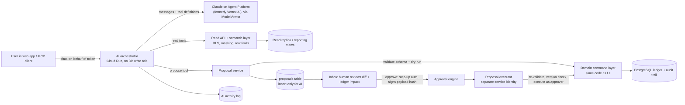
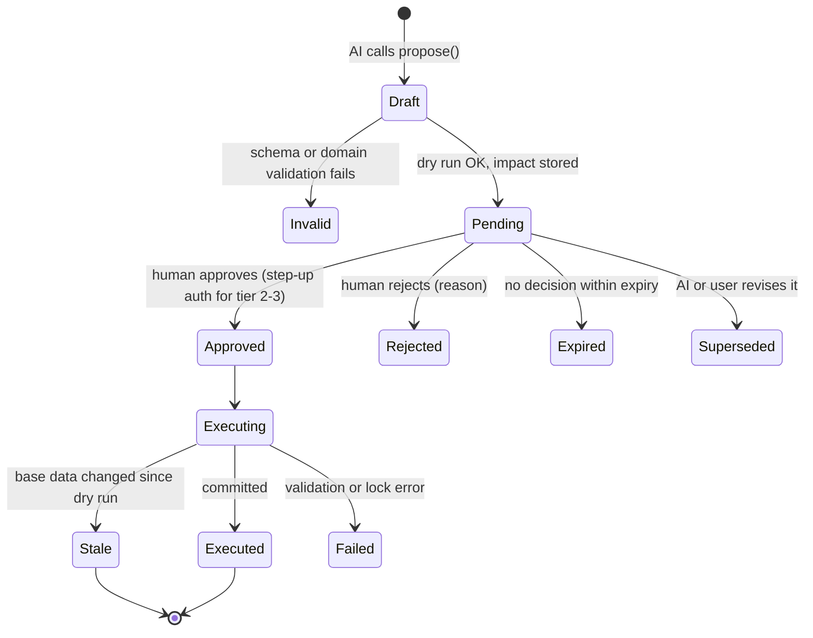
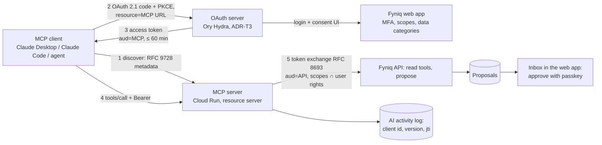
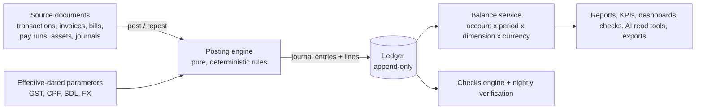
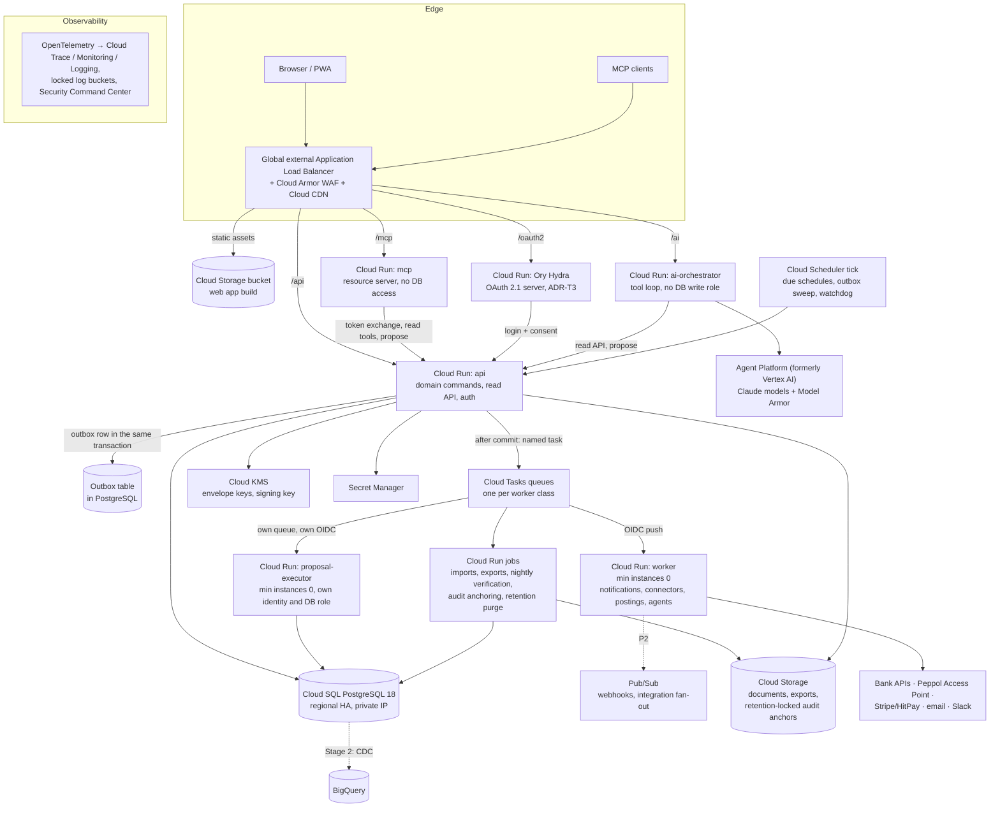

# PRD-001 · Fyniq

*Intelligence behind every number.*

**A web-hosted accounting, compliance, reporting and planning platform on Google Cloud.
Built for a lean founding team, with the controls a growing company needs.**

| | |
|---|---|
| Document | PRD-001 (initial PRD, greenfield) |
| Product | **Fyniq**, "Intelligence behind every number" (rev 0.9: the founders' chosen name; formerly the working name "Cognizhi Finance Hub Cloud", short "FH Cloud") |
| Status | Draft for founder review |
| Revision | 0.61 (21 Oct 2026): the founders' decisions on recurring journals: a late occurrence refuses the close; incomplete content warns at the close instead of refusing it; a past start makes the missed drafts; a resume skips them. Earlier: 0.60 (21 Oct 2026): recurring journals (FR-GL-02): the scheduler makes each occurrence's draft, which a person posts; the worker makes documents only through one database function; provisional until sign-off. |
| Date | 15 Oct 2026 (rev 0.24) |
| Owner | Cognizhi founders |
| Reviewers | Founders; external accountant / tax agent; security reviewer (later: auditor). (rev 0.19) Second review of rev 0.16–0.19 split by area, one pull request each, before P0 work on that area ([plan](reviews/second-review-plan-2026-10-14.md)). (rev 0.22) The reviews no longer gate building: work proceeds on the best current recommendation, and pages awaiting review show a banner until the area's pull request merges (FR-UX-41) |
| Predecessor | `zh-sheet-accounting` PRD-001 "Cognizhi Finance Hub" (Zoho Sheet workbook, release 1.x). This PRD replaces the workbook with a cloud platform and keeps its accounting rules, statuses, checks and test philosophy. |
| Hosting | Google Cloud, Singapore region (`asia-southeast1`) |

**How to read this document.** §1–§4 cover the why and the what. §5 summarises the market
research. §6–§9 cover users, roles, experience, features and the AI assistant. §10–§16 cover the
accounting engine, storage and audit trail, technology, security, compliance and testing.
§12.8–§12.10 cover how the team builds, runs and releases the platform: the local mode, the
container images and the versioning. §17–§21 cover migration, phasing, risks and open questions.
The appendices hold the detailed catalogues: feature parity, posting rules, checks, permissions,
the AI task catalogue, the control registry, acceptance scenarios and the agent skills the
repository ships with (`.claude/skills/`, Appendix H).

**Requirement IDs and phases.** Requirements carry an ID (`FR-…`, `NFR-…`, `SEC-…`, `CMP-…`,
`AI-…`, `QA-…`), a priority (**M** must, **S** should, **C** could) and a phase:

| Phase | Name | Outcome |
|---|---|---|
| **P0** | Foundation | Platform skeleton: identity, tenancy, audit trail, ledger core, CI/CD, compliance-as-code baseline |
| **P1** | Replace the workbook (MVP) | Feature parity with the workbook for Cognizhi's own books, plus approvals, audit, AI chat (read) and the first AI proposal types. (rev 0.8) Since rev 0.3 it also holds the founders' money and equity register, evidence, help and the rev 0.6–0.7 additions listed in R2; what must work at go-live is the launch subset (open question 25). Parallel run, then go-live. |
| **P2** | Run the company | Bank APIs and feeds ((rev 0.8) bank files, emailed bank reports and the Wise and Airwallex APIs are P1), InvoiceNow (Peppol), payroll outputs (payslips, CPF and IR8A files; (rev 0.19, founder decision 14 Oct 2026) produced by Nemura or the payroll provider, never by Fyniq), the claims app and receipt capture by phone camera (PWA), scheduled reports, customer portal, payment links, more AI task types |
| **P3** | Scale and SaaS | Multi-entity and consolidation, accountant-practice mode, multi-tenant onboarding, public API and marketplace, SOC 2 / ISO 27001 certification, XBRL |

Statements tagged **[verify]** are believed correct but must be confirmed against the official
source before they are relied on in a build. Statutory rates and dates always come from the
official source at build time (§10.6).

(rev 0.8) The Phase cell of each requirement row is authoritative. The phase table above and the
summaries in §3.3, §17.2 and §18 give the outline and are corrected when they disagree with a row.

---

## 1. Summary

Cognizhi runs its books today in a generated Zoho Sheet workbook (the "workbook"): 42 sheets,
83 accounts, about 367,000 formulas, 37 health checks, 22 optional macros and 264 automated tests
against an independent reference ledger. It works, and its accounting rules are proven. It has
reached the limits of a spreadsheet: one file per year, no real access control or approval
workflow, no tamper-proof audit trail, no bank feeds, no e-invoicing, no automation and a ceiling
of a few thousand transactions a year.

**Fyniq** is a greenfield web platform that keeps what the workbook got right and removes its
limits:

- **Record** in plain words, as in the workbook (money in, money out, invoice, bill, payday), with
  bank feeds, receipt capture and e-invoices doing most of the typing.
- **Account** with a deterministic double-entry engine whose invariants (balanced entries,
  immutable posted history, closed periods) are enforced by the database itself, not only by
  application code.
- **Report** live: P&L, balance sheet, cash flow, budget vs actual, AR/AP, GST F5, KPIs,
  dashboards, board packs, with drill-down from any number to its source document and its full
  change history, and exports to XLSX, PDF and CSV (XBRL later).
- **Plan**: budgets, driver-based forecasts with scenarios, 13-week cash, runway, feasibility and
  the cap table.
- **Control**: role-based access with segregation of duties, approval workflows, period locks,
  continuous health checks, a tamper-evident audit trail on every saved change, and an automated
  compliance checklist (Singapore statutory obligations, PDPA, ISO/IEC 27001, SOC 2 readiness,
  AI governance).
- **Ask and delegate to AI**: a chat assistant that answers questions from the books with cited
  figures, and that may **propose** changes but can never make them. Every AI proposal is an
  item from an approved task catalogue, is shown with its exact accounting impact, and is executed
  only after a named human approves that specific proposal.

**Key decisions** (detailed in §11 and §12):

| Decision | Choice | Main reason |
|---|---|---|
| System of record | **PostgreSQL 18** on Cloud SQL (Enterprise edition, regional HA, Singapore); Enterprise Plus or AlloyDB only when measured need arises | Exact `NUMERIC` arithmetic, multi-row ACID transactions, database-enforced ledger invariants, relational reporting, row-level security for tenancy and mature audit tooling. Firestore fails the first three (§11.2). |
| Audit trail | Append-only ledger + trigger-captured change log with a per-tenant hash chain, checkpointed hourly and at every period close to a locked (WORM) Cloud Storage bucket, signed with Cloud KMS | Tamper-evident without the operating cost of full event sourcing (§11.5) |
| Analytics | BigQuery fed by change-data-capture, introduced when reporting volume needs it | Keeps the transactional database lean (§11.7) |
| Application | **Go** services on Cloud Run (exact decimals with explicit rounding, SQL checked at build time); **React** single-page app with spreadsheet-grade grids; Typst and excelize for exports; OpenTofu for infrastructure (§12) | Lightweight, fast cold starts, cheap at low scale, scales out; one backend language for a small team |
| AI | Claude on Google Cloud's Agent Platform (formerly Vertex AI) behind our own tool layer; Singapore endpoint by default (ADR-T2); AI holds no write credential; an approval-gated proposal layer is the only write path; (rev 0.4) know-how from a compiled, versioned knowledge base, figures only from tools (ADR-T6) | "AI must never update data directly" enforced by architecture, not by prompt (§9) |
| Team model | **Founder mode** by default: 2–3 people hold several roles each, with named compensating controls; **Standard** and **Enterprise** modes enforce full segregation of duties as the team grows | Controls that fit the team today and tighten without re-platforming (§6) |
| API and integration | **API-first**: the web app uses only the public, versioned OpenAPI 3.1 API, from P1; an **OAuth 2.1 authorisation server (Ory Hydra)** issues tokens to integrations and MCP clients (ADR-T3); webhooks follow the Standard Webhooks specification | Other systems and AI agents get the same surface, contracts and controls as our own UI (§8.18) |
| MCP | A remote MCP server, **off by default**, with read tools plus `propose` only, audience-bound OAuth tokens, a client allowlist and approvals that happen only in the web app. First-party clients in P1, third-party clients in P2 (§9.7). | "MCP-ready" without opening a write path |
| Build and release | **Local mode**: the full stack runs and every merge gate passes on a laptop or in CI with no cloud credentials (ADR-T4). **Lean images**: static binaries on distroless, with size budgets enforced in CI. **Automated versioning**: SemVer from Conventional Commits via release-please (ADR-T5). | A 2–3 person team ships safely and often (§12.8–§12.10) |

---

## 2. Background: from workbook to platform

### 2.1 What the workbook proved (keep)

| Workbook practice | Carry into Fyniq as |
|---|---|
| One row = one event, in plain words; the engine derives the double entry | Plain-language entry forms and grids, with an optional accountant view showing debits and credits (FR-UX-08) |
| Invalid rows never post; every failure has a plain-English status (✔ ⚠ ✖ ⏰ ✎) | The same status vocabulary on every record, with validation that blocks posting (✖) or asks for acknowledgement (⚠) (§10.5) |
| A single source of truth: every report reads the trial balance | Every report reads the ledger through one balance service; reports cannot disagree (§10.2) |
| 37 automatic health checks with a books-health status | A continuous Checks engine with the same 37 checks plus new ones, running on every change and nightly (Appendix C) |
| Period lock with Close Log checksums | Period close workflow, database-enforced locks, signed period snapshots (§8.8, §11.5) |
| Posting rules implemented independently in four places that must agree | An engine plus an **independent reference ledger** used in differential tests, plus database invariants (§10, §16) |
| Every visible calculated number verified by a test; every status triggered by an edge-case data set | The same two coverage gates for every report API and every validation message (§16) |
| Pinned, hand-calculated payroll figures guard the statutory rates | Pinned statutory tests per rate table and effective date (§16.4) |
| Singapore defaults, all configurable on Settings | Effective-dated statutory parameter tables with source and approval (§10.6) |
| Layman-first UX: drop-downs, notes, statuses that say what to do | A design principle with acceptance criteria (§7) |
| Generated from code, reviewed and tested before release | Everything as code: application, schema migrations, infrastructure, controls (§12, §14) |

### 2.2 What the workbook could not do (fix)

| Workbook limitation (workbook PRD §3.2, §16.2) | Fyniq requirement |
|---|---|
| One file per financial year; capacity of a few thousand rows | One continuous ledger across years; designed for millions of lines per tenant (NFR-SCALE) |
| File-level sharing only; protection is not security | Authenticated users, MFA, roles, field-level masking, segregation of duties (§6, §13) |
| No approvals | Approval engine with amount thresholds and dual control (FR-CTL) |
| Version history and an optional macro log are the only audit trail | Tamper-evident audit trail on every change, AI actions included (§11.5) |
| Statutory rates are not date-effective; a change recalculates closed months | Effective-dated parameters picked by tax point or pay month (§10.6; rev 0.8) |
| CPF additional-wage ceiling and PR graduated rates not automated | Implemented (FR-PAY) |
| Unrealised FX is a memo only | Month-end revaluation postings with automatic reversal (FR-GL) |
| Budget at P&L-line level only; no department or tag P&Ls | Budgets and reports by account and by any dimension (FR-DIM, FR-PLN) |
| Bank import: one account per batch, paste only, no feeds | Multi-account import (CSV, OFX, CAMT.053, MT940), then bank feeds (FR-BNK) |
| No InvoiceNow (Peppol), no IRAS filing, no payslips, no CPF or IR8A files | P2 scope (FR-TAX, FR-PAY, FR-AR) |
| Macros run on demand; nothing is scheduled | Scheduler and event automation (FR-AUT) |
| Single entity | Multi-entity and consolidation (P3) |
| Non-breaking spaces in a reference break matching | Unicode normalisation of every reference and name before matching (FR-BNK-07) |
| Reminder links limited by spreadsheet hyperlink length | Reminders sent by the platform (FR-AR-08) |

### 2.3 Assumptions carried over

Cognizhi is a Singapore private limited company with SGD as base currency. It sells AI software
subscriptions plus consulting and AI project work. It may or may not be GST-registered at go-live.
Its staff may include Singapore Citizens and PRs (CPF) and foreigners (SDL only). The founders
are not accountants; an external accountant or tax agent reviews the books and prepares filings.
See §20 for the full list.

---

## 3. Vision, principles and what the cloud unlocks

### 3.1 Vision

*The finance back office a founder actually enjoys opening: always correct, always current,
explains itself, does the routine work for you, and never acts without a human's say-so.*

### 3.2 Product principles

1. **Correct by construction.** No floating-point money anywhere. The database refuses an
   unbalanced entry, a posting into a closed period and an edit of posted history, whatever the
   application does. Every ledger figure is reproducible from the ledger; (rev 0.8) every other
   measure names its source (FR-KPI-03).
2. **Never silently wrong.** Anything that cannot post says so, in plain words, and tells you how
   to fix it. Checks run continuously and the health status is always visible.
3. **Everything is traceable.** Any number drills down to ledger lines, then to the source
   document, then to every change ever made to it: who, when, what, why, and who approved it.
4. **Humans decide; AI proposes.** AI reads, explains, drafts and suggests. It changes data only
   through proposals that a named human approves one at a time, from a catalogue of permitted task
   types.
5. **Layman-first, accountant-proof.** Plain words and guided flows for founders (**Basic
   mode**), with full double-entry views, journals and audit evidence for accountants and
   auditors (**Expert mode**). One toggle switches between them; the data, rules and permissions
   are the same in both (§7.8).
6. **Controls that fit the team.** Founder mode for 2–3 people today; full segregation of duties
   when the team grows. Switching mode is a setting, not a migration.
7. **Singapore first, country-pluggable.** GST, CPF, SDL, SHG, IRAS and ACRA rules ship as
   effective-dated packs. Other countries are new packs, not new code paths.
8. **Tenant-ready from day one.** Every row belongs to an organisation and is protected by
   row-level security, even while Cognizhi is the only tenant.
9. **Lightweight and frugal.** Scale to zero where possible, pay for capacity only when it is used,
   and keep the operating burden within what two or three people can run.
10. **Everything as code.** Application, schema, infrastructure, statutory parameters, controls
    and their evidence are versioned, reviewed and tested.
11. **API-first, agent-ready.** Every capability is an API before it is a screen. The web app is
    one client of the public API. Contracts (OpenAPI, event schemas, tool schemas) are written for
    human developers and AI agents alike. Agents always go through the proposal layer.
12. **Runs on a laptop.** One command starts the whole platform with the sample company, and one
    command runs every merge gate, with no cloud account and no network access beyond package
    downloads.

### 3.3 What hosting in the cloud unlocks

The spreadsheet could not do any of these. They shape the architecture now even where they ship
later.

| Capability | What it gives Cognizhi | Phase |
|---|---|---|
| Real-time collaboration | Several people work at once, with comments, @mentions, record-level history and no file conflicts | P1 |
| Approvals and segregation of duties | Payments, bills, journals and payroll approved by the right person, with evidence | P1 |
| Tamper-evident audit trail | Investor, auditor and IRAS-ready evidence for every change | P1 |
| AI assistant and MCP server | Ask the books anything; let AI prepare work for approval; use the same tools from Claude Desktop or Claude Code | P1 (in-app; MCP for first-party clients) → P2 (third-party MCP clients) |
| Automation and scheduling | Recurring documents, reminders, depreciation, accruals, FX rates and month-end tasks run by themselves | P1–P2 |
| Bank feeds and payment initiation | Transactions arrive daily; payment batches go to the bank; PayNow QR on invoices | (rev 0.8) P1 (bank files, emailed DBS reports, Wise and Airwallex APIs, payment files) → P2 (bank APIs, payment APIs, PayNow QR on invoices) |
| E-invoicing (InvoiceNow / Peppol) | Send and receive structured invoices; required for some GST registrants | P2 |
| Government integrations | GST F5 filing, IRAS audit listings ((rev 0.8) the IAF only if IRAS republishes a specification, FR-TAX-04), CPF and IR8A submission files | P2 |
| Document intelligence | Bills and receipts emailed or photographed, read automatically and matched | (rev 0.8) P1 (upload, paste, email-in, FR-DOC-12) → P2 (phone camera, statements) |
| Self-service portals | Employees: claims and payslips ((rev 0.19, founder decision 14 Oct 2026) payslips are in Nemura's My pay or the provider's system, never in Fyniq). Customers: invoices, statements, pay online. Investors: board pack. | (rev 0.8) P1 (My claims on the web, FR-AP-14) → P2 (payslips, PWA, customer and investor portals) |
| Continuous close and continuous controls monitoring | Books close in days, not weeks; exceptions surface the day they happen | P2 |
| Analytics at scale | Cohorts, unit economics, anomaly detection, benchmarks on BigQuery | P2–P3 |
| Multi-entity, consolidation, intercompany | New subsidiaries (e.g. overseas) without a new system | P3 |
| Accountant-practice mode and SaaS | Serve other start-ups; a possible product line | P3 |
| Open API, webhooks, integrations marketplace | Stripe, CRM, HR, Google Workspace, Slack and others; any system or AI agent can integrate through documented contracts | P1 (public API, used by our own UI) → P2 (third-party clients, webhooks) → P3 (marketplace) |

---

## 4. Goals, non-goals and success metrics

### 4.1 Goals

| # | Goal |
|---|---|
| G1 | Replace the workbook for Cognizhi's own books with at least feature parity (Appendix A) and no unexplained difference in the trial balance during the parallel run (§4.3). |
| G2 | Calculations with zero tolerance for error: deterministic, exact-decimal, invariant-enforced, verified by differential and coverage testing (§10, §16). |
| G3 | A strong audit trail on every saved change, tamper-evident and retained for at least the statutory period (§11.5, §14). |
| G4 | Roles that follow standard finance practice, operable by 2–3 founders today and by a finance team later (§6). |
| G5 | Navigation and data entry a non-accountant finds easy; a modern look with light and dark themes (§7). |
| G6 | An AI assistant that answers from the books with citations and can only change data through human-approved proposals from an approved task catalogue (§9). |
| G7 | Singapore compliance built in and checked automatically: GST, InvoiceNow, CPF, SDL, SHG, IRAS, ACRA, PDPA (§14). |
| G8 | Security and assurance that can grow into CSA Cyber Trust, ISO/IEC 27001 and SOC 2 (§13, §14). |
| G9 | Low cost ((rev 0.8) people's time as well as the cloud bill) and low operating burden at Cognizhi's scale, with a path to multi-tenant SaaS without re-platforming (§12). |

### 4.2 Non-goals (P1)

- Inventory quantities and stock costing (FIFO or weighted average). Items remain a price list.
  Revisit if Cognizhi sells physical goods.
- Multi-entity consolidation (P3; the data model is ready for it from P0).
- Acting as a payment institution or holding customer funds. Payments are initiated through banks
  or licensed providers; the platform never stores card data.
- Statutory audit services or tax advice. The platform prepares figures and files; the
  accountant or tax agent remains responsible for filings.
- (rev 0.3) Company secretarial work. Fyniq records share issues and directors' balances
  (§8.22), keeps the resolutions and lodgement evidence, and tracks the deadlines; the register of
  members, share certificates and ACRA lodgements stay with the company secretary.
- Native mobile apps. P2 ships a responsive progressive web app (PWA) for approvals, receipts and
  dashboards.
- Fully autonomous AI bookkeeping. Autonomy is limited by design (§9).

### 4.3 Success metrics

| Metric | Target |
|---|---|
| Trial balance difference vs the workbook during the parallel run | S$0.00 on every account and month, except the documented cent allocation of spreads and depreciation (`ALLOC-EVEN`, §10.4): those differ from the workbook's unrounded monthly values by less than S$0.01 in any month and by at most S$0.005 in any month-end balance, and match exactly over each schedule; (rev 0.8) and the deliberate rule changes listed in the signed migration difference register (FR-MIG-02) |
| Calculation defects reaching production | 0 per quarter (any one is a P1 incident with a root-cause review, QA-REL-01). (rev 0.8) A calculation defect is a posted amount, balance, tax figure or report value that differs from what the documented rule and the reference ledger give for the same inputs, found by anyone after release. It counts in the quarter it reached production, once the accountant or the product owner confirms it |
| (rev 0.8) Month-end close: hands-on effort (≤ 300 bank lines a month), from the activity log | ≤ 30 minutes in P1 |
| (rev 0.8) Month-end close: elapsed time from month end to the accountant's reviewed close | ≤ 2 working days in P2 |
| (rev 0.8) Bank lines categorised without manual entry, over all bank lines of the last three months, reported in two parts: by rules and auto-reconcile (FR-BNK-05, FR-BNK-14), and by AI proposals approved without edits | ≥ 80% by end of P2, counted only while the correction rate below is within target |
| (rev 0.8) AI-categorised bank lines later corrected (reclassified or reversed within 90 days of approval; AI-33) | ≤ 2% [target to confirm with the accountant] |
| Checks status at each close | Zero ✖; every ⚠ explained |
| Audit trail integrity verification | 100% of daily hash-chain anchors verified; 0 gaps |
| Time for a new user to record a first transaction | ≤ 5 minutes, no training |
| Report and page performance | p95 page load ≤ 1.5 s; p95 standard report ≤ 2 s at 1 million ledger lines |
| AI answer accuracy on the golden question set | 100% of numeric answers match the ledger (numbers must come from tools); ≥ 95% rated helpful |
| AI proposals executed without an approval record | 0 (a control test fails the build and pages on-call if this is ever non-zero) |
| Platform availability (business hours SGT) | ≥ 99.9% monthly |
| Infrastructure cost at Cognizhi's own scale | Within the budget set in §12.6 |

---

## 5. Market research: what we absorb

Research date: 12 Oct 2026. About 30 products in 7 categories were studied from vendor
documentation, help centres, pricing pages, government sites and trade press. Sources are in
Appendix I. Vendor features change quickly; treat this as a snapshot.

### 5.1 Landscape

| Category | Products studied | What they do best | Relevance |
|---|---|---|---|
| SMB accounting | Xero, QuickBooks Online, Zoho Books (SG), Odoo 19 | Bank feeds and rules, invoicing, SG GST F5 and InvoiceNow, app ecosystems; all now ship AI agents | Baseline parity; their gaps are our openings |
| Mid-market ERP | NetSuite, Sage Intacct, Microsoft Dynamics 365 Business Central | Dimensions, multi-level approvals, multi-entity, role design, agent identities | Controls and data-model patterns for P2–P3 |
| Close and reconciliation | Numeric, FloQast, BlackLine | Close checklists, flux analysis, reconciliation packages, AI-prepared work for sign-off | Close workflow and reviewer experience |
| AI-native ledgers | Digits, Puzzle, Rillet, Campfire, Light, Basis, Pennylane, Doss, Kick | Real-time books, auto-categorisation, accrual proposals, drill-down, keyboard-first UX | Experience bar and AI patterns |
| Spend and banking | Ramp, Brex, Mercury, Aspire (SG), Pleo, Spendesk | Policy agents, bill capture, approvals by amount, exception-first review | AP, claims, approvals |
| FP&A | Runway/cfo.ai, Pigment, Abacum, (Mosaic, Causal, Fathom, Jirav) | Scenarios, plan vs actual, AI-drafted board decks | Planning module |
| Singapore payroll and services | Talenox, Swingvy, JustLogin, Osome, Sleek, Financio | CPF/SDL/SHG/FWL, CPF submission file, IR8A via AIS, IRAS Audit File | Statutory scope; build vs buy for payroll |

### 5.2 What we absorb

| Module | Pattern (seen in) | Fyniq requirement |
|---|---|---|
| Home | **One "needs attention" inbox** for AI work, unmatched lines, approvals, close tasks and deadlines; the home page shows work, not only charts (QuickBooks Business Feed) | FR-UX-03, §7.1 Inbox |
| Home | **Exception states** on every item (OK / needs attention / unknown) so founders review only exceptions (Pleo) | FR-UX-09 status chips |
| Banking | Deterministic **bank rules** first, AI for the rest; rules apply forward and can be back-tested (Mercury, Xero) | FR-BNK-05 |
| Banking | **Suggested matches with confidence and bulk confirm** (Xero JAX) | FR-BNK-06, AI `bank.match_payments` |
| Banking | **PayNow**: static UEN QR on invoices now; dynamic per-invoice QR through a provider later (HitPay, Stripe) for automatic reconciliation | FR-AR-13 |
| Banking | Direct bank APIs exist (DBS RAPID, UOB API); SGFinDex covers individuals only and is not an option | FR-BNK-03 |
| Sales | **Posted documents are immutable; corrections via credit note or void-and-replace** (Xero API edits drafts only) | FR-GL-12 |
| Sales | **InvoiceNow (Peppol)** data model from day one: Peppol ID against the UEN, PINT-SG documents, transmission through an IMDA-accredited Access Point's API | FR-CT-01, FR-AR-12, FR-AP-05 |
| Purchases | **Document inbox → draft bill** via OCR; never auto-posted (Business Central Payables Agent "doesn't post purchase invoices") | FR-AP-04, AI `ap.draft_bill` |
| Purchases | **Bill approvals by amount, vendor and account, in sequential levels** (Zoho Books) | FR-APR-01 |
| Purchases | **Fraud flags on changed supplier bank details and new suppliers** (Xero Bill Protection) | FR-CT-03, Check C.2 #11 |
| Payroll | **Statutory rates as effective-dated data**; CPF submission as a file (Talenox does the same; no public CPF API was found) | ENG-30, FR-PAY-09 |
| GL and close | **Two lock levels** (everyone vs everyone except advisers) and an **exceptions report** for postings near the lock date (Xero, QuickBooks) | FR-GL-08/09 |
| GL and close | **Close checklist with preparer and reviewer sign-off** (Numeric) and **flux / variance commentary per line** (Sage Intacct Close Automation) | FR-GL-07, FR-GL-14 |
| GL and close | **Dimensions without a small fixed cap** (a common complaint: Xero allows two active tracking categories) | FR-DIM-01 |
| GL and close | **Journal outlier detection before approval** (Sage Intacct GL Outlier Detection) | FR-KPI-06, AI review lane |
| Tax | **GST F5 drill-down to transactions and IRAS Audit File export** (Financio; (rev 0.8) Fyniq exports the audit listings, and the IAF only if IRAS republishes a specification) | FR-TAX-02/04 |
| Reporting | **Drill-down from every number to its source** (Campfire) | FR-UX-04 |
| Reporting | Scheduled report emails (Zoho); report builder over dimensions (Sage Intacct); AI first draft of the board pack (cfo.ai) | FR-RPT-04/06/07 |
| Planning | Base / upside / downside scenarios and short-term cash forecasts (Xero 30/60/180-day forecast) | FR-PLN-02/05 |
| Integrations | **MCP read access scoped by role, none by default, never with admin roles** (NetSuite) | AI-15/16 |
| AI | **Answers only from data the user may see** (Abacum); **rationale and cited evidence on every proposal** (Ramp, Basis) | AI-01, §9.5 |
| AI | **Agent as its own principal, attributed in the audit log** ("Jane Doe via Intuit Intelligence" in QuickBooks; Business Central's agent user) | AI-10, AI-12, AUD-01 |
| Controls | **Field-level before/after history, exportable** (Xero is criticised for lacking export); **audit log that cannot be turned off** (QuickBooks) | AUD-01…07 |
| UX | **⌘K command palette with bulk actions**, "G then" navigation keys, **spreadsheet-style grids** with Tab, fill-down, paste and `=` arithmetic (Kick) | FR-UX-01/06/07 |
| UX | **Real-time books**, no batch posting (Digits) | ENG-02 |

### 5.3 How the market governs AI writes

| Tier | Pattern | Examples (Oct 2026) |
|---|---|---|
| T0 | Read-only | Sage Intacct Finance Intelligence Agent; Abacum Ask AI |
| T1 | Suggests inline; the user accepts | QuickBooks category suggestions; Campfire; Sage outlier flags |
| T2 | Drafts; a person approves before it posts | Business Central Payables Agent; Puzzle ("nothing posts to the ledger without your approval"); Mercury Command; Aspire MCP ("You confirm anything that changes") |
| T3 | Acts on its own within admin rules | Ramp Policy Agent (auto-approve below an amount); Brex auto-pilot (on by default); Digits (auto-books > 90%); Light; FloQast |
| T4 | Writes with no approval step | Official MCP servers of QuickBooks and Xero (write tools on by default); NetSuite MCP within the user's role; Numeric (posts journals directly); Zoho Ask Zia; Odoo AI server actions |

**Mechanisms worth copying**

1. **The agent has its own identity** and never exceeds the requesting user (Business Central,
   NetSuite, Aspire, Mercury).
2. **Scope by task type** (Odoo's "Use in AI" actions, NetSuite roles per tool, Ramp's
   allow/don't-allow per automation): the nearest analogue of our catalogue.
3. **Approving the AI's work is separate from the business approval** (Business Central): an
   AI-drafted bill that a human accepts still goes through bill approval and payment controls.
4. **Anything that reaches outside parties needs a person** (QuickBooks Custom Automations:
   emails, payments, e-invoices).
5. **Show reasoning and evidence** (Ramp: "rationale and cited policy text"; Basis cites
   evidence for conclusions).
6. **Label AI actions in the audit log** (QuickBooks, Business Central, Light).
7. **Measure approval quality** to guard against rubber-stamping, as Singapore's Model AI
   Governance Framework for Agentic AI (IMDA, Jan 2026, updated May 2026) asks: limits on agents'
   powers, "significant checkpoints at which human approval is required", and audits of how
   effective those approvals are.

### 5.4 Where Fyniq is different

| Gap in the market | Fyniq |
|---|---|
| **No vendor publishes a typed catalogue of AI task types where every AI write needs a human approval.** The approval layer usually covers only the agents the vendor chose to put behind a review step; the official MCP servers of the two largest SMB ledgers write directly. | Catalogue + per-proposal approval + no AI write credential (§9) |
| **No real undo of AI actions** anywhere (one vendor offers backup/restore; another claims "reversible" without detail) | One-click, audited reversal of an executed proposal while its period is open (AI-31) |
| **No dark mode on the web** in Xero, QuickBooks Online or Zoho Books (confirmed Oct 2026) | Light, dark and system themes from P1 (§7.4) |
| Spreadsheet-grade data entry is rare outside Kick | Grids with paste, fill-down and `=` arithmetic (FR-UX-07) |
| Founder-sized segregation of duties is not a concept anywhere | Founder mode with named compensating controls (§6.4) |
| Singapore depth (CPF/SDL/SHG, F5, IAF, InvoiceNow, AIS) usually needs two or three products (ledger + payroll + Peppol app) | One platform, with "buy" integrations where licensing requires (Peppol Access Point, bank APIs) |

### 5.5 Build vs buy

| Capability | Decision | Rationale |
|---|---|---|
| Ledger, AR/AP, GST, reporting, planning, controls, AI layer | **Build** | Core of the product; the workbook's proven rules. (rev 0.8) This assumes the product goal of open question 1; the cost of building and maintaining it is compared with buying under open question 26 |
| Peppol transmission | **Buy**: an IMDA-accredited Access Point's API | Accreditation is required to transmit |
| Bank connectivity | **Buy / partner**: bank APIs (DBS RAPID, UOB), emailed bank reports, or a licensed aggregator that neither shares credentials nor scrapes screens (FR-BNK-15, rev 0.8); statement import as the always-available fallback | Bank onboarding and licences |
| Card and online payments | **Buy**: Stripe or HitPay | PCI scope and licensing |
| OCR / document extraction | **Buy**: Google Document AI or the model's PDF input | Commodity; quality improves without us |
| Payroll | **Build calculations (P1)**; revisit buying (e.g. Talenox) if statutory outputs (payslips, CPF file, AIS) cost more to maintain than to integrate. (rev 0.19, founder decision 14 Oct 2026) Built in Nemura (PRD-002), not in Fyniq | The workbook already calculates payroll; outputs are the costly part |
| Compliance automation | **Build the control registry**; consider a compliance-automation tool when pursuing ISO 27001 / SOC 2 (§14) | Evidence collection at certification time |

**Pricing context** (what a start-up pays elsewhere; (rev 0.8) list prices seen 12 Oct 2026, re-check
before use): Xero S$70–95 a month including GST (rising 1 Nov 2026); Zoho Books SG S$30–54 a month
before GST; Talenox S$4.36 (payroll) to S$7.63 (payroll and leave) per employee a month including
GST on annual billing, minimum five employees; Financio S$20–30 a month. Subscriptions are not the
main cost of either option: the build-or-buy comparison (open question 26) counts people's time.
A SaaS version of Fyniq would compete in the S$50–150 a month band for small companies, with
practice pricing for accounting firms. (rev 0.26) From 1 Nov 2026 Xero costs S$42, S$77 and S$99 a month
including GST; the prices of 17 Oct 2026 and the 24-month comparison are in [build, hybrid or buy](research/build-hybrid-buy-2026-10-17.md).

---

## 6. Users, roles and team modes

### 6.1 Personas

| Persona | Who | Needs | Main areas |
|---|---|---|---|
| P1 Founder / CEO | Decides, fundraises, approves | Cash, burn, runway, approvals in one place, board pack, "what if" | Home, Inbox, Dashboards, Planning |
| P2 Operating founder / bookkeeper | Non-accountant who records and categorises weekly | Know what to do next; fix problems in plain words; little typing | Inbox, Banking, Sales, Purchases |
| P3 External accountant / tax agent | Monthly or quarterly review, year end, filings | Trial balance, GL, journals, GST working papers, audit evidence, exports | Accounting, Reports, Tax |
| P4 Investor / board member | Reads the numbers | Monthly pack, KPIs, cap table | Board portal |
| P5 Employee | Spends company money, gets paid | Submit claims from a phone, see payslips ((rev 0.19, founder decision 14 Oct 2026) in Nemura or the provider's system) | Employee self-service |
| P6 Auditor | Statutory or due-diligence review | Read-only access to everything relevant, audit trail, evidence exports, time-boxed | Auditor workspace |
| P7 Future finance hire (controller, AP/AR specialist) | Runs finance day to day | Queues, bulk tools, approval routing, close checklist | All finance areas |
| P8 AI assistant (non-human) | Acts for a signed-in user | Read access within that user's permissions; propose only | Chat, Inbox (proposals) |

### 6.2 Standard finance roles

Roles follow common finance practice (maker–checker, segregation of preparation, approval,
payment, reconciliation and administration). A user may hold several roles; the team mode
(§6.4) decides which combinations are allowed.

| Role | Can | Cannot (in Standard mode) |
|---|---|---|
| **Owner** | Everything in Administrator plus subscription, data export of the whole tenant, break-glass, closing the organisation | — (every Owner action is dual-controlled and audited, (rev 0.8) except founder break-glass within FM-8's limits, (rev 0.11) which is exempt from dual control only: it is always audited and reviewed, FM-8) |
| **Administrator** | Users, roles, team mode, approval policies, integrations, settings | Post or approve financial transactions |
| **Finance controller / CFO** | Approve journals, bills and payments above thresholds; close and reopen periods (with a second approver); approve statutory parameter changes; sign off reconciliations | Release payments they prepared |
| **Accountant** | Prepare and post journals within limits; reconciliations; accruals, prepayments, FX revaluation; fixed assets; tax working papers | Approve own journals above the threshold; close periods |
| **Bookkeeper** | Record transactions; categorise bank lines; draft invoices and bills; attach documents; manage bank rules | Approve; post journals; change vendor bank details |
| **AR specialist** | Quotes, orders, invoices, credit notes, reminders, customer statements, apply receipts | Write off receivables above limit; approve credit notes above limit |
| **AP specialist** | Purchase orders, bills, vendor credits, prepare payment batches | Approve bills; release payments; change vendor bank details without a second approver |
| **Payroll administrator** | Employees, pay runs, CPF/SDL/SHG, payslips, IR8A. (rev 0.18) Corrected: in Fyniq, the pay runs received from Nemura or imported, their postings and salary payment batches; employees, payslips and IR8A are kept in Nemura or the payroll provider's system (§7.1, FR-PPL-01) | Approve own pay run; release salary payments |
| **Payment releaser (treasury)** | Release approved payment batches to the bank; manage bank connections | Create or approve the payments they release |
| **Approver (budget holder)** | Approve POs, bills, claims within their department and limits. (rev 0.18) Works in a finance workspace cut to their department, projects and limits (FR-UX-40) | Anything outside their department or limit |
| **Employee** | Submit expense claims and receipts; see own payslips and claims. (rev 0.18) Corrected: own claims, timesheets and grants (FR-UX-39); payslips are in Nemura's My pay or the payroll provider's system, never in Fyniq | See anyone else's data |
| **Auditor (external)** | Read everything in scope, the audit trail and evidence; export; time-boxed access with an expiry date | Any change; payroll personal data unless explicitly granted |
| **Tax agent / external accountant** | Accountant rights plus GST and tax working papers; time-boxed | User administration |
| **Board / investor viewer** | Board pack, dashboards, cap table (as granted) | Transaction-level data unless granted |
| **Super admin** (rev 0.6) | Installation-wide settings: sign-in providers, email and messaging connections, announcements to everyone, platform health (FR-ADM-06/07) | Read an organisation's books without being a member; act alone once a second Super admin exists |
| **Company secretary** (rev 0.6) | Corporate profile, registers, equity register, AI company secretary runs and drafts, evidence, filing records (FR-CS-08) | Transactions, payroll or bank detail unless granted |
| **Compliance officer / DPO** | Compliance Center, control evidence, audit trail, data-subject requests, retention holds | Post or approve transactions |
| **AI assistant** (non-human principal) | Read within the delegating user's permissions minus AI exclusions (§9.4); create proposals from the approved task catalogue | Execute, approve or reject anything; hold a write credential |
| **Integration** (service principal) | Narrow, scoped API rights for one integration (bank feed, Peppol access point, Stripe) | Anything outside its scope |

(rev 0.18) **Line manager is a relationship, not a role**: whoever is named as a person's line manager (FR-EMP-01,
FR-PPL-06) approves that person's claims at the first step (FR-AP-17) from the personal workspace
(FR-UX-39); it grants nothing else.

**Permission model.** Role-based access control plus attribute conditions (organisation, entity,
department, amount, document type, data sensitivity). Field-level masking for sensitive fields
(salaries, NRIC/FIN, full bank account numbers, personal addresses). Permissions are checked in
the API layer and again by database row-level security. The full matrix is Appendix D.

### 6.3 Segregation-of-duties (SoD) conflicts

| # | Conflict (the same person must not do both) | Why |
|---|---|---|
| SOD-1 | Create or change a vendor's bank details **and** approve or release payments to that vendor | Payment fraud |
| SOD-2 | Prepare a payment batch **and** release it | Payment fraud |
| SOD-3 | Prepare a journal above the threshold **and** approve it (rev 0.60: whoever wrote the version of a recurring journal a draft was made from prepared that draft) | Misstatement |
| SOD-4 | Prepare a pay run **and** approve it or release salary payments | Payroll fraud |
| SOD-5 | Record bank transactions **and** sign off the bank reconciliation | Concealment |
| SOD-6 | Administer users or roles **and** post or approve transactions | Privilege abuse |
| SOD-7 | Close a period **and** reopen it alone | Tampering with reported results |
| SOD-8 | Propose a change to the AI task catalogue or approval policies **and** approve it | Weakening controls |
| SOD-9 | Write off a receivable **and** receive cash from that customer | Teeming and lading |
| SOD-10 | Change statutory parameters (GST, CPF rates) **and** approve the change | Silent mis-statement |

### 6.4 Team modes

| Mode | Team | SoD | Default |
|---|---|---|---|
| **Founder mode** | 1–3 people, all founders | Conflicts allowed **with compensating controls** (below) | ✔ for Cognizhi at go-live |
| **Standard mode** | 4–15 people, some finance staff | Conflicts blocked; an override needs a reason and a second approver and is reported | |
| **Enterprise mode** | 15+ people or several entities | Conflicts blocked; approval matrices per entity and department; SSO and SCIM; quarterly access reviews | |

**Founder mode: compensating controls (all mandatory).**

| # | Control | Mechanism |
|---|---|---|
| FM-1 | **Two-person rule for high-risk actions**, regardless of amount: releasing payments, adding or changing payee bank details, approving a pay run, reopening a period, changing roles, policies or the AI task catalogue, changing statutory parameters, voiding a posted document, editing opening balances; (rev 0.3) repaying, converting or waiving a director's balance and recording a share issue (FR-EQ-05…08); (rev 0.35) role changes during the founder bootstrap of FR-ADM-01 are the one exception, because there is no second person yet | Approval engine requires a second founder. Step-up authentication (passkey or TOTP) for both. (rev 0.36) Built first for organisation settings under FM-1 and for role changes and invitations after the founder bootstrap: the change answers 202 with an approval request; another member holding A on the object's Appendix D row approves it; the requester never approves their own, which the database refuses too; both pass step-up, until passkeys and TOTP arrive the session's step-up within 5 minutes. Provisional until sign-off (rev 0.53) Voiding a posted journal, built: in Founder mode a reversal is refused (JOURNAL-08) and asked for with its date and reason; another member who holds A on Journals approves it, and the reversal posts. In Standard and Enterprise modes a person who holds P on Journals reverses directly: FM-1 is read as a Founder-mode control. Provisional until sign-off (rev 0.54) Editing a posted journal, built: in Founder mode an edit is refused (JOURNAL-10) and asked for with its new content and reason; another member who holds A on Journals approves it, and the edit posts. Provisional until sign-off (rev 0.58, founder decision 21 Oct 2026) Confirmed: in Founder mode, editing a posted journal always needs a second person, whatever its amount, because an edit is a void and a post; a correcting journal at or below the self-approval threshold still posts alone |
| FM-2 | **Self-approval below a threshold** for routine items (default S$2,000 per document; configurable; (rev 0.11) "below" means at or below: a S$2,000.00 document may be self-approved) | Allowed, but flagged "self-approved" and queued for review (rev 0.53) Built for manual journals, provisional until sign-off: the threshold is the organisation setting "Self-approval threshold" (S$2,000.00 by default, S$0.00 to S$1,000,000.00, changed under dual control), compared with a journal's debits in the base currency as the posting rules would post it. Above it, in every team mode, the journal posts only on another person's approval. At or below it, in Founder mode only, the post is logged as self-approved in the review log of FM-3; Standard and Enterprise modes log nothing (rev 0.58, founder decision 21 Oct 2026) Confirmed: the threshold applies in every team mode, because Standard and Enterprise modes have no amount rule of their own for journals; it is reconciled with amount-based approval policies when they arrive |
| FM-3 | **Weekly review** of the self-approved and high-risk log by another founder | Inbox task; unreviewed items older than 14 days show ⚠ on Checks (rev 0.46) Built, provisional until sign-off: every high-risk action that executes is logged: each approved change (FM-1) and each role change or invitation the Owner made alone before a second member joined (FR-ADM-01); self-approvals (FM-2) and break-glass (FM-8) join it when they arrive. A member who holds A on the row of what an entry changed, and did not act on it, reviews it once, with an optional note; the database refuses a review by the one who acted and never changes an entry or a review. In Founder mode an entry unreviewed 14 days after it executed is overdue, which the log reports for Checks. The weekly Inbox task follows with the Inbox |
| FM-4 | **Monthly close attestation** signed by a founder who did not prepare the close | Part of the close checklist; the close cannot complete without it (rev 0.50) Built, provisional until sign-off: the attester steps up first, and the database refuses an attestation by the one who ran the close checks, in every team mode |
| FM-5 | **Independent bank reconciliation evidence**: statement balances come from the bank feed or an uploaded statement, never typed | Reconciliation refuses typed balances in Founder mode |
| FM-6 | **AI anomaly review** of journals, vendor changes and payments (advisory) | AI flags unusual items into the weekly review; it never approves |
| FM-7 | **Accountant review** at least quarterly, with read access to the full audit trail | Time-boxed accountant access; review sign-off recorded. (rev 0.8) Each review is a record per period: the close snapshot it covers (AUD-04), the accountant's queries with management's answers, any adjusting journals (through FR-GL-01 approval; a closed period follows FR-GL-08), and the sign-off. Reopening a reviewed period marks the review superseded, and both versions are kept |
| FM-8 | **Break-glass for a single available founder** (e.g. the other is unreachable). (rev 0.8) **Allowed:** releasing payments of already-approved bills, claims and pay runs, and statutory payments (IRAS, CPF), to payees whose bank details have not changed in the last 30 days, up to a total per break-glass (setting, open question 35); approving a pay run so salaries are paid on time. **Never:** adding or changing payee bank details; users, roles, team mode, approval policies, sign-in methods, the AI catalogue or AI settings; statutory parameters; reopening a period; voids; opening balances; any payment to or settlement in favour of the founder using break-glass (FM-9 still applies); tenant export. Break-glass cannot extend or renew itself | Owner break-glass with reason, 24-hour expiry, automatic notification and mandatory post-review. (rev 0.8) Step-up; a banner on every page while active; immediate notification to every Owner and the external accountant; post-review by the other founder within 7 days of their return, or by the external accountant (FM-7) if they are still unavailable after 7 days; an unreviewed break-glass is ✖ on Checks and blocks the monthly close attestation (FM-4) |
| FM-9 | (rev 0.3) **A founder never approves the settlement of their own balance**: repaying, converting or waiving a founder's balance needs another founder's approval; when every available approver benefits (for example, all founders convert together), the external accountant's recorded review is also required before posting | The approval engine excludes the beneficiary and adds the accountant step automatically; resolutions attached (FR-EQ-05, FR-EQ-06) |

**Mode switching.** Switching mode is dual-controlled and audited. On a switch to Standard mode,
the platform lists every user whose role combination now conflicts and blocks the switch until
the conflicts are resolved or explicitly overridden.
(rev 0.42) Built, provisional until sign-off, on the recommended options. The team mode is the
organisation's versioned, approval-gated data, Founder mode until the first switch. A switch is an
approval request: a member who holds C on "Users, roles, team mode" (the Administrator) asks, and a
member who holds A on it (an Owner), never the requester, approves. The one conflict a combination
of roles makes by itself is SOD-6: the Administrator role together with any role that holds P, A
or R on a transaction row of Appendix D (Owner, Controller, Accountant, Bookkeeper, AR specialist,
Payment releaser or Approver). The Owner role alone holds both sides and is exempt, as Appendix D
explains. The other conflicts concern one item and are checked when the action happens, as their
objects arrive. A switch to a mode that blocks conflicts lists every member whose roles conflict
and every pending invitation whose roles would, and waits until each member's conflict is resolved
or overridden with a reason, which the switch's approver accepts as the second approver; a
conflicting invitation is withdrawn instead. An override lasts for that version of the team mode
and is reported with it. In a mode that blocks conflicts, a role change that makes a conflict needs
an override with its reason, approved with the change; an invitation with conflicting roles is
refused; and a person whose roles hold SOD-6 without an override does not post. A switch voids
every pending approval request, since each was asked for under the old mode. Enterprise mode
cannot be chosen until its approval matrices per entity and department, SSO, SCIM and quarterly
access reviews exist.

### 6.5 Approval engine

| ID | Requirement | Pri | Phase |
|---|---|---|---|
| FR-APR-01 | Approval policies per object type (bill, payment batch, journal, pay run, expense claim, PO, credit note, write-off, vendor bank change, period reopen, parameter change, role change, AI proposal; (rev 0.3) director-balance settlement and share issue, FR-EQ-05/08) with conditions (amount, entity, department, account, vendor, risk tier) and ordered steps (role or named user, quorum) (rev 0.36) Until FR-APR-09 makes policies versioned, approval-gated data, they are code, one per object type with a version string that each envelope records: organisation settings under FM-1, and role changes and invitations after the founder bootstrap (FR-ADM-01), each one step with a quorum of one, signed by a member holding A on the object's Appendix D row (the Owner). Provisional until sign-off (rev 0.40) Superseding the code policies of rev 0.36: each object type's policy is the organisation's versioned data (FR-APR-09), one to five ordered steps, each a quorum of one to five people who hold A on the object's Appendix D row, narrowed to roles or to named members, never both. A policy never grants an approval right Appendix D does not, and a person signs a request once. The built-in policy, one step with a quorum of one, applies until the organisation changes it. Conditions (amount, entity, department, account, vendor, risk tier) arrive with the first object types that carry them (wave 2's documents). Provisional until sign-off | M | P1 |
| FR-APR-02 | The approver sees exactly what is approved: the document, the ledger impact (debits and credits), affected balances and checks, and a diff against the previous version | M | P1 |
| FR-APR-03 | Each approval is a signed record: approver, time, method of authentication, and a SHA-256 hash of the approved payload. For passkey users the WebAuthn challenge includes that hash, so the approval is a cryptographic signature over exactly what was approved. Executing a payload whose hash differs from the approved hash is impossible. (rev 0.8) Precisely: the hash is of the approval envelope (FR-APR-10). For passkey users the server creates a fresh challenge for each approval: a random nonce of at least 16 bytes followed by the envelope hash. The server stores the challenge, accepts it once and only within the ceremony timeout, verifies the type, challenge, origin, RP ID hash and user-verified flag (W3C WebAuthn), and keeps the assertion (authenticator data, client data, signature) with the approval so it can be re-verified later. A TOTP approval proves the step-up only; its binding is the signed approval record (rev 0.36) The database refuses a signed approval without the envelope's SHA-256 or without a second factor at most 5 minutes old, one whose hash is not its request's, one by the requester and one on a request that is not pending or has expired, and it approves a request only with such a signature. Until passkeys and TOTP arrive (FR-ADM-02), the second factor is the session's step-up, recorded as the method; the passkey challenge over the hash comes with them. Provisional until sign-off (rev 0.44) Built, provisional until sign-off: a signer may sign with a passkey instead of the session's step-up. The challenge is 16 random bytes followed by the envelope's SHA-256, issued for the version of the request the signer was shown (If-Match), bound to their session, the organisation and the request, and answered once within 5 minutes; the answer is recorded in the transaction that records the signature, so a decision that fails leaves the challenge unused. The signature keeps the passkey, the authenticator data, the client data and the signature, and the database records a passkey-signed approval only as the signer's answer by their own live passkey to a challenge over that organisation's, request's and envelope's hash (G4-056). A signature can be verified again with the passkey's public key. TOTP approvals remain the session's step-up, since a TOTP proves the step-up only | M | P1 |
| FR-APR-04 | Step-up authentication (passkey or TOTP) for high-risk approvals (rev 0.43) A passkey step-up satisfies it for the requester and every approver, like the provider's second factor at sign-in; an approval signed with a passkey assertion over the envelope's hash (FR-APR-03) follows. Provisional until sign-off | M | P1 |
| FR-APR-05 | Approvals expire (default 7 days) and become invalid if the underlying record changes. (rev 0.8) "Changes" includes any dependency version in the approval envelope (FR-APR-10): the payee's bank details, a parameter pack, the approval policy or an account mapping. A payment batch approved before a vendor bank change is blocked for re-approval, even after the bank change itself is approved (FR-CT-03) (rev 0.36) The expiry is set from the app's clock (DEV-05). A new version of the record a pending request would change (a setting's next change, a member's roles) voids the request and its signatures in the database; a dependency that changes without a new version, such as a role that expires, makes the rebuilt envelope differ, which blocks the change and voids the request. One request waits per record at a time. Provisional until sign-off (rev 0.40) The requester may withdraw their pending request, which voids it and its signatures. Provisional until sign-off | M | P1 |
| FR-APR-06 | Delegation of approval authority with a start and end date (e.g. during leave), audited | S | P2 |
| FR-APR-07 | Approve or reject from the Inbox, from email (secure link plus sign-in) and from the mobile PWA | S | P1 (web) / P2 (email, PWA) |
| FR-APR-08 | Escalation and reminders for pending approvals | S | P2 |
| FR-APR-09 | Approval policy changes are themselves approval-gated (SOD-8) and versioned (rev 0.40) A change is itself an approval request: a member who holds C on "Approval policies, AI catalogue" (the Administrator) asks, and a member who holds A on it (the Owner or the Controller), never the requester, approves. The policy for approval policies is fixed (one step, quorum one), so no change can lock an organisation out of changing its policies. The active members must be able to sign the new steps, checked when it is asked for and again when it executes. Each version is kept and never changed or deleted; the database adds one only as the next, with the approved request that holds exactly its steps. Provisional until sign-off | M | P1 |
| FR-APR-10 | (rev 0.8) **Approval envelope.** An approver signs an envelope in canonical JSON (RFC 8785 or an equivalent documented form). It holds: the organisation; the object type, ID and version; the operation; the selected items; the amounts and currencies; the payee and the version of the payee's bank details; the versions of the parameter packs, approval policy and account mappings used; and the hash of the impact shown (FR-APR-02). All approvers in a quorum sign the same envelope. A pending approval keeps the policy version it started under, and a policy change (FR-APR-09) restarts it. In the executing transaction the platform rebuilds the envelope from current data, compares the hash and re-checks that every approver still holds the authority; any difference blocks execution with a stable error code. AI proposals use the same envelope, with `base_versions` (§9.5) as its dependency versions (rev 0.36) Each object type declares its dependencies in one table (a setting: its version, the value in effect on the change's date and the changes scheduled after it; a member: their status, version and live roles), and the approver sends the hash of the envelope they were shown. Provisional until sign-off (rev 0.40) A request keeps its policy's steps. The database lets a signature sign only the current step (every earlier step at its quorum, this one not yet) and approves a request only when every step has its quorum. A new policy version voids every pending request of its object type (the restart). Before the change executes, the transaction re-checks that every earlier approver is still an active member whose live roles hold the right their step needs (APR-10). Provisional until sign-off | M | P1 |

---

## 7. Experience: navigation, UX and visual design

The workbook taught that founders succeed when the tool tells them what to do next. Fyniq
turns that into an **inbox-driven, keyboard-first, drill-anywhere** experience with a modern
visual identity.

### 7.1 Information architecture

Top-level navigation (left sidebar, collapsible to icons with labels in tooltips; at most 13
(rev 0.3; 12 before Equity)
items, grouped by job, not by accounting jargon; feature-switched items are hidden when the
feature is off, FR-ORG-06; (rev 0.17) an item a person has no right in is not shown either, and a person
with personal rights only gets the personal workspace instead, FR-UX-39):

| Item | Contains | Badge |
|---|---|---|
| **Home** | Role-aware "Today": cash, runway, books health, to-dos, upcoming deadlines, AI suggestions | — |
| **Inbox** | Everything waiting for me: approvals, AI proposals, items that cannot post (✖), items to review (⚠), mentions, compliance tasks; the **AI tasks** page (catalogue and proposal history, §9.6) | Count |
| **Sales** | Quotes and orders, invoices, credit notes, receipts, statements, recurring invoices, items | Overdue count |
| **Purchases** | Purchase orders, bills (rev 0.6: bills board and calendar, FR-AP-13), vendor credits, payment batches, expense claims (all users' claims, for approvers and AP) | Due count |
| **Contacts** | Customers and vendors (one list, filterable by role), balances, activity, bank-detail changes | — |
| **Banking** | Bank and card accounts, feeds and imports, categorise, match, rules, transfers, reconciliations | Uncategorised count |
| **Payroll** ((rev 0.11) feature-switched, FR-ORG-06) | Employees, pay runs, CPF/SDL/SHG, payslips, IR8A. (rev 0.16) With Nemura or an external system (§8.26): pay runs received or imported, their postings and salary payment batches, with links to Nemura; employees, payslips and IR8A live there (PRD-002 NM-PAY-07). (rev 0.18) "Employees, pay runs, CPF/SDL/SHG, payslips, IR8A" is superseded: payroll runs in Nemura or the payroll provider's system (FR-PPL-01, §8.7), so the area holds only the pay runs received or imported, their postings and salary payment batches, plus the people projection (department, cost centre, line manager, dates, holds; FR-PPL-06) | Due status |
| **Projects** (feature-switched) | Projects, timesheets, profitability | Over-budget count |
| **Accounting** | Journals, chart of accounts, dimensions, fixed assets, accruals and schedules, FX, period close, year end, director accounts and share issues (rev 0.3, §8.22) | Close status |
| **Reports** | Financial statements, management reports, tax reports, saved and scheduled reports, board pack | — |
| **Planning** | Budgets, forecasts and scenarios, 13-week cash, feasibility, funding plan (rev 0.3: the cap table moved to Equity) | — |
| **Equity** (feature-switched; rev 0.3) | Who owns the company (cap table, issued and fully diluted), shareholders and investors, share classes, share issues and transfers, SAFEs and notes, option pool, round simulator, investor updates (§8.23) | ACRA tasks due |
| **Compliance** | Statutory calendar, GST returns, filings, Compliance Center (controls and evidence), audit trail explorer, (rev 0.6) the **AI company secretary** (runs, findings, drafts, schedule; §9.12) | Due count |
| Settings (footer) | Organisation, users and roles, team mode, approval policies, AI settings and task catalogue, **connected apps** (API and MCP clients, §9.7), integrations and webhooks, statutory parameters; (rev 0.10) appearance and motion (FR-UX-38) | — |

(rev 0.6) **Personal section**, at the top of the sidebar for every user and not counted in the cap:
**My claims** (FR-AP-14), "Money I put in" for directors (FR-EQ-14) and, from P2, **My payslips**. (rev 0.16) With Nemura, payslips are in Nemura's My pay (PRD-002 NM-ESS-02), reached through the Finance | People switch; a company with another payroll system gets them there. (rev 0.17) For a person with personal rights only, this section is the whole navigation (FR-UX-39). (rev 0.18) "From P2, My payslips" is superseded: payslips are never in Fyniq (FR-PPL-01). The section holds My claims, My time (FR-PRJ-05), My shares and options (FR-EQ-19) and Money I put in.

The **AI assistant** is not a navigation item. It is a persistent side panel (⌘J / Ctrl+J, and
the "Ask about this" action of FR-UX-17), available on every page and carrying the page's
context.

The list above is **Expert mode**. **Basic mode** (§7.8) shows a shorter list of the essentials;
the user switches with one toggle in the header.

(rev 0.18) **What each role sees.** Derived from Appendix D: an area appears when the role holds a right in
one of its capabilities, and a right that only approves within a department, amount or project arrives as
Inbox items, not as an area (FR-UX-40). It is the reference for the per-role tests (QA-UI-08). A person
with several roles sees the union.

| Role | Workspace · lands on | Navigation | Home shows | Not shown |
|---|---|---|---|---|
| Employee | Personal · My claims (FR-UX-39) | My claims; My time (Projects on, FR-PRJ-05); My shares and options (own grants, FR-EQ-19); Money I put in (directors); Help (payslips are in Nemura's My pay, or the payroll provider's system) | — | Every company figure; other people's records |
| Line manager (relationship, §6.2) | Personal · My claims | As Employee, plus To approve: their reports' claims | — | As Employee; a report's claim only while it waits for them |
| Approver: budget holder or project manager | Finance, cut to their department, projects and limits · Home: My department | Home, Inbox, Projects (their projects), Reports (their department), Planning (their department's budget), the personal items | Their department's budget against actual, spend this month by supplier and category, approvals waiting with their limits, their projects' hours and margin at role-average rates; payroll cost only as a department total covering at least 3 people besides the viewer (FR-PAY-13) | Company cash, runway and bank; other departments; the Sales, Purchases and Contacts areas (their approvals arrive in the Inbox); bank details; Payroll, Accounting, Equity, Compliance, Settings |
| Bookkeeper | Finance · Home | Home, Inbox, Sales, Purchases, Contacts, Banking, Accounting (view), Reports | Books health, bank lines to categorise, documents to finish, deadlines, cash today | Payroll, Projects, Planning, Equity, Compliance Center, Settings |
| AR specialist | Finance · Home | Home, Inbox, Sales, Contacts (customers), Banking (view, to apply receipts), Projects (revenue and hours), Reports (sales) | Overdue invoices, receipts to apply, quotes waiting | Purchases, Payroll, Accounting, Planning, Equity, Compliance |
| AP specialist | Finance · Home | Home, Inbox, Purchases (bills, POs, payment batches, claims), Contacts (vendors; bank-detail changes need a second approver), Banking (view), Reports (purchases) | Bills due, batches to prepare, claims to pay, bank-detail changes waiting | Sales, Payroll, Accounting, Planning, Equity, Compliance |
| Payment releaser | Finance · Home | Home, Inbox, Purchases (payment batches to release), Banking, Reports | Batches waiting for release, bank balances, payments rejected or with an unknown outcome | Creating or approving payments; salary lines, shown as totals (FR-PPL-17) |
| Payroll administrator | Finance · Home; the Finance \| People switch with Nemura | Home, Inbox, Payroll (runs received or imported, postings, salary batches), Projects (reports), Reports (payroll) | Next pay run, salary batches, payroll postings, CPF due | Sales, Purchases beyond salary batches, Banking detail, Accounting, Equity |
| Accountant | Finance · Home | Every finance area; Payroll masked; Compliance (view) | The full Home | Settings administration; per-person pay unless granted |
| Controller | Finance · Home | Every finance area; Settings (approval policies, statutory parameters) | The full Home | Per-person pay unless granted |
| Owner | Finance · Home | Everything | The full Home | — (dual control, §6.4) |
| Administrator | Finance · Settings | Settings, Inbox (role and integration changes), Reports, Compliance (view) | Users and roles waiting, integration and connection health | Posting or approving transactions (SOD-6) |
| Auditor | Auditor workspace, time-boxed and read-only | Reports, Accounting, evidence, audit trail | The engagement: requests, samples, expiry | Any change; payroll personal data unless granted |
| Tax agent | Finance · Home | As Accountant, plus GST and tax working papers | The full Home | User administration |
| Board viewer | Finance, cut · Board pack | Reports (board pack), Equity (own holding; all if granted) | The board pack | Transactions |
| Company secretary | Finance, cut · Compliance | Compliance (statutory calendar, registers, AI company secretary), Equity (registers) | Statutory deadlines and register updates | Transactions, payroll, bank details |
| DPO | Finance, cut · Compliance Center | Compliance (Compliance Center, audit trail, data requests), Settings (view) | Data requests due, breaches, retention holds | Transactions; payroll masked |
| HR officer (Nemura only) | Nemura's People home (FR-PPL-02) | — | — | Fyniq |

### 7.2 Navigation requirements

| ID | Requirement | Pri | Phase |
|---|---|---|---|
| FR-UX-01 | **Command palette** (⌘K / Ctrl+K): go to any page or record, create anything ("new invoice for Acme"), run a report, change theme, or hand the query to the AI assistant (Tab). Fuzzy search, recent items first. | M | P1 |
| FR-UX-02 | **Global search** across documents, contacts, accounts, amounts ("1,234.56", "> 5k"), references and notes, with type filters and keyboard navigation | M | P1 |
| FR-UX-03 | **Inbox triage**: keyboard shortcuts (J/K move, A approve, R reject, E open, ? help), bulk actions where safe, grouping by type and due date. **A opens the approval confirmation** (with step-up where FR-APR-04 requires it) and never approves directly; tier-2/3 AI proposals and FM-1 actions cannot be bulk-approved (rev 0.2) | M | P1 |
| FR-UX-04 | **Drill-down everywhere**: any figure in any report or tile opens its breakdown, then ledger lines, then the source document, then its history ("Trace" panel). Breadcrumbs keep the report context; Back returns to the same scroll position and filters. | M | P1 |
| FR-UX-05 | **Side-peek panels**: open a record over the current list without losing place; split view for matching (bank line ↔ invoice) | M | P1 |
| FR-UX-06 | **Keyboard-first entry**: shortcuts for every create action (e.g. `C I` new invoice), "G then" navigation keys (e.g. `G B` Banking), Enter-to-next-field, bulk actions on selected rows from the command palette, a shortcut sheet on `?`. **Single-character shortcuts can be turned off and remapped per user** (WCAG 2.1 SC 2.1.4, Level A) and never fire while focus is in a text field (rev 0.2) | M | P1 |
| FR-UX-07 | **Spreadsheet-like grids** for bulk work (journal lines, bank categorisation, budgets, opening balances, imports): paste from Excel or Google Sheets, fill down, multi-cell edit, `=` arithmetic in amount cells, undo/redo, inline validation with status chips, virtualised to 100,000 rows | M | P1 |
| FR-UX-08 | **Plain view / Accountant view** toggle per user: "Money in / Money out / Category" vs "Debit / Credit / Account"; both show the same data. Available in Expert mode; Basic mode always uses Plain view (§7.8). | M | P1 |
| FR-UX-09 | **Status chips** in the workbook vocabulary: ✔ OK · ⚠ included, please review · ✖ cannot post until fixed · ⏰ due or overdue · ✎ draft · 🔒 locked period; (rev 0.8) and ⚠ **Not assessed**: a required input is missing or out of date (the tooltip names it, and "Fix it" opens the setting), the "unknown" state of §5.2. Each chip's tooltip says what is wrong and how to fix it, with a "Fix it" action where possible. **In the UI, each chip is an SVG icon from the single icon set (§7.4) plus a text label**; the workbook symbols stay in CSV, plain-text email and exports, where users know them. Colour never carries meaning alone. (Rev 0.2: replaces "icons are BMP symbols"; 🔒 is outside the BMP and emoji render differently per OS.) | M | P1 |
| FR-UX-10 | **Guided set-up**: a checklist (company, financial year, GST, bank accounts, opening balances, contacts, employees, import from the workbook) with progress, and a **sample company** sandbox to explore safely | M | P1 |
| FR-UX-11 | **Teaching empty states and contextual help**: every empty list explains what goes there and offers the first action; glossary terms have hover definitions; "What happened → where to record it" helper (from the workbook's Start Here) | M | P1 |
| FR-UX-12 | **Favourites, recent items and saved views** (filters, columns, sort) per user; shareable view links | S | P1 |
| FR-UX-13 | **Comments and @mentions** on any record, with notifications | S | P1 |
| FR-UX-14 | **Undo-friendly safety**: nothing is hard-deleted ((rev 0.8) by any user action; only the audited retention purge of §11.9 removes data); void with reason; destructive or high-risk actions show their consequences and require confirmation (typed confirmation for bulk voids) | M | P1 |
| FR-UX-15 | **Notifications**: in-app, email, daily digest; Slack or similar in P2; user-level preferences (rev 0.6: detailed in FR-NTF-01…06) | S | P1 / P2 |
| FR-UX-16 | **Responsive PWA** for approvals, receipt capture (camera), claims, payslips and dashboards; offline receipt queue ((rev 0.8) queued receipts are stored encrypted on the device for a limited time (setting) and removed at sign-out; they are uploaded only after the server re-checks the user's rights, deduplicated by a client-generated ID and the file hash; the queue is off on devices marked as shared). (rev 0.10) Responsive layouts for every screen are FR-UX-37 (P1); this row covers the installable PWA, camera capture and the offline queue. (rev 0.18) "payslips" is superseded: payslips are never in Fyniq; they are in Nemura's mobile-first My pay (PRD-002 NM-UX-02) or the payroll provider's system | S | P2 |
| FR-UX-17 | **Contextual AI**: an "Ask about this" action on any record, report or figure opens the assistant with that context attached (§9) | S | P1 |
| FR-UX-18 | **Multi-entity switcher** in the header, and "all entities" views where the user has access | C | P3 |
| FR-UX-19 | **Live updates**: server-sent events notify open pages of changes to the records and lists they show; conflicting edits are caught by ETag / `If-Match` (FR-INT-09) and shown as "changed by X — review and re-apply"; no CRDT in P1. (rev 0.8) Events carry only the record type, ID and version through a change feed with a resume cursor; the page re-reads through the normal API, so permissions and AI exclusions apply as on any read (SEC-34). The transport (server-sent events or polling) is chosen by a P0 measurement under NFR-COST-02. A stream closes when the tab has been hidden for 5 minutes [proposed], at the session idle timeout (SEC-05) and at the Cloud Run request timeout; it resumes from the last event ID, and if the cursor is older than the feed keeps, the page reloads. Events reach every API instance through the database (no extra service) | S | P1 |
| FR-UX-20 | **Clipboard and paste fidelity**: copied amounts and exports use an ASCII minus and plain decimals ((rev 0.11) no thousands separators, a dot as the decimal mark, no currency symbol) (the typographic "−" is display-only); pasted amounts accept `(1,234.56)`, `S$1,234.56`, `−1,234.56` and the user's locale format, with the parsed value previewed before commit | M | P1 |
| FR-UX-21 | **Accessible live counts**: badge and status changes are announced through one polite, atomic status region as contextual phrases ("3 approvals waiting"), never as bare numbers, and never move focus | M | P1 |
| FR-UX-22 | **No optimistic money**: figures derived from the ledger render only from server responses; optimistic updates are allowed only for non-financial UI state (comments, favourites, layout) | M | P1 |
| FR-UX-39 | (rev 0.17, founder request) **Personal workspace for people who only claim**: a person whose Fyniq rights are personal only (the Employee role, with or without Approver rights for their reports' claims and their department's items, §6.2) gets a separate workspace. They land on **My claims** (`/me`, FR-AP-14), never on Home. The navigation shows only what they have a right to: My claims, Money I put in (directors, FR-EQ-14), My payslips (a company without Nemura, P2), **To approve** when they hold Approver rights, and Help; there is no Home, Inbox, Basic \| Expert switch or finance area. An item in To approve opens its approval confirmation with the document (FR-APR-02, FR-APR-03), never the Purchases module. Search, the command palette, notifications and the AI assistant reach only their own records, the expense policy and help (SEC-34, AI-P1). A link to a finance page shows a plain "not part of your access" page with a way back, never a partial page, names or figures. The limits are Appendix D's permissions, enforced by the API and row-level security; the workspace only reflects them. Arriving from Nemura, the header has **Back to People** instead of the Finance \| People switch (FR-PPL-02). Gaining a finance right moves the person to the full workspace at their next page load, and losing it moves them back (rev 0.18) Corrected and narrowed: the personal items also include **My time** (when Projects is on; own timesheets, FR-PRJ-05) and **My shares and options** (own grants, FR-EQ-19). Only the **line-manager relationship** (their reports' claims, FR-AP-17) keeps a person in the personal workspace with To approve; "with or without Approver rights for … their department's items" is superseded: a delegated approver holding the Approver role (a department, amount limits or projects) gets the finance workspace cut to those rights (FR-UX-40). Also superseded: "My payslips (a company without Nemura, P2)": payslips are never in Fyniq; with Nemura they are in My pay, otherwise in the payroll provider's system (§7.1, FR-PPL-01). | M | P1 |
| FR-UX-40 | (rev 0.18, founder request) **Every workspace is cut to the person's rights**: (a) a navigation area appears only when the person holds a right in one of its capabilities (Appendix D), and inside it lists, tabs, columns and actions follow the same rights; a right that only approves within a department, amount or project arrives as Inbox items, not as an area. (b) **Home follows rights**: the pulse card (cash, runway, books health) and company tiles appear only for people with company-wide report rights; a department-scoped Approver gets **My department** (their budget against actual, spend by supplier and category, approvals waiting, their projects at role-average rates), where payroll cost appears only as a department total covering at least 3 people besides the viewer (FR-PAY-13); other roles get their own work first (the table in §7.1). (c) Search, the command palette, notifications, exports, the AI assistant and MCP clients follow the same scope (SEC-34, AI-P1). (d) Gaining or losing a right changes what is shown at the next page load, and the server enforces every right whatever is shown. The table in §7.1 is the reference for QA-UI-08 | M | P1 |
| FR-UX-41 | (rev 0.22, founder request) **Needs additional verification**: while an area of rules awaits its second review ([review plan](reviews/second-review-plan-2026-10-14.md): statutory values and payroll by an accountant or tax agent; roles, approvals and payments by a second director; AI, MCP, identity and tenancy by a security reviewer), every page listed for that area in the **review register** (`docs/prd/reviews/review-status.json`) shows a caveat banner at the top of the page. It says which rules await review, by whom, and what to check before relying on them: before filing a figure, releasing a payment or turning a setting on. A page is listed only where people prepare, approve or configure the rules under review; sign-in, consent, account-recovery, personal-workspace (FR-UX-39) and Nemura self-service pages never show it. It shows in Basic and Expert mode (§7.8), can be collapsed to one line but not switched off, uses the warning status with its icon and label (never AI violet), and links to its help page (help key `review.awaiting-verification`). The register in the repository is its only source: the area's review pull request marks the area reviewed, and the first release after that pull request merges removes the banner; there is no runtime switch. Building does not wait for the reviews: the rules follow the best current recommendation and the evidence on file ([verification sweep](research/verify-sweep-2026-10-14.md)); tested by QA-UI-09 | M | P1 |

### 7.3 Record pages

Every record (invoice, bill, transaction, journal, pay run, asset, contact) has the same anatomy:

1. **Header**: number, status chip, contact, key amounts, primary actions (Approve, Post,
   Send, Record payment), "⋯" for the rest.
2. **Body tabs**: Details · Lines · **Ledger impact** (the debits and credits this record posts,
   always visible to accountants and optional for others) · Attachments · Activity (history,
   approvals, comments; from the audit trail) · Related (payments, credit notes, source quote).
3. **Right panel** (collapsible): checks for this record, AI suggestions, context.

### 7.4 Visual design and themes

**Brand direction: "calm confidence with a spark".** Finance tools are usually grey and dense.
Fyniq stays readable and serious about numbers, and gets its personality from colour, motion
and craft rather than decoration.

| Element | Direction |
|---|---|
| Themes | **Light**, **Dark** and **System** (follows the OS), switchable from the header and the command palette; plus a **high-contrast** theme that follows `prefers-contrast: more` or a user setting and meets 7:1 for text. Windows **forced-colours** mode is supported with system colours, and focus stays visible. Dark mode uses its own selected colour steps, validated against the dark surface, not an automatic inversion. |
| Surfaces | Light: warm paper white with soft elevation. Dark: deep blue-black ("ink") with layered surfaces, not pure black. |
| Brand accent | **Deep teal** for primary actions, links, selection and focus rings. One primary action per view. |
| AI accent | **Violet**, used **only** for AI-originated content (assistant messages, proposals, AI suggestions, AI badges), always with an "AI" label, so AI content is never mistaken for human or posted data. A violet-to-teal gradient appears only on the Home "pulse" card and the AI panel header, never on controls or text backgrounds. (Rev 0.2: the draft used one accent for both buttons and AI content, which destroyed the AI signal.) |
| Typography | **Inter** (UI, `tnum` tabular figures in every table, total and axis) and **JetBrains Mono** (codes, references, IDs), both SIL OFL and **self-hosted** with `font-display: swap`; no third-party font requests. uipro's "Financial Trust" pairing (IBM Plex Sans and Mono) is the recorded alternative if Inter proves too narrow in dense grids. |
| Icons | One SVG set, **Lucide** (shadcn/ui's own components use it, so a second set would break consistency); 16 / 20 / 24 px tokens; 1.5 px stroke; decorative icons beside text are `aria-hidden`, icon-only buttons carry an accessible name. No emoji as structural icons. |
| Numbers | Right-aligned, tabular, thousands separators; negative numbers as "−1,234.56" or "(1,234.56)" per user preference; positive/negative colouring optional and never the only cue; clipboard and exports per FR-UX-20 |
| Motion | Short (150–200 ms; (rev 0.10) 120–240 ms by distance: 120 fast, 180 base, 240 slow; exits faster than entrances), purposeful transitions on `transform` and `opacity` only; number tickers on Home only, never in reports; "reduce motion" renders final states immediately. (rev 0.10) The motion catalogue and the organisation-wide switch are FR-UX-38 (§7.10) |
| Density | **Comfortable** (default; 40 px rows) and **Compact** (32 px rows) per user, on a 4 px grid; 56 px header; 240 px sidebar (64 px collapsed); spacing 8–32 px in data views. Every pointer target stays ≥ 24 × 24 px (WCAG 2.2 SC 2.5.8). (rev 0.10) Layouts per device class: §7.10 |
| Illustration | Friendly line illustrations for empty states and onboarding; none inside reports |
| Signature moments | Home "pulse" card (cash, runway, health) with a subtle gradient; a satisfying "books closed" moment at month end; confetti-free professionalism elsewhere |

**Design tokens** (defined once, used everywhere): colour (semantic: background, surface-1/2/3,
text-primary/secondary/muted, border, accent, positive, negative, status good/warning/serious/
critical, AI accent), typography scale, spacing (4 px grid), radius, elevation, motion. Light and
dark values for every colour token. A visual-regression test renders key pages in both themes
(QA-RPT-04).

**Design system (rev 0.2).** The design system was reviewed with uipro (the `ui-ux-pro-max`
skill; findings REV-29…39 in the [review](reviews/prd-001-review-2026-10-12.md)). It lives in
`docs/design-system/fyniq/`:

| File | Content |
|---|---|
| `MASTER.md` | Global rules: style (uipro "Data-Dense Dashboard" on a minimal Swiss base), colour roles, type scale, density, motion, components, accessibility, anti-patterns |
| `pages/*.md` | Page-specific overrides (Home, Inbox and proposal review, bank categorisation, reports); a page file wins over MASTER |
| `tokens.css` | OKLCH semantic tokens for `:root` (light), `.dark` and `[data-contrast="more"]`, exposed to Tailwind 4 with `@theme inline` (the shadcn/ui CLI 4 convention) |
| `scripts/check_contrast.py` | Validator: every foreground/background token pair meets its WCAG target in every theme; runs in CI (with FR-VIZ-07's palette check) and fails the build on a regression |

The web app (`apps/web`) imports `tokens.css`. Components never use raw colour values. A static
prototype of the shell, Home, Inbox and the AI-proposal review is in `docs/design/prototype/`.
(rev 0.10) Every screen is designed at the five reference frames of §7.10 in light and dark, in
Claude Design canvases built from `docs/design/screens/` (the screen inventory, the shared
stylesheet and the canvas sources). The canvases supersede the prototype as the visual reference.

### 7.5 Charts, dashboards and stat tiles

Charts follow the data-visualisation method used across the project (dataviz skill):

| ID | Requirement | Pri | Phase |
|---|---|---|---|
| FR-VIZ-01 | Choose the form by the data's job: a **stat tile** for a single headline (cash, runway, burn), lines for change over time, bars for comparison, waterfall for bridges (e.g. cash bridge, budget variance) | M | P1 |
| FR-VIZ-02 | **One y-axis per chart.** Two measures of different scale become two charts or small multiples. | M | P1 |
| FR-VIZ-03 | Categorical colours are assigned in a **fixed order and follow the entity, not its rank** (a filter never repaints the remaining series). More than 8 series fold into "Other" or small multiples. | M | P1 |
| FR-VIZ-04 | Sequential scales use one hue light→dark; diverging scales (e.g. variance) use two poles with a neutral grey midpoint | M | P1 |
| FR-VIZ-05 | **Status colours are reserved** (good, warning, serious, critical) and always paired with an icon and label | M | P1 |
| FR-VIZ-06 | Every chart has hover tooltips, a legend when it has 2+ series (with direct labels for ≤ 4 (rev 0.11) in addition to the legend, not instead of it), and a **table view** toggle; every chart exports to PNG and its data to XLSX/CSV | M | P1 |
| FR-VIZ-07 | The categorical palette is **validated by script** (colour-vision-deficiency separation, contrast against the light and dark surfaces) in CI; a palette change that fails validation fails the build | M | P1 |
| FR-VIZ-08 | Text uses text colours (never the series colour); gridlines and axes are recessive | M | P1 |
| FR-VIZ-09 | Dashboards are composed of tiles a user can add, remove, resize and save per role; tiles carry a "last updated" time and drill down (FR-UX-04) | S | P2 |

The starting categorical palette is the validated reference set (blue, orange, aqua, yellow,
magenta, green, violet, red; separate light and dark steps). The brand accent is not a data
series colour. (rev 0.11) The violet series is the seventh, so charts with six series or fewer
never show it, and it is not the AI violet: charts use only the `--chart-*` tokens, never the `--ai`
tokens, and AI content is identified by the "AI" badge and its surfaces, never by hue alone
(FR-UX-09). An AI-drafted chart or commentary carries the badge like any other AI content.

### 7.6 Accessibility, localisation and performance budgets

| ID | Requirement | Pri | Phase |
|---|---|---|---|
| NFR-A11Y-01 | WCAG 2.2 level AA across the application, tested automatically (axe) and manually each release | M | P1 |
| NFR-A11Y-02 | Full keyboard operation; visible focus; screen-reader labels on every control and chart (table view as the accessible alternative) | M | P1 |
| NFR-L10N-01 | English (Singapore) at launch; all strings externalised for translation; dates "12 Oct 2026" by default; per-user number and date formats; time zone per organisation (default Asia/Singapore) | M | P1 |
| NFR-PERF-UI-01 | p75 Largest Contentful Paint ≤ 1.5 s on a mid-range laptop over 4G; interaction to next paint ≤ 200 ms; route changes ≤ 300 ms with cached data | M | P1 |
| NFR-PERF-UI-02 | Grids stay responsive (≥ 50 fps scrolling) with 100,000 rows | S | P1 |
| NFR-A11Y-03 | **Focus not obscured** (WCAG 2.2 SC 2.4.11): sticky report headers and first columns, side-peek panels, the AI panel and toasts never hide the focused element; scrolling keeps the focused cell clear of sticky regions | M | P1 |
| NFR-A11Y-04 | **Dragging alternatives** (SC 2.5.7): fill-down, column resize, dashboard tile layout and split-view resizing all have single-pointer and keyboard alternatives (e.g. Ctrl+D fill-down) | M | P1 |
| NFR-A11Y-05 | **Accessible authentication** (SC 3.3.8): sign-in and step-up allow password managers, paste and passkeys; no cognitive tests; error summaries after a failed submit take focus and link to each field | M | P1 |
| NFR-PERF-UI-03 | Route-level code splitting; heavy modules (AG Grid, ECharts, the PDF preview) load on demand and are preloaded on intent (hover, focus); initial JavaScript ≤ 250 KB compressed for the shell and Home | S | P1 |

### 7.7 Usability acceptance

| # | Test | Target |
|---|---|---|
| UX-T1 | A founder with no accounting training records a supplier bill and pays it ((rev 0.8) including at least one founder who did not take part in building Fyniq) | ≤ 5 minutes, no help needed |
| UX-T2 | Find why "Cash" on the dashboard changed since last week | ≤ 3 clicks to the transactions |
| UX-T3 | (rev 0.8) Approve three routine items (tier-1 proposals, or documents within the self-approval limit) from the Inbox using only the keyboard, each through its approval confirmation (FR-UX-03) | Possible and ≤ 30 seconds. Tier-2 proposals, FM-1 actions and step-up approvals must also work from the keyboard, with no time target |
| UX-T4 | First-time set-up from the workbook export | ≤ 60 minutes including import |
| UX-T5 | System Usability Scale with the founders, the accountant and ((rev 0.8) at least three people who did not build or specify Fyniq, for example founders of other start-ups) | ≥ 80, reported per group |
| UX-T6 | (rev 0.2) A founder in **Basic** mode completes UX-T1 without meeting a debit, credit or account code; switching to **Expert** halfway keeps the draft and every entered value | Pass; 0 values lost |
| UX-T7 | (rev 0.2) A user in Basic mode finds an Expert-only feature (e.g. "journal") from ⌘K and reaches it | ≤ 2 actions |

### 7.8 Experience modes: Basic and Expert (rev 0.2, founder request)

Founders, employees and approvers need a calm product with only the essentials. Accountants and
controllers need every lever. One **toggle per user** switches between the two. The user can
start with the essentials and grow into the full product at their own pace.

```
Header  ┌──────────────────────────────────────────────────────────────┐
        │ ☰  Cognizhi Pte Ltd ▾   ⌘K Search…        [ Basic | Expert ]  ◐  AY │
        └──────────────────────────────────────────────────────────────┘
```

**What each mode shows** (presentation only; permissions decide what a user may do in either
mode):

| Area | Basic: the essentials | Expert: adds |
|---|---|---|
| Navigation | Home, Inbox, Sales, Purchases, Contacts, Banking, Reports; Payroll and Projects when the role and feature switch allow; (rev 0.3) Equity as "Who owns the company" (≤ 10 items) | Accounting, Planning, Compliance and all sub-pages (≤ 13 items, §7.1) |
| Data entry | Guided forms: contact, date, amount, category, GST code (suggested), attachment; plain words ("Money in", "Category"); one document at a time | Lines with accounts, dimensions, FX rate overrides, service periods and spreads, discounts, tax overrides, numbering; spreadsheet grids with paste, fill-down and `=` arithmetic (FR-UX-07) |
| Lists | Simple tables with the key columns, saved filters and a "needs attention" view | Full grids: column chooser, bulk edit, multi-sort, export, saved views (FR-UX-12) |
| Banking | Categorise one line at a time from suggestions; accept or change; match to an invoice | Bulk categorise, split, transfers, rules editor with regex and back-test (FR-BNK-05), reconciliation workspace |
| Reports | A curated set: P&L, balance sheet, cash and runway, who owes us / whom we owe, GST summary, each with a plain-English explanation | Comparatives, dimension pivots, trial balance, general ledger, journals, report builder (P2), all exports |
| Ledger detail | The "Ledger impact" tab is collapsed, with a one-line plain summary ("This bill adds S$1,090 to what we owe ABC") | Ledger impact open with debits, credits and account codes (FR-UX-08 Accountant view) |
| Keyboard | ⌘K and `?` only, (rev 0.11) plus ⌘J for the assistant panel and the mode-toggle shortcut (FR-UX-23) | The full shortcut set (FR-UX-03/06), still remappable and switchable off |
| Density | Comfortable | Compact by default (the user can change it) |
| AI assistant | Plain-language answers and suggestions | Also shows ledger lines, account codes and query details behind each figure |
| Settings | Profile, theme, notifications, connected apps | Everything the role allows |
| Help (rev 0.3) | Tooltips in plain words, the first-run tour, guide pages for Basic features | Tooltips add the accounting detail; every guide page (§7.9) |
| Equity (rev 0.3) | Ownership chart and table, my holding, the latest round, a simple round simulator | Classes and rights, instruments, option pool, transactions, fully diluted views, reconciliation (FR-EQ-27) |

| ID | Requirement | Pri | Phase |
|---|---|---|---|
| FR-UX-23 | **Mode toggle**: each user switches between **Basic** and **Expert** with a segmented control in the header, from the command palette ("Switch to Expert mode") or with a shortcut. The switch is instant (no reload), keeps the current page, filters and any unsaved draft, and is stored server-side as a user preference (the same on every device). The current mode is always visible in the header. | M | P1 |
| FR-UX-24 | **Presentation only**: the mode never grants or removes a permission, never changes validation, posting, approvals or the data saved, and every action calls the same API in both modes. **Safety information is never hidden** in Basic mode: ✖ and ⚠ statuses, approvals waiting, locked periods, compliance deadlines, AI labels and the books-health status. | M | P1 |
| FR-UX-25 | **Nothing silently hidden on records**: when a record uses fields that Basic mode does not show (e.g. dimensions or an FX override entered by the accountant), Basic shows a "Has advanced details (2)" disclosure that reveals them read-only, with "Open in Expert mode" | M | P1 |
| FR-UX-26 | **Discoverable growth**: in Basic mode, search and the command palette still find Expert features and offer "Available in Expert mode: switch?" as one action. Contextual hints ("You can split this line in Expert mode") are dismissible, appear at most once per session, and can be turned off. | M | P1 |
| FR-UX-27 | **Defaults by role**: new users start in **Basic** if their roles are Owner, Bookkeeper, AR/AP specialist, Approver, Employee or Board viewer, and in **Expert** if any role is Accountant, Controller, Tax agent, Auditor or Payroll administrator. When roles disagree, **Owner wins**: a founder who is Owner (and, say, also Payroll administrator) starts in Basic. The Administrator can change the default per role. (rev 0.11) "Founder" was removed from the list: it is not a role (§6.2); founders are Owners. | S | P1 |
| FR-UX-28 | The Administrator can **pin** a role to Basic (e.g. Employee, Board viewer). Pinned users do not see the toggle. | C | P2 |
| FR-UX-29 | **One feature registry**: every route, navigation item, field group, column set and action in `apps/web` is tagged `basic` or `expert` in a single registry. A test fails if anything is untagged, and an end-to-end test asserts that the same action sends identical API requests in both modes (QA-UI-04). | M | P1 |

FR-UX-08 (Plain view / Accountant view) stays an independent toggle inside Expert mode. Basic mode
always uses the Plain view.

### 7.9 Help: tooltips, user guide and first-run walkthrough (rev 0.3, founder request)

Every page explains itself where the user is, a user guide covers the whole platform, and a
first-time user gets a short animated walkthrough. This builds on the guided set-up (FR-UX-10)
and the teaching empty states and glossary definitions (FR-UX-11). Help content is part of the
product: it lives in the repository, ships with each release and is tested like code.

| ID | Requirement | Pri | Phase |
|---|---|---|---|
| FR-UX-30 | **Tooltips on every page**: every field label, column header, status chip, stat tile, chart, icon-only control and accounting term has help: a tooltip for a short hint, or an ⓘ info popover (what it is, why it matters, an example, "Learn more" to the guide page). Help **supplements** the visible label and never replaces it. Basic mode words it plainly; Expert mode adds the accounting detail (account, posting, rule ID). WCAG 2.2: shown on hover **and** keyboard focus, dismissible with Esc, hoverable, persistent until dismissed (SC 1.4.13); on touch the ⓘ target is at least 24 × 24 px (SC 2.5.8) and opens on tap | M | P1 |
| FR-UX-31 | **One help registry**: every help text has a key in the feature registry (FR-UX-29), so the Basic/Expert tag, the tooltip, the guide page and the tour step of a feature are defined in one place. Text is plain English, uses the UI's own names, is reviewed by the accountant where it states an accounting or statutory rule, and is ready for translation (keys, no text in code). A test fails when a field, column, chip, tile or route has no help key (QA-UI-05) | M | P1 |
| FR-UX-32 | **User guide** for the entire platform, in the app at `/help` (header **Help** button, ⌘K "Help: …", and "Learn more" links): getting started; one page per module and per common task ("How do I record a bill?"); concepts in plain words (money in and out, debits and credits, statuses, Basic and Expert modes, approvals, AI proposals, founders' money); Singapore guides (GST, CPF, filings); keyboard shortcuts; the glossary (§21); **What's new**, built from the release notes. Searchable, deep-linkable, printable, filtered by the user's role and mode. Written in Markdown in `docs/user-guide/`, built into the web app (no external CMS) and versioned with each release; screenshots are regenerated from the end-to-end tests in light and dark themes, so they never go stale | M | P1 |
| FR-UX-33 | **Context-aware help**: the Help panel opens on the guide page for the current screen (route → page in the registry); the AI assistant answers "how do I…" questions from the user guide with links to the pages it used (the curated knowledge base of AI-25; rev 0.4: through the compiled knowledge base, §9.11) | S | P1 |
| FR-UX-34 | **First-run walkthrough**: on a user's first sign-in, an optional animated tour of the real interface: a spotlight moves to each element with a short caption (≤ 7 steps, about 2 minutes): the Basic/Expert toggle, Home, Inbox and approving, recording money in and out, ⌘K search, the AI panel and Help ((rev 0.8) seven steps, as in the prototype; role variants may swap steps but never exceed seven). Variants per role (founder or owner, accountant, employee, approver, board viewer). Skippable at every step, resumable, replayable from Help ("Take the tour again"); progress is stored per user on the server. The tour **never changes business data** ((rev 0.8) only the user's own tour progress is saved) and never clicks on the user's behalf. With `prefers-reduced-motion` it shows the same steps without animation. It is fully keyboard-operable (Next, Back, Esc), announces each step to screen readers, moves focus to the step and back to where it started, and never hides the focused element (SC 2.4.11) | M | P1 |
| FR-UX-35 | **Feature tours and "What's new"**: the first time a user opens a feature, or after a release changes it, a one- to three-step tip offers a short tour; release highlights appear once as a dismissible "What's new" card linked to the guide. Each user can turn tips off | S | P2 |
| FR-UX-36 | **Practice safely**: tours and guide pages can open the sample company (FR-UX-10) in a separate, clearly labelled organisation, so users can try a task without touching the real books | S | P1 |

### 7.10 Devices, layouts and motion (rev 0.10, founder request)

Fyniq is used at a desk, on a tablet in a meeting and on a phone between meetings, including
foldable phones that change size when they open. Every screen keeps the same information and the
same safety cues at every size; only the layout changes. Motion is minimal and purposeful, and an
organisation can switch it off.

| Device class | Width (CSS px) | Reference frames (CSS px) | Navigation | Layout |
|---|---|---|---|---|
| **Compact** | < 600 | Phone 390 × 844; foldable folded (cover screen) 344 × 882 | Top bar (menu, search, AI); bottom bar with at most five destinations: Home, Inbox, the role's main area, Banking, More | One column; lists and grids become cards; statements scroll inside their own region with a sticky first column; side panels and the AI panel open full screen |
| **Medium** | 600–1023 | Foldable unfolded 690 × 840; tablet portrait 834 × 1194 | Navigation rail (icons with labels) | List and detail side by side where a screen has both; side-peek and the AI panel open as sheets over the content |
| **Expanded** | ≥ 1024 | Desktop 1440 × 900 (tablet landscape and laptops fall here) | Sidebar (240 px; collapsed to 64 px below 1280 px) | As §7.1–§7.4; the AI panel and side-peek dock beside the content |

| ID | Requirement | Pri | Phase |
|---|---|---|---|
| FR-UX-37 | **Responsive at every size**: every screen works from 320 px wide (small phones and foldable cover screens) to large desktops, in portrait and landscape, in the three device classes above, with no horizontal page scroll (wide statements and grids scroll inside their own region). The same data, statuses, approvals and safety information appear in every class, as FR-UX-24 requires for modes. Touch targets are at least 44 × 44 px on touch screens; an inline ⓘ info button (FR-UX-30) may stay 24 × 24 px visually if its hit area reaches 44 × 44 px (the 24 × 24 px pointer minimum stays). Folding, unfolding or rotating keeps the page, the scroll position, filters and unsaved drafts. On a device that spans a hinge, two-pane layouts split at the hinge (CSS viewport segments) and nothing is placed across it | M | P1 |
| FR-UX-38 | **Minimal motion, switchable**: a small, fixed catalogue of transitions helps people follow what changed: page and panel entrances (a fade with an 8 px rise or a slide, 120–240 ms, on `transform` and `opacity` only), list rows entering in a short stagger (at most 30 ms per row and 8 rows), skeletons while loading, status-chip and count changes, the Home pulse ticker and the "Books closed" moment. Motion never delays input, never carries meaning alone and never loops, except progress indicators. The **Administrator** sets organisation motion to **On** (the recommended default) or **Off** in Settings › Appearance and motion; the change is audited and follows FR-ORG-08. Each user can still choose Reduce motion, and `prefers-reduced-motion` always wins. Off and Reduce render final states immediately | S | P1 |

---

## 8. Functional requirements

Each module lists its requirements with priority and phase. Appendix A maps every workbook
feature to the requirement that replaces it. Posting rules are in §10.2 and Appendix B.

### 8.1 Organisation and settings

| ID | Requirement | Pri | Phase |
|---|---|---|---|
| FR-ORG-01 | Organisation profile: legal name, UEN, GST registration number and date, addresses, contact details, logo, bank and PayNow details for documents, document footers | M | P1 |
| FR-ORG-02 | Financial year (any start month; first year may be short or long), books start date, base currency (default SGD), time zone. (rev 0.47) Built, provisional until sign-off: the periods are calendar months, the first one short when the books start mid-month; a person who prepares the close opens a whole financial year at a time, the first and then each next one, at most one year past the year that holds today; nothing opens a period by posting into it; once the years are set and a period exists, the books start, the start month and the first year end no longer change | M | P1 |
| FR-ORG-10 | (rev 0.8) **Accounting framework and policies**: the framework (FRS, SFRS(I) or SFRS for Small Entities) and its edition, effective from a financial year, with the accountant's confirmation of eligibility; the accounting policies the engine applies (revenue, including subscriptions and fixed-fee projects; government grants; leases; development costs; impairment; classification of SAFEs and notes; measurement basis for conversions; capitalisation threshold), each with its approver and date. Rules that depend on a policy read it from here; a transaction no policy covers goes to an accountant-approved journal. Statements show the framework and edition, and are titled "management statements" until the accountant has approved the policies for that year (open question 31) | M | P1 |
| FR-ORG-03 | GST status with effective dates (registered from / deregistered from), return frequency and period alignment, accounting basis: invoice basis; (rev 0.8) cash basis only under IRAS's Cash Accounting Scheme (taxable supplies up to S$1m, IRAS approval, from the start of the next return period, for three years), offered once its rules are pinned (ENG-45) | M | P1 |
| FR-ORG-04 | Defaults: payment terms, document number sequences per document type (prefix, next number, gap-free option), rounding and FX tolerances, capitalisation threshold. (rev 0.30) A gap-free sequence numbers a document in the transaction that posts it, under the sequence's lock (ENG-47), so a posting that fails takes no number; a sequence that is not gap-free numbers a document when it is saved, so an abandoned draft leaves a gap. Numbers never change and never repeat within a document type. (rev 0.34) Recommended, provisional until sign-off: payment terms of 30 days for invoices and for bills, where the contact has none of its own; a capitalisation threshold of S$1,000 [accountant to confirm], a threshold under FM-1; the settlement tolerances of question 32 | M | P1 |
| FR-ORG-05 | **Effective-dated statutory parameters** (GST rates and codes, CPF rate tables and ceilings, SDL, SHG, CIT tiers and rebates) maintained as versioned packs with source URL, effective date, verifier and dual approval (§10.6) | M | P1 |
| FR-ORG-06 | Organisation-level feature switches (payroll, projects, multi-currency, AI assistant, portals) so the UI shows only what is used. (rev 0.34) Recommended, provisional until sign-off: multi-currency on (start-ups pay some bills in other currencies, such as cloud subscriptions in US dollars); payroll, projects and portals off until used; the AI assistant off, switched on only under FM-1 (AI-34). The session carries the switches in effect today | S | P1 |
| FR-ORG-07 | Data region and retention settings visible to the Owner (read-only where fixed by the platform). (rev 0.34) The data region (`asia-southeast1`) is fixed by the platform; records are kept 7 years after the financial year (default 6), lengthen-only, which the database also enforces; AI conversations are kept 365 days (§11.9); both retention settings are under FM-1 | S | P1 |
| FR-ORG-08 | (rev 0.3) **Recommended defaults, configurable**: every policy the founders were asked to decide (§20, recommended defaults) and every evidence rule (FR-DOC-06) ships set to the recommended value, with a one-line reason and a link to the guide. Settings show **Recommended** or **Changed from recommended**, offer "Reset to recommended", are effective-dated and audited, and need dual approval where FM-1 applies (thresholds, retention, AI and MCP settings, approval policies). (rev 0.34) A change takes effect from today, in the organisation's time zone, or a later date, never an earlier one; earlier values are kept with their dates; "Reset to recommended" records the recommended value as a new change. Until the approval engine exists, a change to a setting under FM-1 is refused, never applied, so it keeps its recommended value; provisional until sign-off (rev 0.36) "Until the approval engine exists, a change to a setting under FM-1 is refused" is superseded: such a change waits as an approval request that another member holding A approves, and is made then if nothing it depends on changed. Provisional until sign-off | M | P1 |
| FR-ORG-09 | (rev 0.7) **Company logo and brand, applied everywhere at once**: the Owner or Administrator uploads the logo (SVG or PNG; (rev 0.8) an SVG is reduced to a safe subset with no scripts, event handlers, external references or embedded fonts, and rasterised to PNG for emails and PDFs; light and dark variants; a square icon for the browser tab and app icon) and, optionally, an accent colour. The change **takes effect immediately** in the app header, the sign-in page, emails, the default theme of document templates (§8.25), PDF reports and board packs, and the customer portal, with a preview of each before saving. The accent colour applies to documents and emails only and is chosen from contrast-checked options; the app itself keeps the design-system colours and the rule that violet marks AI content. Documents already issued keep the logo they were issued with (FR-DOC-04). Changes are versioned and audited | M | P1 |

### 8.2 Chart of accounts and dimensions

| ID | Requirement | Pri | Phase |
|---|---|---|---|
| FR-COA-01 | Pre-loaded Singapore start-up chart of accounts (the workbook's 83 accounts and ranges, Appendix B of the workbook PRD), editable. (rev 0.31) The standard chart is a data file of 86 accounts: the workbook's 83 with every attribute, its 7040 moved to 7050 for disposals, and 2120 Deferred remuneration payable, 3300 Capital contribution and 7040 Unrealised FX gain or loss (B.5). An organisation loads it once, before it has any account. Provisional until the accountant's CoA review | M | P1 |
| FR-COA-02 | Account attributes: code, name, type (asset, liability, equity, revenue, expense), report group, cash-flow line, function (COGS, R&D, S&M, G&A), money-account flag, default GST code, currency (for bank accounts), control-account flag, (rev 0.8) payroll-cost flag (set on the department salary accounts, 6020, 6030 and 6050; protected like the control-account flag; used by FR-PRJ-12 and FR-PAY-13), active flag, usage guidance shown at entry. (rev 0.31) [verify] The standard chart reads "the department salary accounts" as the workbook's 5050, 6011, 6012, 6013 and 6050, and sets the payroll-cost flag on those and on 6020 and 6030 | M | P1 |
| FR-COA-03 | **System accounts** (AR, AP, GST control, FX and rounding, deferred revenue, prepayments, salaries payable, CPF and SDL payable, employer CPF, SDL, depreciation, accumulated depreciation, suspense, retained earnings, expense claims payable; (rev 0.3) director accounts 2500 and 2120, share capital 3010/3020, capital contribution 3300) are protected: they cannot be deleted, retyped or posted to manually where the engine owns them. (rev 0.32) Each system account carries its role (the B.5 key, such as accounts-receivable), set when the account is created and never changed; the engine finds a system account by its role, and each role is on one account, share capital on two (3010, 3020). A system account cannot be deactivated, because the engine posts to it. Manual journals to system accounts post (question 55: a control account with ⚠ from P1), except to share capital (INV-13). Provisional until sign-off | M | P1 |
| FR-COA-04 | Accounts with postings cannot be deleted; they can be deactivated (blocked for new postings) or merged by an approved journal-preserving merge | M | P1 |
| FR-COA-05 | Hierarchy (parent/child) for reporting roll-ups; unlimited depth for reporting, posting only to leaves | S | P1 |
| FR-DIM-01 | **Dimensions** (tracking): Department, Project, and up to 8 custom dimensions (e.g. Product line, Region, Customer segment, Funding source). Values can be required per account. | M | P1 |
| FR-DIM-02 | Every ledger line carries its dimension values; every report can be filtered, grouped and pivoted by dimension (department P&L, project P&L) | M | P1 |
| FR-DIM-03 | Allocation rules (e.g. split shared costs by headcount) posted as approved journals. (rev 0.8) An allocation key may also come from an imported cost or usage file per customer and product (for example a cloud or AI-model provider's export; the FinOps FOCUS columns are the reference format); the file's billed total must equal the supplier's bill it explains, or the import is refused, and what the key cannot place stays on an **unallocated** line. A **contribution margin** report by customer and product (revenue less allocated model, cloud and payment-provider costs) is a management view, like FR-PRJ-12: the allocation posts only when an approver chooses, and usage estimates never post (open question 42) | S | P2 |

### 8.3 Contacts, items and employees

| ID | Requirement | Pri | Phase |
|---|---|---|---|
| FR-CT-01 | Contacts (customer, vendor or both): legal name, UEN or tax ID, Peppol ID, emails (billing, remittance), phone, addresses, currency, payment terms, default category, country, default GST code | M | P1 |
| FR-CT-02 | Live contact balances (owed to us, we owe), FY sales and spend, ageing, activity timeline | M | P1 |
| FR-CT-03 | **Vendor bank details are high-risk data**: changes are dual-controlled (SOD-1, FM-1), notify all founders, and freeze payments to that vendor until approved. Payee name check against the bank where available (P2). | M | P1 |
| FR-CT-04 | Duplicate detection on name, UEN, email and bank account | S | P1 |
| FR-ITM-01 | Items (products and services): code, name, printed description, type, unit, price per currency, revenue account, GST code, active flag; FY quantity and sales | S | P1 |
| FR-ITM-02 | Price lists per customer group or currency | C | P3 |
| FR-EMP-01 | Employees: identity (NRIC/FIN collected only for statutory filings, stored encrypted and partially masked by default, CMP-PD-07), residency status and PR start date, date of birth (CPF age band), department, job title, start and end dates, salary and allowances, SHG fund, bank account for salary, hourly cost override ((rev 0.11) one field: FR-PRJ-06's effective-dated cost-rate override). (rev 0.15) When people records live in Nemura or an external system, they hold these fields and Fyniq keeps only the employee projection (FR-PPL-06); the cost-rate override stays in Fyniq (rev 0.18) And the person's line manager, effective-dated, for claim routing (FR-AP-17, §6.2). | M | P1 |
| FR-EMP-02 | Departments mapped to salary accounts and dimensions | M | P1 |

### 8.4 Banking

| ID | Requirement | Pri | Phase |
|---|---|---|---|
| FR-BNK-01 | Bank, card, wallet, payment-gateway and cash accounts in any currency | M | P1 |
| FR-BNK-02 | **Statement import** for several accounts at once: CSV/XLSX with a saved column mapping per bank (signed amount or in/out columns), OFX/QFX, CAMT.053, MT940, PDF statements via document AI (P2) | M | P1 (CSV/XLSX/OFX) / P2 |
| FR-BNK-03 | (rev 0.7: detailed in FR-BNK-15…18; no credential-sharing aggregators) **Bank feeds** through bank APIs (rev 0.11: "or a licensed aggregator" is superseded; only the connector kinds of FR-BNK-15) for the Singapore banks Cognizhi uses (DBS, OCBC, UOB, and neo-banks such as Aspire, Airwallex, Wise). (rev 0.19) Published APIs, checked 14 Oct 2026: DBS RAPID (balance enquiry, bank statements, inward credit confirmation); UOB API services (balance enquiry, transaction history); Airwallex `GET /api/v1/financial_transactions` and balance history; Wise balance statements (JSON, CSV, CAMT.053, MT940). No public account-information API was found for OCBC Singapore or Aspire [verify with each bank] | S | P2 |
| FR-BNK-04 | **Duplicate detection** across imports and feeds, including a transfer already recorded from the other account (workbook behaviour), using date, amount, reference and a fingerprint. (rev 0.8) The fingerprint is (account, booking date, amount, currency, the bank's transaction reference where given, counterparty, and the line's running balance or position in its statement); two identical lines in the same statement are both kept | M | P1 |
| FR-BNK-05 | **Bank rules**: conditions (description contains/regex, amount range, account, counterparty) → category, contact, GST code, dimensions, reference; ordered, testable against history ("this rule would have matched 23 lines") | M | P1 |
| FR-BNK-06 | **Categorise** screen: queue of unreconciled lines with suggested matches (open invoices and bills by amount, reference and contact), rule hits and AI suggestions; accept, edit, split, or transfer; bulk accept | M | P1 |
| FR-BNK-07 | **Matching** a payment to invoices or bills by reference: exact, then normalised (Unicode NFKC, trimmed, non-breaking spaces removed, case-insensitive), then amount and contact; one payment to many documents and many payments to one document; partial payments; overpayments become credits | M | P1 |
| FR-BNK-08 | Settlement differences within tolerance clear to FX and rounding (7030) in the settlement month, as in the workbook. (rev 0.8) Realised FX is computed first and exactly: the document-currency amount settled × (settlement rate − the document's stored rate), with no tolerance (ENG-41). What remains is the **residual**. A residual within tolerance (Appendix B.1) clears to 7030 in the month of the last payment. A larger residual keeps the document open (part-paid) until a person records a **reason-coded adjustment**: agreed discount (credit note, GST adjusted), bank or provider charges (fees expense), bad debt, or an unexplained cross-currency difference with the bank's advice as evidence (7030). Each is a write-off (FR-AR-17). An overpayment above S$1.00 is never taken to income: it stays a customer credit (FR-AR-18). Tolerance write-offs above the monthly cap raise C.2 #49 | M | P1 |
| FR-BNK-09 | Transfers between money accounts recorded once, matched on both sides; transfers in transit | M | P1 |
| FR-BNK-10 | **Bank reconciliation** per account and period: statement balance (from feed or uploaded statement), reconciled book balance, unreconciled items, difference, sign-off by a different person than the preparer (FM-5, SOD-5); reconciliation reports locked with the period | M | P1 |
| FR-BNK-11 | Suspense handling: unmatched imported lines can post to suspense (2999) with ⚠ until classified; Checks flags a non-zero suspense balance | M | P1 |
| FR-BNK-12 | **Payment batches**: build from approved bills, claims and pay runs; approve (dual control); export a bank bulk-payment file (GIRO/FAST formats of the banks used; (rev 0.19) DBS IDEAL takes its Universal File Format (UFF), UOB Infinity its UFF and ISO 20022 pain.001 (migrating from Oct 2025), checked 14 Oct 2026; OCBC Velocity's layout comes from the relationship manager [verify]) or initiate via bank API (P2); mark paid when the feed shows the debit | S | P1 (file) / P2 (API) |
| FR-BNK-13 | Daily cash position across accounts and currencies at the latest rates | S | P1 |
| FR-BNK-14 | (rev 0.6) **Auto-reconcile, deterministically**: lines that match exactly one open document (same amount and currency, a unique reference and the expected contact), transfers matched on both feeds, and lines hit by a bank rule that an approver marked *auto-apply* ((rev 0.8) marking auto-apply is an approval object, FR-APR-01, that shows the back-test and the rule's hits since it was created; for a rule that came from an AI proposal, the person who requested or approved that proposal cannot approve its auto-apply in Standard mode) are reconciled by the system principal (FR-AUT-02) without a click. A pattern the organisation has coded the same way several times (default 5; Xero calls this "memory") is **offered as a rule to promote**, never applied by itself. Auto-reconciliation runs within limits (amount cap per line and per rule per day; settings with recommended defaults, FR-ORG-08). Everything auto-reconciled appears in an **Auto-reconciled** list with the rule or match that did it, and can be undone while the period is open; a sample enters the weekly review (FM-3). Ambiguous lines stay in the queue. **AI suggestions are never auto-applied** (AI-P4): they stay proposals | M | P1 (imports) / P2 (feeds) |
| FR-BNK-15 | (rev 0.7) **Bank data connectors** (FR-INT-25) behind one model (account, balance, transaction with bank reference, booking and value dates, counterparty, amount, currency, running balance). Five kinds of source: **file import** (MT940 SWIFT and SAP, CSV, camt.053, OFX; FR-BNK-02); **bank reports by email** (scheduled daily reports and incoming-funds alerts sent to the organisation's bank-ingest address, FR-INT-22); **bank APIs** (DBS RAPID, UOB API Services, OCBC credit notifications); **account APIs of EMIs and neo-banks** (Wise, Airwallex; Aspire where offered); **host-to-host files** (DBS IDEAL Connect over SFTP with MT940 and MT942). **No credential-sharing or screen-scraping aggregators.** Bank connectors are **read-only**: payments still go out as approved files (FR-BNK-12) until an API payment connector is added under the same approvals ([source notes](research/bank-payments-cloud-2026-10-12.md)) | M | P1 (files, email, Wise and Airwallex APIs) / P2 (bank APIs, host-to-host) |
| FR-BNK-16 | (rev 0.7) **Sync schedule and completeness**: pulls run on the Scheduler tick (ADR-T7) and pushed notifications are accepted on signed webhooks. Every statement is checked for **continuity** (each opening balance equals the previous closing balance; MT940 `:60F:` and `:62F:`); gaps are flagged; duplicates are removed (FR-BNK-04) (rev 0.8) only when the bank's own transaction reference matches or the statement's running balance proves the overlap; any other look-alike line is kept and marked **possible duplicate** for a person to resolve (C.2 #51). Each account shows its last sync and the date it is complete to; a stale account is ⚠ (check C.2 #43). An incoming-funds **alert** is a *pending* signal that speeds up matching; only statement data becomes reconciled bank lines. (rev 0.11) A pending signal shows "likely paid" on the matching open invoice and on Home until the statement line arrives; it never changes the invoice's status or the ledger (UC-BNK-02) | M | P1 |
| FR-BNK-17 | (rev 0.7) **DBS, in two phases.** **Phase 1 (P1, no extra bank fee):** DBS IDEAL's free scheduled daily account report and real-time incoming-funds alerts, emailed to the bank-ingest address; MT940 (SWIFT) or CSV exports uploaded or emailed; the monthly e-statement ties out the closing balance. **Phase 2 (P2):** **DBS RAPID** (balance enquiry, account-data enquiry, inward credit notification), applied for through the relationship manager, about 4–6 weeks, fees quoted by DBS; or **IDEAL Connect** over SFTP (MT940 daily, MT942 intraday). Phase 2 needs PGP keys in Secret Manager and KMS, a static egress IP (Cloud NAT) for the bank's allowlist, and an HTTPS endpoint for notifications ((rev 0.19) DBS publishes RAPID as REST/JSON with PGP, go-live about 4–6 weeks, checked 14 Oct 2026; whether inward credit confirmations are pushed or polled, and the TLS details, are not published [verify with DBS]) | M | P1 / P2 |
| FR-BNK-18 | (rev 0.7) **Wise and Airwallex**: read-only API keys (scoped where offered), balance statements and transactions (Wise offers camt.053 and MT940 statements for Singapore profiles), and signed balance webhooks; sandboxes used in staging | S | P1 |

### 8.5 Sales and receivables

| ID | Requirement | Pri | Phase |
|---|---|---|---|
| FR-AR-01 | Quotes and sales orders with lines, validity date, status (Draft, Sent, Accepted, Declined, Invoiced, Cancelled, Expired), pipeline value; not posted | S | P1 |
| FR-AR-02 | Convert quote or order → invoice (full or partial), keeping links | S | P1 |
| FR-AR-03 | **Invoices**: number, date, customer, lines (item, description, quantity, unit price, discount %, account, GST code, dimensions) or a single amount, currency and rate, terms and due date, service period (deferred revenue), attachments, notes; (rev 0.8) separate states: **approval** (draft, awaiting approval, approved, rejected), **ledger** (not posted, posted, voided by reversal), **delivery** (not sent, sent, opened, bounced; Peppol transmission, FR-AR-12), **settlement** (open, part-paid, paid, written off; derived from allocations, FR-AR-18) and **due** (not due, overdue; derived from the due date and the open balance). Only posting and voiding change the ledger; a delivery failure or becoming overdue never does. *Superseded:* the single chain draft → approved → posted → sent → part-paid → paid / overdue | M | P1 |
| FR-AR-04 | **Credit notes** linked to invoices (full or partial), and standalone; refunds | M | P1 |
| FR-AR-05 | Tax invoice layout meets IRAS particulars (supplier name, address, GST no., invoice no. and date, customer, description, amount before GST, rate, GST, total; net, GST and gross in SGD for foreign-currency invoices; issued within 30 days (rev 0.11) of the time of supply; simplified invoices up to S$1,000) | M | P1 |
| FR-AR-06 | (rev 0.7: templates from the editor, §8.25) Branded PDF templates (several per organisation), sent by email from the platform with tracking (sent, opened), and a secure online view link | M | P1 |
| FR-AR-07 | Recurring invoices (weekly to yearly), auto-draft or auto-send, month-end date handling ((rev 0.11) a schedule on the 29th, 30th or 31st runs on the last day of shorter months) | S | P1 |
| FR-AR-08 | **Automated reminders** on a schedule per customer group, with templates; statement of account by date range (workbook Statement logic: brought-forward balance, documents, payments, FX and rounding, ageing that adds to the balance). (rev 0.8, P2) An invoice can be marked **disputed** (amount and reason) or carry a **promise-to-pay date**; either pauses its reminders until the dispute is resolved or the date passes, and AR ageing (FR-AR-10) shows disputed and undisputed amounts separately | S | P1 / P2 (disputes and promise-to-pay) |
| FR-AR-09 | Customer deposits and retainers applied to invoices. (rev 0.8) When GST-registered, a deposit that is part payment posts output GST when received (ENG-45) and the final invoice deducts it; a security deposit is a liability without GST until applied | S | P1 |
| FR-AR-18 | (rev 0.8) **Allocations and credits.** Receipts, credit notes and deposits are applied to documents by **allocation records** (source, document, amount in the document currency and in base, date, realised FX per allocation, ENG-41). Undoing one is a reversing allocation, never an edit. An unapplied receipt or overpayment stays on 1100 as a **customer credit** under that customer, shown as unapplied in ageing and statements; it is applied later, refunded (Dr 1100, Cr Bank) or written off only by an approved write-off (FR-AR-17). Customer deposits and retainers (FR-AR-09) post to a deposits liability until applied [account and classification: CoA review, accountant to confirm]. A receipt in one currency applied to a document in another records the document-currency amount settled and the rate. Customer and supplier balances are never netted without an approved contra (FR-APR-01). AP mirrors this for supplier credits and refunds (FR-AP-03) | M | P1 |
| FR-AR-10 | AR ageing (Current, 1–30, 31–60, 61–90, 90+) by customer and currency; unrealised FX exposure | M | P1 |
| FR-AR-11 | Bad-debt write-off (approval-gated, SOD-9) with GST bad-debt relief tracking (written off, 12 months passed (rev 0.11) since the date of the supply or debtor insolvent, claimed within 5 years of the supply) | S | P2 |
| FR-AR-17 | (rev 0.8) **Write-off of a receivable or payable residual** in P1: reason-coded (discount, charges, bad debt, cross-currency difference, migrated), approval-gated (FR-APR-01 write-off; SOD-9: never approved by the person who recorded the receipt), with evidence; posts to the account the reason names. The GST bad-debt-relief tracking of FR-AR-11 stays P2; until then a bad-debt write-off is tagged for later relief review | M | P1 |
| FR-AR-12 | **InvoiceNow (Peppol)**: send invoices, credit and debit notes in PINT-SG format through an IMDA-accredited Access Point; track transmission status per document up to the IRAS acknowledgement ID (FR-TAX-10; rev 0.8); validate the customer's Peppol ID. **Must be live before Cognizhi registers voluntarily for GST** (mandatory for new voluntary registrants since 1 Apr 2026; all registrants phased in 2028–2031, §14.2) | M before GST registration; else S | P2 (or earlier if GST registration is planned) |
| FR-AR-13 | Online payment: PayNow QR (SGQR) on invoices; card and bank payment links through a licensed provider (e.g. Stripe), with automatic matching of payouts and fees | S | P2 |
| FR-AR-14 | Customer portal: view and pay invoices, download statements | C | P2 |
| FR-AR-15 | Subscription revenue schedules (start, end, MRR) feeding deferred revenue and KPIs; contract changes (upgrade, downgrade, cancel). (rev 0.8) Each change is a dated amendment, linked to the contract (evidence, FR-DOC-05) and to the invoices and credit notes it causes; the schedule changes from the amendment date, and closed periods are never rewritten (FR-GL-12). The accounting for each kind of amendment follows the revenue policy (FR-ORG-10) [verify against the framework chosen] | S | P2 |
| FR-AR-16 | (rev 0.6) **Send quotes and invoices**: quotes and invoices go out by email with a branded PDF and a secure online view link (FR-AR-06); the customer can **accept or decline a quote online** (name, date and comment recorded as evidence, FR-DOC-05), and an accepted quote converts to an invoice in one action (FR-AR-02); expiring quotes and unpaid invoices get scheduled reminders (FR-AR-08); (rev 0.11) delivery status (sent, opened, bounced) and the document's own status (a quote: accepted, declined, expired; an invoice: part-paid, paid) show separately on the record and in the customer's timeline (was "send status (sent, opened, accepted, paid)") | M | P1 |
| FR-PSP-01 | (rev 0.7) **Payment-provider connectors** (Stripe, HitPay; others later, FR-INT-25) read charges, refunds, disputes, fees and payouts through the provider's API and signed webhooks (Stripe: `Stripe-Signature` HMAC; HitPay: `Hitpay-Signature` v2), deduplicated by event ID on receipt and (rev 0.8) by **posting identity**: an event only tells Fyniq which object to fetch; postings are keyed on the provider object and the economic action (for Stripe, the balance transaction ID for money legs; the invoice ID with finalised, paid, voided or credited for invoice legs), so the same charge reported by several events, a redelivery days later or a backfill posts once. Events may arrive in any order: Fyniq never orders them by timestamp and fetches missing objects from the API. Each event's raw payload, provider API version and parser version are stored. (rev 0.11) An event type the parser does not know is stored and parked with ⚠ for a person to review; it posts nothing (UC-PSP-01). **Amounts are never floats**: Stripe sends integer minor units; HitPay sends JSON numbers, which are parsed from the raw text as exact decimals (ENG-10) ([source notes](research/bank-payments-cloud-2026-10-12.md)). (rev 0.8) Webhooks are not the only feed, because provider events can arrive late, out of order or not at all (Stripe retries delivery for up to three days and does not guarantee order). Each provider connector also runs a daily **completeness sweep** through the provider's list or report API for the period, fetches anything missing by its provider ID (deduplicated as above) and shows the date the connector is complete to, as a bank account does (FR-BNK-16); a gap it cannot close is ⚠ (C.2 #43) [verify the list or report API HitPay offers] | M | P1 |
| FR-PSP-02 | (rev 0.7) **Model A: Fyniq invoices, the provider collects.** An invoice carries a payment link or a PayNow QR from the provider (FR-AR-13). The payment event marks the invoice *paid, settlement pending*; posting: Dr provider clearing (gross) · Cr AR; the fee: Dr payment fees · Cr clearing; the payout: Dr Bank · Cr clearing | M | P2 |
| FR-PSP-03 | (rev 0.7) **Model B: the product bills at the provider** (Stripe Billing subscriptions or HitPay recurring billing as the system of record for self-serve customers). Fyniq mirrors customers, subscriptions and the provider's invoices read-only, books revenue gross with its service period (deferred revenue through the schedules of FR-GL-03; (rev 0.8) MRR and customer counts from the mirrored subscriptions come with FR-AR-15 and FR-KPI-04 in P2, and P1 KPIs use the workbook method of FR-KPI-02), and posts per transaction or as a daily summary per currency (setting). The provider's invoices must meet the IRAS tax-invoice particulars when Cognizhi is GST-registered (FR-AR-05) and, when the InvoiceNow requirement applies, are submitted as Cognizhi's sales (FR-TAX-10; rev 0.8). Fyniq also mirrors each provider invoice's **collection state** (rev 0.8): the attempts so far, the next retry date and the final outcome (paid, uncollectible or void; the subscription past due, unpaid, cancelled or paused). Fyniq never retries or charges, its own reminders (FR-AR-08) do not run on provider-billed invoices, and MRR and churn (FR-KPI-04) follow the mirrored status (Stripe documents these fields; HitPay's equivalents [verify]) | M | P1 |
| FR-PSP-07 | (rev 0.8) **Model B events and postings.** Each provider invoice is a mirrored AR document. **Finalised**: Dr 1100 (that customer) · Cr revenue, or 2400 for the part of each line's service period after the posting month (FR-GL-03), · Cr 2200 when registered. **Payment succeeded**: Dr provider clearing · Cr 1100. **Payment failed**: no posting; the invoice stays open and ages (FR-AR-10), and the provider's retry status is shown (no second retry engine in Fyniq). **Voided**: reversal. **Marked uncollectible**: write-off (FR-AR-17). **Credit note**: reverses revenue or 2400 for the credited lines; refunded from clearing or kept as a customer credit. Proration follows the provider's invoice lines and their periods; recognition follows each line's service period, never the payment date. **Supported in P1:** fixed-price monthly and annual plans, proration on upgrade or downgrade, cancellation at period end, credit notes and refunds. Usage prices, bundles, set-up fees, trials with paid add-ons and multi-element contracts are parked with ⚠ for the accountant (revenue policy, FR-ORG-10). The daily-summary option (FR-PSP-03) posts the same legs per currency and day; the per-invoice detail stays in the mirrored subledger, so 1100 still reconciles (INV-07) | M | P1 |
| FR-PSP-04 | (rev 0.7) **Refunds and disputes**: a refund creates a credit note (Model A) or mirrors the provider's (Model B); a dispute moves the funds and the dispute fee to a disputes clearing account until it is won or lost; both reverse cleanly in the clearing account | M | P1 |
| FR-PSP-05 | (rev 0.7) **Fees and their GST**: fees are expensed per transaction from the provider's data. Input GST is claimed only where the provider charges GST and issues a tax invoice: Stripe charges GST on certain fees with a monthly tax invoice ((rev 0.19) confirmed: GST at the standard rate on fees such as Connect, Terminal hardware and Radar, charged in addition to the fee, invoiced monthly by the 10th of the next month, checked 14 Oct 2026); whether processing fees and HitPay's fees carry GST is not confirmed: Stripe's list does not name processing fees, and HitPay publishes nothing on it [verify]. (rev 0.8) The fee is expensed **once**, from the provider's transaction data. The monthly tax invoice is matched to that month's fees and never posts a second fee expense: if the provider deducted the GST inside the fee, it posts only a reclassification (Dr 2200 input GST · Cr payment fees); if the provider bills the GST separately, Dr 2200 · Cr AP (or the provider balance transaction that deducts it). A tax invoice that does not agree to the month's fees is ⚠ (C.2 #50) ((rev 0.19) Stripe adds the GST on top of the fee, checked 14 Oct 2026; HitPay's method [verify]) | M | P1 |
| FR-PSP-06 | (rev 0.7) **Payout reconciliation**: each payout is matched to its bank line (FR-BNK-15) and broken down into the charges, refunds, disputes and fees it settles (Stripe's itemised payout-reconciliation report; HitPay's charges per payout). The clearing account must net to zero per settled payout (check C.2 #42); exact matches auto-reconcile (FR-BNK-14). (rev 0.8) Each provider transaction is stored with its ID, type, gross, fee, net, currency, any conversion, the date it becomes available and the payout that settles it. Clearing is kept per provider and per currency. Stripe's itemised report needs **automatic payouts**; with manual payouts the payout's contents come from the provider's balance data ((rev 0.19) confirmed in Stripe's payout reconciliation docs, checked 14 Oct 2026: with manual payouts Stripe cannot tell which transactions a payout contains); **instant payouts are not supported in P1** (Stripe cannot say which transactions they contain). Two checks: each settled payout nets to zero (C.2 #42), and the month-end clearing balance equals the provider's reported balance not yet paid out (unsettled charges, reserves, pending refunds and disputes; C.2 #50). A negative balance, or a payout that debits the bank, posts the same legs in reverse | M | P1 |

### 8.6 Purchases, payables and spend

| ID | Requirement | Pri | Phase |
|---|---|---|---|
| FR-AP-01 | Purchase orders with lines and approval; convert to bill; three-way match (PO, receipt, bill) optional | S | P1 (PO) / P2 (match) |
| FR-AP-02 | **Bills**: mirror of invoices with expense or asset accounts, prepayment periods, GST input tax codes, attachments; (rev 0.8) separate approval, ledger, payment (unscheduled, in a batch, paid, written off) and due states, as for invoices (FR-AR-03) | M | P1 |
| FR-AP-03 | Vendor credits and refunds | M | P1 |
| FR-AP-04 | (rev 0.6: part of FR-DOC-12, now P1; (rev 0.11) the Phase cell now says P1 too) **Bill capture**: forward to a per-organisation email address or upload/photograph; document AI extracts vendor, dates, number, lines, GST and totals into a draft bill; duplicates (rev 0.11) blocked, as FR-AP-12 requires (was "flagged") | S | P1 |
| FR-AP-05 | **Receiving Peppol invoices** (InvoiceNow inbound) into draft bills; the InvoiceNow requirement covers purchase data as well as sales | M with FR-AR-12 | P2 |
| FR-AP-06 | AP ageing, bills to pay by due date, cash requirement forecast | M | P1 |
| FR-AP-07 | **Expense claims**: employee submits receipts (mobile), selects category and project, GST captured; approver approves; posts to 2150 Expense claims payable; reimbursed in a payment batch. (rev 0.3) A director may keep a claim as a loan to the company instead (FR-EQ-02) | M | P1 (web) / P2 (PWA) |
| FR-AP-08 | Corporate card transactions imported (feed or statement) with receipt matching and missing-receipt reminders | S | P2 |
| FR-AP-09 | Recurring bills | S | P1 |
| FR-AP-10 | Vendor statement reconciliation | C | P2 |
| FR-AP-11 | Withholding tax on payments to non-resident service providers (records and S45 form support; (rev 0.19) confirmed: filed through the S45 form and paid by the 15th of the second month from the date of payment, even when a treaty exempts the payment, IRAS checked 14 Oct 2026) | C | P3 |
| FR-AP-19 | (rev 0.8) **Non-resident payments: withholding-tax applicability.** Each supplier records its tax residence. A bill from a non-resident supplier records the nature of the payment (goods; software bought for own use; software rights or royalties; services, and whether they are performed in Singapore or wholly outside it; interest; rent of movable property; other) and the tax agent's decision (not applicable; withhold at the stated rate; reduced treaty rate with a certificate of residence), kept as evidence (FR-DOC-05) and reused for that supplier and nature. Until a decision exists the bill shows ⚠ and the payment batch (FR-BNK-12) holds it; a "not applicable" decision never blocks or taxes ordinary remote SaaS. When tax is withheld, the bill posts the gross expense, the net to the supplier and the tax to a withholding-tax payable account, with a statutory-calendar task ((rev 0.19) due by the 15th of the second month from the date of payment, which is the earliest of the contract or invoice due date, the date credited to the non-resident and the date actually paid, IRAS checked 14 Oct 2026); S45 filing stays manual until FR-AP-11 | M when paying non-resident suppliers; else S | P1 |
| FR-AP-12 | (rev 0.6) **Automated bill entry**: every captured bill (FR-DOC-12) becomes a draft with supplier, number, dates, currency, lines, GST and totals filled in; **supplier defaults** (account, GST code, dimensions, terms) are suggested from that supplier's approved bills and saved as a supplier rule once a person confirms them; duplicates are blocked (supplier, number, amount, date window); the draft goes into the normal approval policy (AI-30) | M | P1 |
| FR-AP-13 | (rev 0.6) **Track and pay bills**: a bills board by status (to review, awaiting approval, approved, scheduled, paid, overdue) and a due-date calendar; schedule a bill for a payment date so it joins that day's payment batch (FR-BNK-12); reminders before due dates; early-payment discounts shown; remittance advice emailed to the supplier when paid; supplier statements reconciled (FR-AP-10) | M | P1 |
| FR-AP-14 | (rev 0.6) **My expense claims**: a dedicated page for **every user** (`/me/claims`, "My claims" in the personal section of the navigation). It shows the user's claims by status (draft, submitted, approved, scheduled, paid, returned) with totals and **what the company owes me**. New claims start from a receipt (paste a screenshot, drag and drop, phone camera in the PWA, or forward it to the user's own capture address, FR-DOC-12): category, project, GST, currency (reimbursed in SGD at the rate cascade, ENG-40), split lines, mileage at the organisation's rate (setting). Policy checks run before submission (FR-AP-15); the user sees the approver's comments, fixes and resubmits, and exports their history. Directors also see "Paid personally → keep as a loan" (FR-EQ-02). A Basic-mode page; approvers handle claims from the Inbox (rev 0.17) For a person with personal rights only, My claims is the landing page of the personal workspace (FR-UX-39). | M | P1 (web) / P2 (PWA camera) |
| FR-AP-15 | (rev 0.6) **Expense policy**: per category limits, receipt and evidence rules (FR-DOC-06), mileage rate, claim deadline (e.g. within 60 days of the expense), approval routing (FR-APR-01) and duplicate-receipt detection across users; shipped with recommended defaults and configurable (FR-ORG-08); breaches show as ⚠ on the claim with the rule named. (rev 0.11) Except: a receipt already claimed or captured (any user) blocks the claim (✖) until a person records why it is not a duplicate (UC-EXP-01); a claim above its category limit also needs the extra approver the policy names; a claim past the deadline needs finance's approval with a reason (UC-EXP-02) | S | P1 |
| FR-AP-16 | (rev 0.7) **Mileage claims**: trip date, purpose, project, from and to (an address or a saved place), distance, one-way or return, vehicle type. The distance is typed in, or computed by a maps service when the organisation enables one (the addresses then go to that provider, so it is off by default and in the data inventory). Amount = distance × the organisation's **rate per km for the vehicle type**, effective-dated (a policy setting, not a statutory rate), rounded with `RND-MILEAGE`. IRAS prescribes no per-km rate; the rate must be **reasonable**, and reimbursing business mileage in a private car is not taxable, while private mileage is. No input GST: there is no tax invoice, and GST on motor-car expenses is disallowed (GST Regulations, reg. 27). A monthly mileage log per user; a map screenshot is optional evidence | M | P1 |
| FR-AP-17 | (rev 0.7) **Employee claims processing**: claim types (receipt, mileage, per diem (C), settlement of a cash advance); routing by amount and category to the line manager, then finance (FR-APR-01; no self-approval in Standard mode); reimbursement in a payment batch (FR-BNK-12) or as a **non-wage reimbursement line in the pay run** (reimbursements of actual business expenses incurred for official purposes are not taxable and are not CPF wages; amounts above the actual spend, or above a reasonable mileage rate, are); **cash advances** paid to an employee (Dr 1250, Cr Bank) and settled by claims, with the balance refunded, or deducted from salary only under FR-PAY-16 (rev 0.8); foreign-currency claims reimbursed in SGD at the rate cascade (ENG-40), the difference to 7030; a claim deadline (FR-AP-15). A **fixed allowance** is not a claim: it is taxable pay, goes through payroll and is reported in the IR8A; non-taxable reimbursements are not reported | M | P1 |
| FR-AP-18 | (rev 0.7) **Company-card spend**: card lines arrive by import or feed (FR-AP-08); the cardholder attaches the receipt, category and project from My claims; personal spend on a company card becomes an amount the employee owes (repaid, or deducted from salary only under FR-PAY-16, rev 0.8) | S | P1 (import) / P2 (feed) |
| FR-AP-20 | (rev 0.8) **Input-tax eligibility** on bills, claims and card lines, decided per line from recorded facts, never from an extracted GST amount alone: the organisation is GST-registered at the claim date; the supplier is GST-registered; the document is a valid tax invoice addressed to the company ("Company c/o another" counts), or a simplified tax invoice (total including GST up to S$1,000; no customer name needed), or an import permit naming the company; an invoice in an employee's or director's name qualifies when the person acted as the company's agent and the company reimbursed them [verify for a claim kept as a director's loan, FR-EQ-02] ((rev 0.19) IRAS asks for evidence of the reimbursement and the bill recorded as a business expense, and allows GST only in proportion to a partial reimbursement; it does not address a balance credited to a director's loan, which stays with the tax agent, checked 14 Oct 2026); the purchase is for the business (a private share is apportioned or excluded); and the expense is not disallowed (GST Regulations 26–27: motor cars, club fees, medical expenses and insurance not required by law, benefits for staff families, games of chance; code BL). The line records the condition that decided it: claimable, not claimable, or ⚠ for the tax agent. Document capture (FR-DOC-12) proposes the facts; the approver confirms them | M when GST-registered; else S | P1 |
| FR-AP-21 | (rev 0.8) **Supplier contracts and renewals**: a register of supplier commitments (software and AI tools, cloud, office, services): supplier, owner, start and end dates, renewal type (auto-renews or not), **notice deadline** (the last day to cancel, often well before the renewal date), billing frequency, amount and currency, minimum commitment and agreed price changes. The contract is evidence (FR-DOC-05) and links to its POs, recurring bills and bills. Reminders go to the owner's Inbox 30 and 7 days before the notice deadline (settings). The register posts nothing: a commitment is shown, not booked, until a bill or accrual exists | S | P2 |

### 8.7 Payroll (Singapore)

(rev 0.15) **Where payroll runs.** These rows stay the Singapore payroll rules. They are delivered
by Nemura's payroll feature (PRD-002 NM-PAY-01, ADR-N2) when a company uses Nemura, and Fyniq
posts the result (FR-PPL-04). A company with another payroll system keeps it, and Fyniq imports its
journals (FR-PPL-05). Leave balances are Nemura's (FR-PAY-12 is superseded). (rev 0.16) PRD-002 NM-PAY-07
maps each row to where it runs and its phase in Nemura; FR-PAY-17 and FR-PAY-18 are new rules for every
payroll source.

| ID | Requirement | Pri | Phase |
|---|---|---|---|
| FR-PAY-01 | Pay runs per month: employees from the register, gross pay (salary, allowances, overtime, bonus as additional wages, deductions, unpaid leave), employee CPF, employer CPF, SDL, SHG, net pay, total cost | M | P1 |
| FR-PAY-02 | CPF by residency, PR year and age band from effective-dated tables (age band changes from the first day of the month after the birthday); Ordinary Wage ceiling (S$8,000 a month) and **Additional Wage ceiling** (S$102,000 annual salary ceiling minus ordinary wages subject to CPF in the year, tracked year to date); graduated rates for wages from S$50 to S$750; first- and second-year PR graduated rates; CPF Board rounding (total to nearest dollar with 50 cents rounding up, employee share rounded down, employer = total − employee) ((rev 0.19) confirmed by CPF Board, checked 14 Oct 2026: OW ceiling S$8,000 from 2026, annual ceiling S$102,000; re-checked every January by the statutory review routine) | M | P1 |
| FR-PAY-03 | SDL on total remuneration with minimum and maximum per employee per **calendar month** ((rev 0.8) all pay runs of the month together); all employees, including foreign employees. (rev 0.8) The **SDL payable** is the employer-month total of the employee amounts, rounded **down** to the dollar (`RND-SDL`); it is the amount in the CPF submission and the amount 2110 must clear to. An organisation with only foreign employees pays SDL directly to the agency CPF Board names ((rev 0.19) the Skills and Workforce Development Agency (SWDA), per CPF Board, checked 14 Oct 2026; SDL is 0.25% of monthly total wages, at least S$2 for an employee earning less than S$800 and at most S$11.25 above S$4,500) | M | P1 |
| FR-PAY-04 | SHG fund deductions (CDAC, ECF, MBMF, SINDA) by wage band from tables; opt-out recorded | M | P1 |
| FR-PAY-05 | Foreign worker levy recorded as an expense where applicable | S | P1 |
| FR-PAY-06 | Overrides allowed with a reason and an approval; overrides flagged ⚠ | M | P1 |
| FR-PAY-14 | (rev 0.8) **Year-to-date and life-cycle state per employee**: OW and AW subject to CPF from 1 January for this employer (the AW ceiling is per employee, per employer, per calendar year); at cut-over (M3, FR-MIG-01) these are imported from 1 January even when the financial year starts later, and a missing year-to-date is ✖ on the first run that pays AW. AW paid before the year's last pay month uses the estimated OW for the year; December or the last month of employment, whichever is earlier, recalculates with actual OW, adds any shortfall to that month and raises a refund task for any excess, with the employee's share repaid to the employee ((rev 0.19) confirmed by CPF Board, checked 14 Oct 2026: the employer applies online for the refund (the automatic refund covers only contributions above the CPF Annual Limit of S$37,740), and the employee's share is the refund ÷ the total rate × the employee rate, cents dropped). The SPR start date (PR year) and any joint election to contribute at full rates are effective-dated with evidence ((rev 0.19) confirmed by CPF Board, checked 14 Oct 2026: the first-year rate runs from the day SPR status is obtained to the end of the month of the first anniversary, the second-year rate to the end of the month of the second, full rates after; graduated employer and employee rates (G/G) by default, or F/G or F/F after a joint application, Form JAP/94). Every override (FR-PAY-06) and correction is part of the employee-month (Appendix B.3) | M | P1 |
| FR-PAY-07 | Pay run approval (SOD-4) and posting: salary expense by department account and dimensions; employer CPF; SDL; liabilities to 2100 Salaries payable and 2110 CPF & SDL payable (workbook rule; (rev 0.11) 2110 also holds the SHG deductions, which are paid to the CPF Board with CPF, §10.2) | M | P1 |
| FR-PAY-08 | **Itemised payslips** with the 12 MOM items, given with the salary payment or within 3 working days of it, and on termination or dismissal together with the outstanding salary (rev 0.8, MOM), published to the MFA-protected self-service area or sent as an expiring link (never as NRIC-password PDFs); key employment terms (KETs) generator. (rev 0.19, founder decision 14 Oct 2026) **Superseded for Fyniq**: Fyniq never produces payslips or KETs. Nemura delivers them (PRD-002 NM-PAY-04, NM-LTR-06); a company without Nemura uses its payroll provider or a documented manual process, recorded under FR-PAY-15. The MOM rules in this row stay the rules those systems must meet | M | P2 |
| FR-PAY-09 | **CPF submission file** for EZPay / One-Stop Payroll (no public CPF API); CPF is due at month end and must be paid by the 14th of the next month to avoid interest | S | P2 |
| FR-PAY-10 | **IR8A / Auto-Inclusion Scheme** file (Appendix 8A/8B where relevant) due 1 March, mandatory from 5 employees (directors included); **IR21** workflow (rev 0.8; (rev 0.11) P1, because C.2 #44 and G4-007 test it in P1): applicability per IRAS (non-citizen employees who cease employment, are posted overseas or leave Singapore for more than 3 months; SPRs only when leaving permanently or posted overseas ((rev 0.19) confirmed by IRAS, checked 14 Oct 2026: an SPR who is not leaving permanently gives a Letter of Undertaking instead, which does not cover an overseas posting; IRAS also exempts people who worked 60 days or less in the calendar year (not directors), those with 183 days or more and under S$21,000 a year, and postings of 3 to 6 months returning to the same employer); exemptions recorded with their reason), filed at least 1 month before that date; a **clearance hold** from the date the organisation knows of the cessation (normally the resignation date) on **all monies due** to the employee (salary, bonus, overtime, leave pay, allowances, reimbursements, gratuities, lump sums) on **every payment path**: pay runs, payment batches, claims (FR-AP-17), advances and director balances [verify the last with the tax agent]; released only on IRAS's notification to release monies or after paying its directive. The hold applies from P1 whenever such an employee is paid (FR-PAY-15) (rev 0.16) When Nemura is linked, Nemura holds the hold and Fyniq checks it at every release (FR-PPL-13). | M from 5 employees; else S | P2 / P1 (IR21 hold) |
| FR-PAY-11 | Salary payment batch (FR-BNK-12) | S | P1 |
| FR-PAY-15 | (rev 0.8) **Payroll go-live gate**: a pay run that pays an employee cannot be approved for payment (FR-PAY-07, FR-PAY-11) until the organisation has recorded, as evidence (FR-DOC-05), how that month's statutory outputs are met: itemised payslips (FR-PAY-08, a named provider, or a documented manual process), KETs for new employees, CPF/SDL/SHG submission and payment by the due date (FR-PAY-09 or manual CPF EZPay entry) and, where they apply, AIS and IR21 (FR-PAY-10). A missing arrangement is ✖. A director on "No salary" (FR-EQ-04) does not trigger the gate (open question 28) | M | P1 |
| FR-PAY-16 | (rev 0.8) **Salary deductions** for employees covered by the Employment Act ((rev 0.19) confirmed, MOM checked 14 Oct 2026) are checked by the pay run, separately from the journal: only the kinds MOM allows (absence; damage or loss; accommodation, amenities and services; recovery of advances, loans, overpaid salary or unearned benefits; CPF; income tax as IRAS's agent; court orders; any other purpose with the employee's **written consent, which they can withdraw at any time**); in total at most **50%** of the salary payable in the salary period, not counting absence, recovery of advances, loans, overpaid salary or unearned benefits, or co-operative society payments, and except on termination; **advances** recovered in instalments over at most **12 months**, each at most **25%** of that period's salary. (rev 0.11) Whether these limits apply to final pay on termination is not settled [verify with the accountant, G4-007] (rev 0.19) Partly settled: MOM says that when the contract of service is terminated, the total authorised deduction may exceed 50% of the final salary payment (checked 14 Oct 2026); MOM is silent on whether the 12-month and 25% instalment limits stop the rest of an advance being recovered from final pay, so that part stays with the accountant; until it is, the pay run never recovers an advance from final pay beyond what the employee has consented to in writing, and it shows the open advance for a person to decide. A breach is ✖ with the rule named; the consent is evidence (FR-DOC-05) | M | P1 |
| FR-PAY-17 | (rev 0.16) **Wage classes by facts, not names**: each pay item carries the employment period it is for, the date it is payable, its nature and whether it is CPF wages. It is **ordinary wages** when it is for the month's employment and payable by the 14th of the following month, and **additional wages** otherwise (CPF Board, checked 14 Oct 2026); a pay item's name or type only suggests a default, which the run checks against these facts. Tax (IR8A), SDL and payslip classes are kept apart from the CPF class. How CPF Board classes commission paid at different frequencies (rev 0.19) was "[verify]"; resolved: CPF Board publishes no commission-specific rule; commission is classed by the same two facts as any pay item, so commission for the month payable by the 14th of the next month is ordinary wages, and quarterly or yearly commission is additional wages (CPF Board, checked 14 Oct 2026) | M | P1 |
| FR-PAY-18 | (rev 0.16) **What a run pays out**: a run keeps separate totals for wages (gross), employee and employer contributions, deductions authorised under FR-PAY-16 (each with its own account: an advance recovered clears 1250, never salary expense), non-wage reimbursements paid with salary (FR-AP-17: a claim already booked clears 2150 and is not CPF wages), monies held under FR-PAY-10, and per person the **amount to disburse** (net pay + reimbursements − held monies). Each deduction and reimbursement links to its source item and is used once; the oracle computes the same totals (Appendix B.3) | M | P1 |
| FR-PAY-12 | Leave balances (annual, sick, etc.) for unpaid-leave calculations. (rev 0.15) **Superseded by PRD-002 NM-LV-08**: leave lives in Nemura or an external system, and unpaid leave reaches the pay run from there | C | P3 (or integrate an HR system) |
| FR-PAY-13 | Payroll data is restricted: visible only to Payroll administrators and Owners by default; (rev 0.8) the restriction covers derived data: per-person cost rates (FR-PRJ-06) are visible only with payroll rights, and others see project cost totals; journal lines from a pay run carry no per-person detail; Checks warns (a DPIA item) when a department or dimension value's payroll cost covers fewer than 3 people (setting), with the option to post those to a combined value; AI access to payroll requires an explicit organisation setting and the user's payroll role (§9.4) (rev 0.16) Salary payment lines in Fyniq follow FR-PPL-17. | M | P1 |

### 8.8 General ledger, journals and period close

| ID | Requirement | Pri | Phase |
|---|---|---|---|
| FR-GL-01 | Manual journals with any number of lines, dimensions and attachments; balanced in base currency (and per currency for foreign-currency journals); preparer and approver recorded; (rev 0.24) a foreign-currency journal is one whose lines are all in one currency other than the base; if `RND-FX` leaves it unbalanced in base, it is refused, and the preparer adds a base-currency line to 7030 FX and rounding, which the engine never adds itself (ENG-24). (rev 0.48) Built, provisional until sign-off: each saved version records who saved it and a posting who posted it and when, both in the transaction that does it and never changed after, which the database enforces; the preparer is whoever saved the version that posted, the approver whoever posted it (or, once journals need approval, the approval's signers); a draft changes only as a new version at the version read, and a posted journal only by reversal; journals are listed newest date first, narrowed by status, dates and text in the memo or number. (rev 0.53) Built, provisional until sign-off: a journal above the self-approval threshold (FM-2) is refused when posted (JOURNAL-07); a person who holds P on Journals asks for approval, stepped up, at the version read; a member who holds A on Journals (the Controller), did not ask and did not save the version approves it (SOD-3, JOURNAL-09), and on the approval the journal posts with the approver as its poster; any change to the draft voids the request | M | P1 |
| FR-GL-02 | Recurring journals; **auto-reversing** journals (e.g. accruals reversing on the 1st of the next period). (rev 0.55) Auto-reversing built, provisional until sign-off: a journal may carry the date it reverses by itself, after its own date (JOURNAL-11), which the screen suggests as the first day of the next month; once the journal posts, the scheduler reverses it on that date, with the reason "Automatic reversal"; the reversal is part of the journal as it was approved and needs no approval of its own. Recurring journals follow (rev 0.58, founder decision 21 Oct 2026) Confirmed: an automatic reversal needs no approval of its own; one whose period is closed or not open yet waits, and shows as a warning on Home and in the close checks until it posts. Recurring journals: the scheduler creates each period's journal from its template as a **draft**, under its own principal, and a person posts it under the usual approvals (FM-1, FM-2), so nothing recurring posts by itself (rev 0.59) The waiting reversal shown, built, provisional until sign-off: a posted journal whose automatic reversal waits, because no period that is not closed covers its date, first carries the warning "Its automatic reversal is waiting" (JOURNAL-WAITING), which says whether its year is not open or its month is closed and what to do; `listWaitingReversals` lists them, earliest first, a page at a time, for Home; the close checks warn when a journal reverses by itself on or before the period's end, since closing the period stops its reversal, or when one dated in the period waits (Appendix C.2 #56) (rev 0.60) Recurring journals built, provisional until sign-off: a recurring journal is a journal's memo and lines, whether each draft reverses on the first day of the next month, and a schedule (every 1, 3, 6 or 12 months on a day of the month, the 29th to the 31st meaning the last day of a shorter month as in FR-AR-07, from a start date to an optional end); each change of its content is a new version that names who wrote it, and drafts already made keep theirs; the scheduler makes the draft of each occurrence up to each organisation's today, dated on the occurrence, with no number until it posts, naming the recurring journal and the version it came from, at most 12 missed occurrences of one a run; one paused and resumed skips the occurrences it missed; whoever wrote the version a draft came from does not approve its posting (SOD-3); its statuses are the workbook's checks of recurring entries (Appendix C.1 #28, #29), and the close checks report an occurrence on or before the period's end with no draft (✖ once the scheduler failed) and an active one whose content the posting rules refuse (✖) (rev 0.61, founder decision 21 Oct 2026) Confirmed: a recurring journal that starts in the past makes the drafts of the occurrences already passed, up to 12 a run; one resumed after a pause skips the occurrences it missed | M | P1 |
| FR-GL-03 | **Schedules**: prepayments and deferred revenue (from bills, invoices, transactions with "spread over months"), depreciation, amortisation; recognition up to the current period only (workbook "as of" gate) | M | P1 |
| FR-GL-04 | **FX revaluation** of open foreign-currency AR, AP and bank balances at month end at the period-end rate, posting unrealised gain or loss with automatic reversal. (rev 0.8) Eligible: the open **monetary** items: AR and AP documents, unapplied customer and supplier credits, money accounts (bank, card, wallet, provider clearing), and foreign-currency balances on 1250, 2500, 2120, and on 2700 when the accountant classified the instrument as a liability (FR-EQ-18). Not revalued: non-monetary items (1210, 2400, customer deposits and supplier advances for goods or services not yet delivered) [accountant to confirm per account]. Per item and currency: unrealised = `RND-FX`(open foreign amount × period-end rate) − carrying base, with the rate from the cascade (ENG-40) for the period's last day, stored with its source. The lines are base-only (INV-05). The entry reverses on day 1 of the next period, so a later settlement measures realised FX against the document's stored rate (ENG-14, ENG-41) and nothing is counted twice. A posting back-dated into a month already revalued re-runs that month's revaluation as a reversal and replacement (FR-GL-12) | M | P1 |
| FR-GL-05 | FX rates: automatic daily feed (e.g. MAS reference rates; (rev 0.19) MAS serves exchange rates through its API catalogue under a royalty-free licence that allows commercial use, checked 14 Oct 2026; its older rate APIs said the rates come from Thomson Reuters with permission, so redistributing the rates is confirmed with MAS first [verify]) plus manual overrides with audit; rate source recorded on every converted amount | M | P1 |
| FR-GL-06 | Opening balances at books start with a balance check; opening open items (invoices, bills) imported with their currencies. (rev 0.49) Built, provisional until sign-off: the organisation's opening balances are one document, saved as a draft a version at a time and posted once, as entered, at the books start, when they net to zero; every line is in the base currency, open items in other currencies coming with sales and purchases; they are prepared as a journal is (C on Journals) and posted by whoever posts journals (P); a change after posting waits for a second person's approval (FM-1) | M | P1 |
| FR-GL-07 | **Period close workflow**: a close checklist per month (templates; tasks with owner, due date and evidence), checks that must be clean, reconciliations signed off, attestation (FM-4); closing locks the period. (rev 0.8) Checks, reconciliations and the attestation record the ledger revision they saw (ENG-46). The close commits only if no entry dated on or before the period end has a revision later than the lowest revision any of them recorded, and the AUD-04 snapshot records the revision at close; otherwise the close fails with a stable error and asks for the checks to be re-run. (rev 0.50) Built, provisional until sign-off: the close is two acts by two people in every team mode: a person who holds C on "Period close / reopen" runs the close checks, which record their result and the ledger revision they saw; another person, who holds A, stepped up in the last 5 minutes and did not run them, attests and closes, which the database enforces; until the checks catalogue arrives the checks are every earlier period closed (✖), the balances agreeing with the lines (✖), the trial balance at the period end netting to zero (✖), draft journals dated in the period (⚠) and, in the period the books start in, opening balances not posted (⚠); periods close in order; the close takes the ledger lock first and refuses checks an entry dated in or before the period has overtaken; the snapshot is the trial balance at the period end as canonical JSON whose SHA-256 the database recomputes | M | P1 |
| FR-GL-08 | **Period lock** is enforced in the database: no posting with a date in a **closed** period (the hard lock), by anyone ((rev 0.8) the soft locks of FR-GL-09 are weaker states). Reopening needs dual approval and a reason, and is logged with before/after snapshots. (rev 0.51) Built, provisional until sign-off: a person who holds C on "Period close / reopen" asks, stepped up, with a reason; another who holds A approves through the approval engine, stepped up; only the latest closed period reopens; the reopening is recorded with the close it undoes, the approval, the reason and the snapshots before (the close's) and after (the trial balance at the period end when it reopened), which the database ties to an approved, signed request and never changes | M | P1 |
| FR-GL-09 | Two lock levels (all users = the hard close of FR-GL-08; all users except the accountant/adviser role = **soft-locked**, §11.4) and per-module soft locks (e.g. lock AR while AP stays open); (rev 0.8) a soft-locked period accepts postings only from the accountant/adviser role, with a reason, and lists them on the exceptions report; soft locks are enforced by the domain layer, the hard close by the database (INV-03); an exceptions report of postings dated near or before a lock date | S | P2 |
| FR-GL-10 | **Year-end**: retained earnings computed (no closing entries required); optional year-end closing entry for statutory presentation; carry-forward of open items is automatic (one continuous ledger) (rev 0.56) Retained earnings built, provisional until sign-off: the balance service folds every earlier financial year's revenue and expense into the account with the retained-earnings role whenever it reads a balance, so the general ledger opens a revenue or expense account at nothing on a year's first day and retained earnings with the profit or loss of every earlier year, and the close's checks and snapshot use the same position; nothing is posted, so the total and the ledger are unchanged; a general ledger range that crosses a year's start is refused (REPORT-02) until reports show a year-end line; without the financial years or a retained-earnings account nothing folds. The optional closing entry waits for open question 31 (rev 0.58, founder decision 21 Oct 2026) Confirmed: computed and never posted; a general ledger range across a year's start stays refused; the optional closing entry waits for open question 31 | M | P1 |
| FR-GL-11 | General ledger report for any account(s) and date range with running balance, export, drill to source. (rev 0.52) Built, provisional until sign-off: one to 20 accounts over a range of dates, in the base currency, read at one ledger revision: each account's balance before the range (the cached balances of earlier periods and the earlier lines of the period that holds the first day), its lines in posting order with the running balance and each line's source, its debits and credits, and its closing balance; at most 5,000 lines per account, a wider range being refused until the asynchronous export; it needs a view of the reports without a qualifier, so a view of sales, purchases, payroll, a department or the board pack does not read it | M | P1 |
| FR-GL-12 | Posted documents are never edited in place. An edit in an open period creates a new version and the engine posts reversal and replacement entries; history keeps both. Void = reversal with reason. (rev 0.24, from P0 for manual journals) A reversal negates every stored line of the entry, amount and base amount as stored, never re-converted (ENG-14); it is dated on or after the entry's posting date, in an open period (INV-03); an entry is reversed at most once. An earlier date or a second reversal is refused. (rev 0.54) Built for manual journals, provisional until sign-off: an edit sends a posted journal's new content with a reason; in one transaction it saves the next version, reverses the entry the journal had on that entry's own date and posts the new version's entry on its date, so both periods must be open; the journal stays posted and keeps its number; the version records who prepared it and the journal who posted the edit; the database refuses an edit without both postings and any change to a reversed journal. An edit needs the approval a void needs (FM-1) and, when the new version's debits are above the self-approval threshold, the approval a post needs (FM-2); an approved edit posts as the approver, with the requester as the one who prepared the new version (rev 0.58, founder decision 21 Oct 2026) Confirmed: the replaced entry is reversed on its own date, so an edit makes its month right and needs both months open; a journal in a closed month is corrected by a correcting journal in an open month, or after a reopen (FR-GL-08) | M | P1 |
| FR-GL-13 | Intercompany journals and eliminations | C | P3 |
| FR-GL-14 | **Flux analysis** in the close: month-on-month and budget variances per account above a threshold need a short explanation (AI may draft it) before the close is signed off | S | P1 |

### 8.9 Fixed assets

| ID | Requirement | Pri | Phase |
|---|---|---|---|
| FR-FA-01 | Asset register from bills or transactions (capitalisation prompt (rev 0.11) when an item's cost is at or above the threshold, FR-ORG-04): category, cost, date, useful life, residual value, method (straight-line in P1; reducing balance P2), depreciation start | M | P1 |
| FR-FA-02 | Monthly depreciation posted by the scheduler (6610 / 1590 per workbook), from the later of depreciation start and books start | M | P1 |
| FR-FA-03 | Disposal and write-off with gain or loss; partial disposal | M | P1 |
| FR-FA-04 | NBV, accumulated depreciation and movement schedule report (for the financial statements); tax capital allowance schedule (S19, S19A; (rev 0.19) confirmed by IRAS, checked 14 Oct 2026: S19 working life (6, 12 or 16 years) with a 20% initial allowance; S19A(1) one-third a year over 3 years; S19A(10A) 100% for assets costing up to S$5,000 each, at most S$30,000 a year of assessment) | S | P2 |

### 8.10 Projects and time

| ID | Requirement | Pri | Phase |
|---|---|---|---|
| FR-PRJ-01 | (rev 0.11: raised from S to M, because FR-PRJ-05, -07, -08, -10 and -12 depend on it) Projects (a dimension with attributes: customer, budget, dates, status, billing method; (rev 0.8) **project managers**, the members who approve the project's time (FR-PRJ-07) and see its reports) | M | P1 |
| FR-PRJ-02 | Timesheets ((rev 0.11) raised from S to M, because FR-PRJ-05 and -07 depend on it; entry detailed in FR-PRJ-05): date, person, project, task, hours, billable flag and rate; cost at the person's cost rate ((rev 0.8) one default formula, FR-PRJ-06; the G.3 figure is the workbook's, without SDL, and is a migration difference register item) | M | P1 |
| FR-PRJ-03 | Project profitability: revenue, direct costs, staff time cost, margin, unbilled time, budget use, health status. (rev 0.11) **Superseded by FR-PRJ-12**, which carries it as an M requirement | S | P1 |
| FR-PRJ-04 | Invoice unbilled time and expenses (rev 0.7: P1, with FR-PRJ-10). (rev 0.8) **Superseded by FR-PRJ-10**, which carries it as an M requirement | S | P1 |
| FR-PRJ-05 | (rev 0.7) **Time entry**: a weekly timesheet grid and a start/stop timer (web; PWA in P2), by project and task, billable flag and note; reminders for missing days; entries lock once approved or invoiced, and corrections are reversing entries | M | P1 |
| FR-PRJ-06 | (rev 0.7) **Rates**: a **cost rate** per person, effective-dated, defaulting to monthly payroll cost (salary + employer CPF + SDL) ÷ standard hours (the workbook's hourly cost), overridable. (rev 0.8) A person's payroll-derived cost rate is payroll data (FR-PAY-13, AUD-05): only Payroll administrators and Owners see it, unless the Owner grants it. Everyone else, project managers included, sees time at cost at a **role or department average rate** computed over at least 3 people, or else at an Owner-set standard rate, and per-person profitability then shows hours, not person-level cost; **billing rates** per project, role, person or customer, effective-dated, in the project's currency | M | P1 |
| FR-PRJ-07 | (rev 0.7) **Timesheet approval** by the project manager (FR-APR-01 object); nobody approves their own time in Standard mode | M | P1 |
| FR-PRJ-08 | (rev 0.7) **Costs on projects**: bills, claims, mileage, card spend and journals carry the project dimension; billable expenses with an optional markup; purchase orders per project | M | P1 |
| FR-PRJ-09 | (rev 0.7) **Budgets**: hours and money per task; burn and forecast at completion; alerts at 80% and 100% (settings). (rev 0.8, P2) A **change order** (approved, with the signed document as evidence) changes the budget, the fee and, for revenue over time (FR-PRJ-11), the estimate at completion from its date; the before and after are both kept | S | P1 / P2 (change orders) |
| FR-PRJ-10 | (rev 0.7) **Billing methods**: time and materials (approved unbilled time and billable expenses become an invoice; the AI may draft it, `ar.draft_invoice`), fixed fee by milestone, retainer drawn down, and internal or non-billable projects | M | P1 |
| FR-PRJ-11 | (rev 0.7) **Revenue over time for fixed-fee projects**, when the accountant elects it: progress by cost-to-cost, contract asset and contract liability, a monthly journal proposed for approval. Basis: SFRS(I) 15 ¶35 (over time when, for example, the customer consumes the benefit as the work is done) and the input method of B18–B19 (excluding costs such as waste that do not show progress); SFRS for Small Entities (2024 edition) §23.14 and §23.22 (percentage of completion). The SFRS for Small Entities third edition applies from periods starting 1 Jan 2027 and moves revenue to a simplified five-step model, so the method is re-confirmed then ((rev 0.19) confirmed: the ASC issued the third edition on 18 Aug 2025, effective for annual periods beginning on or after 1 Jan 2027, following the IFRS for SMEs third edition, whose Section 23 uses the IFRS 15 five-step model, checked 14 Oct 2026) | S | P2 |
| FR-PRJ-12 | (rev 0.7) **Project reports**: profitability per project, customer and person (revenue − time at cost − direct costs), utilisation (billable ÷ available hours), realisation (billed ÷ standard value), unbilled work, budget burn; drill to time entries and costs. Time at cost is a management view: salaries are already in the ledger through payroll, so time itself never posts. (rev 0.8) **Direct costs** are project-tagged ledger costs **excluding** accounts with the payroll-cost flag (FR-COA-02). Staff cost enters only as time at cost, so tagging salary to a project (a journal or an allocation, FR-DIM-03) never counts it twice; project-tagged payroll lines are listed separately to reconcile. **Available hours** = each person's standard hours (organisation setting, effective-dated; default 40 a week, 173.33 a month) minus public holidays, and minus recorded leave once FR-PAY-12 exists (rev 0.16) Superseded in part: "minus recorded leave once FR-PAY-12 exists" becomes: available hours come from each person's effective-dated working pattern (FR-PPL-07; the organisation's standard when there is none), minus public holidays on that person's working days, minus leave hours on working days that are not holidays, so no hour is subtracted twice; planned and actual capacity are shown apart, and each figure records the pattern and calendar versions it used. | M | P1 |


### 8.11 Tax and statutory

| ID | Requirement | Pri | Phase |
|---|---|---|---|
| FR-TAX-01 | Singapore GST codes (the workbook's 12 plus reverse-charge and other codes required by current IRAS guidance) with F5 box mapping, maintained as an effective-dated pack. (rev 0.8) Reverse charge applies only while the organisation is GST-registered **and not entitled to full input tax credit** (IRAS), an effective-dated organisation setting decided by the tax agent (open question 29); while it is off, the reverse-charge codes are not offered and the organisation gives overseas vendors its GST registration number. While the organisation is not registered, GST charged by overseas vendors is part of the cost | M | P1 |
| FR-TAX-02 | **GST F5 return** for any period: all boxes including those the workbook left manual, a breakdown by code, drill-down to transactions, and reconciliation to the GST control account (roll-forward, INV-07); F7 (corrections) and F8 (final) support; (rev 0.8) the adjustment queue (FR-TAX-12) from the first filed return | M | P1 (F5) / P2 (F7, F8) |
| FR-TAX-03 | **Filing**: lock the return period on filing; record the filing reference; (rev 0.8) keep the filed return as an immutable version (boxes, the documents behind each box, filing reference); an F7 adds a new version and never overwrites the original; the GST return lock and the ledger period lock (FR-GL-08) are separate; P2: submit through the IRAS GST filing API where available ((rev 0.19) available: IRAS's CorpPass-authorised APIs File GST Return (F5 and F8), Submission of GST Return (F5) and Edit Past GST Return (F7), checked 14 Oct 2026; sandbox access is by IRAS invitation) | M | P1 (record) / P2 (API) |
| FR-TAX-04 | **IRAS audit listings**: sales and purchase listings in Excel/CSV for any period (what IRAS's current GST audit guidance asks for); IRAS Audit File (IAF) only if IRAS republishes a specification (§14.2) | M | P1 |
| FR-TAX-05 | GST registration monitor: retrospective (calendar-year taxable supplies) and prospective (forecast next 12 months) tests against the threshold, as in the workbook | M | P1 |
| FR-TAX-10 | (rev 0.8) **InvoiceNow submission population**: when the requirement applies (FR-AR-12), every document that feeds the GST return maps to a submission, or to a recorded exclusion with its reason. Submissions: Peppol sales and purchases; solution-extracted sales (customer not on the network, including provider-issued invoices under FR-PSP-03); solution-extracted purchases (supplier not on the network: captured bills and receipts, FR-DOC-12); aggregated POS, simplified-invoice or petty-cash data (staff claims, card lines); credit and debit notes; resubmissions with the same document UUID. Each submission has a status (queued, sent, IRAS acknowledgement ID received, failed with retry) and is due by the earlier of the return's filing date and due date. The Access Point's support for solution-extracted and aggregated submissions is confirmed before registration [verify] | M before GST registration; else S | As FR-AR-12 |
| FR-TAX-11 | (rev 0.8) **Filing gate with a contingency**: F5 filing waits until every in-scope item has an IRAS acknowledgement ID or a recorded exclusion. When an Access Point or IRAS outage would make the return late, the Owner and the tax agent may file with the gap recorded (dual approval, reason, evidence of the outage and any IRAS correspondence); unsent items stay queued and are resubmitted when service returns. The business stays responsible for complete submission; IRAS may extend due dates at its discretion | M before GST registration; else S | As FR-AR-12 |
| FR-TAX-12 | (rev 0.8) **GST corrections from the first filed return**: a document whose tax point (or claim date) falls in a filed period, a changed GST code or amount on a filed document, and refunds post in the open ledger period and join an adjustment queue with the original tax period and the amount per box. The queue applies IRAS's tests from the `sg-gst` pack (net GST error over all affected periods up to S$3,000, and other boxes up to 5% of Box 4; never for Box 12 errors) ((rev 0.19) confirmed on IRAS's GST F7 page, checked 14 Oct 2026; the S$3,000 threshold applies from 1 Jan 2024; re-checked each year) and proposes "next F5" or "F7"; the tax agent decides. A correction working paper with evidence supports a manual F7 in P1 (the in-app F7 is P2). The queue shows the five-year limit for claims and refunds and the penalty risk after one year | M when GST-registered; else S | P1 |
| FR-TAX-06 | Corporate income tax support: tax-adjusted profit working paper (non-deductible expenses, capital allowances), SUTE/PTE and rebate estimates, ECI and Form C-S/C-S Lite data pack for the tax agent | S | P2 |
| FR-TAX-07 | **Statutory calendar**: GST F5, CPF, IR8A/AIS, ECI, Form C-S/C, ACRA annual return, AGM where applicable, register-of-controllers updates, (rev 0.3) share-issue approvals and returns of allotment (FR-EQ-09); dates derived from the organisation's FY and GST periods; reminders and Inbox tasks; overdue items on Checks (CMP-02) | M | P1 |
| FR-TAX-08 | ACRA filing pack: filing-category classifier (solvent exempt private company, simplified XBRL, full XBRL), BizFinx data pack, then XBRL (Taxonomy 2026) validated with Arelle (§14.2) | C | P3 |
| FR-TAX-09 | Country packs: tax codes, return formats and payroll rules for other countries as new effective-dated packs | C | P3 |

### 8.12 Reporting and export

| ID | Requirement | Pri | Phase |
|---|---|---|---|
| FR-RPT-01 | **Financial statements**: P&L (by stream, gross margin, operating expenses by group and function, EBITDA, net profit, % of revenue), balance sheet (with balance check and movement in equity), cash flow (indirect, tied to bank; direct method in P2), trial balance | M | P1 |
| FR-RPT-02 | Any period (month, quarter, YTD, FY, custom), **comparatives** (prior period, prior year, budget, forecast), columns by month or by dimension | M | P1 |
| FR-RPT-03 | Management reports from the workbook: Budget vs Actual, AR & AP ageing, customer statement, sales by customer and item, spend by supplier, top expenses, projects, GST return, KPIs, cash and runway | M | P1 |
| FR-RPT-04 | **Report builder**: choose rows (accounts, groups, dimensions), columns (periods, comparatives, dimensions), filters and calculated rows; save, share, schedule | S | P2 |
| FR-RPT-05 | **Exports**: XLSX (formatted, with live formulas for totals where helpful and a data tab; precision boundary in ENG-10, rev 0.8), PDF (print-quality, branded), CSV (raw, streaming for large data); Google Sheets export (P2). (rev 0.8) No export lets text become a formula: amounts and quantities are written as typed numbers (XLSX number cells; in CSV, only a value that matches the strict decimal pattern of FR-UX-20). Every text cell is wrapped in double quotes with inner quotes doubled, and is also prefixed with an apostrophe when it starts with =, +, -, @, tab, CR or LF (OWASP CSV injection guidance), so an ASCII-minus amount stays a number and a formula-like name or note stays text. Only the platform writes live formulas, never from user text | M | P1 |
| FR-RPT-06 | **Board pack**: a templated monthly pack (cover, highlights, P&L, BS, CF, KPIs, runway, commentary) built from saved reports; commentary drafted by AI and edited by a human; PDF and web link with access control | S | P2 |
| FR-RPT-07 | **Scheduled reports** emailed or posted to Slack on a schedule, with permissions checked at send time | S | P2 |
| FR-RPT-08 | Reports are reproducible: each generated report records the ledger version (high-water mark) and parameters, so re-running it "as at" that version returns identical figures. (rev 0.8) Precisely: it reads its figures in one snapshot and records the **ledger revision** visible in it (ENG-46), its parameters and filters, the platform version (REL-05) and, where used, the template and parameter-pack versions. A re-run "as at" that revision returns identical figures, with the account names, groups and dimension values in force at that revision; a re-run with today's presentation is labelled "restated presentation". Identical bytes come from the stored issued file (FR-DOC-04), not from a re-run | M | P1 |
| FR-RPT-09 | Large exports run asynchronously and deliver a short-lived signed link ((rev 0.8) valid for 24 hours (setting) and only after sign-in as the requesting user; at each download the API re-checks the user's permissions and redirects to a storage URL valid for at most 60 seconds, so a role change or revocation stops downloads at once); every export is logged in the audit trail (who, what, filters, row count) | M | P1 |
| FR-RPT-10 | Accountant exports: GL, TB, journals, fixed asset schedule, AR/AP detail, GST detail; formats for common audit tools; **auditor evidence pack** (P2) | M | P1 |
| FR-RPT-11 | Financial statements in the framework and edition recorded in FR-ORG-10 (rev 0.8), with notes scaffolding | C | P3 |
| FR-RPT-12 | Consolidated reporting across entities with eliminations and currency translation | C | P3 |
| FR-RPT-13 | (rev 0.8) **Deferral roll-forward**: deferred revenue by customer and contract, and prepayments by supplier: opening balance, added (invoices, bills), released to the P&L, reversed (credit notes, cancellations) and closing balance, tying to 2400 and 1210 (INV-07) with drill-down to each schedule; billed, collected and recognised revenue side by side per customer | S | P2 |

### 8.13 Dashboards and KPIs

| ID | Requirement | Pri | Phase |
|---|---|---|---|
| FR-KPI-01 | The workbook's 16 dashboard tiles and 4 charts as the default Home and Dashboard (cash, burn, runway, revenue, gross margin, net profit YTD, owed to us, owed by us, revenue vs budget, cost vs budget ((rev 0.11) two tiles, which makes the 16), forecast cash-out date, books health, pipeline, unbilled time, recurring due, unrealised FX) | M | P1 |
| FR-KPI-02 | The workbook KPI set with its definitions (workbook PRD §11.5): MRR, ARR, growth, gross margin, spend by function, net burn, runway, ARPA, churn, CAC, LTV, LTV:CAC, CAC payback, burn multiple, current and quick ratio, working capital, debt/equity, DSO, DPO, EBITDA margin, net margin, headcount, revenue per employee. (rev 0.8) Two MRR measures, each named on every tile that uses it: **booked MRR** = subscription revenue recognised in the month (the workbook definition; ledger) and **contracted MRR** = monthly value of active subscriptions at month end (FR-AR-15, FR-PSP-03, FR-KPI-04). The KPI page shows both and explains the difference (mid-month starts, credits, unpaid or failed invoices, FX); open question 34 picks the headline | M | P1 |
| FR-KPI-03 | KPI definitions are versioned code with tests; each tile shows its definition on hover. (rev 0.8) Each definition states its source (the ledger through the balance service, or a named operational source), formula, date basis (accounting period, service period or as-at date), currency and rounding, and its **undefined state**. A KPI whose denominator is zero, or whose source data is missing, shows "—" with the reason (for example "no subscription data"), never 0. Carried over from the workbook: runway shows "Not burning" when 3-month net burn ≤ 0; the burn multiple is blank when not burning; debt/equity is blank when equity ≤ 0; margins are blank when revenue is 0 | M | P1 |
| FR-KPI-04 | Customer counts for SaaS KPIs come from the subscription schedules (FR-AR-15) or a CRM/billing integration instead of manual input | S | P2 |
| FR-KPI-05 | Custom dashboards per role and user (FR-VIZ-09) | S | P2 |
| FR-KPI-06 | Anomaly alerts (e.g. spend in a category 3σ above its trend) as Inbox items | C | P2 |
| FR-KPI-07 | (rev 0.6) **Industry benchmarks**: KPIs (gross margin, opex ratios by function, DSO, DPO, revenue per employee, burn multiple, growth) shown against industry bands for the organisation's industry code (SSIC) and size, from **benchmark packs**: sourced, licensed and dated data sets kept like statutory packs (§10.6), for example Singapore Department of Statistics industry surveys and published SaaS benchmark reports [verify licences]. Every comparison shows the source, the year and the sample; benchmarks never touch the ledger; the AI may explain a gap (read lane) | S | P2 |
| FR-KPI-08 | (rev 0.6) **Peer benchmarks** across organisations on the platform (SaaS, P3): opt-in, anonymised, published only for cells with at least 10 organisations, under a PDPA assessment and the data inventory. (rev 0.8) A count alone is not enough: no one or two organisations may dominate a cell, and complementary suppression stops a hidden cell being worked out from totals or other filters; the rules and thresholds are set in the PDPA assessment using a recognised statistical disclosure-control method [verify] | C | P3 |

### 8.14 Planning

| ID | Requirement | Pri | Phase |
|---|---|---|---|
| FR-PLN-01 | **Budgets** by account and dimension, monthly, several versions (original, revised), approval and lock; copy with growth; import from XLSX | M | P1 |
| FR-PLN-02 | **Driver-based forecast** (workbook model): scenarios (Base, Best, Worst and custom), horizon 12–60 months, revenue drivers (customers, new customers and growth, churn, ARPA, price increases, services, other revenue, collection pattern), cost drivers (hosting %, AI/API %, contractors %, payment fees %, salary increases, other opex), headcount plan, capex plan, funding plan, scenario levers | M | P1 |
| FR-PLN-03 | Forecast outputs: monthly P&L and cash, yearly summary, tax estimate (SUTE/PTE), cash-out month, runway, minimum cash, break-even month, average burn, funding gap for the buffer, next-12-month revenue, ending ARR and customers; side-by-side scenario comparison. (rev 0.8) When a scenario's funding plan includes money not yet received, runway and the cash-out month are shown both with and without it; Home, the KPI tiles and alerts use the figure without unconfirmed funding and say so | M | P1 |
| FR-PLN-04 | **Rolling forecast**: actuals replace forecast months automatically as periods close. (rev 0.8) Each week's short-term projection (FR-PLN-09) is kept, and a **forecast accuracy** view compares it with actual cash 4 and 13 weeks later, by cause (receipts later than expected, unplanned spend, timing) | S | P2 |
| FR-PLN-05 | (rev 0.6: P1, the weekly view of FR-PLN-09) **13-week cash forecast** from open AR and AP (with expected dates from payment behaviour), recurring items, payroll and planned payments. (rev 0.8: phase cell corrected) | S | P1 |
| FR-PLN-09 | (rev 0.6) **Short-term cash flow** (the Xero-style 30/60/180-day view): a daily projection for **30, 60, 90 or 180 days** (the user picks; default 60) from today's bank balances, open invoices and bills on their expected dates (from each contact's payment behaviour), recurring documents, scheduled pay runs, CPF, GST and tax due dates, planned payments and ((rev 0.8), from P2) payments committed in the supplier-contract register (FR-AP-21) that no bill covers yet. It shows the lowest balance and its date, a buffer line and an alert when the projection falls below it; what-ifs (delay this bill, chase that invoice) are sandboxed and never post. The 13-week view of FR-PLN-05 is the same engine in weekly buckets, so FR-PLN-05 moves to P1 with it | M | P1 |
| FR-PLN-06 | **Feasibility** calculator (workbook model): NPV, IRR, payback, discounted payback, profitability index, break-even, margin of safety, sensitivity grid, verdict | S | P1 |
| FR-PLN-07 | **Cap table and funding** (workbook model): holders, share classes, options, SAFEs and notes (cap, discount), next priced round, dilution; fix the workbook limitation (converted SAFE shares and whole-share rounding). (rev 0.3) **Partly superseded**: the register, the cap table and round modelling moved to §8.23 (FR-EQ-15…27) in P1; FR-PLN-07 keeps the funding plan inside forecasts, starting from the current cap table | S | P2 |
| FR-PLN-08 | Forecasts are sandboxed: they never post to the ledger; AI may run scenarios freely (read lane) | M | P1 |

### 8.15 Controls and checks

| ID | Requirement | Pri | Phase |
|---|---|---|---|
| FR-CTL-01 | **Checks engine**: every live workbook check ((rev 0.11) 36: C.1 #34 is retired) plus new platform checks (Appendix C), each with a severity (✖ blocks close, ⚠ needs review), a plain-English explanation, a drill-down to offending items, and an owner. Runs on every relevant change and nightly. | M | P1 |
| FR-CTL-02 | **Books health score** on Home (OK / review / problems) with counts by severity | M | P1 |
| FR-CTL-03 | **Audit trail explorer**: filter by user, AI, record, field, time, action; see before/after values; export; verify integrity (hash chain) on demand | M | P1 |
| FR-CTL-04 | Period lock, approvals, SoD and team mode as in §6 and FR-GL-07/08 | M | P1 |
| FR-CTL-05 | **Continuous ledger verification** (nightly): recompute balances from journal lines and compare with materialised balances; subledgers (AR, AP, payroll liabilities, fixed assets, GST; (rev 0.8) prepayments, deferred revenue, expense claims) vs control accounts; hash chain and anchors; result on Checks and in the Compliance Center | M | P1 |
| FR-CTL-06 | User access review report (who has what, last sign-in, SoD conflicts) with quarterly attestation | S | P1 |

### 8.16 Documents and attachments

| ID | Requirement | Pri | Phase |
|---|---|---|---|
| FR-DOC-01 | Attach files (PDF, images, email messages) to any record; preview inline; virus-scanned on upload | M | P1 |
| FR-DOC-02 | Stored encrypted in Cloud Storage with retention locks matching the statutory retention period (§14); deletions only by retention expiry, never by users ((rev 0.11) for committed files; a file on a draft stays in staging and can still be removed, FR-DOC-07 and FR-DOC-13). (rev 0.8) Each committed file gets a **per-object retain-until date in locked mode** (Object Retention Lock), computed from its record's obligations: the end of the financial year in which the related transactions are completed plus the retention setting (§11.9), extended (never shortened) when a linked record moves the date later or the company is struck off (records kept at least 5 years after dissolution, IRAS). A bucket retention policy counts from upload, so it is only a backstop floor. Legal hold uses a temporary hold, which does not restart the clock. Object metadata is never authoritative: classification, financial year and parent live in the audited database row (FR-DOC-07, FR-DOC-09). (rev 0.38) Until a record's completion date is tracked, a committed file's retain-until is computed from the financial year of the day it is committed, which is never earlier than its record's, so it is never short; the database refuses to move it earlier; provisional until sign-off | M | P1 |
| FR-DOC-03 | (rev 0.6: part of FR-DOC-12) Document inbox (emailed-in documents) with AI extraction into drafts (FR-AP-04). (rev 0.11) **Superseded by FR-DOC-12** (M, P1), which carries it | S | P2 |
| FR-DOC-04 | Generated documents (invoices, payslips ((rev 0.19, founder decision 14 Oct 2026) Nemura's, through the shared document store), reports) are stored as issued, with a hash, so a re-issued copy can be proven identical | M | P1 |
| FR-DOC-05 | (rev 0.3) **Evidence on every important activity**: an **Evidence** panel on every record and on every important activity (the FR-APR-01 approval objects, filings and payments to IRAS, CPF and ACRA, close tasks, reconciliations, equity transactions, investor-record changes, founders' settlements, AI-proposal decisions, access reviews and manual control evidence). Add files by drag-and-drop, file picker, **pasting a screenshot from the clipboard**, phone camera (PWA, P2) or forwarding an email; several files per item, each with an evidence type (e.g. "ACRA acknowledgement", "board resolution", "bank letter", "screenshot"), a short note and the date it relates to | M | P1 |
| FR-DOC-06 | (rev 0.3) **Evidence rules** per activity type: *required*, *recommended* or *optional*, with the evidence types expected. A missing required item blocks completion (✖, in plain words: what is missing and how to add it); a missing recommended item is ⚠. Recommended rules ship as defaults (table below) and are organisation settings (FR-ORG-08) | M | P1 |
| FR-DOC-07 | (rev 0.3) **Evidence integrity**: each file's SHA-256 ((rev 0.8) of the original as received and of each derived file, such as converted, metadata-stripped and preview files, linked to each other), uploader, time, source (upload, paste, email, API) and parent record are written to the audit trail in the same transaction (AUD-01). While the parent is a draft, files can be removed; once it is approved, posted or completed, evidence is **append-only**: a file can only be superseded by a newer one with a reason, and both are kept. Stored under the retention lock of FR-DOC-02; a nightly job re-verifies hashes | M | P1 |
| FR-DOC-08 | (rev 0.3) **Safe files**: PDF, PNG, JPEG, HEIC (converted to JPEG), WebP, CSV, XLSX, DOCX, TXT, EML and MSG; up to 25 MB per file (setting); malware-scanned before they are attached (ClamAV, SEC-24); image metadata such as location is stripped; office files with macros are rejected. (rev 0.8) The type is decided from the content, not the extension. ZIP-based files (XLSX, DOCX) are checked for entry count, total uncompressed size and compression ratio before parsing. XML is parsed with DTDs and external entities off. PDF previews are rendered server-side to images, without scripts, forms or external links. File names are kept as data and replaced by a safe name in download headers. Files are untrusted data for the AI (AI-18). (rev 0.38) Provisional until sign-off: until HEIC's conversion is built, a HEIC file is refused with a plain message to export it as JPEG; a legacy OLE document (.doc, .xls) is refused, since it may carry macros, while an Outlook .msg is accepted; ActiveX controls are refused with macros; among text files only, CSV is told from plain text by its name; the archive limits are 10,000 parts, 200 MB uncompressed and a compression ratio of 100 per part, read from the archive's directory without extracting it; a scanner that fails or is missing refuses the file | M | P1 |
| FR-DOC-13 | (rev 0.8) **Two-phase upload.** (1) Every upload lands in a staging bucket with **no retention lock**. (2) It is scanned, converted (HEIC) and stripped of metadata there; only a clean file is attached, with its SHA-256 recorded in the attaching transaction (FR-DOC-07). (3) While the parent is a draft, the file stays in staging and can be removed. (4) When the parent is approved, posted or completed, the file is copied into the locked bucket and that transaction records its object generation and retain-until (FR-DOC-02); from then on it can only be superseded. (5) Staging objects with no database row (failed scan, rejected or removed file, rolled-back transaction) are never readable through the app or API and are deleted by the Scheduler tick's sweep after 24 hours; objects in the locked bucket with no row (orphans) raise an alert and are listed for review. (rev 0.38) The copy is queued in the transaction that posts the record and an hourly job commits anything the queue missed; the copy is verified by its SHA-256 before its row turns final, and a copy left by a failed attempt is reused when its hash matches; provisional until sign-off | M | P1 |
| FR-DOC-09 | (rev 0.3) **Personal data in evidence**: each file carries a data class (general, personal data, bank details, payroll, identity document). Payroll and identity evidence follow payroll permissions (FR-PAY-13); the NRIC pattern scan flags unmasked identifiers; a redaction tool creates a redacted copy and keeps the original restricted (P2). (rev 0.38) Until the payroll permissions (FR-PAY-13) exist, files of the payroll and identity classes are refused; provisional until sign-off | M | P1 (class) / P2 (redaction) |
| FR-DOC-10 | (rev 0.3) **Find and export evidence**: search by activity, type, date and uploader; a "missing evidence" list; an evidence pack for a period, a filing, an investor or an audit, with a manifest of file hashes (feeds the auditor pack of FR-RPT-10) | S | P1 (search) / P2 (packs) |
| FR-DOC-11 | (rev 0.3) **Evidence through the API**: integrations upload with `POST /v1/{collection}/{id}/evidence` (multipart, `Idempotency-Key`, the same scanning and rules). AI and MCP clients never upload directly: they can only propose attaching an existing document (`doc.attach`, tier 1), which a human approves. (rev 0.38) Manual journals are the first collection (`/v1/journals/{journal_id}/evidence`: add, list, read, and remove from a draft). Adding needs If-Match with the record's ETag, so a file goes on the record as read, and every operation needs the evidence right and the right to view the record too; an integration's file is recorded with the source API. Provisional until sign-off | M | P1 |
| FR-DOC-12 | (rev 0.6) **Smart document capture**: one pipeline for receipts, bills, sales invoices, statements and contracts. In: upload, drag and drop, paste, an email-in address per organisation and per user, InvoiceNow inbound (FR-AP-05) and the PWA camera (P2). The pipeline classifies each document, extracts fields with a confidence per field (supplier, UEN, GST registration number, number, dates, currency, lines, GST, totals and (rev 0.8) the GST in SGD as printed) using the model's PDF and image input (AI-28), checks the IRAS tax-invoice particulars (FR-AR-05), detects duplicates, matches receipts to card and bank lines, and creates **drafts only** (`ap.draft_bill`, `exp.draft_claim`, tier 1). (rev 0.8) Capture proposes the input-tax facts (FR-AP-20) and never sets eligibility from an extracted GST amount alone. Low-confidence fields are highlighted for the person who reviews the draft. The original is kept as evidence (FR-DOC-05). Extracted text is untrusted data (AI-18). Replaces FR-AP-04 and FR-DOC-03, which become parts of this pipeline | M | P1 (upload, paste, email-in) / P2 (camera, statements) |

**Recommended evidence rules (rev 0.3; defaults, configurable under FR-ORG-08):**

| Activity | Required | Recommended |
|---|---|---|
| Bill, expense claim, founder cost paid personally | Receipt or invoice | Business purpose note |
| Payee bank-detail change | Bank letter, or a screenshot of the vendor's confirmation through a known channel | Call-back note (who, when, number used) |
| Payment batch release | — | Bank confirmation screenshot or file |
| Manual journal | Supporting calculation or document above S$1,000 | Explanation |
| Bank reconciliation sign-off | Bank statement for the period (FM-5) | — |
| Period close | Signed checklist (generated); reconciliations; (rev 0.8) for each bank, provider-clearing, control (AR, AP, GST, payroll), deferral and director account with a balance, its support: a statement, or a subledger or schedule (INV-07); at the year-end close also the director-account confirmation (FR-EQ-12) | Flux explanations (FR-GL-14) |
| GST F5, Form C-S/C, ECI, AIS filing | Submission acknowledgement | Working papers |
| CPF payment | Payment acknowledgement | CPF submission file |
| Share issue or conversion (FR-EQ-06, FR-EQ-17) | Shareholders' and board resolutions; written agreement for non-cash consideration; ACRA acknowledgement | Valuation or price basis |
| Share transfer | Signed transfer form; ACRA acknowledgement | Stamp duty certificate |
| SAFE, note, option grant | Signed instrument or grant letter | Board resolution |
| Founder settlement or waiver (FR-EQ-05…07) | Founder's balance confirmation; deed or resolution | — |
| Investor record change | — | Source document (e.g. updated agreement) |
| (rev 0.8) Grant claim (when the organisation holds a grant; open question 43) | Letter of offer or award; paid invoices and proof of payment for each claimed cost | Evidence of each deliverable; the claim working paper |
| Period reopen, parameter change, role change | Reason (text) | Supporting document |
| Access review, control evidence (manual) | Review record or screenshot | — |

### 8.17 Automation

| ID | Requirement | Pri | Phase |
|---|---|---|---|
| FR-AUT-01 | Scheduler for recurring documents, depreciation, auto-reversals, FX revaluation, reminders, scheduled reports, statutory reminders, nightly verification (rev 0.7: a Cloud Scheduler tick and Cloud Tasks, so nothing has to stay running; ADR-T7) (rev 0.55) Built first for automatic reversals, provisional until sign-off: an hourly platform job of the tick (`journals.auto-reverse`) reverses what is due by each organisation's own today, in its time zone, each journal in its own transaction, at most 500 per organisation per run (rev 0.58, founder decision 21 Oct 2026) Recurring journals are created by the same scheduler, as drafts (FR-GL-02) (rev 0.60) The tick's platform jobs gain `journals.recurring`, hourly at ten past, which makes the drafts of the recurring journals due by each organisation's own today (FR-GL-02) | M | P1 |
| FR-AUT-02 | Every automated posting runs under a named system principal with its own audit identity, and respects period locks and approval policies (rev 0.55) Built first for automatic reversals, provisional until sign-off: they run under the principal `scheduler:journals.auto-reverse`, recorded on every audit event, with the worker's database role, which may move a document's status and nothing else of it; a reversal whose period is closed or not open yet waits, with an audit event that says why, and the next run tries it again (rev 0.58, founder decision 21 Oct 2026) Confirmed: the scheduler keeps the worker's database role with that permission, which the database guards for every role (a document is reversed only with its reversing entry, FY056); for recurring journals the role may also add documents, only as drafts, and cannot post them, because it cannot record who posted; a database role of the scheduler's own, so that the email and evidence jobs hold no permission on documents, is part of the cloud gate (§17.5) (rev 0.60) Recurring journals, built: their drafts are saved by `scheduler:journals.recurring`; the worker's role holds no INSERT on documents, narrower than the founders approved: its one way to make one is the database function `create_scheduled_draft`, which makes the version-1 draft journal of an active recurring journal's next occurrence from its current version, once (FY057); otherwise the role may only move a recurring journal's next occurrence | M | P1 |
| FR-AUT-03 | Workflow rules ("when a bill over S$5,000 is created, notify X") configurable without code | C | P2 |
| FR-AUT-04 | Outbound webhooks for document and ledger events (signed, retried, logged), as specified in FR-INT-12 | S | P2 |

### 8.18 Integrations and API

| ID | Requirement | Pri | Phase |
|---|---|---|---|
| FR-INT-01 | **API-first public REST API** (OpenAPI 3.1) covering every user-facing operation, using the same domain commands, validations and approval policies as the UI. **The web app uses only this API**: there are no private endpoints (QA-API-03). Third-party access opens in P2. (Rev 0.2: was S / P2.) | M | P1 (our UI) / P2 (third parties) |
| FR-INT-02 | **Client credentials by class** (AI-34): `integration` clients use OAuth 2.1 client credentials with `private_key_jwt`, narrow scopes granted by the Owner with dual control, IP allow-lists where possible, and expiry; developers may use **personal access tokens** (hashed at rest, the same scopes as OAuth clients, expiring ≤ 90 days, shown once, and class `agent` by default because a token may be pasted into an AI tool; the Owner may reclass one as `integration` with dual control); rate limits per client and per organisation; every call audited with the client ID. Tokens come from the OAuth server (ADR-T3). The client-class model itself (AI-34) exists from P1, for MCP ((rev 0.11) hence "P1 (client classes)" in the Phase cell). | M | P2 / P1 (client classes) |
| FR-INT-03 | **MCP server** exposing the AI read tools and the propose tool to MCP clients under the user's own identity and the same proposal-only rule; secured as §9.7 specifies | S | P1 (first-party clients) / P2 (third-party) |
| FR-INT-04 | Integrations: payment provider (Stripe), Peppol access point, bank feeds, Google Workspace (sign-in, Drive export), Slack ((rev 0.11) specified once, in FR-NTF-04; approvals stay in the web app), CRM or billing system (customers, subscriptions) | S | P2 |
| FR-INT-05 | Import from Xero, QuickBooks Online and Zoho Books (CoA, contacts, open items, balances, history) for SaaS onboarding | C | P3 |

#### 8.18.1 API conventions (rev 0.2)

The conventions an integrator, or an AI agent, can rely on. They live in `contracts/` and are
checked by the contract tests (QA-API-01…03).

| ID | Requirement | Pri | Phase |
|---|---|---|---|
| FR-INT-06 | **Versioning**: the major version is in the path (`/v1/…`); within a version, changes are additive only; a breaking change needs a new major version, detected by `oasdiff` in CI (QA-API-02); deprecations carry `Deprecation` (RFC 9745) and `Sunset` (RFC 8594) headers and at least **6 months' notice** to registered clients | M | P1 |
| FR-INT-07 | **Errors** are RFC 9457 problem details (`application/problem+json`) with a stable `code` (the same codes as ENG-23), the field path, a plain-English `detail` and a `fix` hint; validation errors list every invalid field at once | M | P1 |
| FR-INT-08 | **Idempotency**: every `POST` that creates or changes state accepts an `Idempotency-Key` header (stored 24 hours per client; a replay returns the original response; reusing the key with a different body returns 422) ((rev 0.19) the IETF idempotency-key draft (-07) expired on 18 Apr 2026 without becoming an RFC, checked 14 Oct 2026, so Fyniq's contract defines the header; re-checked at P0) (rev 0.27) A command whose response carries a one-time secret takes no key: first-run setup, a Super admin's invitation and its redemption, new recovery codes, and a recovery and its confirmation (FR-ADM-06, FR-ADM-09); (rev 0.35) and an invitation to an organisation and its redemption (FR-ADM-01), whose redeemer has no organisation yet to keep a key in. A stored response would keep the secret at rest, and the code already makes the command one-time: sending it again is refused once the code is used, or makes a new code that replaces the first. The contract names each such command with `x-fyniq-exempt`, and the contract lint refuses any other POST without the header | M | P1 |
| FR-INT-09 | **Concurrency**: versioned resources return an `ETag`; updates require `If-Match` and return 412 on a stale version (the same row versions as `base_versions` in §9.5) | M | P1 |
| FR-INT-10 | **Lists**: cursor pagination (`page_size` ≤ 500, opaque `next_cursor`), filtering on documented fields, sorting, sparse fieldsets; money as decimal strings with currency (ENG-12); dates ISO 8601; IDs as UUIDv7 strings | M | P1 |
| FR-INT-11 | **Long and bulk operations**: requests that may take longer than 10 s return `202 Accepted` and an operation resource to poll or subscribe to; bulk endpoints (≤ 1,000 items) return a result per item and never fail silently | M | P1 |
| FR-INT-12 | **Webhooks and events**: outbound webhooks follow the **Standard Webhooks** specification (HMAC-SHA256 signature, timestamp, `webhook-id` for idempotent receipt, a 5-minute replay window); retries with exponential back-off for 3 days, then a dead-letter view with manual replay; events use the **CloudEvents 1.0** envelope, are catalogued in **AsyncAPI 3** (`contracts/events/`) and are emitted from the transactional outbox, so no event is ever lost or phantom. Endpoints are verified before activation. | S | P2 |
| FR-INT-13 | **Machine-readable contracts**: OpenAPI descriptions and examples are written for both developers and models (purpose, side effects, required permission, the approval policy that may apply); JSON Schema for every resource; published API reference, `llms.txt` and an "agent guide" (how to read, how to propose, what is never allowed) | M | P1 |
| FR-INT-14 | **Preview before commit**: every write command supports a dry run (`Prefer: return=preview`) that returns the validation result and the ledger impact, without committing, through the same simulation the proposal layer uses (§9.3) (rev 0.28) A preview answers as the command would, with nothing saved: the command's own body with `Preference-Applied: return=preview`, or the same problem details; it runs the checks the commit would, including those the database defers to commit, then rolls back, and reserves no Idempotency-Key. The commands whose response carries a one-time secret (FR-INT-08) take no preview: it would confirm a one-time code without spending it | S | P1 |
| FR-INT-15 | **Semantic metrics endpoint**: `POST /v1/metrics:query` exposes the semantic layer (AI-03) to any authorised client, so integrations and agents ask for `revenue by customer by month` instead of writing SQL | S | P2 |
| FR-INT-16 | **Rate limits and quotas** are signalled with `RateLimit` / `RateLimit-Policy` headers ((rev 0.19) still an IETF draft, draft-ietf-httpapi-ratelimit-headers-11 of 23 May 2026, checked 14 Oct 2026; re-checked at P0) and `Retry-After` on 429; defaults per client: 600 reads and 120 writes a minute, adjustable per organisation | M | P1 |
| FR-INT-17 | **Generated SDKs**: the TypeScript client (used by the web app) is generated from the OpenAPI document; Go and Python clients are generated for integrators | S | P1 (TS) / P2 (Go, Python) |
| FR-INT-18 | **Sandbox**: each organisation can create a sandbox copy of the sample company (FR-UX-10) for integration testing, with its own credentials and no access to real data | S | P2 |
| FR-INT-19 | **Agent-to-agent**: publish an A2A agent card so other organisations' agents can ask Fyniq read-only questions under OAuth, through the same tool layer and limits as MCP | C | P3 |

### 8.19 Migration, import and export

| ID | Requirement | Pri | Phase |
|---|---|---|---|
| FR-MIG-01 | **Workbook import**: Settings, Accounts (with opening balances), Contacts, Employees, Items, Lists (FX rates, bank rules), and every record table (Transactions, Invoices, Doc Lines, Bills, Journal, Payroll, Assets, Quotes & Orders, Timesheets, Recurring, Budget, Forecast drivers, Funding) from the published `.xlsx`, with a validation report before commit | M | P1 |
| FR-MIG-02 | Import reconciliation: the imported trial balance must equal the workbook's trial balance for every account and month to the cent, (rev 0.8) except the items in a **migration difference register** that the accountant signs off. The register lists each difference by account and month with its class: (a) the cent allocation of spreads and depreciation, re-derived exactly by applying `ALLOC-EVEN` to the workbook's schedules; (b) deliberate rule changes (CPF graduated and PR rates, the AW ceiling and SHG tables, Appendix B.3; month-end FX revaluation, FR-GL-04; parameters effective-dated by period, §10.6); (c) workbook defects found during migration. Imported pay runs keep the amounts actually paid and reported to the CPF Board; where the platform's calculation differs, the difference is a register item for the accountant's decision and is never posted silently. The workbook's Checks status must be reproduced, except where a register item explains it | M | P1 |
| FR-MIG-03 | Generic CSV/XLSX import for each entity with templates and dry-run | M | P1 |
| FR-MIG-04 | **Full tenant export** (owner, dual-controlled): all data and documents in open formats (CSV/JSON + files), with a manifest and hashes; supports exit, access requests and any future data-portability obligation | M | P1 |

### 8.20 Multi-entity (P3)

| ID | Requirement | Pri | Phase |
|---|---|---|---|
| FR-ENT-01 | Several legal entities per organisation, each with its own base currency, chart of accounts mapping, tax packs and periods | C | P3 |
| FR-ENT-02 | Intercompany transactions, eliminations, consolidation with currency translation | C | P3 |
| FR-ENT-03 | **Accountant-practice mode**: a firm manages many client organisations with per-client access and a practice dashboard | C | P3 |

### 8.21 Administration

| ID | Requirement | Pri | Phase |
|---|---|---|---|
| FR-ADM-01 | Invite users by email, assign roles and scopes (entity, department), expiry dates for external users. (rev 0.35) **Founder bootstrap**: until the organisation has a second active member, its Owner administers members and roles alone: invites people with their roles and assigns or revokes roles, their own included; every change is audited and listed for the weekly review (FM-3) once another founder joins. From the second active member on, a role change falls under FM-1 and waits for the approval engine: refused, never applied, until then. An invitation made during the bootstrap keeps its roles when it is accepted later. An invitation is a one-time code, valid 7 days, given in person until invitation emails arrive; it can be withdrawn while unused, and because withdrawing grants nothing it stays open to the Owner and the Administrator after the bootstrap. The organisation always keeps an Owner. Provisional until sign-off (rev 0.36) "Refused, never applied, until then" is superseded: from the second active member on, a role change or an invitation waits as an approval request that another Owner approves (FM-1); an invitation asked for then shows its code once to the requester, and the code works once the invitation is approved. Provisional until sign-off | M | P1 |
| FR-ADM-02 | Authentication: MFA mandatory for every user (TOTP or passkey); passkeys (WebAuthn) for step-up and approvals; Google sign-in allowed with MFA; SSO (SAML/OIDC) and SCIM in Enterprise mode (rev 0.6: providers are configurable, including Zoho, FR-ADM-08) (rev 0.43) Built, provisional until sign-off: TOTP stays with the sign-in provider (Identity Platform; locally the sign-in page's second factor). A person whose session passed a second factor in the last 5 minutes registers a passkey for the web app's origin and host; Fyniq asks for no attestation ("none", no metadata service), so any authenticator the person trusts is accepted, and requires user verification. A passkey steps any of the person's sessions up: each ceremony answers a challenge of 32 random bytes, bound to the session and its purpose, used once within 5 minutes, and a signature counter that repeats or goes back is refused. Passkeys are revoked, never deleted, and registering and revoking are audited in the installation's trail. The screens for the browser ceremonies follow with the app shell | M | P1 (TOTP, passkey step-up) / P3 (SSO/SCIM) |
| FR-ADM-03 | Session management: idle timeout, absolute timeout, device list, revoke sessions, sign-in alerts (rev 0.45) Built, provisional until sign-off: a session records the browser that began it (its User-Agent); a person lists the browsers they are signed in on, the current one marked, and signs any of them out, or all but the current one, and nobody else's; a device's ID is derived from its session and never shows it. Each sign-in emails the person, at the address their provider verified, when, with which provider and from which browser, through the outbox in the installation's organisation; before first-run setup, or for an unverified address, none is sent. The idle and absolute timeouts stay at 30 minutes and 12 hours (SEC-05); making the idle timeout configurable waits for the security settings | M | P1 |
| FR-ADM-04 | Team mode, approval policies, AI settings and task catalogue, statutory parameters, integrations — all changes approval-gated and audited | M | P1 |
| FR-ADM-05 | Tenant usage and cost view (AI tokens, storage, exports) | S | P2 |

### 8.22 Founders' money: director accounts, deferred pay and conversion to share capital (rev 0.3, founder request)

Founders of a young company often pay company costs from their own pockets, lend it money, take
no salary or defer it, and later turn what the company owes them into shares. The workbook had
the accounts for this (1250 Staff & director advances, 2500 Loan from director / shareholder,
2700 Convertible notes / SAFE, 3010/3020 Share capital, 6050 Directors' fees) but no workflow,
so these amounts became manual journals without a trail. Fyniq records each founder's
position from the first receipt to the share allotment, and keeps the evidence the accountant,
the tax agent and future investors will ask for.

**The options and the general view.** This is a digest for the founders' decision (open
questions 15 and 16). It is general information, not tax or legal advice: the accountant and the
tax agent confirm a route before it is used. The facts were checked against official sources on
12 Oct 2026 (Appendix I.7 and the [source notes](research/founders-money-sources-2026-10-12.md));
[verify] marks what no official source confirmed.

Whatever it started as (money lent, a cost paid personally, unpaid pay, a fee), an amount the
company owes a founder is a **liability to a related party**. It can be settled in five ways:

| Route | What happens | Posting (summary) | Founder: tax and CPF | Company: tax | Paperwork | How investors tend to see it ¹ |
|---|---|---|---|---|---|---|
| **Repay** | The company pays the founder back in cash | Dr 2500 / Cr Bank | None: repaying a loan or reimbursing the company's own cost is not income | The underlying costs are deducted as usual | Receipts, in the company's name for the GST claim | Fine while small; repaying founders from a new round's money is rare, and grant money cannot be used for it ¹ |
| **Keep as a loan** | The balance stays owed, interest-free and repayable on demand unless agreed otherwise | None; 2500 stays | None while it stays a loan | None | A short loan note or board minute with the terms | Disclosed in due diligence; often converted or waived as a condition of the round |
| **Convert to shares** (capitalise) | The company allots new shares, and the debt is the payment for them | Dr 2500 (or 2120) / Cr 3010 or 3020 share capital, the account of the class allotted ((rev 0.11) was "Cr 3010"; B.7, FR-EQ-06); no cash | No income when the debt was a loan or a reimbursement. When it was pay, the pay was already taxed when due; shares worth more than the debt may be a further gain [verify] | No deduction for issuing shares; no gain or loss when the founder converts as a shareholder | Shareholders' approval (a written resolution is allowed) lodged with ACRA within 14 days; then the return of allotment with the written conversion agreement. The shares exist only when ACRA updates the register of members, and that date cannot be backdated | Preferred: a clean balance sheet before investors' money comes in |
| **Waive** (capital contribution) | The founder forgives the balance and receives nothing | Dr 2500 / Cr 3300 capital contribution (when waived as a shareholder) | None | A waived non-trade loan is generally capital (IRAS ruled so for one applicant in 2026); waiving an amount the company deducted earlier (pay, fees) may be taxable [verify] ((rev 0.19) the ruling is IRAS Advance Ruling Summary No. 15/2026 of 1 Sep 2026, binding only on that applicant; the second point stays with the tax agent) | Deed of waiver or written resolution | Simple; the founder gives up the claim and every shareholder gains pro rata |
| **Convert to a SAFE or convertible note** | The balance becomes an instrument that converts at the next priced round | Dr 2500 / Cr 2700 | As for a loan | None | Instrument terms; cap table ((rev 0.11) FR-EQ-18, FR-EQ-20; was FR-PLN-07) | Common at seed; adds to the dilution the round must model |

¹ The investor practice comes from US and UK sources; Singapore-specific practice is not
confirmed. The Startup SG Founder grant (S$20k–S$50k, matched 1:1 by the founders' paid-up
capital) must not be used to pay off loans from the founders. Whether a capitalised founder loan
counts as the founders' capital injection is for Enterprise Singapore to confirm [verify].

Founder **pay** is a separate decision, best made **before** the month, because the tax and CPF
effects follow the choice, not the cash:

| Choice | Effect | When it fits |
|---|---|---|
| **No salary**, agreed in writing before the period | Nothing to post, no CPF, nothing to convert later | The usual choice while the company cannot pay; the cleanest |
| **Salary paid** | A normal pay run (§8.7) | When cash allows |
| **Salary deferred** | The pay run posts as usual (salary expense, CPF, SDL); the net pay moves to 2120 Deferred remuneration payable instead of the bank. CPF falls due at the month end on wages due, paid or not (pay by the 14th of the next month to avoid interest of 1.5% a month), and the founder is taxed on salary in the year it is due, paid or not [verify CPF for unpaid director salary] | Only when the founders accept paying CPF and tax on money not yet received; repay or convert later |
| **Director's fee** | Approved by the shareholders; taxed in the year the director becomes entitled (for fees approved in arrears, the date of the meeting that votes them); no CPF on fees voted at a general meeting; Dr 6050 / Cr 2120 until paid | Directors who are not employees, or a deliberate split between fee and salary |
| **Shares instead of pay** ("sweat equity") | An equity-settled share-based payment measured at the shares' grant-date fair value; employment income to the founder, who pays tax without receiving cash; no CPF on shares in kind; no tax deduction for the company for newly issued shares [verify valuation basis] | Rarely sensible before a priced round; needs a valuation |

**The traps, and what the platform does about each.**

1. **Deferring pay silently.** Accruing pay the company never meant to pay creates CPF and tax
   obligations without the cash, and a liability investors will question. The pay run applies a
   recorded choice per director and refuses a deferral without one (FR-EQ-04).
2. **Mixing personal and company spending.** Every founder-paid cost needs a receipt and a
   business purpose, as for any expense claim. Input GST is claimable with a tax invoice addressed
   to the company, a simplified tax invoice (up to S$1,000), or an invoice in a founder's name when
   the founder acted as the company's agent (FR-AP-20; rev 0.8). Costs from before incorporation follow their own rules
   (FR-EQ-03).
3. **Converting at an arbitrary price.** The price per share decides who owns what. A price away
   from the latest round or a valuation moves value between shareholders, so the price basis is
   recorded and every shareholder's approval is attached. Shares issued without the
   shareholders' approval are void (FR-EQ-06).
4. **Overdrawn director accounts.** A debit balance is a loan to a director. The Companies Act
   bans loans to directors except in an **exempt private company** (no corporate shareholder, at
   most 20 members) and for approved advances for company expenses. A company loses exempt status
   when a corporate investor joins, so a debit balance that was allowed becomes a problem at the
   round (FR-EQ-11).
5. **Converting without the paperwork.** The conversion stays pending, and the balance stays a
   liability, until ACRA has registered the allotment; the ledger posts on that date, never
   earlier. A conversion meant to show in this year's balance sheet must be registered before
   the year end (FR-EQ-06, FR-EQ-09).
6. **Misstating the cash flow.** A conversion moves no cash. The cash flow statement must not show
   it as shares issued for cash and a loan repaid (FR-EQ-10).

| ID | Requirement | Pri | Phase |
|---|---|---|---|
| FR-EQ-01 | **Director accounts**: one sub-ledger per director or shareholder on 2500 Loan from director / shareholder (and on 2120 Deferred remuneration payable), linked to the person's contact and, where employed, the employee record. Every movement records its **origin** (cash lent, cost paid personally, pay, fee) because the tax and accounting result depends on it. A statement per person: opening balance, movements by origin, repayments, conversions, waivers, closing balance; PDF export for balance confirmations | M | P1 |
| FR-EQ-02 | **"Paid personally"** on expense claims (FR-AP-07): when the claimant is a director, each claim settles either to 2150 (reimburse) or to the director's account on 2500 (keep as a loan). Receipt and business purpose are required as for any claim; input GST is claimed only when the line meets the input-tax eligibility rule (FR-AP-20; rev 0.8), otherwise the GST stays in the cost; another founder approves (FM-2/FM-3 apply below the self-approval threshold) | M | P1 |
| FR-EQ-03 | **Costs before incorporation or before GST registration**: recorded with their original date and flagged for the accountant's decision. Income tax: revenue costs from up to 12 months before the deemed start of business are deductible (Income Tax Act s14R); incorporation costs are capital; founders' revenue costs from before incorporation [verify]. GST: input tax from before incorporation is claimable in the first GST return with IRAS's approval when the payer became a member, officer or employee, was reimbursed (or holds a written undertaking), was not GST-registered and bought only for the business, and the pre-registration rules hold (services within 6 months; goods still held). Posted at the books start or the adoption date | S | P1 |
| FR-EQ-04 | **Founder pay choice** per director per period (no salary, salary paid, salary deferred, director's fee, and (rev 0.11) shares instead of pay, the fifth choice in §8.22: recorded as an equity transaction at the shares' grant-date fair value with its valuation evidence, FR-EQ-17 [verify the valuation basis with the accountant]), effective-dated and stored with the signed decision. The pay run applies it: deferred net pay goes to 2120 for that person, and the run shows in plain words the CPF, SDL and income tax that still fall due. A deferral without a recorded choice is ✖. Default for new directors: "No salary" (§20 recommended default 16; FR-ORG-08) | M | P1 (with payroll) |
| FR-EQ-05 | **Settlement routes** for a director's balance on 2500 or 2120: repay (payment batch; FM-1), keep (terms: interest, repayment date, subordination), convert to shares (FR-EQ-06), waive (FR-EQ-07), or convert to a SAFE or convertible note (2700; (rev 0.11) FR-EQ-18, was FR-PLN-07). Each route is an approval object (FR-APR-01) that shows its ledger impact before approval (FR-APR-02), and FM-9 applies. The default route ("keep as a loan") and the default price basis ("latest priced round") are organisation settings (§20 recommended default 15; FR-ORG-08) | M | P1 |
| FR-EQ-06 | **Conversion to share capital** (capitalisation), in two steps. **Approve**: choose the person, the balance and amount, the share class, the price per share with its basis (latest priced round, independent valuation, or a price every shareholder approves); shares = `RND-SHARE`, and the remainder stays on the director's account. Attach the shareholders' approval (Companies Act s161; a private company may use a written resolution, s184A), the board resolution, the written conversion agreement and the founder's signed balance confirmation. Record the founder's **capacity** (lender, employee or shareholder). **Effective**: record the lodgement reference and the effective date, which is the filing date once ACRA's electronic register of members shows the allotment (FR-EQ-09); the entry posts on that date and is never backdated: Dr 2500/2120 converted amount, Cr 3010 or 3020. Until then the balance stays a liability and the conversion shows as pending. The accountant picks the measurement basis: carrying amount (the default, when the founder converts as a shareholder) or the shares' fair value with the difference in profit or loss (IFRIC 19 ¶9 and its Singapore equivalents; SFRS for Small Entities ¶22.15A–C); a basis other than the default needs a note | M | P1 |
| FR-EQ-07 | **Waiver**: Dr 2500/2120; Cr 3300 Capital contribution (equity) when the founder waives as a shareholder, or Cr other income otherwise (the accountant's choice, with a reason). A waived amount the company deducted earlier (pay, fees) is tagged for the tax computation [verify taxability] | M | P1 |
| FR-EQ-08 | **Register of share issues**: every allotment, for cash or not, with holder, class, number, price, consideration type (cash, debt capitalised, services, SAFE or note conversion), resolution references, the ACRA lodgement reference and the **effective date** (the filing date, once ACRA has updated the electronic register of members). Share-capital accounts accept postings only from this register or opening balances (INV-13). It is the issues part of the equity register (§8.23), from which the cap table is computed | M | P1 |
| FR-EQ-09 | **ACRA steps**, tracked with their evidence (Fyniq does not lodge, §4.2, §9.6): (a) the shareholders' approval of the share issue is lodged within 14 days of the resolution (Companies Act s161(5) and s186): a ⏰ statutory-calendar task (FR-TAX-07); the approval lapses at the next AGM (or the date by which it must be held), so a conversion not registered by then needs a new approval (⚠); (b) the return of allotment, lodged with the written conversion agreement or a statement of particulars for shares not paid in cash (s63, s63B): an approved conversion not registered after a configurable number of days (default 14, matching ACRA's guidance; the Act sets no deadline for private companies) is ⚠ | M | P1 |
| FR-EQ-10 | **Presentation**: conversions, waivers and other non-cash movements are left out of the cash flow statement and listed as non-cash financing transactions; the statement of changes in equity shows shares issued for cash and for non-cash consideration separately; a related-party schedule (balances with directors, their pay and fees, conversions, waivers) feeds the notes (FR-RPT-11) | M | P1 |
| FR-EQ-11 | **Director's account in debit**: a director's net balance (2500 and 2120 together) in debit at a month end raises ⚠ on Checks, and the balance sheet presents it in 1250 Staff & director advances. Exempt-private-company status is an effective-dated attribute of the corporate profile ((rev 0.11) FR-CS-01; was "organisation attribute (FR-ORG-01)", which never listed it); when the company is not exempt, the message cites the Companies Act s162 ban on loans to directors and its exception for advances for company expenses (approved in general meeting, or repaid within 6 months after the next AGM). Losing exempt status (for example when a corporate investor joins) re-runs the check | M | P1 |
| FR-EQ-12 | **Year-end confirmation**: each director confirms their closing balance in the app (passkey); an unconfirmed balance is ⚠ on the year-end close checklist | S | P1 |
| FR-EQ-13 | **Shares for services** (equity-settled share-based payment): grant record with the grant-date fair value (SFRS(I) 2 / IFRS 2; SFRS for Small Entities section 26), vesting and the expense recognised over the service period; employment-income data for IR8A [verify valuation]; no company tax deduction for newly issued shares. Settling pay already accrued is a conversion (FR-EQ-06), not a share-based payment | C | P2 |
| FR-EQ-14 | **Modes** (§7.8): the "Paid personally" option and a "Money I put in" card for each founder (balance, latest items, pending settlements) are **Basic**; the settlement routes and the register of share issues are **Expert**. The ⚠ and ⏰ items of FR-EQ-09 and FR-EQ-11 show in both modes (FR-UX-24) | S | P1 |

### 8.23 Equity: shareholders, investors, cap table and dilution (rev 0.3, founder request)

The founders need to know at any date who owns what, what a new round would do to each holder,
and what every investor holds and is entitled to. FR-PLN-07 planned a cap table **model** for P2;
this section makes the **equity register** a P1 record, kept from equity transactions, and keeps
round modelling as a sandbox like forecasts (FR-PLN-08). For a private company the legal register
of members is ACRA's electronic register of members (EROM); Fyniq mirrors it, adds the history,
the instruments ACRA does not hold (SAFEs, notes, options) and the evidence, and reconciles to it.

| ID | Requirement | Pri | Phase |
|---|---|---|---|
| FR-EQ-15 | **Holders and investors**: every shareholder, SAFE or note holder and option holder is a contact with the role *investor* or *shareholder* (Contacts filter): individual or entity, identifiers (protected like employee identifiers, CMP-PD-07), address, contact people, holdings by class, instruments, rights and documents. A change to a holder record is versioned, audited and approved; identity documents are evidence (FR-DOC-05) with the personal-data class | M | P1 |
| FR-EQ-16 | **Share classes**: ordinary and preference (series), each with structured rights: votes per share, liquidation preference (multiple, participating or not, seniority), dividend rights, conversion ratio, anti-dilution (none, broad-based weighted average, full ratchet), pro-rata and redemption rights; the constitution and shareholders' agreement attached as evidence. (rev 0.8) In P1 these rights are recorded, not computed: only SAFE and note conversions (FR-EQ-18) and round dilution (FR-EQ-21) are calculated; no anti-dilution adjustment or liquidation outcome is computed | M | P1 |
| FR-EQ-17 | **Equity transactions**, append-only and dated by their effective date: issue for cash (Dr Bank, Cr 3010/3020), issue for non-cash consideration (FR-EQ-06), **transfer** between holders (no entry in the company's books; share duty on the transfer document is the parties' matter, on the higher of price and net asset value ((rev 0.19) confirmed: 0.2%, payable within 14 days of signing in Singapore, IRAS checked 14 Oct 2026)), conversion between classes, SAFE or note conversion (FR-EQ-18), option exercise (FR-EQ-19); cancellation, buy-back, capital reduction, split and consolidation are C/P2. Each transaction needs approval (FM-1, FM-9) and evidence (FR-DOC-06) and opens its ACRA tasks (FR-EQ-09; a transfer needs a proper instrument of transfer, then the company lodges a notice of transfer, s126, and the transfer takes effect when ACRA updates the register of members; ACRA's guidance expects this within 14 days). A wrong transaction is corrected by a reversing transaction, never edited. (rev 0.8) A reversal corrects Fyniq's record only: when Fyniq was wrong and ACRA's register is right, the reversal cites the ACRA extract as evidence (FR-EQ-26). When the legal position must change (cancellation, buy-back, capital reduction; C/P2), it is a new legal transaction with its own resolutions and lodgements, never a reversal. Cash for an issue that arrives before its effective date is held as share application monies (Appendix B.7) | M | P1 |
| FR-EQ-18 | **SAFEs and convertible notes**: holder, amount, date, valuation cap, discount, most-favoured-nation clause, interest and maturity (notes), conversion trigger and the shares they convert into; posted to 2700 (the accountant classifies each instrument as liability or equity from its terms [verify per instrument]). At a priced round the engine computes the conversion price (the lower of the cap price and the discounted round price, as the terms say) and the shares with `RND-SHARE`, and creates the share issues as drafts for approval. (rev 0.8) Each instrument records its **form** (post-money SAFE with a cap, pre-money SAFE, discount only, MFN, convertible note), the **conversion denominator** its terms define (for a post-money SAFE, the company capitalisation including all SAFEs and the option pool as the terms say), how note interest converts, the precision of the conversion price, and the accountant's liability-or-equity classification. The engine converts automatically only forms with an approved template and a pinned fixture; any other form or term creates a draft that the accountant completes (⚠; open question 33). Fixes the workbook limitation on converted SAFE shares and whole-share rounding (Appendix A) | M | P1 |
| FR-EQ-19 | **Option pool and grants**: pool size set by resolution; grants with holder, number, exercise price, grant date, vesting (cliff, monthly, acceleration), expiry; exercises, forfeitures and expiries update the pool. Each employee sees their own grants. Share-based payment expense schedules (FR-EQ-13) and the employee share-gains data for IR8A (Appendix 8B; (rev 0.19) confirmed by IRAS, checked 14 Oct 2026: gains from share option and share ownership plans, generally taxable on exercise, reported in SGD with the IR8A by 1 March) follow in P2 | S | P1 (register) / P2 (expense, IR8A) |
| FR-EQ-20 | **Cap table at any date**, computed from the transactions and never edited directly: by holder and class; **issued** and **fully diluted** (granted options, the unallocated pool, SAFEs and notes as converted at a stated price); ownership and voting percentages; comparison of two dates; drill-down to each transaction and its evidence; XLSX and PDF export. Percentages are computed exactly and shown to 2 decimals (`RND-DISPLAY`); the oracle computes the same table (QA-ENG-02) | M | P1 |
| FR-EQ-21 | **Round modelling and dilution** (sandboxed, never posts): pre-money valuation or price per share, new money per investor, option-pool top-up before or after the money, SAFE and note conversions, pro-rata take-up. Outputs: price per share, shares per investor, the pro-forma cap table, each holder's ownership before and after and the dilution in percentage points, post-money valuation; side-by-side scenarios. An approved scenario can create **draft** share issues, which then follow FR-EQ-17. The AI may run scenarios (read lane, like FR-PLN-08) | M | P1 |
| FR-EQ-22 | **Investor records and obligations**: per investor, the investments (round, instrument, amount, price, date), rights from the agreements (board seat, observer, information rights, pro-rata, consent matters) and documents (subscription agreement, shareholders' agreement, side letters) as evidence. (rev 0.8) Obligation tasks moved to FR-EQ-28 | M | P1 |
| FR-EQ-28 | (rev 0.8, split from FR-EQ-22) **Investor obligation tasks**: information rights become calendar tasks (for example quarterly accounts within 45 days) with the delivered pack as evidence | S | P2 |
| FR-EQ-23 | **Investor updates**: a monthly or quarterly update built from the board pack (FR-RPT-06): KPIs, cash, runway, highlights, asks; commentary drafted by the AI and edited by a human (`rpt.draft_commentary`); sent to a distribution list as access-controlled links; read status and an archive | S | P2 |
| FR-EQ-24 | **Investor access**: the Board / investor viewer role sees the investor updates, the board pack and **their own holdings** by default; the full cap table only when an Owner grants it. Employees see only their own option grants | S | P2 |
| FR-EQ-25 | **Linked statutory checks**: every holder change re-evaluates exempt-private-company status (a corporate holder or a 21st member ends it, FR-EQ-11), and flags any person whose shares or votes cross the controller threshold (more than 25% of the shares or of the voting power; (rev 0.8) confirmed on ACRA's registrable-controllers guidance, 29 Jan 2026) for a register-of-controllers update: the company's own register within 7 days, then the central register within 2 business days (ACRA guidance; s386AG–AH) (FR-TAX-07). (rev 0.8) The cap table can test only shares and votes. The other control tests (the right to appoint or remove directors holding a majority of board votes; significant influence or control) come from recorded rights (FR-EQ-22: board seats, consent matters) and a person's confirmation (open question 41); where those rights are not recorded, the controller check is "Not assessed", never ✔. The register records the notice sent to each controller at least once a year, the 30-day reply period and the update within 7 days after it | M | P1 |
| FR-EQ-26 | **Integrity**: paid-up capital in the register equals 3010 + 3020 in the ledger (INV-13); the register reconciles to an uploaded ACRA register-of-members extract (business profile), with differences on Checks; equity data is restricted (`fyniq.read.equity`, never granted by default, AI-37) | M | P1 |
| FR-EQ-29 | (rev 0.8) **Exit waterfall** (sandboxed, never posts), built only once a share class with a liquidation preference exists: for a given exit value, the proceeds per class and holder under the recorded preferences (multiple, participating or not, seniority) next to the as-converted split, with each holder's better choice shown; only structures the company's lawyer or accountant has confirmed, each with hand-pinned cases and the oracle (QA-ENG-02) | C | P2 |
| FR-EQ-27 | **Basic and Expert** (§7.8): Basic shows "Who owns the company" (ownership chart with a table view, my holding, the latest round) and the round simulator with a few inputs; Expert adds classes and rights, instruments, the option pool, transactions, fully diluted views and reconciliation | S | P1 |

### 8.24 Sign-in, super admin, email, notifications and messaging (rev 0.6, founder request)

Every outside service sits behind a **capability interface with interchangeable adapters**, so a
provider is a configuration choice, not a code change. The founders use Google and Zoho
accounts, Zoho ZeptoMail and Resend for email, and may use Slack or Zoho Cliq. All of these are
adapters; none is hard-wired.

| Capability | Adapters at launch | Local substitute (ADR-T4) | Phase |
|---|---|---|---|
| Sign-in | Google; Zoho; any OpenID Connect provider; email and password; SAML in Enterprise mode | Firebase Authentication emulator (mock providers only; real Zoho and Google sign-in are tested in staging) | P1 |
| Outbound email | Zoho ZeptoMail (renamed Zoho CPaaS in September 2026 (rev 0.11) [verify]; (rev 0.19) the rename is confirmed on Zoho's site, which says "ZeptoMail is now Zoho CPaaS", checked 14 Oct 2026; the date is not shown there); Resend; generic SMTP | Mailpit | P1 |
| Inbound email (capture addresses) | Resend receiving (webhook, then fetch the message); mailbox polling over IMAP (e.g. a Zoho Mail mailbox) | Mailpit plus a local webhook | P1 |
| Messaging | Slack; Zoho Cliq; generic incoming webhook | Local message sink at `/dev/messages` | P2 |
| (rev 0.7) Ticketing | Jira Cloud; Linear; GitHub Issues; Zoho Desk or Zoho Projects; ServiceNow (P3); generic webhook | Local ticket sink at `/dev/tickets` | P2 |

| ID | Requirement | Pri | Phase |
|---|---|---|---|
| FR-INT-20 | **Integration framework**: every external service (sign-in, outbound and inbound email, messaging, payments, bank feeds, the Peppol Access Point, document AI) implements a capability interface; adapters are interchangeable. Settings → Integrations (the Super admin for installation-wide connections, the Owner or Administrator for organisation-level ones) lets them pick an adapter, enter credentials (kept in Secret Manager and write-only in the interface), **test the connection**, see its health, enable or disable it and set a failover order ((rev 0.8) a send whose outcome at the primary is unknown is reconciled, or its idempotency key checked, before the failover sends it). Changes are audited and dual-controlled (FM-1). (rev 0.7) **Every OAuth or SSO connection can be enabled or disabled on its own**: sign-in providers (FR-ADM-08), integration connections (email, chat, ticketing, payment providers, bank data), OAuth clients and MCP access (FR-INT-02, AI-35); disabling one stops its traffic at once and keeps its configuration for re-enabling ((rev 0.8) precisely: it blocks new work at once, checked when each piece of work starts and never from a cached flag; it revokes the tokens Fyniq issued for it within 60 seconds (AI-38, AI-43); queued work is held or cancelled as the connector's manifest declares; work already in flight finishes or is reconciled, never dropped silently). Every adapter has a local substitute and contract tests; adding a provider adds an adapter, never a change to the core. (rev 0.7) Adapters are packaged and installed as **connectors** (FR-INT-25…28). (rev 0.8) How many adapters per capability ship at go-live is open question 45 | M | P1 |
| FR-ADM-06 | **First-run setup and the super admin**: a new installation opens a setup wizard, and **the first person to complete it becomes the Super admin** and the Owner of the first organisation. The wizard needs a **one-time setup code** created at deployment (printed by `make setup` locally; held in Secret Manager in the cloud) and, optionally, an email address fixed at deployment, so nobody can claim a public installation first. After setup the wizard closes for good. The wizard asks for a second Super admin (recommended) and explains break-glass (FM-8) | M | P0 |
| FR-ADM-07 | **Super admin scope**: installation-wide settings (sign-in providers, email and messaging connections, announcements to everyone, organisations in P3, platform health). The Super admin is not an organisation role: reading an organisation's books needs membership in it. The last Super admin cannot be removed, only replaced (a new Super admin is added first; (rev 0.8) succession and recovery in FR-ADM-09); Super admin changes are audited, need step-up authentication, and are dual-controlled once a second Super admin exists | M | P1 |
| FR-ADM-08 | **Configurable sign-in providers**: Google and Zoho out of the box, any OpenID Connect provider by configuration (issuer or discovery URL, client ID, secret in Secret Manager, scopes, claim mapping). **Zoho**: the authorisation-code flow with a client secret (Zoho's discovery document offers no `id_token` response type for the implicit flow); scopes `openid email profile`; **one provider per Zoho data centre**, because each has its own issuer (`https://accounts.zoho.com`, `.eu`, `.in`, `.com.au`, `.jp`, `.sg` and others); users identified by the `sub` claim, not email. A live sign-in through each configured Zoho data centre is a P0 exit test (§17.3 item 7, rev 0.8), since the issuer format in Zoho's tokens is not confirmed [verify] ((rev 0.19) each data centre's discovery document names its issuer, for example `https://accounts.zoho.com`, `.eu`, `.in`, `.com.au`, `.jp` and `.sa`, and offers only the `code` and `token` response types, checked 14 Oct 2026; the `iss` inside a real token is what the P0 test proves). (rev 0.7) The founders' Zoho accounts are in the **US data centre**, so one Zoho provider is configured, with issuer `https://accounts.zoho.com`. Email and password optional, SAML in Enterprise mode. (rev 0.7) **Every sign-in method (Google, Zoho, each OIDC or SAML provider, email and password) can be enabled or disabled on its own** by the Super admin: disabling blocks new sign-ins through it and, if chosen, ends its sessions; the platform refuses to disable the last method a Super admin can sign in with; changes are audited and dual-controlled. Per provider: allowed email domains, and whether new users may join by domain (**off by default; an invitation is required**). Accounts link only on a verified email. (rev 0.8) Precisely: a user's sign-in identities are stored as (issuer, `sub`) pairs and email is never the key (OpenID Connect Core §5.7). A new provider is linked to an existing account only in a session that has just passed step-up with the platform's MFA, plus a successful sign-in with the new provider; a matching verified email alone never links or merges accounts. Linking and unlinking notify the user on every channel and are audited. **The platform's own MFA (TOTP or passkey) stays mandatory whatever the provider** ("trust the provider's MFA" is off by default); passkeys remain the step-up for approvals (FR-ADM-02). Every sign-in records the provider used | M | P0 (Zoho issuer check, §17.3) / P1 |
| FR-ADM-09 | (rev 0.8) **Owner and Super admin succession.** An organisation always has at least one Owner. Adding, removing or transferring an Owner is dual-controlled (FM-1) and notifies every Owner. When the other Owner is permanently unavailable (departure, incapacity, death), succession needs documentary evidence (a board resolution, or the external accountant's recorded confirmation; FR-DOC-05), a waiting period with notice to the outgoing Owner's channels, and an audited Super admin action. If the last Super admin cannot sign in, a deployment-held recovery procedure in the runbook restores access; every use is audited and notifies every Super admin and Owner (open question 36) | M | P1 |
| FR-INT-21 | **Outbound email**: adapters for **Zoho ZeptoMail**, **Resend** and generic **SMTP** (Mailpit locally). A sender address per purpose (notifications, invoices and quotes, reminders, security); a primary provider and a failover; the platform renders its own templates and providers only deliver. The sending domain's SPF, DKIM and DMARC status is shown and checked daily. Provider webhooks are signature-verified and deduplicated, and update each message's status and a suppression list; **the status model allows for providers that never report "delivered"** (ZeptoMail reports opens, clicks, bounces and complaints only; Resend also reports delivered and delayed). Sends are idempotent through the platform's outbox (Resend's `Idempotency-Key` where available; ZeptoMail has none, so the outbox key goes in `client_reference`). (rev 0.8) Precisely: sends follow the outbox contract (ADR-T7); `client_reference` is for matching only and prevents nothing. A send whose result is unknown is reconciled before any retry ((rev 0.19) Resend keeps idempotency keys for 24 hours and answers a reused key with a changed body with 409, checked 14 Oct 2026), and failover to the second provider happens only for sends known not to have been accepted. There is a test send and each provider's sandbox is used in staging. Each message is logged (recipient, template, status, provider) without storing bodies beyond what the record needs. **Neither provider documents a Singapore region** (ZeptoMail: US, EU, AU, IN, CN, JP; Resend sends from US, EU, São Paulo or Tokyo and keeps account data and logs in the US), so each provider is in the data inventory with a PDPA transfer assessment before use (rev 0.39) **Provisional until sign-off:** the first adapter is SMTP (Mailpit locally), which outside local mode speaks only STARTTLS; a send the provider refused is retried by the outbox and fails on its last attempt; SMTP cannot be asked what became of a message, so a send that may have been handed over (the connection broke after the data) stays unknown and is never sent again on a guess. The test send goes only to the organisation's own email address from its profile, so it cannot mail anyone else, and needs Create on Organisation integrations in Appendix D (the Administrator) | M | P1 |
| FR-INT-22 | **Inbound email** for the capture addresses (FR-DOC-12): an inbound adapter receives messages through a provider's webhook (rev 0.11) or by IMAP polling, keeps the SPF, DKIM and DMARC results, scans attachments (ClamAV), and stores everything as untrusted documents (AI-18); unknown senders go to a quarantine list for a person to accept ((rev 0.11) including a bank report from a sender other than the bank's registered address, UC-BNK-01). Adapters: Resend receiving (generally available since November 2025 [verify]; (rev 0.19) documented without a beta label, checked 14 Oct 2026, the GA date not found; the webhook carries metadata and the message is fetched through the API) or IMAP polling of a mailbox; ZeptoMail is send-only | M | P1 |
| FR-NTF-01 | **Notification centre** for every user: a bell with the unread count; each notification has a type, a severity, the record it is about and the time; read, unread and archive. **Inbox and notifications differ**: the Inbox holds what waits for the user to act (approvals, tasks, proposals, fixes); notifications say what happened, and an actionable one links to its Inbox item | M | P1 |
| FR-NTF-02 | **Preferences** per user and event type: channels (in-app always; email; Slack or Cliq when connected), immediate or a daily or weekly digest, quiet hours. Organisation defaults ship with recommended values (FR-ORG-08). Security notifications (new-device sign-in, MFA or role change) cannot be turned off | M | P1 |
| FR-NTF-03 | **Announcement banners**: the Super admin (for everyone) and the Owner or Administrator (for one organisation) publish a banner with a message and a link, a severity (info, warning, critical), an audience (everyone, roles), a start and an end time, and whether it can be dismissed (critical ones cannot). Banners sit under the header on every page; the platform adds its own for maintenance windows and incidents, and the "What's new" release note (FR-UX-35). Info and (rev 0.11) warning banners use `role="status"` and only critical ones `role="alert"`; a banner never covers the focused element (SC 2.4.11); dismissals are stored per user on the server; publishing is audited | M | P1 |
| FR-NTF-04 | **Slack and Zoho Cliq (optional)**: an organisation-level connection per workspace: a private Slack app posting with a bot token (`chat.postMessage`, scope `chat:write`; not incoming webhooks, which are fixed to one channel), or a Zoho Cliq bot posting to channels and users through the Cliq REST API (OAuth scope `ZohoCliq.Webhooks.CREATE`; 50 requests a minute per user, so messages are queued and batched); routing rules send event types to channels (for example approvals to #finance, company-secretary runs to #compliance); users who link their chat account also get direct messages. Messages carry deep links into the web app. **Approvals never happen in chat**: a button opens the web app, where step-up applies (FR-APR-03/04). A content level per connection: **minimal by default** ("2 approvals waiting", no amounts or names) or standard (amounts and counterparties), the latter only after the chat provider is in the data inventory with a PDPA transfer assessment (Slack offers Singapore data residency on its Business+ and Enterprise plans; Cliq documents no Singapore data centre). Failed deliveries fall back to email | S | P2 |
| FR-NTF-05 | **One event stream**: notifications, digests, banners for incidents, chat messages and webhooks are all produced from the same events (FR-INT-12), so channels are interchangeable; every delivery attempt is logged and retried; each channel has a test message | M | P1 |
| FR-INT-23 | (rev 0.7) **Ticketing connections**: create a ticket from any task, check, finding of the AI company secretary, security alert or "Report a problem", by hand or by routing rules (event type → project, issue type, priority, labels; user mapping by verified email). The ticket links back to the item and the item stores the ticket key and URL. The provider's webhooks (signature-verified) sync status and comments back; closing a ticket may close a **task**, but never approves anything, marks a statutory obligation met or changes a financial record. Content level minimal by default (no amounts or personal data), deduplicated per finding, retried, enabled or disabled per connection. **Jira Cloud**: REST API v3 (`POST /rest/api/3/issue`, descriptions in Atlassian Document Format), an OAuth 2.0 (3LO) app or a scoped API token (tokens expire in 1–365 days, so the connector warns before expiry), webhooks signed in `X-Hub-Signature` and deduplicated on `X-Atlassian-Webhook-Identifier` (webhooks registered by REST expire after 30 days and are renewed by the connector), `Retry-After` honoured; Atlassian offers Singapore data residency on Standard plans and above. Linear (GraphQL), Zoho Desk (OAuth with an `orgId` header, per-region domains) and GitHub Issues follow the same connector contract, as do (rev 0.11) Zoho Projects and, in P3, ServiceNow (§8.24 table) | S | P2 |
| FR-INT-24 | (rev 0.7) **Inbound from ticketing**: a ticketing system (or any integration) can create and update **tasks** through the public API with a narrow scope (`fyniq.write.tasks`); it can never create or change financial records | S | P2 |
| FR-INT-25 | (rev 0.7) **Connectors**: every external integration is a **connector**, an adapter packaged with a manifest: id, name, publisher, version, the capabilities it implements (sign-in, outbound or inbound email, messaging, ticketing, payment provider, bank data, e-invoicing, document AI), a configuration schema (JSON Schema), the secrets it needs, the scopes it asks of the provider and the Fyniq scopes it receives, the data classes it sends out, its processing regions, the webhooks it registers, a health check, a test action, its local substitute and the minimum platform version. Connectors ship in a **connector catalogue** with each release | M | P1 |
| FR-INT-26 | (rev 0.7) **Connector lifecycle**, per organisation (or installation-wide for the Super admin): **install → configure → test → enable → upgrade → disable → uninstall**. (rev 0.8) **Pause** stops new work and holds the queue; **disable** also cancels queued work the manifest marks as cancellable and revokes tokens; **uninstall** also removes the provider-side webhooks and secrets. The manifest declares, per capability, what happens to queued and in-flight work, how secrets are rotated without downtime, and the parser version each imported item was read with; a parser upgrade never re-reads old items silently. An upgrade shows the manifest diff, and new scopes or data classes need the Owner's consent again. Uninstalling revokes tokens at the provider where it can, deletes the secrets, and keeps the audit history. Every step is audited and dual-controlled (FR-INT-20) | M | P1 |
| FR-INT-27 | (rev 0.7) **Connector rules**: a connector uses only the domain commands and read APIs the UI uses (no private write path); the never-list binds it (§9.6, AI-66) ((rev 0.8) precisely: the AI never-list binds what an AI or agent may cause through a connector, not the connector's own transport. Each capability in the manifest names who may trigger it: a completed human authority (a payment batch approved under FR-BNK-12, a filing approved under FR-TAX-03), a system rule (notifications, InvoiceNow transmission of an issued document), or nobody. A connector never approves anything, and work started from an AI proposal still needs the human authority of the underlying action); it runs as its own principal with its own audit identity, rate limits and circuit breaker; when it fails, core work continues (for example, chat falls back to email). (rev 0.8, P2) Re-fetching or re-reading a past date range (after an outage or a parser fix) runs as a preview first, listing what it would add, change or leave; each imported item records the connector and parser version, and the run is idempotent on source IDs, so repeating it adds nothing | M | P1 / P2 (re-ingestion preview) |
| FR-INT-28 | (rev 0.7) **Third-party connectors**: out-of-process, built on the public API, events and an `integration`-class OAuth client, described by the same manifest and listed after review. In-process plug-ins (for example WebAssembly) are an option for later (ADR-T8), not a commitment | C | P3 |
| FR-NTF-06 | **Ask from chat**: linked users ask the assistant read-only questions in Slack or Cliq through the same tools, permissions and exclusions (an `agent`-class client, §9.7); answers follow the connection's content level | C | P3 |

### 8.25 Document templates and the template editor (rev 0.7, founder request)

Invoices, quotes and other documents customers see are rendered from **templates** that people
edit in a visual editor, simple by default and complete when needed. Templates are versioned
like code: every published version is kept, diffable and restorable, and every issued document
records the version that rendered it.

| ID | Requirement | Pri | Phase |
|---|---|---|---|
| FR-TPL-01 | **Visual, block-based editor**: blocks for the header and logo, our and the customer's details, document details, the line-item table, totals and GST summary, payment details (bank, PayNow QR, payment link), notes and terms, signature or stamp image, footer, and free text or image blocks. Drag to reorder; per-block settings (show, alignment, labels). Theme: logo, colours (contrast checked), a self-hosted font, A4 or Letter, margins. **Live preview** with sample data or any real document. Basic mode offers a theme, logo, colours and texts; Expert mode adds layout, columns and conditions. (rev 0.8) Which parts ship in P1 is open question 44. (rev 0.25, founder decision 16 Oct 2026) P1: the theme, logo, colours, font and texts, showing or hiding optional blocks, page settings and the live preview; P2: drag-and-drop layout and per-block layout settings (the Expert part) | M | P1 (theme, texts, optional blocks); P2 (layout) |
| FR-TPL-02 | **Fields and conditions** from a typed catalogue (customer name, due date, amount due, SGD equivalents, and so on), with formats for dates and money; conditional blocks from a fixed list (GST-registered, foreign currency, overdue, discount present, PayNow available); a column chooser for the line table. No free code in the visual editor. (rev 0.8) Every template, visual or code, renders in the `render` job's sandbox (FR-TPL-06): no network, no secrets, only the template's own assets and a JSON data file. (rev 0.25, founder decision 16 Oct 2026) P1: the typed field catalogue and its formats; P2: conditional blocks and the column chooser (open question 44) | M | P1 (fields); P2 (conditions, columns) |
| FR-TPL-03 | **Compliance guard**: for tax invoices, simplified tax invoices and credit notes, the IRAS particulars (FR-AR-05) are **locked blocks** that cannot be removed or hidden; publishing renders test documents and fails if a particular is missing. InvoiceNow documents are structured data and are not affected by the PDF template | M | P1 |
| FR-TPL-04 | **Versioning**: saving makes a draft; **publishing** makes an immutable numbered version (who, when, note). Any two versions can be compared side by side (visual diff plus a list of changed settings); **rollback** republishes an earlier version as a new one. Every issued document stores the template version and a hash (FR-DOC-04), so a reprint is identical. Publishing is an approval object (FR-APR-01; Founder mode: self-approval with the weekly review). (rev 0.25, founder decision 16 Oct 2026) P1: drafts, immutable published versions, rollback and the version and hash on every issued document; P2: the side-by-side visual diff (open question 44) | M | P1 (versions); P2 (visual diff) |
| FR-TPL-05 | **Document types**: invoice, quote, credit note, receipt, customer statement, reminder letter, remittance advice, purchase order and, in P2, payslip ((rev 0.19, founder decision 14 Oct 2026) used by Nemura through the shared template engine, PRD-002 NM-LTR-02; Fyniq issues none); plus **email templates** (subject and body with the same fields). A default template per type, and per-customer overrides | M | P1 |
| FR-TPL-06 | **Code mode for experts**: templates compile to Typst (§12.2); an expert may edit the Typst source in a sandbox (no network, only the template's own assets, time and memory limits; Typst fetches `@preview` packages from the network on demand, so the `render` service ships the allowed packages with its image and blocks downloads; data goes in as a JSON file, not as `sys.inputs` strings). Code changes are versioned and approved like any other, and the output stays PDF/UA-1 (tagged headings, reading order, alternative text for the logo) | S | P2 |
| FR-TPL-07 | **Starter gallery and portability**: 3–4 starter templates built with the design system; export and import as a versioned bundle (JSON plus assets) | S | P1 |
| FR-TPL-08 | **Languages**: labels per language and a language per customer | C | P3 |

### 8.26 People platform: Nemura or an external HR system (rev 0.15, founder request)

People work (records, leave, payroll, payslips, letters, and later hiring, performance and
onboarding) lives in **Nemura** ([PRD-002](prd-002-nemura-people.md)), Cognizhi's optional people
platform with its own image, database and sign-in, or in a company's existing HR and payroll
system. Fyniq keeps the books' side. Nothing here changes the ledger's rules: postings, period
locks, approvals and payment releases work as everywhere else.

| ID | Requirement | Pri | Phase |
|---|---|---|---|
| FR-PPL-01 | **People and HR settings**: Settings → People and HR records, per feature (people records, payroll, leave, letters and self-service), where it lives: **Nemura** (linked, PRD-002 NM-ARC-04), an **external system** through a connector or a file import (FR-PPL-05), or **none** (payroll posted by manual journal). Fyniq never loads Nemura's features itself. Linking Nemura or choosing an external system needs the Owner and a second approver (golden rule 6) | M | P1 |
| FR-PPL-02 | **Workspace switch and HR landing**: a person with rights in both Fyniq and Nemura sees a **Finance \| People** switch in the header (PRD-002 NM-UX-03); it keeps the last page in each app and never changes rights. A person with Nemura rights and no Fyniq financial rights (for example an HR officer) who signs in through Fyniq lands on Nemura's People home, with no ledger, bank or revenue figures (PRD-002 NM-ROLE-02) (rev 0.17) A person whose Fyniq rights are personal only (for example an employee who only claims) sees no Finance \| People switch: Nemura's Claims tile opens Fyniq's personal workspace (FR-UX-39), whose header has Back to People. | M | P1 |
| FR-PPL-03 | **One sign-in with Nemura**: a linked Nemura uses Fyniq's identity provider tenant (ADR-T3), so one session covers both apps and signing out of one signs out of both. Nemura calls Fyniq only as an integration client (§8.18) with audience-bound tokens and the scopes in PRD-002 Appendix E; it never receives or forwards a user's Fyniq token (AI-36) (rev 0.16) How the sessions and identities work: FR-PPL-18. | M | P1 |
| FR-PPL-04 | **Pay runs from Nemura**: Fyniq posts an approved Nemura pay run as FR-PAY-07's posting (salary expense by department account and dimensions, employer CPF, SDL, 2100 Salaries payable, 2110 CPF & SDL payable, no per-person lines), attributed to its approver "via Nemura" and idempotent on the run ID and version. The pay-run approval in Nemura under SOD-4 is the human authority (FR-INT-27). Period locks, checks and balance rules apply as for any posting; a refused posting returns its error code to Nemura. Salary payment lines arrive as a salary payment batch (FR-PAY-11), approved and released in Fyniq like any other. The posting goes through a public API operation in `contracts/openapi/` (golden rule 4), the same payroll-journal command an approved import uses; there is no private write path (rev 0.16) Superseded in part: the Nemura approval is the human authority only with its proof: Fyniq posts after verifying it (FR-PPL-09) and segregation across both apps (FR-PPL-10); "idempotent on the run ID and version" covers retries, and FR-PPL-11 says what a new version means. | M | P1 |
| FR-PPL-05 | **External payroll and HR systems**: payroll journals by pay period, from a connector or a file import with a column mapping, arrive as **draft journals** that a Controller or Accountant approves, because the external system's approval cannot be verified; salary payment lines may arrive for a payment batch; the import is idempotent per period and version and previews what changes (FR-INT-27). No per-person pay is kept in the ledger (FR-PAY-13) | M | P1 |
| FR-PPL-06 | **Employee projection**: when people records live in Nemura or an external system, Fyniq keeps only what accounting needs: person ID, display name, work email, department, cost centre, start and leaving dates and status. FR-EMP-01's other fields are held there, not in Fyniq; project cost rates (FR-PRJ-06) stay in Fyniq, restricted as FR-PAY-13 says (rev 0.16) The projection also holds each person's tax-clearance hold state and version (FR-PPL-13) and bank-detail version (FR-PPL-14), never the account number. (rev 0.18) It also holds each person's line manager (a person ID), for claim routing (FR-AP-17). | M | P1 |
| FR-PPL-07 | **Leave for the books**: leave taken (dates and hours, without the leave type) updates available hours (FR-PRJ-12); an optional monthly leave-liability accrual arrives as a draft journal for approval [verify the accounting policy with the accountant] (rev 0.16) Leave and holidays are counted once (FR-PRJ-12). Whether untaken leave is recognised as a liability is an accounting-policy decision under FR-ORG-10 with the accountant, not a feature switch: where the policy requires it and the automatic accrual is off, the close checklist (FR-GL-07) carries a task for a valuation and an approved journal with evidence; the accrual reverses or rolls forward so leave taken later is not expensed twice. (rev 0.19, founder decision 14 Oct 2026) Default policy: a monthly draft accrual of carried-forward (accumulating) leave arrives from Nemura at each month-end for approval; the accountant confirms the policy and sets a materiality floor below which no journal is proposed | S | P1 / P2 (accrual) |
| FR-PPL-08 | **Link health**: Settings → People and HR shows the source of each feature, the last sync, events waiting or failed and a retry; a link failing for 24 hours notifies the Owner and the Payroll administrator (rev 0.16) From a run's input cut-off to its pay day, a failing link alerts within 1 hour (PRD-002 NM-INT-04). | M | P1 |
| FR-PPL-09 | (rev 0.16) **Verified payroll authority**: before posting a Nemura run, Fyniq verifies in the posting transaction: Nemura's signature with the current link key and epoch (FR-PPL-16); that the SHA-256 of the payload received equals the approval envelope's (FR-APR-10); the approver's signed approval record against their passkey (FR-APR-03; one relying-party ID and passkey registry for both apps, PRD-002 §23 Q10); that the approver is not the preparer and held the payroll-approval right in Nemura when they signed; that the envelope's account-mapping version is Fyniq's current mapping (FR-EMP-02); and that this run, version and envelope were not used before. Any failure refuses the submission with a stable error code, posts nothing, creates no batch and is audited. The posting records the human approver and the service origin ("via Nemura") separately. An imported external run keeps FR-PPL-05's draft path | M | P1 |
| FR-PPL-10 | (rev 0.16) **Segregation across both apps**: Nemura sends the run's preparer and approver as identity-provider issuer and subject (PRD-002 NM-INT-07), which name the same person in Fyniq. The run's preparer cannot approve or release its salary batch in Fyniq (SOD-4), whichever account they use; the batch's approvers and releaser are checked against the run as one chain. In Founder mode FM-1's two-person rule applies, and no break-glass or emergency path (FM-8) can change a salary account, lift a tax-clearance hold or pay the person using it | M | P1 |
| FR-PPL-11 | (rev 0.16) **Corrections from Nemura**: each run version states the full figures of its wage month and the version it supersedes. Fyniq posts the difference between the new version's totals (per department, account and pay item) and what it has already posted for that run, so retries, repeats and versions arriving out of order end at the latest version's totals; a version older than one already posted is refused as stale. An open wage month takes the posting in that month; a closed one (FR-GL-08) takes it in the current open month, with the original wage month recorded. A run withdrawn before payment is reversed (FR-GL-12). Only net pay still unpaid after actual payments becomes a supplementary salary payment line, so nothing is paid twice. Economic uniqueness is per organisation, source system, run and wage month | M | P1 |
| FR-PPL-12 | (rev 0.16) **Paid means paid**: each salary payment line has a state (scheduled, released, sent to the bank, accepted, paid, rejected, returned, unknown) with its instruction ID, amount and date. "Paid" comes only from the bank feed matching the debit (FR-BNK-12) or a person recording the outcome with evidence; an exported file or a posted journal is never "paid". Each change goes back to Nemura (`payroll.payments.status`, PRD-002 Appendix E). An unknown outcome blocks any new instruction for that line, by file or by API, until it is resolved | M | P1 |
| FR-PPL-13 | (rev 0.16) **Tax-clearance hold at release**: when linked, Nemura is the hold authority (PRD-002 NM-INT-08) and the projection keeps each person's hold state and version (FR-PPL-06). Releasing any payment to an employee (a salary batch, a claim reimbursement, an advance, a director's balance) asks Nemura for the hold status of the people in it, and a held person's lines are not released. If Nemura does not answer within 5 seconds, or answers with a version older than the projection's newest hold event, those people's lines wait and the rest of the batch may go. Only Nemura's release, after IRAS's notice or directive, clears a hold; on unlinking, open holds move into Fyniq (FR-PAY-10) | M | P1 |
| FR-PPL-14 | (rev 0.16) **Salary bank details by version**: each salary payment line keeps the bank-detail record's ID, version, digest and approval from Nemura (PRD-002 NM-INT-09) in the batch's approval envelope (FR-APR-10). When Nemura reports a newer approved version for a person, their unreleased lines are blocked until the batch is approved again with the current details (FR-APR-05); a line is never refreshed silently. Approvers see the account masked; a payee-name check runs where the bank offers one (P2, FR-CT-03) | M | P1 |
| FR-PPL-15 | (rev 0.16) **Events between the apps**: Fyniq sends and consumes events with the envelope of PRD-002 NM-INT-10: a durable inbox of event IDs (a repeat does nothing), per-object versions (an older version is ignored and recorded), gap repair by reading the current object through the API, tombstones for deletions, and signed webhooks with a timestamp and a 5-minute replay window. The outbox gives delivery; the inbox and these rules give the outcome (ADR-T7). Logs and task payloads never carry pay or bank details | M | P1 |
| FR-PPL-16 | (rev 0.16) **Link lifecycle and source changes**: the link is proposed, active, suspended, unlinking or unlinked, with an epoch every event carries (PRD-002 NM-INT-11); events and credentials of an earlier epoch are refused. Unlinking needs the Owner and a second approver and first settles work in flight: runs approved but not posted, salary payments with an unknown outcome (no other channel pays them until resolved), open tax-clearance holds (moved into Fyniq) and events waiting; then the link's credentials are revoked. Changing where payroll lives (Nemura, an external system, none) has a start date, imports year-to-date CPF state (FR-PAY-14) and person mappings, and cancels queued work from the previous source | M | P1 |
| FR-PPL-17 | (rev 0.16) **Salary payments on a need-to-know basis**: a salary batch's lines (payee, account, amount) are visible only to roles with the salary-payments right (Owner and Payroll administrator by default; the Owner may grant it); other approvers and bank users see the batch total, the number of people and the release state. Bank-feed lines matched to a salary batch show as that batch to people without the right, and exports, search, notifications, cached reports and AI tools apply the same rule (SEC-34). FR-PAY-13's small-group warning also covers a department, project or cost centre whose salary cost covers fewer than 3 people | M | P1 |
| FR-PPL-18 | (rev 0.16) **Sessions and identities with Nemura**: people are matched by identity-provider issuer, subject and tenant, never by email alone, and one person may belong to several organisations. Each app has its own origin, its own audience-bound session made from the shared sign-in and its own CSRF protection; signing out of either app, or being deactivated, revokes both apps' sessions and live streams on the server within 60 seconds (AI-38). Both apps use one passkey relying-party ID and registry (PRD-002 §23 Q10). Linking a Nemura organisation that ran on its own tenant maps each person explicitly and grants no Fyniq role; an HR-only person who arrives at Fyniq lands on Nemura (FR-PPL-02) | M | P1 |
| FR-PPL-19 | (rev 0.16) **Restores across the two databases**: each run keeps receipts on both sides (submission, posting reference, payment instructions and outcomes) and a reconciliation checkpoint. After a restore of either database, cross-app work after the restore point is held as unknown and reconciled against the other app before anything is sent or paid, so no journal or payment is created twice; deletions in the privacy register are applied again (CMP-PD-02). Restore drills cover restoring each app alone and both (DR-06) | M | P1 |

---

## 9. AI assistant and the proposal layer

### 9.1 Principles

| # | Principle | Enforced by |
|---|---|---|
| AI-P1 | **AI reads freely within the user's permissions** and answers with cited figures | Read tools on a curated semantic layer, on-behalf-of authorisation (§9.4) |
| AI-P2 | **AI never changes data directly.** It has no write path to the ledger, documents, settings or users. | Architecture: the AI runtime's service account and database role have no write privilege except inserting proposals; a control test proves it on every build and nightly (CMP-AI-01). (rev 0.8) This holds for our AI runtime and every `agent`-class client; an AI that uses an `integration` credential is bounded by that client's scopes and approval policies (AI-34) |
| AI-P3 | **Every change AI wants is a proposal** of a type from the **approved task catalogue**. Anything not in the catalogue cannot be proposed. | Proposal service validates the task type and its JSON Schema |
| AI-P4 | **A human approves each proposal, every time.** No standing approvals, no "always allow", no auto-approve rules for AI proposals, in any team mode. | Approval engine: AI proposals have a mandatory approval step that policies cannot remove |
| AI-P5 | **What is approved is exactly what is executed.** | The approval signs the proposal's payload hash; the executor refuses any mismatch or stale base data |
| AI-P6 | **AI does not do arithmetic in prose.** Figures come from tools; calculations go through a deterministic calculator tool. | Numeric grounding check on every answer (AI-08) |
| AI-P7 | **Untrusted content stays data.** Bank descriptions, emails, uploaded documents and web content can never instruct the assistant. | Prompt-injection defences (§9.8); the catalogue and approval gate are the backstop |
| AI-P8 | **Everything the AI does is audited** and visible to the user (their own) and (rev 0.11) to the Owner and Compliance (all), as AI-12 states | AI activity log (AI-12) |

### 9.2 What the assistant does

| Lane | Examples | Writes? |
|---|---|---|
| **Ask** | "What's our runway at the current burn?", "Why did gross margin drop in August?", "Which customers are more than 60 days overdue?", "Show me all software subscriptions above S$500 a month", "How much GST do we owe for Q3 and how was it computed?" | No |
| **Explain** | "Explain this number" on any report cell: lineage from the figure to ledger lines to documents; plain-English explanation of a posting or a check | No |
| **Simulate** | "What if we hire two engineers in January and raise S$2m in June?" → a sandboxed forecast scenario; "What would the F5 look like if this invoice were zero-rated?" | No (sandbox only; may be saved as a *proposal* to create a scenario) |
| **Prepare** | Categorise these 40 bank lines; match receipts to invoices; draft a bill from this PDF; draft the month-end accruals; draft reminder emails; draft board-pack commentary | **Proposals only** |
| **Review** | Flag unusual journals, duplicate bills, vendor bank changes, out-of-pattern spend, missing receipts, close-checklist gaps | No (creates Inbox notes, not approvals) |

### 9.3 Architecture



- The **AI orchestrator** runs the tool loop (client-side tool use). It authenticates the user's
  session and passes an on-behalf-of token to the read API, which applies the user's permissions
  minus AI exclusions. It holds **no** database write credential and no permission to call
  domain commands.
- The **proposal service** is the only place AI output can land. It accepts a `task_type` and
  parameters, validates them against the catalogue's schema and the domain validators, performs a
  **dry run** (the domain command in a rolled-back transaction or a pure simulation) and stores
  the proposal with its computed impact.
- The **proposal executor** is a separate service identity with write rights. It runs only
  approved proposals, re-validates them against current data, checks the base versions the
  dry run used, and executes the frozen payload **as the approving human**, with the AI recorded
  as originator.

### 9.4 Data access for AI

| ID | Requirement | Pri | Phase |
|---|---|---|---|
| AI-01 | **On-behalf-of authorisation**: the AI sees only what the signed-in user can see, intersected with the AI exclusion policy | M | P1 |
| AI-02 | **AI exclusions** (default, Owner-configurable, dual-controlled; (rev 0.11) the Owner may add exclusions but can never remove the "never send" items, and the payroll switch below is the only setting that widens what is sent): never send NRIC/FIN, full bank account numbers, passwords, secrets, authentication data or full home addresses to the model; payroll and individual salaries only if the organisation enables "AI payroll access" **and** the user has the payroll role (rev 0.16) In Nemura, a person's own pay may be explained under PRD-002 NM-AI-06 (off by default, deterministic otherwise), which never sends anyone else's pay; it is not a payroll grant. | M | P1 |
| AI-03 | Read tools query a **curated semantic layer** (named measures and dimensions, e.g. `revenue`, `net_burn`, `ar_outstanding` by `customer`, `month`) compiled to SQL by platform code. The model never writes SQL against production in P1. A read-only SQL sandbox over the reporting dataset (BigQuery authorised views with the same row-level policy) is a P2 option for the Accountant role. | M | P1 |
| AI-04 | Result limits: row caps, column allow-lists, statement timeouts, and token budgets per tool call; large results are summarised by the tool, not dumped into the conversation | M | P1 |
| AI-68 | (rev 0.8) **Typed facts**: every figure a read tool returns is a fact with an ID, the measure, its dimensions and filters (entity, customer, account, project …), the period or as-at date, currency and unit, sign convention, the ledger revision (ENG-46) and a lineage link (`lineage.explain`). `calc` returns its result with the IDs of its input facts. Counts, dates, percentages and statutory values are typed as such; statutory values carry their pack key and version (AI-53). MCP results carry the same facts (AI-41) | M | P1 |
| AI-05 | **Data residency and provider terms**: model calls go to Google Cloud's Agent Platform under Google Cloud's terms; the endpoint (Singapore, global or multi-region) and the model follow ADR-T2 (§12.5); any cross-border processing is assessed under PDPA's Transfer Limitation Obligation and recorded in the data inventory (§14) | M | P1 |

### 9.5 The proposal

**Lifecycle**



**What a proposal stores**

| Field | Purpose |
|---|---|
| `task_type`, `task_version` | Catalogue entry and the version of its schema and rules |
| `payload` (JSON) and `payload_hash` (SHA-256) | Exactly what will execute |
| `items[]` | For batch proposals (e.g. 40 categorisations), each item is individually selectable; partial approval re-hashes the selected subset |
| `rationale`, `evidence_refs[]` | Why the AI proposes it, with links to the records and documents it relied on |
| `impact` | The dry-run result: ledger lines that would post, balances before/after, checks that change, documents created or changed (diff) |
| `base_versions` | Row versions of every record read or changed (optimistic concurrency) |
| `risk_tier`, `required_approvals` | From the catalogue and approval policies |
| `originator` | AI principal, user who asked, conversation ID, model ID, prompt and tool versions |
| `approvals[]` | Approver, time, authentication method, approved envelope hash and, for passkeys, the stored assertion ((rev 0.8) FR-APR-03, FR-APR-10) |
| `execution` | Executor run ID, resulting record IDs, ledger entry IDs, error if any |
| `expires_at` | Default 72 hours |

**Rules**

| ID | Requirement | Pri | Phase |
|---|---|---|---|
| AI-06 | Each proposal requires an explicit human approval; there is no way to configure automatic approval of AI proposals (verified by a control test) | M | P1 |
| AI-07 | The approver sees the plain-language summary ((rev 0.8) generated by platform code from the payload and the dry-run impact, not from model text; the AI's rationale is shown separately and labelled as AI text), the item list, the **ledger impact** and the **diff**, and the AI's evidence; approving needs step-up authentication for risk tiers 2 and 3 | M | P1 |
| AI-08 | **Numeric grounding check**: every number in an AI answer or proposal summary must match a value returned by a tool in that turn (after normalisation) or come from the calculator tool; unmatched numbers are regenerated or visibly marked "unverified". (rev 0.8) Matching a value is not enough: each figure is bound to a fact (AI-68), and the measure, entity, period and currency the sentence gives it must match that fact. In first-party answers, figures are rendered from the cited fact by platform code. A figure reused from an earlier turn keeps its fact ID or is read again. When a needed fact is missing, or a tool failed, the answer says what it could not establish and gives no figure for it; it never presents a partial result as complete. *Superseded:* showing a figure marked "unverified" | M | P1 |
| AI-09 | Tier 3 task types need two different human approvers (in every team mode) | M | P1 |
| AI-10 | The proposer of record is the AI. (rev 0.11) **Superseded:** "the human who asked may approve tier 1 and tier 2 proposals (the AI is the preparer)"; the rev 0.8 rule below governs who may approve. The audit trail records originator, requester, approver and executor separately. (rev 0.8) For segregation of duties (SOD-1…10) and Founder-mode self-approval (FM-2), the human who asked is treated as the preparer. They may approve tier-1 proposals and tier-2 proposals whose effect is a draft. A tier-2 proposal that posts or changes a record (for example `gl.post_journal`, `ap.post_bill`) needs an approver who could approve that record under its own policy if the requester had prepared it: in Standard mode someone else; in Founder mode the FM-2 threshold, the self-approved flag and the FM-3 review apply | M | P1 |
| AI-11 | Executions are idempotent (proposal ID as key), atomic (one database transaction), and never bypass period locks, approval policies or validations | M | P1 |
| AI-12 | **AI activity log**: every conversation turn, tool call (inputs, output hash, row counts), model, token usage, cost, proposals and outcomes; visible to the user (own) and Owner/Compliance (all); (rev 0.8) entries that contain payroll or other restricted data inherit that data class and are shown masked to anyone without the matching right (FR-PAY-13), and reading them is audited (AUD-05); retained as audit data; (rev 0.4) the knowledge-base page versions each answer used (AI-51) | M | P1 |
| AI-13 | **Kill switch**: Owner can disable the assistant, the propose tool, or individual task types; (rev 0.11) new requests and proposals are refused from the moment the switch is saved, and existing tokens, streams and queued tool calls stop within 60 seconds (AI-38, AI-43; the earlier "instantly" is superseded by this testable bound); organisation and per-user token budgets with alerts | M | P1 |
| AI-14 | Rejections carry a reason that is fed back into the conversation so the AI can revise | S | P1 |
| AI-30 | **Approval of the AI's work does not replace business approval.** An executed proposal creates or changes records that then follow the normal approval policies (e.g. an AI-drafted bill accepted by a bookkeeper still needs the bill approval and payment controls) | M | P1 |
| AI-31 | **Undo**: a human can reverse an executed proposal in one action while its period is open; the platform posts reversing entries and restores previous master-data versions, under the same approval policy as the original; audited | S | P1 |
| AI-32 | Every task type is **off by default** and enabled per organisation by the Owner (dual-controlled); bulk approval (approve all items in one action) is allowed only for tier-1 task types | M | P1 |
| AI-33 | **Approval-quality metrics** (guard against rubber-stamping, per IMDA's agentic-AI framework): approval rate, edit-before-approve rate, median time to decide, reversals after approval, per task type and approver; reviewed monthly in Founder mode | S | P2 |

### 9.6 The approved task catalogue

The catalogue lists every task type the AI may propose. It is **data**, versioned, and changed
only through a dual-controlled approval (SOD-8). Each entry defines:

| Attribute | Example |
|---|---|
| ID and name | `bank.categorise_lines` · "Categorise bank lines" |
| Description shown to the AI and the approver | "Assign category, contact, GST code and dimensions to unreconciled bank lines" |
| Input JSON Schema (strict) | Line IDs, account codes, contact IDs, GST codes, dimension values |
| Domain command it maps to | `CategoriseBankLines` |
| Risk tier | 1 (routine: (rev 0.11) reversible with AI-31 undo and no cash movement; it may post, as bank categorisation and matching do, Appendix B.1) · 2 (posts to the ledger or changes master data) · 3 (high-risk: never allowed today, reserved) |
| Limits | Max items per proposal, max amount per item and in total, allowed accounts, entities |
| Approver roles | (rev 0.11) Set per task type in Appendix E: a role that holds the target permission (for example Bookkeeper+ for bank tasks, AR+ for invoices, the employee for their own claim) and, above the task's limit, the role named there; the human who asked is the preparer (AI-10). The earlier example "Bookkeeper or above for tier 1; Accountant or Controller for tier 2" is **superseded** |
| Expiry | 72 h |
| Enabled flag | Per organisation; **off by default** (AI-32) |

**Initial catalogue (P1)** — full list in Appendix E:

| Tier | Task types |
|---|---|
| 1 | Categorise bank lines · match payments to invoices/bills · create or update a bank rule · attach a document to a record · draft an invoice from a quote, order or timesheets · draft a bill or expense claim from a document · draft reminder emails (sent only after approval) · save a forecast scenario · draft board-pack commentary |
| 2 | Draft and post an accrual, prepayment or reclassification journal within limits · post a draft invoice or bill the AI prepared · update contact details other than bank details · create a recurring template · propose a budget version |

**Never in the catalogue** (the proposal service rejects these task types even if someone adds
them; a control test asserts it): approving or rejecting anything ((rev 0.11) the AI never approves or rejects: approving a proposal is always a named human's act in the web app, and for `ar.post_invoice` and `ap.post_bill` that act is the document's approval, by someone other than the requester, AI-10); releasing or initiating
payments; creating or changing payee bank details; changing users, roles, team mode, approval
policies, the AI catalogue or AI settings; changing statutory parameters; reopening periods;
voiding or deleting posted records; filing with IRAS, CPF or ACRA; exporting the tenant;
anything touching the audit trail; (rev 0.3) issuing or transferring shares, changing holders,
instruments or investor rights, or repaying, converting or waiving a director's balance (the AI
may still draft a founder's expense claim, `exp.draft_claim`, and run round scenarios); (rev 0.6)
filing or lodging anything, changing officers or registers, or marking an obligation as met
(scheduled agents, AI-66).

**"List of approved tasks" in the UI**: the *AI tasks* page shows (a) the catalogue with each
task type's tier, limits and status, and (b) the history of every proposal (pending, approved,
executed, rejected, expired), filterable and linked to the records it changed.

### 9.7 MCP server and external agents

The MCP server is a **thin transport over the same tool registry** the in-app assistant uses
(§9.3), so it adds no new data path. It is **open by design** (any MCP-capable agent can be
connected) and **closed by default** (nothing is connected until an Owner allows it). Rev 0.2
turns the draft's three requirements into the controls below. MCP specification references are
to the authorisation part of the current MCP specification [verify the revision in force at P0;
the 2025-06-18 revision made servers OAuth resource servers with RFC 9728 metadata and RFC 8707
audience binding, and the 2025-11-25 revision added Client ID Metadata Documents]. (rev 0.19) The
revision in force on 14 Oct 2026 is **2026-07-28**: authorization servers should send `iss` (RFC 9207)
and clients must check it; clients key credentials by issuer; dynamic client registration is
deprecated in favour of Client ID Metadata Documents; and the transport is stateless (no
`initialize` handshake or `Mcp-Session-Id`, protocol version and capabilities in each request's
`_meta`, `server/discover`). Re-checked at P0.



| ID | Requirement | Pri | Phase |
|---|---|---|---|
| AI-15 | An MCP server exposes the same read tools and the `propose` tool to MCP clients with OAuth sign-in as the user. **P1: organisation members using allowlisted first-party clients** (Claude Desktop, Claude Code). **P2: third-party clients** (AI-46). (Rev 0.2: was S / P2.) | S | P1 / P2 |
| AI-16 | MCP clients get exactly the same permissions, exclusions, proposal-only rule and audit as the in-app assistant; no tool exposed over MCP can write except `propose` | M | P1 |
| AI-17 | Tool descriptions and schemas are versioned and tested (contract tests) so external agents cannot rely on undocumented behaviour | M | P1 |
| AI-34 | **Client classes.** Every OAuth client is registered with a class: `first-party-app` (our web app and PWA), `integration` (a system with narrow write scopes, FR-INT-02) or `agent` (any AI client). **Every MCP client, and every client not explicitly classed, is an `agent`.** Agents are proposal-only whatever scopes they request: the API rejects any non-proposal write from an agent-class token (control test CTL-MCP-01). (rev 0.8) A class is the Owner's declaration about a client: the API enforces the class's rights but cannot detect a model behind an `integration` credential. So integration scopes are granted on the assumption that the client may be automated, AI included: only scopes the Owner would accept from an unattended program, writes still under the approval policies (FR-INT-01), the same anomaly alerts (AI-45, SEC-31), and a place in the quarterly access review (FR-CTL-06) | M | P1 |
| AI-35 | **Off by default, enabled deliberately.** MCP access is off per organisation until the Owner enables it (dual-controlled, FM-1) and off per user until the user opts in. Only clients on the organisation's **allowlist** can connect. **Dynamic client registration is disabled**; P1 pre-registers the first-party public clients with PKCE and fixed loopback redirect URIs. | M | P1 |
| AI-36 | **Authorisation.** OAuth 2.1 authorisation code with PKCE (S256) only; no implicit grant, no password grant. The MCP server is a resource server: it publishes RFC 9728 protected-resource metadata and accepts only tokens whose audience is the MCP resource (RFC 8707 resource indicators). **No token passthrough**: to call the API, the server exchanges the user's token (RFC 8693) for an API-audience token ((rev 0.8) or, if the chosen OAuth server edition has no token exchange, obtains a separate short-lived API-audience token for the same user and client by the mechanism chosen under open question 40; never the MCP token itself) whose scopes are the intersection of the granted scopes and the user's current rights. | M | P1 |
| AI-37 | **Consent and scopes.** A consent screen in the web app (after MFA) shows the client name and verified publisher, the requested scopes, the data categories and the expiry. Scopes map to tool groups and catalogue task types: `fyniq.read.<area>` (reports, sales, purchases, banking, accounting, planning, compliance), `fyniq.read.proposals` (the status of proposals the client created) and `fyniq.propose.<task_type>`. **`fyniq.read.payroll` is never granted by default** and needs the AI payroll setting and the user's payroll role (AI-02). (rev 0.3) **`fyniq.read.equity`** (holders, holdings, instruments, investor records) is never granted by default either and needs an Owner's grant. Default grant: `fyniq.read.reports` only. Consent is renewed every 90 days. | M | P1 |
| AI-38 | **Token lifetimes and revocation.** Access tokens ≤ 60 minutes; refresh tokens rotate on every use with reuse detection, an idle expiry of 14 days and an absolute expiry of 90 days. All of a user's tokens are revoked within 60 seconds when their role changes, they are deactivated, the client is removed or a kill switch is used. Sender-constrained tokens (DPoP, RFC 9449) are required from clients that support them [verify client support]. | M | P1 |
| AI-39 | **Transport.** Streamable HTTP only, through the load balancer and Cloud Armor; stdio and the legacy HTTP+SSE transport are not offered in production. The server validates the `Origin` header against an allowlist (DNS-rebinding defence). `Mcp-Session-Id` is random, bound to the token's subject and client, and never accepted as authentication. | M | P1 |
| AI-40 | **Tool surface.** Tools are generated from the shared registry and annotated (`readOnlyHint: true` for read tools; `propose` declares that it creates a pending proposal, not a change). The **never-list** of §9.6 is enforced: there are no approve, reject, execute, export, administration or settings tools (control test CTL-MCP-02). Tool definitions are static, versioned and **hash-pinned per release**; a change needs the eval and red-team suites (CMP-AI-03). Tool descriptions never contain organisation data, so they cannot carry injected text. | M | P1 |
| AI-41 | **Results.** Results return structured content; untrusted free text from bank descriptions, emails and documents is labelled as untrusted data; AI exclusions (AI-02), masking and row caps (AI-04) are applied **before** any result leaves the server. (rev 0.8) Figures are returned as typed facts with their provenance (AI-68). Fyniq is responsible for its tools, scopes and results, not for how an external client's model words them; the agent guide (FR-INT-13) says so and tells clients to cite fact IDs | M | P1 |
| AI-42 | **Approvals stay in Fyniq.** MCP clients can create proposals and read their status. Approving, rejecting or executing is possible only in the Fyniq web app or PWA, with step-up where required. MCP elicitation is never used to collect approvals, credentials or personal data. | M | P1 |
| AI-43 | **Limits and kill switches.** Per client and per user: requests a minute, tool calls an hour, result-size caps, proposals an hour and token budgets (proposed P1 defaults: 60 requests a minute, 600 tool calls an hour, 30 proposals an hour, results ≤ 500 rows or 256 KB; adjustable per organisation). The organisation kill switch (AI-13) and a per-client kill switch take effect within 60 seconds. | M | P1 |
| AI-44 | **Audit and visibility.** Every MCP session, tool call and proposal is in the AI activity log (AI-12) with the client ID and version, token ID (`jti`), user and IP. **Settings → Connected apps** lists each client with its scopes and last use; users revoke their own connections; the Owner revokes any. | M | P1 |
| AI-45 | **Detection.** Alerts on a new client or new network origin for a user, volume spikes, repeated denied scopes, attempts to reach excluded fields and red-team pattern hits (SEC-31). | S | P1 |
| AI-46 | **Third-party clients.** Registration by an administrator using a Client ID Metadata Document or manual registration, with verified redirect URIs and publisher; never automatic; each client is reviewed in the quarterly access review (FR-CTL-06) and recorded in the data inventory as a processing path, and as a transfer where it processes data outside Singapore (CMP-PD-02, CMP-PD-06). | S | P2 |
| AI-47 | **Outbound agents and tools.** If the assistant calls external MCP servers or agents (e.g. a bank's or payment provider's), only allowlisted servers are used, read-only by default, with AI exclusions applied to everything sent and every call logged | C | P3 |

MCP-specific red-team cases (tool-description injection through organisation data, token replay
and audience mix-up, client impersonation, consent phishing, oversized results, session
fixation) are part of QA-MCP-01 (§16.2).

### 9.8 Guardrails and safety

| ID | Threat (OWASP LLM / agentic top-10 themes) | Control |
|---|---|---|
| AI-18 | Prompt injection via bank descriptions, emails, PDFs | Untrusted content is passed as quoted data in tool results, never as instructions; the system prompt tells the model so; the catalogue + human approval bound the damage; prompts and documents screened by Model Armor (available in Singapore with in-region processing) |
| AI-19 | Excessive agency | No write tools; proposals only; tiered catalogue; per-proposal limits; kill switch |
| AI-20 | Sensitive information disclosure | Exclusions (AI-02), masking, on-behalf-of authorisation, output filter for NRIC/bank-number patterns |
| AI-21 | Hallucinated figures | Numeric grounding (AI-08); citations linking every figure to its report or records |
| AI-22 | Over-reliance | AI content is visually marked (accent + "AI" badge); proposals show evidence and impact; approvers see "what could go wrong" notes for tier 2 |
| AI-23 | Denial of wallet | Token budgets, rate limits, max tool calls per turn, max conversation length with compaction |
| AI-24 | Supply chain / model change | Model IDs pinned per environment; a model or prompt change runs the eval suite before rollout (QA-AI) |
| AI-25 | Data poisoning of retrieval sources | Knowledge base (user guide, policies, statutory notes) is curated and versioned; organisation documents are labelled untrusted; (rev 0.4) compiled pages inherit taint and data class, P1 compiles trusted sources only, and pages from documents need approval before publishing (AI-54) |
| AI-69 | (rev 0.8) Exfiltration and manipulation through output | Assistant output is rendered from a fixed Markdown subset: no raw HTML, no images or other remote fetches; links only to the Fyniq origin or to the user-visible sources the answer cites, with external URLs shown in full. Authorisation, egress and execution checks run outside the model and hold whatever it outputs. On the review screen the summary and impact come from platform code (AI-07), and the model's rationale is labelled as AI text |
| (rev 0.2) | External agents and MCP clients (ASI03 identity and privilege abuse, ASI02 tool misuse) | Client classes with agents proposal-only (AI-34); audience-bound, short-lived tokens; no token passthrough; allowlisted clients; MCP red-team suite (AI-35…46, QA-MCP-01) |

### 9.9 Model and provider

| ID | Requirement | Pri | Phase |
|---|---|---|---|
| AI-26 | Models per ADR-T2 (§12.5): **Option A (default at go-live)** Claude Opus 4.6 for the chat and agent loop and Sonnet 4.6 for high-volume classification on the Singapore endpoint; **Option B** Claude Opus 5.5 (`claude-opus-5-5`) and Haiku 5.5 (`claude-haiku-5-5`) on the global endpoint. Model IDs and endpoints live in configuration, change only with dual approval, and must pass the eval suite (QA-AI-01…03) before use. (rev 0.12) Options A, B and C are now **route presets** over the provider connections of §9.9.1 (AI-74); Option A stays the default route for every agent at go-live and for personal and payroll data afterwards. (rev 0.13) The model names in Options A and B are what the presets would pin on 13 Oct 2026, not a built-in list: a preset names a provider, a region and a model line, and applying it pins the newest active, qualified model of that line from the connection's discovered list (AI-80). No model ID is compiled into code or seed data. | M | P1 |
| AI-27 | Use structured outputs / strict tool schemas for every tool and for proposal payloads; adaptive thinking with effort tuned per route; prompt caching of the stable system prompt and tool definitions; streaming responses to the UI. (rev 0.12) Where a provider lacks one of these capabilities, an agent that needs it cannot be routed to that provider (AI-71, AI-74). (rev 0.25, founder decision 16 Oct 2026) Staging and production run with prompt caching on for every route whose model supports it, checked per model at the cloud gate (§17.5) from the provider's cached-token usage fields; a route that cannot cache says so in its connection's capabilities | M | P1 |
| AI-28 | Google Cloud constraints are designed in: the tool loop runs in our orchestrator (Anthropic's hosted MCP connector, Files API and Batches API are not available for Claude on Google Cloud); document reading uses PDF and image input in the request (Document AI's invoice parser is not offered in Singapore) | M | P1 |
| AI-29 | A provider interface allows a second model family (e.g. Gemini on Agent Platform) for fallback or specific tasks, behind the same tools and evals. (rev 0.12) **Superseded by AI-70…AI-79** (§9.9.1), which make the model layer provider-neutral in P1 | C | P2 |

#### 9.9.1 Model providers and per-agent routes (rev 0.12, founder request)

The assistant and every agent can run on models from different providers: Anthropic, OpenAI,
Google (Agent Platform, formerly Vertex AI), Moonshot (Kimi), xAI (Grok), OpenRouter, a LiteLLM gateway, or a model the
organisation hosts itself. Each provider connection has its own configuration and billing mode,
and each agent chooses the route it runs on. None of this changes the AI write path: the model
only reads through tools and proposes; humans decide (golden rule 5, AI-30…33). Provider facts
below were checked on 13 Oct 2026, mostly against secondary sources, and carry [verify] until the
provider's own terms are captured as evidence ([source notes in Appendix I.12](#i12-added-in-revision-012)).
(rev 0.13) Fyniq ships no list of models: each connection's models come from the provider's own
list, read with that connection's credential (AI-80), so a new model appears and a retired one
leaves without a Fyniq release ([sources in Appendix I.13](#i13-added-in-revision-013)).

| ID | Requirement | Pri | Phase |
|---|---|---|---|
| AI-70 | **One model port.** Every model call (chat and tool loop, extraction, classification, drafting, knowledge-base compile, scheduled agents, evals) goes through one `ModelProvider` port (ADR-T8) with a provider-neutral request: messages, tool definitions as JSON Schema, structured-output schema, attachments (PDF, images), streaming, and limits. The orchestrator, the tools, the proposal service and the guardrails (§9.8) are the same whichever provider answers; no provider SDK is imported outside its adapter | M | P1 |
| AI-71 | **Provider connectors** (FR-INT-25), each declaring its **capabilities**: tool calling, strict structured output, streaming, PDF and image input, prompt caching, context window, reasoning controls, batch, and the regions it processes in. P1 ships four adapters: the **Anthropic Messages API** (also Claude on Google Cloud's Agent Platform, formerly Vertex AI), the **OpenAI API**, **Gemini on Agent Platform**, and a generic **OpenAI-compatible** adapter with presets for Moonshot Kimi (`api.moonshot.ai/v1`; (rev 0.19) confirmed in Kimi's docs, now at platform.kimi.ai, checked 14 Oct 2026), xAI Grok, OpenRouter, a LiteLLM gateway, and self-hosted vLLM, Ollama or LM Studio servers. A capability the adapter cannot prove in its conformance suite counts as absent | M | P1 |
| AI-72 | **Per-provider configuration**: each connection has its own base URL and region, authentication (API key, a cloud service account with workload identity, an OAuth grant, or none for a private self-hosted endpoint), the models it may serve (an allow-list of pinned model versions), default parameters, timeouts, retries, request and token rate limits, its billing mode and quota (AI-73), its data-handling declaration (AI-75) with evidence (the provider's terms and data-processing addendum, FR-DOC-05), and an enabled flag. Connections are **off by default**; creating, changing or enabling one, or adding a model to its allow-list, needs the Owner and a second approver (golden rule 6), and a model serves no agent until it passes qualification (AI-78). (rev 0.13) The allow-list is picked from the models the provider lists for this connection (AI-80); nobody types a model ID, and a model the provider retires or stops listing leaves the allow-list by itself (AI-81) | M | P1 |
| AI-73 | **Billing modes.** (a) **Usage-based (token)**: an API key or cloud billing charged per token; cost is computed per request from the provider's own usage fields (input, output, cached and reasoning tokens) and price table, in the provider's currency and in SGD. (b) **Subscription or commitment**: a fixed fee with a quota, such as provisioned or reserved throughput on a cloud provider, a provider plan whose terms allow use by an application, a gateway's prepaid credits, or a self-hosted model's fixed cost; usage is metered against the quota and its reset window, and the fee is spread over the window for cost reporting. When a quota runs out, the agent moves to its next route (AI-74) or stops with a plain message; it never switches to pay-per-token silently. (c) (P2) **A user's own plan**, where the provider offers an OAuth grant that lets a subscriber spend their plan in third-party apps (for example OpenAI's "Sign in with ChatGPT" plan usage, announced 29 Sep 2026 [verify terms for business data]): only for that user's own interactive assistant, only if the Owner enables it with a second approver, and never for scheduled agents, MCP clients or data classes the Owner excludes. **Not supported**: consumer-plan credentials whose terms reserve them for the provider's own apps (Anthropic restricts Claude Free, Pro and Max sign-in tokens to Claude Code and Claude.ai, Feb 2026; (rev 0.19) confirmed in Claude Code's legal and compliance page, checked 14 Oct 2026: third parties may not offer Claude.ai login, route requests through Free, Pro or Max credentials for their users, or collect, store or intermediate Claude.ai credentials or session tokens) and any reuse of a chat session or cookie. (rev 0.13) A plan's models are listed with the user's own grant (AI-80); a plan whose grant cannot list models cannot be connected (for "Sign in with ChatGPT", (rev 0.19) OpenAI documents the list: `GET /v1/models` with the user's access token, keeping entries whose `visibility` is `list`, checked 14 Oct 2026). (rev 0.14) A plan that draws its quota at different rates per model (for example a long-context model counting double) records each rate with its source, the plan's published terms, because no list endpoint reports it. Seats used through a provider's own command-line agent (Claude Code, Codex, Copilot CLI) have no list endpoint and are not supported; sydekx reaches ChatGPT plans only through the Codex command-line agent, so "Sign in with ChatGPT" may offer no model list either ((rev 0.19) superseded: it does offer one, see above) (rev 0.16) OpenAI's plan use, checked 14 Oct 2026: models come from the SDK's `chatgpt.listModels()` for the active connection; inference needs the `chatgpt.tokens.use.direct` grant (an identity sign-in alone grants none); plan use is open to open-source, locally run personal and selected private apps, others joining a waitlist. (c) stays P2, gated on the terms, eligibility and data handling. (rev 0.25) Local builds only: a developer's own Claude or ChatGPT plan may serve local-mode AI through the command-line agents and SDK of DEV-09; nothing here changes for the product | M | P1 (a, b); P2 (c) |
| AI-74 | **Per-agent routes.** Every agent has a **route**: a primary provider and model, an ordered list of fallbacks, and the data classes it handles. Agents: the assistant's chat and tool loop; document capture and extraction; bank categorisation and matching; each catalogue task type's drafting (§9.6); report and board-pack commentary; the knowledge-base compiler (AI-50); each scheduled agent (§9.12); and the eval runner. The Owner or Administrator sets routes (a change to a route that widens where data goes needs the Owner and a second approver); routes may use the presets of ADR-T2 (A Singapore-only, B global, C by data class). Every run, answer and proposal records the provider, model version and route step that produced it (AI-12, AI-06) | M | P1 |
| AI-75 | **Data handling per provider.** Each connection declares where prompts are processed, whether and how long they are retained (zero data retention when the provider offers it, for example OpenRouter's ZDR routing ((rev 0.19) confirmed: the `zdr=true` filter lists only models with zero-data-retention endpoints, checked 14 Oct 2026) or xAI's team setting [verify; xAI's API docs say stored responses are deleted after 30 days and `store` can be off]), whether they are used for training, and the sub-processors. The Owner records the PDPA transfer assessment for every connection that processes outside Singapore (CMP-PD-06); the data inventory lists it (SEC-13). A policy maps data classes (know-how, business figures, personal data, payroll and restricted) to the connections allowed. **Defaults**: personal data and payroll only on in-Singapore processing (ADR-T2 Option A) or a self-hosted model in the organisation's own Singapore network; other classes on connections the Owner allows. AI-02's exclusions apply to every provider alike, and a route can never point an agent at a connection its data classes do not allow (rev 0.16) What counts as in-Singapore processing is evidenced per provider, model, endpoint and feature (AI-88). | M | P1 |
| AI-76 | **Failover never lowers protection.** On an error, timeout, rate limit or exhausted quota, the router tries the next route step only if that connection meets the agent's data classes and has the capabilities the agent needs; otherwise the run stops with a plain message and an error code. Every fallback is recorded and shown on the AI activity log; a route that fell back more than its threshold in a day raises ⚠ (C.2 #55) | M | P1 |
| AI-77 | **Usage, cost and budgets** per connection, model, agent, user and organisation: requests, tokens by kind, cost, quota used and its reset, fallbacks and errors. Budgets with alerts at 80% and a hard stop at 100% per agent, per connection and per organisation (extends AI-13 and AI-67). Provider invoices are entered as bills like any other supplier's; the usage view helps check them (rev 0.16) The hard stop is admission control with reservations (AI-86). | M | P1 |
| AI-78 | **Qualification before use.** A provider and model serve an agent only after passing that agent's evals (QA-AI-01…03, QA-AI-06, QA-AI-07) at the required thresholds; the result is stored per model version and route. Model versions are pinned where the provider allows; a moving alias (a name the provider re-points to newer models, for example Kimi's `kimi-for-coding` [verify] ((rev 0.19) corrected example: `kimi-for-coding` belongs to the separate Kimi Coding service; OpenRouter's `~latest` aliases, whose `alias_target` names the concrete model, are the confirmed example, checked 14 Oct 2026)) is allowed only with a scheduled re-qualification at least weekly and a ⚠ on the route until it passes. (rev 0.13) A moving alias is recognised from the provider's list where the list says so (for example OpenRouter's `alias_target` ((rev 0.19) confirmed, checked 14 Oct 2026) or xAI's aliases [verify; documented only by third-party mirrors of `GET /v1/language-models`]); newly listed models can be qualified automatically (AI-81) (rev 0.16) How a moved alias is detected and what it may serve: AI-87. | M | P1 |
| AI-79 | **Credentials and network.** Provider credentials sit in Secret Manager behind the `Secrets` port, encrypted with the organisation's key, write-only in the UI (shown once, then masked), rotated on a schedule, never logged (SEC-15), never passed to the model, the browser or an MCP client. Calls leave only through an egress allow-list per connection over TLS; a self-hosted endpoint is reached over a private network or mutual TLS. Local mode uses a deterministic stub or an OpenAI-compatible server on the developer's machine, never a cloud provider key (DEV-07). (rev 0.14) Credentials travel in request headers, never in a URL, and every error text from a provider call (model lists, probes, requests) is scrubbed of credentials before it is logged or shown: in sydekx a key sent as `?key=` once appeared in full in a test dialog's error text (1 Aug 2026) (rev 0.16) A self-hosted endpoint on a private network is reachable only as a registered private endpoint (SEC-37). | M | P1 |
| AI-80 | (rev 0.13) **Model lists come from the provider.** Fyniq ships no list of models. Each adapter lists models (`ListModels` on the AI-70 port) from the provider's own list endpoint, authenticated with the connection's credential, whatever its kind: an API key, a cloud service account, a subscription or commitment grant, or (P2) a user's own plan grant (AI-73). Endpoints on 13 Oct 2026 ((rev 0.19) checked against each provider's own reference on 14 Oct 2026 for Anthropic, OpenAI, Agent Platform, OpenRouter, Kimi and LiteLLM; xAI's only through third-party mirrors [verify]): Anthropic `GET /v1/models` (lifecycle, retirement date, context window, maximum output and capabilities); OpenAI `GET /v1/models` (identifiers only; (rev 0.19) corrected: also `shutdown_date` where announced); Agent Platform `publishers.models.list` (v1beta1) for Google's and Anthropic's models; OpenRouter `GET /api/v1/models` (prices, context window, supported parameters, expiry date); xAI `GET /v1/language-models` (prices and aliases); Moonshot Kimi `GET /v1/models` (context window and capability flags); a LiteLLM gateway's `GET /v1/models` and `/model/info`; and the OpenAI-compatible `GET /v1/models` of vLLM, LM Studio and Ollama. The list is read when a credential is stored and when a connection is tested or enabled (no company data is sent), daily at 06:00 SGT for every connection with a stored credential, when a call fails because the provider no longer knows the model, and on demand (**Refresh from provider**, Owner or Administrator); each read is stored with its time and the models added and removed, as an audited system event. **A connection whose credential cannot list models cannot be enabled** (`AI_MODEL_LIST_UNAVAILABLE`); there is no manual model entry. Where the list does not say whether a model is enabled for the account or offered in the connection's region (Agent Platform's publisher list; (rev 0.19) confirmed: `GET /v1beta1/{parent}/models` takes `publishers/{publisher}` as the parent, so it cannot show a project's enablement or a region, checked 14 Oct 2026), the adapter confirms it with a minimal probe request on synthetic text before the model is offered. Limits and capabilities the list reports are shown and used as hints; the conformance suite still proves each capability (AI-71). (rev 0.14, from the sydekx implementation) **A list says what exists, not what this credential may call**: a plan's roster can depend on its membership tier, and Agent Platform's publisher list is the whole catalogue. So a listed model can be allowed on a connection only after a **probe on that connection** succeeds (a few tokens of synthetic text, run when an Owner picks the model, never against the whole list); this replaces the region-only probe above. **Nothing is hidden by its name**: a list is narrowed only by what the provider reports (capabilities, modalities, generation methods); where it reports nothing, as OpenAI's does, every listed model is shown and the probe and the conformance suite decide. Name patterns may sort a list, never remove a model from it. Lists are read page by page to the end, with a page cap. A subscription plan's roster comes from the plan's own endpoint with the plan's key (it may front other vendors' models), read before the connection is enabled, because the probe needs a model to call (rev 0.16) OpenAI's list now carries an optional `shutdown_date`, kept when supplied (checked 14 Oct 2026); whether a read is complete: AI-84. | M | P1 |
| AI-81 | (rev 0.13) **The list keeps itself current.** Each listed model shows its state: **new** (first listed in the last 7 days), **available**, **deprecated** with the retirement date where the provider gives one, **not offered in this region**, or **no longer listed**. A model that is retired or no longer listed leaves the allow-list, and every route step that names it is skipped, so the agent runs on its next step (AI-76) and Checks shows ⚠ (C.2 #55); its history and past runs stay. If a read fails, the last good list stays in use; after 3 days without a successful read, ⚠ (C.2 #55). **Automatic qualification** (a connection setting, off by default): each newly listed model is queued for the evals of every agent whose route uses that connection, on synthetic fixtures and within the eval runner's budget (AI-77, AI-78); the results appear on the connection. Adding a model to the allow-list (AI-72) or to a route (AI-74) stays a human decision. (rev 0.14) A listed model that fails with an access or not-found error (a plan downgraded, a model withdrawn from the project) is shown as **not callable** and handled like one no longer listed until a read or a probe succeeds again (rev 0.16) "No longer listed" counts only after a complete read (AI-84). | M | P1 |
| AI-82 | (rev 0.13) **Prices come from a named source.** Most list endpoints carry no prices (Anthropic's and OpenAI's do not; (rev 0.19) confirmed, checked 14 Oct 2026), so each model's price records where it came from: (a) the provider's list (OpenRouter, xAI, or a LiteLLM gateway's `/model/info`, whose prices may come from the gateway's community cost map; (rev 0.19) confirmed: a LiteLLM proxy prices from that map, fetched from GitHub at start-up, unless a deployment sets its own prices, checked 14 Oct 2026); (b) Google's Cloud Billing Catalog API for Agent Platform SKUs ((rev 0.19) the API's `services.skus.list` returns public SKU prices, at most 12 hours old, checked 14 Oct 2026; whether Claude usage appears there as Agent Platform SKUs [verify]); (c) otherwise Fyniq's **model price list**, shipped and updated like a statutory pack (§10.6): effective-dated, with the provider's pricing-page URL and the date it was checked; or (d) a price the Owner enters with a second approver, labelled "entered by" until (a)–(c) cover it. A model with no price cannot serve a route on a usage-based connection (AI-73 a), because its cost could not be budgeted (AI-77); subscription, commitment and self-hosted connections need no per-token price. Each request's cost keeps the price version it used, and the provider's invoice stays the record (AI-77). (rev 0.14) **Source (c) is superseded**: instead of a price list shipped with each Fyniq release, (c) is the LiteLLM project's public model price catalogue (`model_prices_and_context_window.json`, about 3,000 models; (rev 0.19) corrected: 4,083 entries, MIT-licensed outside the repository's `enterprise/` folder, changed almost daily (last on 13 Oct 2026), checked 14 Oct 2026), as sydekx uses it. Prices are read daily in the background, never when a page loads. Each match is labelled **exact** (the catalogue names this provider and model) or **normalised** (matched after removing a provider prefix or a version-date suffix); a normalised match needs an Owner's confirmation before it prices a usage-based route. A model nothing matches stays visibly unpriced, never priced by a guess. An Owner-entered price (d) is never overwritten by a later read, and each price change is one audited event by the system user (rev 0.16) How the catalogue is ingested and priced: AI-85. | M | P1 |
| AI-83 | (rev 0.16) **Data classes follow the content**: every tool result, attachment, knowledge-base page and stored conversation turn carries the data classes of what it contains, set deterministically by the tool or source, not by the model; a model call's classes are the union of everything it would send, conversation history, cached prompt prefixes and attachments included. Before every call (the first step and each fallback) the router checks the connection, and any gateway in between, against that union (AI-75); a step that does not qualify is skipped, and if none does, the run stops without sending. Classes never fall during a conversation, and changing a route does not declassify what is stored. Traces and eval sinks follow the same rule; the red-team suite tests it (QA-AI-03) | M | P1 |
| AI-84 | (rev 0.16) **Complete reads only**: each model-list read is **complete** (every page read to the provider's end, the response matching the adapter's schema, the page cap not reached), **partial** or **failed**. Only a complete read can mark a model "no longer listed"; a partial or failed read keeps the last complete list. A provider's own retirement or shutdown date, and a confirmed not-found or access error (AI-81), act on their own. A connection whose last complete read is older than its stale limit (setting, default 14 days) stops serving personal and payroll data classes until a complete read succeeds; other classes keep AI-81's ⚠ | M | P1 |
| AI-85 | (rev 0.16) **Price catalogue ingestion**: each downloaded catalogue is stored with its SHA-256, retrieval time, source URL and licence check, and validated before use. Numbers are read as decimal text, never as binary floating point (golden rule 1). A price records its unit (per token, per million tokens, per request, per image), its currency and every tier the catalogue gives (rates above a context length, cache read and write, reasoning, tools); a request that uses a tier its price lacks is unpriced for that use. A price that falls by more than half, or to zero or below, keeps the previous price until an Owner reviews it (setting). Every request keeps the catalogue version it was priced with, so a past estimate can be reproduced | M | P1 |
| AI-86 | (rev 0.16) **Budgets as admission control**: before a call, the router reserves the most it can cost (its maximum tokens at the route's prices, or its quota draw) against every budget that applies (agent, connection, organisation) in one atomic step, and refuses the call when a budget cannot cover it; the reservation is settled to actual usage on the response. A call with an unknown outcome keeps its reservation until the provider's usage is reconciled. Probes, qualification runs, evals and retries count. "Hard stop" means no new call is admitted, and the most that calls already admitted can add is shown with the budget. Accounting, checks and deadlines never depend on an AI budget | M | P1 |
| AI-87 | (rev 0.16) **The model that answered**: every call records the model ID requested and the model and version the provider reports, where it reports one, with the provider configuration and the evaluation fingerprint of the route step. A reported version that differs from the qualified one invalidates that step's qualification: it is skipped for personal and payroll classes and ⚠ for the rest until re-qualified (AI-78). A moving alias that reports no version may serve know-how and business-figure classes only, unless the Owner and a second approver accept the risk for a named route; personal and payroll classes use pinned versions where the provider offers them | M | P1 |
| AI-88 | (rev 0.16) **Where processing happens is evidenced**: each connection records, per model, endpoint and feature, where prompts are **processed**, as distinct from where data is **stored**, with a dated official source or contract term; a probe never proves geography. Example, checked 14 Oct 2026: OpenAI's Singapore region stores data at rest in Singapore but does not process there, so it cannot carry personal or payroll data under AI-75's default. Gateways, logging, retention and sub-processors are part of the evidence; unclear or conflicting evidence means the connection is not allowed for personal or payroll classes | M | P1 |

### 9.10 Evaluation and monitoring

| ID | Requirement | Pri | Phase |
|---|---|---|---|
| QA-AI-01 | **Golden question set** on the sample company (≥ 200 questions with exact expected figures, built from the workbook's sample data and its verified expectations); 100% numeric accuracy required to release a model or prompt change. (rev 0.8) Each answer is scored on the value **and** its attribution (measure, entity, period, currency). The set includes the right value for the wrong customer, month or currency, a tool that fails part-way, multi-step calculations through `calc`, and a figure reused from an earlier turn | M | P1 |
| QA-AI-02 | **Proposal evals**: for each task type, scenarios with the expected proposal payload; precision and recall of categorisation and matching measured against the sample ledger | M | P1 |
| QA-AI-03 | **Red-team suite**: injection strings in bank descriptions, PDFs and emails; attempts to propose catalogue-excluded actions; attempts to exfiltrate excluded fields; (rev 0.8) Markdown-image and link exfiltration; accumulated disclosure across many in-scope reads; an in-catalogue proposal carrying injected text or a misleading rationale, whose impact view must still show the true effect. 0 successes required. | M | P1 |
| QA-AI-04 | Production monitoring: grounding failures, refusals, tool errors, approval and rejection rates per task type, edit-before-approve rate, cost per conversation | S | P1 |
| QA-AI-05 | User feedback (thumbs up/down with reason) feeds the eval set after review | S | P1 |
| QA-AI-06 | (rev 0.4) **Knowledge evals**: ≥ 100 golden help and policy questions with the expected guide pages and key facts. Measures answer accuracy, citation correctness (every user-facing citation resolves and supports the claim) and the stale-fallback rate. A knowledge-base publish (a platform release or an organisation publish) and any compiler model or prompt change must pass before going live. (rev 0.5) A retrieval miss is fixed by recompiling (summary, `aliases`, cross-links), never by adding vectors. (rev 0.8) The set includes paraphrases and synonyms, questions in languages other than English, negations and exceptions, conflicting effective dates, a stale guide against the pack in force, and a reader whose access was revoked. Retrieval recall is reported per category, and a category below its threshold for two releases gets a named owner and a fix plan | M | P1 |
| QA-AI-07 | (rev 0.6) **Agent evals**: per agent, golden companies with planted problems (for the secretary: an annual return due, financial statements unapproved near their deadline, ledger share capital different from the register, an overdrawn director's account, a new holder above the controller threshold, a share issue with no ACRA acknowledgement; (rev 0.8) a controller through a board-appointment right only, a controller with no annual notice, a nominee shareholder not filed centrally, missing share-rights data, an ACRA extract older than the last share change, and an incomplete corporate profile with no FY end). Required: every planted ✖ and ⏰ found, no false "all clear" (missing inputs give Not assessed, never ✔), every draft matches its template, and the red-team cases (injected text in uploaded documents) cause no action | M | P1 |

### 9.11 Context and the compiled knowledge base (rev 0.4, ADR-T6)

The assistant does not learn the books or keep a copy of them. For every question the
orchestrator builds the context fresh from four layers. **Figures always come from tools.**
**Know-how comes from a compiled knowledge base**: an LLM-maintained, versioned set of Markdown
pages compiled from trusted sources and navigated through an index. This is Andrej Karpathy's
"LLM Wiki" pattern, adapted for a regulated, multi-tenant product; the analysis is in
[research/llm-wiki-review-2026-10-12.md](research/llm-wiki-review-2026-10-12.md).

| Layer | Contents | Source |
|---|---|---|
| 1 · Fixed (cached) | Rules, the never-list, tool definitions, glossary, the **reader-filtered knowledge-base index** | Versioned with the release; prompt-cached (AI-27) |
| 2 · Session | Organisation (FY, currency, GST status, team mode, feature switches), the user's roles, Basic/Expert mode, today's date, current page and selected record ("Ask about this", FR-UX-17) | The app, at the moment of the question |
| 3 · Live facts | Figures, records, lineage, checks, search results | Read tools on the semantic layer, on behalf of the user (AI-01, AI-03) |
| 4 · Know-how | How features work, what statuses mean, statutory guides, the organisation's own policies and decisions | Compiled knowledge base, raw sources as the fallback |

| ID | Requirement | Pri | Phase |
|---|---|---|---|
| AI-48 | **Context assembly** in the four layers above, built by the orchestrator per question; layer 2 is structured data, never free text from untrusted sources | M | P1 |
| AI-49 | **One read-tool registry**, shared with MCP (§9.7): `metrics.query` (semantic layer), `records.get` and `records.search`, `lineage.explain`, `checks.list` and `checks.explain`, `packs.get` (statutory values in force on a date), `calc` (calculator, AI-P6), `kb.index`, `kb.read`, `kb.search`; plus `propose` (§9.5). Each tool is versioned and contract-tested (AI-17) | M | P1 |
| AI-50 | **Two knowledge bases**, laid out by one schema file (`kb/schema.md`) that the repository skill and the runtime compiler both read. **Platform**: compiled from `docs/user-guide/`, the glossary, the checks catalogue and its messages, the help texts of the feature registry, statutory notes from the packs and the release notes; never from the PRD or other internal documents. **Organisation**: pages rendered **deterministically** from settings (approval policies, team mode, recommended-default decisions and their reasons, no LLM), and LLM-compiled pages from admin-written notes and policies; uploaded agreements and minutes from P2 (AI-54). Every page has front matter: key, type, title, one-line summary, sources with SHA-256, data class, taint, compiler model and prompt version, status | M | P1 |
| AI-51 | **Answering order**: read the index, then `kb.read` for the relevant pages; if a page is stale or missing, `kb.search` over the raw sources; figures and record states only from read tools. User-facing citations resolve to things the user can see (guide page, record, document), never to compiled pages; the AI activity log records the knowledge-base page versions used (AI-12) | M | P1 |
| AI-52 | **Compile, index, lint** on every source change. *Compile*: in the repository an agent follows the `fyniq-knowledge-base` skill and a person reviews the diff in the pull request; at runtime the compiler job does it (AI-57). *Index*: regenerated from the pages' front matter by a script, never hand-written, so it cannot drift. *Lint*: a deterministic pass on every change (front matter, source hashes, coverage of every source, links, citations, number grounding; (rev 0.8) a number must appear as a whole token in the section its paragraph cites, and numbers in code spans are checked too; this proves only that the number exists in the source, not that the claim is right) and a semantic pass at each release and weekly for organisation pages (contradictions, superseded claims, orphan pages, missing pages and cross-references). Findings fail CI for the platform knowledge base and become Inbox tasks for the organisation's | M | P1 |
| AI-53 | **Grounding rules for pages**: no organisation figures, ever; statutory values only with their pack key and effective date, and the assistant re-reads them with `packs.get` before stating them; (rev 0.8) a statutory rule on a page (applicability, exceptions, effective dates) carries its pack key and version, and when the pack in force on the question's date is newer, the assistant answers from `packs.get`, says the guide may be out of date and states no rule it cannot confirm from the pack (fail closed); every claim cites a source section; **every number in a page appears verbatim in one of its cited sources** (deterministic lint) | M | P1 |
| AI-54 | **Trust and access**: a page inherits the strictest data class and the taint of its sources; the index, the pages and ((rev 0.8) the raw-source fallback of `kb.search`) are filtered per reader when the question is asked (AI-01, AI-02), so a summary never reveals a page the reader may not open; text derived from untrusted sources is passed as data (AI-18). P1 compiles trusted sources only; from P2, pages from uploaded documents need an Owner's or Administrator's approval before publishing ((rev 0.8) approval publishes such a page but does not make it trusted: it keeps `taint: untrusted`, and its text stays data, AI-18) | M | P1 / P2 (documents) |
| AI-55 | **Visibility and administration**: compiled pages and the index are **not shown in the normal interface** (users see the user guide). Settings → AI → Knowledge base lets the Owner and the Administrator browse the index and pages with their sources, diff any two versions, edit, roll back, recompile and see lint findings; the Auditor can view; all actions are audited (AUD-01) | M | P1 |
| AI-56 | **Versioning**: the platform knowledge base lives in git (diff; rollback by revert; reviewed as a pull request; stamped with the release version). The organisation knowledge base keeps append-only page versions and numbered snapshots; rollback creates a new version restoring the old content. Publishing an organisation change is an approval object (FR-APR-01); Founder mode allows self-approval with the weekly review (FM-2, FM-3) by default (open question 18). An admin edit creates a **human-edited** version that a recompile never overwrites: lint flags the conflict for a person. An edit to a platform page creates an overlay for that organisation only. (rev 0.8) Before publishing, an overlay or organisation page that contradicts a current setting (FR-ORG-08), the pack in force or a newer platform page is flagged for the Owner; until a person resolves it, the assistant follows the setting or the pack and says so | M | P1 |
| AI-57 | **Compiler identity**: the runtime compiler is a Cloud Run job with its own service identity. It reads sources and writes knowledge-base **draft** versions only; it cannot publish, read the ledger or call domain commands. The orchestrator stays without any write grant (CMP-AI-01) | M | P1 |
| AI-58 | **Search and scale**: index-first while the reader's index fits in 8,000 tokens; above that, a top-level index of sections plus `kb.index(section)`. `kb.search` uses PostgreSQL full-text search (`tsvector`, `pg_trgm`) over compiled pages, their `aliases` and the raw sources. (rev 0.5) **No embeddings or vector search, in any phase.** The knowledge base is static, curated and compiled, so a retrieval miss is fixed in the compile step: a better summary, an alias for the user's wording, a cross-link, a split index or pages per language. Any future use of embeddings elsewhere in the platform needs its own ADR | M | P1 |
| AI-59 | **No automatic filing of answers**: answers carry one user's context and the organisation's figures, so they never become pages by themselves. From P2 the AI may propose a know-how page from a conversation (`kb.propose_page`, tier 1, without figures), which an Owner or Administrator approves | C | P2 |
| AI-60 | **Conversation memory**: conversations are kept in the AI activity log for their user (AI-12). There is no hidden long-term memory: anything the assistant should remember across conversations becomes a setting or a knowledge-base page that a person approved | M | P1 |

### 9.12 Scheduled agents and the AI company secretary (rev 0.6, founder request)

The founders want compliance to run itself. On a schedule, an agent checks the books and the
company's details, cross-checks them against Singapore's corporate and tax obligations, and
prepares what is due. In Singapore the company secretary must be a natural person whose
principal or only place of residence is in Singapore, and a sole director cannot also be the
secretary (Companies Act s171; [source notes](research/secretary-xero-integrations-2026-10-12.md)). So the agent is the **AI company secretary assistant**. It checks,
explains, reminds and drafts; the named human secretary and the directors decide, sign and file.
The agent follows every AI principle of §9.1: it reads within permissions, and it changes
nothing except by proposals a person approves.

**Scheduled agents (the framework; the company secretary is the first agent)**

| ID | Requirement | Pri | Phase |
|---|---|---|---|
| AI-61 | **Agent skills**: each scheduled agent is defined by a versioned skill file, `agents/<name>/SKILL.md`, holding its instructions, its checklist, the read tools it may call and the outputs it may produce. The file is hash-pinned per release and changes only through a dual-approved change that passes the evals (CMP-AI-03, QA-AI-07), like the task catalogue | M | P1 |
| AI-62 | **Schedules and triggers**, per organisation and per agent, all configurable with recommended defaults (FR-ORG-08): a cron-style schedule in Singapore time; event triggers (FY end, period close, share issue or transfer, officer or holder change, a filing recorded, a deadline 30, 14, 7 and 1 days ahead); quiet hours; recipients and channels (Inbox and email; Slack from P2); escalation to the Owner 7 days before a deadline; "Run now"; pause. (rev 0.7) Schedules live in the database: the Scheduler tick finds the due runs and enqueues each as a named Cloud Task at its exact time, and every finished run enqueues its next slot, so there is no Scheduler job per schedule and nothing runs between ticks (ADR-T7) | M | P1 |
| AI-63 | **Identity and permissions**: an agent runs as a named non-human principal (e.g. "Company secretary agent") **on behalf of the Owner who enabled it**, intersected with the agent's permission profile (for the secretary: ledger summaries, the statutory calendar, the equity register, officers and controllers, settings and evidence metadata; no payroll detail unless AI payroll access is on; the AI-02 exclusions always). Agents are off by default; enabling one is an AI-settings change under FM-1 | M | P1 |
| AI-64 | **Deterministic first**: a run executes the deterministic checks (checks engine, statutory calendar, reconciliations, registers) first. The model is called only to explain findings, cross-check what rules cannot, and draft. When no input changed since the last run, the model step is skipped. (rev 0.8) Inputs include the business date, every deadline window (30, 14, 7, 1 days), pack versions and the knowledge-base snapshot, not only data. Reproducibility (AI-65) applies to the deterministic findings; model text is stored as written, not regenerated | M | P1 |
| AI-65 | **Outputs**: a **run report** (each finding with its status ✔ ⚠ ✖ ⏰ ((rev 0.8) or ⚠ **Not assessed** when an input is missing or out of date, for example no recorded control rights, an ACRA extract older than the last recorded change or than its age limit (setting), or a pack update not yet accepted; the summary never says "all clear" while any item is ✖, ⏰ or Not assessed), the rule and source it applied, links to the evidence and what to do next), Inbox tasks with an owner and a due date ((rev 0.8) a finding from a deterministic check creates its task directly through the system principal, as the statutory calendar does (FR-TAX-07); a task the model suggests is a `sec.create_task` proposal; either way there is one open task per finding, which a repeat run updates), and **drafts as tier-1 proposals** (documents and reminder emails, sent only after approval). Run reports are append-only and record the ledger revision (ENG-46, rev 0.8), knowledge-base snapshot and pack versions used, so a run can be reproduced (FR-RPT-08) | M | P1 |
| AI-66 | **Never**: an agent never files or lodges with ACRA, IRAS or CPF, signs, approves, changes officers, registers, holders or settings, sends anything outside the organisation without approval, or marks an obligation as met. It reports, has its deterministic findings create tasks ((rev 0.8) AI-65), and proposes drafts only (§9.6) | M | P1 |
| AI-67 | **Budgets and failure**: a token budget per run and per month, a cap on tool calls, and the Owner's instant pause (AI-13). A failed, skipped or late run is itself ⚠ on Checks, and the deterministic deadline monitor (CMP-02) keeps running when the agent is paused or over budget. (rev 0.7) Because nothing runs between ticks, the tick is also the **watchdog**: it compares expected and actual runs and raises the ⚠ | M | P1 |

**The AI company secretary**

| ID | Requirement | Pri | Phase |
|---|---|---|---|
| FR-CS-01 | **Corporate profile** as effective-dated records: UEN, name, registered office, industry code (SSIC), FY end, (rev 0.11) exempt-private-company status (FR-EQ-11, FR-EQ-25); directors, secretary and auditors with appointment and cessation dates; registrable controllers; nominee directors; (rev 0.8) nominee shareholders (the company's register of nominee shareholders, updated within 7 days, then filed to ACRA's Central ROND & RONS within 2 business days; required since 16 Jun 2025). It is reconciled to the ACRA business profile: an uploaded extract in P1, and from P2 fetched through ACRA's API Marketplace (Entity Information Query and Business Profile API; Corppass account, quota-based; **read-only, ACRA offers no filing API**). The registers of directors, secretaries and auditors are kept by ACRA, so the profile mirrors them. A change opens its lodgement checklist with the deadline from the ACRA pack (FR-CS-02): 14 days for officers, their particulars and the registered office (s173A, s143) | M | P1 |
| FR-CS-02 | **ACRA pack**: corporate deadlines and rules as an effective-dated pack `sg-acra@<year>.<n>`, sourced and dual-approved like the statutory packs (§10.6). It covers AGM and financial-statement timing (including the private-company route that dispenses with the AGM), the annual return, changes of officers, address and controllers, share-issue approvals and their lapse, exempt-private-company solvency and XBRL filing categories, and audit-exemption criteria. The rules were checked against the Act and ACRA on 12 Oct 2026 ([source notes](research/secretary-xero-integrations-2026-10-12.md)); points where the Act and ACRA's guidance differ (e.g. a 14-day expectation for returns of allotment and share transfers that the Act does not state) are stored as guidance with their source | M | P1 |
| FR-CS-03 | **Cross-checks** the agent runs, each also a check in Appendix C so it works without the agent: books closed for the FY; financial statements approved by the directors, and their dates; the deadlines for sending or laying them; annual-return consistency (ledger share capital = equity register = ACRA; officers and registered office = ACRA profile); exempt-private-company status and solvency indicators (net assets, runway); the audit-exemption classifier; directors' accounts in debit (FR-EQ-11); share-issue approvals about to lapse (FR-EQ-09); controller changes (FR-EQ-25); the GST threshold monitor (FR-TAX-05); ECI and Form C-S status; CPF and IR8A; filings without their acknowledgement (FR-DOC-06); unconfirmed related-party balances (FR-EQ-12). (rev 0.8) A check whose required input is missing or out of date (for example no FY end, no GST status, no controller data, or an ACRA extract older than the last recorded change) reports **Not assessed** and names the input, never ✔; a run report or summary with any such item never says "all clear" and lists those items first. This holds when the model is off (AI-64, AI-67) | M | P1 |
| FR-CS-04 | **Company secretary workspace** (Compliance → Company secretary): the latest run report, open findings, the obligations calendar, drafts awaiting approval, the history of runs with "new since last run", and the schedule settings. Basic mode shows a plain summary ("2 things need you this week"); Expert mode adds every finding with its rule and source | M | P1 |
| FR-CS-05 | **Document drafts** from templates filled from the records: directors' resolutions (approve the financial statements, allot shares, appoint or remove an officer, change the registered office), members' written resolutions, AGM notice and minutes, or the papers for dispensing with the AGM. Drafts are proposals; once signed and uploaded they become evidence (FR-DOC-05). Signed minutes and written resolutions go in the minute book (minutes within one month, s188), and the agent reminds until they do. Members' written resolutions follow s184A–G (ordinary: a majority; special: at least 75% of total voting rights) and cannot be used for a resolution that needs special notice; general meetings need 14 days' notice (s177) | S | P1 |
| FR-CS-06 | **The named human secretary**: the corporate profile records the appointed company secretary (a person, internal or from a corporate secretarial firm, with the Company secretary role below); the agent addresses its findings to them and to the directors. No secretary recorded 6 months after incorporation is ✖ (ACRA guidance; the office may not stay vacant for more than 6 months, s171(4A)), and so is a sole director recorded as the secretary (s171(1E)) | M | P1 |
| FR-CS-07 | **Annual-return pack**: the officers, members, share capital and financial-statement figures the annual return asks for, assembled by filing category for the secretary to file in BizFile+; XBRL readiness with FR-TAX-08 | S | P2 |
| FR-CS-08 | **Company secretary role**: an internal or external user who sees the corporate profile, registers, equity register, AI company secretary runs and drafts, uploads evidence and records filings; no transaction, payroll or bank detail unless granted; external access is time-boxed (FR-ADM-01) | M | P1 |

**Recommended default schedule** (settings under FR-ORG-08):

| When | What | Model used? |
|---|---|---|
| Daily, 07:00 SGT | Deadline and lodgement monitor (deterministic) | Only if something changed |
| Weekly, Monday 08:00 SGT | Full cross-check (FR-CS-03) with a summary for the directors | Yes |
| After each month's close | Books-to-registers consistency; new findings | Yes |
| FY end + 1 month | FY-end pack: financial statements route, AGM or dispensation, annual return, ECI | Yes |
| Events | Share issue or transfer, officer, address or controller change, filing recorded, deadline 30/14/7/1 days ahead | Only for drafts |

---

## 10. Accounting engine and calculation correctness

### 10.1 Engine architecture



| ID | Requirement | Pri | Phase |
|---|---|---|---|
| ENG-01 | The posting engine is a **pure function**: (document version, parameters in force at the document's tax point or pay month (ENG-31, ENG-45; rev 0.8), organisation settings) → journal entries. Same input, same output, always. No clock, randomness or I/O inside rules. | M | P0 |
| ENG-02 | Posting happens in the **same database transaction** as the document change. The ledger is never eventually consistent with its documents. | M | P0 |
| ENG-03 | Every journal entry references its source (document type, ID, version) and the rule version that produced it; every line carries account, amount, currency, base amount, FX rate and source, dimensions, posting date (accounting date) and recorded time; (rev 0.8) each entry carries its ledger revision (ENG-46); (rev 0.24) a base-currency line stores rate 1 with source "base", and a rate entered on it is refused; a converted line always has a source, a rate typed on the document having the source "document" (ENG-40) | M | P0 |
| ENG-04 | **Single source of truth**: every report, KPI, dashboard tile, check and AI answer reads the ledger through the balance service. No report re-implements posting logic. (rev 0.8) Precisely: every **ledger figure** (balances, movements, statements, subledger totals) comes from the balance service, and nothing else sums journal lines. Measures from other sources (subscriptions, time entries, the equity register, payroll headcount, open documents' expected dates, benchmark packs) are named measures in the semantic layer (AI-03) that declare their source (FR-KPI-03); they never post and are never presented as ledger figures | M | P0 |
| ENG-05 | Scheduled recognition (spreads, deferrals, depreciation, auto-reversals) is posted by the scheduler as real journal entries up to the current period. Future periods are not posted; "as of" views of the future are computed, flagged as projections, and never mixed with actuals. | M | P1 |
| ENG-06 | Rule changes are versioned. Re-running a rule version over the same document reproduces the original entries exactly (replay test, QA-ENG-06). | M | P1 |
| ENG-46 | (rev 0.8) **Ledger revision**: each organisation has one revision counter. Every journal entry gets the next revision when it is inserted (the database assigns it under a row lock held until commit), so revisions become visible in order and an aborted posting leaves no gap. Changes to master data that reports show (account names, report groups, cash-flow lines, dimension values) also take the next revision. "As at revision N" means every entry with revision ≤ N, a set that never changes. A report's first run reads the revision and its figures in one snapshot (one statement, or a read-only REPEATABLE READ transaction) and records that N. Recorded times, UUIDv7 keys and sequences are taken before commit, so they are not used for this | M | P0 |
| ENG-47 | (rev 0.8) **Ledger concurrency protocol**: database transactions run at READ COMMITTED with explicit row locks, always taken in this order: (1) the source documents the command changes, by ID; (rev 0.30) (1a) the number sequence of a document type, when the command numbers a document (FR-ORG-04); (2) the organisation's ledger-revision row (ENG-46), taken when the first entry is inserted, as the last step of the command; (3) period rows, by date. A posting checks the period status after it holds the revision lock. Close and reopen take the same revision lock, then the period row `FOR UPDATE`, then change the status, so a posting and a close never interleave: one commits first and the other sees it. Payment allocation locks the open document's row before reading its open balance. Deadlocks (SQLSTATE 40P01) and serialisation failures (40001) are retried by the API with the same Idempotency-Key, up to 3 times; after that, or after a lock wait over 5 s (setting), the caller gets a stable error code (ENG-23) | M | P0 |

### 10.2 Posting rules

The workbook's rules (workbook PRD §9; verified by its reference ledger) carry over unchanged
unless marked **new** or **changed**. The full table with amounts and edge cases is
Appendix B. Debit is positive and credit negative in base currency, as in the workbook engine.

| Source | Debit | Credit | Notes |
|---|---|---|---|
| Bank transaction, money in | Bank (gross) | Category (net); GST control (output GST, GST-inclusive extraction) | GST only if registered at the tax point (for a bank transaction, its date; rev 0.8) and the code carries GST |
| Bank transaction, money out | Category (net); GST control (input GST) | Bank (gross) | |
| … spread over N months | Prepayments 1210 (out) or Deferred revenue 2400 (in) instead of the category | | Released monthly to the category |
| Transfer between money accounts | Receiving account | Paying account | Recorded once; matched on both feeds |
| Invoice (base) | AR 1100 (total) | Revenue (net) or Deferred revenue 2400 when spread; GST control | Credit notes reverse; drafts never post |
| Customer payment | Bank | AR 1100 | Matched to documents (FR-BNK-07) |
| Settlement difference within tolerance | 7030 or AR | AR or 7030 | Posted in the month of the last payment. (rev 0.8) Only the residual within tolerance after realised FX; a larger residual needs a reason-coded, approved write-off (FR-BNK-08, FR-AR-17) |
| Bill (base) | Expense or asset (net), or Prepayments 1210 when spread; GST control | AP 2010 | Vendor credits reverse |
| Supplier payment | AP 2010 | Bank | |
| **New (rev 0.8):** Customer refund; deposit received and applied (FR-AR-18, FR-AR-09) | 1100 (refund of a credit); Bank, then the deposits account | Bank; the deposits account, then 1100 | By allocation records; never netted against AP without an approved contra |
| Pay run | Salary account by department (gross); 6020 employer CPF; 6030 SDL | 2100 salaries payable (net pay); 2110 CPF & SDL payable (EE + ER CPF + SDL + SHG) | Net pay = gross − EE CPF − SHG |
| Paying salaries or CPF | 2100 or 2110 | Bank | |
| Depreciation (monthly) | 6610 | 1590 | From the later of depreciation start and books start |
| Journal | As entered | As entered | Balanced only |
| Opening balances | As entered at books start | | Must net to zero |
| Expense claim | Expense (net); GST control | 2150 Expense claims payable | Reimbursed via payment batch |
| **New:** FX revaluation (month end) | Open FC items and FC bank balances, or 7040 unrealised FX loss | 7040 unrealised FX gain, or the items | Auto-reverses on the first day of the next period ((rev 0.31) 7040 is in the standard chart, FR-COA-01). (rev 0.8) Base-only lines on the monetary items of FR-GL-04 (INV-05 exception); realised FX on settlement uses the stored document rate |
| **New:** Asset disposal | 1590 (accumulated depreciation), Bank or AR (proceeds), loss on disposal | Asset cost account, gain on disposal, GST control if applicable | The workbook left disposals to a manual journal |
| **New:** Income tax provision | 8010 Income tax expense | 2300 Income tax payable | Proposed from the tax working paper; approved journal |
| **New:** Bad-debt write-off | Bad-debt expense; GST control (relief, when eligible) | AR 1100 | Approval-gated (SOD-9) |
| **New:** Payment-provider payout. (rev 0.8) **Superseded** by the rev 0.7 payment-provider row below: fees post once, per transaction, never again at payout | Bank (net payout); payment fees 5040 | Clearing account for the provider | Gross receipts settle invoices from the clearing account |
| **New (rev 0.3):** Cost a founder paid personally, kept as a loan (FR-EQ-02) | Expense (net); GST control when claimable | 2500 (that director) | Instead of 2150 when the claim settles to the director's account |
| **New (rev 0.3):** Money a founder lends | Bank | 2500 (that director) | |
| **New (rev 0.3):** Deferred founder pay (FR-EQ-04) | 2100 (that director's net pay) | 2120 (that director) | After the normal pay-run posting; CPF and SDL stay on 2110 and are paid as usual |
| **New (rev 0.3):** Director's fee approved | 6050 | 2120 (that director) | Paid later from 2120 |
| **New (rev 0.3):** Repaying a director | 2500 or 2120 | Bank | Payment batch; FM-1, FM-9 |
| **New (rev 0.3):** Conversion to shares (FR-EQ-06) | 2500 or 2120 (converted amount) | 3010 or 3020 | No cash; `RND-SHARE`; posts on the date ACRA registers the allotment, never backdated; non-cash in the cash flow statement (FR-EQ-10) |
| **New (rev 0.3):** Waiver (FR-EQ-07) | 2500 or 2120 | 3300 Capital contribution, or other income | The accountant's choice, with a reason |
| **New (rev 0.3):** Share issue for cash (FR-EQ-17) | Bank | 3010 or 3020 | Only from the equity register (INV-13), on the effective date. (rev 0.8) Cash received earlier waits in share application monies pending allotment (Appendix B.7) |
| **New (rev 0.3):** SAFE or note received; converted (FR-EQ-18) | Bank; then 2700 (converted amount) | 2700; then 3010 or 3020 | `RND-SHARE`; the remainder stays on 2700 until settled under the terms |
| **New (rev 0.7):** Mileage claim (FR-AP-16) | Travel (mileage) expense, by project | 2150 Expense claims payable | `RND-MILEAGE`; no GST |
| **New (rev 0.7):** Cash advance to an employee; settled by claims (FR-AP-17) | 1250 Staff & director advances; then the claim's expense lines | Bank; then 1250 | The unsettled balance is refunded or deducted; ⚠ when older than the claim deadline |
| **New (rev 0.7):** Payment-provider sale, fee and payout (FR-PSP-02…06) | Provider clearing (gross); fees expense and input GST when invoiced; Bank (net payout) | Revenue or AR (gross); provider clearing (fees, payout) | Clearing nets to zero per payout (FR-PSP-06); (rev 0.11, moved here from the superseded payout row above) fees post once, per transaction, never again at payout |
| **Changed:** Edits of posted documents | Reversal of the previous version's entries + entries of the new version | | Workbook recalculated in place; the platform keeps history (FR-GL-12) |

### 10.3 Money and precision

| ID | Requirement | Pri | Phase |
|---|---|---|---|
| ENG-10 | **No binary floating point for money, rates or quantities**, anywhere: database, services, API, front end, exports. Static analysis and lint rules block float types in money code paths; a CI test fails on any float in the money modules. (rev 0.8) The boundary for spreadsheets: a numeric XLSX cell becomes binary floating point inside the spreadsheet program, which keeps 15 significant digits. Exports therefore write every amount from its exact decimal, include a data tab of exact values, write any value with more than 15 significant digits as text with a note, and show the engine's stored totals as values. Live formulas are a convenience and never the source of a figure. CSV and JSON exports carry exact decimal strings | M | P0 |
| ENG-11 | Money is an exact decimal paired with an ISO 4217 currency code; amounts are stored at the currency's minor-unit precision (SGD 2, JPY 0, KWD 3); computed amounts reach it through a named rounding policy, and entered amounts must already be at it (ENG-44, rev 0.8); FX rates are stored with at least 10 decimal places ((rev 0.8) wording corrected from "significant decimal places"; rates below 0.001 keep fewer than 10 significant digits, open question 30); quantities and unit prices with up to 6 decimal places; (rev 0.24) every stored FX rate is base-currency units per one unit of the line's currency, and a manual journal's rate is entered that way; a rate quoted the other way or per 100 units is converted when it is stored (`RND-RATE`), and the original quote is kept beside it | M | P0 |
| ENG-12 | Money crosses the API as **decimal strings** (e.g. `"1234.50"`) with its currency, never as JSON numbers | M | P0 |
| ENG-44 | (rev 0.8) **Input precision boundary**: amounts, rates and quantities are parsed exactly from their decimal strings (ENG-12) and checked **before** any rounding or database coercion. An amount with more decimal places than its currency's minor units, a value outside its column's range, or `NaN`, `Infinity` or exponent notation is rejected with a field error (FR-INT-07, ENG-23), never rounded silently. Rounding happens only inside a named policy (§10.4) applied to computed values. The JSON Schema for money strings states the pattern and the maximum digits (FR-INT-13); imports (FR-MIG-03, FR-BNK-02, budget XLSX) and pasted values (FR-UX-20) follow the same rule. (rev 0.24) Decimal places are counted as written: `"12345.0"` is refused for JPY, which has no minor units, while `"100"` is accepted for USD, and the money-string pattern for each currency says so (FR-INT-13). A computed base amount outside its column's range is refused the same way, with a field error on the line, and never truncated | M | P0 |
| ENG-13 | Arithmetic on money of different currencies is a type error unless an explicit conversion (with rate and source) is applied | M | P0 |
| ENG-14 | Base-currency amounts are computed once at posting and stored; reports never re-convert historical entries; (rev 0.24) a reversal negates the stored base amounts of the entry it reverses and never re-converts them (FR-GL-12) | M | P0 |

### 10.4 Rounding and allocation policies

Every rounding in the system uses a **named policy**. Policies are code, tested and referenced
by the entries they produce. "Half-up" means half away from zero.

| Policy | Rule | Source |
|---|---|---|
| `RND-FX` | Base amount = round(foreign amount × rate, base minor units), half-up | Workbook (`ROUND(amt×fx,2)`) |
| `RND-RATE` | (rev 0.24) A rate quoted as base currency per n units of the foreign currency (n = 1 or 100) is stored as round(quote ÷ n, 10); a rate quoted as foreign currency per one unit of the base currency is stored as round(1 ÷ quote, 10); half-up, within the error bound of open question 30. The original quote and its form are kept beside the stored rate. Used from P1, when rates come from the rate feed (ENG-40, FR-GL-05); a manual journal's rate is entered as base per one unit (ENG-11) | New (open question 53) |
| `RND-GST-EXCL` | GST on a document = round(net base amount per GST code × rate, 2), half-up, computed **per subtotal** (each GST code once per invoice) by default; per-line computation is an organisation setting; whichever is chosen is applied **consistently** | Workbook; IRAS: GST may be computed per line or per subtotal if done consistently, total rounded to the nearest cent (5-cent rounding applies only to cash payment) |
| `RND-GST-INCL` | GST extracted from a GST-inclusive bank amount = round(gross × rate ÷ (1 + rate), 2), half-up; net = gross − GST | Workbook |
| `RND-CPF` | Total CPF = round((capped OW + AW) × (ER% + EE%), 0), half-up (50 cents up); EE share = round down to the dollar; ER = total − EE; (rev 0.8) applied to the employee-month total (all runs of the calendar month together), never per run | CPF Board ((rev 0.19) checked 14 Oct 2026; re-checked each January); workbook |
| `RND-CPF-GRAD` | (rev 0.2) Total wages from S$50 to S$750 a month (graduated range): total and employee contributions follow the CPF Board formulas for the wage band, then the dollar rounding of `RND-CPF` | CPF Board ((rev 0.19) checked 14 Oct 2026; re-checked each January) |
| `RND-SDL` | Per employee: SDL = clamp(round(total remuneration of the calendar month × rate, 2), min, max); 0 when remuneration ≤ 0. (rev 0.8) Per employer-month: SDL payable = the sum of the employee amounts, rounded **down** to the dollar (CPF Board: "add up the SDL calculated for each employee and then round the total amount down"). The difference (under S$1) is never payable and is not carried forward; its posting is open question 27 | CPF Board (0.25%, min S$2, max S$11.25; Jul 2026); workbook |
| `ALLOC-EVEN` | Splitting an amount into n periods (spreads, deferrals, depreciation): (rev 0.8) by **cumulative rounding**: period k = round(amount × k ÷ n) − round(amount × (k − 1) ÷ n), each rounded half away from zero to the minor unit (so a negative amount is the mirror image). The parts sum exactly to the whole; each period is within one minor unit of amount ÷ n, and each cumulative total within half a minor unit of amount × k ÷ n. *Superseded in rev 0.8:* amount ÷ n rounded down with the remainder in the last period, which put up to n − 1 cents into the last period. The accountant confirms the policy at the P1 rule review (A3) | **Changed**: the workbook used unrounded monthly amounts; the ledger posts whole cents |
| `ALLOC-PRORATA` | Splitting by weights (allocations, partial payments across documents): largest-remainder method; ties broken by stable order | New |
| `RND-SHARE` | (rev 0.3) Shares allotted for an amount at a price per share: the largest whole number of shares n for which round(n × price, 2) ≤ amount (half-up); converted amount = round(n × price, 2); the remainder stays on the source balance. No fractional shares | New (FR-EQ-06); pinned in Appendix G.3 |
| `RND-MILEAGE` | (rev 0.7) Mileage amount = round(distance in km, to 0.1 km, half-up) × rate, then round to the cent, half-up, per trip | New (FR-AP-16) |
| `RND-DISPLAY` | Display never re-rounds stored amounts; totals are sums of stored amounts, so every report foots and cross-foots exactly | New |

### 10.5 Statuses and validation

| ID | Requirement | Pri | Phase |
|---|---|---|---|
| ENG-20 | Every workbook status text (more than 100, in priority order per table) is ported as a validation rule with the same plain-English message, adapted where the platform removes the cause (e.g. "Category not on Accounts sheet" becomes impossible because categories are picked from a list) (rev 0.57) Built for the Journal sheet, provisional until sign-off: its 13 statuses map to the posting rules' codes, in its priority order and words: "Enter the date", "Choose an account", "Enter a debit or a credit", "Entry does not balance", "Locked (closed month)" and "OK" keep their words; the platform adds its own rules (a second line, exchange rates, an inactive or group account, share capital, the automatic reversal's date); "Enter an entry #", "Date not recognised", "Account not on Accounts sheet", "Use debit OR credit on a line", "Another line of this entry has an error" and "Lines of this entry have different dates" cannot happen, a journal being its own entry with one date and its fields picked or checked as entered; "Dated before books start", a warning there, is an error here, since no period exists before the books start | M | P1 |
| ENG-21 | Severity semantics carry over: ✖ = the record cannot post (saved as draft with the problem shown); ⚠ = posts, but appears in review queues and on Checks until acknowledged or fixed; ⏰ = due or overdue; ✎ = draft (rev 0.57) Built for journals, provisional until sign-off: a draft carries every error (✖) the posting rules find, and whether a period is open for its date, or OK (✔); a posted journal is OK, or "Locked (closed month)" once its month is closed; the journal and the journal list return them, in the priority order | M | P1 |
| ENG-22 | Validation runs in the domain layer (shared by UI, API, imports and the AI proposal dry run); the database enforces the invariants in §10.7 independently | M | P0 |
| ENG-23 | Every validation message names the field, says what is wrong and how to fix it, and has an error code for tests and support | M | P1 |
| ENG-24 | (rev 0.24) **Manual journal validity.** A manual journal posts only when every rule holds; otherwise it is rejected whole (✖, ENG-21), posts no line, and every failure is reported at once with its field and code (ENG-23, FR-INT-07). (1) Each line's currency is one the organisation uses, and each amount and rate passes the input boundary (ENG-44). (2) At least two lines. (3) No line's amount is zero; a non-zero line whose base amount rounds to zero posts with base amount 0.00 (INV-05). (4) Every account exists, is active and is a leaf (INV-04). (5) Every line not in the base currency has a rate and its source; a base-currency line has none entered (ENG-03). (6) Every base amount fits its column (ENG-44). (7) The base amounts, each `RND-FX` of its line, sum to zero (INV-01). (8) When every line is in one currency, the amounts also sum to zero in it (INV-01, FR-GL-01). The engine never adds, drops or changes a line to make a journal post (§10.2: as entered). The invariants of §10.7 apply as well, including INV-13 (no manual journal to share capital) | M | P0 |

### 10.6 Effective-dated statutory parameters

| ID | Requirement | Pri | Phase |
|---|---|---|---|
| ENG-30 | Statutory parameters (GST rate and codes, F5 mapping, registration threshold; CPF rates by residency, age band and PR year, wage floor, OW and AW ceilings; SDL rate, min, max; SHG tables; CIT rate, SUTE/PTE tiers, rebates) are stored as **versioned packs** with `effective_from`, `effective_to`, official source URL, retrieval date, verifier and approver; (rev 0.8) the source section, the kind of source (law, regulation, official guidance, contract term, product policy), the conditions under which the rule applies, and a review date. A pack past its review date is ⚠ (C.2 #16). (rev 0.37) Provisional until sign-off: a version is a directory `packs/<pack>/<year>.<n>/` holding `pack.toml` (its id, dates, conditions, verifier, review date and sources, each source with its URL, section, kind, retrieval date and the quoted line), its tables as CSV, every row naming its sources, and `pinned/`, its hand-pinned statutory tests; values are exact decimal strings. The release loads it into global tables that only the migrator writes and that never change once loaded; a correction is a new version. A version missing a source URL, a verifier or a review date, or holding any value still marked [verify], is refused whole. The verifier is whoever checked each value against its official page, which may be the version's author; the approver is recorded when an organisation activates the version (ENG-32), not in the file | M | P1 |
| ENG-31 | The engine selects the parameter version in force at each document's tax point or pay month; changing a future rate never changes closed or past periods | M | P1 |
| ENG-32 | A new pack version requires dual approval (SOD-10) and passes the pinned statutory tests for its effective date before activation. (rev 0.37) Provisional until sign-off: an organisation's activation is its own row naming the proposer, an approver who is not the proposer, and the approval engine's record; until `p1-approval-engine` lands, no organisation activates a version, the local sample company included (rev 0.41) Superseding "no organisation activates a version" of rev 0.37: activation goes through the approval engine. A member who holds C on the Appendix D row "Statutory parameters" (the Controller, the Accountant or the Tax agent) asks, and the answer is an approval request that a member who holds A on it (the Owner or the Controller), never the proposer, approves. The pinned statutory tests run when it is asked for and again when it executes, and only a version this release carries exactly as it was loaded can be activated. The database records an activation only as the approved request to activate that version, made by the proposer and signed by the approver, and never changes one. Provisional until sign-off | M | P1 |
| ENG-33 | The platform team publishes pack updates (e.g. every January and after each Budget); each organisation sees a "parameter update available" task with a diff. (rev 0.8) While a mandatory update is not accepted, figures and checks that depend on it show "based on <pack version>; update pending", and no "all clear" is given (this part is M/P1, with C.2 #16; (rev 0.11) the cells now say so). A published correction to a past period opens an assessment task listing the affected documents; it never re-posts history by itself (ENG-31) | S / M (update marking) | P2 / P1 (update marking) |
| ENG-45 | (rev 0.8) **Tax point and GST dates**: every taxable document records its document date, tax point (time of supply), posting date and payment dates. The tax point follows a named, versioned rule in the `sg-gst` pack: the earlier of the invoice date and the payment received; a deposit that is part payment is taxed when received ((rev 0.19) confirmed: the time of supply is the earlier of an invoice and a payment, and a security deposit held pending the sale is not a payment until it is applied, IRAS checked 14 Oct 2026); a security deposit only when it is applied to the price; continuous services by the same earlier-of rule. The GST rate, the registration status and the output-tax return period come from the tax point; the input-tax return period comes from the organisation's claim-date policy (the invoice date, or the date the invoice is recorded; (rev 0.19) confirmed: IRAS allows the date posted or processed into the accounting system if used consistently, with the originals kept and double claims prevented, checked 14 Oct 2026). Supplies spanning a GST registration, deregistration or rate change follow the transitional rules in the pack ((rev 0.19) confirmed: a supply whose time of supply falls before registration or after de-registration is out of scope; services done before registration but invoiced and paid after are taxable, unless a customer who cannot claim the GST in full asks for the basic tax point, IRAS checked 14 Oct 2026). Spreads never move GST between periods. Pinned cases (QA-ENG-08): advance payment before the invoice, registration mid-service, rate change, late-recorded supplier invoice | M | P1 |

### 10.7 Invariants

Enforced by the database (constraints, triggers, privileges) **and** verified by tests and the
nightly verification job. (rev 0.11) The workbook's checks map to INV-09 (TB_Check), INV-10 (BS_Chk, PL_Chk, BS_Uncl) and
INV-11 (CF_Chk, BS_EqChk; CFW_Check, the cash-flow working's own balance, is covered by INV-11's
cash-flow agreement [confirm against the workbook]); INV-12 and INV-13 are new. The earlier
"become the last five rows" is superseded.

| # | Invariant | Enforced by |
|---|---|---|
| INV-01 | Each journal entry balances: Σ debits = Σ credits in base currency (and per transaction currency for single-currency entries) | Deferred constraint trigger at commit |
| INV-02 | Posted journal entries and lines are immutable (no UPDATE, no DELETE) | Privileges (revoked) + trigger |
| INV-03 | No entry has a posting date in a **closed** period ((rev 0.8) the hard lock; soft locks in FR-GL-09) | Trigger against the period table, (rev 0.8) under the ENG-47 lock order; the trigger reads the period row `FOR SHARE` (not `FOR KEY SHARE`, which does not block the close's status update), so the backstop holds even for a writer that skips `post_entry()` |
| INV-04 | Every line posts to an active, postable (leaf) account that exists in the organisation | Composite tenant foreign keys ((rev 0.8) §11.4) + trigger |
| INV-05 | Amounts have the currency's minor-unit scale; base amounts are consistent with amount × rate under `RND-FX`. (rev 0.8) The one exception is a **base-only line** (transaction-currency amount 0, base amount not 0). It is accepted only from the FX-revaluation source and its automatic reversal, only on accounts flagged as monetary foreign-currency items (FR-GL-04), and only when the entry's base-only lines are offset by the unrealised-FX account. (rev 0.24) A non-zero line whose base amount rounds to 0.00 under `RND-FX` is consistent and posts; a manual journal line whose amount is zero is refused (ENG-24) | CHECK constraints + trigger; (rev 0.8) a separate trigger for base-only lines |
| INV-06 | Every row carries its organisation ID and is visible only through row-level security | RLS policies + tests |
| INV-07 | Subledgers equal control accounts: AR (open documents and (rev 0.8) unapplied customer credits) = 1100; AP (open documents and unapplied supplier credits) = 2010; payroll liabilities; fixed asset register = cost and accumulated depreciation accounts; (rev 0.8) the GST control rolls forward per return period: opening balance + output tax − input tax ± approved adjustments − payments to IRAS + refunds from IRAS = closing balance; Box 6 and Box 7 equal the tax postings of the period plus adjustments; Box 8 = Box 6 − Box 7; (rev 0.8) open prepayment schedules = 1210 and open deferred-revenue schedules = 2400 (FR-GL-03); open expense claims = 2150 (FR-AP-07). (rev 0.24) A manual journal may post to a control account; from P1 it shows ⚠ naming the subledger it moves (ENG-21) | Nightly verification + Checks |
| INV-08 | Materialised balances = recomputation from lines | Nightly verification |
| INV-09 | Trial balance nets to zero for every period (workbook TB_Check) | Follows from INV-01; verified |
| INV-10 | Balance sheet balances for every period (BS_Chk); P&L and BS include every account (PL_Chk, BS_Uncl) | Verified; Checks |
| INV-11 | Cash flow agrees to money-account balances (CF_Chk); movement in equity reconciles (BS_EqChk) | Verified; Checks |
| INV-12 | The audit chain is unbroken and matches its signed anchors | Nightly verification (§11.5) |
| INV-13 | (rev 0.3) Share-capital accounts change only through the register of share issues or opening balances; the per-person sub-ledgers equal 2500 and 2120. (rev 0.24) This applies from P0: a manual journal line to a share-capital account (3010, 3020) is refused, so the chart of accounts marks share-capital accounts. (rev 0.49) The trigger allows only those two sources and refuses every other, so a new posting source cannot reach share capital by accident | Trigger on the posting source + nightly verification |

### 10.8 Multi-currency

| ID | Requirement | Pri | Phase |
|---|---|---|---|
| ENG-40 | Rate cascade at posting: the document's own rate → the daily rate feed for the document date → the organisation's monthly table (average of duplicates, as in the workbook; (rev 0.8) a duplicate shows ⚠ on Checks C.1 #9 until resolved, the line records "monthly table, average of n entries", and an average never sets a GST amount, ENG-42) → error ("✖ No exchange rate for this currency") | M | P1 |
| ENG-41 | Realised FX on settlement (to 7030) and month-end unrealised revaluation (FR-GL-04) | M | P1 |
| ENG-42 | GST on foreign-currency documents is reported in SGD. (rev 0.8) **Sales**: converted at the organisation's GST exchange-rate source (an IRAS-approved source, updated at least every three months and used consistently for at least a year), then `RND-FX` and `RND-GST-EXCL`; tax invoices show net, GST and gross in SGD. **Purchases**: input tax is the SGD GST stated on the supplier's tax invoice, or on the import permit for imports, never a recomputation at the book rate; when the tax invoice states no SGD GST, the bill still posts, the GST stays in the cost (as for code BL) and the line shows ⚠ "no SGD GST stated on the tax invoice; input tax not claimed". The document stores its currency amounts, the book rate and source, the GST rate source and the stated SGD GST; the difference between the stated GST and the GST at the book rate posts to 7030 on the same entry | M | P1 |
| ENG-43 | Bank accounts in foreign currency keep both currency and base balances; reconciliation is in the account currency | M | P1 |

---

## 11. Data architecture, storage and audit trail

### 11.1 What decides the storage

A finance system of record has five requirements that rule storage options in or out:

| # | Requirement | Why it is decisive |
|---|---|---|
| D1 | **Exact decimal arithmetic** in storage and in queries | Money must never pass through binary floating point (ENG-10) |
| D2 | **Multi-row ACID transactions** with **database-enforced invariants** (balanced entries at commit, immutable posted rows, locked periods) | The books must stay correct even if application code has a bug (§10.7) |
| D3 | **Relational aggregation** (joins, GROUP BY, window functions) over millions of lines | Every report is an aggregation of ledger lines by account, period and dimension |
| D4 | **Tenant isolation inside the database** (row-level security) | Multi-tenant SaaS later without re-platforming (principle 8) |
| D5 | **Mature audit, backup and change-data-capture tooling** | Tamper-evident audit trail, point-in-time recovery, analytics feed |

### 11.2 Options evaluated

Facts as published by the vendors on 12 Oct 2026 (Appendix I); prices are USD list prices for
Singapore (`asia-southeast1`), on demand.

| Option | D1 exact decimal | D2 ACID + DB invariants | D3 relational reporting | D4 tenant isolation | D5 audit / CDC tooling | Cost at our scale | Verdict |
|---|---|---|---|---|---|---|---|
| **Firestore** (Native) | ✖ int64 and IEEE-754 double only; `sum()` falls back to double and Google notes floating-point aggregation "can be non-deterministic" | ◐ transactions, but **no CHECK, foreign key, UNIQUE or deferred constraints** | ✖ joins and GROUP BY only via Pipeline operations in the Enterprise edition (GA Apr 2026) | ◐ security rules, not database RLS | ◐ export/extension to BigQuery | Low (per operation) | **Rejected** for the ledger |
| Firestore with MongoDB compatibility | ◐ Decimal128 supported; aggregation behaviour undocumented | ◐ no constraints | ◐ `$group`; no SQL | ◐ | ◐ | Low | Rejected |
| **Cloud SQL for PostgreSQL 18** | ✔ `NUMERIC(p,s)`; `round()` is half away from zero | ✔ deferred constraint triggers, immutability triggers, privileges | ✔ full SQL, window functions | ✔ `FORCE ROW LEVEL SECURITY` | ✔ pgAudit, PITR, enhanced backups with retention lock, Datastream CDC | Enterprise 2 vCPU/8 GiB ≈ $142/month zonal, ≈ $283 with HA (+ storage) | **Chosen** |
| AlloyDB for PostgreSQL | ✔ | ✔ | ✔ + columnar engine | ✔ | ✔ | Smallest SLA-backed N2 (2 vCPU/16 GB) ≈ $280 zonal / $559 HA; the 1-vCPU shape has no SLA | Stage 3 option if analytics on the operational database become a bottleneck |
| Spanner (PostgreSQL interface) | ✔ | ✖ **no triggers, extensions, SAVEPOINT or user-defined functions** — invariants would move into application code | ✔ | ◐ | ◐ | 100 processing units ≈ $75/month | Rejected: price fine, guarantees lost |
| TigerBeetle | ✔ integer amounts with asset scale | ✔ immutable transfers, but one debit and one credit per transfer (linked transfers for multi-leg) | ✖ no SQL; a separate metadata database still needed | ◐ | ◐ | 6 replicas recommended in production; managed service limited | Only for a future high-volume money-movement product |
| Amazon QLDB (reference) | — | — | — | — | — | — | **Retired 31 Jul 2025**; AWS pointed customers to Aurora PostgreSQL + pgAudit. Lesson: build tamper evidence from portable parts and keep the verifier in our own code. |
| immudb, Formance, Blnk, Modern Treasury Ledgers | varies | varies | ✖ / ◐ | varies | ✔ (immudb Merkle proofs) | A second system to run or a US SaaS | Not needed: PostgreSQL + hash chain + WORM anchoring covers the need |

### 11.3 Decision (ADR-D1): PostgreSQL as the system of record

**Decision.** **Cloud SQL for PostgreSQL 18, Enterprise edition (selected explicitly: new
instances on PostgreSQL 16+ default to the costlier Enterprise Plus), in `asia-southeast1`,**
[verify PostgreSQL 18 GA status on Cloud SQL at build; PostgreSQL 17 is the fallback, losing only
`uuidv7()` and temporal keys, which have drop-in equivalents] (rev 0.19) Confirmed: Cloud SQL for
PostgreSQL 18 has been GA since 20 Nov 2025 and is the default major version (checked 14 Oct 2026); the fallback is
no longer needed.
private IP / Private Service Connect, IAM database authentication through the Cloud SQL
connectors, pgAudit and Query Insights on. Extensions: `pgcrypto`, `pg_cron`, `pgaudit`,
`pg_partman` (driven by `pg_cron`). (rev 0.5) **No `pgvector`**: the knowledge base uses no
vectors (ADR-T6), and ledger figures never would. Firestore may still be used later for non-financial, real-time UI state (e.g.
presence) if a need appears; no financial data goes there.

(rev 0.7) **Accessed through a storage port** (ADR-T8): the domain never sees SQL; `sqlc` and
`pgx` live inside the PostgreSQL adapter. The portability target is **any PostgreSQL-compatible
managed service** (Cloud SQL, AlloyDB, Amazon RDS or Aurora PostgreSQL, Azure Database for
PostgreSQL, self-hosted), because the invariants (constraints, triggers, row-level security,
`NUMERIC`) are the safety model and stay in the database. Another engine is possible only with
an adapter that passes the same invariant and attack suites (QA-ENG-05), so it is not promised.

**Money representation (ENG-11 made concrete).**

| Column family | Type | Constraint |
|---|---|---|
| Amounts (transaction and base) | `NUMERIC(20,4)` + `currency` + `minor_units` | Composite FK to `currency(code, minor_units)`; `CHECK (amount = trunc(amount, minor_units))` so stored amounts are always at the currency's precision |
| FX rates | `NUMERIC(20,10)` | Positive and not `NaN` (rev 0.8); source, timestamp and direction stored |
| Quantities, unit prices | `NUMERIC(20,6)` | |
| Percentages and statutory rates | `NUMERIC(9,6)` | Effective-dated rows |

Unconstrained `NUMERIC` is not allowed (it also maps to STRING in Datastream → BigQuery).
(rev 0.8) Every numeric column also rejects `NaN`: PostgreSQL accepts `NaN` in a `NUMERIC(p,s)`
column and sorts it above every number, so `NaN` passes both the minor-unit CHECK and a
"positive" CHECK. PostgreSQL also rounds a value with more decimals than the column's scale
**before** CHECK constraints run (1.230001 is stored as 1.2300 and passes). These constraints
therefore guard what is stored; rejecting excess-scale input is the domain's job (ENG-44).

**Consequences.** Positive: exact arithmetic end to end; the invariants of §10.7 live in the
database; conventional SQL for reports and the AI semantic layer; portable (any PostgreSQL,
including AlloyDB Omni, is an exit path). Costs: we operate schema migrations and connection
management; scale-out of writes is limited to one primary per database (ample for this domain;
database-per-tenant for very large tenants in Stage 3).

**Evolution path.**

| Stage | When | Configuration | Indicative cost |
|---|---|---|---|
| 1 · Own books (P0–P2) | Go-live | Enterprise, **regional HA in production**, starting at 1 vCPU / 3.75 GiB and moving to 2 vCPU / 8 GiB when load requires (a zonal instance risks losing entries on zone failure because point-in-time logs sit with the instance [verify]; (rev 0.19) corrected: when its write-ahead logs are kept in Cloud Storage, in the instance's region, a zonal instance loses no committed entries, but it is not recovered automatically: it is restored by point-in-time recovery into a new instance, so the logs must be in Cloud Storage and PITR on, Google checked 14 Oct 2026), 7-day PITR, automated backups **pinned to `asia-southeast1`** (the default is the Asia multi-region), weekly logical export to a retention-locked bucket; zonal instances for dev and staging | ≈ US$140–300/month production database |
| 2 · Multi-tenant SaaS (P3 start) | First external customer | Enhanced backups to a Backup and DR vault in a separate project with enforced retention (up to 10 years); cross-region replica once the residency decision is made; managed connection pooling; 1-year committed use (≈ 25% saving); Datastream → BigQuery after a spike on the row-level-security limitation (§11.7) | ≈ US$600–900/month |
| 3 · Scale / enterprise tenants | Measured need | Enterprise Plus (99.99% SLA, < 1 s maintenance, 35-day PITR, Advanced DR) or AlloyDB if operational analytics are CPU-bound; partition `journal_line` and the audit log; database-per-tenant for large or regulated tenants | Per tenant mix |

**Do not use:** Firestore or Spanner for ledger data; shared-core Cloud SQL tiers in production
(outside the SLA); a dedicated ledger engine for bookkeeping; a proprietary ledger database as
the tamper-evidence mechanism; floating point anywhere; unconstrained `NUMERIC`.

### 11.4 Logical data model

```
organisation ─┬─ entity (P3) ─┬─ period (open | soft-locked | closed)
              │               ├─ account ── account_version
              │               ├─ dimension ── dimension_value
              │               └─ parameter_pack_version (GST, CPF, …; effective-dated)
              ├─ user_membership ── role_assignment (scope, expiry)
              ├─ contact, item, employee (+ encrypted identifiers)
              ├─ document (invoice | bill | bank_txn | pay_run | asset_event | journal | claim)
              │     └─ document_version (immutable snapshots; current pointer)
              ├─ journal_entry (append-only) ── journal_line (append-only)
              ├─ balance (account × period × dimension-set × currency; materialised, rebuildable)
              ├─ approval_request ── approval_decision (signed payload hash)
              ├─ ai_proposal ── ai_proposal_item ── ai_activity
              ├─ attachment (Cloud Storage object + hash + retention)
              │     └─ evidence_link (rev 0.3: parent, type, data class, related date, superseded_by)
              ├─ share_class, equity_transaction (append-only), instrument (SAFE | note | option grant),
              │  round_scenario (sandbox), director_balance_movement (origin)  (rev 0.3)
              ├─ setting_value (effective-dated; recommended | changed), user_help_state (tour, tips)  (rev 0.3)
              ├─ document_template ── template_version (immutable; hash), time_entry, cost_rate, billing_rate,
              │  mileage_trip, cash_advance, provider_transaction ── payout, bank_connection ── sync_run  (rev 0.7)
              ├─ integration_connection (adapter, secret reference, health), outbound_message (status),
              │  notification, notification_preference, announcement, announcement_dismissal  (rev 0.6)
              ├─ corporate_officer, registrable_controller, agent_definition (pinned skill), agent_schedule,
              │  agent_run (append-only report)  (rev 0.6)
              ├─ kb_page ── kb_page_version (append-only; human_edited, taint, data class), kb_snapshot,
              │  kb_lint_finding  (rev 0.4; organisation knowledge base, AI-56)
              └─ audit_event (append-only, hash-chained per organisation)
```

| Rule | Detail |
|---|---|
| Keys | Time-ordered UUIDs (PostgreSQL 18 `uuidv7()`) for every row; human document numbers are separate, gap-free per sequence where required. (rev 0.8) Every tenant table also has `UNIQUE (organisation_id, id)`, and every foreign key between tenant tables, including audit, evidence and proposal links, is composite: `(organisation_id, x_id) REFERENCES x (organisation_id, id)`. Foreign-key and unique checks bypass row-level security, so this is what stops a row referencing another organisation's row whose UUID it knows |
| Tenancy | `organisation_id` on every table, first column of every index, enforced by RLS policies that read a tenant setting the API derives from the authenticated token. **The setting is transaction-scoped** (`set_config('app.org_id', $1, true)` as the first statement of every transaction), so a pooled connection can never carry one tenant's context into the next request. Application roles are neither table owners nor `BYPASSRLS`; every table has `FORCE ROW LEVEL SECURITY`; a missing setting matches no rows. (Rev 0.2; tested by QA-ENG-05.) (rev 0.8) Sensitive tables (payroll, employee identifiers) add a scope predicate (SEC-02). Application roles have no TRUNCATE, REFERENCES or ownership on any table. **Trust boundary:** RLS on an API-set tenant setting stops query mistakes and cross-tenant bugs; it does not stop an attacker who controls the application role, who can set any organisation. The defences there are least-privilege roles per service (SEC-03), no ad-hoc SQL, and audit. |
| Global tables | (rev 0.8) Installation-scoped tables have no `organisation_id` and are listed explicitly: user identities and sign-in providers, Super admins, installation announcements, currencies, published statutory pack definitions (§10.6; each organisation's activation of a pack version stays a tenant row, ENG-32/33), connector manifests, platform knowledge-base pages and installation audit events. Application roles can only read them, through views that expose the columns each service needs. Writes go through Super admin or release paths and are audited. Memberships and everything else that belongs to an organisation stay tenant tables |
| Versioning | Mutable business records (contacts, accounts, settings) keep a version counter for optimistic concurrency and a history in the audit trail; documents keep immutable `document_version` rows |
| Ledger | `journal_entry` and `journal_line` are insert-only; corrections are new entries; each entry records `posting_date` (accounting time), `recorded_at` (system time), source document version, rule version and (rev 0.8) `ledger_revision` (ENG-46: the order in which entries became visible) |
| Money columns | `NUMERIC` with explicit precision and scale per column family (§11.3); currency code beside every amount |
| Effective-dated reference data | Parameter packs, account attributes, salary history use validity periods with PostgreSQL 18 temporal keys (`WITHOUT OVERLAPS`, `PERIOD` foreign keys; needs `btree_gist`; (rev 0.19) confirmed: Cloud SQL lists `btree_gist` 1.8 for PostgreSQL 18, checked 14 Oct 2026) or an equivalent exclusion constraint. (rev 0.8) Each new version of report-affecting master data (`account_version`, report groups, cash-flow lines, `dimension_value`) records the ledger revision at which it took effect (ENG-46), so a report re-run "as at" revision N uses the versions with revision ≤ N |
| Idempotency | `UNIQUE (organisation_id, idempotency_key)` on journal entries, imports and proposal executions. (rev 0.8) Two kinds of key, kept apart. The **transport key** (the API's `Idempotency-Key`, 24 hours per client, FR-INT-08; webhook event IDs) only stops a repeated request. The **posting identity** never expires and is derived from the source: (source system, source object ID, economic action, source version) for connector postings; (document ID, document version, rule version) for documents. A second posting with the same identity is rejected |
| Single posting path | All postings go through one `post_entry()` path in the domain layer; the database triggers are the backstop, not the primary logic |
| Balances | `balance` rows are a cache rebuilt from lines; the nightly job proves equality (INV-08) |

### 11.5 Audit trail design

**Requirement (AUD-00):** every saved change, by any human, AI-originated proposal, integration,
scheduler or administrator, is recorded with who, what (before and after), when, where from,
why, and under which approval, and the record cannot be altered or removed without detection.

Five layers, each catching what the one above could miss:

| Layer | What it records | Mechanism | Tamper resistance |
|---|---|---|---|
| L1 · Immutable ledger | Every posting, for at least the retention period (§11.9); (rev 0.8) whether postings are ever purged is open question 38. (rev 0.25, founder decision 16 Oct 2026) Kept for the life of the company by default; a purge of postings and their audit events after the retention period is an organisation option, off by default, switched on only under dual control (FM-1) and run as AUD-09 describes | Insert-only `journal_entry`/`journal_line`; UPDATE/DELETE revoked from every application role and blocked by trigger | Database privileges + trigger; corrections only by reversal |
| L2 · Business audit events | Every create, update, void, approval, rejection, login, permission change, export, AI proposal and execution: actor (user / AI / service), on-behalf-of user, approval ID, request ID, IP/device, reason, before/after field diff | Written in the **same transaction** as the change (application emits a typed event; a database trigger captures row-level before/after JSON as a backstop for any write path the application missed) | Insert-only table; per-organisation **hash chain**: each event stores `seq`, `prev_hash` and `hash = SHA-256(prev_hash ‖ canonical_event_json)` (pgcrypto), appends serialised per organisation with a transaction-scoped advisory lock |
| L3 · Anchoring | An hourly (and at every period close) checkpoint: the chain head / **Merkle root** of each organisation's new audit events and ledger entries | Signed with a Cloud KMS asymmetric key (e.g. EC P-256; the public key allows offline verification) and written to a Cloud Storage bucket in Singapore with **Bucket Lock** (retention up to 100 years; irreversible) or Object Retention Lock in locked mode; optional RFC 3161 timestamp from an external time-stamping authority | Nobody, including platform administrators, can alter or delete an anchor before retention ends; signatures prove origin |
| L4 · Database and platform logs | SQL statements by privileged sessions, schema changes, admin and data-access logs of cloud services | pgAudit on the database; Cloud Audit Logs (Admin Activity always on, 400-day `_Required` bucket; **Data Access logs are off by default and must be enabled** for Cloud SQL, Cloud KMS and Cloud Storage); routed by log sinks to a locked log bucket in `asia-southeast1` (retention up to 3,650 days) | Retention locks; separate project with restricted access |
| L5 · Analytical copy | A queryable copy of ledger and audit events for investigations and analytics | Change-data-capture into BigQuery (when introduced, §11.7) | Independent copy; discrepancies detectable |

| ID | Requirement | Pri | Phase |
|---|---|---|---|
| AUD-01 | Audit events use a versioned, documented schema: `event_id`, `organisation_id`, `occurred_at`, `actor` {type, id}, `on_behalf_of`, `originator` (AI proposal ID), `approval_ids[]`, `action`, `object` {type, id, version}, `changes` {field: [before, after]}, `reason`, `request` {id, ip, user-agent, session}, `prev_hash`, `hash` | M | P0 |
| AUD-02 | Sensitive values in `changes` (NRIC, bank numbers, salaries) are stored encrypted or as keyed hashes so the trail proves change without exposing the value to every auditor | M | P1 |
| AUD-03 | Verification: anyone with audit access can run "Verify integrity" for a date range; the platform recomputes the chain and checks it against the signed anchors; the nightly job does this for all organisations (INV-12). (rev 0.8: phases split to match §17.3) | M | P0 (nightly verification and anchoring in staging) / P1 (Verify integrity for users) |
| AUD-04 | Period-close snapshots: at close, the trial balance, subledger totals and the chain head are hashed, signed and anchored; reopening records the before and after snapshot; (rev 0.8) both snapshots and the status change are taken under the ENG-47 locks and record their ledger revision | M | P1 |
| AUD-05 | Read access to sensitive data (payroll, personal identifiers) and every export are audited | M | P1 |
| AUD-06 | (rev 0.11) Audit events about accounting records are retained at least as long as those records (§14), and security events for the security-log retention, as the rev 0.8 text below sets out; audit events are excluded from user deletion and from PDPA erasure (retained under the legal-obligation basis, with access restricted). (rev 0.8) Precisely: audit events about accounting records, documents, approvals and payments are retained at least as long as those records (§11.9), because the law requires the records (PDPA s25 allows retention for legal purposes). Sign-in, device and read-access events (AUD-05) follow the security-log retention, stated with its reason in the data inventory (CMP-PD-02). Restricted access does not end retention; at expiry, personal values are shredded (§11.8) or events purged under AUD-09 | M | P1 |
| AUD-07 | Audit explorer and export (FR-CTL-03); auditor evidence pack includes chain verification results | M | P1 / P2 |
| AUD-08 | The audit trail cannot be switched off or reduced by any setting, role or plan ((rev 0.8) the audited retention purge of AUD-09 is the only removal) | M | P0 |
| AUD-09 | (rev 0.8) **Purge and restore keep the chain verifiable.** A purge removes only whole, expired chain segments and first writes a signed, anchored **boundary record** (organisation, last purged `seq` and `hash`, the purge approval, counts); verification (AUD-03) starts from the latest boundary record. After a point-in-time restore behind published anchors, the platform keeps the anchors, records a signed **recovery event** naming the restore point and the anchored range now missing, raises an incident (SEC-32) and continues the chain from the restored head; verification reports the gap as explained, never as clean | M | P1 |

**Why not full event sourcing?** Event sourcing (state rebuilt from an event log) gives a
perfect history but makes every query, migration and report harder, and adds infrastructure a
2–3 person team must run. The design above gives the properties auditors need, which are complete
history, immutability of postings and tamper evidence, with a conventional relational model.
The ledger itself is already an append-only event log of postings.

### 11.6 Time: accounting date vs recorded time

Every ledger line has an **accounting date** (the period it belongs to) and a **recorded time**
(when it was written). Reports can be run "as at" any **ledger revision** ((rev 0.8) ENG-46), so a
report issued on 5 October can be reproduced exactly later even after back-dated entries in open
periods (FR-RPT-08). Recorded time is informational: it is the transaction's start time and does
not give commit order. A request "as at" a time uses the highest revision recorded by then. Master data that affects postings (account attributes, parameter packs) is
effective-dated (valid time) and versioned (system time).

### 11.7 Reporting and analytics store

| Stage | Design |
|---|---|
| 1 | PostgreSQL only. `account_period_balance` (account × period × dimension-set × currency) is updated in the posting transaction and rebuilt nightly from lines as a self-check (INV-08). Report results are cached by `(organisation, report, parameters, ledger revision, platform version, authorisation scope)` (rev 0.8; was "ledger high-water mark"). Report-affecting master-data changes also take a revision (ENG-46), so a renamed or regrouped account invalidates the cache and a cached report is never stale. The cache serves only users whose data scope matches the one it was built for (SEC-34) |
| 2 | **BigQuery** (Singapore: about US$8.44 per TiB scanned after the first 1 TiB a month free; first 10 GiB of storage free) fed by **Datastream** change-data-capture, for cross-tenant analytics, AI over long histories and heavy exports. **Known limitation: Datastream does not support tables with row-level security**, so a spike must prove one of: a dedicated replication role, a non-RLS reporting schema populated by the application, or the application's own outbox → Pub/Sub → BigQuery pipeline. A stalled CDC stream retains WAL and can fill the disk: monitor slot lag. |
| 2+ | BigQuery authorised views with row-level policies mirror the tenant model for the AI SQL sandbox (AI-03) and for Looker Studio dashboards. |

### 11.8 Backups, disaster recovery and residency

| ID | Requirement | Pri | Phase |
|---|---|---|---|
| DR-01 | Regional HA for the production database (synchronous standby in a second zone; RPO ≈ 0 for zone loss) | M | P1 |
| DR-02 | Point-in-time recovery (7 days on Enterprise; 35 days on Enterprise Plus) plus daily automated backups retained 35 days and monthly backups retained 1 year | M | P1 |
| DR-03 | Backup location pinned to `asia-southeast1` (organisation policy `gcp.resourceLocations`; evaluate the Assured Workloads Singapore data-boundary package for P3 [verify fit and cost]) | M | P1 |
| DR-04 | A disaster-recovery copy outside Singapore (all other Google Cloud regions are abroad: Jakarta, Bangkok, Kuala Lumpur, Taiwan, Hong Kong) only after a documented PDPA transfer-limitation assessment (§14); until then, the weekly encrypted export in a retention-locked Singapore bucket plus regional HA is the DR posture. (rev 0.8) The export bucket lives in the `fyniq-audit` project (§12.4), so it survives loss of `fyniq-prod`. This posture covers zone failure, corruption, operator error and loss of the production project; it does not cover loss of the region, because every copy and key is in `asia-southeast1` (open question 37) | M | P1 |
| DR-05 | Enhanced backups to a Backup and DR vault in a separate project with enforced retention and retention lock | S | P3 (Stage 2) |
| DR-06 | Quarterly restore drill into an isolated project; ledger verification and audit-chain verification must pass on the restored copy (NFR-DR-03). (rev 0.8) Each drill names its scenario (NFR-DR-01/02), is timed against that scenario's targets, and counts as recovered only when documents, keys, sign-in, the Scheduler tick and outbox reconciliation (ADR-T7) work too (rev 0.16) With Nemura linked, a drill also restores one app alone and checks the cross-app reconciliation (FR-PPL-19). | M | P1 |
| DR-07 | Attachments in Cloud Storage: regional bucket in Singapore, object versioning, retention policy matching §11.9. (rev 0.8) Per-object retain-until in locked mode (FR-DOC-02) over a backstop bucket policy, with Object Retention Lock enabled when the bucket is created through IaC (Google allows enabling it on an existing bucket only in the console); a separate unlocked staging bucket for uploads (FR-DOC-13) | M | P1 |

**PDPA and immutable logs.** Personal data inside immutable records (payroll, audit `changes`)
(rev 0.8) must still be removed when its retention period ends (PDPA s25; the PDPA has no general
right to have data erased on request). Sensitive personal values are encrypted with a data key per
person **and retention cohort** (for example per person per financial year), so one cohort can be
shredded while later records stay readable; amounts the books need are never under a shreddable
key. The hash chain covers the ciphertext. When the retention obligation ends, destroying the key
renders the data unreadable without breaking the chain ("crypto-shredding"); the destruction is
recorded with proof (key ID, time, approver). Wrapped keys must not outlive the destruction in
backups or the weekly export: either the key-encryption key in Cloud KMS is per cohort and its
versions are destroyed, or a restore re-applies a **shredding and anonymisation register** (kept
outside the database backup) before the restored copy is opened. Confirm the approach with counsel
(open question 39).

### 11.9 Retention and deletion

| Data | Retention | Deletion |
|---|---|---|
| Ledger, documents, attachments, audit trail | Statutory minimum (§14) after the end of the financial year they relate to ((rev 0.8) the financial year in which the transactions they record are completed, Companies Act s199(2) [verify]; (rev 0.19) the rule is confirmed by ACRA, which cites s199(1) and s199(2A), checked 14 Oct 2026); default 7 years; legal hold extends. For files this date is the object's retain-until (FR-DOC-02). (rev 0.25, founder decision 16 Oct 2026) Ledger entries and their audit events are kept for the life of the company unless the organisation switches their purge on (§11.5 L1); documents and attachments follow this row | Automatic purge job after expiry, itself audited; anchors kept until their own retention ends |
| Personal data of employees and contacts not needed for records | As long as needed for the purpose | PDPA requests honoured by anonymising fields not required for statutory records; statutory records retained under the legal-obligation exception, access-restricted. (rev 0.8) Withdrawal of consent stops further use; fields not required for statutory records are anonymised when their purpose ends; every anonymisation is entered in the register of §11.8 so a restore re-applies it |
| AI conversations | 1 year by default (configurable); AI activity log entries that relate to proposals follow the audit retention | Purge job |
| Application logs (non-audit) | 30–90 days | Automatic |
| Backups | Point-in-time recovery 7 days (35 on Enterprise Plus); daily backups 35 days; monthly snapshots 1 year | Automatic |

---

## 12. Technology stack and cloud architecture

Versions and prices below were checked on 12 Oct 2026 (Appendix I); prices are USD list prices
for Singapore before GST. Re-check versions when P0 starts.

### 12.0 Architecture decision index

| ADR | Decision | Section | Status |
|---|---|---|---|
| ADR-D1 | PostgreSQL 18 on Cloud SQL as the system of record | §11.3 | Proposed; (rev 0.21) **Accepted** (founder, 14 Oct 2026) |
| ADR-T1 | Recommended stack (Go, React, AG Grid, Typst, OpenTofu, …) | §12.2 | Proposed; (rev 0.21) **Accepted** (founder, 14 Oct 2026); the versions are re-checked when P0 starts (§12) |
| ADR-T2 | AI models and data residency | §12.5 | Proposed (open question 7; rev 0.7: only Claude Sonnet 4.6 is confirmed on the `asia-southeast1` endpoint; Option A's Opus 4.6 there [verify]; (rev 0.8) corrected: both 4.6 models have the endpoint; Sonnet 4.6's processing guarantee [verify]; Opus 4.6 not retired before 5 Feb 2027; (rev 0.19) Google's pages of 13 Oct 2026 rechecked: Opus 4.6 confirmed in Singapore by all three, Sonnet 4.6 by two of three, the 5.x models not on a Singapore endpoint); (rev 0.25) **Accepted** (open question 7, 16 Oct 2026): option A, Singapore-only models at go-live, revisited when AI is enabled |
| ADR-T3 | Identity Platform for sign-in plus Ory Hydra as the OAuth 2.1 server for integrations and MCP | §12.2.1 | Proposed (rev 0.2; rev 0.8: edition and token-exchange gap, open question 40); (rev 0.20) **Accepted** (open question 11, 14 Oct 2026); the edition and token path follow open question 40; (rev 0.25) decided: the Apache-2.0 build with option (b), no Enterprise Licence |
| ADR-T4 | Local mode: every cloud dependency has a local substitute behind the same interface | §12.8 | Proposed (rev 0.2); (rev 0.21) **Accepted** (founder, 14 Oct 2026) |
| ADR-T5 | Lean images, Conventional Commits and release-please | §12.9, §12.10 | **Accepted** (rev 0.2; bootstrapped in the repository) |
| ADR-T6 | AI context and a compiled, versioned knowledge base (index-first; no vectors, rev 0.5) | §12.2.2 | Proposed (rev 0.4; rev 0.5) |
| ADR-T7 | Scale to zero: transactional outbox, Cloud Tasks and a Cloud Scheduler tick; long work as run-to-completion jobs | §12.11 | Proposed (rev 0.7); (rev 0.21) **Accepted** (founder, 14 Oct 2026) |
| ADR-T8 | Portability by ports, adapters and connectors: PostgreSQL-compatible, GCP first, AWS and Azure named | §12.12 | Proposed (rev 0.7); (rev 0.21) **Accepted** (founder, 14 Oct 2026) |

From P0, each ADR also gets a file in `docs/adr/` (`NNNN-title.md`: context, decision,
consequences, status). A superseded decision is marked superseded, never edited away.

### 12.1 Selection criteria

1. **Correctness first**: exact decimals with explicit rounding, strong typing, SQL checked at
   build time, mature property-based testing.
2. **Lightweight and frugal**: small containers, fast cold starts, scale to zero outside
   production, few moving parts.
3. **Operable by 2–3 people**: managed services, one primary backend language, generated
   clients, everything as code.
4. **Export and reporting strength**: first-class XLSX, PDF and CSV generation.
5. **AI-ready**: v1+ SDKs for Claude on Google Cloud and for MCP.

### 12.2 Decision (ADR-T1): recommended stack

| Layer | Choice | Why | Alternative considered |
|---|---|---|---|
| Backend language | **Go 1.27** (standard-library HTTP routing or chi; **huma** for OpenAPI 3.1, checked against `contracts/`, §12.4, rev 0.8) | No implicit numeric coercion, explicit errors, static binary of roughly 10–30 MB, fastest cold start and lowest memory on Cloud Run; v1+ SDKs for Claude (`anthropic-sdk-go` with Vertex/Agent Platform support), Google GenAI and the **official MCP Go SDK** (v1.8, co-maintained with Google) | TypeScript on Node 24/26 LTS (Node 26 becomes LTS on 28 Oct 2026; Hono, Kysely, dinero.js v2): shares types with React, but its XLSX libraries are stale and key libraries are still 0.x or release candidates |
| Money arithmetic | **cockroachdb/apd v3** (arbitrary-precision decimal with explicit context and rounding) + PostgreSQL `NUMERIC` with fixed scale (§11.3) | Precision and rounding explicit on every operation; maps cleanly to pgx | shopspring/decimal |
| Data access | **sqlc + pgx v5**, inside the PostgreSQL storage adapter (rev 0.7, ADR-T8) | SQL is the source of truth and is checked against the schema at build time; no ORM magic in money code | — |
| Background work | (rev 0.7, ADR-T7: **scale to zero**) A **transactional outbox** in PostgreSQL (written in the same transaction as the change, so no lost or phantom jobs), dispatched by **Cloud Tasks** to Cloud Run services at min instances 0, with a **Cloud Scheduler tick** as the timer and safety net; River stays as the queue adapter for local mode and always-on self-hosting. *Rev 0.2 text, superseded:* **River** (PostgreSQL-backed job queue: jobs enqueued in the same transaction as the change, so no lost or phantom jobs) on a Cloud Run worker pool; **Cloud Run jobs** for heavy batches (exports, imports, nightly verification); **Cloud Scheduler** for timing; **Pub/Sub** added in P2 for integration fan-out and webhooks | Transactional outbox without extra infrastructure | Cloud Tasks + Pub/Sub only |
| Database | **Cloud SQL for PostgreSQL 18, Enterprise edition** (§11.3) | Cheapest managed PostgreSQL with HA | AlloyDB at scale |
| Web front end | **React 19 + Vite 8 single-page app**, **TanStack Router + Query**, React Compiler | Behind a login, so no SEO or server rendering is needed; static hosting removes a server tier to patch and secure | Next.js 16 (adds a Node server tier); SvelteKit 3 / SolidStart 2 (thinner grid and component ecosystems) |
| UI kit and theming | **shadcn/ui on Base UI** + **Tailwind CSS 4** with CSS-variable design tokens for light/dark; **cmdk** command palette; **Inter** with tabular figures | Accessible primitives; components we own; theme tokens in one place | React Aria Components (strongest accessibility); Mantine 9 |
| Data grids | **AG Grid Enterprise** for data entry, bank categorisation and large ledgers (range selection, fill handle, clipboard and Excel-style editing are Enterprise features; ≈ US$999 per developer, perpetual with 1 year of updates); **TanStack Table + Virtual** for financial statements (semantic, printable, accessible HTML tables) | Buy spreadsheet behaviour instead of building it; it is core to "feels like the workbook" | RevoGrid (MIT core); TanStack-only (build range selection and clipboard ourselves) |
| Charts | **Apache ECharts 6** (canvas, large data, theming), driven by the palette and rules in §7.5 | Performance and theming | Recharts 3 for small widgets |
| XLSX | **excelize v2** (streaming writer for large sheets) | Active, complete, fast | — |
| PDF | **Typst 0.15** templates compiled from report JSON in a Cloud Run job; produces **PDF/A-2a and PDF/UA-1** (archival and accessible) deterministically, easy to snapshot-test | Fast, deterministic, small | Gotenberg 8 (Chromium; heavier, slower cold start) |
| CSV | Go `encoding/csv` streamed to Cloud Storage; UTF-8 with BOM; numbers as plain decimal strings | Large exports without memory pressure | — |
| XBRL (P3) | Generate input for ACRA's BizFinx preparation tool first; **Arelle** for validation | Lowest-risk path to ACRA filing | Native XBRL generation later |
| Authentication | **Identity Platform** (email/password and Google sign-in, **TOTP MFA**, multi-tenancy and per-tenant SAML/OIDC for SaaS; free below 50k monthly active users) + **WebAuthn passkeys implemented in the API** (Identity Platform has no native passkeys; (rev 0.19) confirmed: its authentication page lists email and password, federated, phone, custom and anonymous sign-in, with SMS and TOTP second factors, and no passkeys, checked 14 Oct 2026) used for step-up and approval signing (FR-APR-03) + **IAP** directly on Cloud Run for internal admin tools | Native to Google Cloud; cheap; tenant-ready | A passkey-native identity provider (e.g. Zitadel, Auth0, Clerk) if passkey-first sign-in is required at launch |
| AI | **Claude on Google Cloud's Agent Platform** (formerly Vertex AI, renamed Apr 2026) behind our own tool loop; **Model Armor** screening; model and endpoint per ADR-T2 (§12.5) | Data governed by Google Cloud terms; billing in one place; tool loop under our control | Gemini 3.x models for cheap auxiliary tasks behind the same interface (AI-29) |
| MCP server | **MCP Go SDK** on Cloud Run (streamable HTTP; an OAuth resource server for tokens issued under ADR-T3; §9.7) | Official SDK; Cloud Run hosts remote MCP servers (GA Apr 2026) | TypeScript MCP SDK |
| OAuth 2.1 server | **Ory Hydra** (Apache-2.0, Go, OpenID Certified) on Cloud Run, sharing the Cloud SQL instance (own database), with the Fyniq API as its login and consent app (ADR-T3) | Standards-complete token server without writing one; small and stateless. (rev 0.8) The Apache-2.0 build lacks RFC 8693 token exchange and stateless JWTs (Ory's edition matrix, Oct 2026); see ADR-T3 and open question 40 | Embedding `ory/fosite`; Zitadel (AGPL-3.0 since v3; (rev 0.19) confirmed: from v3.0.0 of 2 May 2025, with APIs and SDKs still Apache-2.0, checked 14 Oct 2026); Keycloak (JVM, heavier) |
| Database migrations | **goose** (SQL files embedded in a `migrate` binary, run as a Cloud Run job under the migration identity, SEC-03) + **squawk** to lint migrations for locking and destructive changes in CI | Plain SQL, reviewable; expand-and-contract enforced by lint | Atlas; tern |
| Feature flags | **OpenFeature** SDK with a database-backed provider (per-organisation flags, audited changes) | Vendor-neutral API; no SaaS dependency | flagd; a commercial flag service |
| Global search (FR-UX-02) | PostgreSQL full-text search (`tsvector`) plus `pg_trgm` for fuzzy matching of names and references, with RLS | No extra search engine to run | OpenSearch (only if search volume demands it) |
| Email | A provider interface; (rev 0.6) **Zoho ZeptoMail and Resend adapters plus SMTP**, primary and failover (FR-INT-21); SPF, DKIM and DMARC aligned for the sending domain; **Mailpit** locally | Deliverability and testability | — |
| Malware scanning (FR-DOC-01) | **ClamAV** as a Cloud Run service scanning uploads before they are attached; files stay quarantined until clean | Open source; no file leaves Singapore | A Security Command Center or commercial scanning API |
| Edge for local and preview | **Caddy** as a single-origin reverse proxy for the web app, `/api` and `/mcp` | Same origin, cookies and CSP as production behind the load balancer | nginx |
| Independent oracle | **Python** reference ledger (port and extend the workbook's `tests/reference.py`; Hypothesis for generated scenarios) | A second implementation in a different language from the engine (QA-ENG-01) | — |
| Infrastructure as code | **OpenTofu** (MPL-2.0, Linux Foundation) with the Google provider | Open licence; same HCL as Terraform | Terraform (BSL 1.1); Pulumi |
| CI/CD and supply chain | **GitHub Actions** (Workload Identity Federation, no keys) → **Cloud Build** (SLSA level 3 provenance) → **Artifact Registry** → **Binary Authorization** (enforces provenance; free for Cloud Run) → **Cloud Deploy** | No long-lived keys; verified provenance | GitHub Actions only with an SLSA generator |
| Observability | **OpenTelemetry** → Cloud Trace, Monitoring, Logging, Error Reporting; alerts on any invariant violation | Managed; standard instrumentation | — |
| Testing | **Testcontainers** with real PostgreSQL 18; **rapid** (Go property tests); **Hypothesis** (oracle); **Playwright** (end-to-end); **StrykerJS** (front-end mutation); **gremlins** for Go mutation testing (pre-1.0: scope it to the money and posting packages) | Real database in tests; generated scenarios; mutation where tooling is mature | — |
| Repository | One monorepo, laid out as in §12.4 (rev 0.2: the draft listed two different layouts); one Go module with one `cmd/` per service, a pnpm workspace for the web app, `oracle/` (Python); a Makefile is the single entry point (§12.8); TypeScript client generated from the OpenAPI spec | One place, one build | — |

**Why not Python for the backend?** It has the best correctness tooling and the team knows it
from the workbook generator, but it costs more to run on Cloud Run, FastAPI is still 0.x, and it
cannot share types with the front end. (rev 0.21) Corrected: neither stack shares types with the
front end directly; both would use the TypeScript client generated from the OpenAPI spec. The
deciding reasons are running cost and cold start on Cloud Run, the small static image on
`distroless/static` (§12.9) and the oracle's independence: the engine and the oracle must be in
different languages (golden rule 3, QA-ENG-01). Python stays where it is strongest: the independent
oracle and data scripts. **Why not Kotlin/JVM?** Excellent decimals, but JVM cold starts fit
scale-to-zero poorly.

#### 12.2.1 Decision (ADR-T3): identity and OAuth for integrations and MCP

**Context.** Identity Platform signs users in to our own web app (email and Google sign-in, TOTP
MFA, tenants). API-first integration (FR-INT-01/02) and the MCP server (§9.7) also need an
**OAuth 2.1 authorisation server**: one that registers third-party clients, shows consent screens,
issues scoped and audience-bound access tokens (RFC 8707), rotates refresh tokens, exchanges
tokens (RFC 8693) and publishes metadata. Identity Platform is not that server.

**Decision.** Keep Identity Platform as the **user identity provider** and add **Ory Hydra** as
the **OAuth 2.1 / OpenID Connect server** for all non-browser clients:

- Hydra delegates login and consent to the Fyniq API, which serves Hydra's login and consent URLs
  at `/auth/login` and `/auth/consent`. A user signs in with Identity Platform (MFA enforced,
  SEC-01) and gives consent on our own screen (AI-37).
- The Fyniq API and MCP server validate Hydra-issued JWT access tokens (audience, scopes, client
  class, expiry) and introspect for revocation where needed. (rev 0.8) Because AI-38 requires
  revocation within 60 seconds, they either use opaque tokens (Hydra's default) with introspection,
  cached for at most 30 seconds [proposed], or JWTs plus an introspection or deny-list check on
  every call. Signature checks alone are not enough.
- Client classes (AI-34), allowlists (AI-35) and the "Connected apps" page (AI-44) are Fyniq data;
  Hydra holds the OAuth client records and tokens.
- Our own web app keeps its first-party session cookie (SEC-05). It does not hold bearer
  tokens in the browser.

**Consequences.** A small extra service (Go, about 20–30 MB image, scale-to-zero outside
production) and an extra database on the same Cloud SQL instance. One standards-complete token
server for MCP, integrations and later SSO federation. [verify Hydra's support for RFC 8707
resource indicators and Client ID Metadata Documents at P0; if either is missing, the MCP server
publishes its own RFC 9728 metadata and maps `resource` to Hydra audiences.] (rev 0.19) Both are
missing today (checked 14 Oct 2026): Hydra has no RFC 8707 support and its Client ID Metadata Document request
(ory/hydra#4061) is open, so the fallback applies; since the MCP 2026-07-28 revision deprecates
dynamic client registration in favour of those documents, how MCP clients register with Hydra is
settled with open question 40 at P0.

(rev 0.8) **Edition check (Oct 2026).** Ory's edition matrix lists token exchange and stateless JWT
access tokens for the Ory Enterprise Licence and Ory Network only, and the Apache-2.0 source
(v26.2.0) has no RFC 8693 handler. The Apache-2.0 build does issue JWT-format or opaque access
tokens, rotates refresh tokens and offers introspection. It binds audiences through its own
`audience` parameter; RFC 8707 `resource` is not documented [verify that Hydra ignores rather than
rejects `resource`; (rev 0.19) integrators report that it ignores it, not Ory's docs]. The RFC 9728 metadata the MCP server publishes is discovery only and does not
bind audiences: our consent app grants the MCP resource as the access-token audience
(`grant_access_token_audience`) when it is among the client's allowed audiences. The Hydra version
and edition are pinned (§12.9); open question 40 decides the edition and the MCP-to-API
delegation, and ADR-T3 is not accepted until P0 exit item 6 passes against them. (rev 0.21)
Superseded in part: the founder accepted ADR-T3 (open question 11, rev 0.20). P0 exit item 6 is
still the proof against the pinned version and edition, and if it fails, ADR-T3 is reopened.

**Alternatives.** Embedding `ory/fosite` in the API: fewer services, but we would own security-
critical protocol code. A full identity platform that also covers passkey-first sign-in (Zitadel,
Keycloak, Auth0, Clerk): revisit if passkey-first sign-in is required at launch, since that
would also remove the in-house WebAuthn work.

#### 12.2.2 Decision (ADR-T6): AI context and a compiled knowledge base (rev 0.4)

**Context.** The assistant needs the organisation's figures (exact, permission-checked, live) and
know-how about the product, the statutes and the organisation's own policies. Per-question
retrieval over raw pages re-derives the same synthesis every time and cannot flag contradictions
between sources before a user meets them.

**Decision.** Figures come only from read tools on the semantic layer (AI-03). Know-how comes
from a **compiled knowledge base** (§9.11): an LLM compiles trusted sources into versioned,
interlinked pages, a script generates the index, and deterministic and semantic lint keep it
honest. The model reads the index first, then 1–3 pages, and falls back to full-text search over
the raw sources. (rev 0.5) No embeddings or vector search, in any phase.

**Alternatives.** (1) *Vector RAG with pgvector*: approximate matches, an embedding model with
its own data-residency question, re-indexing on every release, and weak section-level citations.
**Rejected** (rev 0.5; rev 0.4 had kept it as a later option): for a static, compiled knowledge
base, the compile step fixes retrieval misses better than similarity search can ((rev 0.8) an
expectation that QA-AI-06 measures per question category, not an assumption). (2) *Search the raw user guide only*: simplest, but no synthesis
across guide, glossary, checks and statutory notes, and no early contradiction finding. (3) *Put
the whole guide in every prompt*: too costly at a few hundred pages.

**Consequences.** A second artifact to maintain, kept honest by the `fyniq-knowledge-base` skill,
`make kb-lint` in `make check` and CI staleness failures. Compiled errors could compound, so
pages are grounded (AI-53), reviewed as diffs, evaluated (QA-AI-06) and versioned. The compiler
writes; it gets its own identity (AI-57), and CMP-AI-01 names it.

### 12.3 Reference architecture on Google Cloud (`asia-southeast1`)



| Component | Responsibility | Scaling |
|---|---|---|
| Web app | Single-page application served from Cloud Storage via Cloud CDN | Static; global edge |
| `api` service | Authentication, authorisation, domain commands (the only write path), read API, semantic layer, approval engine, proposal service; (rev 0.7) writes outbox rows and enqueues their Cloud Tasks; serves the Scheduler tick | Cloud Run autoscaling; (rev 0.7) **min instances 0**: no cost when nobody uses it; the first request after idle pays a cold start (a small static Go binary; target in NFR-PERF-06, rev 0.8) |
| `ai-orchestrator` | Chat and agent tool loop, Agent Platform (Claude) calls, numeric grounding, AI activity log (via `api`) | Cloud Run; separate service identity with no database write role |
| `mcp` | MCP endpoint (§9.7): validates audience-bound tokens, exchanges them for API tokens, serves the shared tool registry | Cloud Run; its own identity with **no database access at all**; it reaches data only through the API |
| `oauth` (Ory Hydra) | OAuth 2.1 / OIDC server for integrations and MCP clients (ADR-T3) | Cloud Run; stateless; own database on the shared instance |
| `proposal-executor` | Executes approved proposals under its own service identity and database role; (rev 0.7) invoked only by its own Cloud Tasks queue, whose OIDC token it alone accepts (previously the `proposal_execution` River queue) | (rev 0.8) Its own Cloud Run service at min instances 0, invoked only through its own queue (ADR-T7); *superseded:* **its own Cloud Run worker pool** (rev 0.2: the draft ran it inside the shared worker, whose identity also processes untrusted integration input) |
| `worker` | (rev 0.7) HTTP handlers invoked by Cloud Tasks: notifications, connectors (Peppol, bank data, payment providers, chat, ticketing), scheduled postings, scheduled agent runs (§9.12); webhooks via Pub/Sub from P2 | (rev 0.7) Cloud Run service, **min instances 0**; long runs hand over to Cloud Run jobs |
| `kb-compiler` (rev 0.4) | Compiles organisation knowledge-base drafts when their sources change; runs the weekly semantic lint (AI-52, AI-57) | Cloud Run job with its own service identity: reads sources, writes knowledge-base drafts only |

Each service is built as a **separate binary and image** from its own `cmd/` entry point
(§12.9). The AI image therefore contains no domain write code at all, and a compromise of one
image does not carry another service's code paths.
| Jobs | Imports, exports, nightly verification, audit anchoring, retention purge | Cloud Run jobs triggered by Cloud Tasks or the Scheduler tick (rev 0.7) |
| Database | System of record (§11) | Vertical; read replica for heavy reads when needed |
| Storage | Documents, generated files, exports (signed URLs), audit anchors (Bucket Lock) | Managed |

The load balancer with Cloud Armor is in production from go-live (≈ US$30 a month) because it gives one origin for the app and API (simpler cookies and CSP), a WAF and rate limiting (SEC-23). Development environments use Cloud Run URLs and Firebase Hosting without it.

### 12.4 Environments, delivery and repository

| Item | Decision |
|---|---|
| Google Cloud projects | `fyniq-prod`, `fyniq-staging`, `fyniq-dev` (sandbox), `fyniq-audit` (locked log buckets, audit anchors, backup vault; separate admin group), `fyniq-ci` (Artifact Registry, CI identities); one organisation with organisation policies (resource locations = `asia-southeast1`, no service-account keys, uniform bucket access, restricted public IPs) |
| Repository | One monorepo (rev 0.2: the single layout; §12.2 refers here): `apps/web` (React SPA), `cmd/` (one entry point per service: `api`, `ai`, `mcp`, `worker`, `executor`, `jobs`, `render`, `migrate`; (rev 0.15) and `nemura`, the people platform's own image, with its web app in `apps/nemura-web`, PRD-002 ADR-N1), `internal/` (Go domain, ledger, adapters), `contracts/` (OpenAPI, AsyncAPI event schemas, AI tool schemas), `oracle/` (independent reference ledger, Python), `db/` (migrations), `packs/` (statutory parameter packs as data, §10.6), `test/` (cross-cutting suites: differential, invariants, contract, authorisation, MCP), `e2e/` (Playwright), `evals/` (AI suites), `connectors/` (rev 0.7: connector manifests and code, FR-INT-25), `internal/adapters/<provider>/` (rev 0.7: the only place cloud SDKs are imported, NFR-PORT-03), `agents/` (rev 0.6: scheduled-agent skills, e.g. `agents/company-secretary/SKILL.md`), `kb/` (rev 0.4: the platform knowledge base: `schema.md`, generated `index.md`, `log.md`, `pages/`), `deploy/local/` (Compose stack, §12.8), `deploy/docker/` (Dockerfiles, §12.9), `infra/` (OpenTofu), `compliance/` (control registry and checks as code), `openspec/` (rev 0.10: the requirements as OpenSpec specs derived from this PRD; `openspec/sources/` maps each requirement to its spec and records the PRD rows it was converted from), `docs/` (PRD, ADRs, design system, runbooks, post-incident reviews in `docs/postmortems/`), `.claude/skills/` (Appendix H), `AGENTS.md` and `CLAUDE.md` (coding instructions) |
| Contracts | OpenAPI 3.1 is the source of truth for the HTTP API; server stubs and the typed web client are generated from it ((rev 0.8) precisely: handlers are written with huma, which generates OpenAPI from the Go types, and CI fails unless that output equals the contract in `contracts/openapi/`; the typed web client is generated from the contract); AI tool schemas are generated from the same types |
| Database migrations | Versioned SQL migrations (goose; linted by squawk), reviewed like code; expand-and-contract for zero-downtime; every migration tested against a copy of production-shaped data; invariant tests (QA-ENG-05) run after migrations |
| CI/CD | GitHub Actions with Workload Identity Federation (no keys) → build, test gates (§16), SBOM and provenance → Artifact Registry → deploy to staging → automated E2E and smoke tests → manual approval → production with gradual traffic shifting and automatic rollback on SLO burn |
| Release cadence | Small, frequent releases behind feature flags; statutory parameter packs released independently as data (§10.6); versions and changelog automated (§12.10) |
| Local development | One command starts the full stack with the sample company loaded, with no cloud credentials; one command runs every merge gate (§12.8, ADR-T4) |
| Feature flags | Per organisation, for staged rollout and for P2/P3 features |

### 12.5 Decision (ADR-T2): AI models and data residency

**Fact (Google Cloud documentation, updated 9 Oct 2026 [verify at build]).** On Google Cloud,
the Claude models served from the **Singapore** endpoint are Claude Opus 4.6, Sonnet 4.6, Opus
4.5 and Sonnet 4.5. (rev 0.8) Rechecked 12 Oct 2026: the model pages (9 Oct) and the locations page
(10 Oct) list `asia-southeast1` for both 4.6 models, but Google's data-residency table (9 Oct)
confirms Singapore ML processing for Opus 4.6 and not for Sonnet 4.6 [verify]. Earliest retirement:
Opus 4.6 not before 5 Feb 2027 (around P1 go-live), Opus 4.5 24 Nov 2026, Sonnet 4.5 29 Sep 2026;
Sonnet 4.6 has no date yet. The newest models (Claude Opus 5.5, Sonnet 5.5, Haiku 5.5 and the other
4.7+ models) are served only from the **global** endpoint (no data-residency guarantee) or the
**`us` / `eu` multi-region** endpoints. (rev 0.19) Rechecked 14 Oct 2026 against the model cards, the
locations page and the data-residency table (all updated 13 Oct 2026): Opus 4.6 is on the Singapore
endpoint with Singapore ML processing on all three pages (retirement not sooner than 5 Feb 2027);
Sonnet 4.6 is on the Singapore endpoint, and its model card and the locations page list Singapore
processing, but the data-residency table still does not [verify]; Opus 4.5 (not before 24 Nov 2026)
and Sonnet 4.5 (not before 29 Sep 2026, still listed) are in Singapore too. The 5.x models are still
offered only on the global, `us` and `eu` endpoints; their model cards and the residency table now
list `asia-southeast1` among their ML-processing locations, but without a Singapore endpoint that is
no residency guarantee, so they stay in Option B until Google offers one (Opus 5.5 and Sonnet 5.5
not retired before 22 and 28 Sep 2027). Regional and multi-region endpoints cost about 10% more
than global.

| Option | Models | Residency | Trade-off |
|---|---|---|---|
| **A · Singapore-only** | Claude Opus 4.6 for the chat and agent loop; Sonnet 4.6 for high-volume classification | Prompts and responses processed in Singapore (confirm the processing guarantee for each model [verify; (rev 0.19) Opus 4.6 confirmed on all three Google pages]; (rev 0.19) Sonnet 4.6 is confirmed by two of the three; until the third agrees or a captured synthetic call in `asia-southeast1` shows it, classification with personal data uses Opus 4.6 (Sonnet 4.5's earliest retirement date has passed); (rev 0.8) Opus 4.6 confirmed by three Google pages, Sonnet 4.6 not yet because Google's pages disagree; capture the pages and run a synthetic call in `asia-southeast1` before go-live. This covers model calls only; sign-in (Zoho, US), email and other sub-processors are separate transfers, CMP-PD-06) | Strongest residency story; older models (still strong at tool use); numbers are tool-grounded anyway (AI-08) |
| **B · Global** | Claude Opus 5.5 (default model of the Claude API) for the agent loop; Haiku 5.5 for bulk classification | No residency guarantee; a cross-border transfer under PDPA's Transfer Limitation Obligation, covered by Google Cloud's contractual terms and a documented assessment | Newest models; lower price per token |
| **C · Routed by data class** | Option B for business data; Option A whenever the conversation's scope includes personal data (payroll, employee records) | Personal data never leaves Singapore | More routing logic and two model behaviours to evaluate |

**Recommendation.** Start with **Option A** at go-live: it is the conservative choice for a
finance platform that holds personal data and may later sell to Singapore companies that ask
"does my data leave Singapore?". Make the endpoint and model IDs **configuration**, dual-
controlled (FM-1), with every change gated by the AI eval suite (QA-AI-01…03). Move to the newest
model as soon as it is served in Singapore, or earlier to Option B or C if the founders accept
the transfer after a documented PDPA assessment (open question 7). Use an organisation policy
(`constraints/gcp.restrictEndpointUsage`) to block endpoints the chosen option does not allow.
(rev 0.13) The models named above are what the options would pin on 13 Oct 2026; Fyniq reads
the models each connection may use from the provider's own list (AI-80), so moving to the newest
model is a re-qualification and a route change, not a release.

(rev 0.12) **The model layer is provider-neutral** (§9.9.1, AI-70…AI-79). Options A, B and C
above become route presets; an organisation may also connect Anthropic's or OpenAI's API, Moonshot
Kimi, xAI Grok, OpenRouter, a LiteLLM gateway or a self-hosted model, each with its own
configuration, billing mode and data-handling declaration. Every connection outside Google's
Singapore processing is a cross-border transfer for PDPA unless the model is self-hosted in
Singapore, so it needs the transfer assessment before personal data may reach it (AI-75); the
`gcp.restrictEndpointUsage` policy above still guards the Google endpoints, and an egress
allow-list per connection guards the rest (AI-79).

**Related constraints.**

- Google's data-governance page states that Google does not train on customer data without
  permission, but names "managed models"; confirm the commitment for partner models such as
  Claude, and turn off the 24-hour in-memory prompt caching if the assessment requires it
  [verify]. (rev 0.19) Corrected for Claude: Google processes partner-model prompts and responses as
  Customer Data under the Cloud Data Processing Addendum and does not share them with third parties;
  Claude's prompt cache lives 5 minutes by default, up to 1 hour when asked, its hashes are Service
  Data, and caching is turned off per project by asking Google support (requests that use it are
  then rejected), checked 14 Oct 2026.
- **Model Armor** (prompt-injection and sensitive-data screening) is available in Singapore with
  in-region processing since Jun 2026; its overall GA status and pricing are not published
  [verify]. (rev 0.19) Since 22 Jun 2026 with limited features in Singapore (responsible-AI,
  sensitive-data and prompt-injection filters; no multi-language, image, CSAM or malware scanning);
  the public price is 2 million tokens a month free, then US$0.10 per million; the Singapore
  endpoint's launch stage is still not stated [verify], checked 14 Oct 2026.
- **Document AI**: only OCR, Form Parser and custom extractors are offered in Singapore; the
  Invoice and Expense parsers are not. For residency, bill and receipt extraction (FR-AP-04) uses
  the regional Claude model's PDF and image input, with Form Parser as a fallback.

### 12.6 Cost

Monthly, USD, Singapore list prices before GST, at Cognizhi's own scale (2–3 users, thousands
of transactions a year).

| Item | Development / staging | Production at go-live |
|---|---|---|
| Cloud Run (services and jobs) | $0–7 (scale to zero) | $25–50 (1 warm instance for the API ≈ $18); (rev 0.7) lower: every service at min instances 0 and no worker pools (ADR-T7), so idle compute is $0. (rev 0.8) ≈ $7–32: the rev 0.2 estimate less the warm instance; open live-updates streams (FR-UX-19) and scheduled runs add request time; replaced by the measured figure after the staging month (NFR-COST-04) |
| Cloud SQL Enterprise | $36–69 (shared-core or 1 vCPU zonal; no SLA needed) | **1 vCPU / 3.75 GiB with HA ≈ $138**; 2 vCPU / 8 GiB with HA ≈ $283 when needed |
| Database storage, backups, PITR logs | $5–8 | $15–40 |
| Load balancer + Cloud Armor Standard (+ CDN) | — | $30–35 |
| Secret Manager, KMS, Scheduler, Pub/Sub, Storage | $0–2 | $3–10 |
| Logging, Monitoring, Trace (free tiers cover most) | $0 | $0–10 (locked audit log buckets grow slowly) |
| Artifact Registry, Cloud Build, Cloud Deploy | $0–1 | $1–3 |
| Identity Platform (< 50k MAU) | $0 | $0 |
| Ory Hydra OAuth server on Cloud Run (rev 0.2; shares the Cloud SQL instance) | $0 (scale to zero) | ≈ $5–15 (adds about this to the totals below); (rev 0.8) Apache-2.0 build; an Enterprise Licence, if open question 40 chooses it, is not included. (rev 0.25) Open question 40 chose none |
| Claude (≈ 5 M input + 1 M output tokens a month) | $0–20 | ≈ $35–45 (Option A, Opus 4.6 regional); ≈ $25–30 (Option B, Opus 5.5 global) |
| **Total** | **≈ $45–110** | **≈ $250–330** (rising to ≈ $400–480 on the 2-vCPU HA database). (rev 0.8) Recomputed without the warm instance: **≈ $220–315** (≈ $375–460 on the 2-vCPU database); excludes the items listed below |
| One-off | | AG Grid Enterprise ≈ $999 per front-end developer |

The database is 50–75% of the bill; a 1-year committed-use discount takes about 25% off its
compute. Not included: support plans, Model Armor and Document AI usage, GST on Google Cloud
invoices. (rev 0.8) Nor the largest costs of building: the founders' and any contractors' time to
build and maintain the platform, the accountant's review, yearly statutory updates, security
operations, penetration tests and certification. Open question 26 estimates them. Also not yet
priced, to be quoted or measured: the ClamAV scanning service, email providers (FR-INT-21), the
Peppol Access Point (FR-AR-12), bank-data and payment-provider fees, live AI evals in CI,
quarterly restore drills (NFR-DR-03), the independent monitor (NFR-OBS-02) and any OAuth server
licence (open question 40).

**Budget proposal (NFR-COST-01).** P1 production ≤ US$400 a month and development/staging
≤ US$120 a month, with budget alerts at 50%, 80% and 100% and per-organisation AI token budgets
(AI-13).

### 12.7 Scaling path

| Trigger | Change |
|---|---|
| p95 report latency above target, or CPU > 60% sustained | Scale the database vertically; add a read replica for reports and AI reads |
| Many tenants (P3) | Connection pooling, partitioned ledger and audit tables, BigQuery for analytics (§11.7), Cloud Run concurrency tuning |
| Large or regulated tenant | Dedicated database (database-per-tenant) behind the same services |
| Global customers | Additional regions per data-residency need; Cloud Run multi-region failover |
| Very high transaction volumes (a payments product) | A purpose-built ledger engine for that product only (§11.2) |

### 12.8 Decision (ADR-T4): local mode, complete local test and launch

**Context.** The production design depends on services that exist only in Google Cloud. A team
of 2–3 needs to run, debug and test **everything** on a laptop and in CI, without a cloud
account, without production data and with the same code paths.

**Decision.** Every cloud dependency sits behind a Go interface with two adapters: the production
adapter and a **local adapter**. Adapters are chosen by configuration (`FYNIQ_ENV=local|ci|dev|
staging|production`). Local adapters are compiled only into non-production builds (build tag
`local`); the production binary refuses to start if any local adapter is configured (DEV-07).
(rev 0.8) So each service image is built in two flavours from the same commit, Dockerfile, pinned
base and hardening: the **release** flavour (no `local` tag; the only flavour that reaches staging
or production) and the **local** flavour (`-tags local`; pushed only to CI's own registry). The
only permitted difference is the local adapter packages; CI compares `go list -deps` of the two.

| Production dependency | Local substitute (Docker Compose, `deploy/local/compose.yaml`) | Fidelity notes |
|---|---|---|
| Cloud SQL PostgreSQL 18 | `postgres:18` container with the same extensions; password authentication instead of IAM | Same engine and version; Testcontainers uses the same image for tests |
| Identity Platform (sign-in, TOTP MFA) | **Firebase Authentication emulator** (same REST API and token format) [verify the emulator's TOTP MFA support at P0; fallback: a dev-only OIDC issuer in the `local` build; (rev 0.19) a firebase-tools issue (#6224) and later project reports say the emulator fails TOTP enrolment, and no Google statement of support was found, checked 14 Oct 2026, so plan on the fallback] | Passkeys (WebAuthn, our own code) work on `localhost`, which browsers treat as a secure context |
| Ory Hydra (ADR-T3) | The same Hydra image | Identical |
| Cloud KMS (anchor signing, envelope keys) | **Tink** keysets generated by `make setup` into `.data/keys/` (git-ignored) | Same algorithms (ECDSA P-256, AES-256-GCM); key custody differs, by design |
| Cloud Storage | **fake-gcs-server** (GCS JSON API emulator) | The production client library is used unchanged. **Bucket Lock / WORM cannot be emulated**; CTL-AUD-03 verifies it daily in staging and production |
| Secret Manager | `.env` generated by `make setup` (git-ignored); `.env.example` committed | Same `Secrets` interface |
| Claude on Agent Platform | **Replay mode** (default): recorded model responses ("cassettes") keyed by prompt, tools and model version, for deterministic tests. **Live mode** (opt-in, `FYNIQ_AI_LIVE=1`): the Claude API with a developer key, or a developer's own Google Cloud project; **synthetic sample data only, never real organisation data**. (rev 0.25) Live mode may also run on a developer's own Claude or ChatGPT plan through the local-only adapters of DEV-09 | The eval gates (QA-AI-01…03) run in live mode in CI on the sample company before any model or prompt change |
| Model Armor | A local screening stub that flags the red-team corpus patterns | Real Model Armor is tested in staging |
| Cloud Tasks, Cloud Scheduler → Cloud Run jobs | (rev 0.23) A local **push dispatcher** with Cloud Tasks' semantics: after commit it POSTs each outbox row's task to its worker class's HTTP handler with that class's token, honours task names and deadlines, retries, and re-dispatches under a new name; the local tick calls the same handlers. *Superseded (rev 0.23):* (rev 0.7) **River** as the local adapter of the queue port: the same outbox, an in-process consumer and periodic jobs that call the same tick and handlers. River stays the option for self-hosted installations (§12.11) | One schedule definition and the same handlers, the same HTTP path, token check and leases in both; only Cloud Tasks' own retry settings and quotas are tested in staging |
| Pub/Sub (P2) | Google Pub/Sub emulator | Same client library |
| Load balancer, Cloud Armor, CDN | **Caddy**: one origin for the web app, `/api`, `/ai`, `/mcp` and `/oauth2` | Same cookie and CSP behaviour; WAF rules tested in staging |
| Email provider | **Mailpit** (inbox UI at `localhost:8025`) | Templates and links checked end to end |
| (rev 0.6) Slack, Zoho Cliq | A local message sink (`/dev/messages`) that shows what would be posted, with the same payloads | Routing and content level checked end to end |
| Malware scanning | Stub that rejects the EICAR test file; `clamav` profile for the real engine | — |
| Peppol access point, bank APIs, payment provider | **Prism** mock servers from the partners' OpenAPI documents in `contracts/partners/`; `stripe-mock` | Contract-level; partner sandboxes are used in staging |
| Observability | `obs` profile: OpenTelemetry Collector and Jaeger | Same OTel instrumentation |

**Command contract** (the Makefile is the single entry point; CI calls the same targets):

| Command | Does |
|---|---|
| `make setup` | Installs the pinned toolchain (`mise`), creates `.env`, local keys and the Hydra clients for the first-party apps |
| `make dev` | Starts the full stack with hot reload (Go with `air`, Vite HMR) and the **sample company** loaded; prints the URLs; sign in as any sample user |
| `make up` / `make down` | Runs the stack from the **production images** (§12.9), not dev builds, to test what ships / stops it. (rev 0.8) Precisely: the **local flavour** of the release images (same Dockerfile, base and hardening, plus the local adapters, ADR-T4). The release flavour itself is proven by `make images` (budgets, QA-IMG-01 symbol check), the start-up refusal test (CTL-CHG-09) and the staging smoke suite |
| `make seed` / `make reset` | Reloads the sample company / wipes local data |
| `make test` | Every merge gate offline: unit, property, database invariant attacks (Testcontainers), differential tests against the oracle, contract tests, authorisation matrix, front-end unit and accessibility tests |
| `make test-e2e` | Playwright journeys (QA-E2E-01) against `make up` |
| `make evals` | AI golden, proposal and red-team suites (replay by default; `FYNIQ_AI_LIVE=1` for live) |
| `make images` | Builds every image, enforces the size budgets and scans them (§12.9) |
| `make ci` | Exactly what CI runs, in the same order |
| `make help` | Lists the targets |

| ID | Requirement | Pri | Phase |
|---|---|---|---|
| DEV-01 | `make setup && make dev` brings up the full stack (web, API, AI, MCP, OAuth, worker, executor, database, local substitutes) on a clean machine with Docker and `mise` in ≤ 10 minutes, and ≤ 60 seconds on later runs | M | P0 |
| DEV-02 | No cloud credentials, cloud project or production data are needed for `make dev`, `make test`, `make test-e2e` or `make evals` (replay mode) | M | P0 |
| DEV-03 | Toolchain versions (Go, Node, pnpm, Python, Typst, OpenTofu, golangci-lint, …) are pinned in `mise.toml`; a dev container (`.devcontainer/`) gives the same environment with zero installs | M | P0 |
| DEV-04 | **One sample-company generator** feeds local seed data, the in-app sandbox (FR-UX-10, FR-INT-18), the golden fixtures (QA-ENG-07) and the AI golden set (QA-AI-01) | M | P0 |
| DEV-05 | **Injectable clock**: every component reads time through a clock interface; tests freeze it; non-production builds offer a "business date" override, so period close, statutory deadlines, CPF age bands and FX revaluation can be exercised on any date | M | P0 |
| DEV-06 | The local stack serves `/mcp`, so Claude Code or Claude Desktop can connect to the sample company with the same OAuth flow as production (§9.7) | S | P1 |
| DEV-07 | Local adapters exist only in builds tagged `local`; the production binary refuses to start with any local adapter or `FYNIQ_ENV` other than `staging` / `production`; CI asserts the production images contain no local adapter symbols; (rev 0.8) the deploy pipeline admits only release-flavour digests to staging and production | M | P0 |
| DEV-08 | Seeded local and preview data is synthetic; production data is never copied to developer machines or non-production projects (CTL-CHG-05) | M | P0 |
| DEV-09 | (rev 0.25, open question 56) **Local AI through a developer's own plan.** Builds tagged `local` may add model adapters that run the developer's own Claude plan through the Claude Code command-line agent (`claude -p`) or the Claude Agent SDK, and their ChatGPT plan through the Codex command-line agent, for local work only. They are compiled only into the local flavour (DEV-07, SEC-16) and refuse to start unless `FYNIQ_ENV=local`. They take the developer's own sign-in from the agent's own store, which Fyniq never reads, copies or logs, and serve synthetic sample data only (DEV-08). Their responses are recorded as replay cassettes, so CI never calls them. Each names its model from the agent's own configuration, not a list endpoint (AI-80 covers product connections), and declares the capabilities it lacks, such as custom tool definitions, strict schemas or cache control through a command-line agent, so an eval that needs one runs on replay or an API key (AI-71). They are a local live mode, not a product connection: AI-73's refusal of consumer-plan credentials in the product is unchanged, and each use follows the provider's terms at the time [verify: Anthropic tells Agent SDK developers to use API-key authentication; whether the SDK accepts a developer's own subscription sign-in for local work] | S | P1 |

### 12.9 Container images (ADR-T5, part 1)

**Decision.** Small, hardened, reproducible images, one per service, built by multi-stage
Dockerfiles in `deploy/docker/`:

| Image | Build | Runtime base | Budget (compressed) |
|---|---|---|---|
| `api`, `ai`, `mcp`, `worker`, `executor`, `jobs`, `migrate` | Go static binary: `CGO_ENABLED=0`, `-trimpath`, `-ldflags "-s -w -X version=… -X commit=…"`, `-buildvcs=false` (the `.git` directory is not in the build context, so the version and git SHA are stamped with `-X`); embedded migrations, templates and time-zone data (`time/tzdata`) | `gcr.io/distroless/static-debian12:nonroot` (≈ 2 MB: CA certificates, `/etc/passwd`, no shell, no package manager) | **≤ 30 MB each** |
| `render` (Typst PDF job) | Go binary plus the pinned Typst binary and self-hosted fonts | `gcr.io/distroless/cc-debian12:nonroot` | ≤ 90 MB |
| `web` (local and preview only; production serves static files from Cloud Storage and CDN) | `pnpm build` | `nginxinc/nginx-unprivileged` (Alpine) with a strict CSP | ≤ 25 MB |
| `oauth` | Upstream Ory Hydra image, pinned by digest; (rev 0.8) version and edition recorded in ADR-T3 and changed only with the identity test suite green | (upstream distroless) | Upstream size |

| ID | Requirement | Pri | Phase |
|---|---|---|---|
| NFR-IMG-01 | Multi-stage builds; the runtime stage contains only the binary and its static assets: no compiler, shell, package manager or source | M | P0 |
| NFR-IMG-02 | Runs as non-root (UID 65532) with a read-only root filesystem; writable paths only under an explicit `tmpfs`; no Linux capabilities. (rev 0.8) The read-only root applies where the platform supports it (Compose, ECS, Kubernetes). Cloud Run gives every container a writable in-memory filesystem with no read-only option, so there: image files are root-owned and not writable by UID 65532; `/tmp` is an in-memory volume with a size limit; and a start-up self-test that tries to write to a root-owned image path must fail, or the service does not become ready. Cloud Run grants no added capabilities and disables privilege escalation | M | P0 |
| NFR-IMG-03 | Base images pinned by digest and updated by automated pull requests; rebuilt at least weekly for base-image patches | M | P0 |
| NFR-IMG-04 | Size budgets above enforced in CI (`make images` fails over budget); the budget table is the source of truth and changes only by a reviewed pull request | M | P0 |
| NFR-IMG-05 | Every image has an SBOM (syft), a vulnerability scan with no unwaived critical or high findings (grype or Trivy), a cosign signature and SLSA provenance (SEC-22, SEC-26); deployments reference images **by digest**. (rev 0.8: phases split to match §17.3) | M | P0 (budget, hardening, cosign signature, deployment by digest) / P1 (SBOM, scan gate, SLSA provenance) |
| NFR-IMG-06 | Images expose `/healthz` (liveness), `/readyz` (readiness: database and dependencies) and `/version` (SemVer, git SHA, build time); Cloud Run startup and liveness probes use them | M | P0 |
| NFR-IMG-07 | Builds are reproducible: the same commit produces the same image digest (`SOURCE_DATE_EPOCH`, no timestamps or random data in layers) | S | P1 |

### 12.10 Versioning and release automation (ADR-T5, part 2)

**Decision.** Commit messages follow **Conventional Commits 1.0**. **release-please** (GitHub
Action, manifest mode) reads them on every push to `main`. It keeps a release pull request open
with the next version and the generated `CHANGELOG.md` entry. Merging that pull request tags the
release (`vX.Y.Z`) and publishes a GitHub release, which triggers the image builds and the
staging deployment. Bootstrapped in the repository with rev 0.2: `release-please-config.json`,
`.release-please-manifest.json`, `.github/workflows/release-please.yml` and a commit-message check
on pull requests.

| What | Scheme | Source of truth | Bumped by |
|---|---|---|---|
| Platform (all services and the web app) | **SemVer** `MAJOR.MINOR.PATCH`; `0.x` until go-live (P1), `1.0.0` at go-live | `VERSION`, `.release-please-manifest.json`, tag `vX.Y.Z` | release-please from commit types: `fix` → patch, `feat` → minor, `!` or `BREAKING CHANGE:` → major (minor while `0.x`) |
| Public API | Path major (`/v1`) + OpenAPI `info.version` (= platform version) | `contracts/openapi/` | A new path major only for breaking changes (FR-INT-06); `oasdiff` blocks accidental breaks |
| Event schemas | Version per event type (`type: fyniq.invoice.posted.v1`) | `contracts/events/` | New version for any breaking schema change |
| Database schema | Ordered goose migrations (`db/migrations/NNNNNN_name.sql`); expand-and-contract | `db/migrations/` | Each migration; never edited after merge |
| Statutory parameter packs | `<pack>@<year>.<n>` (e.g. `sg-cpf@2027.1`) with an effective date | `packs/` (data) | Independent releases (ENG-32/33) |
| AI task catalogue, prompts, tools | `task_version`, `prompt_version`, `tool_version` per entry | `contracts/ai/` | Any change; gated by the evals (CMP-AI-03) |
| Images | `vX.Y.Z` **and** `sha-<git sha>` tags; deployed by digest | Artifact Registry | Release workflow |
| Knowledge base (rev 0.4) | Platform pages in git, stamped with the platform version; page format `kb-schema@N`; organisation pages as append-only versions and numbered snapshots (AI-56) | `kb/` (platform); the database (organisation) | Every source change (compile, index, lint); a schema or compiler model change means a full recompile and QA-AI-06 |
| This PRD | Revision `0.N` before go-live, then `1.N`; revision history at the end | This file | Each reviewed change |

| ID | Requirement | Pri | Phase |
|---|---|---|---|
| REL-01 | Every commit on `main` follows Conventional Commits (types: `feat`, `fix`, `perf`, `refactor`, `docs`, `test`, `build`, `ci`, `chore`, `revert`, (rev 0.11) `deps`; scopes as in `AGENTS.md`); pull request titles are checked in CI because squash merges use them | M | P0 |
| REL-02 | release-please manages versions, tags, GitHub releases and `CHANGELOG.md`; nobody edits versions or the changelog by hand | M | P0 |
| REL-03 | **Upgrade notes** for anything an operator, integrator or user must do go in the commit body (a `BREAKING CHANGE:` footer, or an "Upgrade notes:" paragraph that the release pull request copies into the changelog) | M | P0 |
| REL-04 | The release pull request is reviewed like any other change (CTL-CHG-01); merging it is the release decision. Production deployment needs the manual approval of §12.4. | M | P1 |
| REL-05 | `/version` (NFR-IMG-06), the web app's About dialog and every generated report (FR-RPT-08) record the platform version and git SHA | M | P1 |
| REL-06 | release-please runs with a GitHub App token (not the default `GITHUB_TOKEN`) once CI exists, so CI runs on release pull requests | S | P0 |

---

### 12.11 Decision (ADR-T7): scale to zero, and how background work runs (rev 0.7)

**Context.** The platform serves a small team; nobody uses it at night or at weekends, so it
should cost nothing then. Cloud Run scales to zero by default, but **only a request wakes it**,
and under request-based billing the CPU is throttled outside requests. An always-on queue
consumer (River on a worker pool, rev 0.2) breaks this: Cloud Run worker pools are billed for
every instance even when idle ([source notes](research/bank-payments-cloud-2026-10-12.md)).

**Decision.**
1. **Transactional outbox.** A change writes its background work as an outbox row in the same
   database transaction (keeping River's guarantee: no lost or phantom jobs).
2. **Cloud Tasks.** After commit, the API enqueues a Cloud Task **named after the outbox row**
   (Cloud Tasks deduplicates named tasks for up to 24 hours), one queue per worker class, with an
   OIDC token for that class's service. The `proposal-executor` has its own queue and accepts
   only its own queue's token. (rev 0.8) The token proves the service account and audience, not
   the queue, so only the `api` service account may create tasks that use the executor's invoker
   account (enqueuer on that queue and actAs on that account, checked daily as configuration), and
   the executor still runs only work it finds approved in the database (§9.3).
3. **Short work** (under about 5 minutes: notifications, connector calls, postings) runs in HTTP
   handlers on Cloud Run services at **min instances 0**, with the request held open for the
   whole run and an explicit dispatch deadline (Cloud Tasks allows 15 seconds to 30 minutes).
4. **Long work** (agent runs, imports, exports, compiles, nightly verification) runs as **Cloud
   Run jobs** (task timeout up to 7 days), started by a task. This is the pattern that ports to
   AWS (ECS RunTask on Fargate) and Azure (Container Apps jobs), which cannot hold long requests
   open (Lambda stops at 15 minutes; Container Apps ingress at 240 seconds).
5. **One Cloud Scheduler tick** (every 5 minutes by default; a setting) wakes the API to:
   enqueue due schedules (agents, recurring documents, bank pulls) as tasks at their exact time
   (Cloud Tasks accepts times up to 30 days ahead); sweep the outbox for rows never enqueued; and
   act as the **watchdog** for late or failed runs. (rev 0.8) The watchdog cannot see its own
   absence, so each successful tick, nightly verification and anchoring run writes a heartbeat
   metric, and a Cloud Monitoring absence alert outside the request path (NFR-OBS-02) pages the
   platform owner if it stops. After a gap, each schedule runs once for its latest missed slot and
   records the skipped slots; two runs of one schedule never overlap (a per-schedule lease); "exact
   time" means within one tick interval. A finished scheduled run also enqueues its
   next slot. A few fixed Scheduler jobs (the tick, nightly verification, audit anchoring) stay
   well inside the 5,000-jobs-per-region quota and cost cents ($0.10 per job a month, 3 free per
   billing account).
6. **Scheduling never depends on the database's own scheduler.** `pg_cron` may run maintenance,
   but anything the business relies on is triggered by the tick, because a paused serverless
   database skips its own cron jobs.

**Outbox contract (rev 0.8).** Each outbox row has a state (pending → dispatched → running → done |
failed | unknown-outcome | dead), an attempt count, a lease (holder and expiry) that a handler takes
in its own transaction before doing work, a business key, and the Cloud Task name and Cloud Run job
execution it used. Cloud Tasks' own HTTP retries reuse the task (queue retry settings with a stated
maximum). When the platform re-dispatches a row itself it uses a new task name (row ID + dispatch
number), because Cloud Tasks remembers names for 24 hours. Cloud Tasks deletes a task when its
retries run out, so the tick sweeps rows that are dispatched or running past their deadline, not
only rows never enqueued. A long job reports completion back to its row; a launched job is not
"done". After the retry limit a row is **dead** and appears on Checks (C.2 #12) with a manual
replay. A call to an outside service whose result is unknown (a time-out after sending) becomes
**unknown-outcome** and is reconciled from the provider (status API or webhook) before any retry or
failover; a provider with no idempotency (ZeptoMail) is never retried blind. A handler that posts
to the ledger writes the row's business key under a unique constraint in the same transaction as
the posting (posting identity, §11.4), so a duplicate run cannot post twice. After a database
restore, every row that was not done at the restore point is set to unknown-outcome and reconciled
before any dispatch; the sweep never re-dispatches it automatically. The local River adapter
(§12.8) implements the same contract, and the outbox conformance suite (NFR-PORT-04) tests the
contract, not River. (rev 0.23) Superseded in part: the local adapter is the push dispatcher of §12.8;
the conformance suite tests the contract against it, and against Cloud Tasks in staging.

**What stays on.** The database. Cloud SQL has no idle auto-stop (a manual stop still charges for
storage and the IP address), so it is the always-on cost floor. Hydra shares it. Everything else
scales to zero. The first request after idle pays a cold start: a small static Go binary, kept
within NFR-PERF-06 (rev 0.8). An open live-updates stream (FR-UX-19) keeps an instance billed while
it is open.

**Alternatives.** River on an always-on worker pool (simpler, but always billed; kept as the
local and self-hosted adapter; (rev 0.23) now the self-hosted option only, the local adapter being
the push dispatcher of §12.8); Pub/Sub push subscriptions (no per-task scheduling or naming,
added in P2 for fan-out only); Cloud Workflows (more moving parts than needed).

**Consequences.** Every handler is idempotent on the outbox ID. A worker class is a queue plus a
service or job with its own identity, which keeps the separation of duties of §12.3.

### 12.12 Decision (ADR-T8): portability by ports, adapters and connectors (rev 0.7)

**Context.** The founders want the solution open to AWS and Azure for the long run, the
database reached through an adapter, and integrations installable as connectors.

**Decision.** The domain depends only on **ports** (interfaces). Each port has a **GCP adapter**
(built and run in production), a **local adapter** (ADR-T4) and **named AWS and Azure
equivalents**, built when a deployment needs them. Cloud SDKs appear only in
`internal/adapters/<provider>/` (NFR-PORT-03). Outside services are **connectors** (FR-INT-25).

| Port | GCP (production) | AWS | Azure | Local |
|---|---|---|---|---|
| Compute (services) | Cloud Run, min instances 0 | ECS on Fargate (App Runner is closed to new customers) | Container Apps, min replicas 0 | Docker Compose |
| Long runs | Cloud Run jobs | ECS RunTask (Fargate) | Container Apps jobs | Compose one-off containers |
| Queue and timer | Cloud Tasks + Cloud Scheduler tick | EventBridge Scheduler (one-time and cron) + ECS RunTask; SQS for short delays | Storage Queues or Service Bus scheduled messages + Container Apps jobs | (rev 0.23) Push dispatcher with Cloud Tasks semantics (§12.8); River for self-hosting |
| Database | Cloud SQL for PostgreSQL | Aurora or RDS for PostgreSQL (Aurora can pause at 0 capacity) | Azure Database for PostgreSQL Flexible Server | PostgreSQL container |
| WORM storage | Cloud Storage with Bucket Lock | S3 Object Lock | Blob immutable storage (locked policy) | fake-gcs-server |
| Keys and secrets | Cloud KMS, Secret Manager | AWS KMS, Secrets Manager | Key Vault | Tink keyset, `.env` ((rev 0.11) the file §12.8 names; was `.env.local`) |
| Sign-in | Identity Platform (ADR-T3) | Cognito, or Ory Kratos + Hydra | Entra External ID, or Ory Kratos + Hydra | Firebase Authentication emulator |
| AI endpoint | Claude on Vertex AI (ADR-T2); (rev 0.12) any provider connection of §9.9.1 | Claude on Amazon Bedrock; any connection | Claude in Microsoft Foundry; any connection | Replayed responses, or an OpenAI-compatible server on the machine (AI-79) |
| Telemetry | OpenTelemetry → Cloud Logging, Monitoring, Trace | OpenTelemetry → CloudWatch | OpenTelemetry → Azure Monitor | Console |

All four database extensions (`pgcrypto`, `pgaudit`, `pg_partman`, `pg_cron`) are available on
RDS, Aurora and Azure Flexible Server for PostgreSQL (rev 0.11) 17–18, the versions NFR-PORT-02 and §11.3 target ((rev 0.19) PostgreSQL 18 confirmed on each, checked 14 Oct 2026: Amazon RDS since 14 Nov 2025, Aurora since Jun 2026, Azure Flexible Server since Nov 2025) (Azure needs them in
`shared_preload_libraries`). Singapore regions exist on all three clouds (`asia-southeast1`,
`ap-southeast-1`, Southeast Asia).

**The two hard ties, stated plainly.**
1. **Identity**: Identity Platform is GCP-only. A portable path exists (Ory Kratos + Hydra or
   Keycloak, Apache-2.0; Zitadel is now AGPL-3.0), and ADR-T3 stays open on it ((rev 0.21) that
   is, ADR-T3 keeps this path available; the ADR itself is accepted, rev 0.20).
2. **Claude in Singapore**: on Vertex AI, Opus 4.6, Sonnet 4.6, Opus 4.5 and Sonnet 4.5 have an
   `asia-southeast1` endpoint; the 4.7+ and 5.x models do not (§12.5). (rev 0.11) The rev 0.7
   statement that only Sonnet 4.6 had one is superseded; on Bedrock in Singapore only Claude Sonnet 5 runs in-region (newer models go through
   the global profile); Microsoft Foundry offers Claude only as Global or US Data Zone. Data
   residency on another cloud would change ADR-T2's options.

**Alternatives.** Kubernetes everywhere (portable, but always-on cost and operations work a
small team should not carry); a multi-cloud abstraction framework (adds a dependency in the
critical path).

**Consequences.** Each port has a conformance suite run against every adapter; the local adapters
prove the domain is cloud-free (DEV-07); a second cloud is a P3 rehearsal (NFR-PORT-06), not a P1
cost.

## 13. Security

### 13.1 Identity and access

| ID | Requirement | Pri | Phase |
|---|---|---|---|
| SEC-01 | Every user signs in with MFA (TOTP via Identity Platform, or a passkey); SMS is not offered. Step-up authentication with a passkey (preferred, phishing-resistant) or TOTP for high-risk actions and approvals (FR-APR-03/04). (rev 0.43) Enforced by Fyniq as well as the provider: a session that passed no second factor only reads itself and steps up with a passkey; every other operation refuses it (API-AUTHZ-07). The one exception is a Super admin's recovery (SEC-35), whose two proofs stand in for a lost authenticator. Provisional until sign-off | M | P1 |
| SEC-02 | Authorisation in the API layer (role + attribute checks) **and** in the database (row-level security keyed on organisation and, for sensitive tables, on scope). A test matrix exercises every role against every endpoint (QA-SEC-03). | M | P0 |
| SEC-34 | (rev 0.8) **Authorisation on every derived output and channel**: search results and snippets, counts and badges, server-sent events, document previews and thumbnails, exports, scheduled deliveries, cached report results, the reader-filtered knowledge-base index and AI traces apply the same row scope, masking and AI exclusions as the record itself. An event about a record the user cannot see is never sent. A role change takes effect on all of them within 60 seconds (AI-38) | M | P1 |
| SEC-03 | Least privilege for services: one service identity per service; the AI orchestrator has no write privileges; the proposal executor can only call domain commands; migrations run under a separate identity; no human has standing production database write access (break-glass with approval and session recording; (rev 0.8) this production break-glass is not the founder break-glass of FM-8) | M | P0 |
| SEC-04 | Administrative access to cloud resources through Google Cloud IAM with MFA, short-lived credentials, and just-in-time elevation; no service-account keys (Workload Identity Federation for CI/CD) | M | P0 |
| SEC-05 | Sessions: secure, HTTP-only, SameSite cookies; idle timeout 30 minutes (configurable), absolute 12 hours; re-authentication for sensitive settings (rev 0.43) Re-authentication is a step-up: at sign-in with the provider's second factor, or later with a passkey; the session records which, and the step-up counts for 5 minutes. Provisional until sign-off | M | P1 |
| SEC-06 | External users (auditor, accountant) have expiry dates and are reviewed quarterly | M | P1 |
| SEC-07 | (rev 0.2) **OAuth clients** (ADR-T3): every client has a class (AI-34), an owner, an expiry and scopes; confidential clients authenticate with `private_key_jwt`, never shared secrets in code; public clients use PKCE; redirect URIs are exact matches; client lists are part of the quarterly access review | M | P1 |
| SEC-08 | (rev 0.2) Our web app never stores bearer tokens in browser storage; it uses the first-party session cookie (SEC-05). Bearer tokens are for API, integration and MCP clients only. | M | P1 |
| SEC-35 | (rev 0.8) **Account recovery** after a lost authenticator or a failed sign-in provider, with NIST SP 800-63B-4 (account recovery) as the design reference. At enrolment each user saves recovery codes and is asked to register a second authenticator (two passkeys, or a passkey and TOTP). Recovery needs two independent proofs: a saved recovery code plus a still-bound authenticator, or a recovery code plus confirmation by a named recovery contact (another Owner or Administrator, with step-up). Email alone or a support request never recovers an account. Recovery notifies the user on every channel and every Owner, revokes all sessions and tokens (AI-38), and starts a cooling-off period (default 24 hours; setting) during which the account cannot approve, release payments, change payee bank details, roles or sign-in methods, or use break-glass (FM-8). Each recovery is audited and enters the weekly review (FM-3) | M | P1 |

### 13.2 Data protection

| ID | Requirement | Pri | Phase |
|---|---|---|---|
| SEC-10 | Encryption in transit (TLS 1.2+, HSTS) and at rest (Google-managed by default; customer-managed keys in Cloud KMS for the database, document storage and backups) | M | P1 |
| SEC-11 | Application-level encryption (envelope encryption with Cloud KMS) for the most sensitive fields: NRIC/FIN, bank account numbers, salary details; masked by default in UI, logs and AI context | M | P1 |
| SEC-12 | Secrets only in Secret Manager; rotated; never in code, images or logs (secret scanning in CI) | M | P0 |
| SEC-13 | Data stays in Singapore (`asia-southeast1`) for primary storage; (rev 0.11) backups and the disaster-recovery export stay there too (DR-03, DR-04): a copy outside Singapore needs the PDPA transfer assessment and the decision on open question 37, which keeps P1 Singapore-only. The earlier "backups and disaster-recovery copies in a second region chosen against PDPA transfer obligations (§11.8)" is **superseded**. Every cross-border flow (including AI model calls) is listed in the data inventory | M | P1 |
| SEC-14 | Personal data minimisation: collect NRIC/FIN only where the law requires it (payroll, IR8A); no card data (PCI scope avoided by using a provider's hosted payment pages) | M | P1 |
| SEC-15 | Logs never contain secrets, tokens, full NRIC or bank numbers (log redaction tested) | M | P0 |
| SEC-16 | (rev 0.2) Local adapters (software keys, emulators, replayed AI) never reach staging or production (DEV-07); production refuses to start with them | M | P0 |

### 13.3 Application and supply-chain security

| ID | Requirement | Pri | Phase |
|---|---|---|---|
| SEC-20 | Secure development lifecycle aligned to **OWASP ASVS 5.0**: Level 2 baseline, **Level 3 for business logic, authentication, authorisation and logging on money and approval flows**; OWASP Top 10:2025 review checklist; threat model per feature with money movement or personal data; security tests tagged with ASVS IDs | M | P0 |
| SEC-21 | CI gates: SAST, dependency and container vulnerability scanning, secret scanning, infrastructure-as-code policy checks, licence checks; critical findings block merge | M | P0 |
| SEC-22 | Signed container images with build provenance (Cloud Build produces SLSA level 3 provenance) and deploy-time enforcement with Binary Authorization (free for Cloud Run). (rev 0.8: phases split to match §17.3) | M | P0 (signing) / P1 (SLSA provenance, Binary Authorization) |
| SEC-23 | Web protections: WAF and DDoS protection at the load balancer (Cloud Armor), rate limiting per user and per IP, strict Content Security Policy, CSRF protection, output encoding | M | P1 |
| SEC-24 | File uploads: type and size limits, malware scanning, stored outside the web root, served with download headers through signed URLs | M | P1 |
| SEC-36 | (rev 0.8) **Outbound requests to configured addresses** (OIDC discovery and token URLs, SMTP and IMAP hosts, webhook and generic-webhook endpoints, connector base URLs, test-connection actions) go through one egress client. It resolves the name and refuses loopback, private, link-local and unique-local addresses, the cloud metadata service and the platform's own internal services; connects to the address it checked (no DNS rebinding); re-checks every redirect or follows none; and limits time and response size. A test action returns pass or fail with a reason, never the response body. Production services send outbound traffic through a controlled egress path. Connector manifests (FR-INT-25) declare their destinations (OWASP SSRF prevention) (rev 0.16) A registered private endpoint is the one exception, under SEC-37. | M | P1 |
| SEC-37 | (rev 0.16) **Registered private endpoints**: a destination on a private network (a self-hosted model, AI-79, or a connector inside an organisation's network) is reachable only after the platform operator registers it: its address or range, its expected TLS identity (mutual TLS or a pinned certificate), the service and organisation it belongs to, and the credential bound to it. An address an organisation user types never reaches a private network by itself. Registered endpoints follow no redirects; the cloud metadata service and the platform's internal services stay refused; a credential is sent only to the destination it is bound to; DNS answers are checked as SEC-36 says | M | P1 |
| SEC-25 | Annual independent penetration test (before SaaS launch: before onboarding the first external customer); continuous DAST on staging | S | P2 |
| SEC-26 | Dependency hygiene: automated update PRs; pinned versions; SBOM generated per release | M | P1 |
| SEC-27 | (rev 0.2) **Hardened images** per §12.9 (NFR-IMG-01…07): distroless, non-root, read-only root filesystem (rev 0.11) where the platform supports it, with NFR-IMG-02's equivalent controls on Cloud Run, no shell, digests pinned, signed | M | P0 |
| SEC-28 | (rev 0.2) **CI supply chain**: third-party GitHub Actions pinned by commit SHA; workflow tokens least-privilege (`permissions:` per job); no secrets available to pull requests from forks; release and deploy workflows run only on `main` and tags | M | P0 |

### 13.4 Detection and response

| ID | Requirement | Pri | Phase |
|---|---|---|---|
| SEC-30 | Security monitoring: Cloud Audit Logs (admin and data access for sensitive services), application security events (sign-ins, MFA changes, role changes, approval and payment events, exports, AI exclusion hits) to a central, retention-locked log store with alerts | M | P1 |
| SEC-31 | Alerting on: impossible travel or new-device sign-ins for admins, vendor bank changes, mass exports, repeated authorisation failures, AI red-team pattern hits, audit-chain verification failures | M | P1 |
| SEC-32 | Incident response runbook, including the PDPA data-breach assessment and notification timelines (§14), tested by a tabletop exercise twice a year | M | P1 |
| SEC-33 | Cloud posture monitoring (Security Command Center or equivalent) with findings feeding the Compliance Center | S | P1 |

---

## 14. Compliance and the automated control checklist

Research date 12 Oct 2026; official sources in Appendix I. Rules change: every statutory value
lives in an effective-dated pack (§10.6), and the yearly review routine (Appendix H,
`fyniq-sg-statutory`) re-checks them. Items tagged [verify] must be confirmed before they become
build requirements.

### 14.1 Approach: compliance as code

1. **Control registry in the repository** (`compliance/controls/*.yaml`): each control has an
   ID, description, owner, framework mappings (Singapore statute, PDPA, ISO/IEC 27001:2022
   Annex A, SOC 2 Trust Services Criteria, CSA Cyber Essentials / Cyber Trust, IMDA agentic-AI
   framework, OWASP), the **automated check** that proves it, its frequency and the evidence it
   produces. Appendix F is the initial registry.
2. **Checks run where the risk is**: CI (code, infrastructure plans, database grants, AI evals),
   runtime (nightly ledger and audit-chain verification, deadline monitors), cloud configuration
   (organisation policies, Security Command Center findings, log sinks), and scheduled manual
   attestations (access reviews, journal reviews) recorded in the platform.
3. **Evidence is collected automatically** into the `fyniq-audit` project (retention-locked),
   time-stamped and linked to the control and the commit or run that produced it.
4. **The Compliance Center** in the app shows every control's status, last run, evidence and
   owner, plus the statutory calendar, and raises Inbox tasks when anything fails or falls due.
5. **Failing controls block releases** where the control is preventive (e.g. a database grant
   test), and page the owner where it is detective (e.g. an overdue CPF payment).

### 14.2 Singapore statutory requirements

| Area | Rule (with source date) | How Fyniq implements it | Automated check |
|---|---|---|---|
| **Record keeping** | Companies Act s199: accounting records kept ≥ 5 years after the FY end (ACRA, Feb 2026). Income tax: 5 years from the relevant Year of Assessment, ((rev 0.8) 5 to 6 years after the FY end depending on the FY-end month: IRAS's examples keep records for the FY to 31 Dec 2018 and the FY to 30 Sep 2018 both until 31 Dec 2023); electronic records allowed (IRAS, Jan 2026). GST: 5 years from the end of the period (IRAS, Sep 2026). Records must stay retrievable, also after strike-off. | Immutable ledger, audit trail and documents; retention default **7 years after the FY end** with legal hold (NFR-RET-01, §11.9); original currency and SGD stored | CI: app roles have no UPDATE/DELETE on posted and audit tables. Daily: bucket retention locked; (rev 0.8) every committed object's retain-until ≥ its computed expiry. Release: GL export re-imports and reproduces the TB |
| **IRAS audit files** | IRAS's current GST audit page asks for **sales and purchase listings in Excel or CSV**; the IRAS Audit File (IAF) appears only in older guidance; the Accounting Software Register Plus (ASR+) is closed to new applications while IRAS rebrands it (Aug 2026) | GL, sales listing and purchase listing exports (FR-RPT-10, FR-TAX-04); IAF only if IRAS republishes a specification; no dependency on ASR+ | Export round-trip tests (QA-RPT-03) |
| **GST basics** | Rate 9% since 1 Jan 2024 (8% in 2023). Registration threshold S$1m: retrospective test by calendar year (apply by 30 Jan; effective 1 Mar) and prospective test (apply within 30 days; effective 2 months later from 1 Jul 2025). Voluntary registrants stay registered ≥ 2 years. | Effective-dated GST pack; threshold monitor (FR-TAX-05) | Golden tests per code and date (31 Dec 2023 → 8%; 1 Jan 2024 → 9%); alert when rolling turnover nears S$1m |
| **GST returns** | F5 due **1 month after the period end**; extensions generally not granted; F7 corrects errors; F8 is the final return; late filing penalties apply (IRAS, Oct 2026) | GST return workflow, F7 corrections, filing record; filing API where access is granted (FR-TAX-02/03) | (rev 0.8) The GST control roll-forward reconciles (INV-07); value boxes reconcile to the tax-coded ledger lines; deadline monitor at 14 and 3 days |
| **Tax invoices** | Issue within 30 days; simplified invoice allowed up to S$1,000; GST rounded per line or per subtotal **consistently**, total to the nearest cent; foreign-currency invoices show net, GST and gross **in SGD** (IRAS, Jul 2026) | `RND-GST-EXCL` with an organisation-level per-line / per-subtotal setting applied consistently; SGD amounts on FC invoices (FR-AR-05) | Template schema test for required particulars; rounding property tests |
| **Bad-debt relief** | Debt written off, 12 months passed (or debtor insolvent), claim within 5 years of the supply (IRAS, Sep 2026) | Bad-debt queue with eligibility dates (FR-AR-11) | Eligibility rule tests |
| **InvoiceNow (Peppol)** | Mandatory for **new voluntary GST registrants from 1 Apr 2026** (from 1 Nov 2025 for voluntary registrants within 6 months of incorporation); new compulsory registrants and existing registrants ≤ S$200k from 1 Apr 2028; ≤ S$1m 2029; ≤ S$4m 2030; all others 2031. Covers invoice data for the supplies and purchases reported in the return ((rev 0.8) simplified tax invoices, receipts and credit/debit notes included), whether or not the counterparty is on the network (the business then submits the data itself); excludes, among others, reverse-charge transactions, import permits, purchases from non-registered suppliers and purchases with blocked input tax; only POS, simplified-invoice and petty-cash data (staff claims, card purchases) may be aggregated (IRAS e-Tax Guide, 2nd edition, 9 Mar 2026); submitted by the earlier of the filing date and the due date, through an InvoiceNow-Ready solution or an **IMDA-accredited Access Point** (IRAS, 8 Oct 2026) | Access Point connector with transmission status per document, inbound and outbound (FR-AR-12, FR-AP-05). **Must be live before Cognizhi registers voluntarily for GST.** | (rev 0.8) Every return item reconciles to an IRAS acknowledgement ID (proof of receipt) or a recorded exclusion before filing; outages follow FR-TAX-11 |
| **Corporate income tax** | 17%; SUTE (first 3 YAs: 75% of first S$100k, 50% of next S$100k; conditions apply); PTE (75% of first S$10k, 50% of next S$190k); YA2026 rebate 50% capped at S$40k incl. a S$2k cash grant that needs a non-shareholder local employee; ECI within 3 months of FY end (waived if revenue ≤ S$5m and ECI nil); Form C-S (revenue ≤ S$5m), C-S Lite (≤ S$200k), Form C otherwise; filing by 30 Nov (15 Dec when filed via ASR+ software, YA2023–2027) (IRAS, Aug–Sep 2026) | YA-keyed tax pack; tax-adjustment tags on accounts; capital allowance register; tax computation working paper; form selector (FR-TAX-06) | Pinned tax computations per YA; CI fails if the current YA's pack is missing or unsourced; deadline alerts at 30 and 7 days |
| **ACRA** | Annual return within 7 months of FY end; AGM within 6 months unless exempt; from 20 Oct 2026 the annual return confirms officer and member particulars; XBRL: solvent exempt private companies file a solvency declaration, simplified XBRL if revenue and assets ≤ S$500k, full XBRL otherwise; XBRL Taxonomy 2026 from 25 Feb 2026; audit exemption for small companies (2 of 3: revenue ≤ S$10m, assets ≤ S$10m, ≤ 50 employees, two consecutive years) **under review**; SFRS for Small Entities 3rd edition from 1 Jan 2027; register of controllers updated within 7 days (ACRA, 2025–2026) | Statutory calendar; filing-category and audit-exemption classifiers with configurable thresholds; FS templates per framework edition; BizFinx data pack, then XBRL (FR-TAX-07/08) | Classifier boundary tests; XBRL validated against the taxonomy (P3) |
| **Share issues and directors' balances** (rev 0.3) | Issuing shares needs the company's prior approval in general meeting (s161; a private company may pass it as a written resolution, s184A), lodged with ACRA within 14 days (s161(5), s186); the approval lapses at the next AGM; shares issued without it are void. In a private company the allotment takes effect on the date the return of allotment is filed, once ACRA has updated the electronic register of members, and backdating is generally not allowed (the 14-day return deadline in s63A is for public companies); shares not paid in cash need the written contract, or a statement of particulars, lodged with the return (s63B). Shares have no par value (s62A). Loans to directors are banned except in exempt private companies and for approved advances for company expenses (s162). Share duty applies to transfers; secondary sources say none on new issues [verify] ((rev 0.19) IRAS's share-duty pages charge contracts for sale and transfer documents only, 0.2% of the higher of price and value, and do not mention allotments, checked 14 Oct 2026). Founder pay: salary is taxed in the year it is due, paid or not; director's fees when the director becomes entitled; CPF is due at the month end on wages due; no CPF on fees voted at a general meeting or on shares in kind. Re-check the Companies Act after the amendments commencing 20 Oct 2026 (SSO, ACRA 30 Apr 2026, IRAS and CPF Board 2024–2026) | Director accounts with origin per movement, founder pay choice, settlement routes, register of share issues with effective dates, exempt-private-company attribute (FR-EQ-01…14, §8.22) | Lodgement and lapse monitor (C.2 #22); director-debit check citing s162 when not exempt (C.2 #21); pay-choice gate (C.2 #24); share capital only from the register (INV-13, C.2 #25) |
| **Company secretary and corporate changes** (rev 0.6) | A company secretary within 6 months (ACRA guidance); a natural person whose principal or only residence is in Singapore; not the sole director; the office never vacant more than 6 months (s171). AGM within 6 months after FY end; a private company may dispense by sending the financial statements to members within 5 months, by all members' resolution, or when dormant and exempt (s175, s175A). Annual return within 7 months after FY end; fee S$60; late penalty S$300 (up to 3 months) or S$600; from 20 Oct 2026 it confirms ACRA's records of officers, members and the registered office and asks about a CEO (s197). Changes of officers, their particulars and the registered office within 14 days (s173A, s143). Registrable controllers: own register within 7 days, central register within 2 business days; nominee directors: 30 days, then 7 days, then 2 business days; (rev 0.8) nominee shareholders: the company's register within 7 days, then the central register within 2 business days (since 16 Jun 2025); a notice to each registrable controller at least once a year, with 30 days to reply. Minutes within one month (s188). ACRA offers read-only APIs, no filing API (SSO and ACRA, Jan–Oct 2026; [source notes](research/secretary-xero-integrations-2026-10-12.md)) | ACRA pack (FR-CS-02); corporate profile (FR-CS-01); AI company secretary (§9.12) | Checks C.2 #15, #32–35; QA-AI-07 scenarios per rule |
| **CPF** | 2026 rates by age band (≤55: 17/20; 55–60: 16/18; 60–65: 12.5/12.5; 65–70: 9/7.5; >70: 7.5/5 employer/employee); (rev 0.19) from wages earned on 1 Jan 2027: 55–60 16.5/19 and 60–65 13/13, the other bands unchanged (CPF Board, checked 14 Oct 2026); age band changes from the first day of the month after the birthday; OW ceiling S$8,000 a month; annual salary ceiling S$102,000 (AW ceiling = S$102,000 − OW subject to CPF); graduated rates for wages S$50–750; first/second-year PR tables; total rounded to the dollar, employee share rounded down; **due at month end, pay by the 14th** of the next month to avoid interest; payment via EZPay or One-Stop Payroll, no public API (CPF Board, Oct 2026) | Effective-dated CPF pack keyed by residency, PR year, age band and wage band; year-to-date AW ceiling tracking; CPF submission file (FR-PAY-02/09) | Hand-pinned golden payslips for every band, the graduated range, the AW ceiling and birthday transitions; CPF-not-paid alert on the 10th; January CI fails if the year's tables are missing |
| **SDL, SHG, levies** | SDL 0.25% of remuneration, min S$2, max S$11.25, all employees incl. foreigners; SHG funds (CDAC, ECF, MBMF, SINDA) tiered amounts remitted with CPF; S Pass levy S$650 a month from 1 Sep 2025 (CPF Board, MOM) | SDL and SHG tables; levy as an expense (FR-PAY-03/04/05) | Pinned tests |
| **MOM employment records** | Itemised payslips with 12 items, given with the salary payment or within 3 working days of it, and with the outstanding salary on termination or dismissal (rev 0.8); key employment terms (17 items; (rev 0.19) corrected: MOM lists 17 items plus an optional 18th, the place of work, and items 11–12 may be left out for a PME without overtime pay, checked 14 Oct 2026) within 14 days; employment records kept 2 years (and 1 year after an employee leaves) (MOM) | Payslip and KET templates; payslips delivered through the MFA-protected portal or an expiring link (FR-PAY-08; (rev 0.19, founder decision 14 Oct 2026) in Nemura, PRD-002 NM-PAY-04) | Payslip schema test for the 12 items (in Nemura) |
| **IR8A / AIS, IR21** | AIS (IR8A, Appendix 8A/8B) due 1 March; mandatory with 5 or more employees (directors included) or on notice; once in, always in. IR21 for non-citizen employees (PRs included) at least 1 month before cessation, withholding all monies (exemptions apply) (IRAS, 2026) | AIS file; IR21 workflow with a clearance hold on all monies due, on every payment path (FR-PAY-10, rev 0.8) | IR21 gate test; AIS deadline monitor |
| **Electronic Transactions Act** | Electronic signatures valid if they identify the signer and intent with appropriate reliability; a secure signature is invalidated if the record changes; electronic records valid if accessible and accurate with metadata | Approvals store user, authentication method (MFA claim), time, statement and document hash; any edit voids the approval (FR-APR-03/05) | Edit-after-approve test resets status; DB constraint requires hash and MFA claim |
| **MAS (reference only)** | TRM Guidelines, Cyber Hygiene Notice and Outsourcing Guidelines apply only if the company becomes a financial institution or serves FIs | Not in scope; revisit if serving FIs | — |

### 14.3 PDPA programme

| ID | Requirement | Pri | Phase |
|---|---|---|---|
| CMP-PD-01 | Appoint a Data Protection Officer and publish their contact and the data protection policies | M | P1 |
| CMP-PD-02 | Personal-data inventory (what, why, where, who, how long, cross-border flows including AI model calls) and retention schedule, maintained in the Compliance Center | M | P1 |
| CMP-PD-03 | Notices and purposes for employees, contacts and (P3) customers' users; consent where required | M | P1 |
| CMP-PD-04 | Access and correction requests handled in a tracked workflow; respond within 30 days or tell the requester in writing within 30 days when it will take longer | M | P1 |
| CMP-PD-05 | **Breach response timers**: assessment within 30 days of becoming aware; notify PDPC within **3 calendar days** after deciding a breach is notifiable (significant harm or ≥ 500 individuals); any leak of name or NRIC with salary or bank details is notifiable (prescribed data); as a data intermediary (P3), notify customers without undue delay | M | P1 |
| CMP-PD-06 | **Transfer limitation**: every overseas transfer (AI endpoint under ADR-T2 Option B/C, DR copies, sub-processors) is covered by legally enforceable obligations (contracts, binding rules) or certification, assessed and recorded | M | P1 |
| CMP-PD-07 | **NRIC**: collected only where the law requires it (CPF, IRAS); encrypted (SEC-11); partially masked in the UI [verify current masking guidance] ((rev 0.19) under review: PDPC's technical guide says to display a masked NRIC where display is needed and that its guidelines will be updated; MDDI said on 3 Feb 2026 that the public sector is moving away from partial NRICs and that private-sector guidance follows a consultation; private organisations must stop using NRIC for authentication by 31 Dec 2026, with PDPC enforcement from 1 Jan 2027, checked 14 Oct 2026. Masking is a setting until the guidance is out); **never used for authentication or as a file password** (e.g. payslip PDFs), in line with the PDPC/CSA advisory with phase-out by 31 Dec 2026 | M | P1 |
| CMP-PD-08 | Data protection impact assessment for payroll, the AI assistant and each new processing of personal data | M | P1 |
| CMP-PD-09 | Penalty awareness in the risk register (up to 10% of Singapore turnover above S$10m, otherwise S$1m) | S | P1 |
| CMP-PD-10 | Data Protection Trustmark (IMDA; valid 3 years) when selling to customers who ask for it | C | P3 |

### 14.4 AI governance

Singapore has no binding AI statute; the applicable frameworks are voluntary but are the
yardstick customers and regulators use. Fyniq aligns with them by design.

| Framework | What it asks | Fyniq |
|---|---|---|
| IMDA **Model AI Governance Framework for Agentic AI** (v1.0 Jan 2026; v1.5 May 2026) | Bound risks upfront (autonomy, tools, data); keep humans meaningfully accountable with **approval at significant checkpoints**; technical controls and testing; end-user transparency; logging and monitoring; multi-agent risks | Catalogue and tiers (§9.6), per-proposal approval (AI-06), evals and red-team (§9.10), AI labelling (AI-22), AI activity log (AI-12), approval-quality metrics (AI-33) |
| IMDA Model AI Governance Framework for Generative AI (May 2024) | Accountability, data, trusted development, incident reporting, testing, security, content provenance | AI inventory and DPIA (CMP-AI-02), incident runbook covers AI |
| CSA *Securing AI Systems* (Oct 2024) and the *Securing Agentic AI* addendum (consultation, 2026) | Secure-by-design AI lifecycle | Threat model per AI feature; Model Armor; least privilege (AI-P2) |
| IMDA Starter Kit for testing LLM applications (Jan 2026) | Test hallucination, bias, content safety, data leakage, adversarial prompts | Eval categories in QA-AI-01…03 |
| PDPC Advisory Guidelines on personal data in AI recommendation and decision systems (Mar 2024) | Consent or exceptions, notification, DPIA | CMP-PD-08; AI exclusions (AI-02) |
| OWASP Top 10 for LLM Applications 2025 and **Top 10 for Agentic Applications** (Dec 2025) | LLM01 prompt injection … LLM10 unbounded consumption; ASI01 goal hijack, ASI02 tool misuse, ASI03 identity and privilege abuse, ASI09 human-agent trust exploitation … | Mapped in AI-18…25 and the red-team suite |
| ISO/IEC 42001:2023 (AI management system) | Certifiable AI management system | P3 option if customers ask (Google Cloud holds it for the platform layer) |

| ID | Requirement | Pri | Phase |
|---|---|---|---|
| CMP-AI-01 | Control test (CI and nightly): the AI service identities have no write grants in IAM or the database except inserting proposals; every side-effecting tool is absent from the AI tool registry (rev 0.4: the knowledge-base compiler job may write knowledge-base draft versions only, AI-57) | M | P1 |
| CMP-AI-02 | AI inventory (models, endpoints, prompts and tool versions, data categories, owners) and DPIA kept current in the Compliance Center | M | P1 |
| CMP-AI-03 | Model, prompt or tool change requires the eval suite to pass and a dual-approved change record | M | P1 |

### 14.5 Security and assurance frameworks

| Framework | Fit for Fyniq | When |
|---|---|---|
| **CSA Cyber Essentials** (2025 edition adds cloud and AI; self-assessment verified by a CSA-appointed body; valid 2 years; SME co-funding until 6 Feb 2028) | Quick, cheap baseline; credible to local customers | Stage 0 (before go-live or shortly after) |
| **CSA Cyber Trust = SS 712:2025** (risk-based, 5 tiers; valid 3 years with yearly audits; CSA publishes a mapping to ISO 27001:2022) | Natural step to ISO 27001 | Stage 1 (Practitioner or Promoter tier) |
| **ISO/IEC 27001:2022** + 27017 (cloud) + 27018:2025 (PII in public cloud) | International baseline; enterprise customers | Stage 2 |
| **SOC 2 Type II** (security, availability, confidentiality, **processing integrity**) | US-style due diligence; processing integrity maps to ledger correctness | Stage 2, after ISO 27001 or alongside |
| **SOC 1 Type II** (controls relevant to customers' financial reporting) | Needed when customers' auditors rely on Fyniq for their ledger, invoicing or payroll | Stage 2+, on demand |
| ISO/IEC 27701:2025 (now a standalone privacy management system), ISO/IEC 42001, ISO 22301, MTCS SS 584 | Privacy, AI, continuity, Singapore public sector | On customer demand |
| **OWASP ASVS 5.0** | **Level 2 baseline**, with **Level 3** for business logic, authentication, authorisation and logging on money and approval flows | From P0 |
| **OWASP Top 10:2025** (web) | Coding and review checklist | From P0 |
| Google Cloud inheritance | Google Cloud holds ISO 27001/27017/27018/27701/42001, SOC 1/2/3 and MTCS Level 3 for the platform; identity, configuration, data and the application remain our responsibility (shared responsibility) | Always |

Compliance tooling: controls as code plus an open-source GRC tool that accepts custom
frameworks (e.g. CISO Assistant, which can import the CSA Cyber Trust ↔ ISO 27001 mapping) in
Stages 0–1; a commercial compliance-automation platform (Vanta, Drata, Secureframe, Sprinto)
when SOC 2 or ISO 27001 audits start. These platforms support SOC 2 and ISO 27001 with Google
Cloud connectors but do not list Singapore's CSA marks. Security Command Center Standard is free;
its Compliance Manager with ISO 27001 / SOC 2 frameworks and audit evidence needs the Premium tier.

### 14.6 Internal control over financial reporting

| Principle (COSO 2013) | Fyniq control |
|---|---|
| Fraud risk (P8) | Vendor bank-change dual control, duplicate-bill checks, anomaly review (FM-6) |
| Control activities and SoD (P10) | Maker–checker enforced by the system; Founder-mode compensating controls (§6.4) |
| IT general controls (P11) | Access management, change management, backups, logging (§13, Appendix F) |
| Policies and procedures (P12) | Approval policies as versioned data; close checklist |
| Monitoring (P16–17) | Checks engine, nightly verification, weekly self-approval review, monthly journal review, quarterly access review |

External auditors (Singapore Standards on Auditing, aligned with ISA 315 (Revised 2019),
ISA 240 and ISA 230) expect: the complete journal population with user and timestamp,
master-data and configuration change logs, access lists, and a trial balance reproducible as at
any date. FR-RPT-08, FR-RPT-10 and §11.5 provide them; the auditor evidence pack (P2) bundles
them.

### 14.7 Compliance Center (in the app)

| ID | Requirement | Pri | Phase |
|---|---|---|---|
| CMP-01 | Control dashboard: every control in the registry with status (pass, fail, overdue, not applicable, (rev 0.8) not assessed: a required input is missing, and named), last run, evidence link, owner and framework mappings; filters by framework | M | P1 |
| CMP-02 | **Statutory calendar** generated from the organisation's FY, GST periods, payroll and filing categories: GST F5 due dates, CPF (14th), AIS (1 Mar), ECI (FY end + 3 months), Form C-S/C (30 Nov), ACRA annual return (FY end + 7 months), AGM, register-of-controllers updates, (rev 0.3) share-issue approvals (lodged within 14 days of the resolution) and pending returns of allotment (FR-EQ-09); reminders at 30, 14, 7 and 1 days; overdue items on Checks | M | P1 |
| CMP-03 | Manual attestations (access review, journal review, close sign-off, policy acknowledgement) with due dates, sign-off and evidence | M | P1 |
| CMP-04 | Evidence export per framework and period for auditors and certification bodies | S | P2 |
| CMP-05 | Data inventory, DPIAs, breach register with PDPA timers (CMP-PD-02/05/08) | M | P1 |
| CMP-06 | Risk register (R1–R19 and new risks) with owners and review dates | S | P1 |
| CMP-07 | Policy library (information security, acceptable use, access control, incident response, backup, change management, AI use, data protection) with versions and staff acknowledgements | S | P1 |

### 14.8 Roadmap by stage

| Stage | Statutory build | Assurance | Continuous checks |
|---|---|---|---|
| **0 · Own books** (founders only; P0–P1) | Immutable GL, audit trail, 7-year locked retention; GST engine (and **InvoiceNow through an Access Point before any voluntary GST registration**); tax pack; FS and filing calendar; e-approvals; AI read + proposals; DPO, data inventory, no NRIC passwords | **CSA Cyber Essentials**; ASVS L2 (+L3 on money flows); MFA everywhere; organisation policies; CMEK; Security Command Center Standard | CI: IaC policy, SAST, secret and dependency scans, AI evals, database-grant tests. Daily: SCC findings and policy drift, log sinks. Monthly: restore test, journal-review sign-off |
| **1 · First employees** (P1–P2) | Effective-dated CPF/SDL/SHG, payslips, KETs, AIS (mandatory from 5 employees), IR21 ((rev 0.19, founder decision 14 Oct 2026) payslips, KETs and AIS from Nemura or the provider); NRIC encryption and masking; payroll access limited to one founder and the accountant | **CSA Cyber Trust** (Practitioner or Promoter); access reviews; breach drills; staff security training | DLP scans for NRIC patterns in logs and AI traces; golden payslips; CPF and AIS deadline monitors; quarterly access-review evidence |
| **2 · SaaS for others** (P3) | Tenant isolation tests; data-intermediary contracts; configurable retention; InvoiceNow-Ready status or Access Point partnership; listing under the ASR+ successor; IRAS API onboarding | **ISO 27001 + 27017/27018**, then **SOC 2 Type II** with processing integrity; **SOC 1 Type II** when customers' auditors ask; optional 27701, 42001, DPTM, MTCS | Commercial GRC platform; SCC Premium with Compliance Manager; annual penetration test; tenant-isolation tests in CI |

**Open items that could change the design** (re-check before freezing requirements): IRAS API
production access and the ASR+ successor scheme (decides in-app F5 and Form C-S filing); whether
the IAF is still required; ACRA's audit-exemption review and the SFRS for Small Entities 3rd
edition from 2027; any revision of the PDPC NRIC guidelines around 31 Dec 2026; the final CSA
agentic-AI addendum; every January: CPF and SHG tables, CIT rebate.

---

## 15. Non-functional requirements

| ID | Area | Requirement | Target | Pri | Phase |
|---|---|---|---|---|---|
| NFR-PERF-01 | API latency | Interactive reads (record, list page, search) | p95 ≤ 300 ms server time | M | P1 |
| NFR-PERF-06 | (rev 0.8) Cold start | First request after idle, measured on the real images in staging: API record read; sign-in session check; OAuth token issue; first AI token; upload scan | API: p95 ≤ 2 s added to NFR-PERF-01 [proposed, confirmed by a P0 measurement]; the other paths measured and reported in P1, not gated | M | P1 |
| NFR-PERF-02 | Reports | Standard report (P&L, BS, TB, ageing) for 12 months with comparatives | p95 ≤ 2 s at 1 M ledger lines per organisation; ≤ 5 s at 10 M | M | P1 |
| NFR-PERF-03 | Posting | Save and post a 50-line document | p95 ≤ 500 ms | M | P1 |
| NFR-PERF-04 | Imports | 10,000 bank lines imported, de-duplicated and rule-matched | ≤ 60 s, asynchronous with progress | M | P1 |
| NFR-PERF-05 | Exports | 1 M-line GL export to CSV/XLSX | ≤ 5 min, asynchronous, streamed | M | P1 |
| NFR-SCALE-01 | Volume | Per organisation without re-architecture | 10 M ledger lines; 100 concurrent users; 5 years online history | M | P1 |
| NFR-SCALE-02 | Tenants | Multi-tenant SaaS (P3) on the same architecture | 1,000 organisations on a shared database tier; option for dedicated database per large tenant | M | P3 |
| NFR-AVAIL-01 | Availability | Monthly, excluding announced maintenance | ≥ 99.9% (P1); ≥ 99.95% (P3) | M | P1 / P3 |
| NFR-DR-01 | Recovery point objective | Data loss tolerance; (rev 0.8) per scenario | ≤ 5 minutes (point-in-time recovery) for database corruption or operator error; (rev 0.8) ≈ 0 for zone failure (DR-01); up to 7 days for loss of the production project (the weekly export, DR-04); loss of the region per open question 37: at P1 no copy is held outside the region | M | P1 |
| NFR-DR-02 | Recovery time objective | (rev 0.8) Per scenario; *superseded:* "Regional outage" | Database corruption or operator error ≤ 4 hours (P1), ≤ 1 hour (P3), including documents, keys, sign-in and the outbox (DR-06); zone failure: automatic failover (DR-01); loss of the production project: measured in the drill, no target at P1; loss of the region per open question 37: at P1 no RTO is promised and the platform returns when the region does | M | P1 / P3 |
| NFR-DR-03 | Restore drills | Full restore to a clean environment, with ledger verification | Quarterly, evidence stored | M | P1 |
| NFR-RET-01 | Retention | Accounting records, documents and audit trail | Default 7 years after the FY end (covers Companies Act 5 years after FY end, GST 5 years from the period end, and income tax 5 years from the Year of Assessment, (rev 0.8) 5 to 6 years after FY end); counted per object from the FY end, not from upload (FR-DOC-02); legal hold; kept after strike-off (§14.2) | M | P1 |
| NFR-OBS-01 | Observability | Traces, metrics and structured logs for every request with tenant and request IDs; SLO dashboards and burn-rate alerts | P1 | M | P1 |
| NFR-OBS-02 | (rev 0.8) Scheduler heartbeat | An alert independent of the API, the database and Scheduler itself (Cloud Monitoring metric absence on a heartbeat that the tick, nightly verification and anchoring write), routed to the named platform owner with escalation to the Owner; plus a daily check that the Scheduler jobs exist and are enabled | (rev 0.11) The named platform owner notified within 30 minutes of the last successful tick, and the Owner by escalation if it is not acknowledged; within 2 hours for daily jobs [verify the alerting limits at P0] | M | P1 |
| NFR-MAINT-01 | Maintainability | Everything as code; one command to run the full stack locally; one command to run all tests | P0 | M | P0 |
| NFR-DEVX-01 | Local launch | `make setup && make dev` on a clean machine; full stack with the sample company (DEV-01) | ≤ 10 min first run; ≤ 60 s later | M | P0 |
| NFR-DEVX-02 | Local test | `make test` runs every merge gate offline, with no cloud credentials (DEV-02) | ≤ 10 min on a developer laptop | M | P0 |
| NFR-DEVX-03 | Feedback loop | Go change → restarted service; web change → hot module reload | ≤ 3 s | M | P0 |
| NFR-IMG-01…07 | Images | Size budgets and hardening (§12.9) | ≤ 30 MB per Go service image | M | As in §12.9 |
| NFR-API-01 | API usability | Every endpoint has a description, an example request and response, its permission and error codes in the OpenAPI document | 100%, checked by a linter (Spectral) in CI | M | P0 |
| NFR-PORT-01 | (rev 0.7) Storage port | The domain depends on repository interfaces; SQL lives only in the PostgreSQL adapter | Architecture test fails the build on SQL or `pgx` imports outside the adapter | M | P0 |
| NFR-PORT-07 | (rev 0.8) Unit of work | Repository interfaces run inside one unit of work per domain command: the document, ledger lines, audit event and outbox row commit or roll back together; a repository method cannot open or commit its own transaction | Architecture test; an attack test that fails one write mid-command and finds no partial rows | M | P0 |
| NFR-PORT-02 | (rev 0.7) PostgreSQL compatibility | Runs on Cloud SQL, AlloyDB, Aurora or RDS for PostgreSQL, Azure Flexible Server and self-hosted PostgreSQL 17+ | Only extensions available on all of them; the invariant and attack suites pass on each target before it is supported | M | P0 |
| NFR-PORT-03 | (rev 0.7) No cloud SDK in the domain | Cloud SDKs are imported only in `internal/adapters/<provider>/` | A dependency lint (depguard-style) fails the build | M | P0 |
| NFR-PORT-04 | (rev 0.7) Adapter conformance | Every port has a conformance suite; (rev 0.8) each adapter records its capability differences and any failing conformance cases, and a cloud is called supported only when its adapters pass | Runs against the local and GCP adapters in CI, and against AWS or Azure adapters when they exist | M | P0 |
| NFR-PORT-05 | (rev 0.7) Infrastructure as code per cloud | OpenTofu modules per cloud behind the same variables | `tofu validate` and policy checks per module | M | P0 |
| NFR-PORT-06 | (rev 0.7) Portability rehearsal | A staging deployment on a second cloud passes the suites | P3, when a customer or the founders need it | M | P3 |
| NFR-COST-02 | (rev 0.7) Idle cost | (rev 0.11) With nobody using it, no service compute is billed; only the fixed-fee items listed below are (was "only the database, storage, keys and the Scheduler tick are billed"). (rev 0.8) "Nobody using it" means no signed-in session with a visible tab, no running scheduled job and no inbound integration traffic. Fixed-fee items billed while idle: the database, storage, the load balancer and Cloud Armor, keys and secrets, registry storage, the Scheduler tick and the independent monitor (NFR-OBS-02) | Monthly bill review; a cost alert when service compute is billed while idle as defined | M | P1 |
| NFR-COST-01 | Cost | Infrastructure cost at Cognizhi's own scale | Budget in §12 | M | P1 |
| NFR-COST-03 | (rev 0.8) Spending limits | Cloud Billing budgets alert at 50%, 80% and 100%. A Google spend cap (which pauses the service) may be set only on Agent Platform, never on Cloud Run. In-app AI token budgets (AI-13, AI-43) degrade AI features only; statutory deadline checks (AI-67) and authorised accounting work never depend on the AI budget | Policy check on the billing configuration; a test that exhausts the AI budget and confirms that deadlines and postings still work | M | P1 |
| NFR-COST-04 | (rev 0.8) Cost model | A workload-based estimate (requests, stream minutes, scans, storage growth, log volume, model input, output and cache tokens, partner quotes) is reconciled with one staging month before P1 go-live, and §12.6 is updated from it | Reconciliation report in the release record | M | P1 |
| NFR-BROWSER-01 | Browsers | Last two versions of Chrome, Edge, Safari, Firefox; iOS Safari and Android Chrome for the PWA | P1 | M | P1 |

---

## 16. Quality engineering: zero tolerance for calculation errors

The workbook reached 100% verification of visible numbers against an independent reference
ledger. Fyniq keeps that bar and adds the tools a codebase allows.

### 16.1 Strategy

```
               ┌──────────────────────────────────────────┐
  Oracles      │ Reference ledger (independent)  · Workbook outputs (parity)  ·  Hand-pinned statutory figures │
               └──────────────────────────────────────────┘
                      ▲ differential tests        ▲ golden data sets
  Engine tests: unit · property-based · mutation · replay · DB-invariant attacks
  Report tests: every visible number verified · snapshot · export round-trip
  System tests: API contract · authorisation matrix · E2E journeys · performance · security · AI evals
  Production:   nightly ledger verification · audit-chain verification · synthetic transactions
```

### 16.2 Requirements

| ID | Requirement | Gate |
|---|---|---|
| QA-ENG-01 | **Independent reference ledger**: a second implementation of the posting rules, written from the rules in §10 and Appendix B (not by translating the engine code), in a different language from the engine. The workbook's `tests/reference.py` is the starting point. | Every engine change ((rev 0.11) blocks the merge until engine and oracle agree to the cent) |
| QA-ENG-02 | **Differential testing**: for every golden data set and for thousands of generated scenarios per CI run, the engine's trial balance, every subledger and every report figure equal the reference ledger's to the cent | 100% equality, blocks merge |
| QA-ENG-03 | **Property-based tests** on the engine: every entry balances; reversal + original nets to zero; reposting is idempotent; `ALLOC-*` parts sum to the whole and stay within the bounds stated in §10.4, for positive and negative amounts (rev 0.8); FX conversion is monotonic and rounding-bounded; settlement never leaves AR negative without a credit; locked periods never change | Blocks merge |
| QA-ENG-04 | **Mutation testing** on the posting engine, rounding policies and statutory calculators (Go mutation tooling is pre-1.0, so scope it to these packages and review surviving mutants by hand). Runs in CI when those packages change and nightly; it is part of `make ci`, not of the fast `make test` loop (rev 0.2). | Mutation score ≥ 90% on those packages, blocks merge |
| QA-ENG-05 | **Database invariant attack tests**: bypassing the application, try to insert unbalanced entries, update or delete posted lines, post into locked periods, cross tenants, write as the AI role, and (rev 0.2) reuse a pooled connection after another tenant's transaction without setting the tenant; (rev 0.8) also insert `NaN` and out-of-range values into every numeric column, insert a row that references another tenant's existing UUID, TRUNCATE any table as an application role, and write a global table outside its access model — every attempt must fail. (rev 0.8) **Race tests** on independent connections, with a barrier between the steps: a posting against a close of the same period; two allocations to one invoice; a report against a back-dated posting; a reopen against a posting. In each, exactly one incompatible operation commits, the other gets its stable error, and a re-run report is unchanged | Blocks merge |
| QA-ENG-06 | **Replay tests**: re-running each rule version over stored documents reproduces stored entries byte-for-byte | Nightly (a mismatch pages the platform owner) + release ((rev 0.11) blocks it) |
| QA-ENG-07 | **Golden data sets**: the workbook sample company and all workbook edge-case data sets (Appendix G) ported as fixtures with their verified expected results; new sets for every new feature | Every release |
| QA-ENG-08 | **Pinned statutory tests**: hand-calculated CPF, SDL, SHG and GST cases per parameter-pack version, derived from the official tables independently of the pack data (the workbook's `PINNED_PAY` approach); cross-checked with the CPF Board contribution calculator where possible | Blocks pack activation |
| QA-RPT-01 | **Every visible number verified**: each figure returned by a report, dashboard, KPI or export API is compared with an independent expectation in at least one test; a coverage report lists unverified figures | 100%, blocks merge |
| QA-RPT-02 | **Every validation message triggered**: each ✖/⚠ rule and error code is produced by at least one fixture (the workbook's status-coverage test) | 100%, blocks merge |
| QA-RPT-03 | **Export round-trip**: generated XLSX re-read and compared figure by figure, including a value at 15 significant digits and one above it, written as text (rev 0.8; (rev 0.11) only the value above 15 digits is written as text, the 15-digit value stays a number); PDF text extracted and compared; CSV totals reconciled | Every release |
| QA-RPT-04 | **Snapshot and visual-regression tests** of reports and key pages on the sample company, in light and dark themes | Every release |
| QA-API-01 | Contract tests from the OpenAPI specification; backwards-compatibility check on every change | Blocks merge |
| QA-API-02 | (rev 0.2) **Breaking-change detection**: `oasdiff` compares the OpenAPI document with the last release; a breaking change inside `/v1` fails the build | Blocks merge |
| QA-API-03 | (rev 0.2) **No private endpoints**: every route the server registers is in the OpenAPI document, and the web app calls only documented operations through the generated client | Blocks merge |
| QA-API-04 | (rev 0.16) **Cross-product contract tests**: Fyniq and Nemura share contract fixtures for every event and call in PRD-002 Appendix E, and a change to a shared schema fails CI without its compatibility test and the PRD update. The adverse cases of the 14 Oct 2026 review run as contract tests: a forged or altered approval, the same person in both apps, versions out of order, a split bank outcome, a resignation on pay day, a bank change after approval, unlinking with work in flight, and restoring one side | Blocks merge |
| QA-MCP-01 | (rev 0.2) **MCP security suite**: agent-class tokens cannot write except `propose` (CTL-MCP-01); no tool outside the registry or on the never-list is exposed (CTL-MCP-02); tokens with the wrong audience, expired, replayed or revoked are rejected; a bad `Origin` is rejected; tool definitions match their pinned hashes; injection strings placed in organisation data never reach tool descriptions; payroll data is unreachable without the payroll scope and setting; rate limits and kill switches act within 60 s | Blocks merge |
| QA-LOCAL-01 | (rev 0.2) **Local mode in CI**: a CI job with **no cloud credentials** runs `make up` from the built images ((rev 0.8) the local flavour built from the same commit, ADR-T4), seeds the sample company and runs the smoke, golden and parity suites. It proves domain behaviour, contracts, invariants and hardening flags; it does not prove cloud adapters, IAM, Bucket Lock, WAF, Model Armor or live model quality, which need staging or live-eval evidence (R17) | Blocks merge |
| QA-IMG-01 | (rev 0.2) Image budgets, non-root user, no shell, pinned base digests and no local adapter symbols in production images (§12.9, DEV-07) | Blocks merge |
| QA-UI-01 | (rev 0.2) Component tests (Vitest and Testing Library) for every shared component and every form's validation messages | Blocks merge |
| QA-UI-02 | (rev 0.2) Storybook stories for every shared component in light, dark and high-contrast themes, with the axe add-on reporting 0 violations | Blocks merge |
| QA-UI-03 | (rev 0.2) Token contrast validator (`docs/design-system/.../scripts/check_contrast.py`, later `apps/web`) and the data-viz palette validator (FR-VIZ-07) | Blocks merge |
| QA-UI-04 | (rev 0.2) **Experience modes**: every route, field group and action is tagged in the feature registry; the same action sends identical API requests in Basic and Expert mode; safety information (FR-UX-24) is visible in both | Blocks merge |
| QA-UI-05 | (rev 0.3) **Help coverage**: every route, field, column, chip and tile in the feature registry has a help key with text in both modes; every guide link resolves; every route maps to a guide page | Blocks merge |
| QA-UI-06 | (rev 0.3) **Tours**: an end-to-end test per role completes the first-run tour by keyboard only, with reduced motion and with animation, with 0 axe violations, and asserts that no write happened during the tour other than the user's own tour state (`user_help_state`, rev 0.8) | Blocks merge |
| QA-UI-07 | (rev 0.10) **Device classes and motion**: visual snapshots of every P1 route at the five reference frames of §7.10, in light and dark; an end-to-end journey per device class (compact, medium, expanded), including a fold or unfold resize that keeps an unsaved draft; with organisation motion Off, with Reduce motion and with `prefers-reduced-motion`, no animation or transition runs (computed durations are 0) | Blocks merge |
| QA-UI-08 | (rev 0.18) **Role walkthroughs**: an end-to-end test per role in §7.1's table signs in as that role and asserts its landing page, its navigation, its Home blocks and its Inbox items; that a link into an area outside the role shows the "not part of your access" page; and that the API refuses the same reads. A person with two roles sees the union | Blocks merge |
| QA-UI-09 | (rev 0.22) **Needs-verification banner**: a test reads the review register and asserts that every page listed for a pending area shows the FR-UX-41 banner naming that area and its reviewer, in Basic and Expert mode; that no page shows it once its area is reviewed; and that sign-in, consent, account-recovery and personal-workspace pages never show it. `make check` fails when the register names an unknown requirement or screen, a screen that cites none of its area's requirements, an excluded page, or a reviewed area without its pull request | Blocks merge |
| QA-TRACE-01 | (rev 0.2) **Requirement traceability**: CI extracts every `M` requirement of the current phase from the PRD tables (ID, priority, phase) and lists those no test references (`// req: FR-GL-08` in Go and TypeScript, `# req:` in Python, `-- req:` in SQL); the list must be empty at the phase gate. S and C requirements are reported, not blocking. The extractor is a P0 script (`scripts/trace_requirements.py`). (rev 0.8) The extractor **fails** on a requirement row it cannot parse. A Phase cell naming several phases (`P1 (files) / P2 (APIs)`) lists the row at each phase it names; a conditional priority (`M before GST registration; else S`) counts as M; a row whose text records a phase move (`rev 0.N: P1`) must match its Phase cell. INV-* rows are covered by QA-ENG-05 and CTL-* rows by the control registry, not by this extractor. A `req:` tag counts only on a test that asserts the requirement's acceptance criteria; the phase-gate review samples tagged tests to check this (rev 0.16) The extractor reads every PRD (PRD-001 and PRD-002), including the PRD-001 rows Nemura implements, each at its phase in PRD-002 NM-PAY-07. | Phase gate |
| QA-SEC-03 | **Authorisation matrix**: every role × every endpoint × allowed/denied, including field masking and SoD rules per team mode | Blocks merge |
| QA-SEC-04 | (rev 0.8) **Egress tests**: test-connection, webhook and OIDC discovery requests aimed at the metadata address, loopback, private ranges, an internal service name, a redirect to one of them and a DNS name that changes between check and connect are all refused (SEC-36); a disabled connector with queued and in-flight work commits nothing new (FR-INT-20) | Blocks merge |
| QA-SEC-05 | (rev 0.8) **File and export safety**: fixtures for a formula-like contact name and note, a negative amount, an SVG with a script and an external reference, a ZIP bomb disguised as XLSX, a DOCX with an external entity, a renamed executable and a hostile file name; each is neutralised, rejected or bounded as FR-DOC-08, FR-ORG-09 and FR-RPT-05 require | Blocks merge |
| QA-E2E-01 | End-to-end tests (browser) of the key journeys: set-up, record, sell, buy, pay, payroll, reconcile, close, GST, AI ask and AI propose → approve → execute | Every release |
| QA-PERF-01 | Load tests at NFR-PERF targets with a 10 M-line synthetic tenant | Every minor release |
| QA-MIG-01 | **Workbook parity test**: import the workbook sample and edge-case files; the platform trial balance equals the workbook's for every account and month, (rev 0.8) except the items in the signed migration difference register (FR-MIG-02); spread and depreciation lines equal `ALLOC-EVEN` applied to the workbook's schedules exactly; an unsigned register item fails the gate; the Checks status matches except where the register explains it. Workbook documents marked fully paid are imported with their workbook outcome as approved write-offs with the reason "migrated: workbook forced-paid", so G.3 (June 7030: 0.60 − 120.00) still holds; FR-BNK-08 applies to settlements made in Fyniq | P1 release gate |
| QA-PROD-01 | **Production verification**: nightly ledger verification (FR-CTL-05), audit-chain verification, synthetic end-to-end transactions in a canary organisation | Alerts on any failure |
| QA-REL-01 | A calculation defect found after release triggers: a failing regression test first, a fix, a root-cause review, and a check that the oracles would now catch the class of defect | Policy |

### 16.3 Definition of done (every change)

1. Requirement ID referenced; acceptance criteria written before code.
2. Tests at the right levels, including a regression test for every bug.
3. All gates in §16.2 green; coverage reports at 100% where required.
4. Security checklist and threat model updated if money movement, personal data or permissions
   are touched.
5. Audit events emitted and verified for every new state change.
6. Docs updated (user guide, API, runbook). The commit message follows Conventional Commits,
   with upgrade notes in its body where users, operators or integrators must act; release-please
   writes the CHANGELOG from it (§12.10). Nobody edits the CHANGELOG or versions by hand.
7. Works in local mode: `make test` passes offline, and `make up` still starts (§12.8).

---

## 17. Migration from the workbook and rollout

### 17.1 Migration path

| Step | What | Evidence |
|---|---|---|
| M1 | Freeze the workbook at a month end; run `make verify` on the live file; export the Checks status | Checks shows zero ✖ |
| M2 | Import set-up (Settings, Accounts, Contacts, Employees, Items, Lists) and review mappings (accounts → platform CoA, GST codes, departments, bank rules) | Mapping report signed off |
| M3 | Import history (FR-MIG-01) for the current financial year, or opening balances + open items at the cut-over date if the founders prefer a clean start | Import validation report |
| M4 | Parity check (FR-MIG-02, QA-MIG-01): trial balance by account and month, AR/AP open items, GST F5 for the last return, payroll totals | Parity report and the migration difference register signed by the accountant (FR-MIG-02, rev 0.8): no unexplained difference |
| M5 | Parallel run for one month: record in both; reconcile at month end | Accountant sign-off |
| M6 | Go-live: lock the workbook (read-only archive kept for the retention period with its PDFs) | Archive stored with hash |

### 17.2 Rollout

| Phase | Duration (indicative) | Activities |
|---|---|---|
| Review | 2 weeks | Founders and accountant review this PRD; resolve open questions (§20) |
| P0 Foundation | 6–8 weeks | Repository, CI/CD, local mode (§12.8), lean images (§12.9), release automation (§12.10), infrastructure, identity and OAuth server (ADR-T3), API conventions (§8.18.1), tenancy, audit trail, ledger core with invariants, reference ledger port, compliance-as-code baseline |
| P1 MVP | 12–16 weeks (rev 0.1 estimate for workbook parity and controls; (rev 0.8) the rev 0.3–0.7 additions are not in it. P1 is re-estimated from the team's capacity once the launch subset is frozen, open question 25) | Modules to parity (Appendix A), approvals, reports and exports, checks, Basic and Expert modes (§7.8), the public API used by our own UI, AI read + first proposal types, MCP for first-party clients (§9.7), workbook import; UAT; migration; parallel run; go-live |
| P2 Run the company | 3–6 months after go-live | Bank feeds, InvoiceNow, payroll outputs, receipt capture by phone camera (rev 0.8), PWA, scheduled reports, board pack, customer portal, more AI task types, third-party API and MCP clients, webhooks |
| P3 Scale and SaaS | When the founders decide to offer it externally | Multi-entity, practice mode, tenant onboarding, public API, certifications |

### 17.3 P0 exit criteria (rev 0.2)

P0 is done when all of these hold, with evidence stored in the release record:

1. `make setup && make dev` and `make test` pass on a clean machine and in CI **with no cloud
   credentials** (DEV-01/02, QA-LOCAL-01).
2. The database invariant attack tests (QA-ENG-05) and the authorisation matrix skeleton
   (QA-SEC-03) are green.
3. The audit chain is written, verified nightly and anchored to a locked bucket in staging
   (AUD-01, AUD-03, CTL-AUD-02).
4. Every service image is within its budget, hardened, signed and deployed to staging by digest
   (§12.9).
5. The first release was cut by release-please from Conventional Commits (§12.10).
6. The OAuth server issues a token to a test client and the API rejects a wrong-audience token
   (ADR-T3). (rev 0.8) Against the pinned Hydra version and edition (open question 40), an
   allowlisted test client also completes consent and receives an MCP-audience token; the MCP
   server obtains a separate API-audience token without passthrough; the API rejects wrong-audience, expired and
   revoked tokens; a reused refresh token revokes its family; a role change denies the next call
   within 60 seconds (AI-36, AI-38).
7. (rev 0.8) A live Zoho sign-in through the configured data centre (US, `https://accounts.zoho.com`)
   completes in staging; the ID token's `iss` equals the configured issuer, and a token from
   another issuer is rejected (FR-ADM-08 [verify]; (rev 0.19) discovery issuers per data centre confirmed, the token's `iss` still to prove).

(rev 0.25, founder decision 16 Oct 2026) **P0 closes on local evidence.** There is no Google Cloud
project for some time. Items 1, 2, 5 and 6 hold as written. Items 3, 4 and 7 are met by what local
mode and CI prove:
- item 3: the chain is written in the same transaction and verified nightly, and its anchors are
  signed; the Cloud Storage adapter writes each anchor once against fake-gcs-server;
- item 4: every image is within its budget and hardened, and each release image is signed, its SBOM
  attested and both verified by digest in CI;
- item 7: the exact `iss` check passes against the local issuer and a fake of Identity Platform.

Their staging clauses move to the cloud gate (§17.5): the retention-locked bucket and an attempted
delete, keyless signing into Artifact Registry and deployment to staging by digest, and the live Zoho
sign-in. The P0 plan (`plans/p0-foundation-2026-10-14.md`) lists the evidence item by item.

### 17.4 P1 entry criteria (rev 0.8)

P1 build starts when all of these hold, recorded in the release record:

1. Every §20 question needed by P0, P1 planning or P1 build has a recorded **decision** (the
   recommended default accepted, or another answer), with who decided and when. A default alone
   is not a decision.
2. The **launch subset** of P1 is frozen (open question 25): the P1 requirements go-live needs for
   the transactions Cognizhi actually has, each with an owner, an estimate and an acceptance
   scenario. Every other P1 row is marked *P1 after go-live*, so the P1 gate (QA-TRACE-01) checks
   the frozen set. A later promotion into the launch subset names the work it displaces.
   (rev 0.25) The founders accepted the subset proposed in the P1–P3 build plan
   (`plans/p1-p3-build-plan-2026-10-16.md`) on 16 Oct 2026. The changes it leaves to decide (expense
   claims, payment files, the company secretary, and whether Stripe or HitPay carry go-live
   transactions) are decided before their wave starts; each change's estimate comes with its proposal.
3. The accountant has reviewed the posting rules (§10.2, Appendix B) and the accounting policies
   (FR-ORG-10) for the transaction types in that subset, and the tax agent the GST rules (ENG-45,
   ENG-42, FR-AP-20) where the company is or will be GST-registered. (rev 0.22) Superseded in part
   (founder, 14 Oct 2026): these reviews no longer gate the start of P1 build. Building proceeds on
   the best current recommendation and the evidence on file; the reviews run in the review pull
   requests (the posting rules and policies with statutory values and payroll), and until each
   merges, the pages it covers show the FR-UX-41 banner.

(rev 0.25) Item 1 is met: on 16 Oct 2026 the founders recorded a decision on every §20 question that
P1 planning or build needs, and on every question in PRD-002 §23. Question 26's decision adds one
condition: the P1 build starts once the one-page comparison of build, hybrid and buy is recorded and
signed. (rev 0.26) It is recorded in [build, hybrid or buy](research/build-hybrid-buy-2026-10-17.md) and was signed for build on
19 Oct 2026, with 10 founder hours a week to start, so the P1 build starts. The second founder's signature line is open.

### 17.5 Cloud gate before the first cloud deployment (rev 0.25)

The first deployment to Google Cloud waits for the founders' organisation (`infra/README.md`). Before
any real data reaches it, all of these hold, with evidence in the release record:

1. The staging clauses moved from §17.3:
   - the audit anchors land in the retention-locked bucket in staging, and an attempted delete fails
     (AUD-03, CTL-AUD-02);
   - release images are signed keyless into Artifact Registry and deployed to staging by digest
     (§12.9, NFR-IMG-05);
   - a live Zoho sign-in through the US data centre completes in staging with the exact `iss` check
     (FR-ADM-08).
2. Binary Authorization admits only signed release-flavour digests: the automated check of
   CTL-CHG-04 (DEV-07).
3. Every cloud adapter so far tested only against a fake or an emulator passes its contract tests
   against the real service in staging: Identity Platform, Cloud Tasks, Cloud KMS, Cloud Storage and
   Secret Manager.
4. Prompt caching is on for every AI route in staging and production whose model supports it (AI-27).
5. (rev 0.58, founder decision 21 Oct 2026) The scheduler's platform jobs run under a database role of their own, so the worker role
   that sends email and finalises evidence holds no permission on documents (FR-AUT-02).

The P1–P3 build plan carries this gate as `cloud-first-deployment`, before `p1-go-live`.

---

## 18. Roadmap by phase (summary)

| Area | P0 | P1 | P2 | P3 |
|---|---|---|---|---|
| Platform | Tenancy, identity and OAuth server, audit trail, CI/CD, IaC, local mode, lean images, release automation, API conventions; (rev 0.7) storage and cloud ports, outbox with Cloud Tasks (scale to zero) | Approvals, team modes, notifications, public API used by our UI, Basic and Expert modes; (rev 0.6) Google and Zoho sign-in, first-run Super admin, ZeptoMail and Resend email, notification centre, announcement banners; (rev 0.7) connector catalogue and lifecycle, company logo and brand | Third-party API clients, webhooks, PWA, sandbox; (rev 0.6) Slack and Zoho Cliq; (rev 0.7) ticketing connectors (Jira and others) | Multi-tenant onboarding, marketplace, A2A agent card |
| Ledger | Engine, invariants, reference ledger | All workbook posting sources, FX revaluation, disposals, close workflow, director accounts and conversions to share capital (rev 0.3) | Allocation rules, soft module locks | Multi-entity, intercompany, consolidation |
| Banking | — | Multi-account import, rules, matching, reconciliation, payment files; (rev 0.6) deterministic auto-reconcile; (rev 0.7) DBS reports by email, MT940, Wise and Airwallex APIs | Bank feeds (rev 0.7: DBS RAPID or IDEAL Connect, UOB), payment APIs, card feeds | More banks and countries |
| Sales / Purchases | — | Quotes, invoices, credit notes, bills, POs, claims, reminders; (rev 0.6) online quote acceptance, smart document capture, automated bill entry, bills board, My claims, expense policy; (rev 0.7) Stripe and HitPay connectors (read), template editor, mileage and employee claims, project time and costs; (rev 0.25) of the template editor, the starter gallery, theme, texts, optional blocks and immutable versions (open question 44) | InvoiceNow send/receive, capture by phone camera, payment links, customer portal, subscriptions; (rev 0.25) the template editor's layout, column chooser, conditional blocks and visual diff | Price lists, vendor portal |
| Payroll | — | Pay runs with full CPF/SDL/SHG rules, postings; (rev 0.16) with Nemura, pay runs, payslips and leave run in Nemura (PRD-002 NM-PAY-07) and Fyniq verifies, posts and pays them (§8.26) | Payslips, CPF file, IR8A/AIS | Leave (or HR integration); (rev 0.16) superseded: leave is in Nemura from its P1, or in an external system |
| Tax | — | GST F5, threshold monitor, statutory calendar | F7/F8, IRAS API filing, CIT working paper; (rev 0.8) the IAF only if IRAS republishes a specification (FR-TAX-04) | XBRL, other countries |
| Reporting | — | Statements, management reports, exports, KPIs, dashboard | Report builder, scheduled reports, board pack; (rev 0.6) industry benchmarks | Consolidated reports, SFRS statements |
| Planning | — | Budgets, driver forecast, feasibility; (rev 0.3) equity register, cap table and round simulator; (rev 0.6) 30/60/90/180-day and 13-week cash flow | Rolling forecast; (rev 0.3) investor updates and portal ((rev 0.8) 13-week cash is P1 with FR-PLN-09) | Multi-entity planning |
| AI | — | Ask, explain, simulate; tier-1 and tier-2 proposals; MCP server for first-party clients; (rev 0.4) compiled knowledge base (platform; organisation from trusted sources) | Third-party MCP clients, document AI drafts, anomaly review; (rev 0.4) knowledge pages from documents, `kb.propose_page` | Practice-level insights, outbound agent connections |
| Compliance | Control registry, CI checks | Compliance Center, evidence collection, CSA Cyber Essentials readiness; (rev 0.6) AI company secretary (scheduled checks, findings, drafts) | Cyber Trust / ISO 27001 readiness | SOC 2 Type II, ISO 27001 certification, ISO 42001 |

---

## 19. Risks and mitigations

| # | Risk | Likelihood | Impact | Mitigation |
|---|---|---|---|---|
| R1 | Calculation error reaches the books | Low | High | Database invariants; differential testing against an independent reference ledger; mutation testing; nightly verification; parity with the proven workbook (§16) |
| R2 | Scope is too large for 2–3 founders | High | High | Strict phasing; P1 = workbook parity + controls only; buy, not build, for bank feeds, Peppol access point, payment collection and document OCR. (rev 0.3) Founders' money, the equity register, evidence and in-app help joined P1 at the founders' request; investor updates and portal, option expense automation, evidence redaction and feature tours stay in P2. (rev 0.6) P1 also gains Xero-parity items (auto-reconcile, document capture, bill automation, short-term cash flow, My claims), the AI company secretary, configurable sign-in and email, notifications and banners; benchmarks and Slack/Cliq are P2. (rev 0.7) P1 also gains connectors, scale-to-zero background work, bank data by email and EMI APIs, payment-provider reconciliation, the template editor, mileage claims and project time; DBS RAPID, ticketing and Model A payment links are P2. (rev 0.8) The P1 estimate in §17.2 predates these additions. The launch subset is frozen under open question 25; adding a row to it needs an estimate, its dependencies and the item it displaces |
| R3 | AI makes or causes a wrong change | Medium | High | No write path; catalogue; per-proposal approval with ledger impact; numeric grounding; evals; kill switch (§9) |
| R4 | Prompt injection through documents or bank data | Medium | Medium | Untrusted-data handling; catalogue limits; approvals; red-team suite (AI-18, QA-AI-03) |
| R5 | Insider error or fraud in a team of founders | Low | High | Founder-mode compensating controls (FM-1…FM-8), dual control on money movement, audit trail, accountant review |
| R6 | Statutory rules change (GST, CPF, InvoiceNow, IRAS APIs) | High (yearly) | Medium | Effective-dated packs, pinned tests, compliance calendar, yearly review routine (carry over the `cfh-sg-compliance-update` practice) |
| R7 | Data breach of payroll or personal data | Low | High | Encryption, masking, least privilege, monitoring, breach runbook, PDPA programme (§13, §14) |
| R8 | Vendor lock-in to Google Cloud or one AI provider | Medium | Medium | PostgreSQL and containers are portable; IaC; AI behind a provider interface (AI-29); (rev 0.7) ports and adapters for every cloud service, no cloud SDK outside the adapters (NFR-PORT-01…06, ADR-T8); identity (ADR-T3) and the Claude endpoint are the hardest ties and are tracked there |
| R9 | Cloud cost creep (AI tokens, BigQuery, logging) | Medium | Low–Medium | Budgets and alerts; token budgets; BigQuery only when needed; log sampling with full retention for audit logs only |
| R10 | Integrations unavailable (bank APIs, IRAS APIs) for a small company | Medium | Medium | File-based fallbacks (statement import, payment files, manual filing) remain first-class |
| R11 | Key-person dependency on the founder who builds it | Medium | High | Everything as code, docs, agent skills (Appendix H), runbooks, managed services over self-hosted |
| R12 | Migration discrepancy from the workbook | Low | Medium | Parity tests on sample, edge-case and live files; parallel run |
| R13 | The newest AI models are not served in Singapore; the residency choice limits model quality or adds transfer risk | High (today) | Medium | ADR-T2 options; tool-grounded numbers; eval gate on every model change; revisit quarterly as regional availability changes; (rev 0.8) track each regional model's retirement date and quota, and have the eval-gated fallback ready before the primary model's earliest retirement |
| R14 | Spreadsheet-grade grid needs a commercial licence (AG Grid Enterprise) | Certain | Low | Budgeted one-off cost; TanStack Table fallback for read-only tables |
| R15 | (rev 0.2) OAuth and identity become complex (Identity Platform plus Hydra plus in-house passkeys) | Medium | Medium | One ADR (ADR-T3); a standard server rather than our own protocol code; revisit a passkey-native IdP if the passkey work grows |
| R16 | (rev 0.2) An MCP client or integration token is stolen or misused | Medium | High | Agents proposal-only (AI-34); audience-bound tokens ≤ 60 min; rotation with reuse detection; allowlists; anomaly alerts; per-client kill switch; approvals only in the web app (§9.7) |
| R17 | (rev 0.2) Local substitutes drift from cloud behaviour, so tests pass locally and fail in the cloud | Medium | Medium | Same interfaces and client libraries; staging runs the same suites against real services; known gaps (Bucket Lock, Model Armor, WAF) have staging controls (§12.8) |
| R18 | (rev 0.2) A breaking API change hurts integrators | Low | Medium | `/v1` additive-only; `oasdiff` gate; deprecation headers and 6 months' notice (FR-INT-06, QA-API-02) |
| R19 | (rev 0.2) Basic mode hides something a user needed to see | Low | Medium | Presentation-only modes; safety information always visible; "advanced details" disclosure; Expert features findable from ⌘K (FR-UX-24…26) |
| R20 | (rev 0.3) Founders' balances are recorded or settled wrongly: personal spending without receipts, pay deferred without a decision, shares issued at an unapproved price or not lodged | Medium | Medium | Director accounts and the pay choice (FR-EQ-01…04); settlement routes with attached resolutions and FM-9; ACRA lodgement task; checks C.2 #21–25; accountant review (FM-7) |
| R21 | (rev 0.4) The compiled knowledge base is wrong, stale or poisoned, and the assistant repeats it | Medium | Medium | Figures only from tools; grounding lint (AI-53); stale pages fall back to raw sources; trusted sources only in P1; diffs reviewed; QA-AI-06 before publishing; versions and rollback (AI-56) |
| R22 | (rev 0.6) People rely on the AI company secretary and a filing is missed or wrong | Medium | High | The agent never marks an obligation met; a named human secretary (FR-CS-06); the deterministic deadline monitor runs without the AI (AI-67, CMP-02); escalation to the Owner; QA-AI-07 |

---

## 20. Assumptions and open questions

**Assumptions**

| # | Assumption |
|---|---|
| A1 | Cognizhi is a Singapore private limited company; base currency SGD; FY to be confirmed |
| A2 | Primary hosting in Google Cloud `asia-southeast1` |
| A3 | The founders build P0–P1 with AI-assisted development; the external accountant reviews accounting rules and UAT. (rev 0.8) Their time is the main cost of building and is estimated under open question 26 |
| A4 | Bank feeds, Peppol access, payment collection and OCR are bought from licensed providers, not built |
| A5 | The workbook stays the system of record until the parallel run is signed off |
| A6 | The platform is single-tenant in use (Cognizhi) until P3, but multi-tenant in design from P0 |

**Open questions** (rev 0.2: owners and "needed by" added; P0 starts when the P0 items are
answered)

| # | Question | Owner | Needed by |
|---|---|---|---|
| 1 | Is the goal only Cognizhi's own books, or a future SaaS product? (Changes the priority of P3, certifications and the brand.). **Decided (rev 0.25, founder, 16 Oct 2026):** Cognizhi's own books first, keeping the multi-tenant design (A6); whether Fyniq, and Nemura with it (PRD-002 question 8), is offered to other companies is decided after six months of live use | Founders | P1 planning |
| 2 | GST status and date; has the tax agent confirmed whether the InvoiceNow requirement applies? **Decided (rev 0.25, founder, 16 Oct 2026):** not GST-registered for now; register voluntarily only once InvoiceNow works (FR-AR-12), when the threshold monitor or the tax agent says so | Founders + tax agent | P1 planning |
| 3 | Which banks, cards and payment providers? Which have usable APIs for a company of Cognizhi's size? **Decided (rev 0.25, founder, 16 Oct 2026):** the recommended default: statement files for every account, DBS's emailed daily reports and alerts, and the Wise and Airwallex APIs where those accounts exist; no credential-sharing aggregators; a bank API follows question 24 | Founders | P1 build ((rev 0.8) bank files, emailed reports, the Wise and Airwallex APIs and the payment-provider connectors are P1) |
| 4 | Payroll: keep in-house (FR-PAY) or integrate a Singapore payroll provider and import the journal? (In-house keeps the workbook's capability; a provider removes statutory-update risk.). **Decided (rev 0.25, founder, 16 Oct 2026):** payroll in-house in Nemura (PRD-002 question 1), built after Fyniq's go-live and before the first paid person; a payroll provider bridges any hire before then, and Fyniq verifies, posts and pays either way (§8.26) | Founders | P1 planning |
| 5 | Approval thresholds for Founder mode (default S$2,000 self-approval; dual control above, and always for the FM-1 list)? **Decided (rev 0.25, founder, 16 Oct 2026):** the recommended default | Founders + accountant | P1 build |
| 6 | Retention: 5 years (statutory minimum) or 7 years (default proposed)? **Decided (rev 0.20, founder, 14 Oct 2026):** 7 years after the end of each object's financial year (the recommended default); the accountant confirms it in the second review | Founders + accountant | P0 (bucket retention is irreversible) |
| 7 | AI data residency (ADR-T2): Singapore-only with Claude Opus 4.6 / Sonnet 4.6 (recommended at go-live), global with Claude Opus 5.5 after a PDPA transfer assessment, or routed by data class? **Decided (rev 0.25, founder, 16 Oct 2026):** Singapore-only models at go-live (ADR-T2, option A), revisited when AI is enabled | Founders + DPO | P1 build |
| 8 | Which certifications matter first: CSA Cyber Essentials/Trust (local customers), ISO 27001 (enterprise customers) or SOC 2 (US customers)? **Decided (rev 0.25, founder, 16 Oct 2026):** the recommended default: CSA Cyber Essentials first, then Cyber Trust; ISO 27001 or SOC 2 only when a customer requires it | Founders | P1 go-live |
| 9 | Budget ceiling for monthly infrastructure and AI usage in P1? **Decided (rev 0.20, founder, 14 Oct 2026):** production ≤ US$400 and development and staging ≤ US$120 a month, alerts at 50%, 80% and 100%, as the starting values. The ceiling is configuration, not a limit on service: a Cloud Billing budget in the infrastructure code that only alerts (NFR-COST-03), plus in-app AI budgets the Owner sets (AI-13, AI-77); it is revisited with the staging-month reconciliation (NFR-COST-04) and whenever the database moves to high availability | Founders | P0 |
| 10 | Brand: keep "Cognizhi Finance Hub" or choose a product name for P3? **Answered (rev 0.9): Fyniq, "Intelligence behind every number".** | Founders | P3 |
| 11 | (rev 0.2) Confirm ADR-T3: Ory Hydra as the OAuth 2.1 server, or a passkey-native identity platform that would also replace in-house WebAuthn? **Decided (rev 0.20, founder, 14 Oct 2026):** Ory Hydra, Apache-2.0, behind an interface (ADR-T3 accepted). Its known gaps (no RFC 8707, no Client ID Metadata Documents, no token exchange in the free build; checked 14 Oct 2026) are handled as §9.7 and open question 40 describe | Founders | P0 (identity work) |
| 12 | (rev 0.2) Confirm the MCP timing: P1 for first-party clients (Claude Desktop, Claude Code), P2 for third-party clients? **Decided (rev 0.25, founder, 16 Oct 2026):** the recommended default: first-party clients in P1, after go-live, and third-party clients in P2; MCP stays off until an Owner enables it with dual control | Founders | P1 planning |
| 13 | (rev 0.2) A GitHub App for release-please and CI (REL-06), owned by the organisation rather than a person? **Decided (rev 0.20, founder, 14 Oct 2026):** yes, an organisation-owned GitHub App, set up before P0's CI. (rev 0.25) Set up on 17 Oct 2026 as `cognizhi-release-bot`; release-please runs with its token, so CI runs on release pull requests (REL-06) | Founders | P0 |
| 14 | (rev 0.2) Basic/Expert defaults per role (FR-UX-27): are the proposed defaults right for the founders and the accountant? **Decided (rev 0.25, founder, 16 Oct 2026):** the recommended default, confirmed in the P1 UX tests | Founders + accountant | P1 UX tests |
| 15 | (rev 0.3) The founders' existing balances (money lent, costs paid personally, any unpaid pay): repay, keep as loans, convert to shares or waive? At what price per share, on what basis? (§8.22). **Decided (rev 0.25, founder, 16 Oct 2026):** the recommended default: interest-free loans repayable on demand, recorded by a board minute and converted to ordinary shares at the price of the first priced round; not repaid from round or grant money; the accountant confirms | Founders + accountant + tax agent | P1 (opening balances, FR-GL-06) |
| 16 | (rev 0.3) Founder pay from go-live, per founder: no salary, salary paid, salary deferred or director's fee? (Decides CPF, IR8A and the pay-run set-up, FR-EQ-04). **Decided (rev 0.25, founder, 16 Oct 2026):** no salary for either founder, agreed in writing and reviewed each financial year; a founder on an Employment Pass is paid the declared salary | Founders + tax agent | P1 payroll set-up |
| 17 | (rev 0.3) The register of share issues (FR-EQ-08) is P1 while the cap table (FR-PLN-07) is P2. Lift the cap table's holders and share classes into P1 as well, or keep P2? **Answered (rev 0.3): P1, §8.23.** | Founders | P1 planning |
| 18 | (rev 0.4) Publishing organisation knowledge-base changes: self-approval with the weekly review in Founder mode, or always a second person? (AI-56). **Decided (rev 0.25, founder, 16 Oct 2026):** the recommended default (self-approval with the weekly review in Founder mode) | Founders | P1 build |
| 19 | (rev 0.6) Who is the named company secretary: a founder who lives in Singapore and is not the sole director, or a corporate secretarial firm? (FR-CS-06). **Decided (rev 0.25, founder, 16 Oct 2026):** a corporate secretarial firm, with time-boxed access | Founders | P1 build |
| 20 | (rev 0.6) Which email provider is primary, which is the failover, and which data centres? (FR-INT-21; neither has a documented Singapore region). **Decided (rev 0.25, founder, 16 Oct 2026):** the recommended default: ZeptoMail sends (Zoho's US data centre); Resend receives for the capture addresses and is the failover; each after its PDPA transfer assessment. The failover is built in P1 (question 45) | Founders + DPO | P1 build |
| 21 | (rev 0.6) Which Zoho data centre holds the founders' Zoho accounts, and should email-and-password sign-in be offered at all? (FR-ADM-08) **Answered (rev 0.7): the US data centre.** | Founders | P0 (identity work) |
| 22 | (rev 0.6) Slack, Zoho Cliq or neither for notifications? (FR-NTF-04). **Decided (rev 0.25, founder, 16 Oct 2026):** neither until P2 | Founders | P2 planning |
| 23 | (rev 0.7) Do customers pay through a provider, and which model: the product bills at Stripe or HitPay (Model B), Fyniq invoices with a payment link (Model A), or both? (FR-PSP, J.4). **Decided (rev 0.25, founder, 16 Oct 2026):** Stripe Billing for self-serve subscriptions (Model B) and HitPay PayNow QR on B2B invoices (Model A); both connectors read-only in P1 (HitPay in P1 by question 45); Model A's payment links stay P2 (FR-PSP-02) | Founders | P1 build |
| 24 | (rev 0.7) When should DBS move from emailed reports and exports (phase 1, free) to RAPID or IDEAL Connect (phase 2, quoted by DBS)? (FR-BNK-17). **Decided (rev 0.25, founder, 16 Oct 2026):** the recommended default | Founders | P2 planning |
| 25 | (rev 0.8) **Launch scope.** Which transaction types and modules must work at go-live (the launch subset), and which P1 rows follow after go-live? Each launch row needs an owner, an estimate, its dependencies, an acceptance scenario and the reason it must come before go-live; the P1 forecast comes from the team's capacity, not from the phase label (§17.2, R2). **Decided (rev 0.25, founder, 16 Oct 2026):** the launch subset proposed in the P1–P3 build plan (`plans/p1-p3-build-plan-2026-10-16.md`); the changes it leaves to decide are decided before their wave starts, and each change's estimate comes with its proposal (§17.4) | Founders + accountant | P1 planning |
| 26 | (rev 0.8) **Build, buy or hybrid.** Over 24 months, compare (a) buying the ledger and payroll (a Singapore accounting subscription with a payroll app), (b) building the whole platform, and (c) buying the statutory ledger and payroll and building the evidence, planning and proposal layers around them through their APIs. Count the founders' build and maintenance time, the accountant's involvement, yearly statutory updates, security operations, licences, support and exit cost, and name the value only a build delivers. **Decided (rev 0.25, founder, 16 Oct 2026):** build, once the one-page comparison of build, hybrid and buy at the day's list prices is recorded and signed (default 26); P1 build starts when it is signed (§17.4). (rev 0.26) The comparison is recorded, at the list prices of 17 Oct 2026, and signed for build on 19 Oct 2026: [build, hybrid or buy](research/build-hybrid-buy-2026-10-17.md) | Founders + accountant | P1 planning (before the P1 build) |
| 27 | (rev 0.8) Where does the sub-dollar SDL difference go (the employee amounts minus the employer-month payable, `RND-SDL`)? **Decided (rev 0.25, founder, 16 Oct 2026):** the recommended default; the accountant confirms it when Nemura's payroll is built | Accountant | P1 payroll build |
| 28 | (rev 0.8) Will Fyniq pay any employee before P2's payroll outputs (payslips, CPF file, IR21 filing) exist? If so, move the payslip document of FR-PAY-08 to "P1 (with the first paid employee)", or run payroll through a provider or the workbook until P2? (FR-PAY-15) (rev 0.19, founder decision 14 Oct 2026) Answered: payslips are never Fyniq's; Nemura issues them from its P1, otherwise a provider or a documented manual process | Founders + accountant | Before the first paid employee is set up in Fyniq |
| 29 | (rev 0.8) Once GST-registered, will Cognizhi be entitled to full input tax credit, so that reverse charge does not apply? (FR-TAX-01). **Decided (rev 0.25, founder, 16 Oct 2026):** no assumption now: the tax agent decides when Cognizhi registers (default 29 superseded) | Tax agent | At GST registration (question 2) |
| 30 | (rev 0.8) FX rate precision: (a) keep `NUMERIC(20,10)` (10 decimal places), accepting fewer significant digits for rates below 0.001 (for example SGD per IDR); or (b) widen to keep 10 significant digits (for example `NUMERIC(28,18)`), checking the Datastream → BigQuery mapping (§11.3, §11.7)? **Decided (rev 0.20, founder, 14 Oct 2026):** (a), keep `NUMERIC(20,10)`; the error bound is documented and tested, and the question is reopened if large amounts in weak currencies appear | Engine lead (accountant consulted) | P0, before the first ledger migration |
| 31 | (rev 0.8) Which accounting framework and edition do Cognizhi's statutory statements use, and does the company qualify for SFRS for Small Entities? How is its third edition (annual periods beginning on or after 1 Jan 2027, ACRA) adopted? Which accounting policies apply at go-live (FR-ORG-10), including the revenue policy for each supported Model B case (FR-PSP-07)? (rev 0.19, founder decision 14 Oct 2026) Fyniq assumes SFRS for Small Entities (the company meets the confirmed criteria), the current edition until the first year beginning on or after 1 Jan 2027 and the third edition from then; the accountant confirms eligibility and the policies before live posting | Founders + external accountant | P1 (opening balances, FR-GL-06), before live posting |
| 32 | (rev 0.8) Settlement tolerances and write-off limits: keep the workbook's foreign-currency "greater of S$1.00 and 3%" for the residual after realised FX? What absolute cap per document and per month? Above what amount does each write-off reason (discount, charges, bad debt, cross-currency) need a second approver? (FR-BNK-08, FR-AR-17). **Decided (rev 0.25, founder, 16 Oct 2026):** the recommended default, which the accountant confirms | Accountant + founders | P1 build |
| 33 | (rev 0.8) Which instrument forms does Cognizhi hold or plan to issue (SAFE form and version, convertible notes), with their exact terms and the accountant's classification of each? (FR-EQ-18). **Decided (rev 0.25, founder, 16 Oct 2026):** the recommended default: YC's Singapore post-money SAFE first; a Singapore lawyer confirms its conversion terms before the automation is used | Founders + lawyer + accountant | Before the FR-EQ-18 automation is used |
| 34 | (rev 0.8) Which MRR do the Home tile, the KPI page headline and the board pack show: booked (recognised revenue) or contracted (active subscriptions)? (FR-KPI-02). **Decided (rev 0.25, founder, 16 Oct 2026):** the recommended default | Founders + accountant | P1 KPI build |
| 35 | (rev 0.8) Confirm the founder break-glass lists (FM-8): the allowed and never actions, the payment cap per break-glass, and the reviewer when the other founder stays unavailable. **Decided (rev 0.25, founder, 16 Oct 2026):** the recommended default | Founders + external accountant | P1 build (approval engine) |
| 36 | (rev 0.8) Who holds the deployment-level recovery for the last Super admin, and are two Super admins required from day one? (FR-ADM-06/07/09) **Decided (rev 0.20, founder, 14 Oct 2026):** two Super admins at setup, one per founder; each keeps printed recovery codes offline; the deployment recovery runbook needs both people and is audited | Founders | P0 exit (setup wizard) |
| 37 | (rev 0.8) What do we promise if the whole Singapore region is lost: (a) nothing beyond waiting for the region (Singapore-only, narrow promise); (b) an encrypted copy in a Singapore region of a second cloud (AWS `ap-southeast-1` or Azure Southeast Asia; (rev 0.19) both are Singapore regions, confirmed) for data survival; or (c) a cross-region replica abroad after the PDPA transfer assessment (DR-04, CMP-PD-06) for a real regional RTO? (NFR-DR-01/02). **Decided (rev 0.25, founder, 16 Oct 2026):** (a): Singapore-only; losing the whole region means waiting for it, as NFR-DR-01/02 state; (b) is revisited at P2 and (c) with P3 | Founders + DPO | P1 go-live |
| 38 | (rev 0.8) After the retention period, are ledger entries and their audit events purged, or kept for the life of the company with only personal values shredded and documents purged? (§11.5 L1, AUD-09). **Decided (rev 0.25, founder, 16 Oct 2026):** kept for the life of the company by default, with documents purged and personal values shredded after retention; a purge of ledger entries and their audit events after retention stays available as an organisation option, off by default and switched on only under dual control (§11.5 L1, AUD-09) | Founders + accountant | P1 build |
| 39 | (rev 0.8) Counsel to confirm the PDPA retention approach: retention periods per data class, crypto-shredding as ceasing to retain, and the restore register (§11.8). **Decided (rev 0.25, founder, 16 Oct 2026):** the recommended default: build the §11.8 design now; counsel confirms before any payroll data is loaded | DPO + counsel | P1 build, before payroll data is loaded |
| 40 | (rev 0.8) Which OAuth server edition and version: Ory Hydra Apache-2.0, the Ory Enterprise Licence (quote needed) or Ory Network? If Apache-2.0, how does the MCP server get an API token without RFC 8693: (a) an Enterprise Licence for token exchange; (b) the RFC 7523 JWT-bearer grant (in the Apache-2.0 build) from the MCP server's own key, issued only for the subject of an MCP token it has just validated, lifetime ≤ 5 minutes, with scopes intersected by the API (weaker: a stolen MCP key could mint tokens for any user, within the agent class); (c) another Apache-2.0 server with token exchange ((rev 0.19) for example Keycloak, Apache-2.0, with RFC 8693 standard token exchange since 26.2 (May 2025), internal-to-internal only and without the `resource` parameter, checked 14 Oct 2026)? (ADR-T3, AI-36) **Decided (rev 0.20, founder, 14 Oct 2026):** pin the Apache-2.0 build with opaque tokens and introspection; the P0 identity spike (§17.3 item 6) proves option (b); an Enterprise Licence quote is requested at the same time; the final choice is made before P1's MCP work, through the MCP red-team suite (QA-MCP-01) and the security reviewer. **Decided (rev 0.25, founder, 16 Oct 2026):** no Enterprise Licence: P1's MCP work uses option (b) on the Apache-2.0 build, which the P0 spike proved (`TestMCPDelegationOptionB`), subject to QA-MCP-01 and the security review; option (c) is the fallback | Founders + identity lead | P0 (identity work) |
| 41 | (rev 0.8) Who sends the yearly notices to registrable controllers, keeps the nominee registers and confirms "significant influence or control" conclusions: the named company secretary (question 19) or a founder? (FR-EQ-25, FR-CS-01). **Decided (rev 0.25, founder, 16 Oct 2026):** the recommended default | Founders + company secretary | P1 build |
| 42 | (rev 0.8) Will any Cognizhi product be priced by usage (tokens, credits, API calls, metered seats)? Are model, API and cloud costs large enough to track margin per customer and product? (FR-DIM-03, FR-PSP-03). **Decided (rev 0.25, founder, 16 Oct 2026):** no usage pricing at go-live | Founders | P2 planning |
| 43 | (rev 0.8) Does Cognizhi hold, or plan to apply for, a government grant (for example the Startup SG Founder grant, or Enterprise Singapore's EDGE Grant, which replaced EDG, MRA and PSG from 30 Sep 2026; (rev 0.19) confirmed by Enterprise Singapore, checked 14 Oct 2026: EDG, MRA and PSG ceased on 29 Sep 2026; EDGE funds up to 70% for SMEs and up to S$100,000 a year)? **Decided (rev 0.25, founder, 16 Oct 2026):** no grant module (default 43) | Founders + accountant | Before the first grant application |
| 44 | (rev 0.8) Keep the full template editor (FR-TPL-01 layout, columns and conditions; FR-TPL-04 visual diff) in P1, or ship starter templates with theme and texts in P1 and move layout editing and visual diff to P2? (§8.25, R2). **Decided (rev 0.25, founder, 16 Oct 2026):** the recommended default; FR-TPL-01, FR-TPL-02 and FR-TPL-04 now say which half of each is P1 | Founders | P1 planning |
| 45 | (rev 0.8) At go-live, build only one adapter per capability (the providers chosen in questions 20, 21 and 23, and the money accounts Cognizhi actually holds), and add second adapters (an email failover, HitPay, another EMI) only when needed? (FR-INT-20/21, FR-PSP-01, FR-BNK-18, ADR-T8). **Decided (rev 0.25, founder, 16 Oct 2026):** departing from the default: the email failover (Resend) and the HitPay connector, read-only, are built in P1 as well (default 45 superseded in part) | Founders | P1 planning |
| 46 | (rev 0.12) Which model providers does Cognizhi connect at go-live, for which agents and data classes, and on which billing mode? Do the chosen plans' terms allow use by an application with business and personal data? (AI-71…AI-75). **Decided (rev 0.25, founder, 16 Oct 2026):** Claude on Agent Platform in Singapore, usage-based, with prompt caching on (AI-27); other connections per organisation after their assessments. Local builds may also use a developer's own plan through DEV-09 (question 56) | Founders + DPO | P1 build |
| 47 | (rev 0.24) Which rules decide whether a P0 manual journal posts? The PRD states the balance (INV-01, FR-GL-01), postable accounts (INV-04), the input boundary (ENG-44) and conversion with a rate and its source (ENG-13), but not "at least two lines" or "no zero line", which the P0 engine and the independent oracle both apply (QA-ENG-01, QA-ENG-02). (a) Write the whole list down as one requirement, ENG-24 in §10.5; (b) leave it to the accountant's rule review (A3) in P1. Questions 48–55 settle the points the list depends on **Decided (rev 0.24, founder, 15 Oct 2026):** (a): ENG-24 in §10.5 | Engine lead (accountant consulted) | Before the P1 build (the differential gate, QA-ENG-02, already runs) |
| 48 | (rev 0.24) Is a zero line judged in the line's own currency or in base? IDR 50 at SGD 0.000085 per IDR is SGD 0.00425, which `RND-FX` makes SGD 0.00. (a) A line is zero when its own amount is zero, and is refused; a non-zero line whose base amount rounds to zero posts with base 0.00; (b) also refuse a line whose base amount rounds to zero; (c) allow zero lines. The independent oracle does (a); its generator makes zero lines, but not lines whose base amount rounds to zero **Decided (rev 0.24, founder, 15 Oct 2026):** (a): ENG-24 rule 3 and an INV-05 note | Engine lead (accountant consulted) | Before the P1 build |
| 49 | (rev 0.24) A journal entirely in one foreign currency can balance in that currency but not in base once each line is converted: USD 0.01 + USD 0.01 − USD 0.02 at 1.5 becomes SGD 0.02 + 0.02 − 0.03 = 0.01. (a) Refuse it, naming the difference; the preparer adds a base-currency line to 7030 FX & rounding, which makes the journal multi-currency, so only the base balance applies (INV-01); (b) the engine adds that 7030 line itself, up to one minor unit per line; (c) the engine changes one line's base amount (INV-05 forbids it). The oracle does (a) and its generator makes such journals **Decided (rev 0.24, founder, 15 Oct 2026):** (a): ENG-24 rules 7 and 8 and an FR-GL-01 note | Engine lead (accountant consulted) | Before the P1 build |
| 50 | (rev 0.24) ENG-03 gives every line an FX rate and its source, and ENG-13 needs both for a conversion. What does a base-currency line carry, and can a converted line lack a source? (a) A base-currency line stores rate 1 with source "base", and a rate entered on it is refused; a converted line always has a source, since a rate typed on the document has the source "document" (ENG-40's first step); (b) a rate entered on a base-currency line is ignored; (c) it is accepted when it is exactly 1. The oracle refuses a base-currency line with a rate and a converted line without a source; its generator makes neither **Decided (rev 0.24, founder, 15 Oct 2026):** (a): an ENG-03 note and ENG-24 rule 5 | Engine lead | Before the P1 build |
| 51 | (rev 0.24) ENG-44 refuses an input outside its column's range, but a computed base amount can fall outside `NUMERIC(20,4)` (17 or more integer digits) when the amount and the rate each fit. (a) Refuse the document with a field error on the line (ENG-23), never truncating; (b) let the database refuse the insert. The oracle does (a); its generator does not make such amounts **Decided (rev 0.24, founder, 15 Oct 2026):** (a): an ENG-44 note and ENG-24 rule 6 | Engine lead | Before the P1 build |
| 52 | (rev 0.24) ENG-44 refuses an amount with "more decimal places than its currency's minor units". Does `"12345.0"` for JPY (no minor units) have one decimal place, as written, or none, by value? §11.3's backstop `CHECK (amount = trunc(amount, minor_units))` goes by value and would store it. (a) As written: refused for JPY, while `"100"` is accepted for USD, and the money-string pattern for each currency says so (FR-INT-13); (b) by value: accepted, since nothing is rounded. The oracle does (a), and its generator makes such amounts **Decided (rev 0.24, founder, 15 Oct 2026):** (a): an ENG-44 note | Engine lead (accountant consulted) | Before the P1 build |
| 53 | (rev 0.24) `RND-FX` multiplies the foreign amount by the rate, so the rate it needs is base-currency units per one unit of the line's currency, but no rule says so, and §11.3 stores a direction. Sources quote both ways, and some quote per 100 units (MAS publishes several currencies, such as JPY, per 100 units [verify]). (a) Every stored rate is base per one unit, and a manual journal's rate is entered that way; a quote the other way or per 100 units is converted when it is stored, by a new named policy `RND-RATE` (10 decimal places, half away from zero, within question 30's error bound), and the original quote is kept beside it; (b) store each rate as quoted with its direction and unit, and let `RND-FX` apply them and round once. The oracle reads every rate as base per one unit **Decided (rev 0.24, founder, 15 Oct 2026):** (a): an ENG-11 note and `RND-RATE` in §10.4 | Engine lead (accountant consulted) | P0 for the entered rate; P1 build for the rate feed (ENG-40, FR-GL-05) |
| 54 | (rev 0.24) FR-GL-12 corrects a posted entry by reversal (a void, or an edit's reversal and replacement) but does not say on which date, whether the reversal re-converts, or how often an entry can be reversed. (a) A reversal negates every stored line of the entry, amount and base amount as stored (never re-converted, ENG-14), is dated on or after the entry's own posting date in an open period (INV-03), and an entry is reversed at most once; an earlier date or a second reversal is refused; (b) as (a), but any open date. The oracle negates the stored lines and refuses a second reversal (both generated), and posts an earlier-dated reversal (not generated) **Decided (rev 0.24, founder, 15 Oct 2026):** (a): an FR-GL-12 note, applying from P0, and an ENG-14 note | Engine lead (accountant consulted) | Before the P1 build |
| 55 | (rev 0.24) May a manual journal post to the share-capital accounts (3010, 3020) or to the control accounts INV-07 reconciles (1100, 2010, 2200 and the others it lists)? INV-13 already lets share capital change only through the register of share issues or opening balances, so for share capital the question is the phase; for control accounts nothing forbids it. Share capital: (a) refused from P0, which needs the chart of accounts to mark share-capital accounts and the differential scenario format to carry the mark; (b) refused from P1, when the register arrives. Control accounts: (a) posted, with ⚠ naming the subledger it moves (ENG-21, P1); (b) refused, except from the accountant/adviser role with a reason; (c) refused. The oracle posts both, since the scenario format does not mark accounts **Decided (rev 0.24, founder, 15 Oct 2026):** share capital (a), refused from P0 (an INV-13 note); control accounts (a), posted with ⚠ from P1 (an INV-07 note) | Founders + accountant | P0 (share capital); P1 build (control accounts) |
| 56 | (rev 0.25) Which AI serves local mode while there is no Google Cloud project? Questions 7 and 46 need Google Cloud, and §12.8's live mode needs a developer key. (a) Replay only until the cloud gate; (b) a provider's API with a developer key, synthetic data only, as §12.8 has it; (c) also a developer's own Claude or ChatGPT plan through the provider's command-line agent or SDK, in local builds only. **Decided (rev 0.25, founder, 16 Oct 2026):** (c), alongside (a) and (b): DEV-09. The adapters never reach a release image, use synthetic data only and are replayed in CI; AI-73 is unchanged for the product. The founder asked that staging and production run with prompt caching on (AI-27) | Founders | P1 build (`p1-ai-providers`) |

**Recommended defaults (rev 0.3, founder request; row 18 rev 0.4; rows 19–22 rev 0.6; rows 23–24 rev 0.7; rows 25–45 rev 0.8; rows 47–55 rev 0.24; row 56 rev 0.25).** The founders asked for a recommended default
for every open question, configurable where it is a product setting. These are the defaults the
platform ships with (FR-ORG-08). The founders, the accountant and the tax agent can change any
setting later, and the table records why each default was chosen. Rows marked *decision* are
one-time choices recorded here, not settings. (rev 0.8) A recommended default is not an accepted
decision: it is what the platform ships with until its owner records acceptance ("Accepted", with
who and when) in the question's row, as rows 17 and 21 show for answered questions.

| # | Recommended default | Why | Applied as |
|---|---|---|---|
| 1 | Cognizhi's own books first; keep the multi-tenant design (A6); decide on SaaS after six months of live use (end of P2) | Proves the product on real books before spending on certifications and onboarding | Decision (§18) |
| 2 | Not GST-registered until the threshold monitor or the tax agent says so; register voluntarily only once InvoiceNow works (FR-AR-12) | Voluntary registrants must use InvoiceNow (§14.2); registration adds quarterly filing work | Setting: GST status, effective-dated (FR-ORG-03); threshold monitor on |
| 3 | (rev 0.8) Statement files (CSV, OFX, MT940, camt.053) for every account in P1 and, for DBS, the free emailed daily reports and alerts (FR-BNK-15, FR-BNK-17 phase 1); the Wise and Airwallex APIs in P1 where those accounts are used (FR-BNK-18); a bank API or host-to-host link for the main account in P2 (default 24); no credential-sharing or screen-scraping aggregators; card and subscription collection as in default 23 | Files and emailed reports work without a bank contract; bank APIs are bought, not built (A4) | Setting per money account: file, email, API or feed |
| 4 | In-house payroll (§8.7) while there are fewer than 10 employees; a provider with journal import beyond that (rev 0.25, founder decision 16 Oct 2026) Nemura's payroll is built after Fyniq's go-live and before the first paid person; a provider bridges any earlier hire | Keeps the workbook's tested CPF engine; few employees at first. (rev 0.19, founder decision 14 Oct 2026) In-house now means Nemura, never Fyniq itself. (rev 0.8) Headcount is a trigger to review, not the rule: move to a provider earlier if keeping payslips, the CPF file and AIS current costs more than integrating one (§5.5, open question 26) | Setting: payroll mode (FR-ORG-06) |
| 5 | S$2,000 self-approval per document; dual approval above it and always for the FM-1 list | As proposed in FM-2 | Setting, dual-controlled |
| 6 | 7 years after the FY end | Covers all three statutory periods with a margin; a Bucket Lock can be lengthened later but never shortened. (rev 0.8) Counted from the FY end per object (FR-DOC-02), not from upload; 5 years counted from upload would leave documents uploaded early in a year below the statutory minimum | Setting, lengthen-only |
| 7 | Singapore-only models at go-live (ADR-T2, option A) | No cross-border transfer assessment needed to start ((rev 0.8) for the AI path only: sign-in, email and other sub-processors are still assessed under CMP-PD-06) | Setting per data class (Owner and DPO) |
| 8 | CSA Cyber Essentials first, then Cyber Trust; ISO 27001 or SOC 2 only when a customer requires it | The cheapest local mark that fits stage 0 (§14.8) | Decision; frameworks in scope in the Compliance Center |
| 9 | NFR-COST-01: production ≤ US$400 a month, development and staging ≤ US$120, AI tokens included; alerts at 50%, 80% and 100% | Matches the §12.6 estimate with headroom | Setting: budget alerts and AI token budgets (AI-13); (rev 0.8) a spend cap only on Agent Platform (NFR-COST-03) |
| 10 | (rev 0.9) **Fyniq**, with the line "Intelligence behind every number" (decided by the founders, 13 Oct 2026; superseded default: keep "Cognizhi Finance Hub" until P3) | The name says what the product is for: every figure traceable to its source, with AI that explains and never guesses | Decision; product name in configuration |
| 11 | Ory Hydra (ADR-T3 as proposed) | A standard, open-source, low-cost server behind an interface | Decision (ADR) |
| 12 | First-party MCP clients in P1, third-party in P2; MCP stays off until an Owner enables it | Closed by default (AI-35) | Setting: MCP off, client allowlist |
| 13 | Yes: an organisation-owned GitHub App before P0's CI | Release pull requests then run CI; no personal tokens | Decision; repository set-up |
| 14 | As proposed in FR-UX-27: founders and Owners start in Basic, accountants in Expert | Owners see the essentials; accountants every lever | Setting per role |
| 15 | Keep founders' balances as **interest-free loans repayable on demand**, recorded now by a board minute; **convert them to ordinary shares at the price of the first priced round**, at that round. Do not repay them from round or grant money; waive only on the accountant's advice | Keeps each founder's claim, avoids moving ownership at an arbitrary price, and gives investors a clean balance sheet | Settings: default route "keep as loan", default price basis "latest priced round" (FR-EQ-05, FR-EQ-06) |
| 16 | **No salary**, agreed in writing per founder before go-live and reviewed each financial year, until the company can pay in cash; then salary through payroll. No deferral, no shares instead of pay. Exception: a founder on an Employment Pass must be paid the declared salary ((rev 0.19) confirmed: the Employment Pass conditions require the employer to pay not less than the fixed monthly salary declared, within 7 days after the salary period, and to ask MOM to reassess the pass before reducing it, Work Passes Regulations, Sixth Schedule, checked 14 Oct 2026) | No CPF or tax on money not received; nothing to unwind later | Setting per director per period (FR-EQ-04), default "No salary" |
| 17 | The equity register, cap table and round simulator in P1 (§8.23); investor updates and portal, and option expense automation, in P2 | Workbook parity (the workbook had a cap table), and the founders need it before the first round | Decided in §8.23 |
| 18 | Self-approval with the weekly review in Founder mode; a second person in Standard and Enterprise modes | These pages change what the assistant says, not the books; the weekly review catches mistakes without slowing every edit | Setting (approval policy for "knowledge-base change") |
| 19 | A corporate secretarial firm, given the Company secretary role with time-boxed access; a founder can take over later if one lives in Singapore and is not the sole director | It meets s171 without relying on one founder; the AI company secretary does the routine checks either way | Decision; recorded in the corporate profile (FR-CS-06) |
| 20 | **ZeptoMail primary**, in the founders' Zoho data centre (**US**, rev 0.7), recorded in the data inventory as a transfer outside Singapore with its PDPA assessment; **Resend as failover**, sending from Tokyo; **Resend receiving for the capture addresses**; each only after its PDPA transfer assessment | ZeptoMail keeps mail with the founders' existing Zoho provider; Resend adds delivered events, idempotency keys and inbound mail. Resend keeps account data in the US, hence failover and inbound only | Settings: primary and failover providers, inbound adapter (FR-INT-20/21/22) |
| 21 | Google and Zoho sign-in on; Zoho configured for the **US data centre** only (`https://accounts.zoho.com`, rev 0.7); email and password **off**; the platform's MFA on for everyone | Fewer passwords to protect; each extra Zoho data centre is a separate provider to test | Settings: sign-in providers (FR-ADM-08) |
| 22 | Neither until P2; then the tool the team already uses daily (Zoho Cliq if the team lives in Zoho), with the minimal content level | Email and the in-app centre cover P1; minimal content keeps finance data out of chat | Settings: messaging connection and content level (FR-NTF-04) |
| 23 | **Stripe Billing for self-serve subscriptions (Model B)**; **HitPay PayNow QR or a free static PayNow QR on B2B invoices (Model A, P2)**; both connectors read-only from P1 (rev 0.25, founder decision 16 Oct 2026) HitPay's connector is built in P1 too, read-only, beside Stripe's (question 45); Model A's payment links stay P2 | Stripe Billing is the usual system of record for card subscriptions; HitPay's PayNow fee (0.65% + S$0.30) is about half of Stripe's (1.3%) | Settings: payment connectors and model (FR-PSP-01…03) |
| 24 | Stay on phase 1 until reconciling by emailed reports costs more than about 15 minutes a day, or same-day cash visibility matters; then ask the relationship manager for a RAPID quote | Phase 1 costs nothing extra; RAPID fees and terms are known only from a quote | Decision; the connector switch is a setting (FR-BNK-17) |
| 25 | The launch subset is R2's original line (workbook parity, Appendix A, with approvals, audit, checks and controls) plus the rev 0.3 items (founders' money, equity register, evidence, help) and whatever the company's actual go-live transactions need (for example the emailed reports of the bank it uses). Every other P1 row is marked *P1 after go-live* and ships after the parallel run, in the founders' order. A row joins the launch subset only with an estimate and the item it displaces | Keeps the go-live date tied to what the books need; nothing requested is dropped from the roadmap | Decision (§17.2, §18) |
| 26 | Build, as §5.5 and A3 assume, once a one-page comparison of the three options is recorded and signed, with the list prices of the day and their tax basis; if the founders keep "build", record the objective only a build meets (question 1) and the founder time budgeted for it. Payroll follows default 4, with the provider integration costed as the alternative | Makes the largest cost visible without stopping P0 work, which the build and hybrid options both need | Decision (§5.5) |
| 27 | Keep 6030 at the per-employee amounts, so department and project costs stay exact; post the difference to 7030 FX & rounding when the CPF/SDL remittance posts (Dr 2110 per-employee total; Cr Bank the payable; Cr 7030 the difference) | 2110 clears to the CPF submission every month; cost allocations are unchanged | Setting (payroll) |
| 28 | Keep the P1 gate (FR-PAY-15). While the founders are on "No salary" (default 16) nothing changes. If a non-founder hire is expected before P2, move the payslip document to "P1 (with the first paid employee)" and keep the self-service portal in P2. (rev 0.19, founder decision 14 Oct 2026) Superseded: payslips come from Nemura (P1) or the provider, never Fyniq | Payslips are due with the pay; the gate stops a pay run from outrunning its legal outputs | Decision (§8.7) |
| 29 | Not a reverse-charge business while all its supplies are taxable; review every year, and whenever grants, exempt supplies or non-business activities start (rev 0.25, founder decision 16 Oct 2026) Superseded: no assumption is made now; the tax agent decides at GST registration, and the setting stays unset until then | Reverse charge applies only to registered businesses not entitled to full input tax credit (IRAS) | Setting: reverse charge (effective-dated) |
| 30 | (a): no structural change. The effect is under a cent on claim-sized IDR amounts and about S$0.03 per IDR 1 billion. Revisit if large amounts in weak currencies appear | Simple and portable; the error is bounded and documented | Decision (§11.3) |
| 31 | SFRS for Small Entities if the accountant confirms the company qualifies ((rev 0.19) criteria confirmed in the ASC's statement on applicability, checked 14 Oct 2026: not publicly accountable, publishes general purpose statements, and at least two of total annual revenue up to S$10 million, total assets up to S$10 million and 50 full-time employees, met for the previous two periods; a new company may use it for its first two periods): the current edition until the first financial year beginning on or after 1 Jan 2027, the third edition from then; FRS otherwise | The equity and revenue rules already cite it; the simplest framework for a small private company | Setting (FR-ORG-10), set by the accountant |
| 32 | Base S$1.00; foreign currency the greater of S$1.00 and 3%, capped at S$50 per document and S$200 per month [accountant to confirm]; every write-off above tolerance approved by someone who did not record the receipt (SOD-9); overpayments always stay customer credits | Keeps the workbook's convenience for small differences without letting a tolerance hide a short payment | Setting (FR-ORG-04) |
| 33 | Support YC's Singapore post-money SAFE (valuation cap, no discount) as the first template [verify the Singapore form's conversion terms] ((rev 0.19) the form exists: YC's "SAFE: Valuation Cap, No Discount (Singapore)" with an optional pro rata side letter, converting at the priced round; YC advises a Singapore lawyer, checked 14 Oct 2026); every other form is converted by hand from a draft | One verified template is safer than a general engine; G.3 pins both conventions | Decision (§8.23) |
| 34 | Contracted MRR as the headline once subscription data exists (FR-KPI-04, FR-PSP-03), with booked MRR beside it; booked MRR until then; always labelled | Investors read contracted MRR; the books show booked revenue; showing both explains the gap | Setting (dashboard) |
| 35 | The FM-8 lists of rev 0.8; a cap of S$20,000 per break-glass (setting); the external accountant as the reviewer of last resort | Lets salaries and statutory payments go out on time without opening the high-risk actions to one person | Setting (approval policies) |
| 36 | Two Super admins (one per founder) at setup; each founder keeps printed recovery codes offline; the deployment recovery runbook needs two people and is audited | Removes the single point of failure before any books are live | Decision (FR-ADM-06) |
| 37 | (a) at P1, stated plainly in NFR-DR-01/02; revisit (b) at P2 and (c) with the P3 residency decision | Cognizhi's own books tolerate a rare multi-hour outage; (c) needs a transfer assessment and keys abroad | Decision (NFR-DR wording) |
| 38 | Keep ledger entries and their audit events for the life of the company; purge documents and attachments after retention; shred personal values per cohort (§11.8) (rev 0.25, founder decision 16 Oct 2026) Also: a purge of ledger entries and their audit events after retention stays available as an organisation option, off by default, switched on only under dual control (FM-1) and run as AUD-09 describes | Ledger history serves multi-year comparatives and the asset and equity registers; no chain truncation is needed until a purge is ever chosen | Decision |
| 39 | Proceed with the §11.8 design; counsel confirms before payroll data is loaded | Payroll is the main personal data inside immutable records | Decision |
| 40 | Pin the Apache-2.0 build with opaque tokens and introspection; run the P0 identity spike (P0 exit item 6) on option (b) and get an Enterprise Licence quote at the same time; choose before the P1 MCP work. Whichever is chosen goes through the MCP red-team suite (QA-MCP-01) and a second reviewer | Keeps P0 moving on the free build while the price of the cleaner option is known | Decision (ADR-T3) |
| 41 | The named company secretary (by default the corporate secretarial firm) confirms and records; the AI secretary only reminds and drafts the notices (`sec.draft_document`) | Control conclusions are legal judgements; the agent never marks an obligation met (AI-66) | Decision (§9.12) |
| 42 | No usage pricing at go-live, so no usage-to-invoice reconciliation is built; margin per customer and product through FR-DIM-03 in P2. Before any usage price launches, choose the rating system first (Stripe now recommends Metronome over Billing Meters for new usage integrations), then reconcile usage records, provider invoice lines and recognised revenue for that metric | Subscriptions are flat-priced today (§2.3, question 23); usage billing changes the revenue and connector design | Decision (§18) |
| 43 | No grant module. When a grant is awarded, tag its costs with the Funding source dimension (FR-DIM-01), apply the "Grant claim" evidence rule (§8.16), keep the claim working paper as evidence and enter the claim deadline from the letter of offer as an Inbox task; no scheme rules are coded | Scheme terms change; the letter of offer governs | Decision; setting (dimension and evidence rule) |
| 44 | P1: the starter gallery (FR-TPL-07); theme, logo, colours, font and texts; showing or hiding optional blocks; the locked IRAS blocks (FR-TPL-03); immutable published versions stored on each document (FR-TPL-04 without the visual diff); email templates (FR-TPL-05). P2: drag-and-drop layout, the column chooser and conditional blocks (the Expert part of FR-TPL-01/02), the visual diff and code mode | Keeps compliance and reproducibility in P1 while cutting the largest UI build; one company issues few document types | Decision (§18, open question 25) |
| 45 | Yes: P1 builds one outbound email provider plus SMTP (Mailpit locally), inbound capture (question 20), the Stripe connector (Model B), the API connector only for the EMI accounts held, and Google and Zoho sign-in; the email failover and the HitPay connector move to P2 with Model A. Ports, manifests and local substitutes stay (ADR-T8), so a second adapter is an addition, not a redesign (rev 0.25, founder decision 16 Oct 2026) Superseded in part: the email failover (Resend) and the HitPay connector (read-only) are built in P1 too; ports, manifests and local substitutes are unchanged | Each extra adapter adds contract tests, a PDPA transfer assessment and operating work for a 2–3 person team (R2) | Decision; connector catalogue per release (FR-INT-25) |
| 46 | Agent Platform (formerly Vertex AI) in Singapore (Option A) for every agent at go-live, usage-based; other connections are enabled per organisation after the transfer assessment and the terms check, for know-how and business-figure agents first; no per-user plan sign-in (AI-73 c) until P2 and a terms review (rev 0.25, founder decision 16 Oct 2026) With prompt caching on (AI-27); local builds may also use a developer's own plan through DEV-09 | No new transfer at go-live; the adapters exist, so adding a provider is configuration plus qualification | Setting per connection and per agent route (Owner, second approver, DPO) |
| 47 | (a). New **ENG-24** (M, P0) in §10.5: "A manual journal posts only when every rule holds; otherwise it is rejected whole (✖, ENG-21), posts no line, and every failure is reported at once with its field and code (ENG-23, FR-INT-07). (1) Each line's currency is one the organisation uses, and each amount and rate passes the input boundary (ENG-44). (2) At least two lines. (3) No line's amount is zero (question 48). (4) Every account exists, is active and is a leaf (INV-04). (5) Every line not in the base currency has a rate and its source; a base-currency line has none (question 50). (6) Every base amount fits its column (question 51). (7) The base amounts, each `RND-FX` of its line, sum to zero (INV-01). (8) When every line is in one currency, the amounts also sum to zero in it (INV-01, FR-GL-01). The engine never adds, drops or changes a line to make a journal post (§10.2: as entered)" | The engine and the oracle must agree to the cent (QA-ENG-02), and an unwritten rule is one each side guesses; the list is what both apply today | Decision; new requirement ENG-24 |
| 48 | (a) | INV-05 calls a line consistent when its base amount is `RND-FX` of its amount, which 0.00 is; (b) would make small amounts in weak currencies impossible to record; a zero line records nothing, and the only base-only line (INV-05) belongs to revaluation | Decision (ENG-24 rule 3; an INV-05 note) |
| 49 | (a). FR-GL-01's "foreign-currency journal" means one whose lines are all in one currency other than the base | §10.2 posts a journal "as entered, balanced only"; every 7030 line in §10.2 and ENG-42 comes from a named source rule; the preparer sees and approves the rounding line | Decision (ENG-24 rules 7 and 8; an FR-GL-01 note) |
| 50 | (a) | A base-currency line's rate is 1 by definition, so an entered rate is a client mistake, refused like other inputs that cannot be right (ENG-44); the source travels with every converted amount (FR-GL-05) | Decision (ENG-24 rule 5; an ENG-03 note); the differential scenario format then treats a rate without a source as an invalid scenario |
| 51 | (a) | The same rule as for an input out of range, with a message the preparer can act on instead of a database error | Decision (an ENG-44 note; ENG-24 rule 6) |
| 52 | (a) | ENG-44 checks the string before any coercion; one pattern per currency is simple to state and to test on both sides; a client that sends decimals for a currency without them usually formats every currency alike, which is worth finding | Decision (an ENG-44 note) |
| 53 | (a) | One direction means `RND-FX`, INV-05's check and every report read a rate the same way; question 30 already accepts a rate held to 10 decimal places | Decision (an ENG-11 note; `RND-RATE` in §10.4 with the rate feed) |
| 54 | (a) | A reversal dated before its entry would correct months in which nothing was posted, leaving balances no document explains; negating the stored amounts makes the pair net to exactly zero, in base and in each currency | Decision (an FR-GL-12 note); the oracle then refuses an earlier-dated reversal, and its generator makes them |
| 55 | Share capital (a); control accounts (a) | INV-13 has no phase, and its spec already refuses such a line, so P0 should not post what P1 forbids; control accounts take legitimate journals (INV-07's "approved adjustments" to the GST control, opening corrections), and the ⚠ keeps each one in view | Decision (an INV-13 note, with an account role in the chart of accounts and in `fyniq-scenario@1`; an INV-07 note) |
| 56 | (c), alongside (a) and (b): DEV-09 | Lets the founders try live AI on the synthetic company before the cloud exists, with plans they already pay for, without putting consumer-plan credentials into the product (AI-73) | Decision (DEV-09) |

---

## 21. Glossary

| Term | Meaning |
|---|---|
| ACRA | Accounting and Corporate Regulatory Authority (Singapore) |
| AIS | IRAS Auto-Inclusion Scheme for employment income (IR8A data) |
| AR / AP | Accounts receivable / accounts payable |
| ASVS | OWASP Application Security Verification Standard |
| CDC | Change data capture: streaming database changes to another system |
| CPF, SDL, SHG | Central Provident Fund; Skills Development Levy; Self-Help Group funds |
| Dimension | A tag on ledger lines (department, project, custom) used to slice reports |
| Dual control / two-person rule | An action needs two different people |
| F5 / F7 / F8 | Singapore GST return / correction return / final return |
| IAF | IRAS Audit File |
| InvoiceNow / Peppol | Singapore's e-invoicing network based on the Peppol standard |
| Invariant | A rule that must always hold (e.g. every entry balances) |
| MCP | Model Context Protocol: a standard way for AI clients to call tools |
| Proposal | A change prepared by the AI that a human must approve before it executes |
| RLS | Row-level security in PostgreSQL |
| RPO / RTO | Recovery point / time objective |
| SoD | Segregation of duties |
| SUTE / PTE | Start-up tax exemption / partial tax exemption |
| WORM | Write once, read many: storage that cannot be altered or deleted before its retention ends |
| A2A | Agent2Agent: an open protocol for AI agents of different organisations to delegate tasks to each other |
| Basic / Expert mode | Per-user presentation modes: essentials only, or every feature the role allows (§7.8) |
| Conventional Commits | A commit-message convention (`feat:`, `fix:`, `BREAKING CHANGE:`) that tools read to decide version numbers |
| Distroless | Container base images with only the runtime files an application needs: no shell or package manager |
| DPoP | Demonstrating Proof of Possession (RFC 9449): binds an OAuth token to a key the client holds |
| Local mode | Running the full platform with local substitutes for every cloud service (§12.8) |
| OAuth 2.1 / PKCE | The current OAuth profile; PKCE protects the authorisation-code flow for public clients |
| release-please | A tool that turns Conventional Commits into version bumps, changelogs, tags and releases |
| Resource indicator | RFC 8707: the client names the API a token is for, so the token is valid only there (its audience) |
| SemVer | Semantic Versioning: MAJOR.MINOR.PATCH |
| Capital contribution | (rev 0.3) Value a shareholder gives the company without receiving shares, recorded in equity |
| Capitalisation (of a debt) | (rev 0.3) Settling an amount the company owes by allotting shares instead of paying cash |
| Exempt private company | (rev 0.3) A private company with no corporate shareholder and at most 20 members (Companies Act s4(1)); among other things, outside the s162 ban on loans to directors |
| Director's account | (rev 0.3) The running balance between the company and one director: money lent, costs paid personally, deferred pay and fees, repayments, conversions (§8.22) |
| Related party | (rev 0.3) A person who controls or significantly influences the company (directors, major shareholders) and their close family; transactions with them are disclosed |
| Return of allotment | (rev 0.3) The lodgement with ACRA after a company issues new shares |
| Sweat equity | (rev 0.3) Shares given for work instead of cash; a share-based payment |
| Cap table | (rev 0.3) The table of who owns which shares and instruments in the company |
| Dilution | (rev 0.3) The fall in a holder's ownership percentage when new shares are issued |
| EROM | (rev 0.3) ACRA's electronic register of members: the legal register of a private company's shareholders |
| Evidence | (rev 0.3) A file attached to an activity to prove what happened (screenshot, acknowledgement, resolution, statement) |
| Fully diluted | (rev 0.3) Ownership counted as if every option, SAFE and note had become shares |
| Liquidation preference | (rev 0.3) A preference shareholder's right to be paid back first, often 1× their investment, on a sale or winding up |
| Option pool | (rev 0.3) Shares set aside by resolution for employee share options |
| Pre-money / post-money valuation | (rev 0.3) The company's value before / after the new money of a round |
| Pro rata right | (rev 0.3) An investor's right to buy enough new shares in later rounds to keep their percentage |
| SAFE | (rev 0.3) Simple agreement for future equity: money now for shares at the next priced round, usually with a valuation cap or discount |
| Compiled knowledge base | (rev 0.4) Markdown pages an LLM compiles from trusted sources and keeps current, read by the assistant through an index (§9.11, ADR-T6) |
| Knowledge-base lint | (rev 0.4) Checks that keep compiled pages honest: sources unchanged, numbers found in sources, citations resolve, no contradictions or orphans |
| Taint | (rev 0.4) A label saying content came from an untrusted source, so it is treated as data, never as instructions |
| AI company secretary | (rev 0.6) A scheduled agent that checks the books and company details against corporate and tax obligations, reports, and drafts documents; the named human secretary files (§9.12) |
| Agent skill | (rev 0.6) The versioned instruction file that defines a scheduled agent: checklist, allowed tools and outputs (`agents/<name>/SKILL.md`) |
| Auto-reconcile | (rev 0.6) Reconciling a bank line without a click, by a deterministic exact match or an approved auto-apply rule; never by an AI suggestion (FR-BNK-14) |
| Benchmark pack | (rev 0.6) A sourced, licensed and dated set of industry figures used for comparison only (FR-KPI-07) |
| OpenID Connect (OIDC) | (rev 0.6) The standard sign-in protocol behind "Sign in with Google" and "Sign in with Zoho" |
| Super admin | (rev 0.6) The installation-wide administrator; the first user to complete setup (FR-ADM-06) |
| Clearing account | (rev 0.7) A holding account between a payment provider and the bank: gross sales in, fees and payouts out; it must net to zero per payout |
| Connector | (rev 0.7) A packaged adapter for an outside service, with a manifest, installed and enabled per organisation (FR-INT-25) |
| MT940 / camt.053 | (rev 0.7) Standard bank-statement file formats (SWIFT and ISO 20022) |
| Outbox | (rev 0.7) A table where a change records the work it causes, in the same database transaction, so background work is never lost (ADR-T7) |
| Scale to zero | (rev 0.7) Running no compute at all while nobody uses the platform; the first request starts it again |
| Ledger revision | (rev 0.8) A per-organisation counter stamped on every journal entry in commit order; "as at revision N" fixes a report's figures for good (ENG-46, FR-RPT-08) |
| Migration difference register | (rev 0.8) The accountant-signed list of every expected difference between the workbook and Fyniq during migration, by account and month, with its class (FR-MIG-02) |
| Posting identity | (rev 0.8) The durable key of an economic action from a source (source system, object, action, version); a second posting with the same identity is rejected (§11.4) |
| Tax point | (rev 0.8) The time of supply for GST: generally the earlier of the invoice and the payment; it sets the GST rate and the return period (ENG-45) |

---

## Appendix A · Feature parity: workbook → Fyniq

Every workbook sheet and macro, and the requirement that replaces it. "Improved" marks where
the platform goes beyond the workbook.

### A.1 Sheets

| Workbook sheet | Fyniq | Requirement(s) | Improved |
|---|---|---|---|
| Start Here | Guided set-up, help, "what happened → where", monthly checklist | FR-UX-10, FR-UX-11, FR-GL-07 | Interactive checklist with progress |
| Dashboard (16 tiles, 4 charts) | Home and Dashboard | FR-KPI-01, FR-VIZ-* | Drill-down, customisable, light/dark |
| Transactions | Banking → transactions, categorise | FR-BNK-01…11 | Feeds, matching suggestions, AI proposals |
| Invoices | Sales → invoices, credit notes | FR-AR-03…10 | Emailing, reminders, InvoiceNow, payment links |
| Bills | Purchases → bills, vendor credits | FR-AP-02…06 | Capture, approvals, payment batches |
| Quotes & Orders | Sales → quotes, orders; Purchases → POs | FR-AR-01/02, FR-AP-01 | Conversion without macros |
| Doc Lines | Lines inside each document | FR-AR-03, FR-AP-02 | Inline lines, per-line accounts and dimensions |
| Payroll | Payroll → pay runs | FR-PAY-01…07 | AW ceiling, PR graduated rates, SHG tables, approvals, payslips (P2; (rev 0.19, founder decision 14 Oct 2026) tested in Nemura) |
| Timesheets | Projects → timesheets | FR-PRJ-02 | Invoice unbilled time (P2) |
| Assets | Accounting → fixed assets | FR-FA-01…03 | Disposal postings |
| Journal | Accounting → journals | FR-GL-01/02 | Approval, auto-reversal, attachments |
| Recurring | Recurring templates on each document type | FR-AR-07, FR-AP-09, FR-GL-02 | Runs on a schedule |
| Bank Import | Banking → import | FR-BNK-02/04 | Multi-account, more formats, feeds |
| Bank Rec | Banking → reconciliation | FR-BNK-10 | Statement balance from feed; sign-off by another person |
| P&L, Balance Sheet, Cash Flow | Reports → financial statements | FR-RPT-01/02 | Any period, comparatives, dimensions |
| Budget vs Actual | Reports | FR-RPT-03 | By account and dimension |
| AR & AP | Reports → ageing; Sales/Purchases lists | FR-AR-10, FR-AP-06 | Automated reminders |
| Statement | Sales → statements | FR-AR-08 | Emailed, portal |
| Print | Document PDF templates | FR-AR-05/06 | Several branded templates |
| Sales & Spend | Reports | FR-RPT-03 | Report builder (P2) |
| Projects | Projects | FR-PRJ-01/03 | Project dimension on every line |
| GST Return | Compliance → GST | FR-TAX-01…05 | All boxes, F7/F8, filing API, audit listings ((rev 0.8) the IAF only if IRAS republishes a specification) |
| KPIs | Reports → KPIs; Dashboard | FR-KPI-02/03 | Customer counts from subscriptions (P2, FR-KPI-04; rev 0.8) |
| Checks (37) | Checks engine, books health | FR-CTL-01/02, Appendix C | Continuous, with owners and drill-down |
| Budget | Planning → budgets | FR-PLN-01 | By account/dimension, versions |
| Forecast | Planning → forecast and scenarios | FR-PLN-02/03 | Rolling forecast, AI simulation |
| Feasibility | Planning → feasibility | FR-PLN-06 | — |
| Funding | Equity → cap table and round simulator (rev 0.3; was Planning) | FR-EQ-18, FR-EQ-20, FR-EQ-21 (FR-PLN-07 for the funding plan) | Fixes SAFE conversion and share rounding |
| Settings | Settings | FR-ORG-01…07 | Effective-dated parameters |
| Accounts | Accounting → chart of accounts | FR-COA-01…05 | Hierarchy, dimensions, protected system accounts |
| Items | Sales → items | FR-ITM-01 | — |
| Contacts | Contacts | FR-CT-01…04 | Bank-detail dual control, Peppol ID |
| Employees | Payroll → employees | FR-EMP-01/02 | Encrypted identifiers |
| Lists (GST codes, currencies, FX, bank rules) | Settings / Banking → rules | FR-TAX-01, ENG-40, FR-BNK-05 | Rate feed; testable rules |
| Trial Balance | Reports → trial balance; balance service | ENG-04, FR-RPT-01 | Any period and dimension |
| Engine | Posting engine + balance service | §10 | Database-enforced invariants |
| GL | Reports → general ledger | FR-GL-11 | Live, no macro, unlimited lines |
| Close Log | Period close workflow, signed snapshots | FR-GL-07/08, §11.5 | Hard lock; snapshots anchored |
| Carry Forward | Not needed (continuous ledger) | FR-GL-10 | — |
| Audit Log | Audit trail | FR-CTL-03, §11.5 | Every change, tamper-evident |

### A.2 Macros

| Workbook macro | Fyniq |
|---|---|
| `CFH_GoHome`, `CFH_GoDashboard`, `CFH_GoChecks` | Navigation, command palette (FR-UX-01) |
| `CFH_NewTransaction`, `CFH_NewInvoice`, `CFH_NewBill`, `CFH_NewJournal` | Create actions and shortcuts; numbering sequences (FR-ORG-04, FR-UX-06) |
| `CFH_ImportBankStatement` | Import and feeds with rules (FR-BNK-02…06) |
| `CFH_GenerateRecurring` | Scheduler (FR-AUT-01) |
| `CFH_ConvertQuoteToInvoice` | Convert action (FR-AR-02, FR-AP-01) |
| `CFH_CloseMonth`, `CFH_ReopenMonth` | Close workflow and dual-controlled reopen (FR-GL-07/08) |
| `CFH_RunAllScenarios` | Scenario comparison (FR-PLN-03) |
| `CFH_FreezeReports`, `CFH_RefreshReports`, `CFH_LiveReports` | Not needed: reports are always live and fast (NFR-PERF-02) |
| `CFH_BuildGeneralLedger` | GL report (FR-GL-11) |
| `CFH_RollForwardYear` | Not needed: continuous ledger; budget copy (FR-PLN-01) |
| `CFH_RepairFormulas` | Not needed: no user-editable formulas |
| `CFH_ClearAllData` | Sandbox reset for the sample company only |
| `CFH_LogChange` | Audit trail (§11.5) |
| `CFH_SelfTest` | Health endpoint and nightly verification (QA-PROD-01) |

### A.3 Xero (Singapore) feature comparison (rev 0.6)

From Xero's Singapore pages, read on 12 Oct 2026 (Starter S$39, Standard S$70, Premium S$95 a
month; [source notes](research/secretary-xero-integrations-2026-10-12.md)). Fyniq is a platform for one company, not a
subscription tier, so nothing below is gated by plan.

| Xero feature | Xero SG | Fyniq | Phase | Difference, on purpose |
|---|---|---|---|---|
| Quotes and invoices: online, Pay now, reminders, repeating, view tracking | All plans | FR-AR-01/02/03/06/07/08, FR-AR-16 | P1 | Online quote acceptance with the customer's acceptance kept as evidence |
| InvoiceNow (Peppol) | Yes | FR-AR-12, FR-AP-05 | P2 (before voluntary GST registration) | — |
| Multi-currency | Premium only | FR-BNK-01, ENG-40…43, FR-GL-04/05 | P1 | Included; month-end revaluation with automatic reversal |
| Bank feeds | Yes | FR-BNK-02 (imports), FR-BNK-03 (feeds) | P1 / P2 | Imports first; feeds through a licensed provider |
| Suggested matches, bank rules, bulk reconcile | Yes | FR-BNK-05/06/07 | P1 | Rules back-tested against history |
| JAX auto-reconcile (rule, match, memory, prediction) | Standard and Premium | FR-BNK-14 | P1 | **Deterministic only**: exact matches and approved auto-apply rules; "memory" is offered as a rule a person promotes; AI predictions stay proposals (AI-P4) |
| Short-term cash-flow forecast (30 / 60 / 180 days by plan) | Yes | FR-PLN-09 (30/60/90/180), FR-PLN-05 (13 weeks) | P1 | Includes CPF, GST and tax due dates and scheduled pay runs |
| Industry benchmarking (anonymised Xero customer data, 9 metrics) | Premium | FR-KPI-07 (sourced benchmark packs), FR-KPI-08 (opt-in peers) | P2 / P3 | Sources and sample shown; no other customers' data until P3, opt-in only |
| Hubdoc / smart document capture | All plans | FR-DOC-12 | P1 (upload, paste, email-in) / P2 (camera) | One pipeline for receipts, bills, invoices and statements; drafts only |
| Bills: planned payment dates, repeating, approvals, batch payment files | Yes | FR-AP-02/09/12/13, FR-BNK-12 | P1 | Learned supplier defaults; remittance advice; dual-controlled release |
| Expenses (Xero Me: receipts, mileage, approvals) | Add-on | FR-AP-07, FR-AP-14 (My claims), FR-AP-15 | P1 (web) / P2 (PWA) | Included for every user; directors can keep a claim as a loan (FR-EQ-02) |
| Purchase orders | Yes | FR-AP-01 | P1 | — |
| Inventory | Yes | Non-goal (§4.2) | — | Revisit if Cognizhi sells goods |
| Fixed assets | Yes | FR-FA-01… | P1 | — |
| Projects | Add-on | FR-PRJ (feature-switched) | P1 | — |
| Payroll | Partner apps only in SG | FR-PAY-01…13 | P1 | In-house CPF, SDL and SHG engine (open question 4) |
| GST F5 filed to IRAS | Yes | FR-TAX-02/03 | P1 (record) / P2 (API) | Reconciled to the GST control account; F7 and F8 |
| Corporate tax | Listed | FR-TAX-06 (working paper for the tax agent) | P2 | — |
| JAX chat (questions on data, how-to, creates invoices and quotes on request) | All plans (beta) | §9 assistant, §9.11 knowledge base | P1 | Figures cited from tools; anything it creates is a proposal a person approves |
| JAX roadmap: agents, Bill Protection, Payment Follow Ups, Cash Flow Actions, Claude integration | Announced Jul 2026 | §9.12 scheduled agents, FR-CT-03 and check C.2 #11, FR-AR-08, FR-PLN-09, §9.7 MCP | P1–P2 | Agents report and draft; they never execute on their own |
| Corporate secretarial | — | AI company secretary (§9.12) | P1 | Not offered by Xero |
| Mobile, analytics, app marketplace, files | Yes | PWA (P2), dashboards (§8.13), public API and MCP (§8.18, §9.7), documents (§8.16) | P1–P3 | — |

---

## Appendix B · Posting rules in detail

Conventions: debit positive, credit negative, in base currency; period = the month of the
posting date. "Rate" is the GST rate in force at the document's tax point ((rev 0.8) ENG-45) when the
organisation is GST-registered at that tax point and the code is standard-rated (SR, TX, IM);
otherwise 0.

### B.1 Transactions (bank, card, cash)

| Leg | Account | Amount |
|---|---|---|
| Money account | Bank/card/cash account | + signed gross (money in positive, money out negative) |
| GST | 2200 GST control | − GST, where GST = `RND-GST-INCL`(signed gross) |
| Category (no spread) | Category account | − (signed gross − GST) |
| Category (spread over n months, P&L category only) | 2400 (money in) or 1210 (money out) in the posting month; then monthly releases from the deferral account to the category from the posting month for n months (`ALLOC-EVEN`). (rev 0.11) A bank line has no service period, so its releases start in the posting month; documents start at their service start month (B.2), by design | |
| Settlement | Category 1100/2010 with a matched document | Clears AR/AP; difference within tolerance to 7030 |

Tolerances (organisation settings, workbook defaults): base currency S$1.00; foreign currency
the greater of S$1.00 and 3% of the document total. (rev 0.8) They apply only to the **residual**
left after realised FX (FR-BNK-08), with the foreign total converted at the document's stored rate,
and never above an absolute cap per document and a cap per month (settings; open question 32).
Realised FX itself is never limited by a tolerance. An overpayment above S$1.00 is never within
tolerance.

### B.2 Invoices and bills (posted, not draft, not opening items)

| Leg | Invoice | Bill |
|---|---|---|
| Net (base) | − `RND-FX`(net in document currency × rate) to revenue (or 2400 when service months > 1 for P&L categories) | + (rev 0.11) `RND-FX`(net in document currency × rate) to expense/asset (or 1210 when spread) |
| GST | − `RND-GST-EXCL`(net base) to 2200 | + (rev 0.8) the SGD GST stated on the supplier's tax invoice (ENG-42); ⚠ when it differs from `RND-GST-EXCL`(net base) by more than rounding; a foreign-currency difference to 7030 |
| Control | + total to 1100 | − total to 2010 |
| Settlement difference | (rev 0.8) Realised FX per payment first (ENG-41). A residual (total − all payments, in base) within tolerance is posted in the month of the last payment: AR −, 7030 +. "Mark as fully paid" with a larger residual is not a posting rule: it opens a reason-coded write-off (FR-BNK-08, FR-AR-17). An overpayment above S$1.00 stays a customer credit (FR-AR-18). *Superseded:* "(or marked fully paid)" with no limit | AP +, 7030 −, within tolerance only; a bill marked fully paid with a larger residual needs the same reason-coded write-off |
| Spread | Deferral account takes the full net in the posting month; monthly releases from the service start month (`ALLOC-EVEN`) | Same with 1210 |

Credit notes and vendor credits are documents with negative totals (or linked credit documents)
and post the reverse. Opening items carry their open balance into AR/AP without touching revenue
or expense.

### B.3 Payroll (per employee per pay month)

| Item | Rule |
|---|---|
| Unit of calculation (rev 0.8) | The **employee-month** (calendar month, per employer). CPF, SDL and SHG are computed on the total wages payable in the calendar month, across the main run, any off-cycle run and any correction of that month (CPF Board: contributions "are computed based on the Total Wages payable in a calendar month"). The wage band (including S$50–750), OW ceiling, age band and `RND-CPF` rounding apply once, to the month's total. A later run or correction in the same month recomputes the employee-month and posts only the difference from what was already posted. The workbook's "✖ Employee entered twice this month" becomes this rule (ENG-20) |
| Gross | basic + allowances + overtime/other ordinary pay + bonus/commission − unpaid leave |
| Ordinary wages for CPF | min(max(0, basic + allowances + OT − unpaid leave), OW ceiling). (rev 0.16) An item counts here only when FR-PAY-17's facts make it ordinary wages |
| Additional wages for CPF | bonus/commission, limited by the annual AW ceiling (**new**: workbook did not enforce it). (rev 0.16) Superseded in part: additional wages are the items FR-PAY-17 classes as such (an annual bonus is the usual case); commission is not additional wages by its name |
| CPF (Citizens and PRs) | `RND-CPF` with rates by residency, age band and PR year (**new**: PR graduated rates); graduated rates below the full-rate wage floor (**new**) |
| SDL | `RND-SDL`, all employees: per employee on the month's total wages, then the employer-month payable rounded down to the dollar; a later run in the same month posts only the change (rev 0.8) |
| SHG | From the SHG table by fund and wage (**new**: workbook used a flat amount) unless opted out |
| Net pay | gross − EE CPF − SHG. (rev 0.16) − deductions authorised under FR-PAY-16. **Amount to disburse** = net pay + non-wage reimbursements (FR-AP-17) − monies held (FR-PAY-10) (FR-PAY-18) |
| Postings | Dr salary account (by department) gross; Dr 6020 ER CPF; Dr 6030 SDL; Cr 2100 net pay; Cr 2110 EE CPF + ER CPF + SDL + SHG. (rev 0.16) Plus: Cr 1250 for an advance recovered; Cr the deduction's own account for any other authorised deduction (for example a court order's payee); Dr 2150 for a claim already booked and paid with the salary. Cr 2100 is then the amount to disburse plus monies held, which stay in 2100, flagged, until released. The entry balances: gross + ER CPF + SDL + reimbursements = advances recovered + other deductions + 2100 + 2110 |

### B.4 Depreciation

Monthly = `ALLOC-EVEN`(cost − residual over the useful life in months). Start month = the
depreciate-from date or the purchase month. End = start + life − 1, or the month before
disposal. Posted from the later of start and books start; earlier depreciation is part of opening
balances. Dr 6610, Cr 1590.

### B.5 System accounts

| Key | Code | Account |
|---|---|---|
| AR | 1100 | Accounts receivable |
| Prepayments | 1210 | Prepayments |
| Accumulated depreciation | 1590 | Accumulated depreciation |
| AP | 2010 | Accounts payable |
| Salaries payable | 2100 | Salaries payable |
| CPF & SDL payable | 2110 | CPF & SDL payable |
| Expense claims payable | 2150 | Expense claims payable |
| GST control | 2200 | GST control |
| Income tax payable | 2300 | Income tax payable |
| Deferred revenue | 2400 | Deferred revenue |
| Suspense | 2999 | Suspense |
| Retained earnings | 3100 | Retained earnings |
| Employer CPF | 6020 | Employer CPF expense |
| SDL | 6030 | SDL expense |
| Depreciation | 6610 | Depreciation expense |
| FX and rounding | 7030 | FX & rounding differences |
| Income tax expense | 8010 | Income tax expense |
| **New:** unrealised FX, payment-provider clearing, gain/loss on disposal, bad debts | to be assigned in the CoA review; (rev 0.11) §10.2 already proposes 7040 for unrealised FX [confirm], and the superseded payout row in §10.2 used 5040 for payment fees [confirm]. (rev 0.31) The standard chart (FR-COA-01) assigns them, provisionally until the CoA review: 7040 Unrealised FX gain or loss; 7050 Gain / (loss) on disposal of assets (the workbook's 7040, moved because §10.2, its golden scenarios and the screens already use 7040 for unrealised FX); 1050 Payment gateway (workbook) as the payment-provider clearing account; 5040 Payment processing fees (workbook). Bad debts stay to be assigned | |
| (rev 0.2) Bank and money accounts; accrued expenses | proposed 10xx range; proposed 2050 (the prototype and the `gl.post_journal` examples use these). (rev 0.31) The standard chart keeps the workbook's 1010–1050 and 2020 Accrued expenses; 2050 stays only in the synthetic sample data | Confirm in the CoA review |
| (rev 0.3) Director accounts | 2500 | Loan from director / shareholder (workbook code; control account with a sub-ledger per person) |
| (rev 0.3) Deferred remuneration | proposed 2120 ((rev 0.11) used as fixed in §10.2 and B.7; confirm in the CoA review; (rev 0.31) in the standard chart) | Deferred remuneration payable (sub-ledger per person) |
| (rev 0.3) Director advances | 1250 | Staff & director advances (workbook code; presents a director's debit balance, FR-EQ-11) |
| (rev 0.3) Share capital | 3010 / 3020 | Share capital, ordinary / preference (workbook codes; postings only from the register of share issues, INV-13) |
| (rev 0.3) Capital contribution | proposed 3300 ((rev 0.31) in the standard chart) | Capital contribution (equity) |
| (rev 0.11) SAFEs and convertible notes | 2700 | Convertible notes / SAFE (workbook code, §8.22; classified per instrument, FR-EQ-18) |
| (rev 0.11) Share application monies | to be assigned in the CoA review | Share application monies pending allotment, a liability per subscriber (B.7) [accountant to confirm] |
| (rev 0.3) Directors' fees | 6050 | Directors' fees (workbook code) |

### B.6 GST codes (workbook set; extend per current IRAS guidance [verify])

| Code | Standard-rated | Direction | F5 |
|---|---|---|---|
| SR | Yes | Supply | Box 1 value, Box 6 GST |
| ZR | No | Supply | Box 2 |
| ES | No | Supply | Box 3 |
| OS | No | Supply | Not reported |
| TX | Yes | Purchase | Box 5 value, Box 7 GST |
| IM | Yes | Purchase | Box 5 value, Box 7 GST |
| ZP | No | Purchase | Box 5 |
| BL | No | Purchase | (rev 0.37) Not reported; the GST is not claimable and stays in the cost. IRAS's F5 page leaves expenses whose input tax is disallowed out of Box 5 (checked 20 Oct 2026). *Superseded:* Box 5 (GST not claimable, included in the cost) |
| NR | No | Purchase | Not reported |
| EP | No | Purchase | Not reported |
| OP | No | Purchase | Not reported |
| NA | No | None | Not reported |

### B.7 Founders' balances and share capital (rev 0.3)

All amounts carry the person as a sub-ledger key on 2500 and 2120 (FR-EQ-01).

| Event | Debit | Credit | Rule |
|---|---|---|---|
| Cost a founder paid personally, kept as a loan | Expense (net); 2200 only when the claim meets the input-tax eligibility rule (FR-AP-20; rev 0.8) | 2500 (gross) | Otherwise no input tax is claimed and the GST is part of the cost |
| Deferred pay | 2100 (that director's net pay) | 2120 | Posted with the pay run for each director whose choice is "deferred"; 2110 unchanged |
| Conversion, carrying-amount basis (default) | 2500 or 2120, converted amount | 3010 or 3020, converted amount | n = `RND-SHARE`(amount, price); converted amount = round(n × price, 2); the remainder stays; posting date = the date ACRA registered the allotment, never backdated |
| Conversion, fair-value basis (accountant's choice) | 2500 or 2120 at the converted amount; a loss when the shares' fair value is higher | 3010 or 3020 at the shares' fair value; a gain when it is lower | IFRIC 19 ¶9; SFRS for Small Entities ¶22.15A–C; gain and loss accounts assigned in the CoA review |
| Waiver | 2500 or 2120 | 3300, or other income | The accountant's choice, with a reason |
| Share issue for cash | Bank | 3010 or 3020 | Only from the equity register (INV-13); posting date = effective date; (rev 0.8) Dr Bank only when the cash arrives on or after that date, otherwise Dr share application monies (next row) |
| (rev 0.8) Cash received before the allotment takes effect | Bank (on the bank date) | Share application monies pending allotment (a liability, per subscriber) | Posted when the bank line is matched to a pending share issue in the register; on the effective date the register posts Dr share application monies · Cr 3010 or 3020 (INV-13 unchanged); refunded from the same account if the issue does not proceed. Code and classification in the CoA review [accountant to confirm] |
| SAFE or note conversion | 2700, converted amount | 3010 or 3020 | Conversion price per the terms (FR-EQ-18); shares with `RND-SHARE`; the remainder stays on 2700 |
| Month-end presentation | — | — | A person's net debit on 2500 + 2120 shows under 1250 in the balance sheet; no posting |
| Cash flow | — | — | Conversions and waivers are not cash flows; they are listed as non-cash financing transactions |

---

## Appendix C · Checks catalogue

### C.1 The workbook's 37 checks (carried over)

| # | Area | Check | Severity |
|---|---|---|---|
| 1 | Books | Debits equal credits | ✖ |
| 2 | Books | Balance sheet balances every month | ✖ |
| 3 | Books | Cash flow agrees to bank balances | ✖ |
| 4 | Books | P&L includes every account | ✖ |
| 5 | Books | Balance sheet includes every account | ✖ |
| 6 | Setup | Opening balances balance | ✖ |
| 7 | Setup | System accounts exist | ✖ |
| 8 | Setup | Chart of accounts problems (rev 0.11): ✖ when a posting, default or rule points to a missing, inactive or non-postable account; ⚠ for an account with no statement mapping or two accounts with the same name | ✖ / ⚠ |
| 9 | Setup | Contacts / employees / FX rates problems | ⚠ |
| 10 | Transactions | Items that cannot post | ✖ |
| 11 | Transactions | Items to review | ⚠ |
| 12 | Transactions | Dated in the future | ⚠ |
| 13 | Invoices | Invoices that cannot post | ✖ |
| 14 | Invoices | Invoices to review | ⚠ |
| 15 | Invoices | Overdue more than 90 days | ⚠ |
| 16 | Bills | Bills that cannot post | ✖ |
| 17 | Bills | Bills to review | ⚠ |
| 18 | Journal | Journals that cannot post / to review | ✖ / ⚠ |
| 19 | Payroll | Pay lines that cannot post | ✖ |
| 20 | Payroll | Pay lines to review | ⚠ |
| 21 | Payroll | Salaries possibly counted twice (pay run and direct postings to salary accounts) | ⚠ |
| 22 | Assets | Asset register problems (rev 0.11): ✖ when the register disagrees with the cost and accumulated-depreciation accounts (INV-07) or depreciation runs past disposal or below residual value; ⚠ for an asset without a category, useful life or depreciation start | ✖ / ⚠ |
| 23 | Books | Movement in equity reconciles | ✖ |
| 24 | Sales | Document line problems | ⚠ |
| 25 | Sales | Quotes and orders to follow up | ⚠ |
| 26 | Projects | Over budget or loss-making | ⚠ |
| 27 | Projects | Timesheet problems | ⚠ |
| 28 | Recurring | Entries due but not created (should be 0 with the scheduler; ✖ if the scheduler failed) (rev 0.60) Built for recurring journals: a ⚠ status on a recurring journal whose occurrence before today has no draft yet; in the close checks, ⚠ for an occurrence on or before the period's end with no draft, and ✖ when one is more than a day before today, as the hourly scheduler then failed (rev 0.61, founder decision 21 Oct 2026) Confirmed: an occurrence more than a day late refuses the close | ⚠ / ✖ |
| 29 | Recurring | Templates incomplete (rev 0.60) Built for recurring journals: every problem the posting rules find in a recurring journal's content is a ✖ status on it; it is kept, and an active one blocks the close until it is fixed or paused (rev 0.61, founder decision 21 Oct 2026) An active recurring journal whose content the posting rules refuse is ⚠ at the close, not ✖: the close is about the period's postings, and the drafts it makes show their own problems; it stays ✖ on the recurring journal | ✖ |
| 30 | Bank | Suspense balance not zero | ⚠ |
| 31 | Bank | Bank or cash balance below zero at a month end | ⚠ |
| 32 | Bank | Reconciliations not matching | ⚠ |
| 33 | Closing | Closed periods changed after closing (should be impossible; ✖ means the database lock was bypassed) | ✖ |
| 34 | Reports | (Workbook fast mode stale) — replaced by C.2 #12 | — |
| 35 | Planning | No budget for a year with postings | ⚠ |
| 36 | Planning | Cash runway below 6 months | ⚠ |
| 37 | Tax | GST registration threshold reached or expected | ⚠ |

### C.2 New platform checks

(rev 0.11) Each check runs from P1 unless its row names a later phase (for example #52, P2).

| # | Area | Check | Severity |
|---|---|---|---|
| 1 | Ledger | Materialised balances equal recomputation from lines (INV-08) | ✖ |
| 2 | Ledger | Subledgers equal control accounts: AR, AP, payroll liabilities, fixed assets, GST; (rev 0.8) prepayments, deferred revenue, expense claims (INV-07) | ✖ |
| 3 | Audit | Audit hash chain intact and anchored (INV-12) | ✖ |
| 4 | Controls | Self-approved items not reviewed within 14 days (FM-3) | ⚠ |
| 5 | Controls | Users with SoD conflicts not covered by the team mode | ✖ |
| 6 | Controls | External users past their expiry date still active | ✖ |
| 7 | Controls | Access review overdue | ⚠ |
| 8 | Banking | Feed not updated for more than 3 days | ⚠ |
| 9 | Banking | Unreconciled lines older than 30 days | ⚠ |
| 10 | Purchases | Possible duplicate bills (same vendor, amount and date window) | ⚠ |
| 11 | Purchases | Vendor bank details changed in the last 30 days with payments pending | ⚠ |
| 12 | Scheduler | Scheduled job failed or late (recurring, depreciation, revaluation, reminders) | ✖ |
| 13 | Tax | GST return period ended and not filed; filing due within 7 days | ⏰ |
| 14 | Payroll | CPF payment due by the 14th not yet paid | ⏰ |
| 15 | Compliance | Statutory deadline within 14 days (ECI, Form C-S, AIS, annual return) | ⏰ |
| 16 | Parameters | Statutory parameter pack past its review date (ENG-30) or (rev 0.11) older than the latest published version (ENG-33); both triggers apply | ⚠ |
| 17 | FX | Foreign-currency items not revalued at the last month end | ⚠ |
| 18 | Close | Month ended more than 15 days ago and not closed | ⚠ |
| 19 | AI | AI proposals pending approval older than 48 hours | ⚠ |
| 20 | Documents | (rev 0.11) Posted bills or claims with no receipt or invoice attached. FR-DOC-06 makes one required, so entry is blocked; this check catches imported and migrated ones (the undefined "above S$X" is superseded) | ⚠ |
| 21 | Founders | (rev 0.3) A director's account is in debit at a month end (FR-EQ-11) | ⚠ |
| 22 | Founders | (rev 0.3) Share-issue approval not lodged within 14 days of the resolution, or an approved conversion not yet registered by ACRA, or its approval lapsing at the next AGM (FR-EQ-09) | ⏰ |
| 23 | Founders | (rev 0.3) A director's closing balance not confirmed at the year end (FR-EQ-12) | ⚠ |
| 24 | Payroll | (rev 0.3) A director's pay deferred without a recorded pay choice (FR-EQ-04) | ✖ |
| 25 | Founders | (rev 0.3) Share-capital balance differs from the register of share issues (INV-13) | ✖ |
| 26 | Equity | (rev 0.3) Equity register differs from the latest uploaded ACRA register-of-members extract (FR-EQ-26) | ⚠ |
| 27 | Equity | (rev 0.3) A holder crossed the controller threshold and the register of controllers is not yet updated (FR-EQ-25) | ⏰ |
| 28 | Equity | (rev 0.3) Exempt-private-company status changed: re-check directors' debit balances (FR-EQ-11, FR-EQ-25) | ⚠ |
| 29 | Equity | (rev 0.3) A SAFE or note is past maturity, or a priced round was recorded without its conversions (FR-EQ-18) | ⚠ |
| 30 | Evidence | (rev 0.3) Completed activities missing recommended evidence (FR-DOC-06) | ⚠ |
| 31 | Evidence | (rev 0.3) Evidence hash re-verification failed (FR-DOC-07) | ✖ |
| 32 | Corporate | (rev 0.6) No company secretary recorded 6 months after incorporation (FR-CS-06) | ✖ |
| 33 | Corporate | (rev 0.6) Financial statements not approved and their deadline (AGM, or sending to members) within 30 days (FR-CS-03) | ⏰ |
| 34 | Corporate | (rev 0.6) Corporate profile differs from the latest uploaded ACRA business-profile extract (FR-CS-01) | ⚠ |
| 35 | Corporate | (rev 0.6) An officer, registered-office or controller change without its lodgement evidence by the deadline (FR-CS-01) | ⏰ |
| 36 | AI | (rev 0.6) A scheduled agent run failed, was skipped or is late (AI-67) | ⚠ |
| 37 | Email | (rev 0.6) The sending domain fails SPF, DKIM or DMARC alignment, or bounces or complaints exceed the threshold (FR-INT-21) | ⚠ |
| 38 | Integrations | (rev 0.6) An integration connection is failing its health check, or its credentials expire within 14 days (FR-INT-20) | ⚠ |
| 39 | Claims | (rev 0.7) A cash advance not settled by the claim deadline (FR-AP-17) | ⚠ |
| 40 | Projects | (rev 0.7) Approved time not invoiced 30 days after the period end on a time-and-materials project (FR-PRJ-10) | ⚠ |
| 41 | Projects | (rev 0.7) Missing or unapproved timesheets for a closed week (FR-PRJ-05/07) | ⚠ |
| 42 | Payments | (rev 0.7) A payment-provider clearing account does not net to zero for a settled payout (FR-PSP-06) | ✖ |
| 43 | Banking | (rev 0.7) Bank data sync failed or is older than its schedule allows (FR-BNK-15); (rev 0.8) a payment-provider completeness sweep failed or found a gap it could not fill (FR-PSP-01) | ⚠ |
| 44 | Payroll | (rev 0.8) A payment to an employee under an IR21 clearance hold was released, or is scheduled, before IRAS's notification (FR-PAY-10) | ✖ |
| 45 | Payroll | (rev 0.8) A salary payment with no payslip issued within 3 working days (FR-PAY-08, FR-PAY-15). (rev 0.19, founder decision 14 Oct 2026) Fyniq issues no payslips: with Nemura this is Nemura's check (PRD-002 N.1); without it, Fyniq checks that the FR-PAY-15 arrangement is recorded (G4-009) | ⏰ |
| 46 | Tax | (rev 0.8) The GST control roll-forward does not reconcile for a return period (INV-07) | ✖ |
| 47 | Tax | (rev 0.8) A GST adjustment for a filed period has no tax-agent decision (next F5 or F7) 14 days before the next return is due (FR-TAX-12) | ⏰ |
| 48 | Tax | (rev 0.8) A bill with input tax claimed is unpaid 12 months after its due date: the input tax must be repaid (IRAS) | ⚠ |
| 49 | Settlements | (rev 0.8) Settlement residuals written to 7030 this month exceed the monthly cap, or a write-off was approved by the person who recorded the receipt (FR-BNK-08, SOD-9) | ⚠ |
| 50 | Payments | (rev 0.8) A provider clearing balance (per provider and currency) differs from the provider's reported balance not yet paid out, or a provider fee tax invoice does not agree to the month's fees (FR-PSP-05/06) | ⚠ |
| 51 | Banking | (rev 0.8) Bank lines marked possible duplicate and not yet resolved (FR-BNK-04, FR-BNK-16) | ⚠ |
| 52 | Close | (rev 0.8, P2) Expected cost without a bill: a supplier billed in each of the last three months, or a PO or supplier contract (FR-AP-21) whose service period has passed, has no bill or accrual for the month being closed | ⚠ |
| 53 | Team | (rev 0.11) A break-glass use not reviewed within FM-8's time limit; it also blocks the monthly close attestation (FM-4, FM-8) | ✖ |
| 54 | Company | (rev 0.11) No company secretary recorded 6 months after incorporation, or a sole director recorded as the secretary (FR-CS-06) | ✖ |
| 55 | AI | (rev 0.12) An agent's route fell back more often than its daily threshold, ran on a moving model alias that has not been re-qualified this week, or is within 20% of its budget or quota (AI-76…AI-78); (rev 0.13) or a model on a route is deprecated with a retirement date within 30 days, is retired or is no longer listed by its provider, or a connection with a stored credential has had no successful model-list read for 3 days (AI-80, AI-81) | ⚠ |
| 56 | Close | (rev 0.59) Automatic reversals not posted: a journal reverses by itself on or before the period's end, so closing the period stops its reversal, or a journal dated in the period waits to reverse in a period that is not open (FR-GL-02) | ⚠ |

---

## Appendix D · Permission matrix (Standard mode)

Legend: **C** create/prepare · **A** approve · **P** post/execute · **R** release (money
movement) · **V** view · **M** view masked · — none. In Founder mode the same people may hold
several roles; the FM controls in §6.4 apply. "AI" acts on behalf of a user and can never exceed
that user's rights.

| Capability | Owner | Admin | Controller | Accountant | Bookkeeper | AR | AP | Payroll | Releaser | Approver | Employee | Auditor | Tax agent | Board | DPO | AI |
|---|---|---|---|---|---|---|---|---|---|---|---|---|---|---|---|---|
| Users, roles, team mode | A | C | V | — | — | — | — | — | — | — | — | V | — | — | V | — |
| Approval policies, AI catalogue | A | C | A | V | — | — | — | — | — | — | — | V | — | — | V | — |
| Organisation profile, financial year, defaults (rev 0.29) | A | C | C | V | V | V | V | V | V | V | — | V | V | V | V | V |
| Statutory parameters | A | — | C/A | C | — | — | — | V | — | — | — | V | C | — | — | V |
| Chart of accounts, dimensions | A | — | A | C | V | V | V | V | V | V | — | V | C | — | — | V |
| Contacts and items (rev 0.33) | V | — | C | C | C | C | C | — | V | V | — | V | V | — | V | V |
| Bank transactions, categorise | V | — | A | C/P | C/P | V | V | — | V | — | — | V | V | — | — | Proposal |
| Bank reconciliation sign-off | V | — | A | C | C | — | — | — | — | — | — | V | V | — | — | — |
| Invoices, credit notes | V | — | A | C/P | C | C/P | — | — | — | A (limit) | — | V | V | — | — | Proposal |
| Bills, vendor credits | V | — | A | C/P | C | — | C | — | — | A (limit) | — | V | V | — | — | Proposal |
| Vendor bank details | A | — | A | C | — | — | C | — | — | — | — | M | M | — | — | — |
| Payment batches | V | — | A | C | — | — | C | C (salaries) | R | — | — | V | V | — | — | — |
| Expense claims | V | — | A | V | V | — | V | — | — | A | C (own) | V | V | — | — | Proposal (draft) |
| Director accounts, settlements, share issues (rev 0.3) | A | — | A | C/P | V | — | — | V (deferred pay) | R (repayments) | — | V (own) | V | V | V (share issues) | — | Ask only |
| Cap table, holders, investors, equity transactions (rev 0.3) | A | — | A | C/P | — | — | — | — | — | — | V (own grants) | V | V | V (own holding; all if granted) | M | Scenarios only, if `fyniq.read.equity` granted |
| Evidence: add, supersede (rev 0.3) | C | — | C | C | C | C | C | C (payroll) | C | C | C (own) | V | C | — | V | Proposal (`doc.attach`) |
| Knowledge base: compiled pages and index (rev 0.4) | V/C (edit, publish) | V/C (edit, publish) | — | — | — | — | — | — | — | — | — | V | — | — | — | Reads, filtered to the user (AI-54) |
| AI company secretary: enable, schedule, runs and drafts (rev 0.6) | A + second approver (enable); C (schedule) | C (schedule) | V | V | — | — | — | — | — | — | — | V | V | V (summaries) | — | Runs as the agent principal (AI-63) |
| Organisation integrations: email senders, Slack, Zoho Cliq, inbound capture (rev 0.6) | A + second approver | C | V | — | — | — | — | — | — | — | — | V | — | — | V | — |
| Announcements to the organisation (rev 0.6) | C/A | C | — | — | — | — | — | — | — | — | — | V | — | — | — | — |
| Own notifications and preferences (rev 0.6) | C | C | C | C | C | C | C | C | C | C | C | C | C | C | C | — |
| Document templates: edit, publish (rev 0.7) | A | — | A | C | — | C | C | — | — | — | — | V | — | — | — | — |
| Timesheets and project time (rev 0.7) | V | — | A | V | — | V | — | — | — | A (project manager) | C (own) | V | V | — | — | Proposal (draft invoice) |
| Project reports and cost rates (rev 0.8) | V | — | V (role-average rates) | V (role-average rates) | — | V (revenue, hours) | — | V | — | V (own projects; role-average rates) | — | V (role-average rates) | V (role-average rates) | — | — | Same as the user; person-level rates only with payroll access (FR-PAY-13, AI-02) |
| Bank data, payment-provider and ticketing connections (rev 0.7) | A + second approver | C | V | — | — | — | — | — | — | — | — | V | — | — | V | — |
| Journals | V | — | A | C/P (limit) | — | — | — | — | — | — | — | V | C | — | — | Proposal |
| Pay runs, employee data | A | — | M ((rev 0.8) V if granted, FR-PAY-13) | M | — | — | — | C | R (salaries) | — | V (own) | M | M | — | M | Only if enabled (AI-02) |
| Fixed assets | V | — | A | C/P | V | — | — | — | — | — | — | V | V | — | — | — |
| Period close / reopen | A | — | C/A | C | — | — | — | — | — | — | — | V | V | — | — | — |
| GST return, filing | A | — | A | C | — | — | — | — | — | — | — | V | C | — | — | Ask only |
| Reports, dashboards | V | V | V | V | V | V (sales) | V (purchases) | V (payroll) | V | V (dept) | — | V | V | V (board pack) | V | V |
| Budgets, forecasts | A | — | A | C | — | — | — | — | — | C (dept) | — | V | V | V | — | Proposal (scenario) |
| Audit trail | V | V | V | V | — | — | — | — | — | — | — | V | V | — | V | — |
| Compliance Center | V | V | V | V | — | — | — | — | — | — | — | V | — | — | C/A | — |
| Tenant export | A + second approver | C | — | — | — | — | — | — | — | — | — | — | — | — | V | — |
| AI providers and model routes: connections, credentials, billing, data-class policy, per-agent routes (rev 0.12, AI-72…AI-75) | A + second approver | C | V | — | — | — | — | — | — | — | — | V | — | — | V | — |
| People and HR: the Nemura link and external HR or payroll systems (rev 0.15, FR-PPL-01); imported payroll journals are approved under Journals | A + second approver | C | V | V | — | — | — | V | — | — | — | V | — | — | V | — |
| Connected apps: enable MCP, allowlist clients, grant integration scopes (rev 0.2) | A + second approver | C | V | — | — | — | — | — | — | — | — | V | — | — | V | — |
| Own MCP connection (opt in, consent, revoke) (rev 0.2) | C | C | C | C | C | C | C | C | C | C | — | — | C | — | C | — |

(rev 0.18) What each role sees in the interface follows this matrix (§7.1, FR-UX-40): a right that only approves
within a department, amount or project (A (limit), A (dept), A (project manager)) arrives as Inbox items, not
as a navigation area.

(rev 0.6) The **Super admin** (FR-ADM-06/07) is an installation role outside this matrix: it manages
sign-in providers, installation-wide email and messaging connections and announcements to
everyone, and sees an organisation's data only as a member.

(rev 0.6) The **Company secretary** role (FR-CS-08) has the Board viewer's rights, plus C on the
corporate profile, registers and evidence, V on the equity register and the AI company secretary
runs, and A on the `sec.*` drafts; no transactions, payroll or bank detail unless granted.

(rev 0.11) **Reading a cell with two letters.** "C/A" means the role may prepare or approve, never
both for the same item: SOD-1…10 apply per item, so a Controller who changes a statutory
parameter cannot approve that change (SOD-10). **The Owner and SOD-6.** The Owner column holds
both sides of SOD-6 (users and roles; approving transactions such as period close, GST and
vendor bank details). This is allowed only because every Owner action on users, roles,
approval policies and bank details is dual-controlled (§6.2), so no single Owner can grant a right
and use it unreviewed; the FM-3 weekly review covers the rest. **Outside the matrix.** Integration
clients (FR-INT-02) are not roles: they act only within the scopes the Owner granted and never
beyond the user or service account behind them (AI-34). The Super admin also sees platform health
(FR-ADM-07). The Company secretary is described above.

---

## Appendix E · AI approved task catalogue (initial)

Tier 1: routine, no ledger impact or easily reversed ((rev 0.8) reversible with AI-31 undo and no cash
movement; bank categorisation and matching do post, Appendix B.1, within the limits below);
approver: the requesting user if they hold
the target permission. Tier 2: posts to the ledger or changes master data; approver: a user with
the target permission and, above the limit, the role named. Tier 3 is reserved (no task types).

| ID | Task | Tier | Maps to | Limits (defaults) | Approver |
|---|---|---|---|---|---|
| `bank.categorise_lines` | Assign category, contact, GST code, dimensions to bank lines | 1 | CategoriseBankLines | ≤ 100 lines; each ≤ S$10,000; (rev 0.8) ≤ S$50,000 in total per proposal (recommended default, FR-ORG-08) | Bookkeeper+ |
| `bank.match_payments` | Match bank lines to open invoices/bills (incl. partial, settlement difference within tolerance) | 1 | MatchPayments | ≤ 100 matches; (rev 0.8) settlement differences only within the B.1 tolerances; total as for categorisation | Bookkeeper+ |
| `bank.rule_upsert` | Create or edit a bank rule, with its back-test result | 1 | UpsertBankRule | (rev 0.8) Back-test required; never sets auto-apply | Bookkeeper+ |
| `doc.attach` | Attach an existing document to a record | 1 | AttachDocument | — | Record owner |
| `ar.draft_invoice` | Draft an invoice from a quote, order, timesheets or a description | 1 | DraftInvoice | Draft only | AR+ |
| `ap.draft_bill` | Draft a bill from an uploaded/emailed document | 1 | DraftBill | Draft only | AP+ |
| `exp.draft_claim` | Draft an expense claim from a receipt | 1 | DraftClaim | Draft only; own claims | Employee (own) |
| `ar.draft_reminders` | Draft reminder emails for overdue invoices | 1 | DraftReminders | Sent only after approval | AR+ |
| `plan.save_scenario` | Save a forecast scenario the user simulated | 1 | SaveScenario | — | Requesting user |
| `rpt.draft_commentary` | Draft board-pack commentary | 1 | DraftCommentary | Text only | Controller+ |
| `gl.post_journal` | Accrual, prepayment, reclassification or correction journal | 2 | PostJournal | ≤ S$5,000 per entry (above: Controller) | Accountant+ |
| `ar.post_invoice` | (rev 0.11) Post a draft invoice the AI prepared; the human who approves the proposal approves the invoice (was "Post (approve)": the AI never approves, §9.6) | 2 | PostInvoice | ≤ S$20,000 | AR+ other than the requester / Controller above |
| `ap.post_bill` | Post a draft bill the AI prepared; (rev 0.11) the human who approves the proposal approves the bill | 2 | PostBill | ≤ S$10,000 | AP+ other than the requester / Controller above |
| `ct.update_contact` | Update contact details (not bank details) | 2 | UpdateContact | Excludes bank fields | AR/AP+ |
| `recur.create_template` | Create a recurring template | 2 | CreateRecurring | Monthly equivalent ≤ S$5,000 | Accountant+ / (rev 0.11) Controller above |
| `plan.propose_budget` | Create a budget version (draft) | 2 | CreateBudgetVersion | Draft; activation separate | Controller |
| `kb.propose_page` (P2, rev 0.4) | Draft a know-how page for the organisation knowledge base from a conversation, without figures | 1 | ProposeKnowledgePage | Draft only; no organisation figures (AI-53, AI-59) | Owner or Administrator |
| `sec.create_task` (rev 0.6) | Create a compliance task with an owner and a due date from a finding | 1 | CreateComplianceTask | (rev 0.8) Tasks the model suggests (deterministic findings create tasks directly, AI-65); deduplicated per finding | Owner, Company secretary |
| `sec.draft_document` (rev 0.6) | Draft a resolution, notice, minutes or the annual-return pack from templates (FR-CS-05, FR-CS-07) | 1 | DraftCorporateDocument | Draft only; never filed or signed | Owner, Company secretary |
| `sec.draft_reminder` (rev 0.6) | Draft a reminder to a director, the secretary or the accountant about an obligation | 1 | DraftReminder | Sent only after approval | Owner, Company secretary |

**Excluded permanently** (see §9.6): approvals; payments; payee bank details; users, roles,
policies, AI settings and catalogue; statutory parameters; period reopen; voids and deletions;
filings; tenant export; audit trail; (rev 0.3) equity transactions, holder and investor records, and
director-balance settlements.

---

## Appendix F · Control registry

The initial registry for `compliance/controls/`. Mapping keys: **ISO** = ISO/IEC 27001:2022
Annex A; **SOC2** = Trust Services Criteria (CC common criteria, A availability, PI processing
integrity, C confidentiality, P privacy); **CE/CT** = CSA Cyber Essentials / Cyber Trust;
**AG** = IMDA agentic-AI framework; **ASVS** = OWASP ASVS 5.0. Frequency: **CI** on every change;
**D** daily; **N** nightly; **W** weekly; **M** monthly; **Q** quarterly; **E** on event.

### F.1 Ledger integrity and financial controls

| ID | Control | Mapping | Automated check | Freq. | Evidence |
|---|---|---|---|---|---|
| CTL-FIN-01 | Every journal entry balances | SOC2 PI1; COSO P10 | Database deferred trigger + property tests; nightly TB recomputation | CI, N | Test reports; verification log |
| CTL-FIN-02 | Posted ledger and audit tables are immutable | ISO 5.33, 8.15; SOC2 PI1, CC7.2; Companies Act s199 | CI: application roles lack UPDATE/DELETE/TRUNCATE; attack tests (QA-ENG-05) | CI, N ((rev 0.11) N: the nightly grant snapshot and immutability verification, §10.7) | Grant snapshot; test report |
| CTL-FIN-03 | Locked periods cannot change | SOC2 PI1; COSO P10 | Trigger test; nightly comparison of signed close snapshots | CI, N | Snapshot hashes |
| CTL-FIN-04 | Subledgers agree with control accounts (AR, AP, payroll, assets, GST) | SOC2 PI1 | Nightly verification job | N | Verification log |
| CTL-FIN-05 | Engine equals the independent reference ledger | SOC2 PI1 | Differential tests on golden and generated data | CI | Test report |
| CTL-FIN-06 | Statutory parameter packs are sourced, dual-approved and pinned-tested | IRAS; CPF Act; SOC2 PI1 | CI fails if the current year's pack is missing, unsourced or fails pinned tests | CI, E (January) | Pack record; test report |
| CTL-FIN-07 | Segregation of duties per team mode; Founder-mode compensating controls operate | ISO 5.3; SOC2 CC6.1; COSO P10 | Authorisation-matrix tests; nightly SoD-conflict scan; overdue-review check (FM-3) | CI, N, W | Scan output; review sign-offs |
| CTL-FIN-08 | Payments and payee bank changes are dual-controlled | COSO P8; SOC2 CC6.1 | Self-approval rejection test; nightly check that every released payment has two distinct approvers (rev 0.8: or is a founder break-glass release within FM-8's limits, with its post-review open or completed on time) | CI, N | Approval records |
| CTL-FIN-09 | Monthly close: checks clean, reconciliations signed, attestation by a non-preparer | COSO P16; SOC2 PI1 | Close cannot complete without them | E (close) | Close record |
| CTL-FIN-10 | Monthly review of manual journals and unusual entries | ISA 240 expectations; COSO P16 | Report generated; sign-off due date monitored | M | Signed review |
| CTL-FIN-11 | (rev 0.3) Founders' balances: settlements, conversions and waivers are approved by someone other than the beneficiary (FM-9) with the resolutions attached; share capital changes only through the register of share issues; per-person sub-ledgers agree | COSO P10; SOC2 PI1; Companies Act s63, s63B, s161, s162 | CI: approval-matrix and INV-13 trigger tests; nightly reconciliation of the per-person sub-ledgers to 2500 and 2120 (rev 0.11, INV-13); allotment-lodgement monitor | CI, N, E | Approval records, resolutions, lodgement evidence |
| CTL-FIN-12 | (rev 0.3) Equity register integrity: the cap table is computed only from approved, evidenced equity transactions; register paid-up capital equals 3010 + 3020; the register reconciles to ACRA's register of members | COSO P10; SOC2 PI1; Companies Act; (rev 0.19) ACRA's electronic register of members for private companies (ACRA's pages cite no section; checked 14 Oct 2026) | INV-13 trigger tests; nightly reconciliation of the register to 3010 + 3020 (rev 0.11); check on each uploaded ACRA extract | CI, N, E | Reconciliation log; transaction evidence |

### F.2 Audit trail and records

| ID | Control | Mapping | Automated check | Freq. | Evidence |
|---|---|---|---|---|---|
| CTL-AUD-01 | Every state change emits an audit event in the same transaction | ISO 8.15; SOC2 CC7.2; Companies Act s199 | CI test per command; nightly row-capture vs event reconciliation | CI, N | Test report |
| CTL-AUD-02 | Audit hash chain intact and anchored hourly (signed, WORM) | ISO 8.15, 5.33; SOC2 CC7.2 | Nightly chain verification against KMS-signed anchors | N | Verification log |
| CTL-AUD-03 | Records retained ≥ 7 years after FY end; buckets retention-locked | ISO 5.33; IRAS; GST; Companies Act | Daily: bucket `isLocked=true`, retention ≥ policy; (rev 0.8) for every object committed since the last run, retention mode Locked and retain-until ≥ the expiry computed from its record; no orphans; log buckets locked | D | Config snapshot |
| CTL-AUD-04 | Data Access logs enabled for Cloud SQL, KMS, Storage, Secret Manager; sinks to the locked audit bucket | ISO 8.15, 8.16; SOC2 CC7.2 | Daily config check | D | Config snapshot |
| CTL-AUD-05 | Exports and sensitive reads are logged | ISO 8.15; PDPA protection | CI test; nightly sample reconciliation | CI, N ((rev 0.11) N: the nightly sample reconciliation of exports and sensitive reads to the audit log) | Audit events |
| CTL-AUD-06 | (rev 0.3) Evidence is append-only once its record is approved, hashed in the audit trail and retention-locked | ISO 5.33, 8.15; SOC2 CC7.2 | CI: removing evidence from an approved record fails; nightly hash re-verification (C.2 #31) | CI, N | Verification log |

### F.3 Access and identity

| ID | Control | Mapping | Automated check | Freq. | Evidence |
|---|---|---|---|---|---|
| CTL-IAM-01 | MFA enforced for every user; passkey step-up for approvals | ISO 8.5; SOC2 CC6.1; CE; ASVS V6 | Nightly: users without MFA = 0 | N | Report |
| CTL-IAM-02 | Quarterly access review; external users expire | ISO 5.18; SOC2 CC6.2–6.3; CT | Review task generated; expired-but-active users = 0 | Q, N | Signed review |
| CTL-IAM-03 | No standing privileged cloud access; just-in-time elevation logged | ISO 8.2; SOC2 CC6.1 | Daily: no human holds Owner/Editor on prod projects | D | IAM snapshot |
| CTL-IAM-04 | No service-account keys; Workload Identity Federation for CI | ISO 8.2, 8.5; SOC2 CC6.1 | Org policy `iam.disableServiceAccountKeyCreation` enforced; daily drift | D | Policy snapshot |
| CTL-IAM-05 | Tenant isolation by row-level security | ISO 8.3; SOC2 C1, CC6.1; ASVS V8 | CI cross-tenant attack tests | CI | Test report |
| CTL-IAM-06 | Authorisation matrix holds for every role and endpoint | ISO 5.15; SOC2 CC6.1; ASVS V8 (L3) | QA-SEC-03 | CI | Test report |
| CTL-IAM-07 | (rev 0.6) First-run setup is completed once, with the deployment's one-time setup code; Super admin changes need step-up and, with two Super admins, dual control; sign-ins through any provider still require the platform's MFA | ISO 5.15–5.18, 8.5; SOC2 CC6.1–6.3 | CI: setup-wizard tests (no code, reused code, second run); provider sign-in tests with MFA; nightly count of Super admins ≥ 1 | CI, N | Test reports; audit events |

### F.4 Change, development and supply chain

| ID | Control | Mapping | Automated check | Freq. | Evidence |
|---|---|---|---|---|---|
| CTL-CHG-01 | Protected branches; two-person review (author ≠ approver) for production changes | ISO 8.32, 8.4; SOC2 CC8.1 | Repository settings check; merge audit | D, CI | Settings snapshot; PR records |
| CTL-CHG-02 | Infrastructure only through IaC; drift detected | ISO 8.9; SOC2 CC8.1 | Daily plan with no changes expected; policy checks on plans (OPA/Conftest) | CI, D | Plan output |
| CTL-CHG-03 | SAST, dependency, container and secret scans; critical findings block | ISO 8.25, 8.28, 8.8; SOC2 CC7.1; CE | CI gates | CI | Scan reports |
| CTL-CHG-04 | Signed images with provenance; only attested images deploy | ISO 8.32; SOC2 CC8.1 | Binary Authorization enforcement check | D | Attestations |
| CTL-CHG-05 | Separate projects per environment; no production data in dev | ISO 8.31; SOC2 C1 | Org structure check; DLP scan of non-prod | D, W | Snapshot; scan |
| CTL-CHG-06 | SBOM per release | ISO 8.28; SOC2 CC7.1 | Release pipeline step | E | SBOM |
| CTL-CHG-07 | Security tests mapped to ASVS IDs; DAST baseline scan on staging | ISO 8.29; ASVS | CI / nightly | CI, N | Reports |
| CTL-CHG-08 | (rev 0.2) Images hardened and within budget (§12.9) | ISO 8.9, 8.19; SOC2 CC7.1; CE | `make images` gate; QA-IMG-01 | CI | Image report |
| CTL-CHG-09 | (rev 0.2) No local adapters in staging or production (DEV-07) | ISO 8.31; SOC2 CC8.1 | Symbol check on production images; start-up refusal test | CI, E (deploy) | Test report |
| CTL-CHG-10 | (rev 0.2) Versions, changelog and tags produced only by release-please from Conventional Commits; release pull request reviewed | ISO 8.32; SOC2 CC8.1 | Commit-message check on pull requests; tag protection | CI | Release record |
| CTL-CHG-11 | (rev 0.2) GitHub Actions pinned by SHA; least-privilege workflow permissions (SEC-28) | ISO 8.30, 8.28; SOC2 CC8.1 | Workflow lint (e.g. zizmor or actionlint) | CI | Lint report |

### F.5 Data protection and cryptography

| ID | Control | Mapping | Automated check | Freq. | Evidence |
|---|---|---|---|---|---|
| CTL-DP-01 | CMEK on database, storage and backups; key rotation | ISO 8.24; SOC2 C1 | Daily config check (`gcp.restrictNonCmekServices`) | D | Config snapshot |
| CTL-DP-02 | Sensitive fields envelope-encrypted and masked (NRIC, bank numbers, salaries) | ISO 8.11; PDPA protection; SOC2 C1, P | API masking tests | CI | Test report |
| CTL-DP-03 | No NRIC or secrets in logs, analytics or AI traces | ISO 8.12; PDPA | Sensitive Data Protection scans: zero NRIC-pattern hits | W | Scan report |
| CTL-DP-04 | NRIC never used for authentication or file passwords | PDPA (PDPC/CSA advisory) | Lint rule and test on payslip delivery ((rev 0.19, founder decision 14 Oct 2026) Nemura's payslip delivery, PRD-002 NM-PAY-04) | CI | Test report |
| CTL-DP-05 | Data inventory, retention schedule and DPIAs current | PDPA accountability; ISO 5.34 | Review due date monitored | Q | Inventory version |
| CTL-DP-06 | Breach runbook with PDPA timers; tabletop twice a year | PDPA breach notification; ISO 5.24–5.28; SOC2 CC7.3–7.5 | Exercise task and record | E ((rev 0.11) each breach or suspected breach), semi-annual (tabletop) | Exercise report |
| CTL-DP-07 | Resource locations restricted to Singapore (except documented transfers) | PDPA transfer limitation; ISO 5.23 | Org policy `gcp.resourceLocations`; endpoint restrictions | D | Policy snapshot |

### F.6 Resilience

| ID | Control | Mapping | Automated check | Freq. | Evidence |
|---|---|---|---|---|---|
| CTL-RES-01 | HA, PITR and backups configured as specified | ISO 8.13; SOC2 A1.2 | Daily config check | D | Snapshot |
| CTL-RES-02 | Restore drill with ledger and audit-chain verification | ISO 5.30, 8.13; SOC2 A1.3; CE | Automated monthly PITR restore; quarterly full drill | M, Q | Drill report |
| CTL-RES-03 | SLO monitoring and alerting | ISO 8.16; SOC2 A1.1, CC7.2 | Burn-rate alerts configured | D | Config; incident log |
| CTL-RES-04 | Security Command Center high/critical findings fixed within SLA | ISO 8.8; SOC2 CC7.1; CT | Daily overdue-finding check | D | Findings report |
| CTL-RES-05 | (rev 0.8) Scheduler heartbeat alert configured and Scheduler jobs enabled (NFR-OBS-02) | ISO 8.16; SOC2 A1.1, CC7.2 | Daily configuration check of the absence policy, its notification channel and the Scheduler jobs; quarterly test that disabling the tick in staging raises the alert | D, Q | Configuration snapshot; test record |

### F.7 AI

| ID | Control | Mapping | Automated check | Freq. | Evidence |
|---|---|---|---|---|---|
| CTL-AI-01 | AI identities hold no write privilege except proposal insert (and knowledge-base drafts by the compiler job, rev 0.4) | AG (bound risks); OWASP LLM06 / ASI02–03 | IAM and database grant tests (CMP-AI-01) | CI, N | Grant snapshot |
| CTL-AI-02 | Every executed proposal has a matching human approval with a valid payload hash | AG (human checkpoints); ETA | Nightly reconciliation; alert if any exception (target 0) | N | Reconciliation log |
| CTL-AI-03 | No automatic approval of AI proposals is configurable | AG | Policy-engine test | CI | Test report |
| CTL-AI-04 | Catalogue changes dual-approved; excluded task types rejected | AG; ISO 8.32 | Catalogue tests | CI | Change records |
| CTL-AI-05 | Evals and red-team suite pass before any model, prompt or tool change | AG (testing); IMDA Starter Kit; OWASP LLM01/02/06/09 | CI gate | CI | Eval report |
| CTL-AI-06 | AI exclusions enforced (no NRIC, bank numbers, payroll unless enabled) | PDPA; OWASP LLM02 | Redaction tests; trace scans (CTL-DP-03) | CI, W | Reports |
| CTL-AI-07 | Approval-quality metrics reviewed | AG (automation bias) | Monthly report and sign-off | M | Signed review |
| CTL-AI-08 | (rev 0.4) The knowledge base is grounded and access-filtered: published pages pass lint (no stale sources, every number in a cited source, citations resolve); the index is filtered per reader; human edits are never overwritten by a recompile | AG (data quality); OWASP LLM04 (data and model poisoning) | CI `make kb-lint`; nightly reader-filter test; QA-AI-06 before each publish | CI, N, E | Lint reports; eval reports |
| CTL-AI-09 | (rev 0.6) Scheduled agents stay inside their skill: tool calls only from the pinned allowlist, outputs only reports, tasks and proposals, schedule and enablement changes audited and dual-controlled, runs reproducible | AG (bound autonomy); OWASP LLM06 (excessive agency) | CI: skill hash pinned and the never-list test per agent; nightly check that every run's tool calls are in its allowlist | CI, N | Run reports; pinned hashes |

### F.7a API, integrations and MCP (rev 0.2)

| ID | Control | Mapping | Automated check | Freq. | Evidence |
|---|---|---|---|---|---|
| CTL-API-01 | The public API is the only API; contracts are complete and backwards-compatible | SOC2 CC8.1, PI1; ASVS V13 | QA-API-01…03; Spectral lint (NFR-API-01) | CI | Contract report |
| CTL-API-02 | Integration clients have an owner, a class, an expiry and least-privilege scopes | ISO 5.15, 5.18; SOC2 CC6.1–6.3 | Nightly: expired or ownerless clients = 0; quarterly review | N, Q | Client inventory |
| CTL-MCP-01 | Agent-class tokens cannot write except by `propose` (AI-34) | AG (bound risks); OWASP ASI02–03 | QA-MCP-01; nightly sample of agent-class writes = 0 | CI, N | Test report |
| CTL-MCP-02 | MCP tool surface = registry minus the never-list; definitions match pinned hashes (AI-40) | AG; OWASP LLM01, LLM06 | QA-MCP-01 | CI | Tool manifest |
| CTL-MCP-03 | MCP off by default; enabling it and allowlisting clients are dual-approved (AI-35) | AG (human checkpoints); ISO 5.15 | Policy-engine test; audit of enablement events | CI, E | Approval records |
| CTL-MCP-04 | Tokens audience-bound, ≤ 60 min, revoked within 60 s on role change or kill switch (AI-36, AI-38) | ASVS V10 (OAuth); SOC2 CC6.1 | QA-MCP-01 revocation timing test | CI | Test report |

### F.8 Statutory deadlines

| ID | Control | Mapping | Automated check | Freq. | Evidence |
|---|---|---|---|---|---|
| CTL-STAT-01 | GST F5 filed by the due date; (rev 0.8) every in-scope return item has an IRAS acknowledgement ID or a recorded exclusion, or a contingency filing is approved (FR-TAX-11) | GST Act; IRAS InvoiceNow requirement | Calendar monitor; filing gate | D | Filing record |
| CTL-STAT-02 | CPF paid by the 14th | CPF Act | Monitor from the 10th | D | Payment record |
| CTL-STAT-03 | AIS by 1 March; IR21 (rev 0.11) at least one month before cessation (FR-PAY-10, §14.2, G4-007; was "before cessation") | Income Tax Act (IRAS) | Calendar monitor; IR21 gate | D | Submission record |
| CTL-STAT-04 | ECI, Form C-S/C, ACRA annual return, AGM on time | Income Tax Act; Companies Act | Calendar monitor | D | Filing record |

---

## Appendix G · Acceptance scenarios from the workbook

The workbook's tests are a ready acceptance suite. Port each data set as a fixture with its
expected results (QA-ENG-07).

### G.1 Data sets

| Set | Source in the workbook repository | Covers |
|---|---|---|
| Sample company | `src/cfh/sample.py`, `tests/reference.py`, `tests/ref_*.py` | Every report figure of a realistic year, verified cell by cell |
| Posting edge cases | `tests/edge_posting.py`, `tests/test_edge_posting.py` | Every status branch; each GST code; spreads (annual plan 13,080 over 12, insurance 1,200 over 6, revenue spread from April); USD invoices at row rate 1.35 and table rate 1.34; duplicated FX month averaging 1.34; settlement short 0.60 and short 20 within 3%; overpaid 110; paid after the as-of date; forced-paid bill with 120.00 to FX; every CPF age band, OW ceiling, low wage, overrides, duplicate employee; assets with residual, disposal, fully depreciated, depreciate-from, bought before books start |
| Non-posting edge cases | `tests/edge_nonposting.py` (accounts, people, sales, bank, plan, recurring) | Account validation, contacts and employee warnings, FX table problems, GST threshold window, double-counted salaries, items and lines, quote health, project budgets, timesheets, bank reconciliation of cards, import duplicates incl. mirrored transfers, close log, wildcard-like names (`Star*`, `<Walk-in customer>`), budget comments, feasibility verdicts, recurring month-end anchors (29 Jan, 28 Feb) |
| Document numbers | `tests/test_edge_docnumbers.py` | Numbers containing `*`, `?`, `~`, `<`; numeric vs text numbers; each payment settles only its own document |
| Regressions | `tests/test_regressions.py` | References with surrounding spaces settle; whitespace-only reference warns; a journal with two dates does not post |
| Misc | `tests/test_edge_misc.py` | Transfer from the other account; hourly cost with CPF cap; USD reminder; foreign carry-forward; unrealised FX 210; statement reconciles; discount budget; overdraft month-end; 3-month averages |

### G.2 Hand-pinned payroll results (2026 CPF rates; from `tests/test_edge_posting.py`)

| Employee | Month | Gross | EE CPF | ER CPF | SDL | SHG (rev 0.11) | Net |
|---|---|---|---|---|---|---|---|
| Age ≤ 55 | Mar | 7,600.00 | 1,520 | 1,292 | 11.25 | 3.00 | 6,077 |
| Age 55–60 | Mar | 5,000.00 | 900 | 800 | 11.25 | 0.00 (opted out) | 4,100 |
| Age 60–65, SPR from the third year (rev 0.11) | Mar | 4,000.00 | 500 | 500 | 10.00 | 0.00 (opted out) | 3,500 |
| Age 65–70 | Mar | 3,000.00 | 225 | 270 | 7.50 | 0.00 (opted out) | 2,775 |
| Age > 70 | Mar | 2,500.00 | 125 | 188 | 6.25 | 0.00 (opted out) | 2,375 |
| Foreigner | Mar | 9,000.00 | 0 | 0 | 11.25 | – | 9,000 |
| OW capped at 8,000 + 5,000 bonus | Mar | 15,000.00 | 2,600 | 2,210 | 11.25 | 0.00 (opted out) | 12,400 |
| Wage 700 (below S$750 floor) | Mar | 700.00 | 140 | 119 | 2.00 | 0.00 (opted out) | 560 |
| Wage 700 with overrides | Apr | 700.00 | 0 | 50 | 2.00 | 0.00 (opted out) | 700 |
| Age ≤ 55 | Apr | 7,000.00 | 1,400 | 1,190 | 11.25 | 5.00 | 5,595 |

(rev 0.11) Net = gross − employee CPF − SHG. The workbook's expected net already deducted a
self-help-group contribution on the two "age ≤ 55" rows without showing it: S$3.00 in March
(the CDAC rate for wages above S$7,500) and S$5.00 in April. The fund behind the S$5.00 and its
band are not recorded in the test, and S$5.00 matches no current band for a S$7,000 wage in the
four funds' tables as we read them [verify against the CDAC, ECF, MBMF and SINDA tables in the
statutory pack before pinning]. (rev 0.19) Confirmed on CPF Board's page (checked 14 Oct 2026): S$5.00 is only
SINDA's rate for wages above S$1,500 to S$2,500; at S$7,000 the funds charge CDAC S$2.00, ECF S$12.00,
MBMF S$22.00 and SINDA S$9.00, and CDAC's S$3.00 applies above S$7,500. The April value is re-derived
from the pack for the fund the employee chose, never pinned from the workbook. SHG deductions go to 2110 with CPF (§10.2) and are paid to the CPF
Board. "SPR from the third year" means full CPF rates; first- and second-year SPRs use graduated
rates (ENG-30) ((rev 0.19) confirmed by CPF Board, checked 14 Oct 2026).

Note: the "wage 700" case shows the workbook's ⚠ (graduated rates not applied). Fyniq
implements graduated rates (FR-PAY-02), so its expected values for that row must be re-derived
by hand from the CPF Board tables, and the override row stays as the workbook's. (rev 0.11) Only
the CPF and net columns are re-derived: SDL does not depend on the graduated CPF rates (S$2.00 is
the minimum for remuneration up to S$800; (rev 0.19) CPF Board says "less than $800", and 0.25% of S$800 is also S$2.00, checked 14 Oct 2026), so the pinned March SDL total of S$70.75 and
the S$70 payable stand.

(rev 0.8) The SDL column is per employee, before the employer-month rounding (`RND-SDL`). March's
employees total S$70.75, so the March SDL payable is **S$70**; April's total S$13.25, so April's is
**S$13**. Both payables are pinned. The parity test (QA-MIG-01) lists the wage-700 row in the migration
difference register (FR-MIG-02) instead of expecting the workbook's figures.

### G.3 Other pinned figures

| Item | Expected |
|---|---|
| Document totals | INV-E01 10,900; INV-E20 13,500; INV-E21 6,700; INV-E26 3,422.60; CN-E15 −1,090; INV-E31 1,000; INV-E32 1,340; SB-E21 2,720; SB-E22 2,616; SB-E23 3,270 |
| 7030 FX & rounding | June: 0.60 − 120.00; August: 20.00 |
| Assets (monthly / accumulated / NBV) | Laptop 100 / 700 / 2,900; old phone 50 / 250 / 0; licence 300 / 900 / 0; fit-out 225 / 1,125 / 4,875; server bought before books start 200 / 3,200 / 8,800; 6610 in September 625 |
| Unrealised FX memo | 240 − 30 = 210. (rev 0.8) Fyniq posts this as a revaluation entry (FR-GL-04) and reverses it on day 1; the parity test compares the workbook memo with the posted revaluation (a class (b) item in the migration difference register, FR-MIG-02) |
| Hourly cost | (10,000 + 17% × 8,000) ÷ 173.33 |
| (rev 0.3) Conversion to shares (`RND-SHARE`) | Balance 12,345.67 at S$1.20 a share: 10,288 shares, Dr 2500 12,345.60, Cr 3010 12,345.60, 0.07 stays owed. At S$0.0375 a share: 329,217 shares, converted 12,345.64, 0.03 stays owed |
| (rev 0.3) SAFE conversion and dilution (FR-EQ-18, FR-EQ-21) | 1,000,000 founder shares; SAFE S$125,000 with a S$2,500,000 pre-money cap and 20% discount; round at S$3.00 a share, new investor S$600,000. Conversion price min(2.50, 2.40) = S$2.40; SAFE 52,083 shares (S$124,999.20, S$0.80 stays on 2700 until settled under the terms); investor 200,000 shares; total 1,252,083. Ownership: founders 79.87%, investor 15.97%, SAFE 4.16% (sum 100.00); founders diluted by 20.13 points. (rev 0.8) This pins a **pre-money** cap (cap ÷ the 1,000,000 shares before the round). Second fixture, a **post-money** SAFE with the same S$2,500,000 cap (the cap price wins with or without the 20% discount, since 2.375 < 2.40): cap price 2,500,000 ÷ 1,052,631.58 = S$2.375; SAFE 52,631 shares (S$124,998.63; S$1.37 stays on 2700); total 1,252,631; founders 79.83%, investor 15.97%, SAFE 4.20% |


### G.4 Acceptance scenarios from the rev 0.8 review (rev 0.8)

Each row traces to a finding of the [deep review](reviews/prd-001-deep-review-2026-10-12.md) (F01–F50,
O01–O12) as validated in the [validation record](reviews/prd-001-deep-review-validation-2026-10-13.md),
and to the requirements that must make it pass. A row marked [verify] waits for the official
source or the accountant before its expected values are pinned.

| # | Scenario | Required outcome | Trace |
|---|---|---|---|
| G4-001 | A requirement row says "(rev 0.N: P1" in its text while its Phase cell says P2, or has a Phase cell the extractor cannot parse | `scripts/trace_requirements.py` fails and names the row | F04; QA-TRACE-01 |
| G4-002 | The G.2 March employees in one run, then a S$4,000 off-cycle bonus in the same month for the employee earning S$4,000 | That employee's SDL is recomputed on the month's S$8,000 and is S$11.25, not 10.00 + 10.00; the employer-month total becomes S$72.00, so the payable goes from S$70 to **S$72**, rounded once, and the off-cycle run posts S$2 (per-run calculation would give S$80). 2110 clears to the submission and the cash paid | F12, F13; FR-PAY-03, `RND-SDL` |
| G4-003 | A citizen aged 55 or under earns S$3,005 in a month, paid as one run, and again as two runs of S$1,502.50 | Both give total 1,112, EE 601, ER 511 (not 600 / 512) | F13; FR-PAY-02, `RND-CPF` |
| G4-004 | A citizen over 70 earns S$2,500 in a month, split into two runs | Total 313, EE 125, ER 188 (as G.2), not 312 / 124 | F13; `RND-CPF` |
| G4-005 | Cut-over on 1 July with January–June pay history; a December bonus | The AW ceiling uses January–December OW subject to CPF for this employer; the result equals a full-year run | F13; FR-PAY-14, M3 |
| G4-006 | Wage S$700 against the workbook (G.2) | The Fyniq result is derived by hand from the CPF Board graduated table and differs from the workbook's 140 / 119; the difference is in the migration difference register | F05, F13; `RND-CPF-GRAD`, FR-MIG-02 |
| G4-007 | An Employment Pass holder resigns on 3 March, leaving on 3 April, with an approved S$420 claim, an unsettled S$800 advance and March salary | The IR21 task is due by 3 March. From 3 March the claim, the salary and any batch are held (C.2 #44), and nothing is paid until IRAS's notification; recovering the advance from final pay is checked against FR-PAY-16 (termination case [verify with the accountant]) | F14; FR-PAY-10, FR-AP-17, FR-PAY-16 |
| G4-008 | An advance of S$3,000 on a S$4,000 salary, recovered in two instalments | ✖: an instalment of S$1,500 is over 25% of S$4,000; recovery in three instalments of S$1,000 passes | F14; FR-PAY-16 |
| G4-009 | A pay run approved for payment with no recorded payslip arrangement | ✖ at approval | F14; FR-PAY-15 |
| G4-010 | A US SaaS subscription bill, and a non-resident consultant who works on site in Singapore for 5 days | SaaS: decision "not applicable" recorded and paid normally. Consultant: ⚠ and held until the tax agent decides; if tax is withheld, the supplier is paid net and the tax is posted to the withholding-tax payable | F15; FR-AP-19 |
| G4-011 | A GST-registered organisation with reverse charge off buys from an overseas vendor | No reverse-charge code is offered; the GST number is given to the vendor; no output or input tax is posted | F15; FR-TAX-01 |
| G4-012 | An SGD amount `"1.230001"` sent to the API, imported by CSV and pasted into a grid | Rejected with a field error naming the amount and the 2-decimal limit; nothing stored | F16; ENG-44 |
| G4-013 | `NaN` inserted directly into an amount column and an FX-rate column, bypassing the application | Both inserts fail | F16; §11.3, QA-ENG-05 |
| G4-014 | A ledger containing 9,999,999,999,999.99 (15 significant digits) and 99,999,999,999,999.99 (16) is exported to XLSX and re-imported | The first survives as a number; the second is written as text with a note and survives exactly; the stored totals in the sheet equal the engine's | F16; ENG-10, QA-RPT-03 |
| G4-015 | S$1.00 spread over 6 months, and −S$1.00 | 0.17, 0.16, 0.17, 0.17, 0.16, 0.17 (sum 1.00), and the mirror image for −1.00; every month within S$0.01 of 1/6 and every month-end balance within S$0.005 | F05; §4.3, `ALLOC-EVEN`, QA-ENG-03 |
| G4-016 | Import of a year with open USD receivables at month ends | The revaluation postings (or their suppression before cut-over, as decided) appear in the migration difference register by account and month; the trial balance otherwise matches to the cent | F05; FR-MIG-02, FR-GL-04 |
| G4-017 | First close before the accountant has approved the framework and policies | Statements are titled "management statements" and name no framework; after approval they show the framework and edition; a financial year beginning on or after 1 Jan 2027 under SFRS for Small Entities shows the third edition | F06; FR-ORG-10 |
| G4-018 | Consulting deposit (part payment) received in Q1, invoice issued in Q2 | Output GST on the deposit in Q1; the Q2 invoice reports only the balance [verify; (rev 0.19) the earlier-of rule is confirmed, the amount taxed at the deposit is not stated on IRAS's page] | F07; ENG-45, FR-AR-09 |
| G4-019 | Refundable security deposit received, applied to the price three months later | No GST on receipt; output GST in the period it is applied | F07; ENG-45 |
| G4-020 | Service invoiced monthly; GST registration takes effect mid-service | Invoices with a tax point before the registration date carry no GST; later ones do, under the pack's transitional rule ((rev 0.19) confirmed, see ENG-45) | F07; ENG-45, FR-ORG-03 |
| G4-021 | Supplier invoice dated in Q1, recorded in Q2 after the Q1 return was filed | Claim-date policy "date recorded": input tax in Q2, no correction; policy "invoice date": an adjustment-queue item (FR-TAX-12) | F07, F11; ENG-45 |
| G4-022 | Annual subscription invoiced and paid upfront, revenue spread over 12 months | All the GST in the invoice period; only the revenue is spread | F07; Appendix B.2 |
| G4-023 | USD bill: net 1,000.00 + GST 90.00 = 1,090.00; the supplier's invoice states GST S$121.50; book rate 1.34 | Dr expense 1,340.00; Dr 2200 121.50 (as stated, not 120.60); Cr AP 1,460.60; Cr 7030 0.90; the entry balances; Box 7 shows 121.50 | F08; ENG-42, Appendix B.2 |
| G4-024 | SGD bill where the supplier rounded GST per line, one cent above the subtotal method | Input tax = the stated GST; ⚠ "differs by S$0.01 from the recomputation" acknowledged by the approver | F08; Appendix B.2 |
| G4-025 | Two monthly-table rates for USD in the same month | ⚠ on Checks until resolved; book conversion uses the recorded average with its source; no GST amount is derived from it | F08; ENG-40 |
| G4-026 | Receipt of S$54.50 with the supplier's GST number and "price includes GST", no customer name, business purpose | Simplified tax invoice: input tax S$4.50 claimable, reason recorded | F09; FR-AP-20 |
| G4-027 | An employee's mobile bill in their own name, business share reimbursed | Claimable for the business share with agency and reimbursement evidence; the private share excluded | F09; FR-AP-20 |
| G4-028 | A receipt without a GST number; a motor-car rental; a private purchase | Not claimable, each with its reason (no GST charged; regulation 27, code BL; private) | F09; FR-AP-20, Appendix B.6 |
| G4-029 | Captured receipt where OCR reads a GST amount | The draft shows the facts; eligibility stays "to confirm" until the approver confirms it; no claim from the GST figure alone | F09; FR-DOC-12 |
| G4-030 | PDF bill from a GST-registered supplier not on the network; a month of staff claims | The bill goes as a solution-extracted purchase; the staff claims may go aggregated as petty-cash data; both reach an IRAS acknowledgement ID before filing | F10; FR-TAX-10 |
| G4-031 | Provider-issued tax invoice to a consumer under Model B | Submitted as a solution-extracted sale (aggregated only if it is a simplified tax invoice) and included in the reconciliation | F10; FR-TAX-10, FR-PSP-03 |
| G4-032 | Credit note on an acknowledged invoice; a code correction on another | The credit note is submitted as its own data; the corrected invoice is resubmitted with the same document UUID | F10; FR-TAX-10 |
| G4-033 | Access Point outage two days before the filing due date | Filing is possible only through the dual-approved contingency with evidence; unsent items stay queued and are resubmitted; nothing is marked complete without an IRAS acknowledgement ID | F10; FR-TAX-11, CTL-STAT-01 |
| G4-034 | Purchase from a non-registered supplier; an import permit; a blocked motor-car expense | Recorded exclusions with reasons; no submission expected | F10; FR-TAX-10 |
| G4-035 | After Q1 is filed and the ledger month closed, a Q1 sales invoice coded SR should have been ZR | The filed Q1 return version is unchanged; the correction posts in the open period tagged Q1; the queue computes both IRAS tests and proposes "next F5" or "F7"; the tax agent's decision and working paper are stored; no ledger lock is broken | F11; FR-TAX-12, FR-TAX-03 |
| G4-036 | A quarter with output tax, input tax, a payment to IRAS and a refund | The 2200 roll-forward reconciles; Box 8 = Box 6 − Box 7; payments and refunds never appear in the boxes | F11; INV-07 |
| G4-037 | A bill with input tax claimed is still unpaid 12 months after its due date | Checks shows ⚠ with the repayment rule | F11; C.2 #48 |
| G4-038 | USD invoice of USD 10,000 at 1.35 (S$13,500.00) paid USD 9,710 into the USD account at 1.32; an SGD bill of S$1,000.00 marked fully paid after S$880.00 | Realised FX posted exactly: 9,710 × (1.32 − 1.35) = −S$291.30 to 7030. The USD 290 residual (S$391.50 at the document rate) is above the recommended S$50 cap, so the invoice stays part-paid until a reason-coded, approved write-off; the bill's S$120.00 stays open likewise. A migrated workbook forced-paid bill keeps G.3's June 7030 figure | F17; FR-BNK-08, FR-AR-17, Appendix B.2 |
| G4-039 | USD invoice of USD 10,000 at 1.35 (S$13,500.00); 31 Mar rate 1.30; 15 Apr USD 4,000 received at 1.32; 30 Apr rate 1.33 | 31 Mar: Dr 7040 500.00 · Cr 1100 500.00 as base-only lines (USD 0), reversed 1 Apr. 15 Apr: Dr Bank USD 4,000 (S$5,280.00), Dr 7030 120.00, Cr 1100 USD 4,000 (S$5,400.00). 30 Apr: USD 6,000 carried at S$8,100.00 revalued to S$7,980.00, Dr 7040 120.00 · Cr 1100 120.00. The USD open balance stays 6,000; INV-05 accepts base-only lines only from the revaluation source | F18; FR-GL-04, INV-05 |
| G4-040 | Stripe invoice of S$49.00 finalised 1 May; the first charge fails; a retry succeeds 4 May; `invoice.paid` arrives before `charge.succeeded`, and both are redelivered on 7 May | 1 May: one AR document (Dr 1100 49.00 · Cr revenue or 2400); open and ageing 1–4 May; one settlement on 4 May (Dr clearing · Cr 1100) and one fee posting; the second event type and the redeliveries post nothing | F19, F21; FR-PSP-07, FR-PSP-01, §11.4 |
| G4-041 | 30 Stripe charges of S$100.00 in a month, fee 3.4% + S$0.50 = S$3.90 each (S$117.00), automatic payouts; a monthly Stripe tax invoice showing GST on some fees; 3 charges not yet paid out at month end | Fees expensed once (S$117.00); the tax invoice claims its GST without a second fee expense; each settled payout nets to zero in clearing (C.2 #42); the S$288.30 still in clearing (3 × S$96.10, plus any reserves) agrees to Stripe's balance not yet paid out (C.2 #50) | F20; FR-PSP-05, FR-PSP-06 |
| G4-042 | Two legitimate S$500.00 receipts on the same booking date with the same reference in one statement with running balances; the same file imported again; then a feed covering the same days | Both lines kept; the re-import and the overlapping feed add nothing; where no bank reference or running balance tells lines apart, the look-alike is marked possible duplicate (C.2 #51), never dropped silently | F21; FR-BNK-04, FR-BNK-16 |
| G4-043 | An investor pays S$600,000.00 on 26 Feb; allotment resolution 5 Mar; ACRA register updated (effective date) 12 Mar | 26 Feb: Dr Bank · Cr share application monies (not 2999, no C.1 #30 warning); the February balance sheet shows the liability and unchanged share capital; 12 Mar: Dr share application monies · Cr 3010 from the register; the cap table changes on 12 Mar only; INV-13 holds | F23; Appendix B.7, FR-EQ-17 |
| G4-044 | A post-money SAFE (S$125,000, S$2,500,000 cap) converts at the G.3 round | 52,631 shares at S$2.375 (S$124,998.63; S$1.37 stays on 2700); founders 79.83%, investor 15.97%, SAFE 4.20%; an instrument without an approved template creates a draft for the accountant | F23; FR-EQ-18, Appendix G.3 |
| G4-045 | Invoice of S$1,000.00 paid S$1,050.00; the S$50.00 credit is later applied to the next invoice; one allocation is then reversed; a sent email bounces; the invoice becomes overdue | INV-07 holds at every month end (1100 = open documents + unapplied credits); ageing shows the S$50.00 as unapplied until applied; the reversed allocation restores the open balance; the bounce and the overdue state post nothing | F22; FR-AR-03, FR-AR-18, INV-07 |
| G4-046 | A subscription starts on the 20th, and one subscription invoice is unpaid at month end | Booked MRR and contracted MRR differ; the KPI page shows both and lists the reconciling items | F24; FR-KPI-02, FR-KPI-03, FR-AR-15 |
| G4-047 | No subscription or CRM data is connected | Churn, ARPA, LTV and CAC show "—" with "no subscription data", never 0; ledger KPIs still show | F24; FR-KPI-03, FR-KPI-04 |
| G4-048 | Equity ≤ 0 and a month that generates cash | Debt/equity is blank; runway shows "Not burning"; the burn multiple is blank | F24; FR-KPI-03 |
| G4-049 | A journal tags S$5,000 of salary to project Acme, and the same people log approved time on Acme that month | Acme's cost counts staff cost once (time at cost); the tagged salary appears on a separate reconciliation line, not in direct costs | F25; FR-PRJ-12, FR-DIM-03 |
| G4-050 | A project manager without payroll rights opens per-person profitability, drills to time entries, calls the cost-rate API and asks the AI for a person's cost | No person-level payroll-derived rate or cost is returned in the UI, API, export or AI answer; role-average or standard rates only | F25; FR-PRJ-06, FR-PAY-13, Appendix D |
| G4-051 | A back-dated posting transaction starts before a P&L is generated and commits after it; the P&L is re-run "as at" its recorded revision a month later | Identical figures; the late entry has a higher revision and appears only in a new run | F26; FR-RPT-08, ENG-46 |
| G4-052 | After a board pack is issued, an account is renamed and moved to another report group | A re-run "as at" the pack's revision shows the original names and grouping; "restated presentation" shows the new ones, labelled; the stored PDF still matches its hash (FR-DOC-04); the cache does not serve the old presentation to a new run | F26; FR-RPT-08, §11.7 |
| G4-053 | A back-dated posting to June and the close of June run at the same time on two connections | Either the posting commits first and the close fails "checks are stale, re-run", or the close commits first and the posting is refused with a stable error; never an entry in a closed June; the close snapshot's revision matches its trial balance | F27; FR-GL-07, FR-GL-08, INV-03, ENG-47 |
| G4-054 | Two S$1,000 receipts are allocated at the same time to one S$1,000 invoice | One settles the invoice; the other becomes a customer credit or stays unapplied; AR is never negative; INV-07 holds | F27; FR-AR-18, ENG-47 |
| G4-055 | A payment batch is approved, then the vendor's bank details change and that change is approved | Execution is blocked; the batch needs re-approval showing the new bank details | F28; FR-APR-05, FR-APR-10, FR-CT-03 |
| G4-056 | A passkey assertion from one approval is replayed for another organisation, another proposal, a different item subset, or after the challenge expired | Rejected with a stable error code; nothing executes | F28; FR-APR-03, FR-APR-10, AI-P5 |
| G4-057 | The approval policy or a parameter pack changes while an approval is pending | The pending approval restarts under the new version; the old approval cannot execute | F28; FR-APR-09, FR-APR-10 |
| G4-058 | A user asks the AI for a S$4,000 accrual journal and tries to approve it themselves | Standard mode: refused; another eligible approver is needed. Founder mode: refused above the FM-2 threshold, otherwise allowed, flagged "self-approved" and queued for the FM-3 review | F29; AI-10, AI-30, SOD-3, FM-2 |
| G4-059 | A user approves an AI-proposed bank rule and then tries to mark it auto-apply | Standard mode: refused for that user; auto-apply is a separate approval showing the back-test; no line is auto-reconciled before that approval | F29; FR-BNK-14, AI-P4 |
| G4-060 | A founder loses their passkey while Zoho sign-in is down | Recovery needs two independent proofs; every channel and every Owner is notified; sessions and tokens are revoked; no approval, release or bank-detail change during cooling-off | F30; SEC-35, AI-38 |
| G4-061 | Someone signs in with a new provider whose verified email matches an existing finance user | No link and no access to the existing account without step-up with that account's MFA; the attempt is audited | F30; FR-ADM-08 |
| G4-062 | With the other founder unreachable, a founder uses break-glass to release approved bills to unchanged payees, then tries to change a payee's bank details | The release succeeds under a banner and expires in 24 hours; the bank change is refused; Owners and the accountant are notified; a break-glass still unreviewed after 7 days is ✖ and blocks the close attestation | F31; FM-8, CTL-FIN-08, FM-4 |
| G4-063 | Break-glass is used to settle the founder's own director balance | Refused; FM-9 applies | F31; FM-8, FM-9 |
| G4-064 | A department approver runs a report; an Accountant then runs the same report with the same parameters | Each receives their own scope's result; no cached result crosses scopes | F32; §11.7, SEC-34 |
| G4-065 | A user's export link is used after their role was removed, and by someone not signed in | Both refused | F32; FR-RPT-09, SEC-34 |
| G4-066 | A department has one employee; a Bookkeeper opens the P&L by department and the project cost rates; the Owner reads that employee's AI conversation log | Checks warns about the one-person group; the Bookkeeper sees no per-person cost rate; AI log entries with payroll data are masked for roles without payroll rights | F32; FR-PAY-13, AI-12 |
| G4-067 | As the application role, insert a journal line or evidence link that references another organisation's existing account or document UUID; TRUNCATE a tenant table | Both fail at the database | F33; §11.4, INV-04, QA-ENG-05 |
| G4-068 | A bill for a December financial year is uploaded on 4 January; a 2027–2029 contract is uploaded in 2027 | The bill's retain-until is at least 31 December of its financial year plus the retention setting; the contract's retain-until extends to the financial year in which its transactions complete; neither is ever shortened; CTL-AUD-03 passes | F34; FR-DOC-02, CTL-AUD-03 |
| G4-069 | One upload fails the malware scan; a clean file is attached to a draft bill and then removed; a third file is copied into the locked bucket at posting but the posting transaction rolls back | None is readable through the app or API; the first two never enter the locked bucket and are gone from staging within 24 hours of losing their row; the third is reported as a locked orphan within one tick; files of the bill once posted carry a retain-until | F34; FR-DOC-13, FR-DOC-07, FR-DOC-08 |
| G4-070 | One cohort of an employee's data expires and is shredded; a monthly backup from before the shredding is restored into the drill project | Shredded values stay unreadable after the restore; all ledger amounts stay readable ((rev 0.19, founder decision 14 Oct 2026) was "the employee's later payslips and all ledger amounts": payslips are Nemura's); the anonymisation register is re-applied before the copy opens | F35; §11.8, AUD-09, DR-06 |
| G4-071 | Expired audit segments are purged (if question 38 allows), then a point-in-time restore lands behind the last anchor | AUD-03 verifies the remaining chain offline from the boundary record; the missing anchored range is reported as an explained recovery event, not as clean or as tampering | F35; AUD-03, AUD-09 |
| G4-072 | The whole `asia-southeast1` region is unavailable (a tabletop exercise until question 37 chooses (b) or (c); then a timed drill) | The outcome matches the promise chosen in question 37, or the promise is narrowed in NFR-DR-01/02; a database restore alone does not count as recovery | F36; NFR-DR-01/02, DR-06 |
| G4-073 | The worker crashes after the email provider accepted a message; separately, a scheduled-posting task runs twice, and a task exhausts its retries | The message row becomes unknown-outcome and is reconciled, not re-sent blind or failed over; the posting exists once; the exhausted row shows as dead on Checks with replay | F37; ADR-T7, FR-INT-21, FR-AUT-02 |
| G4-074 | The database is restored to a point before outbox rows that were already executed more than 24 hours earlier | Those rows are marked unknown-outcome and reconciled; no duplicate posting, email or provider call; a Cloud Run job started before the restore is linked to its row | F37; ADR-T7, DR-06 |
| G4-075 | The Scheduler tick is disabled in staging; separately, the database is stopped so the tick fails | An alert reaches the platform owner through Cloud Monitoring within the NFR-OBS-02 target, without the API or the database; after re-enabling, each schedule runs once for its latest slot and the skipped slots are recorded | F38; NFR-OBS-02, CTL-RES-05, AI-67 |
| G4-076 | A GST F5 deadline reaches 7 days with no data change; the agent runs twice | The ⏰ finding and reminder appear (the business date is an input); one Inbox task, updated, not two | F38; AI-64, AI-65, CMP-02 |
| G4-077 | A page misses events (laptop asleep past the feed window) and reconnects; a restricted record changed meanwhile | The page reloads its state once; no duplicated rows; the restricted record is not shown to a user without the right | F39; FR-UX-19, SEC-34 |
| G4-078 | Staging is left with one tab open and hidden overnight | The stream closes after the hidden-tab limit; no service compute is billed after that; the NFR-COST-02 alert stays quiet | F39; NFR-COST-02 |
| G4-079 | A clean CI runner with no cloud identity runs `make up` | The stack boots from local-flavour images built from the same commit; the smoke, golden and parity suites pass | F40; DEV-02, DEV-07, QA-LOCAL-01 |
| G4-080 | A local-flavour image, or a release image with `FYNIQ_ENV=local`, is offered to staging | The deploy is rejected (digest not release flavour) or the service refuses to start; nothing reaches traffic | F40; DEV-07, SEC-16, CTL-CHG-09 |
| G4-081 | An allowlisted MCP client against the pinned Hydra edition: consent, a call, the same refresh token used twice, then a role change | The MCP-audience token is accepted by the MCP server and rejected by the API; the API is reached only with a separate token; the reused refresh token revokes the family; the next call after the role change is denied within 60 seconds | F41; AI-36, AI-38, ADR-T3 |
| G4-082 | An MCP client sends `resource=https://…/mcp` and no `audience` | The token's audience is the MCP resource (set by the consent app); a token for another resource is rejected with 401 | F41; AI-36 |
| G4-083 | A deployed `api` revision tries to write to a root-owned image path and to `/tmp` beyond its size limit | The write outside `/tmp` fails (the start-up self-test passes); the oversized `/tmp` write fails with a clear error, not an instance crash loop | F42; NFR-IMG-02 |
| G4-084 | A domain command fails after writing ledger lines but before the outbox row | No document, ledger, audit or outbox rows from that command remain | F42; NFR-PORT-07, ENG-02 |
| G4-085 | The AI token budget or the Agent Platform spend cap is reached mid-month, with a GST F5 deadline 3 days away | AI features say they are paused; the deadline alert, postings and approvals continue | F43; NFR-COST-03, AI-13, AI-67 |
| G4-086 | End of the staging month | Predicted and billed costs are reconciled per §12.6 line, and differences over 20% are explained [proposed threshold] | F43; NFR-COST-04 |
| G4-087 | Pre-go-live check of the configured model IDs and endpoint | Dated captures of the Google pages and a synthetic call to `asia-southeast1` succeed for each configured model; the organisation policy blocks the global endpoint; the data inventory says the AI path covers model calls only | F44; AI-05, AI-26, ADR-T2 |
| G4-088 | The primary regional model is announced for retirement | The eval-gated fallback model is switched in by dual-approved configuration before the retirement date | F44; AI-26, R13 |
| G4-089 | The assistant is asked for August revenue from customer A; the tool also returned customer B's revenue and July's figure, and one of them equals the right value | The figure is bound to the fact for customer A, August, SGD; an answer that attributes B's or July's fact fails grounding and is regenerated or withheld | F45; AI-08, AI-68, QA-AI-01 |
| G4-090 | One of three read tools fails during a multi-part question; one figure comes from an earlier turn | The answer says which part it could not establish and gives no figure for it; the reused figure keeps its fact ID or is read again | F45; AI-08 |
| G4-091 | A compiled guide page states a GST or ACRA rule that a newer pack has changed | The assistant answers from `packs.get`, says the guide may be out of date and states no unconfirmed rule; the semantic lint flags the page | F46; AI-53, AI-52 |
| G4-092 | An organisation policy page or overlay contradicts an approved setting | Flagged before publishing; until a person resolves it, the assistant follows the setting and says so | F46; AI-56 |
| G4-093 | A reader's access to a source is revoked; their question would reach that source through the raw-source fallback | No content, summary or citation from it reaches the reader | F46; AI-54 |
| G4-094 | An agent uses an `integration`-class credential; separately, a bank description carries a Markdown image whose URL encodes ledger data | The agent can do only what the integration scopes and approval policies allow; the in-app assistant renders no remote image and no link outside the allowed set | F47; AI-34, AI-69 |
| G4-095 | An in-catalogue proposal carries a misleading AI rationale | The review screen shows the platform-generated summary and impact; the true effect is visible whatever the rationale says | F47; AI-07, QA-AI-03 |
| G4-096 | A connector is disabled while tasks are queued and one is in flight | No new work commits after the disable (checked at start, not cached); queued work is held or cancelled as the manifest declares; the in-flight item finishes or is reconciled | F48; FR-INT-20, FR-INT-26 |
| G4-097 | "Test connection", an OIDC discovery URL or a webhook points at the metadata address, loopback, a private range, an internal service name, a redirect to one of these, or a rebinding DNS name | Refused; the test returns pass or fail only, never a response body | F48; SEC-36, QA-SEC-04 |
| G4-098 | A contact named `=HYPERLINK("…")`, a note `+1-2` and an amount of −1,234.56 are exported to CSV and XLSX | The name and the note are neutralised text; the amount is a number with an ASCII minus | F49; FR-RPT-05, FR-UX-20 |
| G4-099 | An SVG logo with a script and an external reference; an XLSX ZIP bomb; a DOCX with an external entity | The SVG is sanitised and rasterised for emails and PDFs; the bomb is rejected within the size and ratio limits; the entity is not resolved | F49; FR-ORG-09, FR-DOC-08 |
| G4-100 | (P2) Receipts are queued offline on a shared device, then the user signs out; another user's role is removed before sync | Local copies are removed at sign-out; a sync after the role removal is refused | F49; FR-UX-16 |
| G4-101 | A person controls the company through a right to appoint the majority of directors but holds under 25% of the shares; share-rights data is missing | The controller check is (rev 0.11) Not assessed, as FR-EQ-25 requires when share rights are not recorded, and never ✔ (was "✖ or Not assessed"); the run report gives no "all clear" | F50; FR-EQ-25, AI-65 |
| G4-102 | A nominee shareholder is recorded, but the central RONS filing is still missing 2 business days after the private register was updated; a controller has had no notice for 12 months | ⏰ for each, with the rule and the ACRA source | F50; FR-CS-01, FR-EQ-25 |
| G4-103 | The latest ACRA extract predates the last share change, and a mandatory pack update has not been accepted | Not assessed for the affected checks; figures labelled with the pack version; no unqualified "all clear" | F50; AI-65, ENG-33 |
| G4-104 | The first-run tour is completed and resumed | Only `user_help_state` is written; no business data changes | QA-UI-06, FR-UX-34 |
| G4-105 | A deferred-revenue schedule's open balance differs from account 2400 by S$10.00 at a month end; separately, a supplier billed in each of the last three months has no bill for the month being closed | INV-07 verification and C.2 #2 show ✖ and the close cannot complete; in P2, C.2 #52 shows ⚠ for the missing bill | O04; INV-07, FR-GL-07 |
| G4-106 | A Model B subscription invoice fails payment, Stripe retries it, then marks the subscription unpaid | Fyniq shows the attempt count and the next retry date, sends no reminder of its own, makes no charge and mirrors the final status; MRR and churn follow the provider status | O05; FR-PSP-03, FR-AR-08, FR-KPI-04 |
| G4-107 | The webhook endpoint is down for four days, longer than Stripe's three-day retry window | The daily completeness sweep finds the gap and raises ⚠ (C.2 #43), fetches the missing charges, refunds and fees by ID with no duplicate posting, and the payout clearing then nets to zero (C.2 #42) | O06; FR-PSP-01, FR-PSP-06 |
| G4-108 | A forecast's funding plan includes a seed round not yet received | Runway and the cash-out month are shown with and without the round; Home and alerts use the figure without it and say so | O07; FR-PLN-03 |
| G4-109 | The accountant's quarterly review raises two queries and one adjusting journal for a closed period | Queries and answers are recorded against that period's close snapshot; the journal follows FR-GL-01 approval and the FR-GL-08 reopen rule; a later reopen marks the review superseded | O09; FM-7, AUD-04, FR-GL-08 |
| G4-110 | The corporate profile has no FY end and no controller data; the secretary agent runs with the model unavailable | The affected checks report Not assessed and name the missing inputs; the summary never says "all clear"; CMP-01 shows not assessed | O12, F50; FR-CS-03, CMP-01, FR-UX-09, QA-AI-07 |

---

## Appendix H · Agent skills for the new repository

The workbook repository ships maintainer skills in `.claude/skills/` that encode its rules and
routines; they are a large part of why AI-assisted changes there stay correct. Fyniq needs the
equivalent from P0. Create these at repository bootstrap, as plain Markdown useful to humans too:

| Skill | Use for | Seeds |
|---|---|---|
| `fyniq-accounting-domain` | Posting rules, ledger invariants, rounding and allocation policies, the reference ledger, adding a posting source, debugging an imbalance | Workbook `cfh-posting-engine`; §10; Appendix B |
| `fyniq-sg-statutory` | Yearly GST, CPF, SDL, SHG, CIT, InvoiceNow and deadline updates as effective-dated packs, with official sources and pinned tests | Workbook `cfh-sg-compliance-update`; §10.6 |
| `fyniq-feature-change` | Adding a module, entity, field, report, check, KPI or permission end to end (schema migration, domain, API, UI, audit, tests, docs) | Workbook `cfh-workbook-change` recipes |
| `fyniq-quality-gates` | Running and extending the test pyramid: differential tests, property tests, mutation testing, coverage of visible numbers and messages, parity with the workbook | Workbook `cfh-build-test`; §16 |
| `fyniq-ai-proposals` | Adding an AI read tool or a catalogue task type safely: schema, dry run, impact, tier, evals, red-team cases | §9; Appendix E |
| `fyniq-security-compliance` | Controls as code, evidence, the Compliance Center, PDPA processes, incident response | §13; §14; Appendix F |
| `fyniq-design-system` | Tokens, light/dark themes, components, navigation patterns, data-viz rules and the palette validator | §7 |
| `fyniq-bug-fix` | Triage, reproduce, failing test first, fix, data correction via approved journals, release notes | Workbook `cfh-bug-fix` |
| `fyniq-release` | Conventional Commits, release-please, versioning matrix, upgrade notes, migrations, deployment and rollback; PRD revision convention | Workbook `cfh-release`; §12.10 |
| `fyniq-local-dev` (rev 0.2) | Local mode: the Compose stack, local substitutes, `make` targets, seeding, the clock override, lean images and their budgets | §12.8, §12.9 |
| `fyniq-api-integrations` (rev 0.2) | API conventions, OpenAPI and AsyncAPI contracts, idempotency, errors, pagination, webhooks, OAuth client classes, SDK generation | §8.18 |
| `fyniq-knowledge-base` (rev 0.4) | Compile, index and lint the knowledge base whenever a source document changes; the schema in `kb/schema.md` | §9.11; ADR-T6 |
| `fyniq-mcp-server` (rev 0.2) | Exposing tools over MCP safely: OAuth resource server, scopes, never-list, pinned tool definitions, limits, audit, the MCP red-team suite | §9.7; Appendix F.7a |
| `fyniq-openspec` (rev 0.10) | Converting a PRD into OpenSpec specs and keeping them in step with it; designing every new or changed screen in Claude Design at the §7.10 frames; the OpenSpec CLI and its workflows | §7.10; §12.4 |

**Status (rev 0.2):** all twelve skills, plus `AGENTS.md` and `CLAUDE.md`, were created with this
revision. They describe the conventions and the command contract that P0 implements, and they are
updated as the code lands. (rev 0.4) `fyniq-knowledge-base` was added, making thirteen. (rev 0.10) `fyniq-openspec` was added, making fourteen; the twelve OpenSpec workflow skills (`openspec-*`) and `/opsx:*` commands are generated by the OpenSpec CLI. The design skills already in the repository (`ui-ux-pro-max`,
`ui-styling`, `design-system`, `design`, `brand`, `banner-design`, `slides`) are used by
`fyniq-design-system`.


---

## Appendix I · Sources

All sources were accessed on 12 Oct 2026 unless noted; the date in brackets is the page's own
date where it shows one. "[summary]" marks facts taken from search-result summaries rather than
the fetched page; confirm before relying on them. (rev 0.8) Before the P1 build, every "[summary]"
source that a requirement relies on is replaced by the fetched primary page, or the requirement
keeps a [verify] tag.

### I.1 Workbook (predecessor)

- `zh-sheet-accounting/docs/prd/prd-001-cognizhi-finance-hub.md` (28 Sep 2026), `docs/user-guide.md`,
  `src/cfh/*.py`, `tests/*.py`, `macros/*.bas`, `.claude/skills/*` (release 1.0.0).

### I.2 Market research

- Xero: xero.com/sg/pricing-plans; xero.com/us/ai-in-accounting; Xerocon 2026 JAX coverage,
  accountingtoday.com (24 Aug 2026); github.com/XeroAPI/xero-mcp-server (29 Apr 2026); Xero
  product-ideas forum threads on dark mode, history export and tracking categories [summary].
- QuickBooks Online: quickbooks.intuit.com/my/ai-agents; Custom Automations help article
  (7 Oct 2026); github.com/intuit/quickbooks-online-mcp-server; quickbooks.intuit.com/sg/pricing.
- Zoho Books SG: zoho.com/en-sg/books/help/ai-features/ai-features.html; zoho.com/en-sg/books/pricing;
  transaction approval and transaction-lock help pages [summary].
- Odoo: odoo.com/odoo-19-release-notes (Sep 2025); AI server actions documentation [summary].
- NetSuite: docs.oracle.com NetSuite AI Connector Service (MCP) help article 9002708453.
- Microsoft Dynamics 365 Business Central: learn.microsoft.com Payables Agent FAQ (2 Oct 2026);
  Business Central pricing page.
- Sage Intacct: "Get to know Sage AI" help (8 Oct 2026).
- Numeric: numeric.io/pricing; help.numeric.io article 1003152801 (about May 2026).
- FloQast press release on auditable AI agents (25 Mar 2025); BlackLine Verity Prepare
  (27 Jul 2026) [summary].
- Digits: digits.com/blog/agl-announcement (10 Mar 2025). Puzzle: puzzle.io, puzzle.io/pricing.
  Rillet: rillet.com; fintech.global (21 Aug 2026). Campfire: campfire.ai. Light: light.inc;
  tech.eu (25 Sep 2025). Basis: getbasis.ai; cpapracticeadvisor.com (24 Feb 2026). Pennylane:
  pennylane.com; tech.eu (20 Jan 2026). Doss: doss.com. Kick: docs.kick.co keyboard shortcuts.
- Ramp: support.ramp.com articles 47618318137875 and 47024360747027. Brex:
  brex.com/platform/intelligent-finance; brex.com/support/brex-assistant. Mercury:
  mercury.com/command. Aspire: aspireapp.com/en-sg/mcp; aspireapp.com/payable-management.
- FP&A: cfo.ai; Pigment (4 Mar 2026) and Abacum newsroom (Apr 2026) [summary]; HiBob–Mosaic
  (13 Feb 2025), Lucanet–Causal (31 Oct 2024), Access Group–Fathom (24 Aug 2022) [summary].
- Singapore services: talenox.com.sg/pricing; swingvy.com/sg/pricing [summary]; osome.com/sg/pricing;
  sleek.com/sg; uob.com.sg (Financio); xero.com/sg e-invoicing; quickbooks.intuit.com/sg/bank-feeds;
  DBS RAPID and UOB developer portals [summary]; mas.gov.sg SGFinDex [summary]; PayNow Gen2,
  e27.co (13 Aug 2026) [summary].
- Singapore government: iras.gov.sg GST InvoiceNow Requirement (updated 8 Oct 2026); iras.gov.sg
  Auto-Inclusion Scheme (updated 20 Aug 2026); cpf.gov.sg "How much CPF contributions to pay"
  (updated 7 Oct 2026); mddi.gov.sg launch of the Model AI Governance Framework for Agentic AI
  (22 Jan 2026); imda.gov.sg updated agentic-AI factsheet (20 May 2026); imda.gov.sg/invoicenow.

### I.3 Storage and audit trail

- Firestore: docs.cloud.google.com/firestore/native/docs/concepts/data-types (9 Oct 2026); Firestore
  MongoDB-compatibility supported data types and behaviour differences (9 Oct 2026); Sum aggregation
  reference (google.cloud.firestore_v1 StructuredAggregationQuery); firebase.blog Firestore pipelines
  GA (27 Apr 2026); docs.cloud.google.com/firestore/quotas (9 Oct 2026); cloud.google.com/firestore/pricing.
- Cloud SQL for PostgreSQL: docs.cloud.google.com/sql/docs/postgres/db-versions (10 Oct 2026);
  editions-intro, backup-options, iam-authentication, features, extensions (9 Oct 2026); release notes
  (enhanced backups GA 16 Dec 2025; multi-region vaults GA 17 Mar 2026); intro-to-cloud-sql-disaster-recovery;
  cloud.google.com/sql/pricing.
- AlloyDB: cloud.google.com/alloydb/pricing; C4A GA blog (12 Sep 2025); choose-machine-type; AlloyDB
  Omni release notes. Spanner: compute-capacity; PostgreSQL interface overview (9 Oct 2026);
  cloud.google.com/spanner/pricing.
- PostgreSQL: postgresql.org PostgreSQL 18 release (25 Sep 2025) and release notes; PostgreSQL 17
  release (26 Sep 2024); PostgreSQL 19 Beta 4 news (24 Sep 2026).
- Ledgers: docs.tigerbeetle.com (transfer reference, data modelling, cluster); tigerbeetle.com/cloud;
  InfoQ on QLDB end of support (Jul 2024); AWS Database Blog "Migrate an Amazon QLDB ledger to Amazon
  Aurora PostgreSQL"; github.com/formancehq/ledger; docs.moderntreasury.com/docs/currencies;
  github.com/blnkfinance/blnk; opensourceforu.com immudb 1.11 (May 2026).
- Audit and logging: docs.cloud.google.com/kms/docs/create-validate-signatures;
  storage/docs/bucket-lock; storage/docs/object-lock; logging/docs/audit; logging/quotas;
  logging/docs/buckets; RFC 3161 (rfc-editor.org); assured-workloads control packages.
- Money: docs.stripe.com/currencies; Square "Working with monetary amounts"; Martin Fowler, *Patterns
  of Enterprise Application Architecture*, ch. 18 (Money); IRAS "Invoicing customers" (GST rounding).
- Analytics: cloud.google.com/bigquery/pricing; datastream/docs/sources-postgresql (9 Oct 2026);
  datastream/docs/bq-map-data-types; cloud.google.com/datastream/pricing.

### I.4 Technology stack and Google Cloud

- Languages and libraries (registry metadata and release pages, 12 Oct 2026): go.dev/doc/devel/release
  (Go 1.27, 19 Aug 2026); github.com/nodejs/Release; endoflife.date/python; github.com/cockroachdb/apd;
  github.com/shopspring/decimal; github.com/govalues/decimal; github.com/modelcontextprotocol/go-sdk
  (v1.8.0, 4 Sep 2026); github.com/anthropics/anthropic-sdk-go; sqlc, pgx, huma, rapid, River,
  excelize, Testcontainers, gremlins release pages; maxday.github.io/lambda-perf (cold-start ordering,
  Lambda data).
- Front end: React 19.3 release (9 Sep 2026); vite.dev/blog/announcing-vite8 (12 Mar 2026); TanStack
  Router/Query/Table/Virtual releases; tanstack.com/start overview; nextjs.org/blog; shadcn/ui CLI v4
  and Base UI 1.x releases; ag-grid.com/license-pricing and community-vs-enterprise; Apache ECharts 6
  releases; cmdk.
- Exports: typst.app/blog/2026/typst-0.15; Gotenberg 8.37 release; WeasyPrint 70.0; Arelle 2.46.1;
  acra.gov.sg "Filing financial statements in XBRL format" (updated 24 Sep 2026);
  docs.cloud.google.com/storage/docs/access-control/signed-urls.
- Google Cloud: docs.cloud.google.com/run/docs/release-notes; cloud.google.com/run/pricing;
  cloud.google.com/sql/pricing; cloud.google.com/identity-platform/pricing; Cloud Armor and load
  balancing pricing; docs.cloud.google.com/gemini-enterprise-agent-platform/release-notes (Vertex AI
  renamed, 22 Apr 2026); Claude partner-model quotas and locations
  (docs.cloud.google.com/gemini-enterprise-agent-platform/models/partner-models/claude/quotas, updated
  9 Oct 2026); vertex-ai/generative-ai/docs/partner-models/use-partner-models;
  vertex-ai/generative-ai/docs/data-governance (9 Oct 2026); docs.cloud.google.com/model-armor/release-notes;
  Document AI regional availability; build/docs/securing-builds/generate-validate-build-provenance;
  platform.claude.com/docs/en/about-claude/pricing.
- Infrastructure and supply chain: OpenTofu 1.13.1 release (1 Oct 2026); Terraform 1.16 release;
  Google provider v8.6.0; slsa.dev/blog/2025/11/announce-slsa-v1.2; google-github-actions/auth.

### I.5 Compliance

- Record keeping: acra.gov.sg directors' duties (3 Feb 2026); iras.gov.sg corporate income tax record-keeping
  requirements (22 Jan 2026); iras.gov.sg GST "Keeping records" (30 Sep 2026); IRAS GST audits overview
  (27 Nov 2025); IRAS ASR+ information for software developers (7 Aug 2026); IRAS "Using accounting
  software to prepare/file Form C-S" (10 Sep 2025).
- GST: iras.gov.sg current GST rates (13 Jun 2025); "Do I need to register for GST" (15 Sep 2026); GST filing
  due dates (9 Oct 2026); invoicing customers (29 Jul 2026); bad-debt relief (29 Sep 2026); **GST InvoiceNow
  Requirement (8 Oct 2026)**; IRAS API developer portal "Submission of GST Returns (CorpPass)" [summary].
- Corporate income tax: IRAS rates, rebates and exemption schemes (7 Aug 2026); ECI filing (10 Aug 2026);
  corporate income tax filing season 2026 (30 Sep 2026).
- ACRA: annual return deadlines (14 May 2026); AGM due dates (11 Feb 2026); XBRL requirements and exemptions
  (24 Sep 2026); audit exemptions (3 Feb 2026); SFRS for Small Entities 3rd edition announcement (18 Aug 2025).
- Payroll: cpf.gov.sg CPF contribution rates from 1 Jan 2026 (PDF) and "How much CPF contributions to pay"
  (7 Oct 2026); "Making CPF contributions" (7 Jul 2025); Skills Development Levy (2 Jul 2026); contributions to
  self-help groups (22 Sep 2026); mom.gov.sg S Pass levy (19 Feb 2026), itemised payslips, key employment terms;
  iras.gov.sg Auto-Inclusion Scheme (20 Aug 2026) and IR21 tax clearance (4 Mar 2026).
- PDPA: PDPC Advisory Guidelines on Key Concepts (rev. 29 Apr 2026); Guide on Managing and Notifying Data
  Breaches (15 Mar 2021); csa.gov.sg advisory AD-2025-014 on NRIC (7 May 2026); mddi.gov.sg responsible use of
  NRIC numbers (3 Feb 2026); IMDA DPTM information kit (2 May 2024); PDPC Advisory Guidelines on personal data in
  AI recommendation and decision systems (1 Mar 2024); PDPA enforcement guidelines (1 Oct 2022).
- Electronic Transactions Act (IMDA, 2011 revised edition text).
- AI governance: aiverifyfoundation.sg Model AI Governance Framework for Generative AI (30 May 2024); IMDA press
  release and PDF, Model AI Governance Framework for Agentic AI (v1.0 22 Jan 2026; v1.5 20 May 2026); CSA
  Guidelines on Securing AI Systems (15 Oct 2024) and the agentic addendum consultation (17 Jun 2026).
- Security frameworks: csa.gov.sg cybersecurity certification for organisations (7 Oct 2026); OWASP ASVS 5.0
  (github.com/OWASP/ASVS); genai.owasp.org LLM Top 10 2025 and Top 10 for Agentic Applications (9 Dec 2025);
  OWASP Top 10:2025; ISO/IEC 27001:2022, 27017, 27018:2025, 27701:2025, 42001:2023 (catalogue entries;
  Annex A control names to be confirmed against the purchased standard); AICPA Trust Services Criteria.
- Google Cloud: Security Command Center Compliance Manager overview (9 Oct 2026); logging audit logs and quotas
  (9 Oct 2026); Assured Workloads control packages; organisation policy constraints reference.

### I.6 Added in revision 0.2

Not re-fetched for this revision unless noted; confirm before relying on them (the items tagged
[verify] in the text).

- MCP: modelcontextprotocol.io specification, Authorization (revisions 2025-06-18 and 2025-11-25),
  Security Best Practices (token passthrough, confused deputy, session hijacking, DNS rebinding).
- OAuth and HTTP standards: OAuth 2.1 (draft-ietf-oauth-v2-1); RFC 7636 (PKCE); RFC 8693 (token
  exchange); RFC 8707 (resource indicators); RFC 9449 (DPoP); RFC 9728 (protected resource
  metadata); RFC 9457 (problem details); RFC 9745 (Deprecation header); RFC 8594 (Sunset header);
  draft-ietf-httpapi-idempotency-key-header; draft-ietf-httpapi-ratelimit-headers.
- Events and webhooks: standardwebhooks.com specification; CloudEvents 1.0 (CNCF); AsyncAPI 3.0.
- Identity: Ory Hydra documentation and licence (Apache-2.0); Zitadel licence change to AGPL-3.0
  ((rev 0.19) confirmed, v3.0.0 release notes); Firebase Local Emulator Suite, Authentication emulator.
- Tooling: release-please and `googleapis/release-please-action` (v5.0.0 checked on 12 Oct 2026 via
  the GitHub API); Conventional Commits 1.0.0; goose; squawk; oasdiff; Spectral; OpenFeature;
  fake-gcs-server; Mailpit; Prism; stripe-mock; Caddy; Tink; mise; air; Storybook; Vitest.
- Containers: GoogleContainerTools/distroless (`static-debian12`, `cc-debian12`, `nonroot`); syft;
  grype; Trivy; cosign; SLSA v1.2.
- Accessibility: WCAG 2.2 success criteria 2.1.4 (Character Key Shortcuts), 2.4.11 (Focus Not
  Obscured, Minimum), 2.5.7 (Dragging Movements), 2.5.8 (Target Size, Minimum), 3.3.8 (Accessible
  Authentication, Minimum).
- UI review: the `ui-ux-pro-max` (uipro) skill's local data sets (styles, products, colours,
  typography, UX guidelines, charts, icons, the `shadcn` stack), queried on 12 Oct 2026.

### I.7 Added in revision 0.3

Checked on 12 Oct 2026; the claims, verdicts and short quotes are in
[research/founders-money-sources-2026-10-12.md](research/founders-money-sources-2026-10-12.md).

- Singapore Statutes Online: Companies Act 1967 s4(1), s62A, s62B, s63, s63A, s63B, s161, s162,
  s184A, s186 (current on 12 Oct 2026; a tranche of the Corporate and Accounting Laws (Amendment)
  Act 2025 commences on 20 Oct 2026, re-check); Income Tax Act 1947 s14R; CPF Act s2, s7.
- ACRA: "Allotment of shares" (30 Apr 2026); SFRS for Small Entities (2024 edition) ¶2.23,
  ¶22.15A–C, ¶26.7–26.8.
- IRAS: IR8A explanatory notes for YA2026 (salary reported when due, paid or not); e-Tax guide
  "Director's Fees and Bonuses" (30 Jan 2026); e-Tax guide on deductions for employee equity-based
  remuneration (30 Sep 2025); e-Tax guide on pre-commencement expenses (30 Jan 2026); Advance
  Ruling Summary 15/2026 (1 Sep 2026); GST pages "Expenses incurred by employee on behalf of the
  company" (13 Jun 2025) and "Claiming GST incurred before GST registration / incorporation"
  (3 Jun 2026); "Basics of stamp duty for shares" (14 Aug 2026).
- CPF Board: contribution due dates and enforcement (5 Aug 2026); directors FAQ (7 Jun 2024).
- IFRS Foundation: IFRIC 19 ¶3(a), ¶6–9 and BC7; IFRS 2 ¶4, ¶10–11 (2026 editions).
- Startup SG Founder programme page (20 Aug 2026).
- Secondary, not Singapore-specific: SeedLegals (UK) on founder loans at funding rounds;
  AskTheVC and Wallin (US) on deferred founder salary; ACCA Singapore stamp duty notes.

### I.8 Added in revision 0.4

- Andrej Karpathy, "LLM Wiki" (GitHub gist `karpathy/442a6bf555914893e9891c11519de94f`), read on
  12 Oct 2026; analysis in [research/llm-wiki-review-2026-10-12.md](research/llm-wiki-review-2026-10-12.md).
- OWASP Top 10 for LLM Applications 2025: LLM04 Data and Model Poisoning ((rev 0.19) numbering confirmed on genai.owasp.org).

### I.9 Added in revision 0.6

Checked on 12 Oct 2026; claims, verdicts and quotes in [secretary-xero-integrations-2026-10-12.md](research/secretary-xero-integrations-2026-10-12.md):
Companies Act 1967 on SSO (s28, s63, s126, s143, s161, s171, s173A, s175, s175A, s177, s184A–G,
s186, s188, s196A, s197, s199, s201, s205C, s386AG–AL, Thirteenth Schedule); ACRA pages on AGMs,
annual returns, penalties, registers, XBRL categories, the API Marketplace and the Corporate and
Accounting Laws (Amendment) Act 2025 commencement (6 Oct 2026); xero.com/sg feature and pricing
pages and Xero media releases (29 Jun and 9 Jul 2026); Google Cloud Identity Platform OIDC,
multi-tenancy and TOTP pages; Zoho Accounts OpenID Connect and multi-DC pages; Zoho ZeptoMail
(Zoho CPaaS) API, SMTP, webhook, domain and data-centre pages; Resend idempotency, webhook, region
and inbound pages; Slack messaging, distribution and data-residency pages; Zoho Cliq REST API and
webhook-token pages.

### I.10 Added in revision 0.7

Checked on 12 Oct 2026; details in [bank-payments-cloud-2026-10-12.md](research/bank-payments-cloud-2026-10-12.md): DBS IDEAL, RAPID and SME pricing
pages and guide (22 Sep 2026); UOB API Services; OCBC transaction banking; Xero and QuickBooks
bank-feed pages; Wise and Airwallex developer docs and pricing; MAS SGFinDex and API resources;
Stripe Singapore pricing, support, API, reporting and webhook docs; HitPay pricing, OpenAPI and
event docs; Atlassian developer and data-residency docs; Linear, Zoho Desk and GitHub API docs;
IRAS employer tax-treatment and GST motor-vehicle pages; CPF Board reimbursements page; Typst
documentation and changelogs; AASB 15 (for SFRS(I) 15), SFRS for Small Entities 2024 and ACRA's
third-edition announcement; Google Cloud Tasks, Cloud Run, Cloud Scheduler and Cloud SQL docs;
AWS EventBridge Scheduler, Lambda, SQS, ECS, App Runner, RDS and Aurora docs; Microsoft Container
Apps, Service Bus, PostgreSQL Flexible Server and Blob storage docs; Anthropic, Google and AWS
pages on Claude availability; Ory, Keycloak and Zitadel licences; Cognito and Entra External ID.

### I.11 Added in revision 0.8

Checked on 12–13 Oct 2026 while validating the deep review; details per finding in the
[validation record](reviews/prd-001-deep-review-validation-2026-10-13.md). IRAS: time of supply,
foreign-currency transactions, conditions for claiming input tax, the GST InvoiceNow requirement
page, its e-Tax Guide (2nd edition, 9 Mar 2026) and FAQ (23 Sep 2026), correcting errors (GST F7),
completing GST returns, the Cash Accounting Scheme, payments subject to withholding tax, imported
services (reverse charge), tax clearance for employees (IR21) and record-keeping requirements.
CPF Board: SDL, contribution rounding, the AW ceiling and refunds of excess contributions. MOM:
itemised payslips and salary deductions. ACRA: accounting standards, the SFRS for Small Entities
third-edition announcement, registrable controllers, company registers and the Central ROND &
RONS. PDPC: advisory guidelines on key concepts (revised 29 Apr 2026). Enterprise Singapore: EDG
and EDGE Grant pages. PostgreSQL 17 and 18: numeric types, row security, transaction isolation,
explicit locking, date/time, UUID and sequence functions (with a local test on 18.6). Microsoft:
Excel precision. Google Cloud: Bucket Lock, Object Retention Lock, object holds, Cloud SQL disaster
recovery and backups, Cloud Tasks, the Cloud Run container contract and WebSockets, billing budgets
and spend caps, the Claude Opus 4.6 and Sonnet 4.6 model pages, the Agent Platform locations and
data-residency pages. Ory: the Hydra edition matrix, JWT and audience docs, and the Apache-2.0
source at v26.2.0. MCP authorization specification (2025-11-25); W3C WebAuthn Level 3; OpenID
Connect Core 1.0; NIST SP 800-63B-4; OWASP Transaction Authorization, LLM01 prompt injection,
prompt-injection prevention, SSRF prevention and CSV injection. Stripe: webhooks, payout
reconciliation, Smart Retries and usage recording. Y Combinator SAFE documents; IFRS 15 overview;
FinOps FOCUS; Ramp contracts; BlackLine account reconciliation; Xero, Zoho Books and Talenox
Singapore pricing pages. Items still marked [verify] in the text were not confirmed from a primary
source.

---

### I.12 Added in revision 0.12

Checked on 13 Oct 2026 for the model providers of §9.9.1. Most of these are secondary reports; each
fact used in AI-71…AI-79 carries [verify] until the provider's own page is captured as evidence.
Anthropic restricts Claude Free, Pro and Max sign-in tokens to Claude Code and Claude.ai (documentation
update of 19 Feb 2026, reported by [WinBuzzer](https://winbuzzer.com/2026/02/19/anthropic-bans-claude-subscription-oauth-in-third-party-apps-xcxwbn/)
and [GIGAZINE](https://gigazine.net/gsc_news/en/20260220-anthropic-third-party-block)). OpenAI's
"Sign in with ChatGPT" plan usage, the `chatgpt.tokens.use.direct` grant (DevDay, 29 Sep 2026;
[WorkOS](https://workos.com/blog/sign-in-with-chatgpt-plan-usage-scope),
[The New Stack](https://thenewstack.io/sign-in-with-chatgpt/)). Moonshot's pay-per-token developer
API and the separate Kimi Code plan ([promptfoo provider notes](https://www.promptfoo.dev/docs/providers/moonshot/)).
OpenRouter's zero-data-retention routing ([OpenRouter docs](https://openrouter.ai/docs/guides/features/zdr)).
xAI's API pricing and data retention ([CloudZero](https://www.cloudzero.com/blog/grok-pricing/)).
LiteLLM's virtual keys, budgets and fallbacks ([LiteLLM docs](https://docs.litellm.ai/docs/proxy/budget_fallbacks)).
Vertex AI's data-residency tables ([Google Cloud](https://cloud.google.com/vertex-ai/generative-ai/docs/learn/data-residency)).

### I.13 Added in revision 0.13

Checked on 13 Oct 2026 for the model lists of AI-80…AI-82. Primary documentation:
Anthropic's [List Models](https://platform.claude.com/docs/en/api/models/list) (lifecycle,
`retires_at`, `max_input_tokens`, `max_tokens`, `capabilities`; paginated);
OpenRouter's [models list](https://openrouter.ai/docs/api/api-reference/models/get-models)
(`pricing`, `context_length`, `supported_parameters`, `expiration_date`, `alias_target`);
Agent Platform's [`publishers.models.list`](https://docs.cloud.google.com/vertex-ai/docs/reference/rest/v1beta1/publishers.models/list)
(v1beta1 only; a [Google forum thread](https://discuss.google.dev/t/vertex-ai-publishermodel-api-does-not-expose-model-garden-model-card-metadata-display-name-overview-tags/299460)
reports that it omits display names); Kimi's [list models](https://platform.kimi.ai/docs/api/list-models)
(`context_length` and capability flags); LiteLLM's [model management](https://docs.litellm.ai/docs/proxy/model_management)
(`/model/info` from the gateway's configuration and cost map); OpenAI's ["Sign in with ChatGPT"
quickstart](https://developers.openai.com/siwc/quickstart) (plan usage for Responses API requests;
it does not say whether the grant can list models). Secondary only: OpenAI's `GET /v1/models`
fields (the reference page refused automated reading) and xAI's `GET /v1/language-models` with
prices and aliases ([withone.ai reference](https://www.withone.ai/knowledge/x-ai/conn_mod_def%3A%3AGJ8XVu7XnPI%3A%3A8IsJkWc_TYOFSFGiXHOeTg/md)).

### I.14 Added in revision 0.14

Cognizhi's own **sydekx** repository (commit `4bf381f3b`, read on 13 Oct 2026), which already lists
models from many providers: `backend/app/llm/model_catalog.py` (live lists per provider: Anthropic's
paginated `GET /v1/models`, OpenAI-shaped `GET /models`, OpenRouter with `output_modalities`,
Gemini's `GET /v1beta/models` with the key in the `x-goog-api-key` header after the 1 Aug 2026
leak, Agent Platform's `publishers/google/models`; plan rosters read with the plan's key before
enablement; static fallbacks it calls "stale by declaration"), `backend/app/llm/conformance.py`
(a probe must pass before a subscription provider is enabled), `backend/app/llm_class_b/model_discovery.py`
(command-line seats have no list endpoint; model names are read from the installed program and are
"not the seat's entitlements"), and `backend/app/observability/pricing_catalog.py` with
`backend/app/usage/pricing.py` (prices from [LiteLLM's catalogue](https://raw.githubusercontent.com/BerriAI/litellm/main/model_prices_and_context_window.json)
and OpenRouter, exact or normalised matches, unmatched models left unpriced, manual prices never
overwritten). What Fyniq does not copy: sydekx's built-in model lists unioned with live ones, and
its name-based filters (OpenAI prefixes, non-chat keywords), which drift as providers rename models.


### I.15 Added in revision 0.19

The [verification sweep of 14 Oct 2026](research/verify-sweep-2026-10-14.md) lists every source, row by
row. The main primary pages: MOM (key employment terms and the KETs FAQ, salary deductions, sick-leave
medical fees, Employment Pass conditions in the Work Passes Regulations); CPF Board (contribution rates
for 2026 and 2027, rounding, ordinary and additional wages, the AW ceiling and refunds, SPR rates, the
Skills Development Levy, self-help group tables); IRAS (withholding tax due dates, IR21 clearance, GST
time of supply, input-tax periods, GST error correction, InvoiceNow phases, the API developer portal,
capital allowances, Appendix 8B and AIS, stamp duty on shares, Advance Ruling Summary 15/2026); ACRA
and the ASC (record retention, the electronic register of members, SFRS for Small Entities and its
third edition); PDPC and MDDI (NRIC guidance; the Selected Topics guidelines revised 23 May 2024);
Enterprise Singapore (EDGE Grant); MAS (exchange-rate APIs and terms); Google Cloud (Claude model
cards, locations and data residency, prompt caching, Model Armor, Cloud SQL, Identity Platform,
Assured Workloads, Cloud Billing Catalog); Anthropic, OpenAI, OpenRouter, Kimi, LiteLLM, Stripe,
Resend, Zoho, DBS, UOB, Airwallex, Wise, Ory, Keycloak, Zitadel, the MCP specification (2026-07-28),
the IETF datatracker and OWASP.

## Appendix J · Use cases (rev 0.7)

Each use case names its actor, trigger, main flow, the exceptions that matter, the effect on the
books, and the requirements it exercises. They double as acceptance scenarios for UAT and the
end-to-end suite (QA-E2E). Amounts are illustrative.

### J.1 Employee expense and mileage claims

**UC-EXP-01 · An employee claims a taxi fare paid out of pocket**
- **Actor and trigger:** Mei (employee) took a taxi to a client; she has the e-receipt in her email.
- **Flow:**
  1. She opens **My claims** and pastes a screenshot of the receipt.
  2. Document capture drafts the claim: merchant, date, S$27.30, category Local travel, GST
     not claimable: the e-receipt shows no GST registration number, so no GST was charged ((rev 0.8)
     a receipt with the operator's GST number and a total up to S$1,000 would be a simplified tax
     invoice, and the GST claimable, FR-AP-20). The low-confidence field is highlighted.
  3. She picks the project "Acme rollout", checks the fields, and submits.
  4. Policy checks pass (FR-AP-15); her line manager approves from the Inbox; finance approves.
  5. The claim joins the next payment batch; the remittance email tells her when it is paid.
- **Exceptions:** a duplicate receipt across users is blocked; a claim above the category limit
  shows ⚠ with the rule and still needs an extra approver.
- **Books:** Dr Travel (local) 27.30 · Cr 2150 Expense claims payable; on payment Dr 2150 ·
  Cr Bank.
- **Requirements:** FR-AP-14, FR-AP-15, FR-AP-17, FR-DOC-12, FR-BNK-12.

**UC-EXP-02 · An employee claims mileage for a client visit**
- **Actor and trigger:** Raj drove his own car from the office to a client and back.
- **Flow:**
  1. In **My claims → Mileage** he picks saved places (Office, Client HQ), "return", vehicle
     "car"; he types 18.4 km (or the maps service computes it, if enabled).
  2. The amount is 18.4 × the car rate in force on the trip date (a policy setting), rounded
     with `RND-MILEAGE`; no GST.
  3. He adds the purpose and project, and submits; approvals as in UC-EXP-01.
- **Exceptions:** a trip older than the claim deadline needs finance's approval with a reason.
- **Books:** Dr Travel (mileage) · Cr 2150. Not taxable and not CPF wages at a reasonable rate; no input GST (FR-AP-16, FR-AP-17).
- **Requirements:** FR-AP-16, FR-AP-17, `RND-MILEAGE`.

**UC-EXP-03 · An overseas trip with a cash advance and foreign-currency receipts**
- **Actor and trigger:** Anthony travels to Jakarta; finance advances S$800.
- **Flow:**
  1. Finance records the advance: Dr 1250 Staff & director advances · Cr Bank 800.
  2. During the trip he snaps receipts in IDR; each line converts at the rate cascade (ENG-40).
  3. On return he submits the claims and marks them as settling the advance.
  4. The claims total S$742.15; S$57.85 stays on 1250 and he refunds it by bank transfer,
     which the bank sync matches.
- **Exceptions:** if the claims exceed the advance, the excess is reimbursed in the next
  payment batch; an advance unsettled after the claim deadline shows ⚠ (check C.2 #39).
- **Books:** Dr expenses 742.15 · Cr 1250; refund Dr Bank 57.85 · Cr 1250.
- **Requirements:** FR-AP-17, ENG-40, FR-BNK-07.

**UC-EXP-04 · A claim returned for a policy breach**
- **Flow:**
  1. A S$64.80 meal claim lacks attendees (a policy rule for meals above S$50).
  2. The approver returns it with a comment; Mei sees ⚠ and the comment in My claims.
  3. She adds the attendees and resubmits; the audit trail keeps both versions.
- **Requirements:** FR-AP-14, FR-AP-15, FR-GL-12.

### J.2 Project time and costs

**UC-PRJ-01 · A consultant logs time and the project manager approves it**
- **Flow:**
  1. Priya starts the timer on "Acme rollout · Data migration" and stops it after 2 h 15 min;
     she fills the rest of the week in the timesheet grid.
  2. On Friday the reminder catches a missing day; she adds it and submits the week.
  3. The project manager approves; the entries lock.
- **Exceptions:** a correction after approval is a reversing entry plus a new one, re-approved.
- **Books:** none; time at cost is a management view (FR-PRJ-12).
- **Requirements:** FR-PRJ-05, FR-PRJ-07.

**UC-PRJ-02 · Invoicing a time-and-materials project**
- **Flow:**
  1. At month end the AR specialist opens **Unbilled** for Acme: 62.5 approved hours at the
     project's billing rates, plus a S$420 billable expense with a 10% markup.
  2. The AI drafts the invoice (a tier-1 proposal); the AR specialist reviews and posts it.
  3. The time entries and the expense are marked invoiced and locked.
- **Exceptions:** approved time still unbilled 30 days after the period end shows ⚠
  (check C.2 #40).
- **Books:** Dr 1100 AR · Cr Revenue (services) and 2200 GST control (if registered).
- **Requirements:** FR-PRJ-06, FR-PRJ-10, `ar.draft_invoice` ((rev 0.11) FR-PRJ-04 removed: superseded by FR-PRJ-10).

**UC-PRJ-03 · A fixed-fee project with milestones**
- **Flow:**
  1. A S$30,000 project has three milestones; each accepted milestone is invoiced.
  2. If the accountant elects revenue over time, a monthly journal recognises revenue by
     cost-to-cost progress, with a contract asset or liability for the difference, proposed for
     approval (FR-PRJ-11, P2).
- **Requirements:** FR-PRJ-10, FR-PRJ-11.

**UC-PRJ-04 · The project manager reviews budget and profitability**
- **Flow:**
  1. The project page shows 340 of 400 budgeted hours used (85%: ⚠ at 80%), the forecast at
     completion, and margin = revenue − time at cost − direct costs.
  2. Drill-down opens the time entries and bills behind each figure.
- **Requirements:** FR-PRJ-09, FR-PRJ-12, FR-UX-04.

### J.3 Bank data sync and reconciliation (DBS first)

**UC-BNK-01 · Daily DBS sync without any bank API (phase 1)**
- **Actor and trigger:** nobody; DBS IDEAL emails the scheduled daily account report at 07:00,
  and incoming-funds alerts arrive during the day.
- **Flow:**
  1. The inbound connector receives the report at the bank-ingest address, checks SPF, DKIM and
     DMARC and that the sender is DBS, and scans the attachment (FR-INT-22).
  2. The importer parses the transactions, checks continuity (opening balance = previous
     closing balance) and removes duplicates (FR-BNK-16).
  3. Auto-reconcile clears exact matches and approved rules (FR-BNK-14); the rest wait in
     Categorise with suggestions.
  4. At month end the bookkeeper uploads the MT940 export or the e-statement, and the closing
     balances tie out; a different person signs off the reconciliation (FR-BNK-10, FM-5).
- **Exceptions:** a missing day or a broken balance chain shows ⚠ with the gap; a report from an
  unexpected sender is quarantined.
- **Requirements:** FR-BNK-15…17, FR-BNK-04, FR-BNK-10, FR-BNK-14.

**UC-BNK-02 · An incoming-funds alert speeds up matching**
- **Flow:**
  1. A DBS alert says S$10,900 arrived from "ACME ROBOTICS".
  2. The platform records a *pending* signal, finds invoice INV-0138 for that amount and
     customer, and shows "likely paid" on the invoice and on Home.
  3. Next morning's report brings the statement line; auto-reconcile matches it to INV-0138.
- **Books:** none from the alert; Dr Bank · Cr 1100 AR when the statement line is matched.
- **Requirements:** FR-BNK-16, FR-BNK-07, FR-BNK-14.

**UC-BNK-03 · Moving DBS to RAPID (phase 2)**
- **Flow:**
  1. The Owner sends the relationship manager the written enquiry: the Singapore RAPID API
     list, push or poll, fees, test access, IP and PGP requirements.
  2. The bank agreements are signed with a board resolution, attached as evidence.
  3. The Super admin installs the DBS RAPID connector: PGP keys in Secret Manager and KMS, the
     static egress IP given to DBS, the notification endpoint registered. The connector is
     tested against DBS's test environment, then enabled.
  4. Sync switches from emailed reports to API pulls and pushes; the e-statement tie-out stays.
- **Requirements:** FR-BNK-17, FR-INT-25…27, FR-DOC-05.

**UC-BNK-04 · A Wise or Airwallex account syncs itself**
- **Flow:**
  1. The Owner creates a read-only API key in Wise or Airwallex and installs the connector.
  2. Balances and transactions sync on the tick; balance webhooks prompt an early sync.
- **Requirements:** FR-BNK-18, FR-BNK-15.

### J.4 Customers paying through Stripe or HitPay

**Does an integration make sense?** Yes, once customers pay by card or subscribe. Without one,
the bank shows only **net payouts in lump sums**. Then nobody knows the gross revenue per
customer, the fees and any GST on them, refunds, disputes, which invoice each payment settled,
or MRR. With it, every payout breaks down into its charges, refunds and fees, the clearing
account proves that each payout nets to zero and that what remains agrees to the provider's
balance (rev 0.8), and subscription revenue gets its service period. Fees
(12 Oct 2026; [source notes](research/bank-payments-cloud-2026-10-12.md)):
- **Stripe:** domestic cards 3.4% + S$0.50, PayNow 1.3%, Stripe Billing 0.7% of billing volume.
- **HitPay:** PayNow QR 0.65% + S$0.30 (0.9% under S$100), domestic cards 2.8% + S$0.50, no
  monthly fee.

So a sensible default is **Stripe Billing for self-serve product subscriptions (Model B)** and
**HitPay or a free static PayNow QR for B2B invoices (Model A)** (open question 23). At a
handful of payments a month, matching by hand from the provider's payout report is workable;
the connector pays off as volume grows (a judgement, not a measured threshold).

**UC-PSP-01 · A customer subscribes to the product through Stripe Billing (Model B)**
- **Flow:**
  1. A customer subscribes at S$49 a month; Stripe Billing charges the card and issues its
     invoice.
  2. The Stripe connector receives the signed events and mirrors the customer, subscription and
     invoice.
  3. (rev 0.8) When Stripe finalises the invoice, Fyniq posts Dr 1100 AR 49.00 · Cr Revenue (or
     deferred revenue for the service period; GST when registered). When the charge succeeds:
     Dr Stripe clearing 49.00 · Cr 1100 AR, and the fee Dr Payment fees · Cr Stripe clearing.
  4. Days later the payout arrives; bank sync brings the line, and the itemised payout report
     links it to every charge, refund and fee inside it. Auto-reconcile matches Dr Bank ·
     Cr Stripe clearing; the charges, refunds and fees in that payout net to zero in the
     clearing account, and what remains agrees to Stripe's balance not yet paid out (rev 0.8).
  5. (P2, rev 0.8) Contracted MRR, churn and ARPA come from the mirrored subscriptions
     (FR-KPI-04); booked MRR comes from the ledger (FR-KPI-02).
- **Exceptions:** an unknown event type is parked with ⚠; a payout that does not net to zero is
  ✖ (check C.2 #42). (rev 0.8) A failed charge leaves the invoice open in AR; a retry that
  succeeds settles the same invoice once (FR-PSP-01 posting identity); a refund of unused service
  follows the provider's credit note (FR-PSP-04, FR-PSP-07).
- **Requirements:** FR-PSP-01, FR-PSP-03, FR-PSP-05, FR-PSP-06, FR-PSP-07, FR-BNK-14/15.

**UC-PSP-02 · A B2B customer pays an invoice by PayNow through HitPay (Model A)**
- **Flow:**
  1. Invoice INV-0150 (S$5,450) carries a HitPay PayNow QR.
  2. The customer pays; the connector marks the invoice *paid, settlement pending*:
     Dr HitPay clearing 5,450.00 · Cr AR; the fee (0.65% + S$0.30 = S$35.73) Dr Payment fees ·
     Cr HitPay clearing.
  3. Next day the payout of S$5,414.27 lands; bank sync matches it and the clearing account
     nets to zero.
- **Requirements:** FR-PSP-02, FR-PSP-06, FR-AR-13.

**UC-PSP-03 · A refund and a dispute**
- **Flow:**
  1. A customer is refunded S$49: a credit note (Model A) or the mirrored Stripe credit note
     (Model B), against the clearing account.
  2. Another customer disputes a charge: the amount and the dispute fee move to a disputes
     clearing account; if the dispute is lost, they go to revenue reversal and an expense; if won,
     they come back.
- **Requirements:** FR-PSP-04.

**UC-PSP-04 · Month end: provider fees and their GST**
- **Flow:**
  1. Fees were expensed per transaction.
  2. Where the provider charges GST and issues a monthly tax invoice (Stripe does for certain
     fees), the invoice is captured (FR-DOC-12), matched to the month's fees and claims the input
     GST without a second fee expense ((rev 0.8) Dr 2200 · Cr payment fees when the GST was
     inside the fee, Dr 2200 · Cr AP when billed separately; FR-PSP-05); otherwise the fees
     carry no claimable GST.
- **Requirements:** FR-PSP-05, FR-DOC-12.

---

## Revision history

| Revision | Date | Summary |
|---|---|---|
| 0.1 | 12 Oct 2026 | Initial draft for founder review |
| 0.2 | 12 Oct 2026 | Deep review applied ([review](reviews/prd-001-review-2026-10-12.md), REV-01…40). New: Basic and Expert modes (§7.8, founder request); API-first conventions (§8.18.1); MCP security controls and client classes (§9.7, AI-34…47); ADR index (§12.0); ADR-T3 identity and OAuth (§12.2.1); local mode (§12.8, ADR-T4); lean images (§12.9) and automated versioning (§12.10, ADR-T5, accepted); P0 exit criteria (§17.3). Changed: FR-INT-01 to M/P1; MCP to P1 for first-party clients; FR-UX-03/06/09 and §7.4 (separate brand and AI accents, Lucide icons, self-hosted fonts, density values, high contrast); transaction-scoped tenant context (§11.4); the proposal executor and MCP server as their own services (§12.3); single repository layout (§12.4). Added QA, SEC, NFR, risk and control entries listed in the review. Consistency fixes found while writing the skills: MCP limit defaults and the `fyniq.read.proposals` scope (AI-37, AI-43), personal access tokens default to the `agent` class (FR-INT-02), `RND-CPF-GRAD`, `packs/`, `test/`, `e2e/`, `evals/` and `render` in the layout, the traceability extractor (QA-TRACE-01), mutation tests in `make ci` (QA-ENG-04), Hydra's login and consent paths (ADR-T3), the Owner-wins rule for mode defaults (FR-UX-27). No requirement was renumbered or removed. |
| 0.3 | 12 Oct 2026 | Founder requests. (1) **Founders' money** (§8.22): a digest of the options (repay, keep as a loan, convert to shares, waive, convert to a SAFE or note; the founder pay choices) and FR-EQ-01…14 (director accounts, "paid personally", pay choice, settlement routes, conversion to share capital, waiver, ACRA steps, non-cash presentation, overdrawn director accounts, year-end confirmation, shares for services, modes); facts checked against official sources on 12 Oct 2026 ([source notes](research/founders-money-sources-2026-10-12.md)), unconfirmed points keep [verify]. (2) **Equity** (§8.23, FR-EQ-15…27): holders and investors, share classes and rights, equity transactions, SAFEs and notes, option pool, cap table issued and fully diluted, round modelling and dilution, investor records, updates and access, statutory links, integrity; a new Equity navigation item; FR-PLN-07 partly superseded. (3) **Evidence** (FR-DOC-05…11 and recommended evidence rules): screenshots and files on every important activity, append-only once approved. (4) **Help** (§7.9, FR-UX-30…36): tooltips and info popovers on every page, an in-app user guide (`docs/user-guide/`), context-aware help, an animated first-run walkthrough, feature tours, practice in the sample company; QA-UI-05/06. (5) **Recommended defaults** for open questions 1–17 (§20) and FR-ORG-08 (defaults ship pre-set and stay configurable). Related: FM-9; FR-APR-01 objects; §4.2 non-goal (company secretarial work); §7.1 (13 navigation items) and §7.8 rows; FR-COA-03; FR-AP-07; FR-TAX-07; CMP-02; the §9.6 never-list and Appendix E; AI-37 `fyniq.read.equity`; §10.2 rows; `RND-SHARE`; INV-13; §11.4 entities; a §14.2 row; §18; R2 and R20; open questions 15–17; glossary; B.5 rows and B.7; checks C.2 #21–31; Appendix D rows; CTL-FIN-11/12, CTL-AUD-06; G.3 pinned conversions; sources I.7. Fixed the §8 cross-reference to the posting rules (§10.2). No requirement was renumbered or removed. |
| 0.4 | 12 Oct 2026 | Founder request: how the assistant gets context, after a review of Karpathy's "LLM Wiki" pattern ([analysis](research/llm-wiki-review-2026-10-12.md)). New §9.11 (AI-48…60): four context layers, one read-tool registry, a compiled knowledge base (platform and organisation) with compile, generated index and lint, grounding and trust rules, admin view and edit, versioning and rollback, a compiler job identity, index-first search without embeddings in P1, no automatic filing of answers, no hidden memory. New ADR-T6 (§12.2.2), QA-AI-06, CTL-AI-08, R21, open question 18 with its recommended default, a `kb-compiler` job, `kb/` in the layout, the `fyniq-knowledge-base` skill (Appendix H), an Appendix D row, `kb.propose_page` (P2) in Appendix E, glossary entries, sources I.8. Changed: the pgvector line (§11.3), AI-12, AI-25, FR-UX-33, CMP-AI-01, CTL-AI-01, §1, §11.4, §12.4, the §12.10 versioning matrix, §18. Repository: `kb/` (schema, three compiled pages from the founders' money guide, generated index, log), `scripts/kb.py`, `make kb-index`, `kb-lint` (in `make check`) and `kb-stale`, the `kb` commit scope. No requirement was renumbered or removed. |
| 0.5 | 12 Oct 2026 | Founder decision: no vectors for the static, compiled knowledge base. AI-58 now rules out embeddings and vector search in every phase (was "no embeddings in P1", now M); retrieval misses are fixed in the compile step, with a new optional `aliases` front-matter field (`kb/schema.md`). `pgvector` removed from the database extensions (§11.3); ADR-T6 rejects vector RAG; QA-AI-06 updated. Any future use of embeddings elsewhere needs its own ADR. No requirement was renumbered or removed. |
| 0.6 | 12 Oct 2026 | Founder requests, researched against the Companies Act, ACRA, Xero and vendor documentation ([source notes](research/secretary-xero-integrations-2026-10-12.md)). New: §9.12 scheduled agents (AI-61…67) and the AI company secretary (FR-CS-01…08) with its skill file `agents/company-secretary/SKILL.md`, a recommended schedule and `sec.*` drafts; §8.24 integration framework (FR-INT-20…22), first-run Super admin (FR-ADM-06/07), configurable Google, Zoho and OIDC sign-in (FR-ADM-08), ZeptoMail, Resend and SMTP email, inbound capture, notification centre, preferences, announcement banners, Slack and Zoho Cliq (FR-NTF-01…06); Xero-parity items: online quote acceptance (FR-AR-16), deterministic auto-reconcile (FR-BNK-14), automated bill entry and bill tracking (FR-AP-12/13), **My claims for every user** (FR-AP-14), expense policy (FR-AP-15), 30/60/90/180-day cash flow (FR-PLN-09; FR-PLN-05 to P1), industry and peer benchmarks (FR-KPI-07/08), smart document capture (FR-DOC-12; FR-AP-04 and FR-DOC-03 folded in); Appendix A.3 Xero comparison; §14.2 company-secretary row; Super admin and Company secretary roles; personal navigation section; QA-AI-07, CTL-AI-09, CTL-IAM-07, R22, checks C.2 #32–38, Appendix D and E rows, open questions 19–22 with recommended defaults, glossary, §11.4, §12.4, §12.8, §18 and R2. No requirement was renumbered or removed. |
| 0.7 | 12 Oct 2026 | Founder requests, researched against DBS, UOB, OCBC, Wise and Airwallex, Stripe and HitPay, Atlassian, IRAS and CPF, Typst, accounting standards and the GCP, AWS and Azure documentation ([source notes](research/bank-payments-cloud-2026-10-12.md)). New: bank data connectors and the DBS two-phase plan (FR-BNK-15…18; no credential-sharing aggregators); payment-provider connectors and Models A and B (FR-PSP-01…06); document templates and the versioned template editor (§8.25, FR-TPL-01…08); ticketing connectors (FR-INT-23/24); connectors with manifest and lifecycle (FR-INT-25…28); mileage claims, employee claims processing and company-card spend (FR-AP-16…18; `RND-MILEAGE`); project time, rates, approval, costs, budgets, billing, revenue over time and reports (FR-PRJ-05…12; FR-PRJ-04 to P1); company logo and brand (FR-ORG-09); every sign-in and OAuth connection switchable (FR-ADM-08, FR-INT-20); the founders' Zoho accounts are in the US data centre (open question 21 answered); ADR-T7 (outbox, Cloud Tasks, Scheduler tick, Cloud Run jobs; every service at min instances 0; River kept locally) and ADR-T8 (ports, adapters and connectors; PostgreSQL-compatible storage port; AWS and Azure equivalents; identity and Claude-in-Singapore as the hard ties); NFR-PORT-01…06 and NFR-COST-02; Appendix J use cases (claims, projects, bank sync, payment providers); open questions 23–24 with defaults; checks C.2 #39–43; posting rows; Appendix D rows; glossary. Changed: §11.3 (storage port note), §12.2 background work and data access rows, §12.3 diagram and services, §12.6, §12.8, FR-AUT-01, AI-62, AI-67, FR-AP-04/06, FR-BNK-03, FR-DOC-03, FR-PLN-05, ADR-T2 note, R2, R8, §18. No requirement was renumbered or removed. |
| 0.8 | 13 Oct 2026 | External deep review ([report](reviews/prd-001-deep-review-2026-10-12.md), F01–F50 and O01–O12) validated claim by claim against this PRD, the repository and the official sources ([validation record](reviews/prd-001-deep-review-validation-2026-10-13.md)): no finding was wholly wrong, many were partly overstated or already covered, and several gaps the reviewer missed were added. **New:** FR-ORG-10 (accounting framework and policies); ENG-44 (input precision boundary), ENG-45 (tax point and GST dates), ENG-46 (ledger revision), ENG-47 (ledger concurrency protocol); FR-PAY-14 (year-to-date and life-cycle state), FR-PAY-15 (payroll go-live gate), FR-PAY-16 (salary deductions); FR-AP-19 (withholding-tax applicability), FR-AP-20 (input-tax eligibility), FR-AP-21 (supplier contracts and renewals); FR-AR-17 (write-offs in P1), FR-AR-18 (allocations and credits); FR-PSP-07 (Model B events and postings); FR-TAX-10 (InvoiceNow submission population), FR-TAX-11 (filing gate with a contingency), FR-TAX-12 (GST corrections); FR-APR-10 (approval envelope); FR-ADM-09 (Owner and Super admin succession); FR-DOC-13 (two-phase upload); FR-EQ-28 (split from FR-EQ-22), FR-EQ-29 (exit waterfall); FR-RPT-13 (deferral roll-forward); AUD-09 (purge and restore keep the chain verifiable); SEC-34 (authorisation on every derived output), SEC-35 (account recovery), SEC-36 (outbound requests to configured addresses); AI-68 (typed facts), AI-69 (output rendering); NFR-PERF-06, NFR-OBS-02, NFR-PORT-07, NFR-COST-03/04; CTL-RES-05; QA-SEC-04/05; checks C.2 #44–52; the ADR-T7 outbox contract; §17.4 P1 entry criteria; Appendix G.4 (110 acceptance scenarios); sources I.11; open questions 25–45 with recommended defaults; four glossary entries. **Changed:** the phase table and summaries (§3.3, §17.2, §18) now defer to the Phase cell; Pri and Phase columns added to §7.5, §7.6 and §15; phase cells corrected (FR-PLN-05, FR-PRJ-04, AUD-03, NFR-IMG-05, SEC-22, FR-ADM-08); §4.3 success measures; UX-T1/T3/T5; QA-TRACE-01; `ALLOC-EVEN` to cumulative rounding with a migration difference register (FR-MIG-02, QA-MIG-01, M4); SDL rounding per employer-month (`RND-SDL`) and CPF per employee-month (`RND-CPF`, B.3); payslip timing and the IR21 clearance hold; GST foreign-currency input tax (ENG-42), INV-07 roll-forward and coverage; settlement tolerances (FR-BNK-08, B.1, B.2); FX revaluation as base-only lines (FR-GL-04, INV-05); Stripe posting identity and clearing per provider and currency; document states (FR-AR-03, FR-AP-02); cash before allotment and SAFE forms (B.7, FR-EQ-17/18, G.3); ENG-04 and KPI definitions with two MRR measures; project cost and payroll visibility; reproducible reports and the report cache; period locks (FR-GL-08/09, INV-03); AI-10 preparer rule and tier-1 limits; FM-8 break-glass limits; tenant-aware foreign keys and global tables (§11.4); per-object retention (FR-DOC-02, DR-07, CTL-AUD-03); PDPA wording and per-cohort keys (§11.8, AUD-06); NFR-DR-01/02 per scenario; the Scheduler heartbeat; live updates and idle cost; image flavours for local mode (ADR-T4, DEV-07, `make up`, QA-LOCAL-01); the Hydra edition check (ADR-T1, ADR-T3, AI-36, §17.3 item 6); NFR-IMG-02 on Cloud Run; huma against the OpenAPI contract; the cost table; Claude in Singapore (§12.5, §12.12, ADR index, R13, default 7); numeric grounding and knowledge-base rules (AI-07/08, AI-52…56, QA-AI-01/03/06); connector rules, disable and lifecycle (FR-INT-20/26/27); file and export safety; controller tests, annual notices and nominee shareholders (FR-EQ-25, FR-CS-01, §14.2); Not assessed status (FR-UX-09, CMP-01, FR-CS-03, AI-65). **Superseded, kept in the text:** the old `ALLOC-EVEN` rule; "(or marked fully paid)" in B.2; the rev 0.1 payment-provider payout row in §10.2; FR-PRJ-04 (by FR-PRJ-10); NFR-DR-02 "Regional outage"; the executor's worker pool; showing "unverified" AI figures; the single invoice status chain. No requirement was renumbered or removed. |
| 0.9 | 13 Oct 2026 | Founder decision: the product is named **Fyniq**, with the line "Intelligence behind every number" (open question 10 answered; default 10 superseded). The working names "Cognizhi Finance Hub Cloud", "FH Cloud" and "FH" become Fyniq throughout; the predecessor workbook keeps its name ("Cognizhi Finance Hub", `zh-sheet-accounting`, its `CFH_` macros), and Cognizhi remains the company. Identifiers prefixed `fh` become `fyniq`: the agent skills (`fyniq-*`, Appendix H), environment variables (`FYNIQ_*`), OAuth scopes (`fyniq.read.*`, `fyniq.propose.*`, `fyniq.write.*`), event types (`fyniq.<object>.<event>.v<N>`), OpenAPI extensions (`x-fyniq-*`), cloud projects (`fyniq-prod`, `fyniq-audit`, …) and database roles. This file is renamed `prd-001-fyniq-platform.md` and the design system moves to `docs/design-system/fyniq/`; the repository is `cognizhi/fyniq`. No requirement was renumbered or removed. |
| 0.10 | 13 Oct 2026 | Founder requests. **New:** §7.10 Devices, layouts and motion: three device classes (compact, medium, expanded) with five reference frames (phone, foldable folded and unfolded, tablet, desktop), navigation and layout per class, hinge-aware two-pane layouts; FR-UX-37 (responsive at every size, M, P1); FR-UX-38 (minimal motion with an organisation switch for the Administrator, S, P1); QA-UI-07 (device-class snapshots and journeys, motion off). **Changed:** §7.1 Settings gains Appearance and motion; §7.4 Motion and Density rows point to §7.10, and the Motion row's durations are aligned with FR-UX-38 (120–240 ms); the design canvases in `docs/design/screens/` supersede the static prototype as the visual reference; FR-UX-16 now covers only the installable PWA, camera capture and offline queue; §12.4 adds `openspec/`; Appendix H adds `fyniq-openspec`. No requirement was renumbered or removed. |
| 0.11 | 13 Oct 2026 | Resolves the 73 findings from the OpenSpec conversion ([findings](reviews/prd-001-openspec-conversion-findings-2026-10-13.md), OC-01…OC-73), each tagged (rev 0.11). **Security and AI (second reviewer required):** the AI never approves or rejects; `ar.post_invoice` and `ap.post_bill` are approved by someone other than the requester (§9.6, Appendix E); the "(the AI is the preparer)" wording of AI-10 is superseded; approvers are set per task type in Appendix E; tier 1 may post reversible entries; the kill switch refuses new requests at once and stops tokens and streams within 60 seconds (AI-13); the "never send" exclusions can't be removed (AI-02); backups and the DR export stay in Singapore at P1 (SEC-13, superseding "a second region"). **Accounting:** G.2 gains its SHG column (net = gross − employee CPF − SHG; the S$5.00 fund [verify]); a director-loan conversion credits 3010 or 3020 by class; B.5 adds 2700 and share application monies; the bill net leg uses `RND-FX`; §10.7 maps the workbook checks to INV-09…11. **Checks and controls:** C.1 #8 and #22 split ✖ and ⚠; C.2 #16 has both triggers, #20 drops the undefined S$X; new C.2 #53 (unreviewed break-glass) and #54 (company secretary); controls name their nightly checks and reconciliations; IR21 at least one month before cessation. **Requirements:** FR-PRJ-01/02 raised to M and FR-PRJ-03, FR-DOC-03 superseded; duplicate receipts and bills are blocked; Appendix J rules gain homes in FR-AP-15, FR-BNK-16, FR-PSP-01 and FR-INT-22; phases aligned (FR-AP-04 P1; FR-PAY-10's IR21 hold P1; FR-INT-02's client classes P1); FR-KPI-01's 16 tiles named; "Founder" removed from FR-UX-27; the violet chart series is told from AI content by the badge, never by hue (§7.5); Appendix D explains C/A cells and the Owner's SOD-6 exception. **Platform:** `deps` added to REL-01; `.env` everywhere; PostgreSQL 17–18; the stale "only Sonnet 4.6 in Singapore" line superseded. OC-62 needed no PRD change. No requirement was renumbered or removed |
| 0.12 | 13 Oct 2026 | Founder request: open the AI to several model providers. **New:** §9.9.1 (AI-70…AI-79): one provider-neutral model port; four P1 adapters (Anthropic Messages API, OpenAI API, Gemini on Agent Platform, and an OpenAI-compatible adapter with presets for Moonshot Kimi, xAI Grok, OpenRouter, a LiteLLM gateway and self-hosted vLLM, Ollama or LM Studio); per-provider configuration, off by default and dual-controlled; usage-based and subscription or commitment billing, with a user's own plan as a P2 option where the provider allows it, and consumer-plan tokens reserved for the provider's own apps not supported; per-agent routes with fallbacks that never lower protection; a data-class policy per connection with the PDPA transfer assessment; usage, cost, quota and budgets; qualification by evals before use; credentials and egress controls. C.2 #55; an Appendix D row; ADR-T2 and the ADR-T8 port table note the provider-neutral layer; open question 46 with its default (Agent Platform in Singapore for every agent at go-live); Appendix I.12 sources. **Changed:** AI-26 (options become route presets), AI-27 (capabilities gate routes); AI-29 superseded by AI-70…AI-79. **Second reviewer required** (AI and data-transfer surface). No requirement was renumbered |
| 0.13 | 13 Oct 2026 | Founder request: the model list is automated, not built in. **New:** AI-80 (each connection's models come from the provider's own list endpoint, read with the connection's credential of any kind, daily, on demand and on an unknown-model error; a credential that cannot list models cannot be enabled; no manual model entry; a probe confirms models the list cannot place in the region), AI-81 (model states, retired and unlisted models leave allow-lists and routes by themselves, the last good list on a failed read, optional automatic qualification), AI-82 (each price names its source: the provider's list, Google's billing catalogue, Fyniq's sourced price list or an Owner-entered price; an unpriced model cannot serve a usage-based route); Appendix I.13 sources. **Changed:** AI-26 (presets name a model line and pin from the discovered list), AI-72 (the allow-list is picked from the discovered list), AI-73 c (a plan's models are listed with the user's grant), AI-78 (aliases recognised from the list), ADR-T2 (the named models are examples), C.2 #55 (a model on a route going away, or a stale model list). **Second reviewer required** (AI surface). No requirement was renumbered |
| 0.14 | 13 Oct 2026 | Founder pointer: compare with how sydekx lists models ([I.14](#i14-added-in-revision-014)). **Changed:** AI-80 (a listed model is allowed only after a probe on its connection, replacing the region-only probe; nothing hidden by its name; lists read to the end with a page cap; plan rosters read with the plan's key before enablement), AI-81 (not-callable state), AI-82 (source (c) superseded: LiteLLM's public price catalogue replaces a Fyniq-shipped price list, with exact or normalised matches, Owner confirmation for normalised ones, unmatched models left unpriced, Owner prices never overwritten), AI-79 (credentials only in headers; error text scrubbed), AI-73 (per-model quota rates with their source; command-line seats not supported). **Second reviewer required** (AI surface). No requirement was renumbered |
| 0.15 | 13 Oct 2026 | Founder request: an optional people platform. **New:** [PRD-002 Nemura](prd-002-nemura-people.md) (its own image, database and sign-in; switchable features; country and region packs; people records, leave, payroll, self-service, letters; later hiring, performance, onboarding and time); §8.26 FR-PPL-01…08 (People and HR settings per feature: Nemura, an external system or none; the Finance \| People switch and the HR landing without financial figures; one sign-in through Fyniq's identity provider; pay runs from Nemura posted as FR-PAY-07's posting under the Nemura approver's authority; external payroll journals imported as drafts; an employee projection; leave for available hours and an optional leave-liability accrual; link health); an Appendix D row. **Changed:** §8.7 (where payroll runs), FR-EMP-01 (the projection), §12.4 (the `nemura` image and `apps/nemura-web`); FR-PAY-12 superseded by PRD-002 NM-LV-08. **Second reviewer required** (payroll postings, personal data, sign-in). No requirement was renumbered |
| 0.16 | 14 Oct 2026 | The second deep review of PRD-001 and PRD-002 (51 findings), validated claim by claim against both PRDs and the official pages ([validation](reviews/prd-001-002-deep-review-validation-2026-10-14.md)); PRD-002 moves to revision 0.2 with it. **New:** FR-PAY-17 (wage classes by CPF Board's facts), FR-PAY-18 (deductions, reimbursements, held monies and the amount to disburse), FR-PPL-09…19 (verified Nemura approvals, segregation across both apps, corrections as differences, payment states, the tax-clearance hold at release, bank-detail versions, the event envelope, the link lifecycle, salary confidentiality, sessions and identities, restores), AI-83…88 (data classes follow the content, complete model-list reads, price-catalogue ingestion, budgets as admission control, the model that answered, processing-location evidence), SEC-37 (registered private endpoints), QA-API-04 (cross-product contract tests). **Changed:** §7.1 (Payroll area and My payslips with Nemura), §8.7 intro, FR-PAY-10, FR-PAY-13, FR-PRJ-12 (available hours no longer wait for the superseded FR-PAY-12), FR-PPL-03, FR-PPL-04, FR-PPL-06…08, AI-02, AI-73 (OpenAI plan facts), AI-75, AI-77…82 (OpenAI's `shutdown_date`), SEC-36, DR-06, QA-TRACE-01 (both PRDs), §18 Payroll row, Appendix B.3 (ordinary and additional wages, net pay, amount to disburse, postings). **Second reviewer required** (payroll posting rules and the oracle, approvals and segregation across apps, salary payment release and bank details, tax-clearance holds, the AI data path and egress) |
| 0.17 | 14 Oct 2026 | Founder request: an employee who signs in to Fyniq only to claim expenses must not see the finance tooling. **New:** FR-UX-39 (the personal workspace: lands on My claims; only personal items and, for approvers, To approve; no finance area, Home, Inbox or mode switch; search, notifications and the assistant limited to the person's own records, the expense policy and help; a plain "not part of your access" page for finance links; Back to People from Nemura). **Changed:** §7.1 (items without a right are not shown; the personal section is the whole navigation for personal-only users), FR-AP-14, FR-PPL-02. PRD-002 moves to revision 0.3 with it (Fyniq accounts for joiners in P1). **Second reviewer required** (permissions and what each role can reach) |
| 0.18 | 14 Oct 2026 | Founder request: a delegated approver who needs the finance workspace gets it, but no approver sees everything; role-play each important role. **New:** FR-UX-40 (every workspace cut to the person's rights: areas only where a right exists, approve-only rights as Inbox items, Home by rights with My department for budget holders and department payroll cost only as a total covering at least 3 people besides the viewer, search, exports and the AI in the same scope), QA-UI-08 (a walkthrough test per role), §7.1's table of what each role sees (18 roles). **Changed:** FR-UX-39 (adds My time and My shares and options; only the line-manager relationship keeps To approve in the personal workspace), §6.2 (Approver works in a scoped finance workspace; line manager is a relationship, not a role; the Payroll administrator and Employee rows no longer place payslips in Fyniq), §7.1 Payroll area and FR-UX-16 (no payslips in Fyniq), FR-EMP-01 and FR-PPL-06 (the line manager, for claim routing), Appendix D (approve-only rights arrive as Inbox items). PRD-002 moves to revision 0.4 (the line manager in the person event). **Second reviewer required** (what each role can reach) |
| 0.19 | 14 Oct 2026 | Founder request: research every [verify] tag. All 113 tags in this PRD were checked against the publisher's own page ([verification sweep](research/verify-sweep-2026-10-14.md)); a tag came off only when the primary page confirmed the statement. **Corrected:** the KETs item count (17 plus an optional place of work), record retention cites s199(1) and (2A), Cloud SQL zonal recovery (no lost entries when the logs are in Cloud Storage, but a manual restore), the prompt caching of Claude on Google Cloud (5 minutes to 1 hour, off per project through support), the LiteLLM catalogue (about 4,000 models, MIT), the moving-alias example, OpenAI's list (adds shutdown dates), Sign in with ChatGPT (it lists models), and the MCP revision in force (2026-07-28: stateless, `iss` checks, dynamic registration deprecated). **Confirmed with sources:** CPF rounding, ceilings, the 2027 senior rates, AW refunds, SPR rates, commission classing, SDL (paid to SWDA when all staff are foreign), SHG tables (the workbook's S$5.00 matches no band at S$7,000), IR21 scope, salary-deduction coverage (and the 50% cap does not bind final pay), withholding-tax dates, GST time of supply, claim periods, transitional rules and error correction, the IRAS GST filing APIs, capital allowances, Appendix 8B, share duty, the EDGE Grant, the Employment Pass salary condition, SFRS for Small Entities eligibility and third edition, PostgreSQL 18 on Cloud SQL, RDS, Aurora and Azure, Identity Platform's missing passkeys, Zitadel's licence, Keycloak's token exchange, the IETF drafts' status, and the AI providers' list endpoints. **ADR-T2:** Opus 4.6 confirmed in Singapore on all three Google pages; Sonnet 4.6 on two of three, so personal-data classification uses Opus 4.6 until it is confirmed; the 5.x models still have no Singapore endpoint. **Still open:** bank APIs for OCBC and Aspire, HitPay, xAI, MyCareersFuture and Talenox details, NRIC masking (guidance under review), Claude SKUs in the billing catalogue, Model Armor's launch stage, the deposit amount in G4-018, and the accountant's, tax agent's and DPO's decisions. **Founder decisions the same day:** payslips are never in Fyniq (FR-PAY-08 superseded for Fyniq; with no Nemura the provider or a recorded manual process, FR-PAY-15); an outstanding advance is recovered from final pay only with written consent until the accountant rules (FR-PAY-16); a monthly draft accrual of carried-forward leave (FR-PPL-07); SFRS for Small Entities assumed (open question 31); and the second review is split by area, one pull request each, before P0 work on that area ([plan](reviews/second-review-plan-2026-10-14.md)). **Second reviewer required** (statutory values used by payroll and GST) |
| 0.20 | 14 Oct 2026 | Founder decisions on the open questions P0 needs, chosen from options with the recommended defaults: retention 7 years after each object's financial year (6); budget starting at US$400 production and US$120 development and staging, configurable and only alerting (9); Ory Hydra confirmed, ADR-T3 accepted (11); an organisation-owned GitHub App (13); FX rates stay `NUMERIC(20,10)` (30); two Super admins with offline recovery codes and a two-person recovery runbook (36); the free Hydra build pinned, option (b) proved in the P0 spike and an Enterprise Licence quote requested, the final choice before P1's MCP work (40). Question 21 was answered in rev 0.7. No requirement was renumbered or removed. **Second reviewer required** (identity and token path: the security reviewer; retention: the accountant) |
| 0.21 | 14 Oct 2026 | Founder decision: accept the architecture decisions P0 builds on, so P0 starts from accepted ADRs: ADR-D1 (PostgreSQL 18 on Cloud SQL), ADR-T1 (the stack, Go for the backend; versions re-checked when P0 starts), ADR-T4 (local mode), ADR-T7 (scale to zero) and ADR-T8 (ports, adapters and connectors). ADR-T2 and ADR-T6 stay proposed until P1. **Corrected:** the rev 0.8 sentence that held ADR-T3 unaccepted until P0 exit item 6 passes is superseded in part (accepted in rev 0.20; exit item 6 remains the proof, and a failure reopens it), and §12.12's "ADR-T3 stays open on it" now says the ADR keeps the portable path available; the "Why not Python" note no longer claims a type-sharing advantage, since both stacks use the generated TypeScript client. No requirement was renumbered or removed. Second reviewer: not required for the ADR acceptances; the ADR-T3 wording goes to the security reviewer with rev 0.20 |
| 0.22 | 14 Oct 2026 | Founder request: build the areas awaiting specialist review on the best current recommendation and the evidence on file, and tell people on the affected pages until the review is finished. **New:** FR-UX-41 (a "Needs additional verification" banner on the pages listed for each pending review area in the review register, `docs/prd/reviews/review-status.json`; never on sign-in, consent, recovery or self-service pages; Basic and Expert; collapsible, not switchable; removed by the first release after the area's review pull request merges) and QA-UI-09 (its test, and the register check in `make check`). **Changed:** §17.4 item 3 and the Reviewers line: the reviews no longer gate building, and the posting rules join the statutory review. Code that touches money movement, approvals, the audit trail, tenancy or the AI/MCP write path still needs a second human reviewer (AGENTS.md). No requirement was renumbered or removed |
| 0.23 | 15 Oct 2026 | Founder decision while building p0-outbox-background-work, chosen from options with the recommendation: the local adapter of the queue port is a **push dispatcher** with Cloud Tasks' semantics (after commit, an HTTP POST of each outbox row's task to its worker class's handler with that class's token; task names, deadlines, retries and re-dispatch under a new name), so local mode exercises the handlers, the executor's token isolation and the leases exactly as production does. **Superseded in part:** River as the local adapter (§12.8 substitute row, the §12.11 outbox contract and alternatives, the portability table's Local column); River stays the option for self-hosted installations. No requirement was renumbered or removed. |
| 0.24 | 15 Oct 2026 | Founder decisions on nine open questions (47–55), raised and decided the same day, on the rules a P0 manual journal and its reversal post by, found while writing the independent oracle (QA-ENG-01, OpenSpec change `p0-python-oracle-differential`); each was decided on its recommended default. **New:** ENG-24 (the P0 validity rules for a manual journal: at least two lines, no zero line, a rate and its source on every converted line, base amounts in range, balanced in base and, when in one currency, in that currency; rejected whole) and `RND-RATE` (rates quoted the other way or per 100 units, from P1). **Notes:** ENG-03 (a base-currency line's rate), ENG-11 (the rate's direction), ENG-14 and FR-GL-12 (a reversal is dated on or after its entry, negates the stored lines and happens at most once, from P0), ENG-44 (decimal places counted as written; computed amounts out of range), FR-GL-01 (a foreign-currency journal is in one non-base currency; the engine adds no rounding line), INV-05 (a base amount that rounds to 0.00), INV-07 (manual journals to control accounts post with ⚠, P1), INV-13 (no manual journal to share capital, from P0). No requirement was renumbered or removed. **Second reviewer required** (the accountant, with the posting rules in the statutory review area) |
| 0.25 | 17 Oct 2026 | The founders' decisions of 16 Oct 2026, taken interactively from options with a recommendation for each: every open question P1 planning or build needs is decided (§20: 1–5, 7, 8, 12, 14–16, 18–20, 22–27, 29, 32–35, 37–46; PRD-002 §23 in its rev 0.7), most on the recommended default. **Departures from the defaults:** the email failover (Resend) and the HitPay connector, read-only, are built in P1 (45); a purge of ledger entries and their audit events after retention stays available as an organisation option, off by default and switched on under dual control, with AUD-09 keeping the chain (38: §11.5 L1, §11.9); the tax agent decides reverse charge at GST registration (29). **Applied:** FR-TPL-01, FR-TPL-02 and FR-TPL-04 say which half is P1 and which P2 (44); ADR-T2 accepted, option A (7); open question 40 decided: no Enterprise Licence, option (b), option (c) as the fallback. **New:** question 56 and DEV-09 (S, P1): a developer's own Claude or ChatGPT plan through the Claude Code or Codex command-line agent or the Claude Agent SDK serves local-mode AI, in local builds only, on synthetic data, replayed in CI; AI-73 notes it and is unchanged for the product. AI-27: prompt caching on in staging and production. **Rollout:** P0 closes on local evidence (§17.3); the staging clauses of items 3, 4 and 7, Binary Authorization (CTL-CHG-04), the adapters' live contract tests and prompt caching form a new cloud gate (§17.5); §17.4's item 1 is met, the launch subset is the P1–P3 plan's proposal, and P1 build starts once question 26's comparison is signed. Open question 13 notes the GitHub App set up on 17 Oct 2026 |
| 0.26 | 19 Oct 2026 | The one-page comparison that open question 26 asks for is recorded (17 Oct 2026) and signed for build (19 Oct 2026) ([build, hybrid or buy](research/build-hybrid-buy-2026-10-17.md)). It covers buy (Xero Premium and Talenox), build and hybrid over 24 months, at the list prices of 17 Oct 2026 including GST, with the eight costs question 26 names and what only a build delivers. On cash alone, buy wins by about S$9,000–16,400 before any founder time. The signature block records the decision (build), the objective only a build meets (question 1: a product that can be offered to other companies after six months of live use, under the control model) and the founder time budgeted (10 hours a week to start, as a trial, reviewed every 3 months); one founder signed, and the second line is open. §5.5 notes Xero's prices from 1 Nov 2026; §17.4 and question 26 point to the comparison |
| 0.27 | 19 Oct 2026 | Found while claiming the API's conventions in `p1-public-api`: FR-INT-08 said every state-changing `POST` accepts an `Idempotency-Key`, but P0 built six installation commands without one because their response carries a one-time secret, which a stored response would keep at rest. FR-INT-08 now names them (first-run setup, a Super admin's invitation and its redemption, new recovery codes, a recovery and its confirmation); the contract marks each with `x-fyniq-exempt`, and the contract lint refuses any other `POST` without the header. Spec: `integrations/public-api` (FR-INT-08) |
| 0.28 | 19 Oct 2026 | Found while building preview before commit in `p1-public-api`: FR-INT-14 now says what a preview answers (the command's own body with `Preference-Applied: return=preview`, or the same problem details), that it runs the checks the commit would, including those the database defers to commit, before it rolls back, and that it reserves no Idempotency-Key. The six commands whose response carries a one-time secret (FR-INT-08, rev 0.27) take no preview, which would confirm a one-time code without spending it; the contract marks them with `x-fyniq-exempt`. Spec: `integrations/public-api` (FR-INT-14) |
| 0.29 | 19 Oct 2026 | Found while building the organisation profile in `p1-organisation-chart`: Appendix D had no row for the organisation's profile, financial year and defaults (FR-ORG-01, FR-ORG-02, FR-ORG-04), so nothing said who may change them. **New row**, decided by the founder on 19 Oct 2026 on the recommended option: the Owner approves (A); the Admin and the Controller change them (C), as the financial year and defaults are finance settings; every other finance role, the Auditor, the Tax agent, the Board and the DPO view them; the Employee has none; the AI views. In Founder mode the same founders hold the Owner's and the Controller's roles. Provisional until the matrix's sign-off (the co-founder's review, #6), like the rest of the build: the founders use Fyniq internally first and sign off once development is complete |
| 0.30 | 19 Oct 2026 | Found while building document numbers in `p1-organisation-chart` (FR-ORG-04): numbering takes a lock that ENG-47's order did not name. ENG-47 now takes (1a) the number sequence of a document type, when the command numbers a document, after the source documents and before the ledger revision. FR-ORG-04 now says when a sequence numbers a document: a gap-free one in the transaction that posts it, under that lock, so a failed posting takes no number; another when the document is saved, so an abandoned draft leaves a gap; numbers never change or repeat within a type. Provisional until sign-off (the founders use Fyniq internally first). Specs: `ledger/posting-engine` (ENG-47), `organisation/settings` (FR-ORG-04) |
| 0.31 | 19 Oct 2026 | Found while building the standard chart in `p1-organisation-chart` (FR-COA-01): B.5 left codes open that the chart must hold, and the workbook's 7040 (gain or loss on disposal) collides with §10.2's 7040 (unrealised FX), which the posting rules, the golden scenarios G4-039, the screens and the sample company already use. Decided provisionally, on the build-first guidance of 19 Oct 2026, until the accountant's CoA review: the standard chart is the workbook's 83 accounts with every attribute plus 2120, 3300 and 7040 Unrealised FX; disposals move to 7050; payment-provider clearing is the workbook's 1050; accrued expenses keep the workbook's 2020; bad debts and share application monies stay to be assigned. FR-COA-01 says the chart is loaded once, before an organisation has accounts; FR-COA-02's payroll-cost accounts are read as 5050, 6011–6013, 6050, 6020 and 6030 [verify]. Specs: `ledger/chart-of-accounts` (FR-COA-01, FR-COA-02), `ledger/posting-rules` (§10.2, B.5) |
| 0.32 | 19 Oct 2026 | Found while building the system accounts in `p1-organisation-chart` (FR-COA-03): the engine must find a system account without knowing an organisation's codes, and deactivating one would stop the postings that need it. Each system account now carries its role (the B.5 key), fixed at creation; each role is on one account, share capital on two; a system account cannot be deactivated. Manual journals to system accounts post as question 55 decided (control accounts with ⚠ from P1), except share capital (INV-13). Provisional until sign-off. Spec: `ledger/chart-of-accounts` (FR-COA-03) |
| 0.33 | 20 Oct 2026 | Found while building contacts in `p1-organisation-chart` (FR-CT-01, FR-ITM-01): Appendix D had no row for contacts or items, so nothing said who may keep them. **New row** on the recommended option, following who prepares invoices and bills: the Controller, the Accountant, the Bookkeeper and the AR and AP specialists create and change them (C); the Owner, the Payment releaser, the Approver, the Auditor, the Tax agent, the DPO (contacts hold personal data) and the AI view them; the Administrator, the Payroll administrator, the Employee and the Board have none. Vendor bank details keep their own row. Provisional until the matrix's sign-off: the founders use Fyniq internally first and sign off once development is complete |
| 0.34 | 20 Oct 2026 | Found while building the settings framework in `p1-organisation-chart` (task 2.3; FR-ORG-04, FR-ORG-06, FR-ORG-07, FR-ORG-08): the PRD named the settings but set no default for the payment terms, the capitalisation threshold or the feature switches, nor said how a change takes effect. **Provisional, on the recommended options:** payment terms 30 days for invoices and bills; capitalisation threshold S$1,000 [accountant to confirm]; multi-currency on, payroll, projects, portals and the AI assistant off, the AI assistant under FM-1; the data region fixed; records kept 7 years, lengthen-only, enforced by the database too; AI conversations 365 days; a change takes effect from today or later in the organisation's time zone; a reset is a new change holding the recommended value; until the approval engine exists, a setting under FM-1 is refused and keeps its recommended value. Feature switches reach the session. Confirmed at sign-off: the founders use Fyniq internally first and sign off once development is complete |
| 0.35 | 20 Oct 2026 | Found while planning `p1-users-roles` after the organisation settings: setup makes the first founder the Owner only, which approves but prepares nothing in Appendix D; the second Super admin is not a member of the organisation; and FM-1 puts role changes under a two-person rule that needs a second member. So the founders could not give themselves working roles or let each other in. **Provisional, on the recommended option, modelled on FR-ADM-07's "dual-controlled once a second Super admin exists":** until the organisation has a second active member, its Owner administers members and roles alone (invitations with roles, assigning and revoking roles, their own included), audited and listed for FM-3's weekly review once another founder joins; from then on role changes fall under FM-1 and are refused until the approval engine; an invitation made during the bootstrap keeps its roles when accepted; invitations are one-time codes valid 7 days, given in person, withdrawable; the organisation always keeps an Owner. FR-INT-08 adds the invitation and its redemption to the commands that carry a one-time code and take no Idempotency-Key. The build order changes with it: this part of `p1-users-roles` comes before `p1-approval-engine`. Confirmed at sign-off |
| 0.36 | 20 Oct 2026 | Built the first slice of `p1-approval-engine` (tasks 1.1–1.3, FM-1 of 3.2, part of 4.1) and recorded the decisions it needed, **provisional, on the recommended options**: the approval envelope is RFC 8785 canonical JSON hashed with SHA-256, with each object type's dependencies declared in one table (FR-APR-10); the database refuses a signed approval without the hash or a second factor at most 5 minutes old, of another hash, by the requester, or on a request not pending or expired, and voids a pending request and its signatures when its record gets a new version (FR-APR-03, FR-APR-05); requests expire 7 days after they are made, by the app's clock; policies are code with a version string until FR-APR-09 (FR-APR-01); FM-1 settings, and role changes and invitations after the founder bootstrap, now wait as approval requests (202) that another Owner approves, superseding "refused until the approval engine" in FR-ORG-08 and FR-ADM-01; the requester and the approver pass step-up, which until passkeys and TOTP (FR-ADM-02) is the session's; the AI never sees, approves or rejects an approval. Specs: `access/approvals`, `access/team-modes`, `access/users-and-sign-in`, `organisation/settings`. Confirmed at sign-off |
| 0.37 | 20 Oct 2026 | Found while building the statutory packs in `p1-statutory-packs` (ENG-30, ENG-32, FR-ORG-05, B.6). **Provisional until sign-off** (the founders use Fyniq internally first): a pack version is a directory `packs/<pack>/<year>.<n>/` with `pack.toml`, CSV tables whose rows name their sources, and `pinned/`; the release loads it into global tables only the migrator writes, never changed once loaded; a version missing a source URL, verifier or review date, or holding a value marked [verify], is refused whole; the verifier may be the author who checked the official page, and the approver is recorded at activation; until the approval engine lands no organisation activates a version, the sample company included (the change's design had seeded it active). **Corrected from IRAS:** code BL is not reported in Box 5, as IRAS's F5 page leaves expenses whose input tax is disallowed out of it (checked 20 Oct 2026); the old Box 5 reading is kept as superseded. `sg-gst@2026.1` holds the rate history from 1 Apr 1994 (3%, 4%, 5%, 7%, 8% in 2023, 9% from 1 Jan 2024) and the twelve B.6 codes with their F5 boxes, each from IRAS's pages. Specs: `tax/statutory-parameters` (ENG-30, ENG-32), `ledger/posting-rules` (B.6) |
| 0.38 | 20 Oct 2026 | Found while building `p1-documents-evidence` (FR-DOC-01, 02, 07, 08, 09, 11, 13): the PRD did not say which collection takes evidence first, how a file's retain-until is dated before records track their completion, what happens to HEIC before its conversion exists, or how payroll and identity files are guarded before payroll permissions. **Provisional, on the recommended options:** manual journals are the first collection (add with If-Match on the journal, list, read, remove from a draft), and evidence needs the evidence right and the right to view its record; a committed file's retain-until counts from the financial year it is committed in, never earlier than its record's; HEIC and legacy OLE documents are refused, Outlook .msg accepted, ActiveX refused with macros; archive limits 10,000 parts, 200 MB and a ratio of 100; a missing or failing scanner refuses the file; payroll and identity classes are refused until FR-PAY-13; the commit to the locked store is queued when the record posts, retried hourly and verified by hash. Specs: `documents/attachments-and-evidence` (FR-DOC-02, FR-DOC-08, FR-DOC-09, FR-DOC-11, FR-DOC-13). Confirmed at sign-off |
| 0.39 | 20 Oct 2026 | Found while building the first slice of `p1-templates-email` (task 2.1, FR-INT-21, FR-NTF-05): the PRD said there is a test send but not where it may go, and did not say how an SMTP send, which no provider can be asked about, is reconciled. **Provisional, on the recommended options:** the test send goes only to the organisation's own email address from its profile and needs Create on Organisation integrations (the Administrator); the first adapter is SMTP, Mailpit locally and STARTTLS only elsewhere; a refused send is retried by the outbox and fails on its last attempt; an SMTP send that may have been handed over stays unknown and is never sent again; a message's record keeps its purpose, recipient, subject, provider, attempts and outcome, never its body, and an outcome never changes. ZeptoMail and Resend, senders per purpose, the domain check, webhooks and failover follow. Specs: `communication/email-and-notifications` (FR-INT-21). Confirmed at sign-off |
| 0.40 | 20 Oct 2026 | Built tasks 2.1 and 2.2 of `p1-approval-engine` (FR-APR-01, FR-APR-05, FR-APR-09, FR-APR-10, SOD-8) and recorded the decisions they needed, **provisional, on the recommended options**: policies become each organisation's versioned data, superseding rev 0.36's code policies; a policy is one to five ordered steps, each a quorum of one to five people who hold A on the object's Appendix D row, narrowed to roles or to named members (never both), so a policy never grants an approval right Appendix D does not; a person signs a request once, and a step is signed only after the one before it has its quorum, which the database enforces; a policy change is an approval request that the Administrator asks for and the Owner or the Controller approves, never the requester (SOD-8), under a fixed policy for approval policies so a change can never lock an organisation out; the new steps must be signable by the active members, checked when asked for and when executed; versions are append-only, and the database adds one only with the approved request holding exactly its steps; a new version voids every pending request of its kind; the executing transaction re-checks that every earlier approver still holds their right (APR-10); the requester may withdraw a pending request. Conditions (amount, entity, department, account, vendor, risk tier) wait for the object types that carry them (wave 2); team modes other than Founder mode, FM-2, FM-3, FM-8 and FM-9 are still to come. Specs: `access/approvals`. Confirmed at sign-off |
| 0.41 | 20 Oct 2026 | Built pack activation through the approval engine (`p1-statutory-packs` task 3.1, the read half of 6.1; `p1-approval-engine` task 4.1; ENG-32, SOD-10, FR-ORG-05, FR-ADM-04) and recorded the decisions it needed, **provisional, on the recommended options**: superseding rev 0.37's "no organisation activates a version", a member who holds C on "Statutory parameters" (the Controller, the Accountant or the Tax agent) asks to activate a loaded version and a member who holds A (the Owner or the Controller), never the proposer, approves; an Owner who is not also a Controller can approve an activation but not ask for one, and a Controller can do both but never both on one request; the pinned statutory tests run when it is asked for and again when it executes, and only a version this release carries with the digest it was loaded with can be activated; the database records an activation only as the approved request to activate exactly that version, made by the proposer and signed by the approver, and never changes or deletes one; activating a version is an object type whose policy an organisation may change (FR-APR-01). The loaded versions are read with their sources and pinned results. Specs: `tax/statutory-parameters`. Confirmed at sign-off |
| 0.42 | 20 Oct 2026 | Built team modes and the first segregation-of-duties checks (`p1-approval-engine` task 3.1; `p1-users-roles` task 1.1 and the role-combination half of 1.3; §6.3, §6.4, SOD-6, FR-ADM-04) and recorded the decisions they needed, **provisional, on the recommended options**: the team mode is the organisation's versioned, approval-gated data, Founder mode until the first switch, which the Administrator asks for and an Owner, never the requester, approves; SOD-6 is the one conflict a combination of roles makes (the Administrator role with any role that posts, approves or releases transactions), and the Owner role alone is exempt as Appendix D explains, while the other conflicts are checked per item as their objects arrive; a switch to a mode that blocks conflicts lists the members whose roles conflict and the pending invitations whose roles would, and waits until each member's conflict is resolved or overridden with a reason that the switch's approver accepts, while a conflicting invitation is withdrawn; an override lasts for one version of the team mode and is reported with it; in a mode that blocks conflicts a role change that makes a conflict needs an override approved with it, an invitation with conflicting roles is refused, and a person who holds SOD-6 without an override does not post; a switch voids every pending approval request; Enterprise mode cannot be chosen until its per-entity approval matrices, SSO, SCIM and quarterly access reviews exist. The database keeps each version and override only with the approved request that holds it, and never changes one. The authorisation policy table now carries every row of Appendix D, checked against it. Specs: `access/team-modes`, `access/roles-and-segregation`. Confirmed at sign-off |
| 0.43 | 20 Oct 2026 | Built passkeys and the mandatory second factor (`p1-users-roles` task 2.2, its P1 part; FR-ADM-02, SEC-01, SEC-05, FR-APR-04) and recorded the decisions they needed, **provisional, on the recommended options**: TOTP stays with the sign-in provider; a passkey is registered by a session that passed a second factor in the last 5 minutes, for the web app's origin and host, with user verification required and no attestation asked for; it steps any of the person's sessions up through a challenge of 32 random bytes bound to the session and its purpose, used once within 5 minutes, with a signature counter that never repeats or goes back; the database keeps passkeys and challenges in two global tables reached only through functions that hold the API to those rules, and audits registering and revoking in the installation's trail; a session that passed no second factor only reads itself and steps up (API-AUTHZ-07), except a Super admin's recovery, whose two proofs stand in; a session records whether its step-up was at sign-in or by a passkey. The browser screens and approvals signed with a passkey assertion (FR-APR-03, G4-056) follow. Specs: `access/users-and-sign-in`, `security/identity-and-access`, `access/approvals`. Confirmed at sign-off |
| 0.44 | 20 Oct 2026 | Built approvals signed with a passkey (`p1-approval-engine` task 1.2's last part, `p1-users-roles` task 2.2; FR-APR-03, G4-056) and recorded the decisions it needed, **provisional, on the recommended options**: a signer asks for a challenge for the version of the request they were shown, 16 random bytes followed by the envelope's SHA-256, bound to their session, the organisation and the request, and answers it with approve or reject within 5 minutes; the answer is checked and recorded in the transaction that records the signature, so a failed decision leaves it unused; the signature keeps the passkey and the assertion, which can be verified again with the passkey's key; the database records a passkey-signed approval only as the signer's answer, by their own live passkey, to a challenge over that organisation's, request's and envelope's hash, and an approval challenge only for a pending request's own envelope; TOTP approvals stay the session's step-up. Specs: `access/approvals`. Confirmed at sign-off |
| 0.45 | 20 Oct 2026 | Built session management (`p1-users-roles` task 2.3; FR-ADM-03, SEC-05) and recorded the decisions it needed, **provisional, on the recommended options**: a session records its browser's User-Agent (at most 300 characters); a person lists their live sessions, the current one marked, with a device ID derived from the session that never shows it, and signs any of them out or all but the current one, never anyone else's, each recorded in the security log; each sign-in emails the person at the address their provider verified, with the time, provider and browser and what to do if it was not them, queued through the outbox in the installation's organisation and recorded in its trail, and none before first-run setup or to an unverified address; the idle timeout stays 30 minutes until the security settings make it configurable. Specs: `access/users-and-sign-in`. Confirmed at sign-off |
| 0.46 | 20 Oct 2026 | Built the review log of FM-3 (`p1-approval-engine` task 3.2, its FM-3 part; FM-3, FM-1, FR-ADM-01) and recorded the decisions it needed, **provisional, on the recommended options**: every approved change and every role change or invitation the Owner made alone during the founder bootstrap is logged when it executes, with who acted; a member who holds the approval right on what an entry changed, and did not act on it, reviews it once, with a note, and the database refuses a review by the one who acted and never changes the log; whoever holds a right on what an entry changed, or acted on it, sees it, never the AI; in Founder mode an entry unreviewed 14 days after it executed is overdue, counted for Checks. The weekly Inbox task waits for the Inbox; self-approvals (FM-2) and break-glass (FM-8) join the log when they are built. Specs: `access/team-modes`. Confirmed at sign-off |
| 0.47 | 21 Oct 2026 | Proposed `p1-general-ledger-close`, the first change of wave 2, and built its periods (task 1.1; FR-ORG-02, Appendix B's period of a posting), recording the decisions they needed, **provisional, on the recommended options**: periods are calendar months cut at the books start and at each financial year end, so a year that starts mid-month has a short first period; the first year runs from the books start to the first year end and each later one the twelve months after; a member who holds C on "Period close / reopen" (the Accountant, the Controller) opens a whole year at a time, naming its first day, so a repeated request never opens a second year, and no year more than one past the year that holds today; nothing opens a period by posting into it, so the database's refusal of a date no period covers stays the backstop; the years may be set for the first time beside periods made earlier (the sample company's), and then the rest of that year opens; once the years are set and a period exists, the books start, the start month and the first year end no longer change. Specs: `organisation/settings`. Confirmed at sign-off |
| 0.48 | 21 Oct 2026 | Built journal lists, draft versions and the record of who prepared and posted each journal (`p1-general-ledger-close` task 2.1; FR-GL-01), recording the decisions they needed, **provisional, on the recommended options**: every new version of a document records who saved it and a posting who posted it and when, in the transaction that does it, and the database refuses a version or a posting without them and any later change to them; the preparer is whoever saved the version that posted and the approver whoever posted it, until journals need approval (task 2.2), when the approval's signers are; a draft changes only as a new version at the version its author read, and a posted journal only by reversal; a list shows journals newest date first (a draft without a date last), narrowed by status, dates and text in the memo or number, with the debit totals per currency and the names of the preparer and the poster. Specs: `ledger/general-ledger`. Confirmed at sign-off |
| 0.49 | 21 Oct 2026 | Built the opening balances (`p1-general-ledger-close` task 3.1; FR-GL-06, posting rule "Opening balances", INV-13) and recorded the decisions they needed, **provisional, on the recommended options**: an organisation has one opening balances document, which the database keys on the organisation, saved as a draft a version at a time at the version read and posted once, as entered, at the books start, when it nets to zero; every line is in the base currency, a line in another currency being refused (LEDGER-17), because open invoices and bills in other currencies come with sales and purchases; share capital may take a line; they are prepared under C on "Journals" and posted under P, as journals are; a change after posting waits for a second person's approval (FM-1, task 2.3), so until then posted opening balances do not change; INV-13's trigger becomes an allow list: only the register of share issues and the opening balances reach share capital. The oracle's side of the new posting rule is left to the oracle session (QA-ENG-01). Specs: `ledger/general-ledger`, `ledger/invariants`. Confirmed at sign-off |
| 0.50 | 21 Oct 2026 | Built the period close (`p1-general-ledger-close` task 1.2; FR-GL-07, FR-GL-08, FM-4, AUD-04, ENG-46, ENG-47, G4-053) and recorded the decisions it needed, **provisional, on the recommended options**: the close is two acts by two people in every team mode, not only Founder mode; a person who holds C on "Period close / reopen" runs the close checks, recorded with their result, the ledger revision they saw and who ran them, and may run them again; another person who holds A, stepped up in the last 5 minutes and did not run them, attests the latest clean checks with a statement and closes the period in one transaction; the database refuses an attestation by the one who ran the checks, on checks that are not clean or of another period, or before them, and never changes either record; until the checks catalogue (`p1-checks`) arrives, the close's checks are every earlier period closed (✖), the balances agreeing with the lines (✖, for which the API's role may now run the read-only comparison the nightly verification runs), the trial balance at the period end netting to zero (✖), draft journals dated in the period (⚠) and, in the period the books start in, opening balances not posted (⚠); reconciliations and flux join with their changes; periods close in order; the close takes the ledger lock first, then refuses checks that an entry dated on or before the period end has overtaken (G4-053), and records the revision at the close with the trial balance at the period end, as canonical JSON (RFC 8785) whose SHA-256 the database recomputes (AUD-04). Specs: `ledger/general-ledger`, `access/team-modes`. Confirmed at sign-off |
| 0.51 | 21 Oct 2026 | Built reopening a closed period (`p1-general-ledger-close` task 1.3; FR-GL-08, FM-1, AUD-04) and recorded the decisions it needed, **provisional, on the recommended options**: periods join the approval engine as the object type `period`, under the row "Period close / reopen", with a built-in policy of one step of one person who holds A there, which an organisation may change like any other; a person who holds C on the row (the Accountant, the Controller) asks, stepped up, with a reason; the request's envelope holds the period's version and status, the close it undoes and whether a later period is closed, so any change to them voids it; only the latest closed period reopens, so periods reopen in reverse order; on the approval, under the ledger lock, the period reopens and the reopening is recorded with the close it undoes, the approval, the reason, the final approver and the snapshots before (the close's) and after (the trial balance at the period end when it reopened, canonical JSON whose SHA-256 the database recomputes); the database ties a reopening to the period's latest close and an approved request to reopen it, signed by the one who reopens it, and never changes it. Specs: `ledger/general-ledger`. Confirmed at sign-off |
| 0.52 | 21 Oct 2026 | Built the general ledger report (`p1-general-ledger-close` task 4.1; FR-GL-11, ENG-04) and recorded the decisions it needed, **provisional, on the recommended options**: the report reads one to 20 accounts over a range of dates in the base currency, at one ledger revision; each account's opening balance comes from the balance service, as the cached balances of the periods before the range and the lines of the period that holds its first day dated before it, so no query sums journal lines (ENG-04); its lines follow in posting order (date, ledger revision, line) with the running balance, each with its entry, revision, source type, ID, version and number, so the line opens its source; at most 5,000 lines per account per request, a wider range being refused (REPORT-01) until the asynchronous export of `p1-reports`; an operation may need a right without a qualifier, and this one does: a view of the reports limited to sales, purchases, payroll, a department or the board pack does not reach every line, so it is refused. Specs: `ledger/general-ledger`. Confirmed at sign-off |
| 0.53 | 21 Oct 2026 | Built journal approvals (`p1-general-ledger-close` task 2.2; FR-GL-01, FR-GL-12, FM-1, FM-2, FM-3, SOD-3) and recorded the decisions it needed, **provisional, on the recommended options**: journals join the approval engine as the object type `journal`, under the row "Journals", with the operations `journal.post` and `journal.reverse` and a built-in policy of one step of one person who holds A there (the Controller), which an organisation may change like any other; the self-approval threshold is a new organisation setting, `approvals.self_approval_threshold` (S$2,000.00 by default, under dual control), compared with the journal's debits in the base currency as the posting rules would post it; above it, in every team mode, posting is refused (JOURNAL-07) and a person who holds P asks for approval, stepped up, at the version read; the request's envelope holds the journal's version, status and debits, so any change voids it; whoever saved the version asked about never approves it (SOD-3, JOURNAL-09), checked when they sign; on the approval the journal posts with the approver as its poster; at or below the threshold a Founder-mode post is logged as `self_approved` in the review log for another founder to review (FM-3); in Founder mode voiding a posted journal is refused (JOURNAL-08) and asked for with its date and reason, then approved; in Standard and Enterprise modes a person who holds P reverses directly, FM-1 being read as a Founder-mode control. Specs: `ledger/general-ledger`, `access/team-modes`. Confirmed at sign-off |
| 0.54 | 21 Oct 2026 | Built editing a posted journal (`p1-general-ledger-close` task 2.3; FR-GL-12, FM-1, FM-2, posting rule "Edits of posted documents") and recorded the decisions it needed, **provisional, on the recommended options**: an edit is its own command on a posted journal, with the new content and a reason, not a change to a draft; in one transaction it saves the next version, reverses the entry the journal had on that entry's own date (so the period's figures are corrected where they were wrong) and posts the new version's entry on its date; both periods must be open (INV-03); the journal stays posted, keeps its number and records who posted the edit, and the version who prepared it; the database allows a posted document's version to move only with who posted the edit set anew, refuses any change to a reversed document, and checks at commit that the new version has its entry and the replaced entry is reversed (FY055); in Founder mode an edit is refused (JOURNAL-10) and asked for, and in any mode an edit whose new debits are above the self-approval threshold is refused (JOURNAL-07) and asked for; the request keeps the new content beside its envelope, which holds the content's SHA-256, and lists each changed line for the approver; an approved edit posts as the approver, with the requester as the one who prepared the new version. The oracle's shape for an edit stays with task 8.1. Specs: `ledger/general-ledger`, `access/team-modes`. Confirmed at sign-off |
| 0.55 | 21 Oct 2026 | Built automatic reversals (`p1-general-ledger-close` tasks 2.4, part, and 5.1, part; FR-GL-02, FR-AUT-01, FR-AUT-02) and recorded the decisions they needed, **provisional, on the recommended options**: a journal carries an optional reversal date, after its own date (JOURNAL-11); an hourly platform job of the tick, `journals.auto-reverse`, reverses each posted journal due by its organisation's own today, on its reversal date, under the principal `scheduler:journals.auto-reverse` with the worker's database role, each in its own transaction; the reversal is part of the journal as it was approved, so it needs no approval of its own, in any team mode; one whose period is closed or not open yet waits, with the audit event `journal.reversal_waiting`, and the next run tries it again; the worker may now move a document's status (UPDATE (status) only), and the database checks for every role that a document becomes reversed only with the reversal of its entry (FY056). Recurring journal templates, and the scheduler for other automated postings, follow. Specs: `ledger/general-ledger`, `automation/rules-and-schedules`. Confirmed at sign-off |
| 0.56 | 21 Oct 2026 | Built year-end without closing entries (`p1-general-ledger-close` task 1.4; FR-GL-10, ENG-04) and recorded the decisions it needed, **provisional, on the recommended options**: year-end is computed in the balance service, never posted; whenever a balance is read, the revenue and expense of every financial year before the one that holds the day count in the account with the retained-earnings role instead of their own, so a revenue or expense account opens each year at nothing, retained earnings opens with every earlier year's profit or loss, and balance-sheet accounts carry on; the close's trial-balance check and snapshot use the same position, whose total is unchanged; a general ledger range that crosses a financial year's start is refused (REPORT-02) rather than showing a computed line, until `p1-reports`; an organisation without its financial years or without a retained-earnings account folds nothing, as before; carry-forward of open items needs nothing, the ledger being one; the optional closing entry for statutory presentation waits for the accountant (open question 31). Nothing new posts, so the oracle is unchanged. Specs: `ledger/general-ledger`. Confirmed at sign-off |
| 0.57 | 21 Oct 2026 | Built the journal's workbook statuses (`p1-general-ledger-close` task 6.1; ENG-20, ENG-21, ENG-23) and recorded the decisions they needed, **provisional, on the recommended options**: the domain layer evaluates a journal's statuses without writing (`journal.Statuses`), from the posting rules' problems in their order, then whether a period is open for its date; each status has a severity (error, warning, ok), the rule's code, the field, the workbook's title, the detail and the fix; the Journal sheet's 13 statuses map to the platform's codes in its priority order, keeping its words where the cause can still occur, and the six whose cause the platform removes are recorded as such; "Dated before books start" becomes an error, because no period exists before the books start; a posted journal is "OK", or "Locked (closed month)" once its month is closed; `getJournal` and `listJournals` return them as `checks`. Warnings (⚠) arrive with the first rule that posts with a review. Specs: `ledger/validation`. Confirmed at sign-off |
| 0.58 | 21 Oct 2026 | Recorded the **founders' decisions** on the general ledger close (`p1-general-ledger-close`), asked one by one with the options, their pros and cons and a recommendation; the founders chose the recommended option each time. Confirmed as built: in Founder mode an edit of a posted journal always needs a second person, being a void and a post (FM-1); the self-approval threshold applies in every team mode (FM-2); an edit reverses the replaced entry on its own date, so both months must be open (FR-GL-12); an automatic reversal needs no approval of its own (FR-GL-02); year-end is computed, never posted, a general ledger range across a year's start stays refused and the closing entry waits for open question 31 (FR-GL-10); the scheduler keeps the worker's database role with its permission to move a document's status, guarded by FY056 (FR-AUT-02). Decided, to be built: recurring journals are created by the scheduler from their templates as drafts, which a person posts under the usual approvals, and the worker's role may add documents only as drafts (FR-GL-02, FR-AUT-01, FR-AUT-02); an automatic reversal that waits for a closed or unopened period shows as a warning on Home and in the close checks (FR-GL-02); the scheduler's platform jobs move to a database role of their own before real data reaches the cloud (§17.5 item 5). Not asked, as it has no real alternative: "Dated before books start" stays an error (rev 0.57). Specs: `ledger/general-ledger`, `access/team-modes`, `automation/rules-and-schedules` |
| 0.59 | 21 Oct 2026 | Built the founders' decision of revision 0.58 that a waiting automatic reversal shows (`p1-general-ledger-close` tasks 2.4 and 5.1; FR-GL-02), **provisional, on the recommended options**: "waiting" means what the scheduler does, no period that is not closed covers the reversal's date; such a journal's first status is the warning JOURNAL-WAITING, before OK or Locked; `listWaitingReversals` (`GET /v1/journals/waiting-reversals`) lists them for Home, a page at a time; journal summaries carry `reverse_on`; the close checks gain C.2 #56, a warning when a journal reverses by itself on or before the period's end or one dated in the period waits. Specs: `ledger/general-ledger`, and the checks catalogue. Confirmed at sign-off |
| 0.60 | 21 Oct 2026 | Built recurring journals (`p1-general-ledger-close` tasks 2.4 and 5.1; FR-GL-02, FR-AUT-01, FR-AUT-02, SOD-3, Appendix C.1 #28 and #29) on the founders' decision of revision 0.58 that the scheduler makes drafts a person posts, and recorded the decisions they needed, **provisional, on the recommended options**: the schedule follows FR-AR-07 (every 1, 3, 6 or 12 months, the 29th to the 31st as the last day of a shorter month); each draft is dated on its occurrence and numbered when it posts; a recurring journal's content is versioned and each draft names its version; a resumed one skips what it missed while paused; a run makes at most 12 missed occurrences of one; an occurrence more than a day late means the hourly scheduler failed, which blocks the close, as does an active recurring journal whose content the posting rules refuse (revised in rev 0.61: that one warns); the author of the version a draft came from does not approve its posting; the worker's database role makes documents only through `create_scheduled_draft` (no INSERT on `document` or `document_version`, narrower than the grant the founders approved), reads both recurring tables and moves `next_on`; a scheduler shows in the API as a service named Scheduler. Database: migration 000064, FY057 and FY058. Specs: `ledger/general-ledger`, `automation/rules-and-schedules`, `controls/checks`, `access/roles-and-segregation`. Confirmed at sign-off |
| 0.61 | 21 Oct 2026 | Recorded the **founders' decisions** on the four rules of revision 0.60 they had not been asked about, each asked with its options, pros and cons and a recommendation; they chose the recommended option each time. Confirmed: an occurrence more than a day late refuses the close (C.1 #28); a recurring journal that starts in the past makes the missed drafts, up to 12 a run; one resumed after a pause skips what it missed (FR-GL-02). Changed: an active recurring journal whose content the posting rules refuse is a warning at the close instead of refusing it, and stays an error on itself (C.1 #29), so the approved spec's "blocks the close" is revised. Specs: `controls/checks`, `ledger/general-ledger` |
